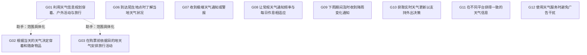

# DOC010 目标图与关系预审

节点已由用户采纳；关系由助手依据原文处理，尚无独立人工关系确认。不确定项保留，不强制连树。

| 目标A | 目标B | 关系建议 | 理由 |
|---|---|---|---|
| DOC010-G01 | DOC010-G02 | A为父B为子 | 日常穿着与携带决策是天气辅助规划中的具体情境；不是对汇总目标的完整分解。 |
| DOC010-G01 | DOC010-G03 | A为父B为子 | 购票前的旅行活动安排是天气辅助活动与旅行规划的具体情境；不推断所有规划都必须购票。 |
| DOC010-G01 | DOC010-G06 | 仅相关 | 陌生地点的天气知识可供规划使用，但熟悉天气本身不保证完成规划。 |
| DOC010-G01 | DOC010-G07 | 仅相关 | T035描述极端天气下推迟活动，T039要求告警；告警可支持调整规划，不等于规划结果。 |
| DOC010-G01 | DOC010-G08 | 仅相关 | T041将常规通知时间与外出作息联系，存在规划情境关联，频率偏好不是完整规划的精化。 |
| DOC010-G01 | DOC010-G09 | 仅相关 | 降雨变化信息能支持外出安排，但收到变化通知本身不足以完成规划。 |
| DOC010-G01 | DOC010-G10 | 仅相关 | T051直接用步行或公交决策说明实时更新重要，更新信息支持规划而不是规划子结果。 |
| DOC010-G01 | DOC010-G11 | 不确定 | 跨平台一致可能影响规划可信度，但没有直接说明具体规划如何依赖多平台一致。 |
| DOC010-G01 | DOC010-G12 | 无关系 | 广告干扰与活动规划分别表达，没有明确互相满足或促进关系。 |
| DOC010-G02 | DOC010-G03 | 无关系 | 穿着携带与旅行购票是汇总目标的不同具体情境，兄弟节点不自动产生两两相关边。 |
| DOC010-G02 | DOC010-G06 | 不确定 | 陌生地点天气可能影响穿着，但文本没有把两者直接联系，不自动补因果。 |
| DOC010-G02 | DOC010-G07 | 无关系 | 极端告警对应推迟活动，不自动等同于穿着携带决策。 |
| DOC010-G02 | DOC010-G08 | 仅相关 | 早晨等固定通知与日常穿着决策共用例行情境；仅记情境相关，不主张三次通知是必要条件。 |
| DOC010-G02 | DOC010-G09 | 无关系 | 原文没有将降雨开始停止通知直接联系到衣物或携带决定。 |
| DOC010-G02 | DOC010-G10 | 仅相关 | 日常天气供穿着携带决策使用，更新及时可能影响这些决定；该联系为跨轮推断而非严格精化。 |
| DOC010-G02 | DOC010-G11 | 不确定 | 平台一致性是否具体影响穿着携带决策未说明。 |
| DOC010-G02 | DOC010-G12 | 无关系 | 避免广告与穿着携带决策没有已建立关系。 |
| DOC010-G03 | DOC010-G06 | 仅相关 | T017说明去没去过的地方旅行需先查当地天气，和熟悉陌生地天气有直接情境联系。 |
| DOC010-G03 | DOC010-G07 | 仅相关 | T021说雨冷时购票无意义，T035说极端天气会推迟活动；两者通过天气影响活动安排相关。 |
| DOC010-G03 | DOC010-G08 | 无关系 | 旅行整周预报与常规每日三次通知不是同一时间要求，没有明确依赖。 |
| DOC010-G03 | DOC010-G09 | 仅相关 | 雨况关系到游乐园购票价值，但通知需求和购票安排分别成立，不构成充分精化。 |
| DOC010-G03 | DOC010-G10 | 仅相关 | T019说明旅行预报准确度影响活动和购票；实时性可帮助更新判断，但整周规划不等同实时更新。 |
| DOC010-G03 | DOC010-G11 | 不确定 | 跨平台一致可能影响旅行判断，但原文未把平台切换与旅行购票直接关联。 |
| DOC010-G03 | DOC010-G12 | 无关系 | 旅行购票与无广告分别表达，未建立目标关系。 |
| DOC010-G06 | DOC010-G07 | 无关系 | 熟悉陌生地天气与极端告警分别表达，没有明确包含或依赖关系。 |
| DOC010-G06 | DOC010-G08 | 无关系 | 陌生地天气熟悉与日常通知频率分别表达，没有已建立关系。 |
| DOC010-G06 | DOC010-G09 | 无关系 | 熟悉陌生地天气不必依赖雨况变化通知，原文未另建立关联。 |
| DOC010-G06 | DOC010-G10 | 不确定 | 实时更新可能有助陌生地天气知识，但文本只明确实时更新用于外出决策。 |
| DOC010-G06 | DOC010-G11 | 不确定 | 熟悉陌生地天气与跨平台一致的依赖没有直接说明。 |
| DOC010-G06 | DOC010-G12 | 无关系 | 陌生地天气知识与广告干扰没有已建立目标关系。 |
| DOC010-G07 | DOC010-G08 | 仅相关 | 均属通知偏好但适用条件不同：极端天气告警与日常固定频率；不标等价或冲突。 |
| DOC010-G07 | DOC010-G09 | 仅相关 | 极端天气告警与降雨变化通知可能共享天气事件，但普通降雨不必是极端天气，不能据此认定精化。 |
| DOC010-G07 | DOC010-G10 | 仅相关 | 及时更新可支持极端事件告警，但信息更新与告警送达是不同结果，不自动精化。 |
| DOC010-G07 | DOC010-G11 | 不确定 | 极端事件是否出现跨平台告警差异未说明，平台一致的具体对象是天气信息。 |
| DOC010-G07 | DOC010-G12 | 无关系 | 告警通知与广告是不同消息类型，不能因都可能弹窗而认定冲突。 |
| DOC010-G08 | DOC010-G09 | 仅相关 | T041与T049给出常规低频、降雨频繁两种条件化偏好；情境不同，不构成频率矛盾。 |
| DOC010-G08 | DOC010-G10 | 仅相关 | 常规固定推送与实时天气更新分别涉及送达频率和数据时效，可以并存，非等价或冲突。 |
| DOC010-G08 | DOC010-G11 | 无关系 | 通知频率和跨平台信息一致分别表达，原文未建立二者依赖。 |
| DOC010-G08 | DOC010-G12 | 无关系 | 天气通知偏好不等于广告偏好，避免广告不意味着取消所需天气通知。 |
| DOC010-G09 | DOC010-G10 | 仅相关 | 雨况变化通知需要及时信息但还需要送达机制；保留支持关系，不把通知直接当作全部实时更新的子结果。 |
| DOC010-G09 | DOC010-G11 | 仅相关 | T057描述App雨况滞后且与网站不同，涉及雨况变化及时性与平台一致；两者相关而不等价。 |
| DOC010-G09 | DOC010-G12 | 无关系 | 雨况通知与广告干扰分别表达，没有已建立关系。 |
| DOC010-G10 | DOC010-G11 | 仅相关 | T057与T071同时体现更新及时及平台一致；及时但平台不同、或一致但均过时都可能，故不等价。 |
| DOC010-G10 | DOC010-G12 | 无关系 | 实时更新与无广告是T071列举的独立偏好，共同出现不构成精化或因果。 |
| DOC010-G11 | DOC010-G12 | 无关系 | 平台一致与无广告是独立质量要求，未建立互相满足关系。 |
