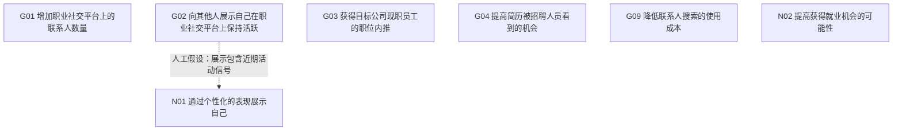

# DOC023 开发参考 v0.4

用户在聊天中同意按前轮建议推进。本版固定7节点、21个目标对：17条仅相关、3个无关系对、1条条件性精化。
冻结范围仅为开发试标；人工参与及助手补充已披露，不作为独立测试Gold。

## 关系裁决

| 目标对 | 定稿标签 | 说明 |
|---|---|---|
| DOC023-G01__DOC023-G02 | 仅相关 | 保持活跃可以被更多的人看到，可能会有助于增加联系人数量 |
| DOC023-G01__DOC023-G03 | 仅相关 | 增加联系人数量有助于获得内推机会 |
| DOC023-G01__DOC023-G04 | 仅相关 | 助手补充：联系人增加可能通过后续内推间接增加简历曝光，但数量增长本身不是简历被看到的充分条件。 |
| DOC023-G01__DOC023-G09 | 仅相关 | 助手补充：寻找潜在联系人受到会员可查看结果数量与费用限制，成本与扩展联系人活动有上下文联系，但不构成目标精化。 |
| DOC023-G01__DOC023-N01 | 仅相关 | 助手补充：个性化展示可能影响他人连接意愿，但属于人工提出的设计假设，原文没有直接证明它会增加联系数量。 |
| DOC023-G01__DOC023-N02 | 仅相关 | 助手补充：扩展职业网络可能服务于求职，但联系人数与就业机会并不等价，也不直接构成可证明的满足关系。 |
| DOC023-G02__DOC023-G03 | 仅相关 | 助手补充：展示活跃度与获得内推同属职业社交情境，活跃信号是否影响员工内推意愿未被直接陈述，保留为弱关联。 |
| DOC023-G02__DOC023-G04 | 仅相关 | 助手补充：平台活跃展示与招聘曝光可能有关，但被看到活跃状态不同于简历被招聘者看到，不能合并或自动建立精化。 |
| DOC023-G02__DOC023-G09 | 无关系 | 助手补充：当前材料没有说明展示活跃度与降低联系人搜索费用之间的达成关系；无关系限于本材料的标注范围。 |
| DOC023-G02__DOC023-N01 | A为父B为子 | 助手补充：按人标保留G02为父、N01为子；只有个性化展示包含可观察的近期活动信号时，才可能具体化展示活跃度。仅展示个性化内容本身不足。 |
| DOC023-G02__DOC023-N02 | 仅相关 | 助手补充：职业平台活跃可能服务于求职可见性，但展示活跃度不保证就业机会增加，按人标保留潜在关联。 |
| DOC023-G03__DOC023-G04 | 仅相关 | 内推明确有助于简历被招聘人员看到，存在促进关系；原文不足以证明严格精化。 |
| DOC023-G03__DOC023-G09 | 仅相关 | 助手补充：寻找内推者所用人员搜索受会员费用约束，降低成本可能改善搜索负担，但不保证内推成功。 |
| DOC023-G03__DOC023-N01 | 仅相关 | 助手补充：个性化展示可能帮助建立联系或传达背景，但原文没有提出这种展示机制，保留为人工假设下的弱关联。 |
| DOC023-G03__DOC023-N02 | 仅相关 | 助手补充：获得内推可以是求职策略之一，但不能保证获得就业机会；按人标只记关联，不自动把共同目的转成精化。 |
| DOC023-G04__DOC023-G09 | 仅相关 | 助手补充：降低寻找联系人所需成本可能经有效联系和内推间接影响简历曝光，但原文没有直接建立该因果链。 |
| DOC023-G04__DOC023-N01 | 仅相关 | 助手补充：个性化展示可能与个人可见性有关，但不等同于简历曝光，且机制没有直接原文支持。 |
| DOC023-G04__DOC023-N02 | 仅相关 | 助手补充：简历被招聘人员看到可服务于求职，但曝光本身不保证就业，按人标保留共同目的关联。 |
| DOC023-G09__DOC023-N01 | 无关系 | 助手补充：现有材料未建立降低联系人搜索费用与个性化展示之间的具体联系，因此暂不连边。 |
| DOC023-G09__DOC023-N02 | 仅相关 | 助手补充：降低求职网络搜索负担可能服务于求职过程，但成本下降与就业机会增长没有直接或充分的满足关系。 |
| DOC023-N01__DOC023-N02 | 无关系 | 助手补充：原材料没有说明个性化展示如何带来就业机会，按人标保留无关系；仅有共同职业情境不足以强制连边。 |

## 使用边界

- 原“无关系”G03/G04改为“仅相关”，依据T003直接促进表述。
- N01及其条件性精化属于人工设计扩展，独立于源文目标提取评分。
- 源文相关评测只使用其余6节点及15个目标对；DOC023没有已确认的源文精化边，相关精化指标记N/A。
- 本版冻结已声明的选择和假设，不宣称完整覆盖所有可能目标、所有相关关系获得独立证明，或方法有效性已验证。
