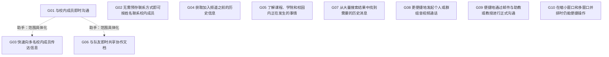

# DOC031 目标图与关系预审

节点已由用户采纳；关系由助手依据原文处理，尚无独立人工关系确认。不确定项保留，不强制连树。

| 目标A | 目标B | 关系建议 | 理由 |
|---|---|---|---|
| DOC031-G01 | DOC031-G02 | 仅相关 | 免预存并按姓名联系减少寻人准备，与即时沟通有关；免预存不保证消息即时到达。 |
| DOC031-G01 | DOC031-G03 | A为父B为子 | 向多名校内成员快速传达信息是校内即时沟通在群体对象上的具体化，不主张完备AND/OR分解。 |
| DOC031-G01 | DOC031-G04 | 无关系 | 即时沟通与读取加入前的历史信息是不同结果，原文未建立两者的满足或促进关系。 |
| DOC031-G01 | DOC031-G05 | 无关系 | 了解校园动态与即时沟通并列出现，未给出两者间的目标依赖。 |
| DOC031-G01 | DOC031-G06 | A为父B为子 | T013明确回指即时沟通目标，并以即时向队友共享文档解释实现方式；采用内容与对象上的具体化。 |
| DOC031-G01 | DOC031-G07 | 无关系 | 检索历史消息与即时联系他人分别讨论，未建立直接目标关系。 |
| DOC031-G01 | DOC031-G08 | 仅相关 | 音视频通话属于沟通方式，入口便捷可能帮助沟通；入口易用不等于即时沟通本身。 |
| DOC031-G01 | DOC031-G09 | 仅相关 | 即时消息和正式邮件是互补沟通方式，正式邮件未被要求即时完成，故不标精化。 |
| DOC031-G01 | DOC031-G10 | 不确定 | 窗口易用性可能影响即时沟通，但原文未说明具体受影响的任务，不能替受访者确定依赖。 |
| DOC031-G02 | DOC031-G03 | 无关系 | 按姓名联系个人与频道多人触达独立描述，不能把个人寻址要求扩展到广播。 |
| DOC031-G02 | DOC031-G04 | 无关系 | 免预存联系方式与访问历史信息没有已建立的跨目标关系。 |
| DOC031-G02 | DOC031-G05 | 无关系 | 寻址便利与了解校园动态分别表达，不能仅凭同属Slack而连边。 |
| DOC031-G02 | DOC031-G06 | 不确定 | 找到队友可能先于共享文件，但共享对象也可能已在最近聊天中；免预存是否必要未说明。 |
| DOC031-G02 | DOC031-G07 | 无关系 | 人员寻址与历史消息搜索的检索对象不同，文本没有建立两者关系。 |
| DOC031-G02 | DOC031-G08 | 仅相关 | T023把已知电话号码作为更快通话的替代条件；人员可达性与通话接入有关，非精化。 |
| DOC031-G02 | DOC031-G09 | 不确定 | 姓名查找是否提供邮件地址或邮件跳转能力未明确，正式邮件功能只是提议。 |
| DOC031-G02 | DOC031-G10 | 不确定 | 无法确定缩小窗口具体影响人员查找还是其他功能，保留待定。 |
| DOC031-G03 | DOC031-G04 | 无关系 | 两项目标共用频道功能，但多人触达不等于历史信息访问，共用功能不足以证明目标关系。 |
| DOC031-G03 | DOC031-G05 | 仅相关 | 频道用于多人信息传播及校园动态交换；仅记情境关联，不推断单向充分满足。 |
| DOC031-G03 | DOC031-G06 | 无关系 | 多人信息传播与给队友共享文档的对象及内容不同，原文未将后者视作前者的子目标。 |
| DOC031-G03 | DOC031-G07 | 无关系 | 广播信息与查找过去消息没有在原文中建立目标关系。 |
| DOC031-G03 | DOC031-G08 | 无关系 | 频道传播与通话入口易用分别提出，群体对象重叠不构成目标精化。 |
| DOC031-G03 | DOC031-G09 | 无关系 | 频道触达多人和正式邮件分别表达，未要求群发邮件或互为实现方式。 |
| DOC031-G03 | DOC031-G10 | 不确定 | 小窗口是否特别影响频道传播未说明，不能从全局易用性自动补边。 |
| DOC031-G04 | DOC031-G05 | 不确定 | 历史资料可能帮助了解院系，但G05强调正在发生的事情，旧资料是否满足它无法确定。 |
| DOC031-G04 | DOC031-G06 | 无关系 | 访问历史与共享新文档分别表达，未建立二者的依赖。 |
| DOC031-G04 | DOC031-G07 | 仅相关 | T019明确说能看到加入前的全部历史带来过多结果，增加定位消息难度；这是带负面影响的相关，不自动升级为冲突。 |
| DOC031-G04 | DOC031-G08 | 无关系 | 历史访问与通话入口之间没有已建立关系。 |
| DOC031-G04 | DOC031-G09 | 无关系 | 历史访问与邮件正式沟通之间没有已建立关系。 |
| DOC031-G04 | DOC031-G10 | 不确定 | 缩小窗口对历史信息访问的具体影响未定位。 |
| DOC031-G05 | DOC031-G06 | 无关系 | 校园动态与团队文档共享分别表达，原文未说明文件内容属于校园动态。 |
| DOC031-G05 | DOC031-G07 | 仅相关 | T019举查找教授课程消息的例子，与G05的课程信息范围重叠；仅记信息获取关联。 |
| DOC031-G05 | DOC031-G08 | 无关系 | 校园动态获取与音视频通话入口分别表达，没有已建立的跨目标关系。 |
| DOC031-G05 | DOC031-G09 | 无关系 | 校园动态与向助教教授正式发邮件分别表达，不能凭受众重叠判精化。 |
| DOC031-G05 | DOC031-G10 | 不确定 | 窗口易用性的具体任务范围未说明，无法确定对动态获取的作用。 |
| DOC031-G06 | DOC031-G07 | 无关系 | G07聚焦特定历史消息，不能把采访者提到的文件搜索自动扩入该目标并连接文档共享。 |
| DOC031-G06 | DOC031-G08 | 仅相关 | 文档共享和通话是T025提到的协作能力；仅保留互补协作关联，不强制互相依赖。 |
| DOC031-G06 | DOC031-G09 | 无关系 | 文档共享和正式邮件分别讨论，没有明确邮件附件或文件发送依赖。 |
| DOC031-G06 | DOC031-G10 | 不确定 | 小窗口可能影响附件操作，但原文未定位到共享流程。 |
| DOC031-G07 | DOC031-G08 | 无关系 | 消息查找与通话入口没有已建立的目标关系。 |
| DOC031-G07 | DOC031-G09 | 无关系 | 历史消息查找与正式邮件没有已建立的目标关系。 |
| DOC031-G07 | DOC031-G10 | 不确定 | 原文的搜索结果过多与小窗口导航困难是两种问题，是否叠加影响搜索待定。 |
| DOC031-G08 | DOC031-G09 | 无关系 | 更易通话与正式邮件是分别提出的需求；同属沟通不足以认定互相促进或精化。 |
| DOC031-G08 | DOC031-G10 | 不确定 | 通话入口跨窗口困难与缩小应用窗口困难并非同一障碍，具体联系未被证明。 |
| DOC031-G09 | DOC031-G10 | 不确定 | 正式邮件跳转和缩小窗口易用性没有明确依赖，不能自动关联。 |
