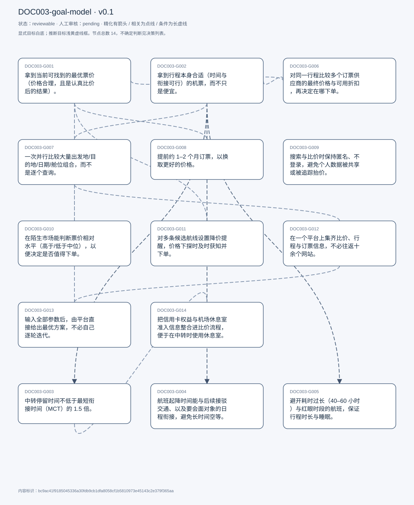
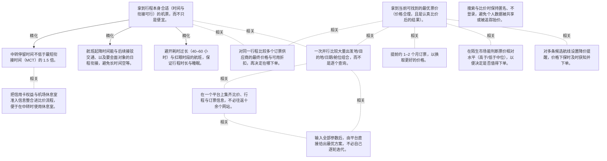

# 目标模型说明

模型：DOC003-goal-model；版本：v0.1

交付状态：reviewable；结构：passed；人工审核：pending

[交互模型](goal-model.html) · [矢量图](goal-model.svg) · [权威数据](goal-model.json)

## 目标图

## 目标

| 编号 | 表述 | 来源 | 情境 | 证据 |
|---|---|---|---|---|
| DOC003-G001 | 拿到当前可找到的最优票价（价格合理，且是认真比价后的结果）。 | explicit | 自述为主要目标之一；价格判断依赖多年订票经验，无客观阈值；比价会持续多次、跨数天进行 | E0001, E0002, E0003 |
| DOC003-G002 | 拿到行程本身合适（时间与衔接可行）的机票，而不只是便宜。 | explicit | 自述「best results」为物流/行程、价格与灵活性的组合，前两者为主；行程是否合适取决于当时的个人处境，无法给出客观标准 | E0004, E0005, E0006 |
| DOC003-G003 | 中转停留时间不低于最短衔接时间（MCT）的 1.5 倍。 | explicit | MCT 为 IATA 定义的最短衔接时间（含行李转运与最远登机口移动）；一般取 1.5× 或 2× 作为自设缓冲；除非有签证限制，否则不介意中转次数本身 | E0007, E0008 |
| DOC003-G004 | 航班起降时间能与后续接驳交通、以及要会面对象的日程衔接，避免长时间空等。 | explicit | 典型场景：落地后需转乘火车去另一城市；判断标准包含是否需要在城市里空等约 20 小时 | E0009, E0010, E0011 |
| DOC003-G005 | 避开耗时过长（40–60 小时）与红眼时段的航班，保证行程时长与睡眠。 | explicit | 国际航线的「最便宜」列表常被 40–60 小时行程占满；对红眼航班不完全排斥，但更希望不牺牲夜间睡眠 | E0012, E0013 |
| DOC003-G006 | 对同一行程比较多个订票供应商的最终价格与可用折扣，再决定在哪下单。 | explicit | 比较项：价格、评分、折扣码、最终总价；价格随时变动，折扣并非固定 | E0014, E0015, E0016 |
| DOC003-G007 | 一次并行比较大量出发地/目的地/日期/舱位组合，而不是逐个查询。 | explicit | 自估组合规模约 11,760（20 个出发机场 × 49 个日期组合 × 2 个舱位）；还需对里程票单独重复一轮；现实中没有网站允许同时跑这么多查询 | E0017, E0018, E0019 |
| DOC003-G008 | 提前约 1–2 个月订票，以换取更好的价格。 | explicit | 理想为提前两个月以上；实际常拖到出发前 1–2 周，价格明显更高；国际长途线曾提前约两个月订 | E0020, E0021 |
| DOC003-G009 | 搜索与比价时保持匿名、不登录，避免个人数据被共享或被追踪抬价。 | explicit | 手段：不登录、无痕窗口、屏蔽 cookie；两个动机：避免按搜索行为抬价；不愿把数据交给不信任的第三方；例外：用里程/积分订票必须登录航司账户 | E0022, E0023, E0024, E0025 |
| DOC003-G010 | 在陌生市场能判断票价相对水平（高于/低于中位），以便决定是否值得下单。 | explicit | 对熟悉市场凭经验判断，不需要该功能；在美国等新市场需要外部参考价 | E0026, E0027, E0028 |
| DOC003-G011 | 对多条候选航线设置降价提醒，价格下探时及时获知并下单。 | explicit | 仅在必须成行、且价格暴涨的紧迫场景下使用过；当时借用已登录的 Google 账号，回避新建账号 | E0029, E0030 |
| DOC003-G012 | 在一个平台上集齐比价、行程与订票信息，不必往返十余个网站。 | explicit | 自估一次订票至少访问 10–12 个网站；表述为当前最大的两个障碍之一 | E0031, E0032 |
| DOC003-G013 | 输入全部参数后，由平台直接给出最优方案，不必自己逐轮迭代。 | explicit | 表述为当前最大的两个障碍之一；受访者同时认为票价与个人处境的动态性使该设想难以实现（T086） | E0033, E0034, E0035 |
| DOC003-G014 | 把信用卡权益与机场休息室准入信息整合进比价流程，便于在中转时使用休息室。 | explicit | 持约 30 张信用卡，不同卡对不同休息室、不同时段与次数限制不同；受访者认为第三方整合难以保持准确，倾向直接查发卡行；愿望强度为 would be wonderful，但同时表示不愿深入讨论 | E0036, E0037, E0038 |

## 关系判断（含不确定与无关系）

- DOC003-G001 / DOC003-G002：none。DOC003-G001 的对象是拿到当前可找到的最优票价（T025/T115），DOC003-G002 的对象是行程本身合适（时间与衔接可行）（T108/T130）；两处分别出自不同话题段，原文未在二者之间建立因果、手段、评价或情境包含关系，本次评估口径内未建立可采用关系。
- DOC003-G001 / DOC003-G003：none。DOC003-G001 的对象是拿到当前可找到的最优票价（T025/T115），DOC003-G003 的对象是中转停留不低于 1.5×MCT（T123）；两处分别出自不同话题段，原文未在二者之间建立因果、手段、评价或情境包含关系，本次评估口径内未建立可采用关系。
- DOC003-G001 / DOC003-G004：none。DOC003-G001 的对象是拿到当前可找到的最优票价（T025/T115），DOC003-G004 的对象是航班与接驳交通及会面日程衔接（T031/T119）；两处分别出自不同话题段，原文未在二者之间建立因果、手段、评价或情境包含关系，本次评估口径内未建立可采用关系。
- DOC003-G001 / DOC003-G005：none。DOC003-G001 的对象是拿到当前可找到的最优票价（T025/T115），DOC003-G005 的对象是避开超长行程与红眼时段（T073/T119）；两处分别出自不同话题段，原文未在二者之间建立因果、手段、评价或情境包含关系，本次评估口径内未建立可采用关系。
- DOC003-G001 / DOC003-G006：related。同一票价目标的两个阶段：T103 把聚合器的作用分为「找到合适行程」与「为该行程找最低价」，后者正是 G006 的内容；G006 是达成 G001 的手段，手段不自动构成精化，故为 related。
- DOC003-G001 / DOC003-G007：related。T095 说明并行搜索的目的在于确认「what&#x27;s the best」，而 T108 把 best 定义为行程与价格的组合；G007 通过扩大搜索面来压低价格，属 G001 的实现手段，非精化。
- DOC003-G001 / DOC003-G008：related。T015 直接说明提前订票的理由是「just to get like a better price at a better deal」，提前量是达成低价的手段，与 G001 构成手段—结果关系。
- DOC003-G001 / DOC003-G009：none。DOC003-G001 的对象是拿到当前可找到的最优票价（T025/T115），DOC003-G009 的对象是搜索保持匿名、不登录（T053/T093）；两处分别出自不同话题段，原文未在二者之间建立因果、手段、评价或情境包含关系，本次评估口径内未建立可采用关系。
- DOC003-G001 / DOC003-G010：related。T109-T112 中，相对中位价的判断被用于决定是否值得下单，服务于价格目标；但 G010 只在陌生市场需要，G001 覆盖所有市场，范围不同，故为 related。
- DOC003-G001 / DOC003-G011：related。T087 设置提醒的动机是价格暴涨后需要「if any one of them goes down in price, I book it」，提醒服务于低价目标；但 G011 引入时间窗口与多航线监控，条件多于 G001。
- DOC003-G001 / DOC003-G012：none。DOC003-G001 的对象是拿到当前可找到的最优票价（T025/T115），DOC003-G012 的对象是在一处集齐比价与行程信息（T138）；两处分别出自不同话题段，原文未在二者之间建立因果、手段、评价或情境包含关系，本次评估口径内未建立可采用关系。
- DOC003-G001 / DOC003-G013：none。DOC003-G001 的对象是拿到当前可找到的最优票价（T025/T115），DOC003-G013 的对象是输入全部参数后由平台给出最优方案（T138）；两处分别出自不同话题段，原文未在二者之间建立因果、手段、评价或情境包含关系，本次评估口径内未建立可采用关系。
- DOC003-G001 / DOC003-G014：none。DOC003-G001 的对象是拿到当前可找到的最优票价（T025/T115），DOC003-G014 的对象是整合信用卡权益与休息室准入信息（T124/T126）；两处分别出自不同话题段，原文未在二者之间建立因果、手段、评价或情境包含关系，本次评估口径内未建立可采用关系。
- DOC003-G002 / DOC003-G003：refinement。T116 直接追问「good itinerary 能否拆成子目标」，T123 随即给出中转时长的自设规则，属父目标在衔接维度上的情境具体化；二者范围不同（父为整体行程合适，子为单一可量化条件），因此是精化而非等价。
- DOC003-G002 / DOC003-G004：refinement。T031 在描述规划顺序时把接续交通与落地时间直接挂钩，T119 又把「与接驳/会面日程是否对得上」列为行程是否合适的具体判断项，构成父目标的情境具体化。
- DOC003-G002 / DOC003-G005：refinement。T073 解释为何国际线不用 cheapest 而用 best，理由是低价段被超长行程占满；T119 把「是否是合适的飞行时段」列为行程合适的判断项，二者共同构成父目标在时长/作息维度上的具体化。
- DOC003-G002 / DOC003-G006：related。T103 明确把流程分为两步：「once I&#x27;ve found the right itinerary... they allow me to find the best price for that itinerary」，G006 以 G002 已完成（行程确定）为前提，属先后条件关系，非精化。
- DOC003-G002 / DOC003-G007：related。并行组合搜索的另一个目的是找到可行的行程组合（T099 以机场对与日期范围作为搜索维度），与 G002 相接；但 G007 是搜索方式、G002 是结果质量，非精化。
- DOC003-G002 / DOC003-G008：none。DOC003-G002 的对象是行程本身合适（时间与衔接可行）（T108/T130），DOC003-G008 的对象是提前 1–2 个月订票（T015）；两处分别出自不同话题段，原文未在二者之间建立因果、手段、评价或情境包含关系，本次评估口径内未建立可采用关系。
- DOC003-G002 / DOC003-G009：none。DOC003-G002 的对象是行程本身合适（时间与衔接可行）（T108/T130），DOC003-G009 的对象是搜索保持匿名、不登录（T053/T093）；两处分别出自不同话题段，原文未在二者之间建立因果、手段、评价或情境包含关系，本次评估口径内未建立可采用关系。
- DOC003-G002 / DOC003-G010：none。DOC003-G002 的对象是行程本身合适（时间与衔接可行）（T108/T130），DOC003-G010 的对象是判断票价相对中位水平（T109/T111）；两处分别出自不同话题段，原文未在二者之间建立因果、手段、评价或情境包含关系，本次评估口径内未建立可采用关系。
- DOC003-G002 / DOC003-G011：none。DOC003-G002 的对象是行程本身合适（时间与衔接可行）（T108/T130），DOC003-G011 的对象是对多条航线设置降价提醒（T087）；两处分别出自不同话题段，原文未在二者之间建立因果、手段、评价或情境包含关系，本次评估口径内未建立可采用关系。
- DOC003-G002 / DOC003-G012：none。DOC003-G002 的对象是行程本身合适（时间与衔接可行）（T108/T130），DOC003-G012 的对象是在一处集齐比价与行程信息（T138）；两处分别出自不同话题段，原文未在二者之间建立因果、手段、评价或情境包含关系，本次评估口径内未建立可采用关系。
- DOC003-G002 / DOC003-G013：none。DOC003-G002 的对象是行程本身合适（时间与衔接可行）（T108/T130），DOC003-G013 的对象是输入全部参数后由平台给出最优方案（T138）；两处分别出自不同话题段，原文未在二者之间建立因果、手段、评价或情境包含关系，本次评估口径内未建立可采用关系。
- DOC003-G002 / DOC003-G014：none。DOC003-G002 的对象是行程本身合适（时间与衔接可行）（T108/T130），DOC003-G014 的对象是整合信用卡权益与休息室准入信息（T124/T126）；两处分别出自不同话题段，原文未在二者之间建立因果、手段、评价或情境包含关系，本次评估口径内未建立可采用关系。
- DOC003-G003 / DOC003-G004：none。DOC003-G003 的对象是中转停留不低于 1.5×MCT（T123），DOC003-G004 的对象是航班与接驳交通及会面日程衔接（T031/T119）；两处分别出自不同话题段，原文未在二者之间建立因果、手段、评价或情境包含关系，本次评估口径内未建立可采用关系。
- DOC003-G003 / DOC003-G005：none。DOC003-G003 的对象是中转停留不低于 1.5×MCT（T123），DOC003-G005 的对象是避开超长行程与红眼时段（T073/T119）；两处分别出自不同话题段，原文未在二者之间建立因果、手段、评价或情境包含关系，本次评估口径内未建立可采用关系。
- DOC003-G003 / DOC003-G006：none。DOC003-G003 的对象是中转停留不低于 1.5×MCT（T123），DOC003-G006 的对象是同一行程下比较多个订票供应商的最终价（T077/T103）；两处分别出自不同话题段，原文未在二者之间建立因果、手段、评价或情境包含关系，本次评估口径内未建立可采用关系。
- DOC003-G003 / DOC003-G007：none。DOC003-G003 的对象是中转停留不低于 1.5×MCT（T123），DOC003-G007 的对象是一次并行比较大量机场/日期/舱位组合（T095/T099）；两处分别出自不同话题段，原文未在二者之间建立因果、手段、评价或情境包含关系，本次评估口径内未建立可采用关系。
- DOC003-G003 / DOC003-G008：none。DOC003-G003 的对象是中转停留不低于 1.5×MCT（T123），DOC003-G008 的对象是提前 1–2 个月订票（T015）；两处分别出自不同话题段，原文未在二者之间建立因果、手段、评价或情境包含关系，本次评估口径内未建立可采用关系。
- DOC003-G003 / DOC003-G009：none。DOC003-G003 的对象是中转停留不低于 1.5×MCT（T123），DOC003-G009 的对象是搜索保持匿名、不登录（T053/T093）；两处分别出自不同话题段，原文未在二者之间建立因果、手段、评价或情境包含关系，本次评估口径内未建立可采用关系。
- DOC003-G003 / DOC003-G010：none。DOC003-G003 的对象是中转停留不低于 1.5×MCT（T123），DOC003-G010 的对象是判断票价相对中位水平（T109/T111）；两处分别出自不同话题段，原文未在二者之间建立因果、手段、评价或情境包含关系，本次评估口径内未建立可采用关系。
- DOC003-G003 / DOC003-G011：none。DOC003-G003 的对象是中转停留不低于 1.5×MCT（T123），DOC003-G011 的对象是对多条航线设置降价提醒（T087）；两处分别出自不同话题段，原文未在二者之间建立因果、手段、评价或情境包含关系，本次评估口径内未建立可采用关系。
- DOC003-G003 / DOC003-G012：none。DOC003-G003 的对象是中转停留不低于 1.5×MCT（T123），DOC003-G012 的对象是在一处集齐比价与行程信息（T138）；两处分别出自不同话题段，原文未在二者之间建立因果、手段、评价或情境包含关系，本次评估口径内未建立可采用关系。
- DOC003-G003 / DOC003-G013：none。DOC003-G003 的对象是中转停留不低于 1.5×MCT（T123），DOC003-G013 的对象是输入全部参数后由平台给出最优方案（T138）；两处分别出自不同话题段，原文未在二者之间建立因果、手段、评价或情境包含关系，本次评估口径内未建立可采用关系。
- DOC003-G003 / DOC003-G014：related。T124 说明中转停留时会确认休息室是否开放，休息室信息服务于中转体验；但 G003 是中转时长的下限规则，G014 是权益信息整合，对象不同，非精化。
- DOC003-G004 / DOC003-G005：none。DOC003-G004 的对象是航班与接驳交通及会面日程衔接（T031/T119），DOC003-G005 的对象是避开超长行程与红眼时段（T073/T119）；两处分别出自不同话题段，原文未在二者之间建立因果、手段、评价或情境包含关系，本次评估口径内未建立可采用关系。
- DOC003-G004 / DOC003-G006：none。DOC003-G004 的对象是航班与接驳交通及会面日程衔接（T031/T119），DOC003-G006 的对象是同一行程下比较多个订票供应商的最终价（T077/T103）；两处分别出自不同话题段，原文未在二者之间建立因果、手段、评价或情境包含关系，本次评估口径内未建立可采用关系。
- DOC003-G004 / DOC003-G007：none。DOC003-G004 的对象是航班与接驳交通及会面日程衔接（T031/T119），DOC003-G007 的对象是一次并行比较大量机场/日期/舱位组合（T095/T099）；两处分别出自不同话题段，原文未在二者之间建立因果、手段、评价或情境包含关系，本次评估口径内未建立可采用关系。
- DOC003-G004 / DOC003-G008：none。DOC003-G004 的对象是航班与接驳交通及会面日程衔接（T031/T119），DOC003-G008 的对象是提前 1–2 个月订票（T015）；两处分别出自不同话题段，原文未在二者之间建立因果、手段、评价或情境包含关系，本次评估口径内未建立可采用关系。
- DOC003-G004 / DOC003-G009：none。DOC003-G004 的对象是航班与接驳交通及会面日程衔接（T031/T119），DOC003-G009 的对象是搜索保持匿名、不登录（T053/T093）；两处分别出自不同话题段，原文未在二者之间建立因果、手段、评价或情境包含关系，本次评估口径内未建立可采用关系。
- DOC003-G004 / DOC003-G010：none。DOC003-G004 的对象是航班与接驳交通及会面日程衔接（T031/T119），DOC003-G010 的对象是判断票价相对中位水平（T109/T111）；两处分别出自不同话题段，原文未在二者之间建立因果、手段、评价或情境包含关系，本次评估口径内未建立可采用关系。
- DOC003-G004 / DOC003-G011：none。DOC003-G004 的对象是航班与接驳交通及会面日程衔接（T031/T119），DOC003-G011 的对象是对多条航线设置降价提醒（T087）；两处分别出自不同话题段，原文未在二者之间建立因果、手段、评价或情境包含关系，本次评估口径内未建立可采用关系。
- DOC003-G004 / DOC003-G012：none。DOC003-G004 的对象是航班与接驳交通及会面日程衔接（T031/T119），DOC003-G012 的对象是在一处集齐比价与行程信息（T138）；两处分别出自不同话题段，原文未在二者之间建立因果、手段、评价或情境包含关系，本次评估口径内未建立可采用关系。
- DOC003-G004 / DOC003-G013：none。DOC003-G004 的对象是航班与接驳交通及会面日程衔接（T031/T119），DOC003-G013 的对象是输入全部参数后由平台给出最优方案（T138）；两处分别出自不同话题段，原文未在二者之间建立因果、手段、评价或情境包含关系，本次评估口径内未建立可采用关系。
- DOC003-G004 / DOC003-G014：none。DOC003-G004 的对象是航班与接驳交通及会面日程衔接（T031/T119），DOC003-G014 的对象是整合信用卡权益与休息室准入信息（T124/T126）；两处分别出自不同话题段，原文未在二者之间建立因果、手段、评价或情境包含关系，本次评估口径内未建立可采用关系。
- DOC003-G005 / DOC003-G006：none。DOC003-G005 的对象是避开超长行程与红眼时段（T073/T119），DOC003-G006 的对象是同一行程下比较多个订票供应商的最终价（T077/T103）；两处分别出自不同话题段，原文未在二者之间建立因果、手段、评价或情境包含关系，本次评估口径内未建立可采用关系。
- DOC003-G005 / DOC003-G007：none。DOC003-G005 的对象是避开超长行程与红眼时段（T073/T119），DOC003-G007 的对象是一次并行比较大量机场/日期/舱位组合（T095/T099）；两处分别出自不同话题段，原文未在二者之间建立因果、手段、评价或情境包含关系，本次评估口径内未建立可采用关系。
- DOC003-G005 / DOC003-G008：none。DOC003-G005 的对象是避开超长行程与红眼时段（T073/T119），DOC003-G008 的对象是提前 1–2 个月订票（T015）；两处分别出自不同话题段，原文未在二者之间建立因果、手段、评价或情境包含关系，本次评估口径内未建立可采用关系。
- DOC003-G005 / DOC003-G009：none。DOC003-G005 的对象是避开超长行程与红眼时段（T073/T119），DOC003-G009 的对象是搜索保持匿名、不登录（T053/T093）；两处分别出自不同话题段，原文未在二者之间建立因果、手段、评价或情境包含关系，本次评估口径内未建立可采用关系。
- DOC003-G005 / DOC003-G010：none。DOC003-G005 的对象是避开超长行程与红眼时段（T073/T119），DOC003-G010 的对象是判断票价相对中位水平（T109/T111）；两处分别出自不同话题段，原文未在二者之间建立因果、手段、评价或情境包含关系，本次评估口径内未建立可采用关系。
- DOC003-G005 / DOC003-G011：none。DOC003-G005 的对象是避开超长行程与红眼时段（T073/T119），DOC003-G011 的对象是对多条航线设置降价提醒（T087）；两处分别出自不同话题段，原文未在二者之间建立因果、手段、评价或情境包含关系，本次评估口径内未建立可采用关系。
- DOC003-G005 / DOC003-G012：none。DOC003-G005 的对象是避开超长行程与红眼时段（T073/T119），DOC003-G012 的对象是在一处集齐比价与行程信息（T138）；两处分别出自不同话题段，原文未在二者之间建立因果、手段、评价或情境包含关系，本次评估口径内未建立可采用关系。
- DOC003-G005 / DOC003-G013：none。DOC003-G005 的对象是避开超长行程与红眼时段（T073/T119），DOC003-G013 的对象是输入全部参数后由平台给出最优方案（T138）；两处分别出自不同话题段，原文未在二者之间建立因果、手段、评价或情境包含关系，本次评估口径内未建立可采用关系。
- DOC003-G005 / DOC003-G014：none。DOC003-G005 的对象是避开超长行程与红眼时段（T073/T119），DOC003-G014 的对象是整合信用卡权益与休息室准入信息（T124/T126）；两处分别出自不同话题段，原文未在二者之间建立因果、手段、评价或情境包含关系，本次评估口径内未建立可采用关系。
- DOC003-G006 / DOC003-G007：none。DOC003-G006 的对象是同一行程下比较多个订票供应商的最终价（T077/T103），DOC003-G007 的对象是一次并行比较大量机场/日期/舱位组合（T095/T099）；两处分别出自不同话题段，原文未在二者之间建立因果、手段、评价或情境包含关系，本次评估口径内未建立可采用关系。
- DOC003-G006 / DOC003-G008：none。DOC003-G006 的对象是同一行程下比较多个订票供应商的最终价（T077/T103），DOC003-G008 的对象是提前 1–2 个月订票（T015）；两处分别出自不同话题段，原文未在二者之间建立因果、手段、评价或情境包含关系，本次评估口径内未建立可采用关系。
- DOC003-G006 / DOC003-G009：none。DOC003-G006 的对象是同一行程下比较多个订票供应商的最终价（T077/T103），DOC003-G009 的对象是搜索保持匿名、不登录（T053/T093）；两处分别出自不同话题段，原文未在二者之间建立因果、手段、评价或情境包含关系，本次评估口径内未建立可采用关系。
- DOC003-G006 / DOC003-G010：none。DOC003-G006 的对象是同一行程下比较多个订票供应商的最终价（T077/T103），DOC003-G010 的对象是判断票价相对中位水平（T109/T111）；两处分别出自不同话题段，原文未在二者之间建立因果、手段、评价或情境包含关系，本次评估口径内未建立可采用关系。
- DOC003-G006 / DOC003-G011：none。DOC003-G006 的对象是同一行程下比较多个订票供应商的最终价（T077/T103），DOC003-G011 的对象是对多条航线设置降价提醒（T087）；两处分别出自不同话题段，原文未在二者之间建立因果、手段、评价或情境包含关系，本次评估口径内未建立可采用关系。
- DOC003-G006 / DOC003-G012：none。DOC003-G006 的对象是同一行程下比较多个订票供应商的最终价（T077/T103），DOC003-G012 的对象是在一处集齐比价与行程信息（T138）；两处分别出自不同话题段，原文未在二者之间建立因果、手段、评价或情境包含关系，本次评估口径内未建立可采用关系。
- DOC003-G006 / DOC003-G013：none。DOC003-G006 的对象是同一行程下比较多个订票供应商的最终价（T077/T103），DOC003-G013 的对象是输入全部参数后由平台给出最优方案（T138）；两处分别出自不同话题段，原文未在二者之间建立因果、手段、评价或情境包含关系，本次评估口径内未建立可采用关系。
- DOC003-G006 / DOC003-G014：none。DOC003-G006 的对象是同一行程下比较多个订票供应商的最终价（T077/T103），DOC003-G014 的对象是整合信用卡权益与休息室准入信息（T124/T126）；两处分别出自不同话题段，原文未在二者之间建立因果、手段、评价或情境包含关系，本次评估口径内未建立可采用关系。
- DOC003-G007 / DOC003-G008：none。DOC003-G007 的对象是一次并行比较大量机场/日期/舱位组合（T095/T099），DOC003-G008 的对象是提前 1–2 个月订票（T015）；两处分别出自不同话题段，原文未在二者之间建立因果、手段、评价或情境包含关系，本次评估口径内未建立可采用关系。
- DOC003-G007 / DOC003-G009：none。DOC003-G007 的对象是一次并行比较大量机场/日期/舱位组合（T095/T099），DOC003-G009 的对象是搜索保持匿名、不登录（T053/T093）；两处分别出自不同话题段，原文未在二者之间建立因果、手段、评价或情境包含关系，本次评估口径内未建立可采用关系。
- DOC003-G007 / DOC003-G010：none。DOC003-G007 的对象是一次并行比较大量机场/日期/舱位组合（T095/T099），DOC003-G010 的对象是判断票价相对中位水平（T109/T111）；两处分别出自不同话题段，原文未在二者之间建立因果、手段、评价或情境包含关系，本次评估口径内未建立可采用关系。
- DOC003-G007 / DOC003-G011：none。DOC003-G007 的对象是一次并行比较大量机场/日期/舱位组合（T095/T099），DOC003-G011 的对象是对多条航线设置降价提醒（T087）；两处分别出自不同话题段，原文未在二者之间建立因果、手段、评价或情境包含关系，本次评估口径内未建立可采用关系。
- DOC003-G007 / DOC003-G012：related。两者都针对同一结构性负担：组合规模过大（T096「nobody&#x27;s there to feed you all the different combinations」）与信息分散在十余个站点（T138）；前者要一次跑更多查询，后者要在一处汇总结果。
- DOC003-G007 / DOC003-G013：related。T138 的「one click platform... give it all of my parameters, and it will find the best option」是 G007 并行搜索诉求的自动化延伸；但 G013 要求平台直接给结论，G007 只要求能同时比较，自主程度不同，非精化。
- DOC003-G007 / DOC003-G014：none。DOC003-G007 的对象是一次并行比较大量机场/日期/舱位组合（T095/T099），DOC003-G014 的对象是整合信用卡权益与休息室准入信息（T124/T126）；两处分别出自不同话题段，原文未在二者之间建立因果、手段、评价或情境包含关系，本次评估口径内未建立可采用关系。
- DOC003-G008 / DOC003-G009：none。DOC003-G008 的对象是提前 1–2 个月订票（T015），DOC003-G009 的对象是搜索保持匿名、不登录（T053/T093）；两处分别出自不同话题段，原文未在二者之间建立因果、手段、评价或情境包含关系，本次评估口径内未建立可采用关系。
- DOC003-G008 / DOC003-G010：none。DOC003-G008 的对象是提前 1–2 个月订票（T015），DOC003-G010 的对象是判断票价相对中位水平（T109/T111）；两处分别出自不同话题段，原文未在二者之间建立因果、手段、评价或情境包含关系，本次评估口径内未建立可采用关系。
- DOC003-G008 / DOC003-G011：none。DOC003-G008 的对象是提前 1–2 个月订票（T015），DOC003-G011 的对象是对多条航线设置降价提醒（T087）；两处分别出自不同话题段，原文未在二者之间建立因果、手段、评价或情境包含关系，本次评估口径内未建立可采用关系。
- DOC003-G008 / DOC003-G012：none。DOC003-G008 的对象是提前 1–2 个月订票（T015），DOC003-G012 的对象是在一处集齐比价与行程信息（T138）；两处分别出自不同话题段，原文未在二者之间建立因果、手段、评价或情境包含关系，本次评估口径内未建立可采用关系。
- DOC003-G008 / DOC003-G013：none。DOC003-G008 的对象是提前 1–2 个月订票（T015），DOC003-G013 的对象是输入全部参数后由平台给出最优方案（T138）；两处分别出自不同话题段，原文未在二者之间建立因果、手段、评价或情境包含关系，本次评估口径内未建立可采用关系。
- DOC003-G008 / DOC003-G014：none。DOC003-G008 的对象是提前 1–2 个月订票（T015），DOC003-G014 的对象是整合信用卡权益与休息室准入信息（T124/T126）；两处分别出自不同话题段，原文未在二者之间建立因果、手段、评价或情境包含关系，本次评估口径内未建立可采用关系。
- DOC003-G009 / DOC003-G010：none。DOC003-G009 的对象是搜索保持匿名、不登录（T053/T093），DOC003-G010 的对象是判断票价相对中位水平（T109/T111）；两处分别出自不同话题段，原文未在二者之间建立因果、手段、评价或情境包含关系，本次评估口径内未建立可采用关系。
- DOC003-G009 / DOC003-G011：uncertain。两者存在实质张力：G009 要求不登录以保持匿名（T053「I avoid logging in」、T093「I would probably never log in」），而 T088-T090 显示设提醒时他借用了已登录的 Google 账号，并明说「Only reason I did it by Google flights is because I was already logged into my Google account by chance」。受访者未表态是否愿为 Skyscanner 登录换提醒，也无法确定该例外是稳定规则还是权宜之计；多种解释并存，不能自行裁决，故记为不确定。
- DOC003-G009 / DOC003-G012：none。DOC003-G009 的对象是搜索保持匿名、不登录（T053/T093），DOC003-G012 的对象是在一处集齐比价与行程信息（T138）；两处分别出自不同话题段，原文未在二者之间建立因果、手段、评价或情境包含关系，本次评估口径内未建立可采用关系。
- DOC003-G009 / DOC003-G013：none。DOC003-G009 的对象是搜索保持匿名、不登录（T053/T093），DOC003-G013 的对象是输入全部参数后由平台给出最优方案（T138）；两处分别出自不同话题段，原文未在二者之间建立因果、手段、评价或情境包含关系，本次评估口径内未建立可采用关系。
- DOC003-G009 / DOC003-G014：none。DOC003-G009 的对象是搜索保持匿名、不登录（T053/T093），DOC003-G014 的对象是整合信用卡权益与休息室准入信息（T124/T126）；两处分别出自不同话题段，原文未在二者之间建立因果、手段、评价或情境包含关系，本次评估口径内未建立可采用关系。
- DOC003-G010 / DOC003-G011：none。DOC003-G010 的对象是判断票价相对中位水平（T109/T111），DOC003-G011 的对象是对多条航线设置降价提醒（T087）；两处分别出自不同话题段，原文未在二者之间建立因果、手段、评价或情境包含关系，本次评估口径内未建立可采用关系。
- DOC003-G010 / DOC003-G012：none。DOC003-G010 的对象是判断票价相对中位水平（T109/T111），DOC003-G012 的对象是在一处集齐比价与行程信息（T138）；两处分别出自不同话题段，原文未在二者之间建立因果、手段、评价或情境包含关系，本次评估口径内未建立可采用关系。
- DOC003-G010 / DOC003-G013：none。DOC003-G010 的对象是判断票价相对中位水平（T109/T111），DOC003-G013 的对象是输入全部参数后由平台给出最优方案（T138）；两处分别出自不同话题段，原文未在二者之间建立因果、手段、评价或情境包含关系，本次评估口径内未建立可采用关系。
- DOC003-G010 / DOC003-G014：none。DOC003-G010 的对象是判断票价相对中位水平（T109/T111），DOC003-G014 的对象是整合信用卡权益与休息室准入信息（T124/T126）；两处分别出自不同话题段，原文未在二者之间建立因果、手段、评价或情境包含关系，本次评估口径内未建立可采用关系。
- DOC003-G011 / DOC003-G012：none。DOC003-G011 的对象是对多条航线设置降价提醒（T087），DOC003-G012 的对象是在一处集齐比价与行程信息（T138）；两处分别出自不同话题段，原文未在二者之间建立因果、手段、评价或情境包含关系，本次评估口径内未建立可采用关系。
- DOC003-G011 / DOC003-G013：none。DOC003-G011 的对象是对多条航线设置降价提醒（T087），DOC003-G013 的对象是输入全部参数后由平台给出最优方案（T138）；两处分别出自不同话题段，原文未在二者之间建立因果、手段、评价或情境包含关系，本次评估口径内未建立可采用关系。
- DOC003-G011 / DOC003-G014：none。DOC003-G011 的对象是对多条航线设置降价提醒（T087），DOC003-G014 的对象是整合信用卡权益与休息室准入信息（T124/T126）；两处分别出自不同话题段，原文未在二者之间建立因果、手段、评价或情境包含关系，本次评估口径内未建立可采用关系。
- DOC003-G012 / DOC003-G013：related。T138 把两者并列为两大障碍：信息不在同一处（10–12 个网站）与没有一键给出最优方案的平台；二者共同指向「减少跨站与人工迭代」，但一个是信息聚合、一个是决策自动化。
- DOC003-G012 / DOC003-G014：none。DOC003-G012 的对象是在一处集齐比价与行程信息（T138），DOC003-G014 的对象是整合信用卡权益与休息室准入信息（T124/T126）；两处分别出自不同话题段，原文未在二者之间建立因果、手段、评价或情境包含关系，本次评估口径内未建立可采用关系。
- DOC003-G013 / DOC003-G014：none。DOC003-G013 的对象是输入全部参数后由平台给出最优方案（T138），DOC003-G014 的对象是整合信用卡权益与休息室准入信息（T124/T126）；两处分别出自不同话题段，原文未在二者之间建立因果、手段、评价或情境包含关系，本次评估口径内未建立可采用关系。

## 证据

### E0001 · DOC003:S026

> But my primary focus is to like get a really good deal when I&#x27;m actually booking my flights. So I keep on checking at regular intervals, just to make sure. Hey, am I getting a good deal?

原件位置：{&quot;line_start&quot;: 26, &quot;line_end&quot;: 26, &quot;start_char&quot;: 5940, &quot;end_char&quot;: 6389}

### E0002 · DOC003:S116

> I would do that in terms of finding a good itinerary and finding a good price that works for me.

原件位置：{&quot;line_start&quot;: 116, &quot;line_end&quot;: 116, &quot;start_char&quot;: 41724, &quot;end_char&quot;: 42173}

### E0003 · DOC003:S026

> I check like dozens of different websites to just make sure I&#x27;m having the best deal possible.

原件位置：{&quot;line_start&quot;: 26, &quot;line_end&quot;: 26, &quot;start_char&quot;: 5940, &quot;end_char&quot;: 6389}

### E0004 · DOC003:S108

> Best results for me is a combination of the logistics in terms of the itinerary that I want the price and the flexibility.

原件位置：{&quot;line_start&quot;: 108, &quot;line_end&quot;: 108, &quot;start_char&quot;: 39686, &quot;end_char&quot;: 40078}

### E0005 · DOC003:S130

> It should give me a good itinerary in terms of times, and it should match my situations.

原件位置：{&quot;line_start&quot;: 130, &quot;line_end&quot;: 130, &quot;start_char&quot;: 46765, &quot;end_char&quot;: 47275}

### E0006 · DOC003:S110

> it is extremely situational, and I cannot give you like a concrete or objective criteria for that

原件位置：{&quot;line_start&quot;: 110, &quot;line_end&quot;: 110, &quot;start_char&quot;: 40176, &quot;end_char&quot;: 41092}

### E0007 · DOC003:S124

> Unless I have visa issues, I generally don&#x27;t care very much about it as long as the I am at least 1.5 x the Mct. For that airport.

原件位置：{&quot;line_start&quot;: 124, &quot;line_end&quot;: 124, &quot;start_char&quot;: 43139, &quot;end_char&quot;: 44314}

### E0008 · DOC003:S124

> I generally tend to at least go for 1.5 x or 2 x of that for a stopover.

原件位置：{&quot;line_start&quot;: 124, &quot;line_end&quot;: 124, &quot;start_char&quot;: 43139, &quot;end_char&quot;: 44314}

### E0009 · DOC003:S032

> How does that connect with other modes of transport? So let&#x27;s say I&#x27;m flying into a city, but then I have to travel to a different city by like a train

原件位置：{&quot;line_start&quot;: 32, &quot;line_end&quot;: 32, &quot;start_char&quot;: 7944, &quot;end_char&quot;: 10733}

### E0010 · DOC003:S032

> I try to plan out my travel, such that things fall into place, and I don&#x27;t end up having to stay in a city for like 20 h doing nothing.

原件位置：{&quot;line_start&quot;: 32, &quot;line_end&quot;: 32, &quot;start_char&quot;: 7944, &quot;end_char&quot;: 10733}

### E0011 · DOC003:S120

> is it matching up with the schedules of the other modes of transport I&#x27;m planning to.

原件位置：{&quot;line_start&quot;: 120, &quot;line_end&quot;: 120, &quot;start_char&quot;: 42348, &quot;end_char&quot;: 42910}

### E0012 · DOC003:S074

> the cheapest section ends up being filled with a lot of stuff that&#x27;s like 40, 50, 60 h that I would rather not indulge in.

原件位置：{&quot;line_start&quot;: 74, &quot;line_end&quot;: 74, &quot;start_char&quot;: 23249, &quot;end_char&quot;: 24025}

### E0013 · DOC003:S120

> I don&#x27;t mind taking a red eye, but I would rather get my night&#x27;s sleep.

原件位置：{&quot;line_start&quot;: 120, &quot;line_end&quot;: 120, &quot;start_char&quot;: 42348, &quot;end_char&quot;: 42910}

### E0014 · DOC003:S078

> I look at the price. I take a look at the rating, and I often visit multiple providers from this page.

原件位置：{&quot;line_start&quot;: 78, &quot;line_end&quot;: 78, &quot;start_char&quot;: 25736, &quot;end_char&quot;: 26639}

### E0015 · DOC003:S078

> you can compare prices. Sometimes prices increase, though that&#x27;s pretty rare, and you can compare discounts on different providers. The final costs on different providers.

原件位置：{&quot;line_start&quot;: 78, &quot;line_end&quot;: 78, &quot;start_char&quot;: 25736, &quot;end_char&quot;: 26639}

### E0016 · DOC003:S104

> they allow me to find the best price for that itinerary. comparing all of the different booking options.

原件位置：{&quot;line_start&quot;: 104, &quot;line_end&quot;: 104, &quot;start_char&quot;: 38136, &quot;end_char&quot;: 38915}

### E0017 · DOC003:S100

> So I&#x27;d like to search for all possible airports, let&#x27;s say, from the Us. All, the top 20 most popular airports from the Us. To the top 5 or 6 most popular airports in India.

原件位置：{&quot;line_start&quot;: 100, &quot;line_end&quot;: 100, &quot;start_char&quot;: 35610, &quot;end_char&quot;: 36569}

### E0018 · DOC003:S100

> So that works out to be 11,760 different combinations of flights, different combinations of dates and itineraries

原件位置：{&quot;line_start&quot;: 100, &quot;line_end&quot;: 100, &quot;start_char&quot;: 35610, &quot;end_char&quot;: 36569}

### E0019 · DOC003:S096

> you want to do around 500 searches at the same time, because you&#x27;re doing combinations of city pairs, country pairs, dates. travelers, different classes

原件位置：{&quot;line_start&quot;: 96, &quot;line_end&quot;: 96, &quot;start_char&quot;: 34221, &quot;end_char&quot;: 34990}

### E0020 · DOC003:S016

> Ideally, I like to do it at least a couple of months before.

原件位置：{&quot;line_start&quot;: 16, &quot;line_end&quot;: 16, &quot;start_char&quot;: 2596, &quot;end_char&quot;: 3015}

### E0021 · DOC003:S016

> Mostly I try to aim for at least one to 1.5 months out, just to get like a better price at a better deal.

原件位置：{&quot;line_start&quot;: 16, &quot;line_end&quot;: 16, &quot;start_char&quot;: 2596, &quot;end_char&quot;: 3015}

### E0022 · DOC003:S054

> I generally am very privacy conscious. So I avoid logging in, and I try to keep myself as anonymized as possible.

原件位置：{&quot;line_start&quot;: 54, &quot;line_end&quot;: 54, &quot;start_char&quot;: 15147, &quot;end_char&quot;: 15761}

### E0023 · DOC003:S054

> if you end up booking flights or searching for specific flights pretty often they might increase the flight prices for you.

原件位置：{&quot;line_start&quot;: 54, &quot;line_end&quot;: 54, &quot;start_char&quot;: 15147, &quot;end_char&quot;: 15761}

### E0024 · DOC003:S094

> considering the way I specifically use skyscanner, I would probably never log in.

原件位置：{&quot;line_start&quot;: 94, &quot;line_end&quot;: 94, &quot;start_char&quot;: 33441, &quot;end_char&quot;: 34115}

### E0025 · DOC003:S090

> skyscanner is a Chinese company, and I generally don&#x27;t want my data to be shared.

原件位置：{&quot;line_start&quot;: 90, &quot;line_end&quot;: 90, &quot;start_char&quot;: 32137, &quot;end_char&quot;: 32958}

### E0026 · DOC003:S110

> I can use Google flights for it because it tells me if the price is above, below, or lower than the Median.

原件位置：{&quot;line_start&quot;: 110, &quot;line_end&quot;: 110, &quot;start_char&quot;: 40176, &quot;end_char&quot;: 41092}

### E0027 · DOC003:S112

> Sure. Yeah, it would help out for the times when I&#x27;m not familiar with the specific market.

原件位置：{&quot;line_start&quot;: 112, &quot;line_end&quot;: 112, &quot;start_char&quot;: 41188, &quot;end_char&quot;: 41499}

### E0028 · DOC003:S112

> I won&#x27;t really need that feature. But yeah, it&#x27;s it&#x27;s nice to have.

原件位置：{&quot;line_start&quot;: 112, &quot;line_end&quot;: 112, &quot;start_char&quot;: 41188, &quot;end_char&quot;: 41499}

### E0029 · DOC003:S088

> I needed a reminder on a few different routes, just to make sure that if any one of them goes down in price. I I book it

原件位置：{&quot;line_start&quot;: 88, &quot;line_end&quot;: 88, &quot;start_char&quot;: 31200, &quot;end_char&quot;: 31928}

### E0030 · DOC003:S088

> So that was the only time I set up an alert. And that was through Google flights.

原件位置：{&quot;line_start&quot;: 88, &quot;line_end&quot;: 88, &quot;start_char&quot;: 31200, &quot;end_char&quot;: 31928}

### E0031 · DOC003:S138

> I don&#x27;t get to have all of my information at one pace I end up having to visit at least 10 to 12 different sites at a mostly at a minimum.

原件位置：{&quot;line_start&quot;: 138, &quot;line_end&quot;: 138, &quot;start_char&quot;: 49592, &quot;end_char&quot;: 50103}

### E0032 · DOC003:S096

> and nobody&#x27;s there to feed you all the different combinations.

原件位置：{&quot;line_start&quot;: 96, &quot;line_end&quot;: 96, &quot;start_char&quot;: 34221, &quot;end_char&quot;: 34990}

### E0033 · DOC003:S138

> There&#x27;s no one click platform where I can just give it all of my parameters, and it will find the best option for me.

原件位置：{&quot;line_start&quot;: 138, &quot;line_end&quot;: 138, &quot;start_char&quot;: 49592, &quot;end_char&quot;: 50103}

### E0034 · DOC003:S138

> I have to invest a lot of time into finding. What&#x27;s the ideal option?

原件位置：{&quot;line_start&quot;: 138, &quot;line_end&quot;: 138, &quot;start_char&quot;: 49592, &quot;end_char&quot;: 50103}

### E0035 · DOC003:S086

> it&#x27;s kind of hard for these websites to also sort of predict what I would do, and let me know at an ideal time where maybe the cost is low for the exact itinerary that I want to take.

原件位置：{&quot;line_start&quot;: 86, &quot;line_end&quot;: 86, &quot;start_char&quot;: 29965, &quot;end_char&quot;: 31000}

### E0036 · DOC003:S126

> it would be very nice if I could, input there would be a website that keeps everything updated about what I have and what that would grant me access to. and that would be integrated with skyscanner. That would be wonderful.

原件位置：{&quot;line_start&quot;: 126, &quot;line_end&quot;: 126, &quot;start_char&quot;: 44418, &quot;end_char&quot;: 45545}

### E0037 · DOC003:S124

> Oh, will the lounge at that airport be open at that point of time? Because I like to visit all sorts of different lounges in different countries.

原件位置：{&quot;line_start&quot;: 124, &quot;line_end&quot;: 124, &quot;start_char&quot;: 43139, &quot;end_char&quot;: 44314}

### E0038 · DOC003:S126

> I know a few apps that have tried that, but generally it doesn&#x27;t update well, and it doesn&#x27;t work well.

原件位置：{&quot;line_start&quot;: 126, &quot;line_end&quot;: 126, &quot;start_char&quot;: 44418, &quot;end_char&quot;: 45545}

## 问题、限制与版本

- 两者存在实质张力：G009 要求不登录以保持匿名（T053「I avoid logging in」、T093「I would probably never log in」），而 T088-T090 显示设提醒时他借用了已登录的 Google 账号，并明说「Only reason I did it by Google flights is because I was already logged into my Google account by chance」。受访者未表态是否愿为 Skyscanner 登录换提醒，也无法确定该例外是稳定规则还是权宜之计；多种解释并存，不能自行裁决，故记为不确定。
- 当前会话助手的开发判断，非独立盲测；无人工采纳记录。
- 结构检查已绑定当前版本；独立语义审查未执行；人工状态以实际审核记录为准。

内容标识：bc9ac41f9185045336a30fdb9cb1dfa8058cf1b5810973e45143c2e379f365aa

人工决定：

审核意见：
