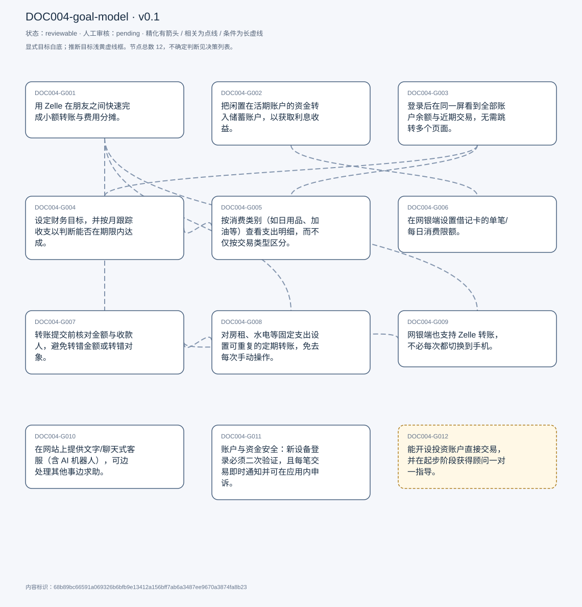
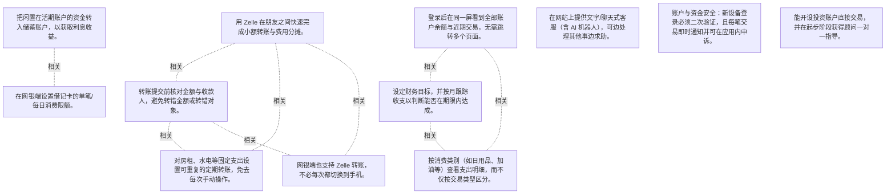

# 目标模型说明

模型：DOC004-goal-model；版本：v0.1

交付状态：reviewable；结构：passed；人工审核：pending

[交互模型](goal-model.html) · [矢量图](goal-model.svg) · [权威数据](goal-model.json)

## 目标图

## 目标

| 编号 | 表述 | 来源 | 情境 | 证据 |
|---|---|---|---|---|
| DOC004-G001 | 用 Zelle 在朋友之间快速完成小额转账与费用分摊。 | explicit | 自述为使用该应用的主要原因；Zelle 被定义为按手机号瞬时转账小额资金的方式；当前只能在手机端完成（见 C009） | E0001, E0002, E0003 |
| DOC004-G002 | 把闲置在活期账户的资金转入储蓄账户，以获取利息收益。 | explicit | 持有独立的 checking 与 savings 账户；触发条件：活期账户余额较多时；储蓄账户未绑定借记卡，因此多数资金不在可刷卡账户内（见 C006） | E0004 |
| DOC004-G003 | 登录后在同一屏看到全部账户余额与近期交易，无需跳转多个页面。 | explicit | 仪表盘同时展示 checking 与 savings 的余额、存款与取款；首页折叠区展示最近 5 笔交易 | E0005, E0006, E0007 |
| DOC004-G004 | 设定财务目标，并按月跟踪收支以判断能否在期限内达成。 | explicit | 对应产品内「plan and track」功能；受访者以此作为该行优于其他银行之处 | E0008, E0009, E0010 |
| DOC004-G005 | 按消费类别（如日用品、加油等）查看支出明细，而不仅按交易类型区分。 | explicit | 现状仅按 card / Zelle / fee / account transfer 等交易类型标记，无商户类别；受访者认为分类在技术上容易实现且对用户有价值 | E0011, E0012, E0013, E0014 |
| DOC004-G006 | 在网银端设置借记卡的单笔/每日消费限额。 | explicit | 手机应用内可设置卡片参数，网页端未找到入口；受访者认为入口不直观：寻找锁卡与限额需多次点击；当前紧迫性较低：多数资金在未绑定借记卡的储蓄账户 | E0015, E0016, E0017, E0018, E0019 |
| DOC004-G007 | 转账提交前核对金额与收款人，避免转错金额或转错对象。 | explicit | 对应转账流程中的确认步骤 | E0020, E0021 |
| DOC004-G008 | 对房租、水电等固定支出设置可重复的定期转账，免去每次手动操作。 | explicit | 可设频率（每周/每月）、执行日、首次日期、结束日期或次数 | E0022, E0023 |
| DOC004-G009 | 网银端也支持 Zelle 转账，不必每次都切换到手机。 | explicit | 现状：网页端无 Zelle，只能通过外部账户转账（需知道对方账号）；动机：避免每次拿手机，更方便 | E0024, E0025, E0026 |
| DOC004-G010 | 在网站上提供文字/聊天式客服（含 AI 机器人），可边处理其他事边求助。 | explicit | 现状：网站只有电话、预约面谈、留言、找网点，无在线文字客服；动机：文字沟通比电话更放松、不引发焦虑，且可同时做别的事；受访者认为对不熟悉网站操作的用户尤其有用 | E0027, E0028, E0029, E0030 |
| DOC004-G011 | 账户与资金安全：新设备登录必须二次验证，且每笔交易即时通知并可在应用内申诉。 | explicit | 首次在本机登录即触发两步验证；交易通知可contest（申诉）被受访者视为安全感的来源 | E0031, E0032 |
| DOC004-G012 | 能开设投资账户直接交易，并在起步阶段获得顾问一对一指导。 | inferred | 该行与 J.P. Morgan 合作提供交易账户；受访者认为对不知如何起步的投资者可避免损失 | E0033, E0034 |

## 关系判断（含不确定与无关系）

- DOC004-G001 / DOC004-G002：none。DOC004-G001 的对象是朋友间 Zelle 小额转账与费用分摊（T005），DOC004-G002 的对象是闲余资金转入储蓄账户以获息（T005）；两处分别出自不同话题段，原文未在二者之间建立因果、手段、评价或情境包含关系，本次评估口径内未建立可采用关系。
- DOC004-G001 / DOC004-G003：none。DOC004-G001 的对象是朋友间 Zelle 小额转账与费用分摊（T005），DOC004-G003 的对象是登录后一屏总览账户与近期交易（T015）；两处分别出自不同话题段，原文未在二者之间建立因果、手段、评价或情境包含关系，本次评估口径内未建立可采用关系。
- DOC004-G001 / DOC004-G004：none。DOC004-G001 的对象是朋友间 Zelle 小额转账与费用分摊（T005），DOC004-G004 的对象是设定财务目标并按月跟踪达成进度（T017/T021）；两处分别出自不同话题段，原文未在二者之间建立因果、手段、评价或情境包含关系，本次评估口径内未建立可采用关系。
- DOC004-G001 / DOC004-G005：none。DOC004-G001 的对象是朋友间 Zelle 小额转账与费用分摊（T005），DOC004-G005 的对象是按消费类别查看支出明细（T021/T023）；两处分别出自不同话题段，原文未在二者之间建立因果、手段、评价或情境包含关系，本次评估口径内未建立可采用关系。
- DOC004-G001 / DOC004-G006：none。DOC004-G001 的对象是朋友间 Zelle 小额转账与费用分摊（T005），DOC004-G006 的对象是网银端设置借记卡消费限额（T035/T037）；两处分别出自不同话题段，原文未在二者之间建立因果、手段、评价或情境包含关系，本次评估口径内未建立可采用关系。
- DOC004-G001 / DOC004-G007：related。两者同属一笔转账的完成过程：T045 在评价转账体验时把「不会转错金额或转错人」（it makes sure that you don&#x27;t send the wrong amount, or like to the wrong person）与 Zelle 缺失并列表述，T043 描述同一流程中的确认步骤。G007 是转账任务的质量要求，G001 是转账用途，对象一致而层次不同，互不具体化。
- DOC004-G001 / DOC004-G008：related。T045 在同一段评价网页转账时，把「schedule properly」与「repeat the transactions」列为优点，与 Zelle 的缺失对比；二者是同一转账能力下的不同用途（朋友间一次性付款 vs 房租水电定期付款），但场景、频率与对象均不同，互不具体化。
- DOC004-G001 / DOC004-G009：related。T045 直接给出因果：「I would like to see them implement Zelle on on the web app because I think it. It&#x27;ll just be more convenient, so that I don&#x27;t have to like reach. Reach my phone every time」。G009 是让既有用途（G001）在网页端可用的渠道诉求，但渠道不等于用途本身，故为 related 而非精化。
- DOC004-G001 / DOC004-G010：none。DOC004-G001 的对象是朋友间 Zelle 小额转账与费用分摊（T005），DOC004-G010 的对象是网站文字/聊天客服（含 AI 机器人）（T053/T055）；两处分别出自不同话题段，原文未在二者之间建立因果、手段、评价或情境包含关系，本次评估口径内未建立可采用关系。
- DOC004-G001 / DOC004-G011：none。DOC004-G001 的对象是朋友间 Zelle 小额转账与费用分摊（T005），DOC004-G011 的对象是登录二次验证与交易通知可申诉（T019）；两处分别出自不同话题段，原文未在二者之间建立因果、手段、评价或情境包含关系，本次评估口径内未建立可采用关系。
- DOC004-G001 / DOC004-G012：none。DOC004-G001 的对象是朋友间 Zelle 小额转账与费用分摊（T005），DOC004-G012 的对象是投资开户与顾问一对一指导（T061）；两处分别出自不同话题段，原文未在二者之间建立因果、手段、评价或情境包含关系，本次评估口径内未建立可采用关系。
- DOC004-G002 / DOC004-G003：none。DOC004-G002 的对象是闲余资金转入储蓄账户以获息（T005），DOC004-G003 的对象是登录后一屏总览账户与近期交易（T015）；两处分别出自不同话题段，原文未在二者之间建立因果、手段、评价或情境包含关系，本次评估口径内未建立可采用关系。
- DOC004-G002 / DOC004-G004：none。DOC004-G002 的对象是闲余资金转入储蓄账户以获息（T005），DOC004-G004 的对象是设定财务目标并按月跟踪达成进度（T017/T021）；两处分别出自不同话题段，原文未在二者之间建立因果、手段、评价或情境包含关系，本次评估口径内未建立可采用关系。
- DOC004-G002 / DOC004-G005：none。DOC004-G002 的对象是闲余资金转入储蓄账户以获息（T005），DOC004-G005 的对象是按消费类别查看支出明细（T021/T023）；两处分别出自不同话题段，原文未在二者之间建立因果、手段、评价或情境包含关系，本次评估口径内未建立可采用关系。
- DOC004-G002 / DOC004-G006：related。T037 用储蓄与借记卡的绑定关系解释为何卡片限额需求不急迫：「most of my funds are in my savings account, which is not tied to my debit card anyway. So even if let&#x27;s say that limit really matters to me, I can&#x27;t really go above it」。资金存放方式（G002）实质性影响限额目标（G006）的紧迫性，但两者对象不同，非精化。
- DOC004-G002 / DOC004-G007：none。DOC004-G002 的对象是闲余资金转入储蓄账户以获息（T005），DOC004-G007 的对象是转账提交前核对金额与收款人（T043/T045）；两处分别出自不同话题段，原文未在二者之间建立因果、手段、评价或情境包含关系，本次评估口径内未建立可采用关系。
- DOC004-G002 / DOC004-G008：none。DOC004-G002 的对象是闲余资金转入储蓄账户以获息（T005），DOC004-G008 的对象是房租水电等定期重复转账（T043/T045）；两处分别出自不同话题段，原文未在二者之间建立因果、手段、评价或情境包含关系，本次评估口径内未建立可采用关系。
- DOC004-G002 / DOC004-G009：none。DOC004-G002 的对象是闲余资金转入储蓄账户以获息（T005），DOC004-G009 的对象是网银端支持 Zelle（T045）；两处分别出自不同话题段，原文未在二者之间建立因果、手段、评价或情境包含关系，本次评估口径内未建立可采用关系。
- DOC004-G002 / DOC004-G010：none。DOC004-G002 的对象是闲余资金转入储蓄账户以获息（T005），DOC004-G010 的对象是网站文字/聊天客服（含 AI 机器人）（T053/T055）；两处分别出自不同话题段，原文未在二者之间建立因果、手段、评价或情境包含关系，本次评估口径内未建立可采用关系。
- DOC004-G002 / DOC004-G011：none。DOC004-G002 的对象是闲余资金转入储蓄账户以获息（T005），DOC004-G011 的对象是登录二次验证与交易通知可申诉（T019）；两处分别出自不同话题段，原文未在二者之间建立因果、手段、评价或情境包含关系，本次评估口径内未建立可采用关系。
- DOC004-G002 / DOC004-G012：none。DOC004-G002 的对象是闲余资金转入储蓄账户以获息（T005），DOC004-G012 的对象是投资开户与顾问一对一指导（T061）；两处分别出自不同话题段，原文未在二者之间建立因果、手段、评价或情境包含关系，本次评估口径内未建立可采用关系。
- DOC004-G003 / DOC004-G004：related。T015 在描述仪表盘时把可用模块一并列出：「I have access to accounts, pay and transfer plan and track investments, security and all of the other stuff」，即 G004 的目标跟踪与 G003 的总览同属登录首屏的入口。但 G003 关注信息一屏可见、G004 关注目标设定与跟踪，功能不同，非精化。
- DOC004-G003 / DOC004-G005：related。T023 是在查看交易列表（G003 的总览内容）时指出缺少类别维度：「as I scroll down I just see what how much is spent, and where... But apart from that, I don&#x27;t really see it categorizing the thing」。G005 是在同一信息面上的细分诉求，二者对象相同（交易信息）而粒度不同，但 G005 不是 G003 的范围具体化（前者要类别分析，后者要一屏可得），故为 related。
- DOC004-G003 / DOC004-G006：none。DOC004-G003 的对象是登录后一屏总览账户与近期交易（T015），DOC004-G006 的对象是网银端设置借记卡消费限额（T035/T037）；两处分别出自不同话题段，原文未在二者之间建立因果、手段、评价或情境包含关系，本次评估口径内未建立可采用关系。
- DOC004-G003 / DOC004-G007：none。DOC004-G003 的对象是登录后一屏总览账户与近期交易（T015），DOC004-G007 的对象是转账提交前核对金额与收款人（T043/T045）；两处分别出自不同话题段，原文未在二者之间建立因果、手段、评价或情境包含关系，本次评估口径内未建立可采用关系。
- DOC004-G003 / DOC004-G008：none。DOC004-G003 的对象是登录后一屏总览账户与近期交易（T015），DOC004-G008 的对象是房租水电等定期重复转账（T043/T045）；两处分别出自不同话题段，原文未在二者之间建立因果、手段、评价或情境包含关系，本次评估口径内未建立可采用关系。
- DOC004-G003 / DOC004-G009：none。DOC004-G003 的对象是登录后一屏总览账户与近期交易（T015），DOC004-G009 的对象是网银端支持 Zelle（T045）；两处分别出自不同话题段，原文未在二者之间建立因果、手段、评价或情境包含关系，本次评估口径内未建立可采用关系。
- DOC004-G003 / DOC004-G010：none。DOC004-G003 的对象是登录后一屏总览账户与近期交易（T015），DOC004-G010 的对象是网站文字/聊天客服（含 AI 机器人）（T053/T055）；两处分别出自不同话题段，原文未在二者之间建立因果、手段、评价或情境包含关系，本次评估口径内未建立可采用关系。
- DOC004-G003 / DOC004-G011：none。DOC004-G003 的对象是登录后一屏总览账户与近期交易（T015），DOC004-G011 的对象是登录二次验证与交易通知可申诉（T019）；两处分别出自不同话题段，原文未在二者之间建立因果、手段、评价或情境包含关系，本次评估口径内未建立可采用关系。
- DOC004-G003 / DOC004-G012：none。DOC004-G003 的对象是登录后一屏总览账户与近期交易（T015），DOC004-G012 的对象是投资开户与顾问一对一指导（T061）；两处分别出自不同话题段，原文未在二者之间建立因果、手段、评价或情境包含关系，本次评估口径内未建立可采用关系。
- DOC004-G004 / DOC004-G005：related。T021 在同一段把两者对照：现有 plan and track「keeps track of how much money I&#x27;m spending every month and how much money I&#x27;m actually getting」，但「I don&#x27;t really think it gives me like a breakdown of how much I&#x27;m spending and where」。G005 是 G004 已有跟踪能力的缺口，二者共用同一数据面，但一个是目标管理、一个是支出分析，非精化。
- DOC004-G004 / DOC004-G006：none。DOC004-G004 的对象是设定财务目标并按月跟踪达成进度（T017/T021），DOC004-G006 的对象是网银端设置借记卡消费限额（T035/T037）；两处分别出自不同话题段，原文未在二者之间建立因果、手段、评价或情境包含关系，本次评估口径内未建立可采用关系。
- DOC004-G004 / DOC004-G007：none。DOC004-G004 的对象是设定财务目标并按月跟踪达成进度（T017/T021），DOC004-G007 的对象是转账提交前核对金额与收款人（T043/T045）；两处分别出自不同话题段，原文未在二者之间建立因果、手段、评价或情境包含关系，本次评估口径内未建立可采用关系。
- DOC004-G004 / DOC004-G008：none。DOC004-G004 的对象是设定财务目标并按月跟踪达成进度（T017/T021），DOC004-G008 的对象是房租水电等定期重复转账（T043/T045）；两处分别出自不同话题段，原文未在二者之间建立因果、手段、评价或情境包含关系，本次评估口径内未建立可采用关系。
- DOC004-G004 / DOC004-G009：none。DOC004-G004 的对象是设定财务目标并按月跟踪达成进度（T017/T021），DOC004-G009 的对象是网银端支持 Zelle（T045）；两处分别出自不同话题段，原文未在二者之间建立因果、手段、评价或情境包含关系，本次评估口径内未建立可采用关系。
- DOC004-G004 / DOC004-G010：none。DOC004-G004 的对象是设定财务目标并按月跟踪达成进度（T017/T021），DOC004-G010 的对象是网站文字/聊天客服（含 AI 机器人）（T053/T055）；两处分别出自不同话题段，原文未在二者之间建立因果、手段、评价或情境包含关系，本次评估口径内未建立可采用关系。
- DOC004-G004 / DOC004-G011：none。DOC004-G004 的对象是设定财务目标并按月跟踪达成进度（T017/T021），DOC004-G011 的对象是登录二次验证与交易通知可申诉（T019）；两处分别出自不同话题段，原文未在二者之间建立因果、手段、评价或情境包含关系，本次评估口径内未建立可采用关系。
- DOC004-G004 / DOC004-G012：none。DOC004-G004 的对象是设定财务目标并按月跟踪达成进度（T017/T021），DOC004-G012 的对象是投资开户与顾问一对一指导（T061）；两处分别出自不同话题段，原文未在二者之间建立因果、手段、评价或情境包含关系，本次评估口径内未建立可采用关系。
- DOC004-G005 / DOC004-G006：none。DOC004-G005 的对象是按消费类别查看支出明细（T021/T023），DOC004-G006 的对象是网银端设置借记卡消费限额（T035/T037）；两处分别出自不同话题段，原文未在二者之间建立因果、手段、评价或情境包含关系，本次评估口径内未建立可采用关系。
- DOC004-G005 / DOC004-G007：none。DOC004-G005 的对象是按消费类别查看支出明细（T021/T023），DOC004-G007 的对象是转账提交前核对金额与收款人（T043/T045）；两处分别出自不同话题段，原文未在二者之间建立因果、手段、评价或情境包含关系，本次评估口径内未建立可采用关系。
- DOC004-G005 / DOC004-G008：none。DOC004-G005 的对象是按消费类别查看支出明细（T021/T023），DOC004-G008 的对象是房租水电等定期重复转账（T043/T045）；两处分别出自不同话题段，原文未在二者之间建立因果、手段、评价或情境包含关系，本次评估口径内未建立可采用关系。
- DOC004-G005 / DOC004-G009：none。DOC004-G005 的对象是按消费类别查看支出明细（T021/T023），DOC004-G009 的对象是网银端支持 Zelle（T045）；两处分别出自不同话题段，原文未在二者之间建立因果、手段、评价或情境包含关系，本次评估口径内未建立可采用关系。
- DOC004-G005 / DOC004-G010：none。DOC004-G005 的对象是按消费类别查看支出明细（T021/T023），DOC004-G010 的对象是网站文字/聊天客服（含 AI 机器人）（T053/T055）；两处分别出自不同话题段，原文未在二者之间建立因果、手段、评价或情境包含关系，本次评估口径内未建立可采用关系。
- DOC004-G005 / DOC004-G011：none。DOC004-G005 的对象是按消费类别查看支出明细（T021/T023），DOC004-G011 的对象是登录二次验证与交易通知可申诉（T019）；两处分别出自不同话题段，原文未在二者之间建立因果、手段、评价或情境包含关系，本次评估口径内未建立可采用关系。
- DOC004-G005 / DOC004-G012：none。DOC004-G005 的对象是按消费类别查看支出明细（T021/T023），DOC004-G012 的对象是投资开户与顾问一对一指导（T061）；两处分别出自不同话题段，原文未在二者之间建立因果、手段、评价或情境包含关系，本次评估口径内未建立可采用关系。
- DOC004-G006 / DOC004-G007：none。DOC004-G006 的对象是网银端设置借记卡消费限额（T035/T037），DOC004-G007 的对象是转账提交前核对金额与收款人（T043/T045）；两处分别出自不同话题段，原文未在二者之间建立因果、手段、评价或情境包含关系，本次评估口径内未建立可采用关系。
- DOC004-G006 / DOC004-G008：none。DOC004-G006 的对象是网银端设置借记卡消费限额（T035/T037），DOC004-G008 的对象是房租水电等定期重复转账（T043/T045）；两处分别出自不同话题段，原文未在二者之间建立因果、手段、评价或情境包含关系，本次评估口径内未建立可采用关系。
- DOC004-G006 / DOC004-G009：none。DOC004-G006 的对象是网银端设置借记卡消费限额（T035/T037），DOC004-G009 的对象是网银端支持 Zelle（T045）；两处分别出自不同话题段，原文未在二者之间建立因果、手段、评价或情境包含关系，本次评估口径内未建立可采用关系。
- DOC004-G006 / DOC004-G010：none。DOC004-G006 的对象是网银端设置借记卡消费限额（T035/T037），DOC004-G010 的对象是网站文字/聊天客服（含 AI 机器人）（T053/T055）；两处分别出自不同话题段，原文未在二者之间建立因果、手段、评价或情境包含关系，本次评估口径内未建立可采用关系。
- DOC004-G006 / DOC004-G011：none。DOC004-G006 的对象是网银端设置借记卡消费限额（T035/T037），DOC004-G011 的对象是登录二次验证与交易通知可申诉（T019）；两处分别出自不同话题段，原文未在二者之间建立因果、手段、评价或情境包含关系，本次评估口径内未建立可采用关系。
- DOC004-G006 / DOC004-G012：none。DOC004-G006 的对象是网银端设置借记卡消费限额（T035/T037），DOC004-G012 的对象是投资开户与顾问一对一指导（T061）；两处分别出自不同话题段，原文未在二者之间建立因果、手段、评价或情境包含关系，本次评估口径内未建立可采用关系。
- DOC004-G007 / DOC004-G008：related。T043 描述同一转账流程时先后提到确认页（「it asks me if everything looks okay」）与重复转账选项（「there&#x27;s also an option for setup, repeated transfers」），二者是同一流程中的两个环节（提交前校验 vs 周期设置），对象与作用不同，非精化。
- DOC004-G007 / DOC004-G009：related。T045 在同一段评价中把二者并列：既称确认机制「makes sure that you don&#x27;t send the wrong amount, or like to the wrong person」，又以「My only my only concern is that it does not have cell」收束。二者共同构成对网页转账的完整评价，但一个是质量保障、一个是渠道缺失，非精化。
- DOC004-G007 / DOC004-G010：none。DOC004-G007 的对象是转账提交前核对金额与收款人（T043/T045），DOC004-G010 的对象是网站文字/聊天客服（含 AI 机器人）（T053/T055）；两处分别出自不同话题段，原文未在二者之间建立因果、手段、评价或情境包含关系，本次评估口径内未建立可采用关系。
- DOC004-G007 / DOC004-G011：none。DOC004-G007 的对象是转账提交前核对金额与收款人（T043/T045），DOC004-G011 的对象是登录二次验证与交易通知可申诉（T019）；两处分别出自不同话题段，原文未在二者之间建立因果、手段、评价或情境包含关系，本次评估口径内未建立可采用关系。
- DOC004-G007 / DOC004-G012：none。DOC004-G007 的对象是转账提交前核对金额与收款人（T043/T045），DOC004-G012 的对象是投资开户与顾问一对一指导（T061）；两处分别出自不同话题段，原文未在二者之间建立因果、手段、评价或情境包含关系，本次评估口径内未建立可采用关系。
- DOC004-G008 / DOC004-G009：none。DOC004-G008 的对象是房租水电等定期重复转账（T043/T045），DOC004-G009 的对象是网银端支持 Zelle（T045）；两处分别出自不同话题段，原文未在二者之间建立因果、手段、评价或情境包含关系，本次评估口径内未建立可采用关系。
- DOC004-G008 / DOC004-G010：none。DOC004-G008 的对象是房租水电等定期重复转账（T043/T045），DOC004-G010 的对象是网站文字/聊天客服（含 AI 机器人）（T053/T055）；两处分别出自不同话题段，原文未在二者之间建立因果、手段、评价或情境包含关系，本次评估口径内未建立可采用关系。
- DOC004-G008 / DOC004-G011：none。DOC004-G008 的对象是房租水电等定期重复转账（T043/T045），DOC004-G011 的对象是登录二次验证与交易通知可申诉（T019）；两处分别出自不同话题段，原文未在二者之间建立因果、手段、评价或情境包含关系，本次评估口径内未建立可采用关系。
- DOC004-G008 / DOC004-G012：none。DOC004-G008 的对象是房租水电等定期重复转账（T043/T045），DOC004-G012 的对象是投资开户与顾问一对一指导（T061）；两处分别出自不同话题段，原文未在二者之间建立因果、手段、评价或情境包含关系，本次评估口径内未建立可采用关系。
- DOC004-G009 / DOC004-G010：none。DOC004-G009 的对象是网银端支持 Zelle（T045），DOC004-G010 的对象是网站文字/聊天客服（含 AI 机器人）（T053/T055）；两处分别出自不同话题段，原文未在二者之间建立因果、手段、评价或情境包含关系，本次评估口径内未建立可采用关系。
- DOC004-G009 / DOC004-G011：none。DOC004-G009 的对象是网银端支持 Zelle（T045），DOC004-G011 的对象是登录二次验证与交易通知可申诉（T019）；两处分别出自不同话题段，原文未在二者之间建立因果、手段、评价或情境包含关系，本次评估口径内未建立可采用关系。
- DOC004-G009 / DOC004-G012：none。DOC004-G009 的对象是网银端支持 Zelle（T045），DOC004-G012 的对象是投资开户与顾问一对一指导（T061）；两处分别出自不同话题段，原文未在二者之间建立因果、手段、评价或情境包含关系，本次评估口径内未建立可采用关系。
- DOC004-G010 / DOC004-G011：none。DOC004-G010 的对象是网站文字/聊天客服（含 AI 机器人）（T053/T055），DOC004-G011 的对象是登录二次验证与交易通知可申诉（T019）；两处分别出自不同话题段，原文未在二者之间建立因果、手段、评价或情境包含关系，本次评估口径内未建立可采用关系。
- DOC004-G010 / DOC004-G012：none。DOC004-G010 的对象是网站文字/聊天客服（含 AI 机器人）（T053/T055），DOC004-G012 的对象是投资开户与顾问一对一指导（T061）；两处分别出自不同话题段，原文未在二者之间建立因果、手段、评价或情境包含关系，本次评估口径内未建立可采用关系。
- DOC004-G011 / DOC004-G012：none。DOC004-G011 的对象是登录二次验证与交易通知可申诉（T019），DOC004-G012 的对象是投资开户与顾问一对一指导（T061）；两处分别出自不同话题段，原文未在二者之间建立因果、手段、评价或情境包含关系，本次评估口径内未建立可采用关系。

## 证据

### E0001 · DOC004:S006

> the main reason I use the app is to do sell payments to like a few of my friends. Basically split split costs and all of that.

原件位置：{&quot;line_start&quot;: 6, &quot;line_end&quot;: 6, &quot;start_char&quot;: 875, &quot;end_char&quot;: 1844}

### E0002 · DOC004:S008

> Zelle is basically like a way to instantaneously transfer small amounts of money between, let&#x27;s say, 2 different accounts just based on their phone number.

原件位置：{&quot;line_start&quot;: 8, &quot;line_end&quot;: 8, &quot;start_char&quot;: 2038, &quot;end_char&quot;: 2324}

### E0003 · DOC004:S008

> So it&#x27;s super easy to use.

原件位置：{&quot;line_start&quot;: 8, &quot;line_end&quot;: 8, &quot;start_char&quot;: 2038, &quot;end_char&quot;: 2324}

### E0004 · DOC004:S006

> when I have. Let&#x27;s say a lot of funds in my checking account, so I normally transfer it over to my savings, so I can get even that little bit of interest I normally get.

原件位置：{&quot;line_start&quot;: 6, &quot;line_end&quot;: 6, &quot;start_char&quot;: 875, &quot;end_char&quot;: 1844}

### E0005 · DOC004:S016

> So it shows me all my bank accounts. So right now I have a checking and a savings account shows me how much it shows me the balance in each of the accounts, and it also shows me my deposits and withdrawals.

原件位置：{&quot;line_start&quot;: 16, &quot;line_end&quot;: 16, &quot;start_char&quot;: 3328, &quot;end_char&quot;: 4685}

### E0006 · DOC004:S016

> it&#x27;s a good thing that I can like. Just look at all of my spends on like in like a quick glance, and don&#x27;t really have to go to like multiple screens to check all of that

原件位置：{&quot;line_start&quot;: 16, &quot;line_end&quot;: 16, &quot;start_char&quot;: 3328, &quot;end_char&quot;: 4685}

### E0007 · DOC004:S016

> They also have a very small list of all the transactions, like all the recent transactions. So again, that&#x27;s also good. Also because I don&#x27;t have to like, you know, click on another link, or like another button, and then I&#x27;ll check out this.

原件位置：{&quot;line_start&quot;: 16, &quot;line_end&quot;: 16, &quot;start_char&quot;: 3328, &quot;end_char&quot;: 4685}

### E0008 · DOC004:S018

> they also have like this plan and track feature where you can like track like, you can basically set monetary goals. And then track how you&#x27;re doing that.

原件位置：{&quot;line_start&quot;: 18, &quot;line_end&quot;: 18, &quot;start_char&quot;: 5020, &quot;end_char&quot;: 5768}

### E0009 · DOC004:S022

> So it lets me set a goal and then tells me how much exactly I&#x27;m supposed to be earning, and are spending every month to make sure I hit that goal by a specified timeframe

原件位置：{&quot;line_start&quot;: 22, &quot;line_end&quot;: 22, &quot;start_char&quot;: 7738, &quot;end_char&quot;: 8752}

### E0010 · DOC004:S022

> obviously helps me keep on track and not really spend a lot

原件位置：{&quot;line_start&quot;: 22, &quot;line_end&quot;: 22, &quot;start_char&quot;: 7738, &quot;end_char&quot;: 8752}

### E0011 · DOC004:S022

> But apart from that, I don&#x27;t really think it gives me like a breakdown of how much I&#x27;m spending and where. So I I think that it would be great to see something like that.

原件位置：{&quot;line_start&quot;: 22, &quot;line_end&quot;: 22, &quot;start_char&quot;: 7738, &quot;end_char&quot;: 8752}

### E0012 · DOC004:S024

> it doesn&#x27;t have any other sort of indicator to show that I&#x27;ve let&#x27;s say, spend it on groceries or on fuel, or something like that.

原件位置：{&quot;line_start&quot;: 24, &quot;line_end&quot;: 24, &quot;start_char&quot;: 9081, &quot;end_char&quot;: 10413}

### E0013 · DOC004:S024

> it just categorizes how I spend it. Like it says, if it&#x27;s card Zelle or yeah, if it&#x27;s like another fee or something like that, or if it&#x27;s like an account transfer.

原件位置：{&quot;line_start&quot;: 24, &quot;line_end&quot;: 24, &quot;start_char&quot;: 9081, &quot;end_char&quot;: 10413}

### E0014 · DOC004:S022

> I believe it&#x27;s pretty easy to like categorize what we are spending on. And then I think it would be like a very valuable insight. For the users.

原件位置：{&quot;line_start&quot;: 22, &quot;line_end&quot;: 22, &quot;start_char&quot;: 7738, &quot;end_char&quot;: 8752}

### E0015 · DOC004:S036

> I don&#x27;t think they really have like a specific option where I can, like, you know. change my change the limits on the card per se, yeah.

原件位置：{&quot;line_start&quot;: 36, &quot;line_end&quot;: 36, &quot;start_char&quot;: 12717, &quot;end_char&quot;: 13583}

### E0016 · DOC004:S038

> So obviously, that is something I would really like on my that. That&#x27;s obviously something I&#x27;d really like to have.

原件位置：{&quot;line_start&quot;: 38, &quot;line_end&quot;: 38, &quot;start_char&quot;: 13870, &quot;end_char&quot;: 14601}

### E0017 · DOC004:S036

> so obviously, it&#x27;s not very intuitive. I would really like it to be a bit more better.

原件位置：{&quot;line_start&quot;: 36, &quot;line_end&quot;: 36, &quot;start_char&quot;: 12717, &quot;end_char&quot;: 13583}

### E0018 · DOC004:S038

> the only reason I&#x27;m I haven&#x27;t used it yet is because most of my funds are in my savings account, which is not tied to my debit card anyway.

原件位置：{&quot;line_start&quot;: 38, &quot;line_end&quot;: 38, &quot;start_char&quot;: 13870, &quot;end_char&quot;: 14601}

### E0019 · DOC004:S060

> some of the more important features should be more accessible

原件位置：{&quot;line_start&quot;: 60, &quot;line_end&quot;: 60, &quot;start_char&quot;: 23241, &quot;end_char&quot;: 24241}

### E0020 · DOC004:S044

> So then it tells me it asks me if everything looks okay. So just to confirm which is a great detail.

原件位置：{&quot;line_start&quot;: 44, &quot;line_end&quot;: 44, &quot;start_char&quot;: 16759, &quot;end_char&quot;: 19050}

### E0021 · DOC004:S046

> it makes sure that you don&#x27;t send the wrong amount, or like to the wrong person.

原件位置：{&quot;line_start&quot;: 46, &quot;line_end&quot;: 46, &quot;start_char&quot;: 19227, &quot;end_char&quot;: 20011}

### E0022 · DOC004:S044

> there&#x27;s also an option for setup, repeated transfers. That&#x27;s that I&#x27;m assuming is for like stuff like rent or utilities.

原件位置：{&quot;line_start&quot;: 44, &quot;line_end&quot;: 44, &quot;start_char&quot;: 16759, &quot;end_char&quot;: 19050}

### E0023 · DOC004:S046

> it lets you schedule properly. It also lets you repeat the transactions is a great, so you don&#x27;t have to come and keep on doing it again and again.

原件位置：{&quot;line_start&quot;: 46, &quot;line_end&quot;: 46, &quot;start_char&quot;: 19227, &quot;end_char&quot;: 20011}

### E0024 · DOC004:S046

> I would like to see them implement Zelle on on the web app because I think it. It&#x27;ll just be more convenient, so that I don&#x27;t have to like reach. Reach my phone every time.

原件位置：{&quot;line_start&quot;: 46, &quot;line_end&quot;: 46, &quot;start_char&quot;: 19227, &quot;end_char&quot;: 20011}

### E0025 · DOC004:S042

> I don&#x27;t think Zelle is I don&#x27;t think we can sell on of the web app.

原件位置：{&quot;line_start&quot;: 42, &quot;line_end&quot;: 42, &quot;start_char&quot;: 15208, &quot;end_char&quot;: 16468}

### E0026 · DOC004:S042

> So I&#x27;ll have to know the I have to know the what do you say? The account number to basically transfer this to someone.

原件位置：{&quot;line_start&quot;: 42, &quot;line_end&quot;: 42, &quot;start_char&quot;: 15208, &quot;end_char&quot;: 16468}

### E0027 · DOC004:S056

> I am very used to having a chat based interface when it comes to support, because it lets I don&#x27;t know. It&#x27;s just more relaxing.

原件位置：{&quot;line_start&quot;: 56, &quot;line_end&quot;: 56, &quot;start_char&quot;: 21632, &quot;end_char&quot;: 22500}

### E0028 · DOC004:S056

> It&#x27;s not really anxiety inducing as much as the call. So and I can like multitask while texting like, let&#x27;s say, the bank representative. So that would be a great option.

原件位置：{&quot;line_start&quot;: 56, &quot;line_end&quot;: 56, &quot;start_char&quot;: 21632, &quot;end_char&quot;: 22500}

### E0029 · DOC004:S056

> It&#x27;d be great to just like text the AI bot. And then, like, get responses

原件位置：{&quot;line_start&quot;: 56, &quot;line_end&quot;: 56, &quot;start_char&quot;: 21632, &quot;end_char&quot;: 22500}

### E0030 · DOC004:S054

> I don&#x27;t see like a way to like text or like chat with a with a bank manager

原件位置：{&quot;line_start&quot;: 54, &quot;line_end&quot;: 54, &quot;start_char&quot;: 20584, &quot;end_char&quot;: 21559}

### E0031 · DOC004:S020

> They had this whole 2 factor thing authentication thing set up like from the get go. So that was good. So that way. That&#x27;s like an additional layer of security.

原件位置：{&quot;line_start&quot;: 20, &quot;line_end&quot;: 20, &quot;start_char&quot;: 6058, &quot;end_char&quot;: 7024}

### E0032 · DOC004:S020

> every time I do a transaction. I get a notification on my phone saying that this much amount of money has been spent, and then I can also contest it, which is great.

原件位置：{&quot;line_start&quot;: 20, &quot;line_end&quot;: 20, &quot;start_char&quot;: 6058, &quot;end_char&quot;: 7024}

### E0033 · DOC004:S062

> they let you open and like open a trading account, and then trade directly, but they also have, like a team of advisors, or like you can have a 1 to one with an advisor which is a really good features.

原件位置：{&quot;line_start&quot;: 62, &quot;line_end&quot;: 62, &quot;start_char&quot;: 24463, &quot;end_char&quot;: 25274}

### E0034 · DOC004:S062

> because if you&#x27;re not, if you don&#x27;t know where to start investing, you can like talk to someone. And instead of like losing a lot of money, you know, you could talk to someone who actually knows what they&#x27;re doing

原件位置：{&quot;line_start&quot;: 62, &quot;line_end&quot;: 62, &quot;start_char&quot;: 24463, &quot;end_char&quot;: 25274}

## 问题、限制与版本

- 当前会话助手的开发判断，非独立盲测；无人工采纳记录。
- 结构检查已绑定当前版本；独立语义审查未执行；人工状态以实际审核记录为准。

内容标识：68b89bc66591a069326b6bfb9e13412a156bff7ab6a3487ee9670a3874fa8b23

人工决定：

审核意见：
