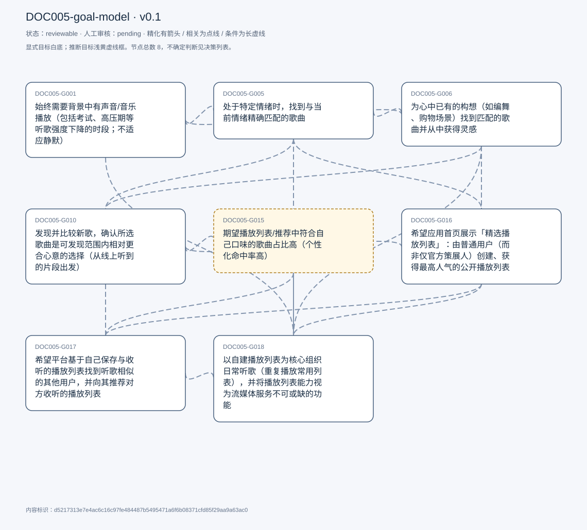
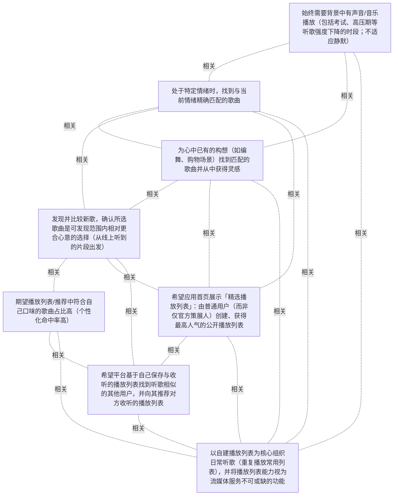

# 目标模型说明

模型：DOC005-goal-model；版本：v0.1

交付状态：reviewable；结构：passed；人工审核：pending

[交互模型](goal-model.html) · [矢量图](goal-model.svg) · [权威数据](goal-model.json)

## 目标图

## 目标

| 编号 | 表述 | 来源 | 情境 | 证据 |
|---|---|---|---|---|
| DOC005-G001 | 始终需要背景中有声音/音乐播放（包括考试、高压期等听歌强度下降的时段；不适应静默） | explicit | 自评听歌强度 4/5：清醒时间几乎一直听音乐，但非每一刻（T005「a fool」疑为「a four」转写误差，待人工确认）；考试或高压期自评降至 3-2，但背景声音需求保持；动机：音乐使其从现实压力中抽离，感到生活仍在继续；极端假设下（流媒体与 YouTube 均不可用）依次退至电影/Netflix、电视、广播 | E0001, E0002, E0003, E0004, E0005, E0006 |
| DOC005-G005 | 处于特定情绪时，找到与当前情绪精确匹配的歌曲 | explicit | 占使用时间约 15%；触发条件：正处于某种特定情绪；实现手段见动作候选 DOC005-C007（情绪词/关键词搜索公开播放列表） | E0007 |
| DOC005-G006 | 为心中已有的构想（如编舞、购物场景）找到匹配的歌曲并从中获得灵感 | explicit | 场景：编舞、购物等有明确构想的场合；占使用时间约 15%（原文「the other 50%」与「15% and 15%」拆分矛盾，按上下文取 15%）；实现手段见动作候选 DOC005-C008 | E0008, E0009 |
| DOC005-G010 | 发现并比较新歌，确认所选歌曲是可发现范围内相对更合心意的选择（从线上听到的片段出发） | explicit | 发现入口：线上听到歌曲片段后回 Spotify 搜索该歌；新歌发现不限于前述 15% 场景，日常听播放列表时也会发生；实现手段见动作候选 DOC005-C011 | E0010, E0011, E0012, E0013 |
| DOC005-G015 | 期望播放列表/推荐中符合自己口味的歌曲占比高（个性化命中率高） | inferred | 自述对比：普通播放列表约 3/20，「Made for You」约 10-12/20 | E0014 |
| DOC005-G016 | 希望应用首页展示「精选播放列表」：由普通用户（而非仅官方策展人）创建、获得最高人气的公开播放列表 | explicit | 动机：获得不同视角，非首要出于社交考虑，但包含社交维度；回应「如果想为应用增加一件事」的提问 | E0015, E0016, E0017 |
| DOC005-G017 | 希望平台基于自己保存与收听的播放列表找到听歌相似的其他用户，并向其推荐对方收听的播放列表 | explicit | 依据观点：算法无法真正复制人类情感，相似真人的选择可能更可信；受访者对该想法的实际效果不确定（I&#x27;m not sure how much it would work） | E0018, E0019, E0020, E0021 |
| DOC005-G018 | 以自建播放列表为核心组织日常听歌（重复播放常用列表），并将播放列表能力视为流媒体服务不可或缺的功能 | explicit | 典型流程见动作候选 DOC005-C003；播放列表使用约占 70%；与「Made for You」、环境音并列为三大最重要功能；T105「Playlist is one made for use」转写含混（made for use 疑指 Made for You） | E0022, E0023, E0024, E0025 |

## 关系判断（含不确定与无关系）

- DOC005-G001 / DOC005-G005：related。G001 要求清醒时持续有背景声音，G005 决定在特定情绪下播放什么内容，二者分别对应同一听歌行为的存在性维度与内容维度；S034 自述在情绪触发时专门找匹配歌曲，S012 自述该播放需求覆盖全天。但 G001 明确允许非音乐声源（电影/电视/广播）且不要求内容匹配，G005 也未陈述是为满足背景声需求而找歌，故不构成精化；原文未把二者表述为实现路径关系。
- DOC005-G001 / DOC005-G006：related。与 G001-G005 同理：G006 决定在为编舞或购物等构想找歌时播放什么，属内容选择维度；G001 覆盖声音的持续存在。S034 自述构想匹配占部分使用，S012/S080 自述背景声需求持续存在。G001 不要求构想匹配，G006 也不以维持背景声为目的，故非精化。
- DOC005-G001 / DOC005-G010：none。G001 关注背景声音的持续存在且不指定内容来源；G010 关注从线上片段出发发现并比较新歌。S012/S080 与 S056 分别描述两类行为，原文未建立二者关系：未说明发现的新歌用于背景播放，也未说明背景声需求依赖新歌发现。评估口径内未建立可采用关系。
- DOC005-G001 / DOC005-G015：none。G001 为存在性维持目标，G015 为对推荐/播放列表口味命中比例的质量期望；S012/S080 与 S086 分属不同话题段，原文未建立关系，也未说明背景播放的满意度取决于命中率。
- DOC005-G001 / DOC005-G016：none。G016 是对新增功能的期望（首页展示高人气公开播放列表），G001 是对持续背景声的需求。S094 未提及背景播放需求，S012/S080 也未提及首页或列表来源；原文未建立可采用关系。
- DOC005-G001 / DOC005-G017：none。G017 为基于听歌相似性的互荐功能期望，G001 为持续背景声需求。S100 未涉及播放的持续性，S012/S080 未涉及推荐来源；S102 关于算法无法复制人类情感的评论是对 G017 自身可行性的说明，不构成与 G001 的联系。
- DOC005-G001 / DOC005-G018：related。G018 描述日常听歌的主要承载方式，S034 自述约 70% 的使用经由播放列表，S028 自述以播放列表为入口并重复播放常用列表；这与 G001 的清醒时持续播放共同构成同一日常使用行为的总量与结构。但 G001 不限定承载方式（可退至电影/电视/广播），G018 也不以维持背景声为目的，故非精化。
- DOC005-G005 / DOC005-G006：related。S034 将非播放列表的使用划为两个并列部分：15% 为情绪触发时找匹配歌曲，另一部分为已有构想时找匹配歌曲，二者在原文同一段自述中作为并列使用情形出现，触发条件（情绪状态 vs 心中构想）与对象不同，互不具体化，故为 related 而非 refinement；情境不同，也不满足 equivalent 的归并条件，不据此合并。
- DOC005-G005 / DOC005-G010：related。二者同属寻找特定歌曲的达成型目标，S034 与 S056 均描述以搜索关键词/曲目为入口的行为（S034 搜索情绪词或关键词，S056 搜索具体歌曲后听相似歌曲）。触发条件不同（情绪状态 vs 线上听到的片段），目标对象不同（匹配情绪 vs 相对更合心意的新歌），互不具体化，故为 related。
- DOC005-G005 / DOC005-G015：none。G015 是对推荐/播放列表整体口味命中比例的质量期望（S086），G005 是特定情绪下的精确匹配。原文未说明情绪匹配依赖推荐命中率，也未以命中率评价情绪匹配结果；以推荐命中率支撑情绪精确匹配属原文未陈述的推断。
- DOC005-G005 / DOC005-G016：related。S034 表明受访者预期他人已按情绪关键词创建公开播放列表（someone might have already created a public playlist），而 G016 正是希望首页展示由普通用户创建、获最高人气的公开播放列表（S094）；二者在&#x27;通过他人公开列表获取内容&#x27;这一点上相接。但 G016 限定为最高人气的列表而非情绪分类列表，且未表述为服务情绪匹配，故非精化。
- DOC005-G005 / DOC005-G017：none。G017 的推荐依据是自己保存与收听的播放列表所对应的听歌相似性（S100），未涉及情绪状态；G005 的匹配对象为当前情绪。S102 关于算法不能复制人类情感的评论是提出 G017 的动机说明，未在原文中与情绪匹配目标建立联系。
- DOC005-G005 / DOC005-G018：related。S034 将使用划分为约 70% 的播放列表使用与非播放列表部分（其中一部分为情绪触发的匹配找歌），二者在原文同一段占比划分中作为并列使用情形出现；G018 覆盖播放列表为主的日常组织，G005 覆盖情绪触发时的选曲，互不具体化。
- DOC005-G006 / DOC005-G010：related。二者同属寻找特定歌曲的达成型目标：S034 构想匹配通过热门关键词搜索并浏览不同播放列表与歌曲，S056 新歌发现通过搜索具体歌曲后试听相似歌曲，共享搜索与试听比较的行为方式。触发条件（心中构想 vs 线上片段）与判据（匹配构想、灵感 vs 是否更合心意）不同，互不具体化。
- DOC005-G006 / DOC005-G015：none。G015 针对推荐与播放列表的口味命中比例（S086），G006 针对已有构想的内容匹配与灵感获取（S034）。原文未以命中率评价构想匹配，也未说明构想匹配依赖推荐质量。
- DOC005-G006 / DOC005-G016：related。S034 表明构想匹配的实现方式是浏览不同播放列表与歌曲（I try to go through different playlists and songs via search with popular keywords），G016 希望首页展示普通用户创建的高人气公开播放列表（S094），若实现可扩充其可浏览的列表来源。但 G016 未以构想匹配为动机，也未限定主题，故非精化。
- DOC005-G006 / DOC005-G017：none。G017 为按听歌相似性推送他人播放列表（S100），G006 为按心中构想主动浏览与搜索。前者是被动个性化推送，后者是主动检索，原文未建立二者关系，也未说明推荐结果用于构想匹配或灵感获取。
- DOC005-G006 / DOC005-G018：related。S034 将约 70% 的使用归为播放列表、其余部分包含构想触发的找歌，二者在同一段占比划分中作为并列使用情形出现；G018 为日常组织方式，G006 为特定构想触发的选曲，互不具体化。
- DOC005-G010 / DOC005-G015：related。二者共享&#x27;口味契合&#x27;这一判据：G010 以是否有更好选择作为探索准则（Do I like anyone better / is this the best I can find，S056），G015 以喜欢曲目在列表中的占比衡量推荐与播放列表的优劣（S086）。但 G015 针对推荐/播放列表整体的质量期望，G010 针对发现过程中的比较行为，范围不同且互不具体化，故为 related。
- DOC005-G010 / DOC005-G016：related。G016 希望首页展示普通用户创建的高人气公开播放列表（S094），若实现可成为接触未听过内容的入口之一，与 G010 的发现新歌取向相接。但 S094 的动机是普通用户来源与最高人气的可见性，未提及新歌发现；S098 受访者确认主要动机不是社交属性，故非精化。
- DOC005-G010 / DOC005-G017：related。G017 希望平台推荐听歌相似用户所听的播放列表（S100），其实质是引入新的、可能未听过的内容来源，与 G010 的发现新歌取向相接。但 G010 的起点是线上听到的片段并依赖 Spotify 的相似歌曲续播，G017 的来源为相似用户的播放列表，范围与机制不同，互不具体化。
- DOC005-G010 / DOC005-G018：none。G018 为以自建播放列表组织日常听歌（S028、S106），G010 为从线上片段出发发现并比较新歌（S056）。原文未说明发现的新歌是否加入播放列表，也未说明播放列表使用依赖新歌发现，评估口径内未建立可采用关系。
- DOC005-G015 / DOC005-G016：none。G015 是口味命中比例的质量期望（S086），G016 是首页展示高人气公开播放列表的功能期望（S094）。后者关注列表的可见性与来源（普通用户而非仅策展人），不涉及命中比例；S086 也未涉及首页或精选机制。
- DOC005-G015 / DOC005-G017：related。G015 确立的评价标准是曲目与自身口味的契合比例（S086）；G017 提出的互荐结果同样是可被该标准衡量的内容来源。但 G017 的提出依据是听歌相似性而非命中率，原文未以命中率论证该构想，故仅为判据适用层面的联系，非精化。
- DOC005-G015 / DOC005-G018：related。S086 直接以播放列表为命中率的评价对象（in a playlist, maybe 3 out of 20 songs that I really like），与 G018 所述的播放列表中心地位（S034 约 70% 使用、S106 最重要功能之一）在同一材料上相接：播放列表既是主要使用方式，也是口味命中率的评价载体。但 G015 是质量期望，G018 是组织方式与功能重要性，性质不同，互不具体化。
- DOC005-G016 / DOC005-G017：related。二者同为在采访者&#x27;希望新增什么功能&#x27;提问（S093）下提出的功能期望，且 S097 追问社交属性时，受访者确认 G016 虽非以此为首要动机但确实涵盖社交方面（S098），与 G017 的人人互荐取向相接。二者提出语境相同、取向部分重叠，但服务对象与机制不同，互不具体化。
- DOC005-G016 / DOC005-G018：related。G016 的实现对象仍是播放列表（首页展示的精选公开播放列表，S094），与 G018 所述的播放列表中心地位（S106 最重要功能之一、S034 约 70% 使用）相容；G016 补充的是列表来源与入口，不改变以播放列表组织听歌的方式。但 G016 的列表来自他人，G018 的日常组织以其常用列表为主，来源不同，故非精化。
- DOC005-G017 / DOC005-G018：related。G017 的触发数据直接来自 G018 所描述的播放列表使用行为：S100 明确以&#x27;我保存与收听的播放列表&#x27;作为寻找相似用户的依据，S028 自述以播放列表为入口并重复播放常用列表，S106 确认播放列表为最重要功能之一。二者在&#x27;播放列表行为是互荐机制的输入&#x27;这一点上相接，但 G017 是新增功能期望、G018 是既有使用方式，性质不同，非精化。

## 证据

### E0001 · DOC005:S012

> I still need to have something playing in the background at all

原件位置：{&quot;line_start&quot;: 12, &quot;line_end&quot;: 12, &quot;start_char&quot;: 963, &quot;end_char&quot;: 1140}

### E0002 · DOC005:S080

> But I always need something playing in the background.

原件位置：{&quot;line_start&quot;: 80, &quot;line_end&quot;: 80, &quot;start_char&quot;: 10207, &quot;end_char&quot;: 10554}

### E0003 · DOC005:S008

> Music almost all the time, but not every moment. I&#x27;m awake.

原件位置：{&quot;line_start&quot;: 8, &quot;line_end&quot;: 8, &quot;start_char&quot;: 586, &quot;end_char&quot;: 665}

### E0004 · DOC005:S012

> when there are exams or peak stress schedules, maybe drops to a 3 or a 2

原件位置：{&quot;line_start&quot;: 12, &quot;line_end&quot;: 12, &quot;start_char&quot;: 963, &quot;end_char&quot;: 1140}

### E0005 · DOC005:S014

> I think it kind of distracts me from the stress of the real world

原件位置：{&quot;line_start&quot;: 14, &quot;line_end&quot;: 14, &quot;start_char&quot;: 1446, &quot;end_char&quot;: 1658}

### E0006 · DOC005:S080

> So I&#x27;m someone who doesn&#x27;t really do well with silence in the background.

原件位置：{&quot;line_start&quot;: 80, &quot;line_end&quot;: 80, &quot;start_char&quot;: 10207, &quot;end_char&quot;: 10554}

### E0007 · DOC005:S034

> the 1st 15% would be when I&#x27;m feeling a particular way. And then I need some songs to find exactly what I&#x27;m feeling.

原件位置：{&quot;line_start&quot;: 34, &quot;line_end&quot;: 34, &quot;start_char&quot;: 4055, &quot;end_char&quot;: 4837}

### E0008 · DOC005:S034

> So if I have something in mind. and I want to find songs to match the vision I have in my mind.

原件位置：{&quot;line_start&quot;: 34, &quot;line_end&quot;: 34, &quot;start_char&quot;: 4055, &quot;end_char&quot;: 4837}

### E0009 · DOC005:S034

> I&#x27;m a dancer. and I love going shopping as well.

原件位置：{&quot;line_start&quot;: 34, &quot;line_end&quot;: 34, &quot;start_char&quot;: 4055, &quot;end_char&quot;: 4837}

### E0010 · DOC005:S056

> Discover new songs is, I hear, maybe a small part of it online.

原件位置：{&quot;line_start&quot;: 56, &quot;line_end&quot;: 56, &quot;start_char&quot;: 7305, &quot;end_char&quot;: 7748}

### E0011 · DOC005:S056

> So then I&#x27;m like, Okay, Vibe, what are the other songs that are there? Do I like anyone better, or do I like anything worse. But is this the best I can find?

原件位置：{&quot;line_start&quot;: 56, &quot;line_end&quot;: 56, &quot;start_char&quot;: 7305, &quot;end_char&quot;: 7748}

### E0012 · DOC005:S054

> I don&#x27;t think so most of the time.

原件位置：{&quot;line_start&quot;: 54, &quot;line_end&quot;: 54, &quot;start_char&quot;: 7224, &quot;end_char&quot;: 7278}

### E0013 · DOC005:S058

> Yeah, that is accurate.

原件位置：{&quot;line_start&quot;: 58, &quot;line_end&quot;: 58, &quot;start_char&quot;: 7911, &quot;end_char&quot;: 7960}

### E0014 · DOC005:S086

> But let&#x27;s say in a playlist, I would like maybe 3 out of 20 songs that I really like with this made for you, but by spotify, I would say the chances go up to around 10 to 12 songs out of 20.

原件位置：{&quot;line_start&quot;: 86, &quot;line_end&quot;: 86, &quot;start_char&quot;: 11823, &quot;end_char&quot;: 12114}

### E0015 · DOC005:S094

> I think it would be nice to maybe have something on the home screen, like featured playlists. which are public playlists created by random people, not just by any curators that get the most traction.

原件位置：{&quot;line_start&quot;: 94, &quot;line_end&quot;: 94, &quot;start_char&quot;: 12894, &quot;end_char&quot;: 13113}

### E0016 · DOC005:S096

> I think that would have that would be cool.

原件位置：{&quot;line_start&quot;: 96, &quot;line_end&quot;: 96, &quot;start_char&quot;: 13140, &quot;end_char&quot;: 13203}

### E0017 · DOC005:S098

> I don&#x27;t think that&#x27;s the primary motivation behind what I said, but it does kind of encompass that.

原件位置：{&quot;line_start&quot;: 98, &quot;line_end&quot;: 98, &quot;start_char&quot;: 13337, &quot;end_char&quot;: 13456}

### E0018 · DOC005:S100

> maybe if there is an algorithm on Spotify where. based on the playlist, I save, and I listen to if they find someone else listening to kind of the same songs.

原件位置：{&quot;line_start&quot;: 100, &quot;line_end&quot;: 100, &quot;start_char&quot;: 13483, &quot;end_char&quot;: 13775}

### E0019 · DOC005:S100

> if they can suggest a playlist that they will listen to.

原件位置：{&quot;line_start&quot;: 100, &quot;line_end&quot;: 100, &quot;start_char&quot;: 13483, &quot;end_char&quot;: 13775}

### E0020 · DOC005:S102

> an algorithm cannot really replicate human emotions

原件位置：{&quot;line_start&quot;: 102, &quot;line_end&quot;: 102, &quot;start_char&quot;: 13802, &quot;end_char&quot;: 13931}

### E0021 · DOC005:S104

> So I think this way might be pretty cool. I&#x27;m not sure how much it would work, though.

原件位置：{&quot;line_start&quot;: 104, &quot;line_end&quot;: 104, &quot;start_char&quot;: 13959, &quot;end_char&quot;: 14065}

### E0022 · DOC005:S106

> Definitely. Playlist is one made for use. Another.

原件位置：{&quot;line_start&quot;: 106, &quot;line_end&quot;: 106, &quot;start_char&quot;: 14390, &quot;end_char&quot;: 14716}

### E0023 · DOC005:S106

> So those 3 things are my most important features in spotify.

原件位置：{&quot;line_start&quot;: 106, &quot;line_end&quot;: 106, &quot;start_char&quot;: 14390, &quot;end_char&quot;: 14716}

### E0024 · DOC005:S034

> this is around 70% of my usage

原件位置：{&quot;line_start&quot;: 34, &quot;line_end&quot;: 34, &quot;start_char&quot;: 4055, &quot;end_char&quot;: 4837}

### E0025 · DOC005:S028

> I have the playlist that I listen to the most which are usually my repeat playlist, which is the list of all the songs I usually listen to on the repeat.

原件位置：{&quot;line_start&quot;: 28, &quot;line_end&quot;: 28, &quot;start_char&quot;: 2920, &quot;end_char&quot;: 3387}

## 问题、限制与版本

- 当前会话助手的开发判断，非独立盲测；无人工采纳记录。
- 结构检查已绑定当前版本；独立语义审查未执行；人工状态以实际审核记录为准。

内容标识：d5217313e7e4ac6c16c97fe484487b5495471a6f6b08371cfd85f29aa9a63ac0

人工决定：

审核意见：
