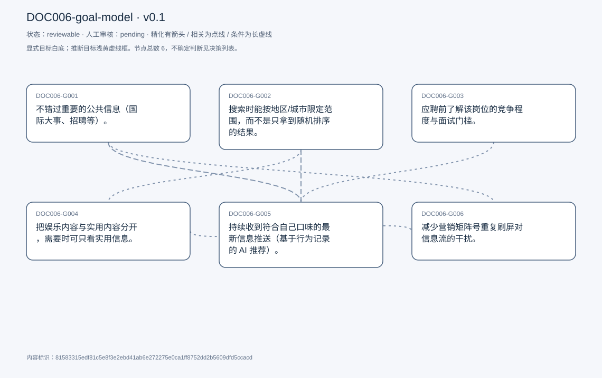
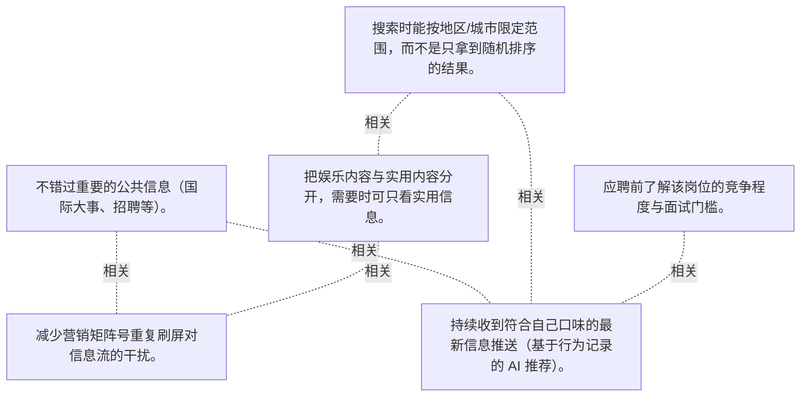

# 目标模型说明

模型：DOC006-goal-model；版本：v0.1

交付状态：reviewable；结构：passed；人工审核：pending

[交互模型](goal-model.html) · [矢量图](goal-model.svg) · [权威数据](goal-model.json)

## 目标图

## 目标

| 编号 | 表述 | 来源 | 情境 | 证据 |
|---|---|---|---|---|
| DOC006-G001 | 不错过重要的公共信息（国际大事、招聘等）。 | explicit | 自述为主要使用动机之一；判断标准为「重要信息」，未定义阈值 | E0001, E0002 |
| DOC006-G002 | 搜索时能按地区/城市限定范围，而不是只拿到随机排序的结果。 | explicit | 典型场景：找房源、找本地信息；现状只能靠其他渠道（房屋中介）补充；替代平台免费是他继续使用的理由 | E0003, E0004, E0005 |
| DOC006-G003 | 应聘前了解该岗位的竞争程度与面试门槛。 | explicit | 希望看到：已进入招聘流程的人数、近期面试者的反馈 | E0006, E0007 |
| DOC006-G004 | 把娱乐内容与实用内容分开，需要时可只看实用信息。 | explicit | 现状：平台把娱乐、招聘、房源等内容混在同一信息流推送 | E0008, E0009, E0010 |
| DOC006-G005 | 持续收到符合自己口味的最新信息推送（基于行为记录的 AI 推荐）。 | explicit | 依据：点赞、评论等行为记录推断偏好；受访者认为这是社交应用的必备功能 | E0011, E0012, E0013 |
| DOC006-G006 | 减少营销矩阵号重复刷屏对信息流的干扰。 | explicit | 矩阵号特征：批量发布相同内容用于营销；后果：信息流被无关内容淹没，影响使用体验 | E0014, E0015 |

## 关系判断（含不确定与无关系）

- DOC006-G001 / DOC006-G002：none。DOC006-G001 的对象是不错过重要公共信息（T003），DOC006-G002 的对象是搜索按地区/城市限定（T011/T013）；两处分别出自不同话题段，原文未在二者之间建立因果、手段、评价或情境包含关系，本次评估口径内未建立可采用关系。
- DOC006-G001 / DOC006-G003：none。DOC006-G001 的对象是不错过重要公共信息（T003），DOC006-G003 的对象是应聘前了解竞争度与面试门槛（T019）；两处分别出自不同话题段，原文未在二者之间建立因果、手段、评价或情境包含关系，本次评估口径内未建立可采用关系。
- DOC006-G001 / DOC006-G004：none。DOC006-G001 的对象是不错过重要公共信息（T003），DOC006-G004 的对象是娱乐与实用内容分离（T023）；两处分别出自不同话题段，原文未在二者之间建立因果、手段、评价或情境包含关系，本次评估口径内未建立可采用关系。
- DOC006-G001 / DOC006-G005：related。T029 描述推荐的价值时直接指向「不错过」：用户「can just stay there, and they will give you the latest information. That fits your taste continuously」，即推送是 G001 的实现方式。手段与结果不自动构成精化，故为 related。
- DOC006-G001 / DOC006-G006：related。T043 说明矩阵号刷屏的后果是「flood the feed with irrelevant contents, and it interferes with user experience」，直接干扰 G001 想避免的遗漏风险（有用信息被淹没）；但 G006 针对内容来源治理、G001 针对信息获取结果，非精化。
- DOC006-G002 / DOC006-G003：none。DOC006-G002 的对象是搜索按地区/城市限定（T011/T013），DOC006-G003 的对象是应聘前了解竞争度与面试门槛（T019）；两处分别出自不同话题段，原文未在二者之间建立因果、手段、评价或情境包含关系，本次评估口径内未建立可采用关系。
- DOC006-G002 / DOC006-G004：related。T023 在提出内容分离时把场景一并列出「including job searching and housing rental, searching whatever」，与 G002 的房源/本地搜索场景重叠，二者同属信息流筛选能力；但一个是地区维度、一个是内容类型维度，非精化。
- DOC006-G002 / DOC006-G005：related。T017 把两者对照：房源因无法按地区收窄而「filter out a lot of useful postings」，而招聘因为「it can push you the right postings with artificial intelligence, recommendations」问题较少——即推荐可部分弥补地区筛选的缺失。二者为实现方式上的替代关系，非精化。
- DOC006-G002 / DOC006-G006：none。DOC006-G002 的对象是搜索按地区/城市限定（T011/T013），DOC006-G006 的对象是减少营销矩阵号刷屏（T043）；两处分别出自不同话题段，原文未在二者之间建立因果、手段、评价或情境包含关系，本次评估口径内未建立可采用关系。
- DOC006-G003 / DOC006-G004：none。DOC006-G003 的对象是应聘前了解竞争度与面试门槛（T019），DOC006-G004 的对象是娱乐与实用内容分离（T023）；两处分别出自不同话题段，原文未在二者之间建立因果、手段、评价或情境包含关系，本次评估口径内未建立可采用关系。
- DOC006-G003 / DOC006-G005：related。T017 明确把招聘信息质量归因于 AI 推荐「it can push you the right postings with artificial intelligence, recommendations」，G005 的推荐机制是 G003 获取岗位情报的渠道。
- DOC006-G003 / DOC006-G006：none。DOC006-G003 的对象是应聘前了解竞争度与面试门槛（T019），DOC006-G006 的对象是减少营销矩阵号刷屏（T043）；两处分别出自不同话题段，原文未在二者之间建立因果、手段、评价或情境包含关系，本次评估口径内未建立可采用关系。
- DOC006-G004 / DOC006-G005：none。DOC006-G004 的对象是娱乐与实用内容分离（T023），DOC006-G005 的对象是按口味持续推送最新信息（T005/T029）；两处分别出自不同话题段，原文未在二者之间建立因果、手段、评价或情境包含关系，本次评估口径内未建立可采用关系。
- DOC006-G004 / DOC006-G006：related。T023 要求把娱乐内容从实用内容中分离，T043 要求治理刷屏的营销矩阵号，两者都针对信息流内容质量，但一个按内容类型、一个按账号行为，路径不同，非精化。
- DOC006-G005 / DOC006-G006：none。DOC006-G005 的对象是按口味持续推送最新信息（T005/T029），DOC006-G006 的对象是减少营销矩阵号刷屏（T043）；两处分别出自不同话题段，原文未在二者之间建立因果、手段、评价或情境包含关系，本次评估口径内未建立可采用关系。

## 证据

### E0001 · DOC006:S004

> I do not want to miss out any important information like if there are any great events going on internationally.

原件位置：{&quot;line_start&quot;: 4, &quot;line_end&quot;: 4, &quot;start_char&quot;: 696, &quot;end_char&quot;: 1024}

### E0002 · DOC006:S004

> maybe there are some new job posting I was just.

原件位置：{&quot;line_start&quot;: 4, &quot;line_end&quot;: 4, &quot;start_char&quot;: 696, &quot;end_char&quot;: 1024}

### E0003 · DOC006:S012

> There is no way for me to get the get the information and results for that specific region.

原件位置：{&quot;line_start&quot;: 12, &quot;line_end&quot;: 12, &quot;start_char&quot;: 3116, &quot;end_char&quot;: 3621}

### E0004 · DOC006:S014

> it would be better for for me if there is a specific specific button, or or some feature in the application that I could search in a specific region like the city.

原件位置：{&quot;line_start&quot;: 14, &quot;line_end&quot;: 14, &quot;start_char&quot;: 3809, &quot;end_char&quot;: 4278}

### E0005 · DOC006:S012

> It&#x27;s it&#x27;s kind of randomly randomly generated.

原件位置：{&quot;line_start&quot;: 12, &quot;line_end&quot;: 12, &quot;start_char&quot;: 3116, &quot;end_char&quot;: 3621}

### E0006 · DOC006:S020

> how how many people are already entering the hiring process, so that I can see if this company is on a great number of hiring or not

原件位置：{&quot;line_start&quot;: 20, &quot;line_end&quot;: 20, &quot;start_char&quot;: 5512, &quot;end_char&quot;: 5932}

### E0007 · DOC006:S020

> I can get feedback from them to see if this company is, does it have a high benchmark to to pass the interview or not?

原件位置：{&quot;line_start&quot;: 20, &quot;line_end&quot;: 20, &quot;start_char&quot;: 5512, &quot;end_char&quot;: 5932}

### E0008 · DOC006:S024

> it would be better if it it can have a feature that you can split the entertainment contents from useful contents

原件位置：{&quot;line_start&quot;: 24, &quot;line_end&quot;: 24, &quot;start_char&quot;: 6339, &quot;end_char&quot;: 6902}

### E0009 · DOC006:S024

> when sometimes I don&#x27;t wanna see those entertainment contents, and they can filter them up for me.

原件位置：{&quot;line_start&quot;: 24, &quot;line_end&quot;: 24, &quot;start_char&quot;: 6339, &quot;end_char&quot;: 6902}

### E0010 · DOC006:S024

> They just push all the things together to you.

原件位置：{&quot;line_start&quot;: 24, &quot;line_end&quot;: 24, &quot;start_char&quot;: 6339, &quot;end_char&quot;: 6902}

### E0011 · DOC006:S006

> they will do more like recommendations based on my. on my taste.

原件位置：{&quot;line_start&quot;: 6, &quot;line_end&quot;: 6, &quot;start_char&quot;: 1235, &quot;end_char&quot;: 1605}

### E0012 · DOC006:S030

> they will give you the the latest information. That fits your taste continuously.

原件位置：{&quot;line_start&quot;: 30, &quot;line_end&quot;: 30, &quot;start_char&quot;: 7996, &quot;end_char&quot;: 8571}

### E0013 · DOC006:S030

> It can deduce the taste of your like browsing tastes like, what? What do you like to to see in applications.

原件位置：{&quot;line_start&quot;: 30, &quot;line_end&quot;: 30, &quot;start_char&quot;: 7996, &quot;end_char&quot;: 8571}

### E0014 · DOC006:S044

> the social application platforms should strengthen their efforts to handle with matrix accounts.

原件位置：{&quot;line_start&quot;: 44, &quot;line_end&quot;: 44, &quot;start_char&quot;: 11239, &quot;end_char&quot;: 11646}

### E0015 · DOC006:S044

> they just flood the feed with irrelevant contents, and it interferes with user experience.

原件位置：{&quot;line_start&quot;: 44, &quot;line_end&quot;: 44, &quot;start_char&quot;: 11239, &quot;end_char&quot;: 11646}

## 问题、限制与版本

- 当前会话助手的开发判断，非独立盲测；无人工采纳记录。
- 结构检查已绑定当前版本；独立语义审查未执行；人工状态以实际审核记录为准。

内容标识：81583315edf81c5e8f3e2ebd41ab6e272275e0ca1ff8752dd2b5609dfd5ccacd

人工决定：

审核意见：
