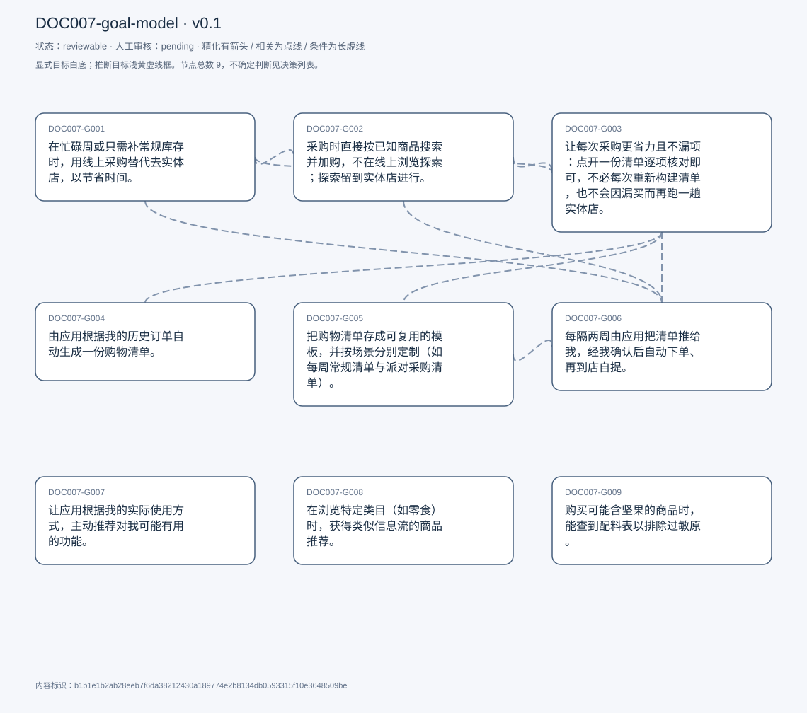
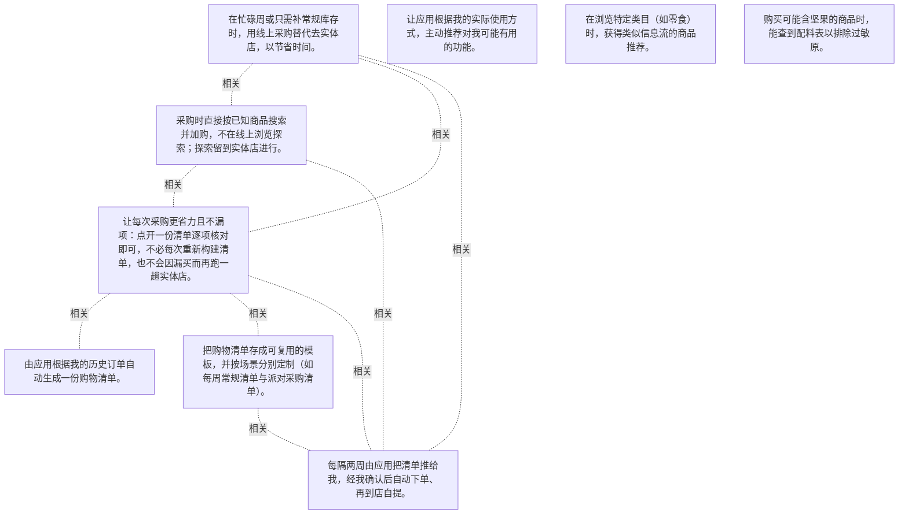

# 目标模型说明

模型：DOC007-goal-model；版本：v0.1

交付状态：reviewable；结构：passed；人工审核：pending

[交互模型](goal-model.html) · [矢量图](goal-model.svg) · [权威数据](goal-model.json)

## 目标图

## 目标

| 编号 | 表述 | 来源 | 情境 | 证据 |
|---|---|---|---|---|
| DOC007-G001 | 在忙碌周或只需补常规库存时，用线上采购替代去实体店，以节省时间。 | explicit | 触发条件一：当周安排很忙、没有时间亲自到店；触发条件二：只需买固定不变的常规商品、无需探索或挑选新品；履约方式偏好：到店自提（免配送费、门店离家近）而非配送；自评频率：约每两周一次，不固定 | E0001, E0002, E0003, E0004, E0005, E0006, E0007 |
| DOC007-G002 | 采购时直接按已知商品搜索并加购，不在线上浏览探索；探索留到实体店进行。 | explicit | 对多数常规商品已明确知道想要的品牌与单品；浏览探索被视为浪费时间，与线上采购的效率目的相冲突；例外：购买零食等特定类目时会按类目浏览（见 C008） | E0008, E0009, E0010, E0011, E0012, E0013 |
| DOC007-G003 | 让每次采购更省力且不漏项：点开一份清单逐项核对即可，不必每次重新构建清单，也不会因漏买而再跑一趟实体店。 | explicit | 当前状态：每次按记忆重新逐项输入与点击；漏项的后果：需亲自再到店补买一次 | E0014, E0015, E0016, E0017 |
| DOC007-G004 | 由应用根据我的历史订单自动生成一份购物清单。 | explicit | 现有相近功能「buy again」未被使用，受访者认为入口不明显（见 C007） | E0018, E0019, E0020 |
| DOC007-G005 | 把购物清单存成可复用的模板，并按场景分别定制（如每周常规清单与派对采购清单）。 | explicit | 需求提出两次（T038 与 T068），表述一致；现有「your list」功能可建清单，但受访者从未使用过 | E0021, E0022, E0023 |
| DOC007-G006 | 每隔两周由应用把清单推给我，经我确认后自动下单、再到店自提。 | explicit | 周期为受访者自举的「every 2 weeks」；下单前必须由本人确认（sign off）；履约方式为自提 | E0024, E0025, E0026 |
| DOC007-G007 | 让应用根据我的实际使用方式，主动推荐对我可能有用的功能。 | explicit | 问题背景：功能存在但因界面杂乱、入口不直观而从未被发现；举例：buy again、your list 两项均属「已存在但没被用过」 | E0027, E0028, E0029, E0030 |
| DOC007-G008 | 在浏览特定类目（如零食）时，获得类似信息流的商品推荐。 | explicit | 仅在有探索意愿的类目下成立（零食为例），与 C002 的「不探索」并存于不同类目；受访者对该提议用词为「would kind of be interesting」，强度弱于明确需求；受访者推测平台后台可能已有类似机制 | E0031, E0032, E0033 |
| DOC007-G009 | 购买可能含坚果的商品时，能查到配料表以排除过敏原。 | explicit | 受访者对坚果过敏，仅在购买糕点等含坚果风险的商品时需要；现状：不确定商品页是否总提供配料表 | E0034, E0035 |

## 关系判断（含不确定与无关系）

- DOC007-G001 / DOC007-G002：related。T050 用「it contradicts why I&#x27;m going online grocery shopping in the 1st place」把「不探索」直接接到线上购物的目的上，T050 同时自陈「I&#x27;m really there for efficiency」，与 G001 的省时取向同源；G002 描述的是 G001 在站内的行为取向。但 G001 说明为何选择线上渠道、G002 说明进入后如何操作，对象不同，互不具体化，故非精化。
- DOC007-G001 / DOC007-G003：related。两者共享效率取向：G001 以省时为改用线上的理由（T057 save a lot of time、T051 efficiency），G003 以减少输入点击与避免漏项为期望（T078 reduce the amount of typing and clicking / more streamlined）。但 G001 针对到店往返，G003 针对站内操作负担，对象不同且原文未把后者表述为前者的具体化，故非精化。
- DOC007-G001 / DOC007-G004：none。G001 为渠道选择（线上替代到店），G004 为按历史订单生成清单。T035 讨论生成清单时未涉及渠道选择，T022 讨论线上动机时也未提及清单生成；评估口径内未建立可采用关系。
- DOC007-G001 / DOC007-G005：none。G005 的模板复用诉求（T039/T069）以站内清单为对象，与 G001 的渠道选择无原文连接；T070 讨论 your list 时也未回到渠道或时间成本。
- DOC007-G001 / DOC007-G006：related。G006 的履约环节「and then you can go pick it up」（T069）与 G001 记录的自提偏好同源（T057 成本与时间平衡、T059 pickup is free）；G006 的周期设想也与 G001 的采购频率（T018 every 2 weeks）一致。但 G006 是自动化设想，G001 是渠道选择，性质不同，非精化。
- DOC007-G001 / DOC007-G007：none。G007 针对功能可发现性（T073），G001 针对渠道与时间成本；T035/T071/T073 均未涉及线上与线下的选择，T022/T057 也未提及功能推荐。
- DOC007-G001 / DOC007-G008：none。G008 为类目浏览中的商品推荐（T047），G001 为线上替代到店的渠道选择。原文未把推荐形态与渠道效率联系起来；G008 与效率的关系反而由 G002 的张力体现，不在 G001 上。
- DOC007-G001 / DOC007-G009：none。G009 为配料信息可得性（T039），G001 为渠道选择与时间成本。T039 讨论配料时未涉及线上线下的取舍，T022 也未涉及配料或过敏。
- DOC007-G002 / DOC007-G003：related。G003 要减少的「逐项输入与点击」（T078）正是 G002 所描述的「type in exactly what I want」（T029）这一做法；T078 的「rather than having to reconstruct the list every time」直接针对同一操作负担。二者对象一致（站内操作）、但一个是现状取向、一个是改变期望，互不具体化。
- DOC007-G002 / DOC007-G004：none。G004 为按历史订单生成清单，G002 为直接搜索加购已知商品。T035 提出生成清单时未提及是否会替代搜索，T029/T031 也未涉及清单生成；二者可能并存也可能替代，原文未表态。
- DOC007-G002 / DOC007-G005：none。G005 的模板复用（T039/T069）与 G002 的即时搜索加购属不同机制；T039 提出模板时未与搜索方式对比，T029 也未提及模板或清单复用。
- DOC007-G002 / DOC007-G006：related。G006 的自动化设想（T069 每两周推清单、确认后下单）与 G002 描述的逐项搜索加购是同一任务（日常补货）的两种完成方式；T078「rather than having to reconstruct the list every time」也指向从逐项输入转向按清单核对。二者并存于「如何完成一次采购」这一问题下，非精化。
- DOC007-G002 / DOC007-G007：none。G007 的对象是功能推荐（T073），G002 的对象是商品搜索方式。T073 未涉及商品探索，T031 也未涉及功能发现；两者分处不同话题。
- DOC007-G002 / DOC007-G008：uncertain。同一受访者前后给出两种取向：T050 明确否定在电脑上随机浏览食材（「I don&#x27;t wanna waste time like randomly exploring grocery items on my computer」），T047 又主动希望在滚动零食类目时获得信息流式推荐（「a Facebook news feed where it&#x27;s like recommending things」）。按类目区分可以并存，但受访者本人未澄清边界，也无法排除前后态度不一致；不能自行裁决，故记为不确定。
- DOC007-G002 / DOC007-G009：none。G009 为配料表可得性（T039），G002 为搜索与不浏览取向。T039 讨论配料时未涉及搜索方式，T029 也未涉及配料或过敏。
- DOC007-G003 / DOC007-G004：related。G004 的动机句与 G003 的目标句指向同一痛点：T035「figuring out exactly what I need for a month or 2 weeks」的困难，对应 T078「having to reconstruct the list every time」。G004 提供生成清单这一手段，G003 是期望结果（省力、不漏项），手段与结果不自动等同，故为 related 而非精化。
- DOC007-G003 / DOC007-G005：related。T039 的「reuse every time」与 T078 的「rather than having to reconstruct the list every time」针对同一重复劳动；模板复用是达成 G003 的直接路径之一。但 G005 是具体功能形态、G003 是结果质量，故为 related。
- DOC007-G003 / DOC007-G006：related。T069 的定期推送与确认下单，正对应 T078 所述「点击一份清单核对即可、不必每次重建」的期望；G006 是实现 G003 的一种自动化形态。但 G006 引入周期与下单环节等额外条件，故为 related 而非精化。
- DOC007-G003 / DOC007-G007：none。G007 针对功能被发现（T073 及其动因 T035 的界面 overwhelming），G003 针对采购操作本身的负担。两者都提到 T035 的界面感受，但一处指向功能入口、一处指向逐项输入，原文未建立二者关系。
- DOC007-G003 / DOC007-G008：none。G008 为类目浏览中的推荐形态（T047），G003 为减少重复输入与漏项。原文未说明推荐可减轻清单重建负担，T078 也未提及浏览或推荐。
- DOC007-G003 / DOC007-G009：none。G009 为配料信息可得性（T039），G003 为清单重建负担。T039 的配料诉求与清单模板诉求虽同处一段，但为两个独立话题，原文未建立因果或手段关系。
- DOC007-G004 / DOC007-G005：none。G004 依据历史订单生成清单（T035），G005 建立可复用模板（T039/T069）。两者都作用于清单，但生成依据不同（历史数据 vs 用户自定义），原文未说明二者如何组合或替代。
- DOC007-G004 / DOC007-G006：none。G006 的定期清单来源未在原文中指定（T069 只说「here&#x27;s your grocery list」），不能据此认定由历史订单生成；G004 也未提及周期推送或自动下单。
- DOC007-G004 / DOC007-G007：none。G007 为功能推荐（T073），G004 为清单生成。T035 同一段内先提出清单生成、后感叹 buy again 入口不直观，但受访者未把两者联系为因果或手段关系。
- DOC007-G004 / DOC007-G008：none。G008 为浏览类目时的商品推荐（T047），G004 为按历史订单生成清单（T035）。原文未说明推荐结果是否用于清单生成。
- DOC007-G004 / DOC007-G009：none。G009 为配料信息（T039），G004 为历史订单生成清单（T035）。两者分处不同轮次，原文未建立关系。
- DOC007-G005 / DOC007-G006：related。T069 在同一段内把「templates of a grocery list」与「every 2 weeks... here&#x27;s your grocery list」并列表述，两者共用同一清单复用机制：模板提供内容，定期推送提供触发。但 G005 是内容组织方式、G006 是触发与履约流程，要素不同，互不具体化。
- DOC007-G005 / DOC007-G007：none。G007 为功能推荐（T073），G005 为清单模板。T069/T071 讨论模板与 your list 时未涉及功能推荐，T073 也未提及模板。
- DOC007-G005 / DOC007-G008：none。G008 为类目浏览中的商品推荐（T047），G005 为清单模板。原文未说明推荐结果进入模板。
- DOC007-G005 / DOC007-G009：none。两者虽同处 T038 一段（配料表与模板清单先后提出），但为两个独立诉求，原文未建立因果或手段关系。
- DOC007-G006 / DOC007-G007：none。G006 为定期推送与自动下单（T069），G007 为功能推荐（T073）。受访者在 T069 说该功能「this is like so buried」，与 G007 的动因（入口不直观）方向相近，但原文未把二者联系，不能据此补边。
- DOC007-G006 / DOC007-G008：none。G008 为商品推荐（T047），G006 为定期推送清单与自动下单（T069）。原文未说明推送内容包含推荐商品。
- DOC007-G006 / DOC007-G009：none。G009 为配料信息（T039），G006 为定期成单（T069）。原文未讨论自动下单时如何校验过敏原，也未以过敏为由提出推送。
- DOC007-G007 / DOC007-G008：none。两者形态相近（均为主动推荐），但对象不同：G007 推荐功能（T073），G008 推荐商品（T047）；两处分属不同话题，原文未把二者合并表述。形式相似不构成可采用关系。
- DOC007-G007 / DOC007-G009：none。G009 为配料信息（T039），G007 为功能推荐（T073）。原文未说明配料提示属于应被推荐的功能。
- DOC007-G008 / DOC007-G009：none。G008 为类目浏览中的商品推荐（T047），G009 为配料表可得性（T039）。原文未说明推荐时需带出配料或过敏信息。

## 证据

### E0001 · DOC007:S023

> if I have like, a really busy week, and I don&#x27;t have time to physically go or if I&#x27;m just buying the same things that I always buy and like don&#x27;t need to explore.

原件位置：{&quot;line_start&quot;: 23, &quot;line_end&quot;: 23, &quot;start_char&quot;: 2606, &quot;end_char&quot;: 3207}

### E0002 · DOC007:S023

> So like picking up just my regular stock for the month. I&#x27;ll just do online.

原件位置：{&quot;line_start&quot;: 23, &quot;line_end&quot;: 23, &quot;start_char&quot;: 2606, &quot;end_char&quot;: 3207}

### E0003 · DOC007:S057

> it does save a lot of time for me

原件位置：{&quot;line_start&quot;: 57, &quot;line_end&quot;: 57, &quot;start_char&quot;: 14317, &quot;end_char&quot;: 14794}

### E0004 · DOC007:S051

> I&#x27;m really there for efficiency. I&#x27;m not there to look around.

原件位置：{&quot;line_start&quot;: 51, &quot;line_end&quot;: 51, &quot;start_char&quot;: 11608, &quot;end_char&quot;: 12444}

### E0005 · DOC007:S057

> I typically like picking it up. because I think it&#x27;s like the perfect balance of cost saving

原件位置：{&quot;line_start&quot;: 57, &quot;line_end&quot;: 57, &quot;start_char&quot;: 14317, &quot;end_char&quot;: 14794}

### E0006 · DOC007:S059

> And then typically pickup is free. at least at target.

原件位置：{&quot;line_start&quot;: 59, &quot;line_end&quot;: 59, &quot;start_char&quot;: 14821, &quot;end_char&quot;: 15064}

### E0007 · DOC007:S019

> It&#x27;s not very regular, but maybe, like every 2 weeks or so roughly give or take.

原件位置：{&quot;line_start&quot;: 19, &quot;line_end&quot;: 19, &quot;start_char&quot;: 2129, &quot;end_char&quot;: 2299}

### E0008 · DOC007:S029

> it&#x27;ll be like a very targeted like I go to the search bar. I type in exactly what I want.

原件位置：{&quot;line_start&quot;: 29, &quot;line_end&quot;: 29, &quot;start_char&quot;: 4728, &quot;end_char&quot;: 5171}

### E0009 · DOC007:S031

> But for me it&#x27;s just like the search bar, and that&#x27;s it.

原件位置：{&quot;line_start&quot;: 31, &quot;line_end&quot;: 31, &quot;start_char&quot;: 5211, &quot;end_char&quot;: 5293}

### E0010 · DOC007:S051

> I don&#x27;t wanna waste time like randomly exploring grocery items on my computer.

原件位置：{&quot;line_start&quot;: 51, &quot;line_end&quot;: 51, &quot;start_char&quot;: 11608, &quot;end_char&quot;: 12444}

### E0011 · DOC007:S051

> I prefer exploring in a physical grocery store if I have to do that.

原件位置：{&quot;line_start&quot;: 51, &quot;line_end&quot;: 51, &quot;start_char&quot;: 11608, &quot;end_char&quot;: 12444}

### E0012 · DOC007:S051

> it contradicts why I&#x27;m going online grocery shopping in the 1st place

原件位置：{&quot;line_start&quot;: 51, &quot;line_end&quot;: 51, &quot;start_char&quot;: 11608, &quot;end_char&quot;: 12444}

### E0013 · DOC007:S029

> I won&#x27;t really like kind of explore

原件位置：{&quot;line_start&quot;: 29, &quot;line_end&quot;: 29, &quot;start_char&quot;: 4728, &quot;end_char&quot;: 5171}

### E0014 · DOC007:S079

> the biggest overhaul would probably be, I just like click on one list and read through it rather than like having to reconstruct the list every time.

原件位置：{&quot;line_start&quot;: 79, &quot;line_end&quot;: 79, &quot;start_char&quot;: 18415, &quot;end_char&quot;: 19161}

### E0015 · DOC007:S079

> So I think it would like reduce the amount of typing and clicking

原件位置：{&quot;line_start&quot;: 79, &quot;line_end&quot;: 79, &quot;start_char&quot;: 18415, &quot;end_char&quot;: 19161}

### E0016 · DOC007:S079

> sometimes I just like, forget things like I&#x27;ll kind of just go off of memory every time I&#x27;m doing this. And then I&#x27;ll realize like I forgot one item, and then I&#x27;ll have to like physically. Go into the store for that.

原件位置：{&quot;line_start&quot;: 79, &quot;line_end&quot;: 79, &quot;start_char&quot;: 18415, &quot;end_char&quot;: 19161}

### E0017 · DOC007:S079

> more comprehensive

原件位置：{&quot;line_start&quot;: 79, &quot;line_end&quot;: 79, &quot;start_char&quot;: 18415, &quot;end_char&quot;: 19161}

### E0018 · DOC007:S035

> it would be cool if they could look at all of my past orders, and like come up with a grocery list for me.

原件位置：{&quot;line_start&quot;: 35, &quot;line_end&quot;: 35, &quot;start_char&quot;: 7297, &quot;end_char&quot;: 8216}

### E0019 · DOC007:S035

> you can click on, buy again.

原件位置：{&quot;line_start&quot;: 35, &quot;line_end&quot;: 35, &quot;start_char&quot;: 7297, &quot;end_char&quot;: 8216}

### E0020 · DOC007:S035

> It wasn&#x27;t like intuitive to click on. Buy again.

原件位置：{&quot;line_start&quot;: 35, &quot;line_end&quot;: 35, &quot;start_char&quot;: 7297, &quot;end_char&quot;: 8216}

### E0021 · DOC007:S039

> it would be nice like if they could have almost a template grocery list that I could just like reuse every time that I customize, like my weekly grocery list versus my like party planning grocery list

原件位置：{&quot;line_start&quot;: 39, &quot;line_end&quot;: 39, &quot;start_char&quot;: 8774, &quot;end_char&quot;: 9566}

### E0022 · DOC007:S069

> the ability to create templates of a grocery list. and then just like Reuse

原件位置：{&quot;line_start&quot;: 69, &quot;line_end&quot;: 69, &quot;start_char&quot;: 16688, &quot;end_char&quot;: 17309}

### E0023 · DOC007:S071

> There&#x27;s a button called your list, which I guess allows you to make lists, but I have never actually done this.

原件位置：{&quot;line_start&quot;: 71, &quot;line_end&quot;: 71, &quot;start_char&quot;: 17353, &quot;end_char&quot;: 17519}

### E0024 · DOC007:S069

> it would be interesting if they had like a way to every 2 weeks. They show you like, okay, here&#x27;s your grocery list. I&#x27;m about like, if you once you sign off on it. I&#x27;m going to place this order, and then you can go pick it up.

原件位置：{&quot;line_start&quot;: 69, &quot;line_end&quot;: 69, &quot;start_char&quot;: 16688, &quot;end_char&quot;: 17309}

### E0025 · DOC007:S069

> wait! They actually might. I&#x27;m clicking around on it now they might have something like this. But again, this is like so buried.

原件位置：{&quot;line_start&quot;: 69, &quot;line_end&quot;: 69, &quot;start_char&quot;: 16688, &quot;end_char&quot;: 17309}

### E0026 · DOC007:S059

> And then typically pickup is free. at least at target.

原件位置：{&quot;line_start&quot;: 59, &quot;line_end&quot;: 59, &quot;start_char&quot;: 14821, &quot;end_char&quot;: 15064}

### E0027 · DOC007:S073

> they should just like somehow find a way to suggest features that might be useful to me, based on how I&#x27;m using this platform.

原件位置：{&quot;line_start&quot;: 73, &quot;line_end&quot;: 73, &quot;start_char&quot;: 17546, &quot;end_char&quot;: 17754}

### E0028 · DOC007:S035

> because the interface is so overwhelming like I haven&#x27;t even.

原件位置：{&quot;line_start&quot;: 35, &quot;line_end&quot;: 35, &quot;start_char&quot;: 7297, &quot;end_char&quot;: 8216}

### E0029 · DOC007:S071

> but I have never actually done this.

原件位置：{&quot;line_start&quot;: 71, &quot;line_end&quot;: 71, &quot;start_char&quot;: 17353, &quot;end_char&quot;: 17519}

### E0030 · DOC007:S029

> I guess there is an explore tab that I&#x27;ve literally never used before

原件位置：{&quot;line_start&quot;: 29, &quot;line_end&quot;: 29, &quot;start_char&quot;: 4728, &quot;end_char&quot;: 5171}

### E0031 · DOC007:S047

> it would kind of be interesting if they like made it when I&#x27;m scrolling through like more of, or they probably do this on the back end. But like a Facebook news feed where it&#x27;s like recommending things.

原件位置：{&quot;line_start&quot;: 47, &quot;line_end&quot;: 47, &quot;start_char&quot;: 10614, &quot;end_char&quot;: 11250}

### E0032 · DOC007:S047

> sometimes there are items like snacks when I want to explore some like other snacks, and I&#x27;ll type in just like generally like snacks.

原件位置：{&quot;line_start&quot;: 47, &quot;line_end&quot;: 47, &quot;start_char&quot;: 10614, &quot;end_char&quot;: 11250}

### E0033 · DOC007:S051

> I&#x27;m not interested really in that function when I&#x27;m shopping for food online.

原件位置：{&quot;line_start&quot;: 51, &quot;line_end&quot;: 51, &quot;start_char&quot;: 11608, &quot;end_char&quot;: 12444}

### E0034 · DOC007:S039

> Sometimes I&#x27;ll have to look at ingredients because I&#x27;m allergic to nuts.

原件位置：{&quot;line_start&quot;: 39, &quot;line_end&quot;: 39, &quot;start_char&quot;: 8774, &quot;end_char&quot;: 9566}

### E0035 · DOC007:S039

> I&#x27;ll have to see if they have an ingredient list available which I&#x27;m not entirely sure they always do

原件位置：{&quot;line_start&quot;: 39, &quot;line_end&quot;: 39, &quot;start_char&quot;: 8774, &quot;end_char&quot;: 9566}

## 问题、限制与版本

- 同一受访者前后给出两种取向：T050 明确否定在电脑上随机浏览食材（「I don&#x27;t wanna waste time like randomly exploring grocery items on my computer」），T047 又主动希望在滚动零食类目时获得信息流式推荐（「a Facebook news feed where it&#x27;s like recommending things」）。按类目区分可以并存，但受访者本人未澄清边界，也无法排除前后态度不一致；不能自行裁决，故记为不确定。
- 当前会话助手的开发判断，非独立盲测；无人工采纳记录。
- 结构检查已绑定当前版本；独立语义审查未执行；人工状态以实际审核记录为准。

内容标识：b1b1e1b2ab28eeb7f6da38212430a189774e2b8134db0593315f10e3648509be

人工决定：

审核意见：
