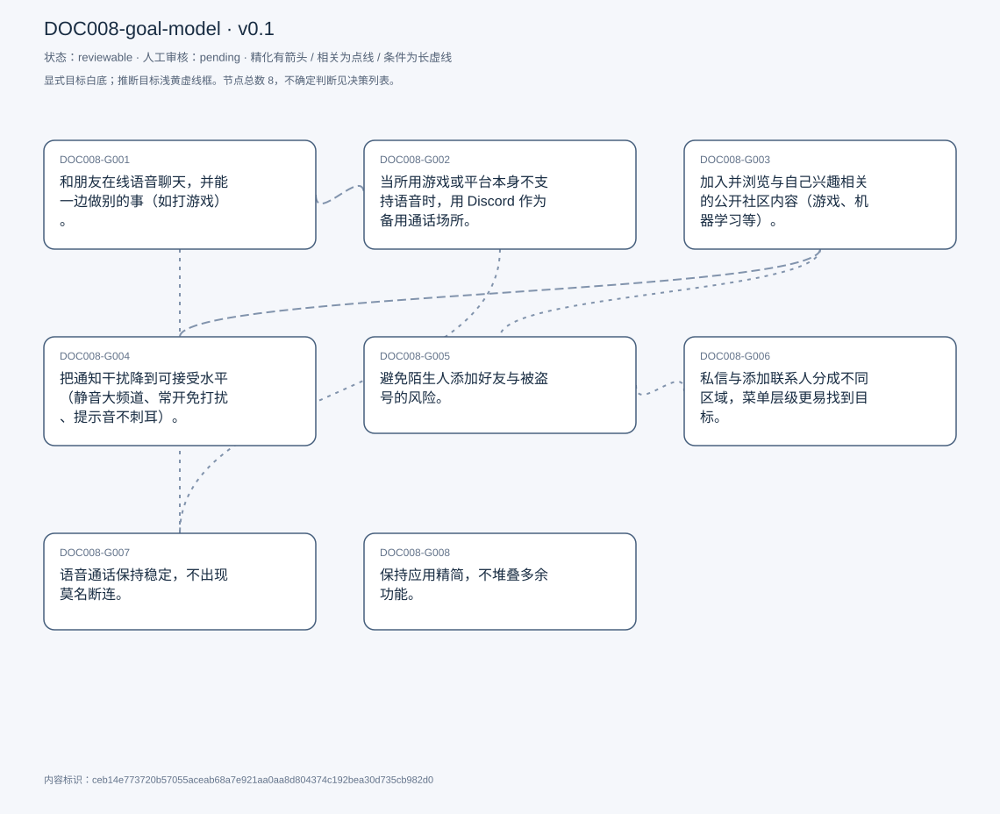
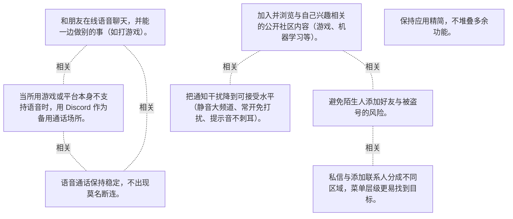

# 目标模型说明

模型：DOC008-goal-model；版本：v0.1

交付状态：reviewable；结构：passed；人工审核：pending

[交互模型](goal-model.html) · [矢量图](goal-model.svg) · [权威数据](goal-model.json)

## 目标图

## 目标

| 编号 | 表述 | 来源 | 情境 | 证据 |
|---|---|---|---|---|
| DOC008-G001 | 和朋友在线语音聊天，并能一边做别的事（如打游戏）。 | explicit | 自述为主要目标；偏群聊与语音通话，不太用发帖功能 | E0001, E0002 |
| DOC008-G002 | 当所用游戏或平台本身不支持语音时，用 Discord 作为备用通话场所。 | explicit | 触发条件：一起玩的人所在平台不支持语音或组队通话 | E0003, E0004 |
| DOC008-G003 | 加入并浏览与自己兴趣相关的公开社区内容（游戏、机器学习等）。 | explicit | 以围观为主，自己很少发言；社区按主题划分（Genshin Impact、机器学习、Valorant、Hugging Face） | E0005, E0006, E0007, E0008 |
| DOC008-G004 | 把通知干扰降到可接受水平（静音大频道、常开免打扰、提示音不刺耳）。 | explicit | 现状手段：静音大频道、长期开启 Do Not Disturb；额外诉求：更换更悦耳的通知音 | E0009, E0010, E0011, E0012 |
| DOC008-G005 | 避免陌生人添加好友与被盗号的风险。 | explicit | 经历：无共同频道的陌生账号频繁发好友请求；担忧来源：听说他人账号被盗，原因不明 | E0013, E0014, E0015 |
| DOC008-G006 | 私信与添加联系人分成不同区域，菜单层级更易找到目标。 | explicit | 对照：其他社交应用把私信与添加联系人分开；现状：两者混在同一菜单，界面拥挤 | E0016, E0017, E0018 |
| DOC008-G007 | 语音通话保持稳定，不出现莫名断连。 | explicit | 对照：同期其他网络活动正常，问题只在 Discord 通话；当前应对：只能等它自行恢复 | E0019, E0020, E0021 |
| DOC008-G008 | 保持应用精简，不堆叠多余功能。 | explicit | 受访者把「bare、没有 fluff」当作优点，与其他社交应用的臃肿对比 | E0022, E0023 |

## 关系判断（含不确定与无关系）

- DOC008-G001 / DOC008-G002：related。两者共用同一功能（语音/视频通话），差别只在场景：G001 是日常与朋友通话，G002 是对方平台不支持时的替代场所；G002 是 G001 的情境补位而非其范围具体化，故为 related。
- DOC008-G001 / DOC008-G003：none。DOC008-G001 的对象是与朋友语音聊天并同时做别的事（T005），DOC008-G003 的对象是加入并浏览兴趣社区内容（T021/T031）；两处分别出自不同话题段，原文未在二者之间建立因果、手段、评价或情境包含关系，本次评估口径内未建立可采用关系。
- DOC008-G001 / DOC008-G004：none。DOC008-G001 的对象是与朋友语音聊天并同时做别的事（T005），DOC008-G004 的对象是把通知干扰降到可接受水平（T047-T056）；两处分别出自不同话题段，原文未在二者之间建立因果、手段、评价或情境包含关系，本次评估口径内未建立可采用关系。
- DOC008-G001 / DOC008-G005：none。DOC008-G001 的对象是与朋友语音聊天并同时做别的事（T005），DOC008-G005 的对象是避免陌生加好友与盗号风险（T061/T063）；两处分别出自不同话题段，原文未在二者之间建立因果、手段、评价或情境包含关系，本次评估口径内未建立可采用关系。
- DOC008-G001 / DOC008-G006：none。DOC008-G001 的对象是与朋友语音聊天并同时做别的事（T005），DOC008-G006 的对象是私信与加好友分区、菜单易导航（T089-T093）；两处分别出自不同话题段，原文未在二者之间建立因果、手段、评价或情境包含关系，本次评估口径内未建立可采用关系。
- DOC008-G001 / DOC008-G007：related。T071 描述的断连正是发生在「in a call with some of my friends」的场景里，通话稳定性直接决定 G001 能否达成；但 G007 是可用性条件、G001 是用途，非精化。
- DOC008-G001 / DOC008-G008：none。DOC008-G001 的对象是与朋友语音聊天并同时做别的事（T005），DOC008-G008 的对象是保持应用精简无冗余（T037）；两处分别出自不同话题段，原文未在二者之间建立因果、手段、评价或情境包含关系，本次评估口径内未建立可采用关系。
- DOC008-G002 / DOC008-G003：none。DOC008-G002 的对象是作为平台不支持时的备用通话场所（T013），DOC008-G003 的对象是加入并浏览兴趣社区内容（T021/T031）；两处分别出自不同话题段，原文未在二者之间建立因果、手段、评价或情境包含关系，本次评估口径内未建立可采用关系。
- DOC008-G002 / DOC008-G004：none。DOC008-G002 的对象是作为平台不支持时的备用通话场所（T013），DOC008-G004 的对象是把通知干扰降到可接受水平（T047-T056）；两处分别出自不同话题段，原文未在二者之间建立因果、手段、评价或情境包含关系，本次评估口径内未建立可采用关系。
- DOC008-G002 / DOC008-G005：none。DOC008-G002 的对象是作为平台不支持时的备用通话场所（T013），DOC008-G005 的对象是避免陌生加好友与盗号风险（T061/T063）；两处分别出自不同话题段，原文未在二者之间建立因果、手段、评价或情境包含关系，本次评估口径内未建立可采用关系。
- DOC008-G002 / DOC008-G006：none。DOC008-G002 的对象是作为平台不支持时的备用通话场所（T013），DOC008-G006 的对象是私信与加好友分区、菜单易导航（T089-T093）；两处分别出自不同话题段，原文未在二者之间建立因果、手段、评价或情境包含关系，本次评估口径内未建立可采用关系。
- DOC008-G002 / DOC008-G007：related。G002 把 Discord 当作备用通话场所，若通话本身不稳定（T071-T073），备用价值即被削弱；二者同属通话能力的两个侧面。
- DOC008-G002 / DOC008-G008：none。DOC008-G002 的对象是作为平台不支持时的备用通话场所（T013），DOC008-G008 的对象是保持应用精简无冗余（T037）；两处分别出自不同话题段，原文未在二者之间建立因果、手段、评价或情境包含关系，本次评估口径内未建立可采用关系。
- DOC008-G003 / DOC008-G004：related。T049 直接把两者连起来：因为加入的都是公开大社区，「they would just constantly be going off」，所以把大频道全部静音。社区规模是通知过载的直接来源。
- DOC008-G003 / DOC008-G005：related。T061 用「we have like no shared no shared like discord channels」作为陌生加好友可疑的依据，说明该风险与公开社区暴露面相关；但一个是参与内容、一个是账号安全，非精化。
- DOC008-G003 / DOC008-G006：none。DOC008-G003 的对象是加入并浏览兴趣社区内容（T021/T031），DOC008-G006 的对象是私信与加好友分区、菜单易导航（T089-T093）；两处分别出自不同话题段，原文未在二者之间建立因果、手段、评价或情境包含关系，本次评估口径内未建立可采用关系。
- DOC008-G003 / DOC008-G007：none。DOC008-G003 的对象是加入并浏览兴趣社区内容（T021/T031），DOC008-G007 的对象是语音通话稳定不断连（T071/T073）；两处分别出自不同话题段，原文未在二者之间建立因果、手段、评价或情境包含关系，本次评估口径内未建立可采用关系。
- DOC008-G003 / DOC008-G008：none。DOC008-G003 的对象是加入并浏览兴趣社区内容（T021/T031），DOC008-G008 的对象是保持应用精简无冗余（T037）；两处分别出自不同话题段，原文未在二者之间建立因果、手段、评价或情境包含关系，本次评估口径内未建立可采用关系。
- DOC008-G004 / DOC008-G005：none。DOC008-G004 的对象是把通知干扰降到可接受水平（T047-T056），DOC008-G005 的对象是避免陌生加好友与盗号风险（T061/T063）；两处分别出自不同话题段，原文未在二者之间建立因果、手段、评价或情境包含关系，本次评估口径内未建立可采用关系。
- DOC008-G004 / DOC008-G006：none。DOC008-G004 的对象是把通知干扰降到可接受水平（T047-T056），DOC008-G006 的对象是私信与加好友分区、菜单易导航（T089-T093）；两处分别出自不同话题段，原文未在二者之间建立因果、手段、评价或情境包含关系，本次评估口径内未建立可采用关系。
- DOC008-G004 / DOC008-G007：none。DOC008-G004 的对象是把通知干扰降到可接受水平（T047-T056），DOC008-G007 的对象是语音通话稳定不断连（T071/T073）；两处分别出自不同话题段，原文未在二者之间建立因果、手段、评价或情境包含关系，本次评估口径内未建立可采用关系。
- DOC008-G004 / DOC008-G008：none。DOC008-G004 的对象是把通知干扰降到可接受水平（T047-T056），DOC008-G008 的对象是保持应用精简无冗余（T037）；两处分别出自不同话题段，原文未在二者之间建立因果、手段、评价或情境包含关系，本次评估口径内未建立可采用关系。
- DOC008-G005 / DOC008-G006：related。T089 提到其他应用把「adding connections」与私信分开，而 Discord 混在同一菜单；加好友入口的组织方式同时影响安全感知与导航效率，二者在同一菜单上相接。
- DOC008-G005 / DOC008-G007：none。DOC008-G005 的对象是避免陌生加好友与盗号风险（T061/T063），DOC008-G007 的对象是语音通话稳定不断连（T071/T073）；两处分别出自不同话题段，原文未在二者之间建立因果、手段、评价或情境包含关系，本次评估口径内未建立可采用关系。
- DOC008-G005 / DOC008-G008：none。DOC008-G005 的对象是避免陌生加好友与盗号风险（T061/T063），DOC008-G008 的对象是保持应用精简无冗余（T037）；两处分别出自不同话题段，原文未在二者之间建立因果、手段、评价或情境包含关系，本次评估口径内未建立可采用关系。
- DOC008-G006 / DOC008-G007：none。DOC008-G006 的对象是私信与加好友分区、菜单易导航（T089-T093），DOC008-G007 的对象是语音通话稳定不断连（T071/T073）；两处分别出自不同话题段，原文未在二者之间建立因果、手段、评价或情境包含关系，本次评估口径内未建立可采用关系。
- DOC008-G006 / DOC008-G008：uncertain。两者可能冲突也可能相容：T037 把「bare、no fluff」当作优点，倾向不加功能；T089-T093 又要求把私信与加好友拆开、减少菜单拥挤。若「拆分」只是重排现有元素则与精简一致，若需新增分区与设置项则相悖；受访者未就二者的取舍表态，无法裁决，故记为不确定。
- DOC008-G007 / DOC008-G008：none。DOC008-G007 的对象是语音通话稳定不断连（T071/T073），DOC008-G008 的对象是保持应用精简无冗余（T037）；两处分别出自不同话题段，原文未在二者之间建立因果、手段、评价或情境包含关系，本次评估口径内未建立可采用关系。

## 证据

### E0001 · DOC008:S006

> primary goal is just to like talk to my friends online. And also, like voice calls. we can talk to each other, while doing other things like playing games.

原件位置：{&quot;line_start&quot;: 6, &quot;line_end&quot;: 6, &quot;start_char&quot;: 1097, &quot;end_char&quot;: 1278}

### E0002 · DOC008:S004

> I lean more towards the like, the group chat functions. And like the video calls and the texting, direct, messaging.

原件位置：{&quot;line_start&quot;: 4, &quot;line_end&quot;: 4, &quot;start_char&quot;: 628, &quot;end_char&quot;: 903}

### E0003 · DOC008:S014

> we use discord as like a secondary platform to host like the video call or whatnot.

原件位置：{&quot;line_start&quot;: 14, &quot;line_end&quot;: 14, &quot;start_char&quot;: 1784, &quot;end_char&quot;: 2062}

### E0004 · DOC008:S014

> It&#x27;s helpful for like when there&#x27;s like a platform that we want to talk to. Other people like don&#x27;t want to talk to each other. but the platform itself doesn&#x27;t support it.

原件位置：{&quot;line_start&quot;: 14, &quot;line_end&quot;: 14, &quot;start_char&quot;: 1784, &quot;end_char&quot;: 2062}

### E0005 · DOC008:S022

> there are a bunch of like public discords that you&#x27;re allowed to join.

原件位置：{&quot;line_start&quot;: 22, &quot;line_end&quot;: 22, &quot;start_char&quot;: 2596, &quot;end_char&quot;: 2702}

### E0006 · DOC008:S024

> Usually, it&#x27;s like different topics, like, I&#x27;m in one that&#x27;s about a game called Genshin impact.

原件位置：{&quot;line_start&quot;: 24, &quot;line_end&quot;: 24, &quot;start_char&quot;: 2740, &quot;end_char&quot;: 3047}

### E0007 · DOC008:S030

> I don&#x27;t really like contribute too much to it. But I like to read a lot of what other people are saying.

原件位置：{&quot;line_start&quot;: 30, &quot;line_end&quot;: 30, &quot;start_char&quot;: 3423, &quot;end_char&quot;: 3754}

### E0008 · DOC008:S032

> I just joined to like just kind of snoop around.

原件位置：{&quot;line_start&quot;: 32, &quot;line_end&quot;: 32, &quot;start_char&quot;: 3781, &quot;end_char&quot;: 4021}

### E0009 · DOC008:S048

> I&#x27;d say overall, the notifications are a little overwhelming.

原件位置：{&quot;line_start&quot;: 48, &quot;line_end&quot;: 48, &quot;start_char&quot;: 5402, &quot;end_char&quot;: 5483}

### E0010 · DOC008:S050

> A lot of the channels that I&#x27;m in especially the bigger ones I have muted because they would just constantly be going off

原件位置：{&quot;line_start&quot;: 50, &quot;line_end&quot;: 50, &quot;start_char&quot;: 5514, &quot;end_char&quot;: 5707}

### E0011 · DOC008:S054

> So I like I&#x27;m always on. Do not disturb

原件位置：{&quot;line_start&quot;: 54, &quot;line_end&quot;: 54, &quot;start_char&quot;: 5983, &quot;end_char&quot;: 6042}

### E0012 · DOC008:S056

> I think this group should find oh, like just a more pleasing sound for the notification.

原件位置：{&quot;line_start&quot;: 56, &quot;line_end&quot;: 56, &quot;start_char&quot;: 6084, &quot;end_char&quot;: 6213}

### E0013 · DOC008:S062

> I think I have run into a few times where, like random people that I don&#x27;t know are trying to add me as friends.

原件位置：{&quot;line_start&quot;: 62, &quot;line_end&quot;: 62, &quot;start_char&quot;: 6805, &quot;end_char&quot;: 7009}

### E0014 · DOC008:S064

> Is quite concerning

原件位置：{&quot;line_start&quot;: 64, &quot;line_end&quot;: 64, &quot;start_char&quot;: 7036, &quot;end_char&quot;: 7182}

### E0015 · DOC008:S064

> I&#x27;ve seen a few of so few people get hacked.

原件位置：{&quot;line_start&quot;: 64, &quot;line_end&quot;: 64, &quot;start_char&quot;: 7036, &quot;end_char&quot;: 7182}

### E0016 · DOC008:S090

> some some of the menus are a bit more a bit harder to navigate than others. Like the the the direct message, menu.

原件位置：{&quot;line_start&quot;: 90, &quot;line_end&quot;: 90, &quot;start_char&quot;: 10564, &quot;end_char&quot;: 10874}

### E0017 · DOC008:S090

> usually other other like social media apps. have a separation between your dms, and then like adding. adding connections.

原件位置：{&quot;line_start&quot;: 90, &quot;line_end&quot;: 90, &quot;start_char&quot;: 10564, &quot;end_char&quot;: 10874}

### E0018 · DOC008:S092

> But all of that is like slapped onto the same menu.

原件位置：{&quot;line_start&quot;: 92, &quot;line_end&quot;: 92, &quot;start_char&quot;: 10905, &quot;end_char&quot;: 10976}

### E0019 · DOC008:S072

> the discord call just kept on like cutting out and everything.

原件位置：{&quot;line_start&quot;: 72, &quot;line_end&quot;: 72, &quot;start_char&quot;: 8645, &quot;end_char&quot;: 8989}

### E0020 · DOC008:S074

> there&#x27;s sometimes just like discord has some like connectivity issues.

原件位置：{&quot;line_start&quot;: 74, &quot;line_end&quot;: 74, &quot;start_char&quot;: 9037, &quot;end_char&quot;: 9269}

### E0021 · DOC008:S078

> I kind of just manage it myself a lot of times. I just have to wait for a problem to like. Just roll over.

原件位置：{&quot;line_start&quot;: 78, &quot;line_end&quot;: 78, &quot;start_char&quot;: 9590, &quot;end_char&quot;: 9716}

### E0022 · DOC008:S038

> Discord overall is a pretty bare application. It doesn&#x27;t have like too much fluff to it.

原件位置：{&quot;line_start&quot;: 38, &quot;line_end&quot;: 38, &quot;start_char&quot;: 4475, &quot;end_char&quot;: 4632}

### E0023 · DOC008:S038

> it&#x27;s a it&#x27;s a pretty, I&#x27;d say.

原件位置：{&quot;line_start&quot;: 38, &quot;line_end&quot;: 38, &quot;start_char&quot;: 4475, &quot;end_char&quot;: 4632}

## 问题、限制与版本

- 两者可能冲突也可能相容：T037 把「bare、no fluff」当作优点，倾向不加功能；T089-T093 又要求把私信与加好友拆开、减少菜单拥挤。若「拆分」只是重排现有元素则与精简一致，若需新增分区与设置项则相悖；受访者未就二者的取舍表态，无法裁决，故记为不确定。
- 当前会话助手的开发判断，非独立盲测；无人工采纳记录。
- 结构检查已绑定当前版本；独立语义审查未执行；人工状态以实际审核记录为准。

内容标识：ceb14e773720b57055aceab68a7e921aa0aa8d804374c192bea30d735cb982d0

人工决定：

审核意见：
