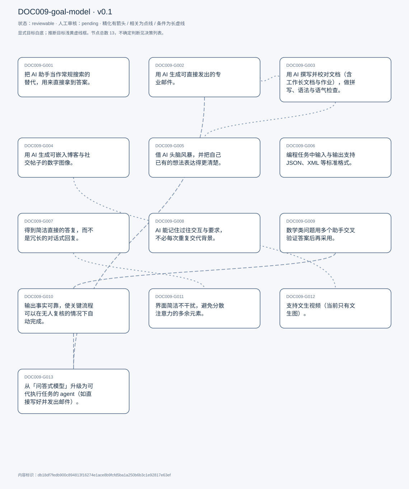
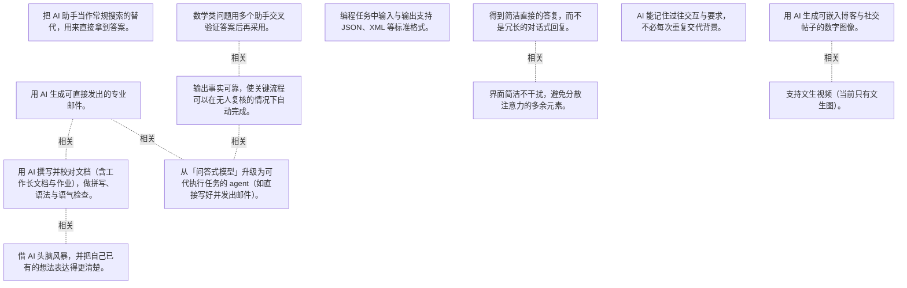

# 目标模型说明

模型：DOC009-goal-model；版本：v0.1

交付状态：reviewable；结构：passed；人工审核：pending

[交互模型](goal-model.html) · [矢量图](goal-model.svg) · [权威数据](goal-model.json)

## 目标图

## 目标

| 编号 | 表述 | 来源 | 情境 | 证据 |
|---|---|---|---|---|
| DOC009-G001 | 把 AI 助手当作常规搜索的替代，用来直接拿到答案。 | explicit | 例外：需要严格事实正确时仍会自己核查；频率：自述每天 15–20 次 | E0001, E0002, E0003 |
| DOC009-G002 | 用 AI 生成可直接发出的专业邮件。 | explicit | 以专业邮件为主，私人邮件较少；私人沟通倾向直接在聊天软件里写，因为跨站复制流程太麻烦 | E0004, E0005, E0006 |
| DOC009-G003 | 用 AI 撰写并校对文档（含工作长文档与作业），做拼写、语法与语气检查。 | explicit | 作业中仅在允许使用 AI 的科目里用；频率：写作与作业约每周 3–4 次 | E0007, E0008, E0009 |
| DOC009-G004 | 用 AI 生成可嵌入博客与社交帖子的数字图像。 | explicit | 动机：自己不会画图，AI 让产出看起来专业；收益：显著加快配图制作 | E0010, E0011 |
| DOC009-G005 | 借 AI 头脑风暴，并把自己已有的想法表达得更清楚。 | explicit | 自述为写作与作业场景下的两个主要用途之一 | E0012, E0013 |
| DOC009-G006 | 编程任务中输入与输出支持 JSON、XML 等标准格式。 | explicit | 现状：仅支持自然语言处理与输出；场景：写代码时需要结构化格式 | E0014, E0015 |
| DOC009-G007 | 得到简洁直接的答复，而不是冗长的对话式回复。 | explicit | 理由：用 AI 是为提高效率，时间关键 | E0016, E0017 |
| DOC009-G008 | AI 能记住过往交互与要求，不必每次重复交代背景。 | explicit | 期望记忆内容包括历史对话与个人要求 | E0018, E0019 |
| DOC009-G009 | 数学类问题用多个助手交叉验证答案后再采用。 | explicit | 语言类任务不必比较，任选其一即可；原因：各模型在数学上都容易出错 | E0020, E0021 |
| DOC009-G010 | 输出事实可靠，使关键流程可以在无人复核的情况下自动完成。 | explicit | 现状：幻觉导致必须有人工把关，因此若干流程无法自动化；受访者认为这需要技术突破，自己提不出解法 | E0022, E0023, E0024 |
| DOC009-G011 | 界面简洁不干扰，避免分散注意力的多余元素。 | explicit | 对比：Perplexity 屏上信息过多、Gemini 网页设计让他出戏；偏好 ChatGPT 的部分原因 | E0025, E0026 |
| DOC009-G012 | 支持文生视频（当前只有文生图）。 | explicit | 已知业界在做，但尚未见到产品化 | E0027, E0028 |
| DOC009-G013 | 从「问答式模型」升级为可代执行任务的 agent（如直接写好并发出邮件）。 | explicit | 期望形态：描述任务后由 agent 自行操作外部工具完成；举例：自动打开邮件客户端、撰写并发送 | E0029, E0030 |

## 关系判断（含不确定与无关系）

- DOC009-G001 / DOC009-G002：none。DOC009-G001 的对象是用 AI 替代常规搜索（T003），DOC009-G002 的对象是生成可直接发出的专业邮件（T011）；两处分别出自不同话题段，原文未在二者之间建立因果、手段、评价或情境包含关系，本次评估口径内未建立可采用关系。
- DOC009-G001 / DOC009-G003：none。DOC009-G001 的对象是用 AI 替代常规搜索（T003），DOC009-G003 的对象是撰写并校对文档与作业（T009/T021）；两处分别出自不同话题段，原文未在二者之间建立因果、手段、评价或情境包含关系，本次评估口径内未建立可采用关系。
- DOC009-G001 / DOC009-G004：none。DOC009-G001 的对象是用 AI 替代常规搜索（T003），DOC009-G004 的对象是生成可嵌入博文的数字图像（T013）；两处分别出自不同话题段，原文未在二者之间建立因果、手段、评价或情境包含关系，本次评估口径内未建立可采用关系。
- DOC009-G001 / DOC009-G005：none。DOC009-G001 的对象是用 AI 替代常规搜索（T003），DOC009-G005 的对象是用 AI 头脑风暴并优化表达（T017/T021）；两处分别出自不同话题段，原文未在二者之间建立因果、手段、评价或情境包含关系，本次评估口径内未建立可采用关系。
- DOC009-G001 / DOC009-G006：none。DOC009-G001 的对象是用 AI 替代常规搜索（T003），DOC009-G006 的对象是编程输入输出支持 JSON/XML（T027）；两处分别出自不同话题段，原文未在二者之间建立因果、手段、评价或情境包含关系，本次评估口径内未建立可采用关系。
- DOC009-G001 / DOC009-G007：none。DOC009-G001 的对象是用 AI 替代常规搜索（T003），DOC009-G007 的对象是回复简洁不冗长（T031）；两处分别出自不同话题段，原文未在二者之间建立因果、手段、评价或情境包含关系，本次评估口径内未建立可采用关系。
- DOC009-G001 / DOC009-G008：none。DOC009-G001 的对象是用 AI 替代常规搜索（T003），DOC009-G008 的对象是跨会话记住过往要求（T033）；两处分别出自不同话题段，原文未在二者之间建立因果、手段、评价或情境包含关系，本次评估口径内未建立可采用关系。
- DOC009-G001 / DOC009-G009：none。DOC009-G001 的对象是用 AI 替代常规搜索（T003），DOC009-G009 的对象是数学题多助手交叉验证（T035）；两处分别出自不同话题段，原文未在二者之间建立因果、手段、评价或情境包含关系，本次评估口径内未建立可采用关系。
- DOC009-G001 / DOC009-G010：uncertain。两处表态方向相左：T003 说除严格事实场景外「I defer to any assistant」，把 AI 当默认答案来源；T041-T043 又说幻觉使其「incompletely reliable」、关键任务必须人工复核。可以解释为按任务重要性分层，也可以解释为对同一批工具同时持有依赖与不信任；受访者未给出分界，无法裁决，故记为不确定。
- DOC009-G001 / DOC009-G011：none。DOC009-G001 的对象是用 AI 替代常规搜索（T003），DOC009-G011 的对象是界面简洁不干扰（T053）；两处分别出自不同话题段，原文未在二者之间建立因果、手段、评价或情境包含关系，本次评估口径内未建立可采用关系。
- DOC009-G001 / DOC009-G012：none。DOC009-G001 的对象是用 AI 替代常规搜索（T003），DOC009-G012 的对象是支持文生视频（T055）；两处分别出自不同话题段，原文未在二者之间建立因果、手段、评价或情境包含关系，本次评估口径内未建立可采用关系。
- DOC009-G001 / DOC009-G013：none。DOC009-G001 的对象是用 AI 替代常规搜索（T003），DOC009-G013 的对象是升级为可代执行任务的 agent（T055）；两处分别出自不同话题段，原文未在二者之间建立因果、手段、评价或情境包含关系，本次评估口径内未建立可采用关系。
- DOC009-G002 / DOC009-G003：related。T009 把「composing emails」与「writing and proofreading documents」并列为三大用途，二者同属书面产出任务，共享「少量提示即可成稿」的使用方式；但产出物与场景不同，非精化。
- DOC009-G002 / DOC009-G004：none。DOC009-G002 的对象是生成可直接发出的专业邮件（T011），DOC009-G004 的对象是生成可嵌入博文的数字图像（T013）；两处分别出自不同话题段，原文未在二者之间建立因果、手段、评价或情境包含关系，本次评估口径内未建立可采用关系。
- DOC009-G002 / DOC009-G005：none。DOC009-G002 的对象是生成可直接发出的专业邮件（T011），DOC009-G005 的对象是用 AI 头脑风暴并优化表达（T017/T021）；两处分别出自不同话题段，原文未在二者之间建立因果、手段、评价或情境包含关系，本次评估口径内未建立可采用关系。
- DOC009-G002 / DOC009-G006：none。DOC009-G002 的对象是生成可直接发出的专业邮件（T011），DOC009-G006 的对象是编程输入输出支持 JSON/XML（T027）；两处分别出自不同话题段，原文未在二者之间建立因果、手段、评价或情境包含关系，本次评估口径内未建立可采用关系。
- DOC009-G002 / DOC009-G007：none。DOC009-G002 的对象是生成可直接发出的专业邮件（T011），DOC009-G007 的对象是回复简洁不冗长（T031）；两处分别出自不同话题段，原文未在二者之间建立因果、手段、评价或情境包含关系，本次评估口径内未建立可采用关系。
- DOC009-G002 / DOC009-G008：none。DOC009-G002 的对象是生成可直接发出的专业邮件（T011），DOC009-G008 的对象是跨会话记住过往要求（T033）；两处分别出自不同话题段，原文未在二者之间建立因果、手段、评价或情境包含关系，本次评估口径内未建立可采用关系。
- DOC009-G002 / DOC009-G009：none。DOC009-G002 的对象是生成可直接发出的专业邮件（T011），DOC009-G009 的对象是数学题多助手交叉验证（T035）；两处分别出自不同话题段，原文未在二者之间建立因果、手段、评价或情境包含关系，本次评估口径内未建立可采用关系。
- DOC009-G002 / DOC009-G010：none。DOC009-G002 的对象是生成可直接发出的专业邮件（T011），DOC009-G010 的对象是输出可靠到可无人复核自动化（T041/T043）；两处分别出自不同话题段，原文未在二者之间建立因果、手段、评价或情境包含关系，本次评估口径内未建立可采用关系。
- DOC009-G002 / DOC009-G011：none。DOC009-G002 的对象是生成可直接发出的专业邮件（T011），DOC009-G011 的对象是界面简洁不干扰（T053）；两处分别出自不同话题段，原文未在二者之间建立因果、手段、评价或情境包含关系，本次评估口径内未建立可采用关系。
- DOC009-G002 / DOC009-G012：none。DOC009-G002 的对象是生成可直接发出的专业邮件（T011），DOC009-G012 的对象是支持文生视频（T055）；两处分别出自不同话题段，原文未在二者之间建立因果、手段、评价或情境包含关系，本次评估口径内未建立可采用关系。
- DOC009-G002 / DOC009-G013：related。T055 正是用邮件场景说明 agent 设想：现在要「copy and paste in my email client」，理想是「it just goes ahead and opens the email client of its own, composes the email and sends it」。G013 是同一任务的下一成熟度阶段，手段升级不等于精化。
- DOC009-G003 / DOC009-G004：none。DOC009-G003 的对象是撰写并校对文档与作业（T009/T021），DOC009-G004 的对象是生成可嵌入博文的数字图像（T013）；两处分别出自不同话题段，原文未在二者之间建立因果、手段、评价或情境包含关系，本次评估口径内未建立可采用关系。
- DOC009-G003 / DOC009-G005：related。T017 说明头脑风暴直接服务于写作与作业：「for writing documents and for assignments... it helps me like brainstorm」。G005 是 G003 的前置环节，非其范围具体化。
- DOC009-G003 / DOC009-G006：none。DOC009-G003 的对象是撰写并校对文档与作业（T009/T021），DOC009-G006 的对象是编程输入输出支持 JSON/XML（T027）；两处分别出自不同话题段，原文未在二者之间建立因果、手段、评价或情境包含关系，本次评估口径内未建立可采用关系。
- DOC009-G003 / DOC009-G007：none。DOC009-G003 的对象是撰写并校对文档与作业（T009/T021），DOC009-G007 的对象是回复简洁不冗长（T031）；两处分别出自不同话题段，原文未在二者之间建立因果、手段、评价或情境包含关系，本次评估口径内未建立可采用关系。
- DOC009-G003 / DOC009-G008：none。DOC009-G003 的对象是撰写并校对文档与作业（T009/T021），DOC009-G008 的对象是跨会话记住过往要求（T033）；两处分别出自不同话题段，原文未在二者之间建立因果、手段、评价或情境包含关系，本次评估口径内未建立可采用关系。
- DOC009-G003 / DOC009-G009：none。DOC009-G003 的对象是撰写并校对文档与作业（T009/T021），DOC009-G009 的对象是数学题多助手交叉验证（T035）；两处分别出自不同话题段，原文未在二者之间建立因果、手段、评价或情境包含关系，本次评估口径内未建立可采用关系。
- DOC009-G003 / DOC009-G010：none。DOC009-G003 的对象是撰写并校对文档与作业（T009/T021），DOC009-G010 的对象是输出可靠到可无人复核自动化（T041/T043）；两处分别出自不同话题段，原文未在二者之间建立因果、手段、评价或情境包含关系，本次评估口径内未建立可采用关系。
- DOC009-G003 / DOC009-G011：none。DOC009-G003 的对象是撰写并校对文档与作业（T009/T021），DOC009-G011 的对象是界面简洁不干扰（T053）；两处分别出自不同话题段，原文未在二者之间建立因果、手段、评价或情境包含关系，本次评估口径内未建立可采用关系。
- DOC009-G003 / DOC009-G012：none。DOC009-G003 的对象是撰写并校对文档与作业（T009/T021），DOC009-G012 的对象是支持文生视频（T055）；两处分别出自不同话题段，原文未在二者之间建立因果、手段、评价或情境包含关系，本次评估口径内未建立可采用关系。
- DOC009-G003 / DOC009-G013：none。DOC009-G003 的对象是撰写并校对文档与作业（T009/T021），DOC009-G013 的对象是升级为可代执行任务的 agent（T055）；两处分别出自不同话题段，原文未在二者之间建立因果、手段、评价或情境包含关系，本次评估口径内未建立可采用关系。
- DOC009-G004 / DOC009-G005：none。DOC009-G004 的对象是生成可嵌入博文的数字图像（T013），DOC009-G005 的对象是用 AI 头脑风暴并优化表达（T017/T021）；两处分别出自不同话题段，原文未在二者之间建立因果、手段、评价或情境包含关系，本次评估口径内未建立可采用关系。
- DOC009-G004 / DOC009-G006：none。DOC009-G004 的对象是生成可嵌入博文的数字图像（T013），DOC009-G006 的对象是编程输入输出支持 JSON/XML（T027）；两处分别出自不同话题段，原文未在二者之间建立因果、手段、评价或情境包含关系，本次评估口径内未建立可采用关系。
- DOC009-G004 / DOC009-G007：none。DOC009-G004 的对象是生成可嵌入博文的数字图像（T013），DOC009-G007 的对象是回复简洁不冗长（T031）；两处分别出自不同话题段，原文未在二者之间建立因果、手段、评价或情境包含关系，本次评估口径内未建立可采用关系。
- DOC009-G004 / DOC009-G008：none。DOC009-G004 的对象是生成可嵌入博文的数字图像（T013），DOC009-G008 的对象是跨会话记住过往要求（T033）；两处分别出自不同话题段，原文未在二者之间建立因果、手段、评价或情境包含关系，本次评估口径内未建立可采用关系。
- DOC009-G004 / DOC009-G009：none。DOC009-G004 的对象是生成可嵌入博文的数字图像（T013），DOC009-G009 的对象是数学题多助手交叉验证（T035）；两处分别出自不同话题段，原文未在二者之间建立因果、手段、评价或情境包含关系，本次评估口径内未建立可采用关系。
- DOC009-G004 / DOC009-G010：none。DOC009-G004 的对象是生成可嵌入博文的数字图像（T013），DOC009-G010 的对象是输出可靠到可无人复核自动化（T041/T043）；两处分别出自不同话题段，原文未在二者之间建立因果、手段、评价或情境包含关系，本次评估口径内未建立可采用关系。
- DOC009-G004 / DOC009-G011：none。DOC009-G004 的对象是生成可嵌入博文的数字图像（T013），DOC009-G011 的对象是界面简洁不干扰（T053）；两处分别出自不同话题段，原文未在二者之间建立因果、手段、评价或情境包含关系，本次评估口径内未建立可采用关系。
- DOC009-G004 / DOC009-G012：related。T055 把二者放在同一句里对照：「They do support text image right now. But text to video would be in useful addition」，同属多媒体生成能力，只是模态不同。
- DOC009-G004 / DOC009-G013：none。DOC009-G004 的对象是生成可嵌入博文的数字图像（T013），DOC009-G013 的对象是升级为可代执行任务的 agent（T055）；两处分别出自不同话题段，原文未在二者之间建立因果、手段、评价或情境包含关系，本次评估口径内未建立可采用关系。
- DOC009-G005 / DOC009-G006：none。DOC009-G005 的对象是用 AI 头脑风暴并优化表达（T017/T021），DOC009-G006 的对象是编程输入输出支持 JSON/XML（T027）；两处分别出自不同话题段，原文未在二者之间建立因果、手段、评价或情境包含关系，本次评估口径内未建立可采用关系。
- DOC009-G005 / DOC009-G007：none。DOC009-G005 的对象是用 AI 头脑风暴并优化表达（T017/T021），DOC009-G007 的对象是回复简洁不冗长（T031）；两处分别出自不同话题段，原文未在二者之间建立因果、手段、评价或情境包含关系，本次评估口径内未建立可采用关系。
- DOC009-G005 / DOC009-G008：none。DOC009-G005 的对象是用 AI 头脑风暴并优化表达（T017/T021），DOC009-G008 的对象是跨会话记住过往要求（T033）；两处分别出自不同话题段，原文未在二者之间建立因果、手段、评价或情境包含关系，本次评估口径内未建立可采用关系。
- DOC009-G005 / DOC009-G009：none。DOC009-G005 的对象是用 AI 头脑风暴并优化表达（T017/T021），DOC009-G009 的对象是数学题多助手交叉验证（T035）；两处分别出自不同话题段，原文未在二者之间建立因果、手段、评价或情境包含关系，本次评估口径内未建立可采用关系。
- DOC009-G005 / DOC009-G010：none。DOC009-G005 的对象是用 AI 头脑风暴并优化表达（T017/T021），DOC009-G010 的对象是输出可靠到可无人复核自动化（T041/T043）；两处分别出自不同话题段，原文未在二者之间建立因果、手段、评价或情境包含关系，本次评估口径内未建立可采用关系。
- DOC009-G005 / DOC009-G011：none。DOC009-G005 的对象是用 AI 头脑风暴并优化表达（T017/T021），DOC009-G011 的对象是界面简洁不干扰（T053）；两处分别出自不同话题段，原文未在二者之间建立因果、手段、评价或情境包含关系，本次评估口径内未建立可采用关系。
- DOC009-G005 / DOC009-G012：none。DOC009-G005 的对象是用 AI 头脑风暴并优化表达（T017/T021），DOC009-G012 的对象是支持文生视频（T055）；两处分别出自不同话题段，原文未在二者之间建立因果、手段、评价或情境包含关系，本次评估口径内未建立可采用关系。
- DOC009-G005 / DOC009-G013：none。DOC009-G005 的对象是用 AI 头脑风暴并优化表达（T017/T021），DOC009-G013 的对象是升级为可代执行任务的 agent（T055）；两处分别出自不同话题段，原文未在二者之间建立因果、手段、评价或情境包含关系，本次评估口径内未建立可采用关系。
- DOC009-G006 / DOC009-G007：none。DOC009-G006 的对象是编程输入输出支持 JSON/XML（T027），DOC009-G007 的对象是回复简洁不冗长（T031）；两处分别出自不同话题段，原文未在二者之间建立因果、手段、评价或情境包含关系，本次评估口径内未建立可采用关系。
- DOC009-G006 / DOC009-G008：none。DOC009-G006 的对象是编程输入输出支持 JSON/XML（T027），DOC009-G008 的对象是跨会话记住过往要求（T033）；两处分别出自不同话题段，原文未在二者之间建立因果、手段、评价或情境包含关系，本次评估口径内未建立可采用关系。
- DOC009-G006 / DOC009-G009：none。DOC009-G006 的对象是编程输入输出支持 JSON/XML（T027），DOC009-G009 的对象是数学题多助手交叉验证（T035）；两处分别出自不同话题段，原文未在二者之间建立因果、手段、评价或情境包含关系，本次评估口径内未建立可采用关系。
- DOC009-G006 / DOC009-G010：none。DOC009-G006 的对象是编程输入输出支持 JSON/XML（T027），DOC009-G010 的对象是输出可靠到可无人复核自动化（T041/T043）；两处分别出自不同话题段，原文未在二者之间建立因果、手段、评价或情境包含关系，本次评估口径内未建立可采用关系。
- DOC009-G006 / DOC009-G011：none。DOC009-G006 的对象是编程输入输出支持 JSON/XML（T027），DOC009-G011 的对象是界面简洁不干扰（T053）；两处分别出自不同话题段，原文未在二者之间建立因果、手段、评价或情境包含关系，本次评估口径内未建立可采用关系。
- DOC009-G006 / DOC009-G012：none。DOC009-G006 的对象是编程输入输出支持 JSON/XML（T027），DOC009-G012 的对象是支持文生视频（T055）；两处分别出自不同话题段，原文未在二者之间建立因果、手段、评价或情境包含关系，本次评估口径内未建立可采用关系。
- DOC009-G006 / DOC009-G013：none。DOC009-G006 的对象是编程输入输出支持 JSON/XML（T027），DOC009-G013 的对象是升级为可代执行任务的 agent（T055）；两处分别出自不同话题段，原文未在二者之间建立因果、手段、评价或情境包含关系，本次评估口径内未建立可采用关系。
- DOC009-G007 / DOC009-G008：none。DOC009-G007 的对象是回复简洁不冗长（T031），DOC009-G008 的对象是跨会话记住过往要求（T033）；两处分别出自不同话题段，原文未在二者之间建立因果、手段、评价或情境包含关系，本次评估口径内未建立可采用关系。
- DOC009-G007 / DOC009-G009：none。DOC009-G007 的对象是回复简洁不冗长（T031），DOC009-G009 的对象是数学题多助手交叉验证（T035）；两处分别出自不同话题段，原文未在二者之间建立因果、手段、评价或情境包含关系，本次评估口径内未建立可采用关系。
- DOC009-G007 / DOC009-G010：none。DOC009-G007 的对象是回复简洁不冗长（T031），DOC009-G010 的对象是输出可靠到可无人复核自动化（T041/T043）；两处分别出自不同话题段，原文未在二者之间建立因果、手段、评价或情境包含关系，本次评估口径内未建立可采用关系。
- DOC009-G007 / DOC009-G011：related。两者都指向减少认知负担：T031 要「brevity over verbose response」，T053 抱怨竞品「too much happening on the screen that it distracts me」；但一个是回复内容长度、一个是界面布局，非精化。
- DOC009-G007 / DOC009-G012：none。DOC009-G007 的对象是回复简洁不冗长（T031），DOC009-G012 的对象是支持文生视频（T055）；两处分别出自不同话题段，原文未在二者之间建立因果、手段、评价或情境包含关系，本次评估口径内未建立可采用关系。
- DOC009-G007 / DOC009-G013：none。DOC009-G007 的对象是回复简洁不冗长（T031），DOC009-G013 的对象是升级为可代执行任务的 agent（T055）；两处分别出自不同话题段，原文未在二者之间建立因果、手段、评价或情境包含关系，本次评估口径内未建立可采用关系。
- DOC009-G008 / DOC009-G009：none。DOC009-G008 的对象是跨会话记住过往要求（T033），DOC009-G009 的对象是数学题多助手交叉验证（T035）；两处分别出自不同话题段，原文未在二者之间建立因果、手段、评价或情境包含关系，本次评估口径内未建立可采用关系。
- DOC009-G008 / DOC009-G010：none。DOC009-G008 的对象是跨会话记住过往要求（T033），DOC009-G010 的对象是输出可靠到可无人复核自动化（T041/T043）；两处分别出自不同话题段，原文未在二者之间建立因果、手段、评价或情境包含关系，本次评估口径内未建立可采用关系。
- DOC009-G008 / DOC009-G011：none。DOC009-G008 的对象是跨会话记住过往要求（T033），DOC009-G011 的对象是界面简洁不干扰（T053）；两处分别出自不同话题段，原文未在二者之间建立因果、手段、评价或情境包含关系，本次评估口径内未建立可采用关系。
- DOC009-G008 / DOC009-G012：none。DOC009-G008 的对象是跨会话记住过往要求（T033），DOC009-G012 的对象是支持文生视频（T055）；两处分别出自不同话题段，原文未在二者之间建立因果、手段、评价或情境包含关系，本次评估口径内未建立可采用关系。
- DOC009-G008 / DOC009-G013：none。DOC009-G008 的对象是跨会话记住过往要求（T033），DOC009-G013 的对象是升级为可代执行任务的 agent（T055）；两处分别出自不同话题段，原文未在二者之间建立因果、手段、评价或情境包含关系，本次评估口径内未建立可采用关系。
- DOC009-G009 / DOC009-G010：related。T035 把数学易错归因于模型本身，T041 把同一问题表述为幻觉影响事实准确性；G009 是在 G010 未达成时的自保手段（多开助手互校），二者因果相连但层次不同。
- DOC009-G009 / DOC009-G011：none。DOC009-G009 的对象是数学题多助手交叉验证（T035），DOC009-G011 的对象是界面简洁不干扰（T053）；两处分别出自不同话题段，原文未在二者之间建立因果、手段、评价或情境包含关系，本次评估口径内未建立可采用关系。
- DOC009-G009 / DOC009-G012：none。DOC009-G009 的对象是数学题多助手交叉验证（T035），DOC009-G012 的对象是支持文生视频（T055）；两处分别出自不同话题段，原文未在二者之间建立因果、手段、评价或情境包含关系，本次评估口径内未建立可采用关系。
- DOC009-G009 / DOC009-G013：none。DOC009-G009 的对象是数学题多助手交叉验证（T035），DOC009-G013 的对象是升级为可代执行任务的 agent（T055）；两处分别出自不同话题段，原文未在二者之间建立因果、手段、评价或情境包含关系，本次评估口径内未建立可采用关系。
- DOC009-G010 / DOC009-G011：none。DOC009-G010 的对象是输出可靠到可无人复核自动化（T041/T043），DOC009-G011 的对象是界面简洁不干扰（T053）；两处分别出自不同话题段，原文未在二者之间建立因果、手段、评价或情境包含关系，本次评估口径内未建立可采用关系。
- DOC009-G010 / DOC009-G012：none。DOC009-G010 的对象是输出可靠到可无人复核自动化（T041/T043），DOC009-G012 的对象是支持文生视频（T055）；两处分别出自不同话题段，原文未在二者之间建立因果、手段、评价或情境包含关系，本次评估口径内未建立可采用关系。
- DOC009-G010 / DOC009-G013：related。T043 明确因果：因为幻觉必须有人工把关，所以「I have not been able to automate certain pipelines」；G013 的 agent 形态正需要这种无人复核的自动化，故 G010 是 G013 的前置条件。
- DOC009-G011 / DOC009-G012：none。DOC009-G011 的对象是界面简洁不干扰（T053），DOC009-G012 的对象是支持文生视频（T055）；两处分别出自不同话题段，原文未在二者之间建立因果、手段、评价或情境包含关系，本次评估口径内未建立可采用关系。
- DOC009-G011 / DOC009-G013：none。DOC009-G011 的对象是界面简洁不干扰（T053），DOC009-G013 的对象是升级为可代执行任务的 agent（T055）；两处分别出自不同话题段，原文未在二者之间建立因果、手段、评价或情境包含关系，本次评估口径内未建立可采用关系。
- DOC009-G012 / DOC009-G013：none。DOC009-G012 的对象是支持文生视频（T055），DOC009-G013 的对象是升级为可代执行任务的 agent（T055）；两处分别出自不同话题段，原文未在二者之间建立因果、手段、评价或情境包含关系，本次评估口径内未建立可采用关系。

## 证据

### E0001 · DOC009:S004

> They have Camus to serve as a replacement for a lot of traditional searching that I used to do

原件位置：{&quot;line_start&quot;: 4, &quot;line_end&quot;: 4, &quot;start_char&quot;: 672, &quot;end_char&quot;: 1227}

### E0002 · DOC009:S004

> unless I need them to be perfectly, factually correct these days, I defer to any assistant to get my results

原件位置：{&quot;line_start&quot;: 4, &quot;line_end&quot;: 4, &quot;start_char&quot;: 672, &quot;end_char&quot;: 1227}

### E0003 · DOC009:S006

> I use it 15 to 20 times daily.

原件位置：{&quot;line_start&quot;: 6, &quot;line_end&quot;: 6, &quot;start_char&quot;: 1306, &quot;end_char&quot;: 1358}

### E0004 · DOC009:S012

> I use it to compose professional emails, primarily, but to a lesser extent, personal emails as well.

原件位置：{&quot;line_start&quot;: 12, &quot;line_end&quot;: 12, &quot;start_char&quot;: 2203, &quot;end_char&quot;: 3107}

### E0005 · DOC009:S012

> with just a few prompts, I&#x27;m able to generate professional emails

原件位置：{&quot;line_start&quot;: 12, &quot;line_end&quot;: 12, &quot;start_char&quot;: 2203, &quot;end_char&quot;: 3107}

### E0006 · DOC009:S012

> things that I wish to communicate with people that I know personally, I tend to. Maybe you know just quickly whatsapp them

原件位置：{&quot;line_start&quot;: 12, &quot;line_end&quot;: 12, &quot;start_char&quot;: 2203, &quot;end_char&quot;: 3107}

### E0007 · DOC009:S010

> writing and proofreading documents

原件位置：{&quot;line_start&quot;: 10, &quot;line_end&quot;: 10, &quot;start_char&quot;: 1629, &quot;end_char&quot;: 1920}

### E0008 · DOC009:S022

> proofreading like documents that I&#x27;ve written myself, for which, like, I want spelling checks, grammar checks, tone checks

原件位置：{&quot;line_start&quot;: 22, &quot;line_end&quot;: 22, &quot;start_char&quot;: 5290, &quot;end_char&quot;: 5729}

### E0009 · DOC009:S018

> for for writing documents and for assignments, maybe 3 to 4 times a a week

原件位置：{&quot;line_start&quot;: 18, &quot;line_end&quot;: 18, &quot;start_char&quot;: 4197, &quot;end_char&quot;: 4717}

### E0010 · DOC009:S014

> I use them to create you know, digital art that I often embed in my blog posts or social media posts

原件位置：{&quot;line_start&quot;: 14, &quot;line_end&quot;: 14, &quot;start_char&quot;: 3393, &quot;end_char&quot;: 3733}

### E0011 · DOC009:S014

> I&#x27;m a terrible artist myself, but Gpt makes me look as though I&#x27;m not

原件位置：{&quot;line_start&quot;: 14, &quot;line_end&quot;: 14, &quot;start_char&quot;: 3393, &quot;end_char&quot;: 3733}

### E0012 · DOC009:S018

> it helps me like brainstorm, different ideas and articulate some of the ideas that I have of my own better

原件位置：{&quot;line_start&quot;: 18, &quot;line_end&quot;: 18, &quot;start_char&quot;: 4197, &quot;end_char&quot;: 4717}

### E0013 · DOC009:S022

> Brainstorming is one of the primary tasks for which I use an a assistant as well.

原件位置：{&quot;line_start&quot;: 22, &quot;line_end&quot;: 22, &quot;start_char&quot;: 5290, &quot;end_char&quot;: 5729}

### E0014 · DOC009:S028

> when I use a assistance for programming tasks, I often need the input or the output to be in certain formats. Json or Xml is an example

原件位置：{&quot;line_start&quot;: 28, &quot;line_end&quot;: 28, &quot;start_char&quot;: 6703, &quot;end_char&quot;: 7508}

### E0015 · DOC009:S028

> I think it would make sense if it is able to format these into other standardized formats that we use

原件位置：{&quot;line_start&quot;: 28, &quot;line_end&quot;: 28, &quot;start_char&quot;: 6703, &quot;end_char&quot;: 7508}

### E0016 · DOC009:S032

> I would definitely appreciate brevity over a a verbose response

原件位置：{&quot;line_start&quot;: 32, &quot;line_end&quot;: 32, &quot;start_char&quot;: 8382, &quot;end_char&quot;: 8766}

### E0017 · DOC009:S032

> having a succinct response to my question rather than having a big conversational response

原件位置：{&quot;line_start&quot;: 32, &quot;line_end&quot;: 32, &quot;start_char&quot;: 8382, &quot;end_char&quot;: 8766}

### E0018 · DOC009:S034

> I think it&#x27;s super important that I don&#x27;t have to repeat myself in every query or every conversation

原件位置：{&quot;line_start&quot;: 34, &quot;line_end&quot;: 34, &quot;start_char&quot;: 8872, &quot;end_char&quot;: 9213}

### E0019 · DOC009:S034

> hold some sort of memory or history of previous interactions

原件位置：{&quot;line_start&quot;: 34, &quot;line_end&quot;: 34, &quot;start_char&quot;: 8872, &quot;end_char&quot;: 9213}

### E0020 · DOC009:S036

> when it comes to solving mathematical problems, I often find the need to cross check the answers generated by any given a assistant with multiple others

原件位置：{&quot;line_start&quot;: 36, &quot;line_end&quot;: 36, &quot;start_char&quot;: 9489, &quot;end_char&quot;: 10220}

### E0021 · DOC009:S036

> they seem to be prone to making mistakes when it comes to math

原件位置：{&quot;line_start&quot;: 36, &quot;line_end&quot;: 36, &quot;start_char&quot;: 9489, &quot;end_char&quot;: 10220}

### E0022 · DOC009:S042

> the very nature of how the assistants have been trained make them very prone to hallucinations

原件位置：{&quot;line_start&quot;: 42, &quot;line_end&quot;: 42, &quot;start_char&quot;: 11116, &quot;end_char&quot;: 11775}

### E0023 · DOC009:S044

> I have not been able to completely automate certain pipelines, because that needs to be a human eye looking over the content

原件位置：{&quot;line_start&quot;: 44, &quot;line_end&quot;: 44, &quot;start_char&quot;: 11912, &quot;end_char&quot;: 12590}

### E0024 · DOC009:S042

> for tasks that are critical. They do need a human eye to go over them still

原件位置：{&quot;line_start&quot;: 42, &quot;line_end&quot;: 42, &quot;start_char&quot;: 11116, &quot;end_char&quot;: 11775}

### E0025 · DOC009:S054

> in the case of perplexity, I think there&#x27;s just too much happening on the screen that it distracts me

原件位置：{&quot;line_start&quot;: 54, &quot;line_end&quot;: 54, &quot;start_char&quot;: 14172, &quot;end_char&quot;: 14889}

### E0026 · DOC009:S054

> in the case of Gemini, it&#x27;s a simple case of the design of their web page. That kind of throws me off

原件位置：{&quot;line_start&quot;: 54, &quot;line_end&quot;: 54, &quot;start_char&quot;: 14172, &quot;end_char&quot;: 14889}

### E0027 · DOC009:S056

> If they could help me do text to video as well. They do support text image right now.

原件位置：{&quot;line_start&quot;: 56, &quot;line_end&quot;: 56, &quot;start_char&quot;: 15066, &quot;end_char&quot;: 16292}

### E0028 · DOC009:S056

> But text to video would be in useful addition.

原件位置：{&quot;line_start&quot;: 56, &quot;line_end&quot;: 56, &quot;start_char&quot;: 15066, &quot;end_char&quot;: 16292}

### E0029 · DOC009:S056

> If we can move from that model to having large language agents instead of large language models

原件位置：{&quot;line_start&quot;: 56, &quot;line_end&quot;: 56, &quot;start_char&quot;: 15066, &quot;end_char&quot;: 16292}

### E0030 · DOC009:S056

> it just goes ahead and opens the email client of its own, composes the email and sends it

原件位置：{&quot;line_start&quot;: 56, &quot;line_end&quot;: 56, &quot;start_char&quot;: 15066, &quot;end_char&quot;: 16292}

## 问题、限制与版本

- 两处表态方向相左：T003 说除严格事实场景外「I defer to any assistant」，把 AI 当默认答案来源；T041-T043 又说幻觉使其「incompletely reliable」、关键任务必须人工复核。可以解释为按任务重要性分层，也可以解释为对同一批工具同时持有依赖与不信任；受访者未给出分界，无法裁决，故记为不确定。
- 当前会话助手的开发判断，非独立盲测；无人工采纳记录。
- 结构检查已绑定当前版本；独立语义审查未执行；人工状态以实际审核记录为准。

内容标识：db18df7fedb900c894813f16274e1ace8b9fcfd5ba1a250b6b3c1e92817e63ef

人工决定：

审核意见：
