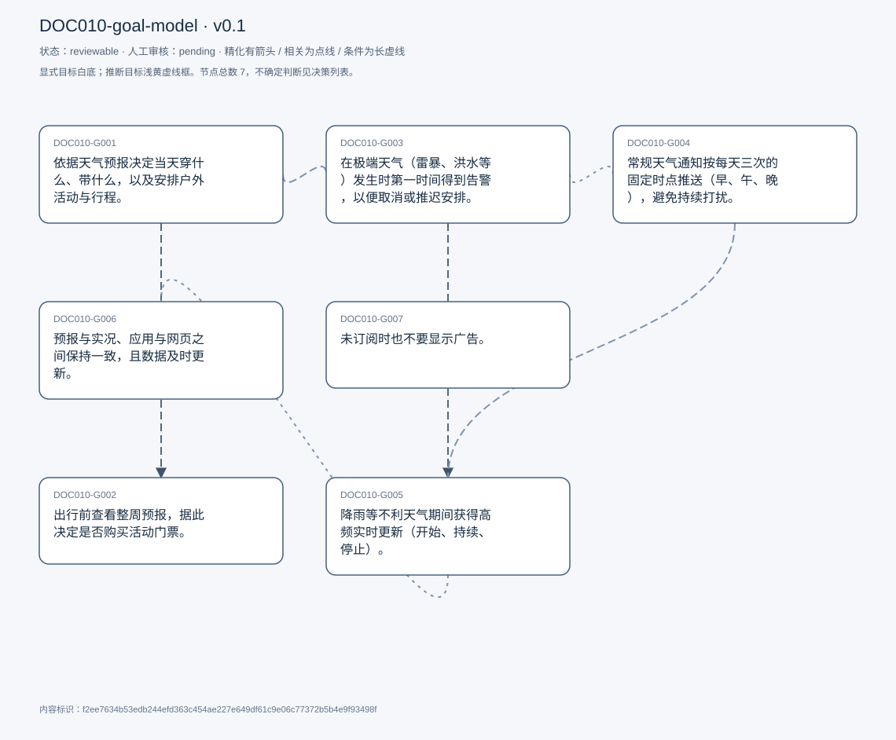
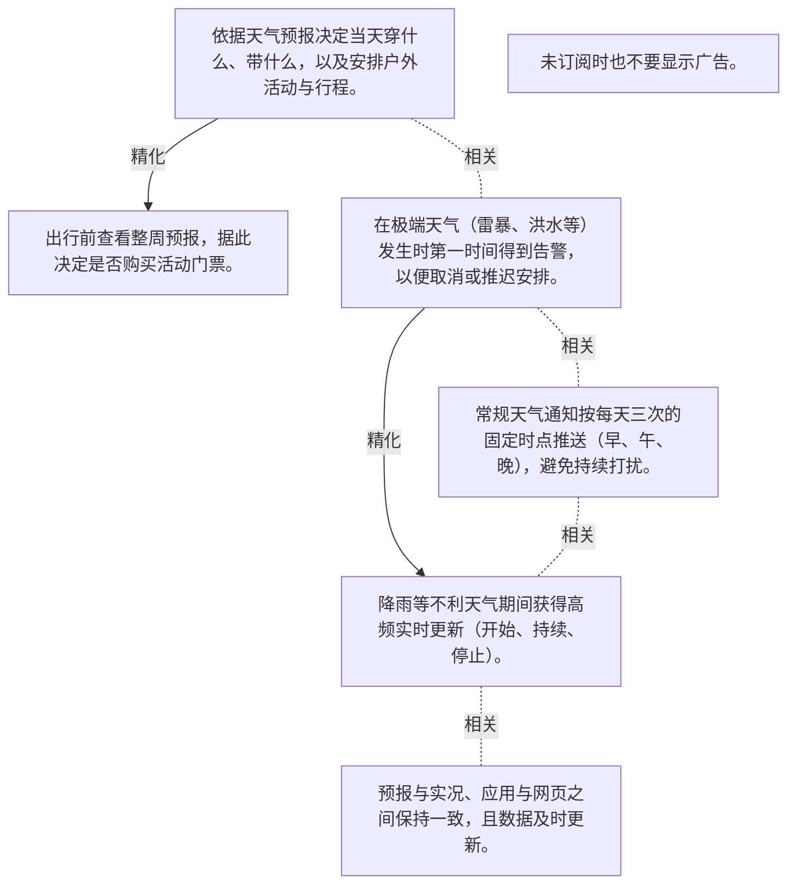

# 目标模型说明

模型：DOC010-goal-model；版本：v0.1

交付状态：reviewable；结构：passed；人工审核：pending

[交互模型](goal-model.html) · [矢量图](goal-model.svg) · [权威数据](goal-model.json)

## 目标图

## 目标

| 编号 | 表述 | 来源 | 情境 | 证据 |
|---|---|---|---|---|
| DOC010-G001 | 依据天气预报决定当天穿什么、带什么，以及安排户外活动与行程。 | explicit | 自述为主要用途；熟悉的地方（如久居的家乡）基本不查，只在陌生地点才需要熟悉天气 | E0001, E0002, E0003 |
| DOC010-G002 | 出行前查看整周预报，据此决定是否购买活动门票。 | explicit | 日常只看当天，只有旅行才拉长到整周；例：芝加哥六旗乐园，雨天或严寒时买票没有意义 | E0004, E0005, E0006 |
| DOC010-G003 | 在极端天气（雷暴、洪水等）发生时第一时间得到告警，以便取消或推迟安排。 | explicit | 现状：也会通过县政府的邮件/短信获知；行动规则：看到极端天气告警就直接取消当天安排 | E0007, E0008, E0009 |
| DOC010-G004 | 常规天气通知按每天三次的固定时点推送（早、午、晚），避免持续打扰。 | explicit | 曾全天不定时弹窗，自评「不需要」后改为三次；时点与其出门节奏对齐 | E0010, E0011, E0012 |
| DOC010-G005 | 降雨等不利天气期间获得高频实时更新（开始、持续、停止）。 | explicit | 自述为当前最大的问题；触发过具体损失：据「10 分钟内不下雨」决定步行，结果被淋湿 | E0013, E0014, E0015 |
| DOC010-G006 | 预报与实况、应用与网页之间保持一致，且数据及时更新。 | explicit | 经历：应用显示在下雨，窗外并没有；网页与 app 不同步 | E0016, E0017, E0018 |
| DOC010-G007 | 未订阅时也不要显示广告。 | explicit | 自述为理想体验的三项要求之一（无广告、实时更新、跨平台一致） | E0019, E0020 |

## 关系判断（含不确定与无关系）

- DOC010-G001 / DOC010-G002：refinement。T007 已把「plan my trip」列为规划的三种情形之一，T019 随即给出旅行时的具体做法（看整周、据此买票），属父目标在旅行情境下的具体化；范围（当天 vs 整周）与决策（穿什么 vs 买不买票）均不同，不是等价。
- DOC010-G001 / DOC010-G003：related。G003 的行动规则是「取消/推迟当天安排」，本质仍服务于 G001 的规划目的，但 G003 的核心是告警到达，不是规划方式，故为相关而非精化。
- DOC010-G001 / DOC010-G004：none。DOC010-G001 的对象是依据天气规划穿衣与活动（T007），DOC010-G004 的对象是常规通知每天三次固定时点（T041）；两处分别出自不同话题段，原文未在二者之间建立因果、手段、评价或情境包含关系，本次评估口径内未建立可采用关系。
- DOC010-G001 / DOC010-G005：none。DOC010-G001 的对象是依据天气规划穿衣与活动（T007），DOC010-G005 的对象是降雨期间高频实时更新（T049/T051）；两处分别出自不同话题段，原文未在二者之间建立因果、手段、评价或情境包含关系，本次评估口径内未建立可采用关系。
- DOC010-G001 / DOC010-G006：none。DOC010-G001 的对象是依据天气规划穿衣与活动（T007），DOC010-G006 的对象是预报与实况、跨端保持一致（T057/T059）；两处分别出自不同话题段，原文未在二者之间建立因果、手段、评价或情境包含关系，本次评估口径内未建立可采用关系。
- DOC010-G001 / DOC010-G007：none。DOC010-G001 的对象是依据天气规划穿衣与活动（T007），DOC010-G007 的对象是未订阅时不显示广告（T057/T071）；两处分别出自不同话题段，原文未在二者之间建立因果、手段、评价或情境包含关系，本次评估口径内未建立可采用关系。
- DOC010-G002 / DOC010-G003：none。DOC010-G002 的对象是旅行前看整周预报决定买票（T019），DOC010-G003 的对象是极端天气告警以便取消安排（T035/T039）；两处分别出自不同话题段，原文未在二者之间建立因果、手段、评价或情境包含关系，本次评估口径内未建立可采用关系。
- DOC010-G002 / DOC010-G004：none。DOC010-G002 的对象是旅行前看整周预报决定买票（T019），DOC010-G004 的对象是常规通知每天三次固定时点（T041）；两处分别出自不同话题段，原文未在二者之间建立因果、手段、评价或情境包含关系，本次评估口径内未建立可采用关系。
- DOC010-G002 / DOC010-G005：none。DOC010-G002 的对象是旅行前看整周预报决定买票（T019），DOC010-G005 的对象是降雨期间高频实时更新（T049/T051）；两处分别出自不同话题段，原文未在二者之间建立因果、手段、评价或情境包含关系，本次评估口径内未建立可采用关系。
- DOC010-G002 / DOC010-G006：none。DOC010-G002 的对象是旅行前看整周预报决定买票（T019），DOC010-G006 的对象是预报与实况、跨端保持一致（T057/T059）；两处分别出自不同话题段，原文未在二者之间建立因果、手段、评价或情境包含关系，本次评估口径内未建立可采用关系。
- DOC010-G002 / DOC010-G007：none。DOC010-G002 的对象是旅行前看整周预报决定买票（T019），DOC010-G007 的对象是未订阅时不显示广告（T057/T071）；两处分别出自不同话题段，原文未在二者之间建立因果、手段、评价或情境包含关系，本次评估口径内未建立可采用关系。
- DOC010-G003 / DOC010-G004：related。两者都是通知策略：G004 是常规节奏（每天三次），G003 是极端条件下的即时告警；共用同一通知通道，触发条件与强度不同。
- DOC010-G003 / DOC010-G005：refinement。T049 在讲完极端天气告警后紧接着说「for when there&#x27;s like a rain... I have like a frequent notifications like when it&#x27;s stopping, when it&#x27;s adding」，把告警从一次性事件推进为过程性跟踪，属父目标在降雨这一具体天气下的深化。
- DOC010-G003 / DOC010-G006：none。DOC010-G003 的对象是极端天气告警以便取消安排（T035/T039），DOC010-G006 的对象是预报与实况、跨端保持一致（T057/T059）；两处分别出自不同话题段，原文未在二者之间建立因果、手段、评价或情境包含关系，本次评估口径内未建立可采用关系。
- DOC010-G003 / DOC010-G007：none。DOC010-G003 的对象是极端天气告警以便取消安排（T035/T039），DOC010-G007 的对象是未订阅时不显示广告（T057/T071）；两处分别出自不同话题段，原文未在二者之间建立因果、手段、评价或情境包含关系，本次评估口径内未建立可采用关系。
- DOC010-G004 / DOC010-G005：related。T049 明确把降雨高频作为常规三次之外的例外：「But like just to add, there for when there&#x27;s like a rain... I have like a frequent notifications」，二者构成同一通知策略的常规与例外两档。
- DOC010-G004 / DOC010-G006：none。DOC010-G004 的对象是常规通知每天三次固定时点（T041），DOC010-G006 的对象是预报与实况、跨端保持一致（T057/T059）；两处分别出自不同话题段，原文未在二者之间建立因果、手段、评价或情境包含关系，本次评估口径内未建立可采用关系。
- DOC010-G004 / DOC010-G007：none。DOC010-G004 的对象是常规通知每天三次固定时点（T041），DOC010-G007 的对象是未订阅时不显示广告（T057/T071）；两处分别出自不同话题段，原文未在二者之间建立因果、手段、评价或情境包含关系，本次评估口径内未建立可采用关系。
- DOC010-G005 / DOC010-G006：related。两者都指向信息可信：G005 要求数据足够新（实时），G006 要求各端一致且更新及时（T057「they don&#x27;t get updates often」直接导致显示与实况不符）。新鲜度与一致性是同一问题的两个侧面。
- DOC010-G005 / DOC010-G007：none。DOC010-G005 的对象是降雨期间高频实时更新（T049/T051），DOC010-G007 的对象是未订阅时不显示广告（T057/T071）；两处分别出自不同话题段，原文未在二者之间建立因果、手段、评价或情境包含关系，本次评估口径内未建立可采用关系。
- DOC010-G006 / DOC010-G007：none。DOC010-G006 的对象是预报与实况、跨端保持一致（T057/T059），DOC010-G007 的对象是未订阅时不显示广告（T057/T071）；两处分别出自不同话题段，原文未在二者之间建立因果、手段、评价或情境包含关系，本次评估口径内未建立可采用关系。

## 证据

### E0001 · DOC010:S008

> primary purpose is a planning. So whenever I use weather app, it&#x27;s either to plan what I have to wear on a particular day or plan my outdoor activities.

原件位置：{&quot;line_start&quot;: 8, &quot;line_end&quot;: 8, &quot;start_char&quot;: 906, &quot;end_char&quot;: 1124}

### E0002 · DOC010:S034

> whenever I&#x27;m like in the new place. I have to get familiar with the weather conditions there, so I have to use weather.

原件位置：{&quot;line_start&quot;: 34, &quot;line_end&quot;: 34, &quot;start_char&quot;: 5815, &quot;end_char&quot;: 6128}

### E0003 · DOC010:S032

> when I was like back in Pakistan I never checked the weather.

原件位置：{&quot;line_start&quot;: 32, &quot;line_end&quot;: 32, &quot;start_char&quot;: 5520, &quot;end_char&quot;: 5786}

### E0004 · DOC010:S020

> if I have to plan a trip. I would check whether for entire week.

原件位置：{&quot;line_start&quot;: 20, &quot;line_end&quot;: 20, &quot;start_char&quot;: 3292, &quot;end_char&quot;: 3757}

### E0005 · DOC010:S020

> I have to plan activities, and I have to buy ticket for tickets for those activities.

原件位置：{&quot;line_start&quot;: 20, &quot;line_end&quot;: 20, &quot;start_char&quot;: 3292, &quot;end_char&quot;: 3757}

### E0006 · DOC010:S022

> it&#x27;s very annoying when it&#x27;s rain or when it&#x27;s very cold. So there&#x27;s no point in buying tickets at that point.

原件位置：{&quot;line_start&quot;: 22, &quot;line_end&quot;: 22, &quot;start_char&quot;: 3851, &quot;end_char&quot;: 4140}

### E0007 · DOC010:S036

> extreme weather conditions are really important, like thunderstorm or flood flooding conditions

原件位置：{&quot;line_start&quot;: 36, &quot;line_end&quot;: 36, &quot;start_char&quot;: 6302, &quot;end_char&quot;: 6582}

### E0008 · DOC010:S036

> I just like postpone the entire event and don&#x27;t. Don&#x27;t go out at all.

原件位置：{&quot;line_start&quot;: 36, &quot;line_end&quot;: 36, &quot;start_char&quot;: 6302, &quot;end_char&quot;: 6582}

### E0009 · DOC010:S040

> for extreme conditions, I&#x27;m just expecting, you know, the weather app to give me notifications or alert

原件位置：{&quot;line_start&quot;: 40, &quot;line_end&quot;: 40, &quot;start_char&quot;: 7277, &quot;end_char&quot;: 7583}

### E0010 · DOC010:S042

> I made it in a way that now I get it like 3 times per day

原件位置：{&quot;line_start&quot;: 42, &quot;line_end&quot;: 42, &quot;start_char&quot;: 7893, &quot;end_char&quot;: 8321}

### E0011 · DOC010:S042

> it&#x27;s usually in the morning. in the afternoon, afternoon and in the evening.

原件位置：{&quot;line_start&quot;: 42, &quot;line_end&quot;: 42, &quot;start_char&quot;: 7893, &quot;end_char&quot;: 8321}

### E0012 · DOC010:S042

> So that&#x27;s that&#x27;s likely to blend in into my routine, because that&#x27;s when I go. Usually go out.

原件位置：{&quot;line_start&quot;: 42, &quot;line_end&quot;: 42, &quot;start_char&quot;: 7893, &quot;end_char&quot;: 8321}

### E0013 · DOC010:S050

> for when there&#x27;s like a rain like ongoing rain, for that I have like a frequent notifications like when it&#x27;s stopping, when it&#x27;s adding like when it&#x27;s going

原件位置：{&quot;line_start&quot;: 50, &quot;line_end&quot;: 50, &quot;start_char&quot;: 8770, &quot;end_char&quot;: 9047}

### E0014 · DOC010:S052

> real time updates are very important

原件位置：{&quot;line_start&quot;: 52, &quot;line_end&quot;: 52, &quot;start_char&quot;: 9332, &quot;end_char&quot;: 9816}

### E0015 · DOC010:S052

> But then it started raining and I got wet.

原件位置：{&quot;line_start&quot;: 52, &quot;line_end&quot;: 52, &quot;start_char&quot;: 9332, &quot;end_char&quot;: 9816}

### E0016 · DOC010:S058

> sometimes with the apps is they don&#x27;t show you they don&#x27;t get updates often.

原件位置：{&quot;line_start&quot;: 58, &quot;line_end&quot;: 58, &quot;start_char&quot;: 10491, &quot;end_char&quot;: 11002}

### E0017 · DOC010:S058

> in the app itself is showing it&#x27;s raining

原件位置：{&quot;line_start&quot;: 58, &quot;line_end&quot;: 58, &quot;start_char&quot;: 10491, &quot;end_char&quot;: 11002}

### E0018 · DOC010:S060

> the synchronization between the website and the web app is somewhat, not not only

原件位置：{&quot;line_start&quot;: 60, &quot;line_end&quot;: 60, &quot;start_char&quot;: 11032, &quot;end_char&quot;: 11143}

### E0019 · DOC010:S058

> if I haven&#x27;t subscribed to the to the app, it just like shows me random ads, and I don&#x27;t like that

原件位置：{&quot;line_start&quot;: 58, &quot;line_end&quot;: 58, &quot;start_char&quot;: 10491, &quot;end_char&quot;: 11002}

### E0020 · DOC010:S072

> no ads, real time updates and should be consistent across all the platforms. These are like the 3 things that I would prefer.

原件位置：{&quot;line_start&quot;: 72, &quot;line_end&quot;: 72, &quot;start_char&quot;: 13003, &quot;end_char&quot;: 13231}

## 问题、限制与版本

- 当前会话助手的开发判断，非独立盲测；无人工采纳记录。
- 结构检查已绑定当前版本；独立语义审查未执行；人工状态以实际审核记录为准。

内容标识：f2ee7634b53edb244efd363c454ae227e649df61c9e06c77372b5b4e9f93498f

人工决定：

审核意见：
