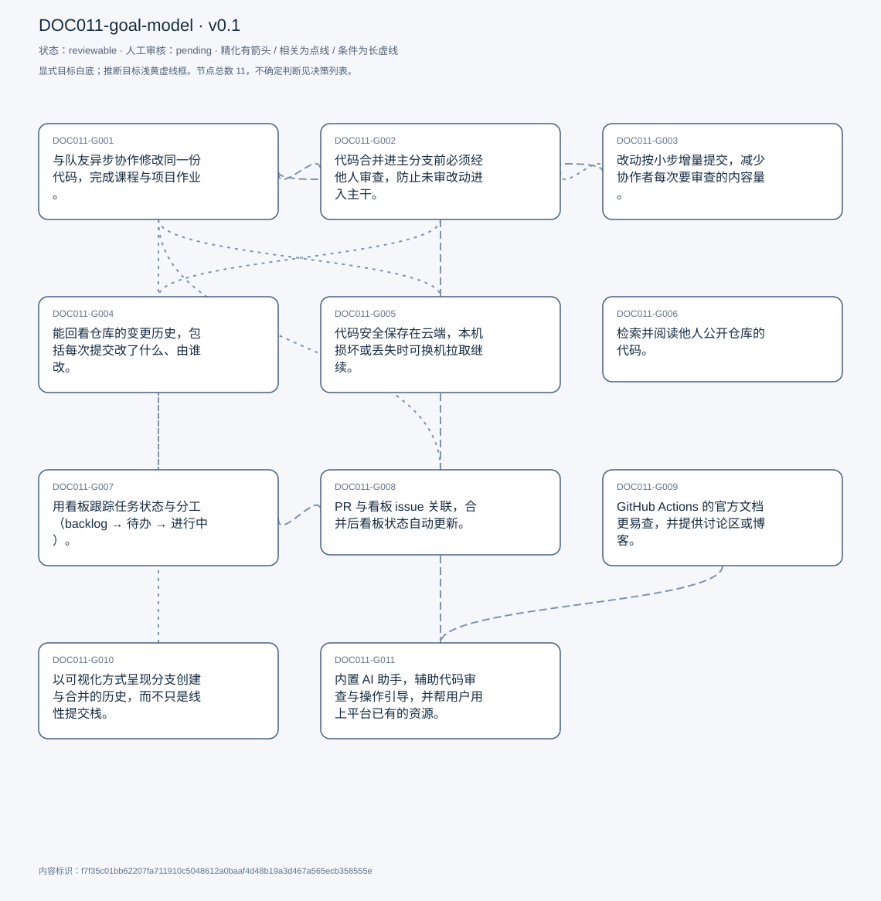
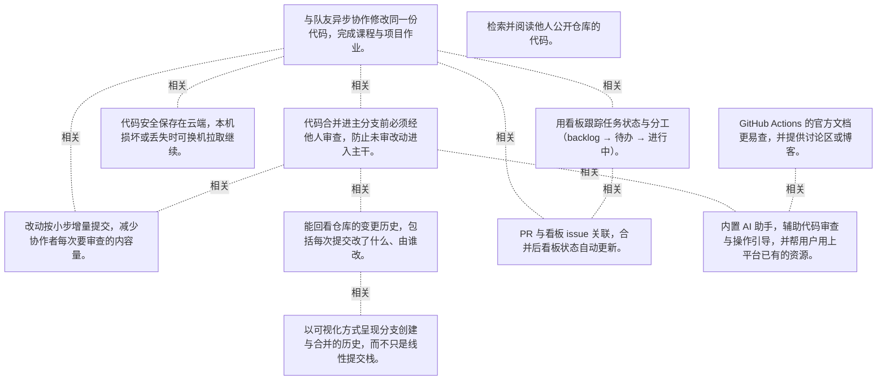

# 目标模型说明

模型：DOC011-goal-model；版本：v0.1

交付状态：reviewable；结构：passed；人工审核：pending

[交互模型](goal-model.html) · [矢量图](goal-model.svg) · [权威数据](goal-model.json)

## 目标图

## 目标

| 编号 | 表述 | 来源 | 情境 | 证据 |
|---|---|---|---|---|
| DOC011-G001 | 与队友异步协作修改同一份代码，完成课程与项目作业。 | explicit | 主要身份为学生与助教；队友同时有仓库写权限，无法约到共同工作时间时靠异步协作 | E0001, E0002, E0003 |
| DOC011-G002 | 代码合并进主分支前必须经他人审查，防止未审改动进入主干。 | explicit | 审查由同一仓库的其他协作者执行；不达标可拒绝合并 | E0004, E0005, E0006 |
| DOC011-G003 | 改动按小步增量提交，减少协作者每次要审查的内容量。 | explicit | 自述为个人偏好，非团队强制；独自开发时反而倾向大 PR，因为没人要审 | E0007, E0008 |
| DOC011-G004 | 能回看仓库的变更历史，包括每次提交改了什么、由谁改。 | explicit | PR 不会被删除，保留在列表中可追溯 | E0009, E0010, E0011 |
| DOC011-G005 | 代码安全保存在云端，本机损坏或丢失时可换机拉取继续。 | explicit | 也支持协作者各自分支存放工作，不影响主仓库 | E0012, E0013, E0014 |
| DOC011-G006 | 检索并阅读他人公开仓库的代码。 | explicit | 可按关键词、文件名、变量名、语言筛选；范围含仓库、PR、issue、讨论区与用户名 | E0015, E0016, E0017 |
| DOC011-G007 | 用看板跟踪任务状态与分工（backlog → 待办 → 进行中）。 | explicit | 任务以 issue 形式建立，含标题、描述与被指派人；团队开会决定指派后再移入待办列 | E0018, E0019, E0020 |
| DOC011-G008 | PR 与看板 issue 关联，合并后看板状态自动更新。 | explicit | 依赖项目已链接到对应仓库；通过 resolves / #issue 关键词关联 | E0021, E0022 |
| DOC011-G009 | GitHub Actions 的官方文档更易查，并提供讨论区或博客。 | explicit | 现状：官方文档「broad」且难找，多数信息来自 Stack Overflow 等外部来源 | E0023, E0024, E0025 |
| DOC011-G010 | 以可视化方式呈现分支创建与合并的历史，而不只是线性提交栈。 | explicit | 自评为 nice-to-have，非必需；期望同时看到分支内的 issue 与时间线 | E0026, E0027, E0028 |
| DOC011-G011 | 内置 AI 助手，辅助代码审查与操作引导，并帮用户用上平台已有的资源。 | explicit | 动机：独立开发者只能自己审自己，缺少第二意见；期望覆盖：审查建议、PR 与 actions 文件的操作引导 | E0029, E0030, E0031 |

## 关系判断（含不确定与无关系）

- DOC011-G001 / DOC011-G002：related。T083 把 PR 的价值概括为「保护主仓库免于未审改动」，而主仓库正是多人协作的对象（T024 说明队友都有写权限）；审查是协作流程中的质量关卡，但二者一个是流程、一个是要求，非精化。
- DOC011-G001 / DOC011-G003：related。T043 给出增量提交的理由就是协作：「provides less content for my collaborators to have to review」，说明 G003 服务于 G001 的协作效率；但提交粒度不等于协作本身。
- DOC011-G001 / DOC011-G004：none。DOC011-G001 的对象是与队友异步协作改代码（T023），DOC011-G004 的对象是回看变更历史（T083）；两处分别出自不同话题段，原文未在二者之间建立因果、手段、评价或情境包含关系，本次评估口径内未建立可采用关系。
- DOC011-G001 / DOC011-G005：related。T077 把云端仓库直接称为「collaborative cloud environment」，并说明协作者可在自己分支存放工作；云端存储是协作的前提条件。
- DOC011-G001 / DOC011-G006：none。DOC011-G001 的对象是与队友异步协作改代码（T023），DOC011-G006 的对象是检索阅读公开仓库代码（T081）；两处分别出自不同话题段，原文未在二者之间建立因果、手段、评价或情境包含关系，本次评估口径内未建立可采用关系。
- DOC011-G001 / DOC011-G007：related。T054 说明看板用于「facilitate team management」，T059 描述团队开会分配 issue，看板是 G001 分工环节的载体；但它是管理工具，不是协作本身。
- DOC011-G001 / DOC011-G008：related。T069 的 PR-issue 联动把代码合并与任务状态连起来，正好覆盖协作的两个环节；但自动化联动是效率增强，不是协作的必要条件。
- DOC011-G001 / DOC011-G009：none。DOC011-G001 的对象是与队友异步协作改代码（T023），DOC011-G009 的对象是Actions 文档更易查并有讨论区（T085）；两处分别出自不同话题段，原文未在二者之间建立因果、手段、评价或情境包含关系，本次评估口径内未建立可采用关系。
- DOC011-G001 / DOC011-G010：none。DOC011-G001 的对象是与队友异步协作改代码（T023），DOC011-G010 的对象是可视化分支合并历史（T087）；两处分别出自不同话题段，原文未在二者之间建立因果、手段、评价或情境包含关系，本次评估口径内未建立可采用关系。
- DOC011-G001 / DOC011-G011：none。DOC011-G001 的对象是与队友异步协作改代码（T023），DOC011-G011 的对象是内置 AI 助手辅助审查与操作（T093/T097）；两处分别出自不同话题段，原文未在二者之间建立因果、手段、评价或情境包含关系，本次评估口径内未建立可采用关系。
- DOC011-G002 / DOC011-G003：related。T043 明确因果：增量提交是为了「less content for my collaborators to have to review」——即降低审查负担。手段与要求不同，故为 related。
- DOC011-G002 / DOC011-G004：related。T083 在同一句里把 PR 的两个价值并列：「stays safe from unknown code changes」与「a very convenient way to track history」，二者由同一机制（PR 不被删除、保留在列表）同时提供。
- DOC011-G002 / DOC011-G005：none。DOC011-G002 的对象是合并前须经他人审查（T083），DOC011-G005 的对象是代码云端安全保存可换机续用（T075）；两处分别出自不同话题段，原文未在二者之间建立因果、手段、评价或情境包含关系，本次评估口径内未建立可采用关系。
- DOC011-G002 / DOC011-G006：none。DOC011-G002 的对象是合并前须经他人审查（T083），DOC011-G006 的对象是检索阅读公开仓库代码（T081）；两处分别出自不同话题段，原文未在二者之间建立因果、手段、评价或情境包含关系，本次评估口径内未建立可采用关系。
- DOC011-G002 / DOC011-G007：none。DOC011-G002 的对象是合并前须经他人审查（T083），DOC011-G007 的对象是用看板跟踪任务与分工（T053/T059）；两处分别出自不同话题段，原文未在二者之间建立因果、手段、评价或情境包含关系，本次评估口径内未建立可采用关系。
- DOC011-G002 / DOC011-G008：none。DOC011-G002 的对象是合并前须经他人审查（T083），DOC011-G008 的对象是PR 合并后看板自动更新（T069）；两处分别出自不同话题段，原文未在二者之间建立因果、手段、评价或情境包含关系，本次评估口径内未建立可采用关系。
- DOC011-G002 / DOC011-G009：none。DOC011-G002 的对象是合并前须经他人审查（T083），DOC011-G009 的对象是Actions 文档更易查并有讨论区（T085）；两处分别出自不同话题段，原文未在二者之间建立因果、手段、评价或情境包含关系，本次评估口径内未建立可采用关系。
- DOC011-G002 / DOC011-G010：none。DOC011-G002 的对象是合并前须经他人审查（T083），DOC011-G010 的对象是可视化分支合并历史（T087）；两处分别出自不同话题段，原文未在二者之间建立因果、手段、评价或情境包含关系，本次评估口径内未建立可采用关系。
- DOC011-G002 / DOC011-G011：related。T097 把 AI 助手直接用于代码审查：「would review help me with code reviews, provide suggestions」，作为审查环节的补充反馈源；但未表示可替代人工审查。
- DOC011-G003 / DOC011-G004：none。DOC011-G003 的对象是小步增量提交（T043），DOC011-G004 的对象是回看变更历史（T083）；两处分别出自不同话题段，原文未在二者之间建立因果、手段、评价或情境包含关系，本次评估口径内未建立可采用关系。
- DOC011-G003 / DOC011-G005：none。DOC011-G003 的对象是小步增量提交（T043），DOC011-G005 的对象是代码云端安全保存可换机续用（T075）；两处分别出自不同话题段，原文未在二者之间建立因果、手段、评价或情境包含关系，本次评估口径内未建立可采用关系。
- DOC011-G003 / DOC011-G006：none。DOC011-G003 的对象是小步增量提交（T043），DOC011-G006 的对象是检索阅读公开仓库代码（T081）；两处分别出自不同话题段，原文未在二者之间建立因果、手段、评价或情境包含关系，本次评估口径内未建立可采用关系。
- DOC011-G003 / DOC011-G007：none。DOC011-G003 的对象是小步增量提交（T043），DOC011-G007 的对象是用看板跟踪任务与分工（T053/T059）；两处分别出自不同话题段，原文未在二者之间建立因果、手段、评价或情境包含关系，本次评估口径内未建立可采用关系。
- DOC011-G003 / DOC011-G008：none。DOC011-G003 的对象是小步增量提交（T043），DOC011-G008 的对象是PR 合并后看板自动更新（T069）；两处分别出自不同话题段，原文未在二者之间建立因果、手段、评价或情境包含关系，本次评估口径内未建立可采用关系。
- DOC011-G003 / DOC011-G009：none。DOC011-G003 的对象是小步增量提交（T043），DOC011-G009 的对象是Actions 文档更易查并有讨论区（T085）；两处分别出自不同话题段，原文未在二者之间建立因果、手段、评价或情境包含关系，本次评估口径内未建立可采用关系。
- DOC011-G003 / DOC011-G010：none。DOC011-G003 的对象是小步增量提交（T043），DOC011-G010 的对象是可视化分支合并历史（T087）；两处分别出自不同话题段，原文未在二者之间建立因果、手段、评价或情境包含关系，本次评估口径内未建立可采用关系。
- DOC011-G003 / DOC011-G011：none。DOC011-G003 的对象是小步增量提交（T043），DOC011-G011 的对象是内置 AI 助手辅助审查与操作（T093/T097）；两处分别出自不同话题段，原文未在二者之间建立因果、手段、评价或情境包含关系，本次评估口径内未建立可采用关系。
- DOC011-G004 / DOC011-G005：none。DOC011-G004 的对象是回看变更历史（T083），DOC011-G005 的对象是代码云端安全保存可换机续用（T075）；两处分别出自不同话题段，原文未在二者之间建立因果、手段、评价或情境包含关系，本次评估口径内未建立可采用关系。
- DOC011-G004 / DOC011-G006：none。DOC011-G004 的对象是回看变更历史（T083），DOC011-G006 的对象是检索阅读公开仓库代码（T081）；两处分别出自不同话题段，原文未在二者之间建立因果、手段、评价或情境包含关系，本次评估口径内未建立可采用关系。
- DOC011-G004 / DOC011-G007：none。DOC011-G004 的对象是回看变更历史（T083），DOC011-G007 的对象是用看板跟踪任务与分工（T053/T059）；两处分别出自不同话题段，原文未在二者之间建立因果、手段、评价或情境包含关系，本次评估口径内未建立可采用关系。
- DOC011-G004 / DOC011-G008：none。DOC011-G004 的对象是回看变更历史（T083），DOC011-G008 的对象是PR 合并后看板自动更新（T069）；两处分别出自不同话题段，原文未在二者之间建立因果、手段、评价或情境包含关系，本次评估口径内未建立可采用关系。
- DOC011-G004 / DOC011-G009：none。DOC011-G004 的对象是回看变更历史（T083），DOC011-G009 的对象是Actions 文档更易查并有讨论区（T085）；两处分别出自不同话题段，原文未在二者之间建立因果、手段、评价或情境包含关系，本次评估口径内未建立可采用关系。
- DOC011-G004 / DOC011-G010：related。T087 把两者直接对照：现有提交历史「is all like very much a linear stack of changes」，但「doesn&#x27;t give like a an exact history」，因此希望可视化分支与合并位置。G010 是 G004 在分支拓扑层面的补足，属改进而非其具体化。
- DOC011-G004 / DOC011-G011：none。DOC011-G004 的对象是回看变更历史（T083），DOC011-G011 的对象是内置 AI 助手辅助审查与操作（T093/T097）；两处分别出自不同话题段，原文未在二者之间建立因果、手段、评价或情境包含关系，本次评估口径内未建立可采用关系。
- DOC011-G005 / DOC011-G006：none。DOC011-G005 的对象是代码云端安全保存可换机续用（T075），DOC011-G006 的对象是检索阅读公开仓库代码（T081）；两处分别出自不同话题段，原文未在二者之间建立因果、手段、评价或情境包含关系，本次评估口径内未建立可采用关系。
- DOC011-G005 / DOC011-G007：none。DOC011-G005 的对象是代码云端安全保存可换机续用（T075），DOC011-G007 的对象是用看板跟踪任务与分工（T053/T059）；两处分别出自不同话题段，原文未在二者之间建立因果、手段、评价或情境包含关系，本次评估口径内未建立可采用关系。
- DOC011-G005 / DOC011-G008：none。DOC011-G005 的对象是代码云端安全保存可换机续用（T075），DOC011-G008 的对象是PR 合并后看板自动更新（T069）；两处分别出自不同话题段，原文未在二者之间建立因果、手段、评价或情境包含关系，本次评估口径内未建立可采用关系。
- DOC011-G005 / DOC011-G009：none。DOC011-G005 的对象是代码云端安全保存可换机续用（T075），DOC011-G009 的对象是Actions 文档更易查并有讨论区（T085）；两处分别出自不同话题段，原文未在二者之间建立因果、手段、评价或情境包含关系，本次评估口径内未建立可采用关系。
- DOC011-G005 / DOC011-G010：none。DOC011-G005 的对象是代码云端安全保存可换机续用（T075），DOC011-G010 的对象是可视化分支合并历史（T087）；两处分别出自不同话题段，原文未在二者之间建立因果、手段、评价或情境包含关系，本次评估口径内未建立可采用关系。
- DOC011-G005 / DOC011-G011：none。DOC011-G005 的对象是代码云端安全保存可换机续用（T075），DOC011-G011 的对象是内置 AI 助手辅助审查与操作（T093/T097）；两处分别出自不同话题段，原文未在二者之间建立因果、手段、评价或情境包含关系，本次评估口径内未建立可采用关系。
- DOC011-G006 / DOC011-G007：none。DOC011-G006 的对象是检索阅读公开仓库代码（T081），DOC011-G007 的对象是用看板跟踪任务与分工（T053/T059）；两处分别出自不同话题段，原文未在二者之间建立因果、手段、评价或情境包含关系，本次评估口径内未建立可采用关系。
- DOC011-G006 / DOC011-G008：none。DOC011-G006 的对象是检索阅读公开仓库代码（T081），DOC011-G008 的对象是PR 合并后看板自动更新（T069）；两处分别出自不同话题段，原文未在二者之间建立因果、手段、评价或情境包含关系，本次评估口径内未建立可采用关系。
- DOC011-G006 / DOC011-G009：none。DOC011-G006 的对象是检索阅读公开仓库代码（T081），DOC011-G009 的对象是Actions 文档更易查并有讨论区（T085）；两处分别出自不同话题段，原文未在二者之间建立因果、手段、评价或情境包含关系，本次评估口径内未建立可采用关系。
- DOC011-G006 / DOC011-G010：none。DOC011-G006 的对象是检索阅读公开仓库代码（T081），DOC011-G010 的对象是可视化分支合并历史（T087）；两处分别出自不同话题段，原文未在二者之间建立因果、手段、评价或情境包含关系，本次评估口径内未建立可采用关系。
- DOC011-G006 / DOC011-G011：none。DOC011-G006 的对象是检索阅读公开仓库代码（T081），DOC011-G011 的对象是内置 AI 助手辅助审查与操作（T093/T097）；两处分别出自不同话题段，原文未在二者之间建立因果、手段、评价或情境包含关系，本次评估口径内未建立可采用关系。
- DOC011-G007 / DOC011-G008：related。T069 说明 PR 可挂到看板 issue 上，合并后看板自动反映；两者是同一任务流的两端（任务跟踪与代码合并），联动使其闭环。
- DOC011-G007 / DOC011-G009：none。DOC011-G007 的对象是用看板跟踪任务与分工（T053/T059），DOC011-G009 的对象是Actions 文档更易查并有讨论区（T085）；两处分别出自不同话题段，原文未在二者之间建立因果、手段、评价或情境包含关系，本次评估口径内未建立可采用关系。
- DOC011-G007 / DOC011-G010：none。DOC011-G007 的对象是用看板跟踪任务与分工（T053/T059），DOC011-G010 的对象是可视化分支合并历史（T087）；两处分别出自不同话题段，原文未在二者之间建立因果、手段、评价或情境包含关系，本次评估口径内未建立可采用关系。
- DOC011-G007 / DOC011-G011：none。DOC011-G007 的对象是用看板跟踪任务与分工（T053/T059），DOC011-G011 的对象是内置 AI 助手辅助审查与操作（T093/T097）；两处分别出自不同话题段，原文未在二者之间建立因果、手段、评价或情境包含关系，本次评估口径内未建立可采用关系。
- DOC011-G008 / DOC011-G009：none。DOC011-G008 的对象是PR 合并后看板自动更新（T069），DOC011-G009 的对象是Actions 文档更易查并有讨论区（T085）；两处分别出自不同话题段，原文未在二者之间建立因果、手段、评价或情境包含关系，本次评估口径内未建立可采用关系。
- DOC011-G008 / DOC011-G010：none。DOC011-G008 的对象是PR 合并后看板自动更新（T069），DOC011-G010 的对象是可视化分支合并历史（T087）；两处分别出自不同话题段，原文未在二者之间建立因果、手段、评价或情境包含关系，本次评估口径内未建立可采用关系。
- DOC011-G008 / DOC011-G011：none。DOC011-G008 的对象是PR 合并后看板自动更新（T069），DOC011-G011 的对象是内置 AI 助手辅助审查与操作（T093/T097）；两处分别出自不同话题段，原文未在二者之间建立因果、手段、评价或情境包含关系，本次评估口径内未建立可采用关系。
- DOC011-G009 / DOC011-G010：none。DOC011-G009 的对象是Actions 文档更易查并有讨论区（T085），DOC011-G010 的对象是可视化分支合并历史（T087）；两处分别出自不同话题段，原文未在二者之间建立因果、手段、评价或情境包含关系，本次评估口径内未建立可采用关系。
- DOC011-G009 / DOC011-G011：related。T093 提出 AI 助手的用途之一是「use all the resources available on Github」，而 T085 抱怨的正是 Actions 文档难找、信息散落外部；AI 引导与文档改进针对同一获取门槛。
- DOC011-G010 / DOC011-G011：none。DOC011-G010 的对象是可视化分支合并历史（T087），DOC011-G011 的对象是内置 AI 助手辅助审查与操作（T093/T097）；两处分别出自不同话题段，原文未在二者之间建立因果、手段、评价或情境包含关系，本次评估口径内未建立可采用关系。

## 证据

### E0001 · DOC011:S024

> from my student perspective is like team collaboration

原件位置：{&quot;line_start&quot;: 24, &quot;line_end&quot;: 24, &quot;start_char&quot;: 4256, &quot;end_char&quot;: 4736}

### E0002 · DOC011:S024

> we are asynchronous collab, asynchronously collaborating on this code

原件位置：{&quot;line_start&quot;: 24, &quot;line_end&quot;: 24, &quot;start_char&quot;: 4256, &quot;end_char&quot;: 4736}

### E0003 · DOC011:S104

> It really did help facilitate our asynchronous workflows.

原件位置：{&quot;line_start&quot;: 104, &quot;line_end&quot;: 104, &quot;start_char&quot;: 23243, &quot;end_char&quot;: 23356}

### E0004 · DOC011:S084

> the port request feature simply because it&#x27;s a great way to make sure that the main repository stays safe from unknown code changes before they are reviewed by others

原件位置：{&quot;line_start&quot;: 84, &quot;line_end&quot;: 84, &quot;start_char&quot;: 17467, &quot;end_char&quot;: 18156}

### E0005 · DOC011:S032

> the code, is up to standard of the team or their personal standard

原件位置：{&quot;line_start&quot;: 32, &quot;line_end&quot;: 32, &quot;start_char&quot;: 6875, &quot;end_char&quot;: 7041}

### E0006 · DOC011:S034

> Either approved, or they can also be denied if they don&#x27;t meet the standards.

原件位置：{&quot;line_start&quot;: 34, &quot;line_end&quot;: 34, &quot;start_char&quot;: 7072, &quot;end_char&quot;: 7169}

### E0007 · DOC011:S044

> I personally prefer to do it incrementally

原件位置：{&quot;line_start&quot;: 44, &quot;line_end&quot;: 44, &quot;start_char&quot;: 9149, &quot;end_char&quot;: 9341}

### E0008 · DOC011:S046

> It provides less content for my collaborators to have to review

原件位置：{&quot;line_start&quot;: 46, &quot;line_end&quot;: 46, &quot;start_char&quot;: 9366, &quot;end_char&quot;: 9847}

### E0009 · DOC011:S084

> It&#x27;s also a very convenient way to track history.

原件位置：{&quot;line_start&quot;: 84, &quot;line_end&quot;: 84, &quot;start_char&quot;: 17467, &quot;end_char&quot;: 18156}

### E0010 · DOC011:S084

> in that backlog I mean to see, like what changes were made with this pull request

原件位置：{&quot;line_start&quot;: 84, &quot;line_end&quot;: 84, &quot;start_char&quot;: 17467, &quot;end_char&quot;: 18156}

### E0011 · DOC011:S084

> plus other like changes that were made by my collaborators.

原件位置：{&quot;line_start&quot;: 84, &quot;line_end&quot;: 84, &quot;start_char&quot;: 17467, &quot;end_char&quot;: 18156}

### E0012 · DOC011:S076

> having a convenient place to store my code in a in a in a safe manner

原件位置：{&quot;line_start&quot;: 76, &quot;line_end&quot;: 76, &quot;start_char&quot;: 15029, &quot;end_char&quot;: 15383}

### E0013 · DOC011:S076

> I would still have my work in a cloud environment that I could simply I&#x27;m gonna use the keyword pull onto a different machine

原件位置：{&quot;line_start&quot;: 76, &quot;line_end&quot;: 76, &quot;start_char&quot;: 15029, &quot;end_char&quot;: 15383}

### E0014 · DOC011:S078

> They can store their work on that branch

原件位置：{&quot;line_start&quot;: 78, &quot;line_end&quot;: 78, &quot;start_char&quot;: 15492, &quot;end_char&quot;: 15963}

### E0015 · DOC011:S082

> public repositories are visible to anybody

原件位置：{&quot;line_start&quot;: 82, &quot;line_end&quot;: 82, &quot;start_char&quot;: 16348, &quot;end_char&quot;: 17256}

### E0016 · DOC011:S082

> it can then search the entire Github database for public repositories that I can look at

原件位置：{&quot;line_start&quot;: 82, &quot;line_end&quot;: 82, &quot;start_char&quot;: 16348, &quot;end_char&quot;: 17256}

### E0017 · DOC011:S082

> I can also filter based on language.

原件位置：{&quot;line_start&quot;: 82, &quot;line_end&quot;: 82, &quot;start_char&quot;: 16348, &quot;end_char&quot;: 17256}

### E0018 · DOC011:S052

> a project is essentially just a tracking board

原件位置：{&quot;line_start&quot;: 52, &quot;line_end&quot;: 52, &quot;start_char&quot;: 10611, &quot;end_char&quot;: 10798}

### E0019 · DOC011:S054

> Kanban board where you&#x27;re actually assigning tasks, and you can facilitate team management that way

原件位置：{&quot;line_start&quot;: 54, &quot;line_end&quot;: 54, &quot;start_char&quot;: 10825, &quot;end_char&quot;: 11280}

### E0020 · DOC011:S060

> we would add that to the backlog, we would meet together as a team. discuss who should be assigned

原件位置：{&quot;line_start&quot;: 60, &quot;line_end&quot;: 60, &quot;start_char&quot;: 12250, &quot;end_char&quot;: 12602}

### E0021 · DOC011:S070

> when that port request is merged, the Kanban board would automatically reflect that

原件位置：{&quot;line_start&quot;: 70, &quot;line_end&quot;: 70, &quot;start_char&quot;: 13610, &quot;end_char&quot;: 14136}

### E0022 · DOC011:S068

> you can actually attach it to an issue in the Kanban board

原件位置：{&quot;line_start&quot;: 68, &quot;line_end&quot;: 68, &quot;start_char&quot;: 13314, &quot;end_char&quot;: 13576}

### E0023 · DOC011:S086

> their documentation overall is a little broad. or it&#x27;s it&#x27;s very. It&#x27;s very difficult to find.

原件位置：{&quot;line_start&quot;: 86, &quot;line_end&quot;: 86, &quot;start_char&quot;: 18367, &quot;end_char&quot;: 19063}

### E0024 · DOC011:S086

> So if they. Could have a forum or such, or like a a blog, tab forward discussions or information on building these action workflows. It&#x27;d be great.

原件位置：{&quot;line_start&quot;: 86, &quot;line_end&quot;: 86, &quot;start_char&quot;: 18367, &quot;end_char&quot;: 19063}

### E0025 · DOC011:S086

> most of the documentation, I find is from other external sources. Stack, overflow, for example.

原件位置：{&quot;line_start&quot;: 86, &quot;line_end&quot;: 86, &quot;start_char&quot;: 18367, &quot;end_char&quot;: 19063}

### E0026 · DOC011:S088

> It would be to see a visual mapping of the repository history.

原件位置：{&quot;line_start&quot;: 88, &quot;line_end&quot;: 88, &quot;start_char&quot;: 19207, &quot;end_char&quot;: 20020}

### E0027 · DOC011:S088

> visually see there was new branches made where they were merged in

原件位置：{&quot;line_start&quot;: 88, &quot;line_end&quot;: 88, &quot;start_char&quot;: 19207, &quot;end_char&quot;: 20020}

### E0028 · DOC011:S088

> it&#x27;s not an essential feature, it&#x27;s more so. Just like convenience. Nice to have feature.

原件位置：{&quot;line_start&quot;: 88, &quot;line_end&quot;: 88, &quot;start_char&quot;: 19207, &quot;end_char&quot;: 20020}

### E0029 · DOC011:S094

> if a Github was to integrate such an assistant to allow users to consult with it to have better to use all the resources available on Github

原件位置：{&quot;line_start&quot;: 94, &quot;line_end&quot;: 94, &quot;start_char&quot;: 20495, &quot;end_char&quot;: 20877}

### E0030 · DOC011:S098

> if I was to have maybe an AI assistant or something that would review help me with code reviews, provide suggestions

原件位置：{&quot;line_start&quot;: 98, &quot;line_end&quot;: 98, &quot;start_char&quot;: 21096, &quot;end_char&quot;: 21588}

### E0031 · DOC011:S098

> I have another source of feedback that I can incorporate

原件位置：{&quot;line_start&quot;: 98, &quot;line_end&quot;: 98, &quot;start_char&quot;: 21096, &quot;end_char&quot;: 21588}

## 问题、限制与版本

- 当前会话助手的开发判断，非独立盲测；无人工采纳记录。
- 结构检查已绑定当前版本；独立语义审查未执行；人工状态以实际审核记录为准。

内容标识：f7f35c01bb62207fa711910c5048612a0baaf4d48b19a3d467a565ecb358555e

人工决定：

审核意见：
