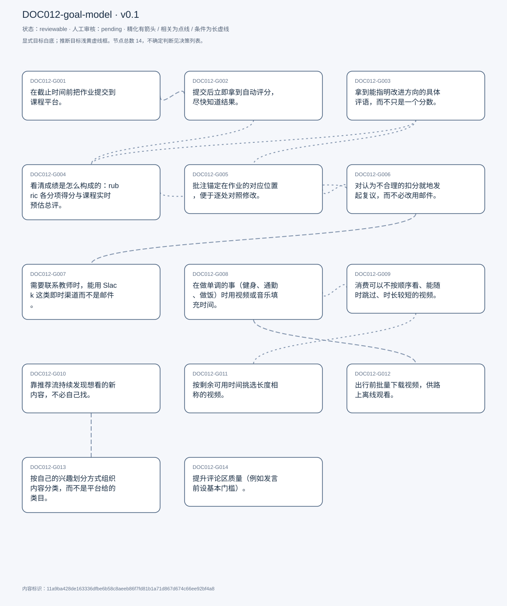
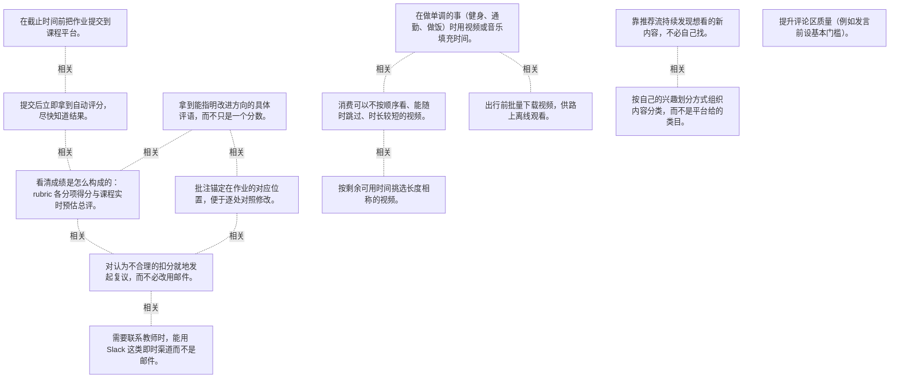

# 目标模型说明

模型：DOC012-goal-model；版本：v0.1

交付状态：reviewable；结构：passed；人工审核：pending

[交互模型](goal-model.html) · [矢量图](goal-model.svg) · [权威数据](goal-model.json)

## 目标图

## 目标

| 编号 | 表述 | 来源 | 情境 | 证据 |
|---|---|---|---|---|
| DOC012-G001 | 在截止时间前把作业提交到课程平台。 | explicit | 使用 Canvas 与 Gradescope 两个平台；频率：每门课每周 1–2 次，五门课合计约每周 10 次 | E0001, E0002 |
| DOC012-G002 | 提交后立即拿到自动评分，尽快知道结果。 | explicit | 仅适用于代码类作业（Gradescope 自动评测）；自评该分数不是最终成绩 | E0003, E0004 |
| DOC012-G003 | 拿到能指明改进方向的具体评语，而不只是一个分数。 | explicit | 反馈以带批注的文档形式给出，由教授或助教撰写 | E0005, E0006 |
| DOC012-G004 | 看清成绩是怎么构成的：rubric 各分项得分与课程实时预估总评。 | explicit | rubric 仅 Canvas 有，Gradescope 没有；预估总评用于决定投入多少时间、是否刷额外学分 | E0007, E0008, E0009, E0010 |
| DOC012-G005 | 批注锚定在作业的对应位置，便于逐处对照修改。 | explicit | 问题成因：教师不熟悉应用，把批注放在全局位置而非具体位置 | E0011, E0012 |
| DOC012-G006 | 对认为不合理的扣分就地发起复议，而不必改用邮件。 | explicit | Gradescope 有复议入口，Canvas 没有；现实中多数情况他放弃申诉，因为邮件沟通不方便 | E0013, E0014, E0015 |
| DOC012-G007 | 需要联系教师时，能用 Slack 这类即时渠道而不是邮件。 | explicit | 现状取决于任课教师是否自建 Slack 频道；没有时只能用邮件 | E0016, E0017 |
| DOC012-G008 | 在做单调的事（健身、通勤、做饭）时用视频或音乐填充时间。 | explicit | 主要在健身房的器械上、做饭时、长途驾驶时观看；音乐多于视频，常作为背景 | E0018, E0019, E0020 |
| DOC012-G009 | 消费可以不按顺序看、能随时跳过、时长较短的视频。 | explicit | 不喜欢连续剧式内容：依赖前集、需要持续专注；自评注意力跨度有限 | E0021, E0022 |
| DOC012-G010 | 靠推荐流持续发现想看的新内容，不必自己找。 | explicit | 自评这是不换平台的主要原因；依赖十余年的观看历史刻画偏好 | E0023, E0024, E0025 |
| DOC012-G011 | 按剩余可用时间挑选长度相称的视频。 | explicit | 10–30 分钟是安全选择；40 分钟以上需要提前安排更多时间 | E0026, E0027 |
| DOC012-G012 | 出行前批量下载视频，供路上离线观看。 | explicit | 依赖付费会员的下载能力 | E0028, E0029 |
| DOC012-G013 | 按自己的兴趣划分方式组织内容分类，而不是平台给的类目。 | explicit | 期望划分示例：几个音乐类型、剧集、桌游、数学、游戏；现状类目与其划分方式不一致 | E0030, E0031 |
| DOC012-G014 | 提升评论区质量（例如发言前设基本门槛）。 | explicit | 自评很少发评论，改的是他人的发言门槛；以玩笑口吻提出，但同时称其为「最大的愿望」 | E0032, E0033 |

## 关系判断（含不确定与无关系）

- DOC012-G001 / DOC012-G002：related。T031 描述的是提交动作之后的即时结果（自动评测并给分），二者是同一提交流程的前后两段；但一个是完成提交、一个是获取结果，非精化。
- DOC012-G001 / DOC012-G003：none。DOC012-G001 的对象是截止前提交作业（T027），DOC012-G003 的对象是拿到可指导改进的评语（T033）；两处分别出自不同话题段，原文未在二者之间建立因果、手段、评价或情境包含关系，本次评估口径内未建立可采用关系。
- DOC012-G001 / DOC012-G004：none。DOC012-G001 的对象是截止前提交作业（T027），DOC012-G004 的对象是看清成绩构成（rubric + 预估总评）（T059）；两处分别出自不同话题段，原文未在二者之间建立因果、手段、评价或情境包含关系，本次评估口径内未建立可采用关系。
- DOC012-G001 / DOC012-G005：none。DOC012-G001 的对象是截止前提交作业（T027），DOC012-G005 的对象是批注锚定在文档对应位置（T061）；两处分别出自不同话题段，原文未在二者之间建立因果、手段、评价或情境包含关系，本次评估口径内未建立可采用关系。
- DOC012-G001 / DOC012-G006：none。DOC012-G001 的对象是截止前提交作业（T027），DOC012-G006 的对象是就地发起评分复议（T061）；两处分别出自不同话题段，原文未在二者之间建立因果、手段、评价或情境包含关系，本次评估口径内未建立可采用关系。
- DOC012-G001 / DOC012-G007：none。DOC012-G001 的对象是截止前提交作业（T027），DOC012-G007 的对象是用 Slack 等即时渠道联系教师（T063）；两处分别出自不同话题段，原文未在二者之间建立因果、手段、评价或情境包含关系，本次评估口径内未建立可采用关系。
- DOC012-G001 / DOC012-G008：none。DOC012-G001 的对象是截止前提交作业（T027），DOC012-G008 的对象是用内容填充单调时段（T082）；两处分别出自不同话题段，原文未在二者之间建立因果、手段、评价或情境包含关系，本次评估口径内未建立可采用关系。
- DOC012-G001 / DOC012-G009：none。DOC012-G001 的对象是截止前提交作业（T027），DOC012-G009 的对象是消费可跳看、非连续、短小的内容（T114）；两处分别出自不同话题段，原文未在二者之间建立因果、手段、评价或情境包含关系，本次评估口径内未建立可采用关系。
- DOC012-G001 / DOC012-G010：none。DOC012-G001 的对象是截止前提交作业（T027），DOC012-G010 的对象是靠推荐流持续发现内容（T114）；两处分别出自不同话题段，原文未在二者之间建立因果、手段、评价或情境包含关系，本次评估口径内未建立可采用关系。
- DOC012-G001 / DOC012-G011：none。DOC012-G001 的对象是截止前提交作业（T027），DOC012-G011 的对象是按剩余时长挑片（T098）；两处分别出自不同话题段，原文未在二者之间建立因果、手段、评价或情境包含关系，本次评估口径内未建立可采用关系。
- DOC012-G001 / DOC012-G012：none。DOC012-G001 的对象是截止前提交作业（T027），DOC012-G012 的对象是出行前批量下载离线看（T118）；两处分别出自不同话题段，原文未在二者之间建立因果、手段、评价或情境包含关系，本次评估口径内未建立可采用关系。
- DOC012-G001 / DOC012-G013：none。DOC012-G001 的对象是截止前提交作业（T027），DOC012-G013 的对象是按自己的方式分类组织内容（T126）；两处分别出自不同话题段，原文未在二者之间建立因果、手段、评价或情境包含关系，本次评估口径内未建立可采用关系。
- DOC012-G001 / DOC012-G014：none。DOC012-G001 的对象是截止前提交作业（T027），DOC012-G014 的对象是提升评论区发言门槛（T110）；两处分别出自不同话题段，原文未在二者之间建立因果、手段、评价或情境包含关系，本次评估口径内未建立可采用关系。
- DOC012-G002 / DOC012-G003：none。DOC012-G002 的对象是提交后即时自动评分（T031），DOC012-G003 的对象是拿到可指导改进的评语（T033）；两处分别出自不同话题段，原文未在二者之间建立因果、手段、评价或情境包含关系，本次评估口径内未建立可采用关系。
- DOC012-G002 / DOC012-G004：related。自动评分与 rubric/预估总评都是成绩可见性的一部分：前者即时但是单次，后者用于判断课程整体位置（T059 称之为 indirect feedback）。
- DOC012-G002 / DOC012-G005：none。DOC012-G002 的对象是提交后即时自动评分（T031），DOC012-G005 的对象是批注锚定在文档对应位置（T061）；两处分别出自不同话题段，原文未在二者之间建立因果、手段、评价或情境包含关系，本次评估口径内未建立可采用关系。
- DOC012-G002 / DOC012-G006：none。DOC012-G002 的对象是提交后即时自动评分（T031），DOC012-G006 的对象是就地发起评分复议（T061）；两处分别出自不同话题段，原文未在二者之间建立因果、手段、评价或情境包含关系，本次评估口径内未建立可采用关系。
- DOC012-G002 / DOC012-G007：none。DOC012-G002 的对象是提交后即时自动评分（T031），DOC012-G007 的对象是用 Slack 等即时渠道联系教师（T063）；两处分别出自不同话题段，原文未在二者之间建立因果、手段、评价或情境包含关系，本次评估口径内未建立可采用关系。
- DOC012-G002 / DOC012-G008：none。DOC012-G002 的对象是提交后即时自动评分（T031），DOC012-G008 的对象是用内容填充单调时段（T082）；两处分别出自不同话题段，原文未在二者之间建立因果、手段、评价或情境包含关系，本次评估口径内未建立可采用关系。
- DOC012-G002 / DOC012-G009：none。DOC012-G002 的对象是提交后即时自动评分（T031），DOC012-G009 的对象是消费可跳看、非连续、短小的内容（T114）；两处分别出自不同话题段，原文未在二者之间建立因果、手段、评价或情境包含关系，本次评估口径内未建立可采用关系。
- DOC012-G002 / DOC012-G010：none。DOC012-G002 的对象是提交后即时自动评分（T031），DOC012-G010 的对象是靠推荐流持续发现内容（T114）；两处分别出自不同话题段，原文未在二者之间建立因果、手段、评价或情境包含关系，本次评估口径内未建立可采用关系。
- DOC012-G002 / DOC012-G011：none。DOC012-G002 的对象是提交后即时自动评分（T031），DOC012-G011 的对象是按剩余时长挑片（T098）；两处分别出自不同话题段，原文未在二者之间建立因果、手段、评价或情境包含关系，本次评估口径内未建立可采用关系。
- DOC012-G002 / DOC012-G012：none。DOC012-G002 的对象是提交后即时自动评分（T031），DOC012-G012 的对象是出行前批量下载离线看（T118）；两处分别出自不同话题段，原文未在二者之间建立因果、手段、评价或情境包含关系，本次评估口径内未建立可采用关系。
- DOC012-G002 / DOC012-G013：none。DOC012-G002 的对象是提交后即时自动评分（T031），DOC012-G013 的对象是按自己的方式分类组织内容（T126）；两处分别出自不同话题段，原文未在二者之间建立因果、手段、评价或情境包含关系，本次评估口径内未建立可采用关系。
- DOC012-G002 / DOC012-G014：none。DOC012-G002 的对象是提交后即时自动评分（T031），DOC012-G014 的对象是提升评论区发言门槛（T110）；两处分别出自不同话题段，原文未在二者之间建立因果、手段、评价或情境包含关系，本次评估口径内未建立可采用关系。
- DOC012-G003 / DOC012-G004：related。T059 把 rubric 分项与评语都归为「indirect feedback」，二者共同构成批改结果的两个层面：一个说扣在哪、一个说为什么扣。
- DOC012-G003 / DOC012-G005：related。T061 的痛点正是评语与作业脱钩导致「I need to find really hard, like what the comment... is related to which part」——定位能力决定评语是否可用。
- DOC012-G003 / DOC012-G006：none。DOC012-G003 的对象是拿到可指导改进的评语（T033），DOC012-G006 的对象是就地发起评分复议（T061）；两处分别出自不同话题段，原文未在二者之间建立因果、手段、评价或情境包含关系，本次评估口径内未建立可采用关系。
- DOC012-G003 / DOC012-G007：none。DOC012-G003 的对象是拿到可指导改进的评语（T033），DOC012-G007 的对象是用 Slack 等即时渠道联系教师（T063）；两处分别出自不同话题段，原文未在二者之间建立因果、手段、评价或情境包含关系，本次评估口径内未建立可采用关系。
- DOC012-G003 / DOC012-G008：none。DOC012-G003 的对象是拿到可指导改进的评语（T033），DOC012-G008 的对象是用内容填充单调时段（T082）；两处分别出自不同话题段，原文未在二者之间建立因果、手段、评价或情境包含关系，本次评估口径内未建立可采用关系。
- DOC012-G003 / DOC012-G009：none。DOC012-G003 的对象是拿到可指导改进的评语（T033），DOC012-G009 的对象是消费可跳看、非连续、短小的内容（T114）；两处分别出自不同话题段，原文未在二者之间建立因果、手段、评价或情境包含关系，本次评估口径内未建立可采用关系。
- DOC012-G003 / DOC012-G010：none。DOC012-G003 的对象是拿到可指导改进的评语（T033），DOC012-G010 的对象是靠推荐流持续发现内容（T114）；两处分别出自不同话题段，原文未在二者之间建立因果、手段、评价或情境包含关系，本次评估口径内未建立可采用关系。
- DOC012-G003 / DOC012-G011：none。DOC012-G003 的对象是拿到可指导改进的评语（T033），DOC012-G011 的对象是按剩余时长挑片（T098）；两处分别出自不同话题段，原文未在二者之间建立因果、手段、评价或情境包含关系，本次评估口径内未建立可采用关系。
- DOC012-G003 / DOC012-G012：none。DOC012-G003 的对象是拿到可指导改进的评语（T033），DOC012-G012 的对象是出行前批量下载离线看（T118）；两处分别出自不同话题段，原文未在二者之间建立因果、手段、评价或情境包含关系，本次评估口径内未建立可采用关系。
- DOC012-G003 / DOC012-G013：none。DOC012-G003 的对象是拿到可指导改进的评语（T033），DOC012-G013 的对象是按自己的方式分类组织内容（T126）；两处分别出自不同话题段，原文未在二者之间建立因果、手段、评价或情境包含关系，本次评估口径内未建立可采用关系。
- DOC012-G003 / DOC012-G014：none。DOC012-G003 的对象是拿到可指导改进的评语（T033），DOC012-G014 的对象是提升评论区发言门槛（T110）；两处分别出自不同话题段，原文未在二者之间建立因果、手段、评价或情境包含关系，本次评估口径内未建立可采用关系。
- DOC012-G004 / DOC012-G005：none。DOC012-G004 的对象是看清成绩构成（rubric + 预估总评）（T059），DOC012-G005 的对象是批注锚定在文档对应位置（T061）；两处分别出自不同话题段，原文未在二者之间建立因果、手段、评价或情境包含关系，本次评估口径内未建立可采用关系。
- DOC012-G004 / DOC012-G006：related。复议针对的正是评分本身（T061「that comment is wrong or not applicable... I should not be have a minus point here」），二者同属成绩的可申诉性。
- DOC012-G004 / DOC012-G007：none。DOC012-G004 的对象是看清成绩构成（rubric + 预估总评）（T059），DOC012-G007 的对象是用 Slack 等即时渠道联系教师（T063）；两处分别出自不同话题段，原文未在二者之间建立因果、手段、评价或情境包含关系，本次评估口径内未建立可采用关系。
- DOC012-G004 / DOC012-G008：none。DOC012-G004 的对象是看清成绩构成（rubric + 预估总评）（T059），DOC012-G008 的对象是用内容填充单调时段（T082）；两处分别出自不同话题段，原文未在二者之间建立因果、手段、评价或情境包含关系，本次评估口径内未建立可采用关系。
- DOC012-G004 / DOC012-G009：none。DOC012-G004 的对象是看清成绩构成（rubric + 预估总评）（T059），DOC012-G009 的对象是消费可跳看、非连续、短小的内容（T114）；两处分别出自不同话题段，原文未在二者之间建立因果、手段、评价或情境包含关系，本次评估口径内未建立可采用关系。
- DOC012-G004 / DOC012-G010：none。DOC012-G004 的对象是看清成绩构成（rubric + 预估总评）（T059），DOC012-G010 的对象是靠推荐流持续发现内容（T114）；两处分别出自不同话题段，原文未在二者之间建立因果、手段、评价或情境包含关系，本次评估口径内未建立可采用关系。
- DOC012-G004 / DOC012-G011：none。DOC012-G004 的对象是看清成绩构成（rubric + 预估总评）（T059），DOC012-G011 的对象是按剩余时长挑片（T098）；两处分别出自不同话题段，原文未在二者之间建立因果、手段、评价或情境包含关系，本次评估口径内未建立可采用关系。
- DOC012-G004 / DOC012-G012：none。DOC012-G004 的对象是看清成绩构成（rubric + 预估总评）（T059），DOC012-G012 的对象是出行前批量下载离线看（T118）；两处分别出自不同话题段，原文未在二者之间建立因果、手段、评价或情境包含关系，本次评估口径内未建立可采用关系。
- DOC012-G004 / DOC012-G013：none。DOC012-G004 的对象是看清成绩构成（rubric + 预估总评）（T059），DOC012-G013 的对象是按自己的方式分类组织内容（T126）；两处分别出自不同话题段，原文未在二者之间建立因果、手段、评价或情境包含关系，本次评估口径内未建立可采用关系。
- DOC012-G004 / DOC012-G014：none。DOC012-G004 的对象是看清成绩构成（rubric + 预估总评）（T059），DOC012-G014 的对象是提升评论区发言门槛（T110）；两处分别出自不同话题段，原文未在二者之间建立因果、手段、评价或情境包含关系，本次评估口径内未建立可采用关系。
- DOC012-G005 / DOC012-G006：related。复议的触发点常是某条错位的批注（T061 把「feedback detached」与「regrade」放在同一段抱怨里）；定位不清会同时降低反馈可用性与申诉准确性。
- DOC012-G005 / DOC012-G007：none。DOC012-G005 的对象是批注锚定在文档对应位置（T061），DOC012-G007 的对象是用 Slack 等即时渠道联系教师（T063）；两处分别出自不同话题段，原文未在二者之间建立因果、手段、评价或情境包含关系，本次评估口径内未建立可采用关系。
- DOC012-G005 / DOC012-G008：none。DOC012-G005 的对象是批注锚定在文档对应位置（T061），DOC012-G008 的对象是用内容填充单调时段（T082）；两处分别出自不同话题段，原文未在二者之间建立因果、手段、评价或情境包含关系，本次评估口径内未建立可采用关系。
- DOC012-G005 / DOC012-G009：none。DOC012-G005 的对象是批注锚定在文档对应位置（T061），DOC012-G009 的对象是消费可跳看、非连续、短小的内容（T114）；两处分别出自不同话题段，原文未在二者之间建立因果、手段、评价或情境包含关系，本次评估口径内未建立可采用关系。
- DOC012-G005 / DOC012-G010：none。DOC012-G005 的对象是批注锚定在文档对应位置（T061），DOC012-G010 的对象是靠推荐流持续发现内容（T114）；两处分别出自不同话题段，原文未在二者之间建立因果、手段、评价或情境包含关系，本次评估口径内未建立可采用关系。
- DOC012-G005 / DOC012-G011：none。DOC012-G005 的对象是批注锚定在文档对应位置（T061），DOC012-G011 的对象是按剩余时长挑片（T098）；两处分别出自不同话题段，原文未在二者之间建立因果、手段、评价或情境包含关系，本次评估口径内未建立可采用关系。
- DOC012-G005 / DOC012-G012：none。DOC012-G005 的对象是批注锚定在文档对应位置（T061），DOC012-G012 的对象是出行前批量下载离线看（T118）；两处分别出自不同话题段，原文未在二者之间建立因果、手段、评价或情境包含关系，本次评估口径内未建立可采用关系。
- DOC012-G005 / DOC012-G013：none。DOC012-G005 的对象是批注锚定在文档对应位置（T061），DOC012-G013 的对象是按自己的方式分类组织内容（T126）；两处分别出自不同话题段，原文未在二者之间建立因果、手段、评价或情境包含关系，本次评估口径内未建立可采用关系。
- DOC012-G005 / DOC012-G014：none。DOC012-G005 的对象是批注锚定在文档对应位置（T061），DOC012-G014 的对象是提升评论区发言门槛（T110）；两处分别出自不同话题段，原文未在二者之间建立因果、手段、评价或情境包含关系，本次评估口径内未建立可采用关系。
- DOC012-G006 / DOC012-G007：related。T061 说明 Canvas 无复议入口时只能改用邮件，而 T063 说 Slack 这类渠道「very convenient」；二者是同一诉求（低摩擦沟通）的两条路径。
- DOC012-G006 / DOC012-G008：none。DOC012-G006 的对象是就地发起评分复议（T061），DOC012-G008 的对象是用内容填充单调时段（T082）；两处分别出自不同话题段，原文未在二者之间建立因果、手段、评价或情境包含关系，本次评估口径内未建立可采用关系。
- DOC012-G006 / DOC012-G009：none。DOC012-G006 的对象是就地发起评分复议（T061），DOC012-G009 的对象是消费可跳看、非连续、短小的内容（T114）；两处分别出自不同话题段，原文未在二者之间建立因果、手段、评价或情境包含关系，本次评估口径内未建立可采用关系。
- DOC012-G006 / DOC012-G010：none。DOC012-G006 的对象是就地发起评分复议（T061），DOC012-G010 的对象是靠推荐流持续发现内容（T114）；两处分别出自不同话题段，原文未在二者之间建立因果、手段、评价或情境包含关系，本次评估口径内未建立可采用关系。
- DOC012-G006 / DOC012-G011：none。DOC012-G006 的对象是就地发起评分复议（T061），DOC012-G011 的对象是按剩余时长挑片（T098）；两处分别出自不同话题段，原文未在二者之间建立因果、手段、评价或情境包含关系，本次评估口径内未建立可采用关系。
- DOC012-G006 / DOC012-G012：none。DOC012-G006 的对象是就地发起评分复议（T061），DOC012-G012 的对象是出行前批量下载离线看（T118）；两处分别出自不同话题段，原文未在二者之间建立因果、手段、评价或情境包含关系，本次评估口径内未建立可采用关系。
- DOC012-G006 / DOC012-G013：none。DOC012-G006 的对象是就地发起评分复议（T061），DOC012-G013 的对象是按自己的方式分类组织内容（T126）；两处分别出自不同话题段，原文未在二者之间建立因果、手段、评价或情境包含关系，本次评估口径内未建立可采用关系。
- DOC012-G006 / DOC012-G014：none。DOC012-G006 的对象是就地发起评分复议（T061），DOC012-G014 的对象是提升评论区发言门槛（T110）；两处分别出自不同话题段，原文未在二者之间建立因果、手段、评价或情境包含关系，本次评估口径内未建立可采用关系。
- DOC012-G007 / DOC012-G008：none。DOC012-G007 的对象是用 Slack 等即时渠道联系教师（T063），DOC012-G008 的对象是用内容填充单调时段（T082）；两处分别出自不同话题段，原文未在二者之间建立因果、手段、评价或情境包含关系，本次评估口径内未建立可采用关系。
- DOC012-G007 / DOC012-G009：none。DOC012-G007 的对象是用 Slack 等即时渠道联系教师（T063），DOC012-G009 的对象是消费可跳看、非连续、短小的内容（T114）；两处分别出自不同话题段，原文未在二者之间建立因果、手段、评价或情境包含关系，本次评估口径内未建立可采用关系。
- DOC012-G007 / DOC012-G010：none。DOC012-G007 的对象是用 Slack 等即时渠道联系教师（T063），DOC012-G010 的对象是靠推荐流持续发现内容（T114）；两处分别出自不同话题段，原文未在二者之间建立因果、手段、评价或情境包含关系，本次评估口径内未建立可采用关系。
- DOC012-G007 / DOC012-G011：none。DOC012-G007 的对象是用 Slack 等即时渠道联系教师（T063），DOC012-G011 的对象是按剩余时长挑片（T098）；两处分别出自不同话题段，原文未在二者之间建立因果、手段、评价或情境包含关系，本次评估口径内未建立可采用关系。
- DOC012-G007 / DOC012-G012：none。DOC012-G007 的对象是用 Slack 等即时渠道联系教师（T063），DOC012-G012 的对象是出行前批量下载离线看（T118）；两处分别出自不同话题段，原文未在二者之间建立因果、手段、评价或情境包含关系，本次评估口径内未建立可采用关系。
- DOC012-G007 / DOC012-G013：none。DOC012-G007 的对象是用 Slack 等即时渠道联系教师（T063），DOC012-G013 的对象是按自己的方式分类组织内容（T126）；两处分别出自不同话题段，原文未在二者之间建立因果、手段、评价或情境包含关系，本次评估口径内未建立可采用关系。
- DOC012-G007 / DOC012-G014：none。DOC012-G007 的对象是用 Slack 等即时渠道联系教师（T063），DOC012-G014 的对象是提升评论区发言门槛（T110）；两处分别出自不同话题段，原文未在二者之间建立因果、手段、评价或情境包含关系，本次评估口径内未建立可采用关系。
- DOC012-G008 / DOC012-G009：related。T114 解释为何需要可跳看、短小的内容，理由与场景相关（注意力跨度、填充碎片时间）；前者是场景需求，后者是内容形态偏好。
- DOC012-G008 / DOC012-G010：none。DOC012-G008 的对象是用内容填充单调时段（T082），DOC012-G010 的对象是靠推荐流持续发现内容（T114）；两处分别出自不同话题段，原文未在二者之间建立因果、手段、评价或情境包含关系，本次评估口径内未建立可采用关系。
- DOC012-G008 / DOC012-G011：none。DOC012-G008 的对象是用内容填充单调时段（T082），DOC012-G011 的对象是按剩余时长挑片（T098）；两处分别出自不同话题段，原文未在二者之间建立因果、手段、评价或情境包含关系，本次评估口径内未建立可采用关系。
- DOC012-G008 / DOC012-G012：related。T118 把下载与长途驾驶场景直接绑定（「as I drive」），下载是 G008 在无网络场景下的实现方式；但下载是手段，非场景需求本身。
- DOC012-G008 / DOC012-G013：none。DOC012-G008 的对象是用内容填充单调时段（T082），DOC012-G013 的对象是按自己的方式分类组织内容（T126）；两处分别出自不同话题段，原文未在二者之间建立因果、手段、评价或情境包含关系，本次评估口径内未建立可采用关系。
- DOC012-G008 / DOC012-G014：none。DOC012-G008 的对象是用内容填充单调时段（T082），DOC012-G014 的对象是提升评论区发言门槛（T110）；两处分别出自不同话题段，原文未在二者之间建立因果、手段、评价或情境包含关系，本次评估口径内未建立可采用关系。
- DOC012-G009 / DOC012-G010：none。DOC012-G009 的对象是消费可跳看、非连续、短小的内容（T114），DOC012-G010 的对象是靠推荐流持续发现内容（T114）；两处分别出自不同话题段，原文未在二者之间建立因果、手段、评价或情境包含关系，本次评估口径内未建立可采用关系。
- DOC012-G009 / DOC012-G011：related。T098 的选片规则（按剩余时间填充）与 T114 的短内容偏好同源于「碎片时间 + 注意力跨度」，但一个是时长匹配策略、一个是内容形态偏好，非精化。
- DOC012-G009 / DOC012-G012：none。DOC012-G009 的对象是消费可跳看、非连续、短小的内容（T114），DOC012-G012 的对象是出行前批量下载离线看（T118）；两处分别出自不同话题段，原文未在二者之间建立因果、手段、评价或情境包含关系，本次评估口径内未建立可采用关系。
- DOC012-G009 / DOC012-G013：none。DOC012-G009 的对象是消费可跳看、非连续、短小的内容（T114），DOC012-G013 的对象是按自己的方式分类组织内容（T126）；两处分别出自不同话题段，原文未在二者之间建立因果、手段、评价或情境包含关系，本次评估口径内未建立可采用关系。
- DOC012-G009 / DOC012-G014：none。DOC012-G009 的对象是消费可跳看、非连续、短小的内容（T114），DOC012-G014 的对象是提升评论区发言门槛（T110）；两处分别出自不同话题段，原文未在二者之间建立因果、手段、评价或情境包含关系，本次评估口径内未建立可采用关系。
- DOC012-G010 / DOC012-G011：none。DOC012-G010 的对象是靠推荐流持续发现内容（T114），DOC012-G011 的对象是按剩余时长挑片（T098）；两处分别出自不同话题段，原文未在二者之间建立因果、手段、评价或情境包含关系，本次评估口径内未建立可采用关系。
- DOC012-G010 / DOC012-G012：none。DOC012-G010 的对象是靠推荐流持续发现内容（T114），DOC012-G012 的对象是出行前批量下载离线看（T118）；两处分别出自不同话题段，原文未在二者之间建立因果、手段、评价或情境包含关系，本次评估口径内未建立可采用关系。
- DOC012-G010 / DOC012-G013：related。T126 在肯定推荐的同时指出平台类目与其兴趣划分不符，二者共同构成内容组织问题：推荐负责「找得到」，分类负责「归类顺手」。
- DOC012-G010 / DOC012-G014：none。DOC012-G010 的对象是靠推荐流持续发现内容（T114），DOC012-G014 的对象是提升评论区发言门槛（T110）；两处分别出自不同话题段，原文未在二者之间建立因果、手段、评价或情境包含关系，本次评估口径内未建立可采用关系。
- DOC012-G011 / DOC012-G012：none。DOC012-G011 的对象是按剩余时长挑片（T098），DOC012-G012 的对象是出行前批量下载离线看（T118）；两处分别出自不同话题段，原文未在二者之间建立因果、手段、评价或情境包含关系，本次评估口径内未建立可采用关系。
- DOC012-G011 / DOC012-G013：none。DOC012-G011 的对象是按剩余时长挑片（T098），DOC012-G013 的对象是按自己的方式分类组织内容（T126）；两处分别出自不同话题段，原文未在二者之间建立因果、手段、评价或情境包含关系，本次评估口径内未建立可采用关系。
- DOC012-G011 / DOC012-G014：none。DOC012-G011 的对象是按剩余时长挑片（T098），DOC012-G014 的对象是提升评论区发言门槛（T110）；两处分别出自不同话题段，原文未在二者之间建立因果、手段、评价或情境包含关系，本次评估口径内未建立可采用关系。
- DOC012-G012 / DOC012-G013：none。DOC012-G012 的对象是出行前批量下载离线看（T118），DOC012-G013 的对象是按自己的方式分类组织内容（T126）；两处分别出自不同话题段，原文未在二者之间建立因果、手段、评价或情境包含关系，本次评估口径内未建立可采用关系。
- DOC012-G012 / DOC012-G014：none。DOC012-G012 的对象是出行前批量下载离线看（T118），DOC012-G014 的对象是提升评论区发言门槛（T110）；两处分别出自不同话题段，原文未在二者之间建立因果、手段、评价或情境包含关系，本次评估口径内未建立可采用关系。
- DOC012-G013 / DOC012-G014：none。DOC012-G013 的对象是按自己的方式分类组织内容（T126），DOC012-G014 的对象是提升评论区发言门槛（T110）；两处分别出自不同话题段，原文未在二者之间建立因果、手段、评价或情境包含关系，本次评估口径内未建立可采用关系。

## 证据

### E0001 · DOC012:S028

> I submitted. Like before the due date.

原件位置：{&quot;line_start&quot;: 28, &quot;line_end&quot;: 28, &quot;start_char&quot;: 3093, &quot;end_char&quot;: 3298}

### E0002 · DOC012:S028

> Once or twice every week for a class, and you will sum up to like 10 times if I&#x27;m going to take like 5 classes.

原件位置：{&quot;line_start&quot;: 28, &quot;line_end&quot;: 28, &quot;start_char&quot;: 3093, &quot;end_char&quot;: 3298}

### E0003 · DOC012:S032

> it will evaluate it like you will try to build a project and give me an auto auto auto grading, so I will know my grade immediately

原件位置：{&quot;line_start&quot;: 32, &quot;line_end&quot;: 32, &quot;start_char&quot;: 3768, &quot;end_char&quot;: 4723}

### E0004 · DOC012:S032

> But that is not a final grade.

原件位置：{&quot;line_start&quot;: 32, &quot;line_end&quot;: 32, &quot;start_char&quot;: 3768, &quot;end_char&quot;: 4723}

### E0005 · DOC012:S034

> I will generally get feedback, that&#x27;s in the like that is in the form of a document with some comments after the assignment is created. So I can get some more detail like information, for where I can improve.

原件位置：{&quot;line_start&quot;: 34, &quot;line_end&quot;: 34, &quot;start_char&quot;: 4938, &quot;end_char&quot;: 5470}

### E0006 · DOC012:S036

> It&#x27;s the Professor, or Tas.

原件位置：{&quot;line_start&quot;: 36, &quot;line_end&quot;: 36, &quot;start_char&quot;: 5537, &quot;end_char&quot;: 5584}

### E0007 · DOC012:S060

> there will be a rubric for each assignment

原件位置：{&quot;line_start&quot;: 60, &quot;line_end&quot;: 60, &quot;start_char&quot;: 11438, &quot;end_char&quot;: 12408}

### E0008 · DOC012:S060

> what part of your assignment received better grade like a subgrade

原件位置：{&quot;line_start&quot;: 60, &quot;line_end&quot;: 60, &quot;start_char&quot;: 11438, &quot;end_char&quot;: 12408}

### E0009 · DOC012:S060

> you can see a real time estimated grade for your previously submitted and graded assignments

原件位置：{&quot;line_start&quot;: 60, &quot;line_end&quot;: 60, &quot;start_char&quot;: 11438, &quot;end_char&quot;: 12408}

### E0010 · DOC012:S060

> helpful to decide like how much time you are going to spend on the course, and whether or not you are going to try an extra extra credit

原件位置：{&quot;line_start&quot;: 60, &quot;line_end&quot;: 60, &quot;start_char&quot;: 11438, &quot;end_char&quot;: 12408}

### E0011 · DOC012:S062

> the feedback we&#x27;ll be detached from the assignments. So I need to find really hard, like what the comment or feedback is related to which part of my assignment

原件位置：{&quot;line_start&quot;: 62, &quot;line_end&quot;: 62, &quot;start_char&quot;: 12678, &quot;end_char&quot;: 13716}

### E0012 · DOC012:S062

> they basically just insert the comment in a globe global part rather than specify a place for inserting the comment

原件位置：{&quot;line_start&quot;: 62, &quot;line_end&quot;: 62, &quot;start_char&quot;: 12678, &quot;end_char&quot;: 13716}

### E0013 · DOC012:S062

> I can submit a recreate request whenever I think. Oh, maybe that comment is wrong or not applicable to my assignment

原件位置：{&quot;line_start&quot;: 62, &quot;line_end&quot;: 62, &quot;start_char&quot;: 12678, &quot;end_char&quot;: 13716}

### E0014 · DOC012:S062

> But there&#x27;s no such feature in canvas

原件位置：{&quot;line_start&quot;: 62, &quot;line_end&quot;: 62, &quot;start_char&quot;: 12678, &quot;end_char&quot;: 13716}

### E0015 · DOC012:S062

> I let it go or try try to communicate using other forms of communication tools. But I didn&#x27;t have. I didn&#x27;t do that, because it&#x27;s just not convenient.

原件位置：{&quot;line_start&quot;: 62, &quot;line_end&quot;: 62, &quot;start_char&quot;: 12678, &quot;end_char&quot;: 13716}

### E0016 · DOC012:S064

> Some some of them have a set up a slack channel. and that will be very convenient

原件位置：{&quot;line_start&quot;: 64, &quot;line_end&quot;: 64, &quot;start_char&quot;: 13842, &quot;end_char&quot;: 14198}

### E0017 · DOC012:S062

> I still have to try to use email or other form of communication to contact my professor

原件位置：{&quot;line_start&quot;: 62, &quot;line_end&quot;: 62, &quot;start_char&quot;: 12678, &quot;end_char&quot;: 13716}

### E0018 · DOC012:S083

> I go to the gym, and I I want to be able to be entertained as I run

原件位置：{&quot;line_start&quot;: 83, &quot;line_end&quot;: 83, &quot;start_char&quot;: 15981, &quot;end_char&quot;: 16369}

### E0019 · DOC012:S083

> do exercise on the bike, which can be monotonous

原件位置：{&quot;line_start&quot;: 83, &quot;line_end&quot;: 83, &quot;start_char&quot;: 15981, &quot;end_char&quot;: 16369}

### E0020 · DOC012:S085

> I probably stream more music because I just put it on when other stuff is on.

原件位置：{&quot;line_start&quot;: 85, &quot;line_end&quot;: 85, &quot;start_char&quot;: 16552, &quot;end_char&quot;: 16794}

### E0021 · DOC012:S115

> I&#x27;d rather have a bunch of stuff that I can just watch out of order, or watch in whatever order I want, or skip, or whatever that&#x27;s better for my attention. Span and shorter things.

原件位置：{&quot;line_start&quot;: 115, &quot;line_end&quot;: 115, &quot;start_char&quot;: 24768, &quot;end_char&quot;: 26521}

### E0022 · DOC012:S115

> I don&#x27;t really like stories. Because stories. They&#x27;re kind of dependent on you watching the previous episode

原件位置：{&quot;line_start&quot;: 115, &quot;line_end&quot;: 115, &quot;start_char&quot;: 24768, &quot;end_char&quot;: 26521}

### E0023 · DOC012:S115

> basically an endless stream of like, really like. heavily, algorithmically curated curated videos

原件位置：{&quot;line_start&quot;: 115, &quot;line_end&quot;: 115, &quot;start_char&quot;: 24768, &quot;end_char&quot;: 26521}

### E0024 · DOC012:S115

> it&#x27;s like it&#x27;s easy for me to find a new thing that I want to watch

原件位置：{&quot;line_start&quot;: 115, &quot;line_end&quot;: 115, &quot;start_char&quot;: 24768, &quot;end_char&quot;: 26521}

### E0025 · DOC012:S117

> That&#x27;s a big part of it.

原件位置：{&quot;line_start&quot;: 117, &quot;line_end&quot;: 117, &quot;start_char&quot;: 26670, &quot;end_char&quot;: 26720}

### E0026 · DOC012:S099

> If I&#x27;m I have a certain amount of time left on the bike. Then I would aim for like filling exactly that time

原件位置：{&quot;line_start&quot;: 99, &quot;line_end&quot;: 99, &quot;start_char&quot;: 19970, &quot;end_char&quot;: 22069}

### E0027 · DOC012:S099

> a 10 to 30. Minute video is like a safe bet for me

原件位置：{&quot;line_start&quot;: 99, &quot;line_end&quot;: 99, &quot;start_char&quot;: 19970, &quot;end_char&quot;: 22069}

### E0028 · DOC012:S121

> that&#x27;s another thing that Youtube makes really easy is downloading videos

原件位置：{&quot;line_start&quot;: 121, &quot;line_end&quot;: 121, &quot;start_char&quot;: 27434, &quot;end_char&quot;: 27591}

### E0029 · DOC012:S119

> I&#x27;ll just listen to it as I drive

原件位置：{&quot;line_start&quot;: 119, &quot;line_end&quot;: 119, &quot;start_char&quot;: 26835, &quot;end_char&quot;: 27406}

### E0030 · DOC012:S127

> they don&#x27;t exactly square up with what, how I would subdivide my interests

原件位置：{&quot;line_start&quot;: 127, &quot;line_end&quot;: 127, &quot;start_char&quot;: 27903, &quot;end_char&quot;: 28873}

### E0031 · DOC012:S127

> I would divide the content like differently

原件位置：{&quot;line_start&quot;: 127, &quot;line_end&quot;: 127, &quot;start_char&quot;: 27903, &quot;end_char&quot;: 28873}

### E0032 · DOC012:S111

> my biggest wish for Youtube is that they had, like smarter users in the comments

原件位置：{&quot;line_start&quot;: 111, &quot;line_end&quot;: 111, &quot;start_char&quot;: 23789, &quot;end_char&quot;: 24318}

### E0033 · DOC012:S111

> maybe if they had like, an IQ test, or even just like like, just sort of basic any sort of basic test before people were allowed to comment

原件位置：{&quot;line_start&quot;: 111, &quot;line_end&quot;: 111, &quot;start_char&quot;: 23789, &quot;end_char&quot;: 24318}

## 问题、限制与版本

- 当前会话助手的开发判断，非独立盲测；无人工采纳记录。
- 结构检查已绑定当前版本；独立语义审查未执行；人工状态以实际审核记录为准。

内容标识：11a9ba428de163336dfbe6b58c8aeeb86f7fd81b1a71d867d674c66ee92bf4a8

人工决定：

审核意见：
