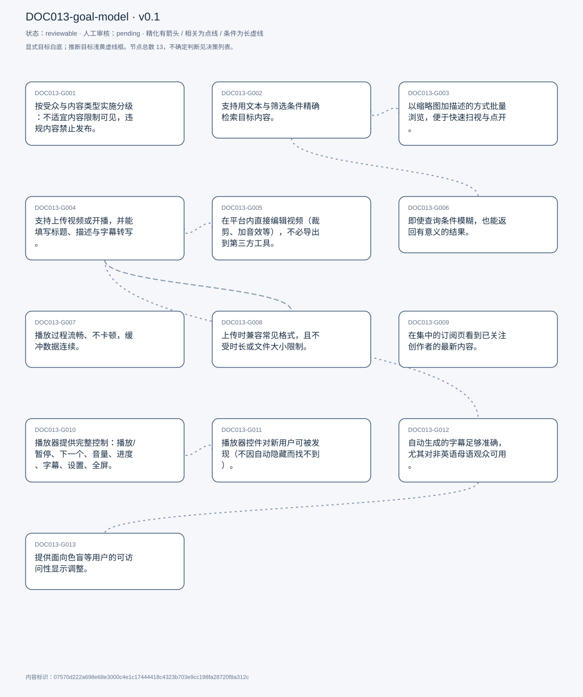
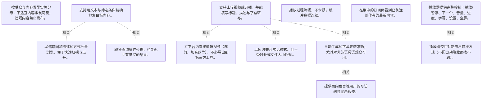

# 目标模型说明

模型：DOC013-goal-model；版本：v0.1

交付状态：reviewable；结构：passed；人工审核：pending

[交互模型](goal-model.html) · [矢量图](goal-model.svg) · [权威数据](goal-model.json)

## 目标图

## 目标

| 编号 | 表述 | 来源 | 情境 | 证据 |
|---|---|---|---|---|
| DOC013-G001 | 按受众与内容类型实施分级：不适宜内容限制可见，违规内容禁止发布。 | explicit | 背景：被问及平台是否存在合规约束；举例：含有不当语言的内容 | E0001, E0002, E0003 |
| DOC013-G002 | 支持用文本与筛选条件精确检索目标内容。 | explicit | 自述为观众侧的首要必要功能 | E0004 |
| DOC013-G003 | 以缩略图加描述的方式批量浏览，便于快速扫视与点开。 | explicit | 希望看到大量候选后逐个点开；缩略图旁带标题、作者、演员等信息 | E0005, E0006 |
| DOC013-G004 | 支持上传视频或开播，并能填写标题、描述与字幕转写。 | explicit | 从创作者视角提出；开播另有 24 小时账号等待期（见 C001 的合规语境） | E0007, E0008 |
| DOC013-G005 | 在平台内直接编辑视频（裁剪、加音效等），不必导出到第三方工具。 | explicit | 自评对视频流媒体「very useful」 | E0009 |
| DOC013-G006 | 即使查询条件模糊，也能返回有意义的结果。 | explicit | 对应「找不到想找的内容」这一障碍 | E0010, E0011 |
| DOC013-G007 | 播放过程流畅、不卡顿，缓冲数据连续。 | explicit | 被视为技术层面的核心障碍 | E0012, E0013 |
| DOC013-G008 | 上传时兼容常见格式，且不受时长或文件大小限制。 | explicit | 从创作者侧提出的技术障碍 | E0014 |
| DOC013-G009 | 在集中的订阅页看到已关注创作者的最新内容。 | explicit | 通过订阅按钮建立关系，订阅页从侧边菜单进入 | E0015, E0016 |
| DOC013-G010 | 播放器提供完整控制：播放/暂停、下一个、音量、进度、字幕、设置、全屏。 | explicit | 描述现有实现，属维持型期望 | E0017, E0018 |
| DOC013-G011 | 播放器控件对新用户可被发现（不因自动隐藏而找不到）。 | explicit | 现状：控件在播放时消失，需移动鼠标才会出现；熟悉用户不受影响，新用户可能找不到 | E0019, E0020 |
| DOC013-G012 | 自动生成的字幕足够准确，尤其对非英语母语观众可用。 | explicit | 被问及残障用户的可访问性时提出 | E0021 |
| DOC013-G013 | 提供面向色盲等用户的可访问性显示调整。 | explicit | 自评不清楚现有能力，认为是待改进之处 | E0022, E0023 |

## 关系判断（含不确定与无关系）

- DOC013-G001 / DOC013-G002：none。DOC013-G001 的对象是内容分级与禁用（T006），DOC013-G002 的对象是文本检索与筛选（T012）；两处分别出自不同话题段，原文未在二者之间建立因果、手段、评价或情境包含关系，本次评估口径内未建立可采用关系。
- DOC013-G001 / DOC013-G003：none。DOC013-G001 的对象是内容分级与禁用（T006），DOC013-G003 的对象是缩略图式视觉浏览（T012）；两处分别出自不同话题段，原文未在二者之间建立因果、手段、评价或情境包含关系，本次评估口径内未建立可采用关系。
- DOC013-G001 / DOC013-G004：none。DOC013-G001 的对象是内容分级与禁用（T006），DOC013-G004 的对象是上传/开播与元数据填写（T012）；两处分别出自不同话题段，原文未在二者之间建立因果、手段、评价或情境包含关系，本次评估口径内未建立可采用关系。
- DOC013-G001 / DOC013-G005：none。DOC013-G001 的对象是内容分级与禁用（T006），DOC013-G005 的对象是站内编辑视频（T012）；两处分别出自不同话题段，原文未在二者之间建立因果、手段、评价或情境包含关系，本次评估口径内未建立可采用关系。
- DOC013-G001 / DOC013-G006：none。DOC013-G001 的对象是内容分级与禁用（T006），DOC013-G006 的对象是模糊查询返回有意义结果（T014）；两处分别出自不同话题段，原文未在二者之间建立因果、手段、评价或情境包含关系，本次评估口径内未建立可采用关系。
- DOC013-G001 / DOC013-G007：none。DOC013-G001 的对象是内容分级与禁用（T006），DOC013-G007 的对象是播放流畅不卡顿（T014）；两处分别出自不同话题段，原文未在二者之间建立因果、手段、评价或情境包含关系，本次评估口径内未建立可采用关系。
- DOC013-G001 / DOC013-G008：none。DOC013-G001 的对象是内容分级与禁用（T006），DOC013-G008 的对象是上传格式兼容无长度限制（T018）；两处分别出自不同话题段，原文未在二者之间建立因果、手段、评价或情境包含关系，本次评估口径内未建立可采用关系。
- DOC013-G001 / DOC013-G009：none。DOC013-G001 的对象是内容分级与禁用（T006），DOC013-G009 的对象是订阅页集中看更新（T030）；两处分别出自不同话题段，原文未在二者之间建立因果、手段、评价或情境包含关系，本次评估口径内未建立可采用关系。
- DOC013-G001 / DOC013-G010：none。DOC013-G001 的对象是内容分级与禁用（T006），DOC013-G010 的对象是播放器控件完备（T038）；两处分别出自不同话题段，原文未在二者之间建立因果、手段、评价或情境包含关系，本次评估口径内未建立可采用关系。
- DOC013-G001 / DOC013-G011：none。DOC013-G001 的对象是内容分级与禁用（T006），DOC013-G011 的对象是控件对新用户可发现（T040）；两处分别出自不同话题段，原文未在二者之间建立因果、手段、评价或情境包含关系，本次评估口径内未建立可采用关系。
- DOC013-G001 / DOC013-G012：none。DOC013-G001 的对象是内容分级与禁用（T006），DOC013-G012 的对象是字幕准确（含非母语者）（T040）；两处分别出自不同话题段，原文未在二者之间建立因果、手段、评价或情境包含关系，本次评估口径内未建立可采用关系。
- DOC013-G001 / DOC013-G013：none。DOC013-G001 的对象是内容分级与禁用（T006），DOC013-G013 的对象是无障碍显示调整（T040）；两处分别出自不同话题段，原文未在二者之间建立因果、手段、评价或情境包含关系，本次评估口径内未建立可采用关系。
- DOC013-G002 / DOC013-G003：related。T012 用「as a viewer first... and secondly」把文本检索与视觉浏览并列为观众侧两种发现方式，二者同层但不互相包含。
- DOC013-G002 / DOC013-G004：none。DOC013-G002 的对象是文本检索与筛选（T012），DOC013-G004 的对象是上传/开播与元数据填写（T012）；两处分别出自不同话题段，原文未在二者之间建立因果、手段、评价或情境包含关系，本次评估口径内未建立可采用关系。
- DOC013-G002 / DOC013-G005：none。DOC013-G002 的对象是文本检索与筛选（T012），DOC013-G005 的对象是站内编辑视频（T012）；两处分别出自不同话题段，原文未在二者之间建立因果、手段、评价或情境包含关系，本次评估口径内未建立可采用关系。
- DOC013-G002 / DOC013-G006：related。T012 提出文本检索，T014 紧接着讨论该功能的障碍，并把它细化为「vague criteria 也要有意义结果」；G006 是检索能力的质量要求，不是独立功能。
- DOC013-G002 / DOC013-G007：none。DOC013-G002 的对象是文本检索与筛选（T012），DOC013-G007 的对象是播放流畅不卡顿（T014）；两处分别出自不同话题段，原文未在二者之间建立因果、手段、评价或情境包含关系，本次评估口径内未建立可采用关系。
- DOC013-G002 / DOC013-G008：none。DOC013-G002 的对象是文本检索与筛选（T012），DOC013-G008 的对象是上传格式兼容无长度限制（T018）；两处分别出自不同话题段，原文未在二者之间建立因果、手段、评价或情境包含关系，本次评估口径内未建立可采用关系。
- DOC013-G002 / DOC013-G009：none。DOC013-G002 的对象是文本检索与筛选（T012），DOC013-G009 的对象是订阅页集中看更新（T030）；两处分别出自不同话题段，原文未在二者之间建立因果、手段、评价或情境包含关系，本次评估口径内未建立可采用关系。
- DOC013-G002 / DOC013-G010：none。DOC013-G002 的对象是文本检索与筛选（T012），DOC013-G010 的对象是播放器控件完备（T038）；两处分别出自不同话题段，原文未在二者之间建立因果、手段、评价或情境包含关系，本次评估口径内未建立可采用关系。
- DOC013-G002 / DOC013-G011：none。DOC013-G002 的对象是文本检索与筛选（T012），DOC013-G011 的对象是控件对新用户可发现（T040）；两处分别出自不同话题段，原文未在二者之间建立因果、手段、评价或情境包含关系，本次评估口径内未建立可采用关系。
- DOC013-G002 / DOC013-G012：none。DOC013-G002 的对象是文本检索与筛选（T012），DOC013-G012 的对象是字幕准确（含非母语者）（T040）；两处分别出自不同话题段，原文未在二者之间建立因果、手段、评价或情境包含关系，本次评估口径内未建立可采用关系。
- DOC013-G002 / DOC013-G013：none。DOC013-G002 的对象是文本检索与筛选（T012），DOC013-G013 的对象是无障碍显示调整（T040）；两处分别出自不同话题段，原文未在二者之间建立因果、手段、评价或情境包含关系，本次评估口径内未建立可采用关系。
- DOC013-G003 / DOC013-G004：none。DOC013-G003 的对象是缩略图式视觉浏览（T012），DOC013-G004 的对象是上传/开播与元数据填写（T012）；两处分别出自不同话题段，原文未在二者之间建立因果、手段、评价或情境包含关系，本次评估口径内未建立可采用关系。
- DOC013-G003 / DOC013-G005：none。DOC013-G003 的对象是缩略图式视觉浏览（T012），DOC013-G005 的对象是站内编辑视频（T012）；两处分别出自不同话题段，原文未在二者之间建立因果、手段、评价或情境包含关系，本次评估口径内未建立可采用关系。
- DOC013-G003 / DOC013-G006：none。DOC013-G003 的对象是缩略图式视觉浏览（T012），DOC013-G006 的对象是模糊查询返回有意义结果（T014）；两处分别出自不同话题段，原文未在二者之间建立因果、手段、评价或情境包含关系，本次评估口径内未建立可采用关系。
- DOC013-G003 / DOC013-G007：none。DOC013-G003 的对象是缩略图式视觉浏览（T012），DOC013-G007 的对象是播放流畅不卡顿（T014）；两处分别出自不同话题段，原文未在二者之间建立因果、手段、评价或情境包含关系，本次评估口径内未建立可采用关系。
- DOC013-G003 / DOC013-G008：none。DOC013-G003 的对象是缩略图式视觉浏览（T012），DOC013-G008 的对象是上传格式兼容无长度限制（T018）；两处分别出自不同话题段，原文未在二者之间建立因果、手段、评价或情境包含关系，本次评估口径内未建立可采用关系。
- DOC013-G003 / DOC013-G009：none。DOC013-G003 的对象是缩略图式视觉浏览（T012），DOC013-G009 的对象是订阅页集中看更新（T030）；两处分别出自不同话题段，原文未在二者之间建立因果、手段、评价或情境包含关系，本次评估口径内未建立可采用关系。
- DOC013-G003 / DOC013-G010：none。DOC013-G003 的对象是缩略图式视觉浏览（T012），DOC013-G010 的对象是播放器控件完备（T038）；两处分别出自不同话题段，原文未在二者之间建立因果、手段、评价或情境包含关系，本次评估口径内未建立可采用关系。
- DOC013-G003 / DOC013-G011：none。DOC013-G003 的对象是缩略图式视觉浏览（T012），DOC013-G011 的对象是控件对新用户可发现（T040）；两处分别出自不同话题段，原文未在二者之间建立因果、手段、评价或情境包含关系，本次评估口径内未建立可采用关系。
- DOC013-G003 / DOC013-G012：none。DOC013-G003 的对象是缩略图式视觉浏览（T012），DOC013-G012 的对象是字幕准确（含非母语者）（T040）；两处分别出自不同话题段，原文未在二者之间建立因果、手段、评价或情境包含关系，本次评估口径内未建立可采用关系。
- DOC013-G003 / DOC013-G013：none。DOC013-G003 的对象是缩略图式视觉浏览（T012），DOC013-G013 的对象是无障碍显示调整（T040）；两处分别出自不同话题段，原文未在二者之间建立因果、手段、评价或情境包含关系，本次评估口径内未建立可采用关系。
- DOC013-G004 / DOC013-G005：related。T012 在讲完上传与元数据后立即提出站内编辑，二者同属创作流程；但编辑是上传后的加工能力，非上传承诺的一部分。
- DOC013-G004 / DOC013-G006：none。DOC013-G004 的对象是上传/开播与元数据填写（T012），DOC013-G006 的对象是模糊查询返回有意义结果（T014）；两处分别出自不同话题段，原文未在二者之间建立因果、手段、评价或情境包含关系，本次评估口径内未建立可采用关系。
- DOC013-G004 / DOC013-G007：none。DOC013-G004 的对象是上传/开播与元数据填写（T012），DOC013-G007 的对象是播放流畅不卡顿（T014）；两处分别出自不同话题段，原文未在二者之间建立因果、手段、评价或情境包含关系，本次评估口径内未建立可采用关系。
- DOC013-G004 / DOC013-G008：related。T018 讨论创作者侧障碍时，把格式兼容与时长限制作为上传环节的技术条件，直接作用在 C004 的上传能力上。
- DOC013-G004 / DOC013-G009：none。DOC013-G004 的对象是上传/开播与元数据填写（T012），DOC013-G009 的对象是订阅页集中看更新（T030）；两处分别出自不同话题段，原文未在二者之间建立因果、手段、评价或情境包含关系，本次评估口径内未建立可采用关系。
- DOC013-G004 / DOC013-G010：none。DOC013-G004 的对象是上传/开播与元数据填写（T012），DOC013-G010 的对象是播放器控件完备（T038）；两处分别出自不同话题段，原文未在二者之间建立因果、手段、评价或情境包含关系，本次评估口径内未建立可采用关系。
- DOC013-G004 / DOC013-G011：none。DOC013-G004 的对象是上传/开播与元数据填写（T012），DOC013-G011 的对象是控件对新用户可发现（T040）；两处分别出自不同话题段，原文未在二者之间建立因果、手段、评价或情境包含关系，本次评估口径内未建立可采用关系。
- DOC013-G004 / DOC013-G012：related。T012 把字幕/转写列为上传时可填的元数据，T040 又质疑自动字幕的准确性；一个是录入途径，一个是质量要求。
- DOC013-G004 / DOC013-G013：none。DOC013-G004 的对象是上传/开播与元数据填写（T012），DOC013-G013 的对象是无障碍显示调整（T040）；两处分别出自不同话题段，原文未在二者之间建立因果、手段、评价或情境包含关系，本次评估口径内未建立可采用关系。
- DOC013-G005 / DOC013-G006：none。DOC013-G005 的对象是站内编辑视频（T012），DOC013-G006 的对象是模糊查询返回有意义结果（T014）；两处分别出自不同话题段，原文未在二者之间建立因果、手段、评价或情境包含关系，本次评估口径内未建立可采用关系。
- DOC013-G005 / DOC013-G007：none。DOC013-G005 的对象是站内编辑视频（T012），DOC013-G007 的对象是播放流畅不卡顿（T014）；两处分别出自不同话题段，原文未在二者之间建立因果、手段、评价或情境包含关系，本次评估口径内未建立可采用关系。
- DOC013-G005 / DOC013-G008：none。DOC013-G005 的对象是站内编辑视频（T012），DOC013-G008 的对象是上传格式兼容无长度限制（T018）；两处分别出自不同话题段，原文未在二者之间建立因果、手段、评价或情境包含关系，本次评估口径内未建立可采用关系。
- DOC013-G005 / DOC013-G009：none。DOC013-G005 的对象是站内编辑视频（T012），DOC013-G009 的对象是订阅页集中看更新（T030）；两处分别出自不同话题段，原文未在二者之间建立因果、手段、评价或情境包含关系，本次评估口径内未建立可采用关系。
- DOC013-G005 / DOC013-G010：none。DOC013-G005 的对象是站内编辑视频（T012），DOC013-G010 的对象是播放器控件完备（T038）；两处分别出自不同话题段，原文未在二者之间建立因果、手段、评价或情境包含关系，本次评估口径内未建立可采用关系。
- DOC013-G005 / DOC013-G011：none。DOC013-G005 的对象是站内编辑视频（T012），DOC013-G011 的对象是控件对新用户可发现（T040）；两处分别出自不同话题段，原文未在二者之间建立因果、手段、评价或情境包含关系，本次评估口径内未建立可采用关系。
- DOC013-G005 / DOC013-G012：none。DOC013-G005 的对象是站内编辑视频（T012），DOC013-G012 的对象是字幕准确（含非母语者）（T040）；两处分别出自不同话题段，原文未在二者之间建立因果、手段、评价或情境包含关系，本次评估口径内未建立可采用关系。
- DOC013-G005 / DOC013-G013：none。DOC013-G005 的对象是站内编辑视频（T012），DOC013-G013 的对象是无障碍显示调整（T040）；两处分别出自不同话题段，原文未在二者之间建立因果、手段、评价或情境包含关系，本次评估口径内未建立可采用关系。
- DOC013-G006 / DOC013-G007：none。DOC013-G006 的对象是模糊查询返回有意义结果（T014），DOC013-G007 的对象是播放流畅不卡顿（T014）；两处分别出自不同话题段，原文未在二者之间建立因果、手段、评价或情境包含关系，本次评估口径内未建立可采用关系。
- DOC013-G006 / DOC013-G008：none。DOC013-G006 的对象是模糊查询返回有意义结果（T014），DOC013-G008 的对象是上传格式兼容无长度限制（T018）；两处分别出自不同话题段，原文未在二者之间建立因果、手段、评价或情境包含关系，本次评估口径内未建立可采用关系。
- DOC013-G006 / DOC013-G009：none。DOC013-G006 的对象是模糊查询返回有意义结果（T014），DOC013-G009 的对象是订阅页集中看更新（T030）；两处分别出自不同话题段，原文未在二者之间建立因果、手段、评价或情境包含关系，本次评估口径内未建立可采用关系。
- DOC013-G006 / DOC013-G010：none。DOC013-G006 的对象是模糊查询返回有意义结果（T014），DOC013-G010 的对象是播放器控件完备（T038）；两处分别出自不同话题段，原文未在二者之间建立因果、手段、评价或情境包含关系，本次评估口径内未建立可采用关系。
- DOC013-G006 / DOC013-G011：none。DOC013-G006 的对象是模糊查询返回有意义结果（T014），DOC013-G011 的对象是控件对新用户可发现（T040）；两处分别出自不同话题段，原文未在二者之间建立因果、手段、评价或情境包含关系，本次评估口径内未建立可采用关系。
- DOC013-G006 / DOC013-G012：none。DOC013-G006 的对象是模糊查询返回有意义结果（T014），DOC013-G012 的对象是字幕准确（含非母语者）（T040）；两处分别出自不同话题段，原文未在二者之间建立因果、手段、评价或情境包含关系，本次评估口径内未建立可采用关系。
- DOC013-G006 / DOC013-G013：none。DOC013-G006 的对象是模糊查询返回有意义结果（T014），DOC013-G013 的对象是无障碍显示调整（T040）；两处分别出自不同话题段，原文未在二者之间建立因果、手段、评价或情境包含关系，本次评估口径内未建立可采用关系。
- DOC013-G007 / DOC013-G008：none。DOC013-G007 的对象是播放流畅不卡顿（T014），DOC013-G008 的对象是上传格式兼容无长度限制（T018）；两处分别出自不同话题段，原文未在二者之间建立因果、手段、评价或情境包含关系，本次评估口径内未建立可采用关系。
- DOC013-G007 / DOC013-G009：none。DOC013-G007 的对象是播放流畅不卡顿（T014），DOC013-G009 的对象是订阅页集中看更新（T030）；两处分别出自不同话题段，原文未在二者之间建立因果、手段、评价或情境包含关系，本次评估口径内未建立可采用关系。
- DOC013-G007 / DOC013-G010：none。DOC013-G007 的对象是播放流畅不卡顿（T014），DOC013-G010 的对象是播放器控件完备（T038）；两处分别出自不同话题段，原文未在二者之间建立因果、手段、评价或情境包含关系，本次评估口径内未建立可采用关系。
- DOC013-G007 / DOC013-G011：none。DOC013-G007 的对象是播放流畅不卡顿（T014），DOC013-G011 的对象是控件对新用户可发现（T040）；两处分别出自不同话题段，原文未在二者之间建立因果、手段、评价或情境包含关系，本次评估口径内未建立可采用关系。
- DOC013-G007 / DOC013-G012：none。DOC013-G007 的对象是播放流畅不卡顿（T014），DOC013-G012 的对象是字幕准确（含非母语者）（T040）；两处分别出自不同话题段，原文未在二者之间建立因果、手段、评价或情境包含关系，本次评估口径内未建立可采用关系。
- DOC013-G007 / DOC013-G013：none。DOC013-G007 的对象是播放流畅不卡顿（T014），DOC013-G013 的对象是无障碍显示调整（T040）；两处分别出自不同话题段，原文未在二者之间建立因果、手段、评价或情境包含关系，本次评估口径内未建立可采用关系。
- DOC013-G008 / DOC013-G009：none。DOC013-G008 的对象是上传格式兼容无长度限制（T018），DOC013-G009 的对象是订阅页集中看更新（T030）；两处分别出自不同话题段，原文未在二者之间建立因果、手段、评价或情境包含关系，本次评估口径内未建立可采用关系。
- DOC013-G008 / DOC013-G010：none。DOC013-G008 的对象是上传格式兼容无长度限制（T018），DOC013-G010 的对象是播放器控件完备（T038）；两处分别出自不同话题段，原文未在二者之间建立因果、手段、评价或情境包含关系，本次评估口径内未建立可采用关系。
- DOC013-G008 / DOC013-G011：none。DOC013-G008 的对象是上传格式兼容无长度限制（T018），DOC013-G011 的对象是控件对新用户可发现（T040）；两处分别出自不同话题段，原文未在二者之间建立因果、手段、评价或情境包含关系，本次评估口径内未建立可采用关系。
- DOC013-G008 / DOC013-G012：none。DOC013-G008 的对象是上传格式兼容无长度限制（T018），DOC013-G012 的对象是字幕准确（含非母语者）（T040）；两处分别出自不同话题段，原文未在二者之间建立因果、手段、评价或情境包含关系，本次评估口径内未建立可采用关系。
- DOC013-G008 / DOC013-G013：none。DOC013-G008 的对象是上传格式兼容无长度限制（T018），DOC013-G013 的对象是无障碍显示调整（T040）；两处分别出自不同话题段，原文未在二者之间建立因果、手段、评价或情境包含关系，本次评估口径内未建立可采用关系。
- DOC013-G009 / DOC013-G010：none。DOC013-G009 的对象是订阅页集中看更新（T030），DOC013-G010 的对象是播放器控件完备（T038）；两处分别出自不同话题段，原文未在二者之间建立因果、手段、评价或情境包含关系，本次评估口径内未建立可采用关系。
- DOC013-G009 / DOC013-G011：none。DOC013-G009 的对象是订阅页集中看更新（T030），DOC013-G011 的对象是控件对新用户可发现（T040）；两处分别出自不同话题段，原文未在二者之间建立因果、手段、评价或情境包含关系，本次评估口径内未建立可采用关系。
- DOC013-G009 / DOC013-G012：none。DOC013-G009 的对象是订阅页集中看更新（T030），DOC013-G012 的对象是字幕准确（含非母语者）（T040）；两处分别出自不同话题段，原文未在二者之间建立因果、手段、评价或情境包含关系，本次评估口径内未建立可采用关系。
- DOC013-G009 / DOC013-G013：none。DOC013-G009 的对象是订阅页集中看更新（T030），DOC013-G013 的对象是无障碍显示调整（T040）；两处分别出自不同话题段，原文未在二者之间建立因果、手段、评价或情境包含关系，本次评估口径内未建立可采用关系。
- DOC013-G010 / DOC013-G011：related。T038 枚举控件（完备性），T040 随即指出这些控件会消失、新用户找不到（可发现性）；二者是同一控件集的两个维度，非精化。
- DOC013-G010 / DOC013-G012：none。DOC013-G010 的对象是播放器控件完备（T038），DOC013-G012 的对象是字幕准确（含非母语者）（T040）；两处分别出自不同话题段，原文未在二者之间建立因果、手段、评价或情境包含关系，本次评估口径内未建立可采用关系。
- DOC013-G010 / DOC013-G013：none。DOC013-G010 的对象是播放器控件完备（T038），DOC013-G013 的对象是无障碍显示调整（T040）；两处分别出自不同话题段，原文未在二者之间建立因果、手段、评价或情境包含关系，本次评估口径内未建立可采用关系。
- DOC013-G011 / DOC013-G012：none。DOC013-G011 的对象是控件对新用户可发现（T040），DOC013-G012 的对象是字幕准确（含非母语者）（T040）；两处分别出自不同话题段，原文未在二者之间建立因果、手段、评价或情境包含关系，本次评估口径内未建立可采用关系。
- DOC013-G011 / DOC013-G013：none。DOC013-G011 的对象是控件对新用户可发现（T040），DOC013-G013 的对象是无障碍显示调整（T040）；两处分别出自不同话题段，原文未在二者之间建立因果、手段、评价或情境包含关系，本次评估口径内未建立可采用关系。
- DOC013-G012 / DOC013-G013：related。T040 在同一段回答可访问性问题：先讲字幕准确性（听觉/语言障碍），再讲色彩调整（色觉障碍），同属无障碍范畴但对象不同。

## 证据

### E0001 · DOC013:S007

> there could be types of content that&#x27;s not suitable for all viewers. so we&#x27;ll have to make sure that a some viewers can&#x27;t see certain things

原件位置：{&quot;line_start&quot;: 7, &quot;line_end&quot;: 7, &quot;start_char&quot;: 568, &quot;end_char&quot;: 975}

### E0002 · DOC013:S007

> there&#x27;s some sorts of content that streamers should not be allowed to share with anybody

原件位置：{&quot;line_start&quot;: 7, &quot;line_end&quot;: 7, &quot;start_char&quot;: 568, &quot;end_char&quot;: 975}

### E0003 · DOC013:S007

> things with explicit language, for instance.

原件位置：{&quot;line_start&quot;: 7, &quot;line_end&quot;: 7, &quot;start_char&quot;: 568, &quot;end_char&quot;: 975}

### E0004 · DOC013:S013

> essential to be able to try to get a specific type of video or content by searching via text, or perhaps by filters of some sort

原件位置：{&quot;line_start&quot;: 13, &quot;line_end&quot;: 13, &quot;start_char&quot;: 1881, &quot;end_char&quot;: 3007}

### E0005 · DOC013:S013

> to be able to search visually, so I would like to be able to see a large volume of different options and click through it

原件位置：{&quot;line_start&quot;: 13, &quot;line_end&quot;: 13, &quot;start_char&quot;: 1881, &quot;end_char&quot;: 3007}

### E0006 · DOC013:S013

> seeing little images of a thumbnail, so to speak, with a description, perhaps, who made it, the Creator, or the actors in it

原件位置：{&quot;line_start&quot;: 13, &quot;line_end&quot;: 13, &quot;start_char&quot;: 1881, &quot;end_char&quot;: 3007}

### E0007 · DOC013:S013

> I would want to see some option where I could go and create to upload a video or start a stream

原件位置：{&quot;line_start&quot;: 13, &quot;line_end&quot;: 13, &quot;start_char&quot;: 1881, &quot;end_char&quot;: 3007}

### E0008 · DOC013:S013

> put some sort of description in, add, perhaps a transcript captions of the like

原件位置：{&quot;line_start&quot;: 13, &quot;line_end&quot;: 13, &quot;start_char&quot;: 1881, &quot;end_char&quot;: 3007}

### E0009 · DOC013:S013

> one thing, I think would be very useful, particularly in a video streaming would be to edit those. So I can add sound effects. Trim crop.

原件位置：{&quot;line_start&quot;: 13, &quot;line_end&quot;: 13, &quot;start_char&quot;: 1881, &quot;end_char&quot;: 3007}

### E0010 · DOC013:S015

> I want to be able to search, using vague criteria, but that should still get me meaningful results.

原件位置：{&quot;line_start&quot;: 15, &quot;line_end&quot;: 15, &quot;start_char&quot;: 3307, &quot;end_char&quot;: 3799}

### E0011 · DOC013:S015

> not finding what I&#x27;m looking for. even if it hypothetically should exist

原件位置：{&quot;line_start&quot;: 15, &quot;line_end&quot;: 15, &quot;start_char&quot;: 3307, &quot;end_char&quot;: 3799}

### E0012 · DOC013:S015

> I want a seamless stream of buffered data.

原件位置：{&quot;line_start&quot;: 15, &quot;line_end&quot;: 15, &quot;start_char&quot;: 3307, &quot;end_char&quot;: 3799}

### E0013 · DOC013:S015

> I don&#x27;t want it to freeze constantly.

原件位置：{&quot;line_start&quot;: 15, &quot;line_end&quot;: 15, &quot;start_char&quot;: 3307, &quot;end_char&quot;: 3799}

### E0014 · DOC013:S019

> making sure their formats are compatible with the system, making sure there&#x27;s no length requirements

原件位置：{&quot;line_start&quot;: 19, &quot;line_end&quot;: 19, &quot;start_char&quot;: 4454, &quot;end_char&quot;: 5021}

### E0015 · DOC013:S031

> they can access. This in a central area known as the subscriptions tab

原件位置：{&quot;line_start&quot;: 31, &quot;line_end&quot;: 31, &quot;start_char&quot;: 9349, &quot;end_char&quot;: 9932}

### E0016 · DOC013:S031

> it will list out the latest content from said creators, who they are subscribed to

原件位置：{&quot;line_start&quot;: 31, &quot;line_end&quot;: 31, &quot;start_char&quot;: 9349, &quot;end_char&quot;: 9932}

### E0017 · DOC013:S039

> my screen is the video player in the center, where along the bottom there is a play button

原件位置：{&quot;line_start&quot;: 39, &quot;line_end&quot;: 39, &quot;start_char&quot;: 11117, &quot;end_char&quot;: 12235}

### E0018 · DOC013:S039

> I can enable disable captions. I have some settings. and I&#x27;m able to toggle and untoggle the full screen.

原件位置：{&quot;line_start&quot;: 39, &quot;line_end&quot;: 39, &quot;start_char&quot;: 11117, &quot;end_char&quot;: 12235}

### E0019 · DOC013:S041

> if someone unfamiliar were to arrive and see these 10 icons, they might not be so well known. They actually disappear when the video is playing.

原件位置：{&quot;line_start&quot;: 41, &quot;line_end&quot;: 41, &quot;start_char&quot;: 12452, &quot;end_char&quot;: 13280}

### E0020 · DOC013:S041

> someone would need to realize they need to move their mouse down to the bottom to find the buttons.

原件位置：{&quot;line_start&quot;: 41, &quot;line_end&quot;: 41, &quot;start_char&quot;: 12452, &quot;end_char&quot;: 13280}

### E0021 · DOC013:S041

> these captions can be auto generated, but I&#x27;m not sure how accurate they always are, particularly for people who don&#x27;t speak English as a 1st language

原件位置：{&quot;line_start&quot;: 41, &quot;line_end&quot;: 41, &quot;start_char&quot;: 12452, &quot;end_char&quot;: 13280}

### E0022 · DOC013:S041

> I&#x27;m also not sure if things like colors can be tweaked for, say. colorblind viewers

原件位置：{&quot;line_start&quot;: 41, &quot;line_end&quot;: 41, &quot;start_char&quot;: 12452, &quot;end_char&quot;: 13280}

### E0023 · DOC013:S041

> that could be grounds for some work.

原件位置：{&quot;line_start&quot;: 41, &quot;line_end&quot;: 41, &quot;start_char&quot;: 12452, &quot;end_char&quot;: 13280}

## 问题、限制与版本

- 当前会话助手的开发判断，非独立盲测；无人工采纳记录。
- 结构检查已绑定当前版本；独立语义审查未执行；人工状态以实际审核记录为准。

内容标识：07570d222a698e68e3000c4e1c17444418c4323b703e9cc198fa28720f8a312c

人工决定：

审核意见：
