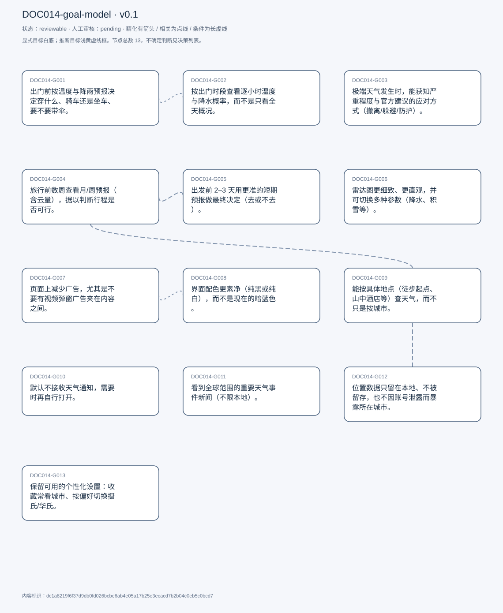
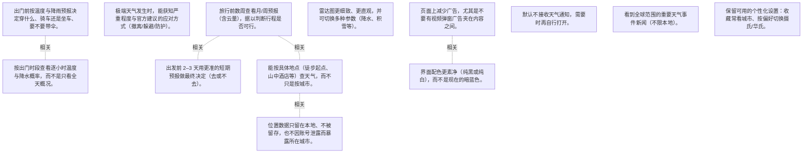

# 目标模型说明

模型：DOC014-goal-model；版本：v0.1

交付状态：reviewable；结构：passed；人工审核：pending

[交互模型](goal-model.html) · [矢量图](goal-model.svg) · [权威数据](goal-model.json)

## 目标图

## 目标

| 编号 | 表述 | 来源 | 情境 | 证据 |
|---|---|---|---|---|
| DOC014-G001 | 出门前按温度与降雨预报决定穿什么、骑车还是坐车、要不要带伞。 | explicit | 通常在前一天查看；判断依据为温度区间与降雨概率（25% 以上视为可能下雨） | E0001, E0002, E0003 |
| DOC014-G002 | 按出门时段查看逐小时温度与降水概率，而不是只看全天概况。 | explicit | 关注早晨上课前那一小时的温度与降水 | E0004, E0005, E0006 |
| DOC014-G003 | 极端天气发生时，能获知严重程度与官方建议的应对方式（撤离/躲避/防护）。 | explicit | 期望应用成为最早看到消息的地方；现状：严重预警也由地方政府与气象机构发布 | E0007, E0008, E0009 |
| DOC014-G004 | 旅行前数周查看月/周预报（含云量），据以判断行程是否可行。 | explicit | 场景：海滩度假要看云量；观星/天文行程怕阴天；也会先查历史数据 | E0010, E0011, E0012 |
| DOC014-G005 | 出发前 2–3 天用更准的短期预报做最终决定（去或不去）。 | explicit | 自评：几周前的预报很难准，2–3 天内通常可靠；误差可能正好落在「去/不去」的分界上 | E0013, E0014 |
| DOC014-G006 | 雷达图更细致、更直观，并可切换多种参数（降水、积雪等）。 | explicit | 对标 windy.com：整个应用就是雷达，动画细节多；自评若做好，可能因此付费 | E0015, E0016, E0017 |
| DOC014-G007 | 页面上减少广告，尤其是不要有视频弹窗广告夹在内容之间。 | explicit | 现状：一页 4–5 个广告，含视频弹窗；后果：需要上下滚动确认内容是否刷新 | E0018, E0019, E0020 |
| DOC014-G008 | 界面配色更素净（纯黑或纯白），而不是现在的暗蓝色。 | explicit | 与广告并列为界面上的两处不满 | E0021, E0022 |
| DOC014-G009 | 能按具体地点（徒步起点、山中酒店等）查天气，而不只是按城市。 | explicit | 场景：目的地不是城市，城市级数据没有参考价值 | E0023, E0024, E0025 |
| DOC014-G010 | 默认不接收天气通知，需要时再自行打开。 | explicit | 自述在电脑上偏好零通知；通过浏览器站点设置关闭通知权限 | E0026, E0027 |
| DOC014-G011 | 看到全球范围的重要天气事件新闻（不限本地）。 | explicit | 首页有专门区块，点开进入站内新闻页 | E0028, E0029 |
| DOC014-G012 | 位置数据只留在本地、不被留存，也不因账号泄露而暴露所在城市。 | explicit | 推断：位置存在本地浏览器缓存，清缓存即可清除；顾虑集中在已登录状态下的泄露风险 | E0030, E0031, E0032 |
| DOC014-G013 | 保留可用的个性化设置：收藏常看城市、按偏好切换摄氏/华氏。 | explicit | 已设两个城市（现居与家乡）；默认华氏，手动切到摄氏 | E0033, E0034, E0035 |

## 关系判断（含不确定与无关系）

- DOC014-G001 / DOC014-G002：related。T005 说明看逐小时数据的目的正是判断出门那一时段的温度与降水（「when I&#x27;m actually going out」），G002 是 G001 的信息依据；但一个是决策、一个是查看粒度，非精化。
- DOC014-G001 / DOC014-G003：none。DOC014-G001 的对象是出门前按温度与降雨做准备（T001），DOC014-G003 的对象是极端天气获知程度与建议（T011/T015）；两处分别出自不同话题段，原文未在二者之间建立因果、手段、评价或情境包含关系，本次评估口径内未建立可采用关系。
- DOC014-G001 / DOC014-G004：none。DOC014-G001 的对象是出门前按温度与降雨做准备（T001），DOC014-G004 的对象是旅行前数周看预报含云量（T017）；两处分别出自不同话题段，原文未在二者之间建立因果、手段、评价或情境包含关系，本次评估口径内未建立可采用关系。
- DOC014-G001 / DOC014-G005：none。DOC014-G001 的对象是出门前按温度与降雨做准备（T001），DOC014-G005 的对象是出发前 2–3 天最终确认（T019）；两处分别出自不同话题段，原文未在二者之间建立因果、手段、评价或情境包含关系，本次评估口径内未建立可采用关系。
- DOC014-G001 / DOC014-G006：none。DOC014-G001 的对象是出门前按温度与降雨做准备（T001），DOC014-G006 的对象是雷达更细更多参数（T043）；两处分别出自不同话题段，原文未在二者之间建立因果、手段、评价或情境包含关系，本次评估口径内未建立可采用关系。
- DOC014-G001 / DOC014-G007：none。DOC014-G001 的对象是出门前按温度与降雨做准备（T001），DOC014-G007 的对象是减少广告（T037/T069）；两处分别出自不同话题段，原文未在二者之间建立因果、手段、评价或情境包含关系，本次评估口径内未建立可采用关系。
- DOC014-G001 / DOC014-G008：none。DOC014-G001 的对象是出门前按温度与降雨做准备（T001），DOC014-G008 的对象是配色更素净（T035）；两处分别出自不同话题段，原文未在二者之间建立因果、手段、评价或情境包含关系，本次评估口径内未建立可采用关系。
- DOC014-G001 / DOC014-G009：none。DOC014-G001 的对象是出门前按温度与降雨做准备（T001），DOC014-G009 的对象是按具体地点查天气（T067）；两处分别出自不同话题段，原文未在二者之间建立因果、手段、评价或情境包含关系，本次评估口径内未建立可采用关系。
- DOC014-G001 / DOC014-G010：none。DOC014-G001 的对象是出门前按温度与降雨做准备（T001），DOC014-G010 的对象是默认不接收通知（T055/T057）；两处分别出自不同话题段，原文未在二者之间建立因果、手段、评价或情境包含关系，本次评估口径内未建立可采用关系。
- DOC014-G001 / DOC014-G011：none。DOC014-G001 的对象是出门前按温度与降雨做准备（T001），DOC014-G011 的对象是看全球天气事件新闻（T051）；两处分别出自不同话题段，原文未在二者之间建立因果、手段、评价或情境包含关系，本次评估口径内未建立可采用关系。
- DOC014-G001 / DOC014-G012：none。DOC014-G001 的对象是出门前按温度与降雨做准备（T001），DOC014-G012 的对象是位置数据不留存不泄露（T061）；两处分别出自不同话题段，原文未在二者之间建立因果、手段、评价或情境包含关系，本次评估口径内未建立可采用关系。
- DOC014-G001 / DOC014-G013：none。DOC014-G001 的对象是出门前按温度与降雨做准备（T001），DOC014-G013 的对象是个性化：收藏城市与温标（T045/T047/T071）；两处分别出自不同话题段，原文未在二者之间建立因果、手段、评价或情境包含关系，本次评估口径内未建立可采用关系。
- DOC014-G002 / DOC014-G003：none。DOC014-G002 的对象是按出门时段看逐小时数据（T005），DOC014-G003 的对象是极端天气获知程度与建议（T011/T015）；两处分别出自不同话题段，原文未在二者之间建立因果、手段、评价或情境包含关系，本次评估口径内未建立可采用关系。
- DOC014-G002 / DOC014-G004：none。DOC014-G002 的对象是按出门时段看逐小时数据（T005），DOC014-G004 的对象是旅行前数周看预报含云量（T017）；两处分别出自不同话题段，原文未在二者之间建立因果、手段、评价或情境包含关系，本次评估口径内未建立可采用关系。
- DOC014-G002 / DOC014-G005：none。DOC014-G002 的对象是按出门时段看逐小时数据（T005），DOC014-G005 的对象是出发前 2–3 天最终确认（T019）；两处分别出自不同话题段，原文未在二者之间建立因果、手段、评价或情境包含关系，本次评估口径内未建立可采用关系。
- DOC014-G002 / DOC014-G006：none。DOC014-G002 的对象是按出门时段看逐小时数据（T005），DOC014-G006 的对象是雷达更细更多参数（T043）；两处分别出自不同话题段，原文未在二者之间建立因果、手段、评价或情境包含关系，本次评估口径内未建立可采用关系。
- DOC014-G002 / DOC014-G007：none。DOC014-G002 的对象是按出门时段看逐小时数据（T005），DOC014-G007 的对象是减少广告（T037/T069）；两处分别出自不同话题段，原文未在二者之间建立因果、手段、评价或情境包含关系，本次评估口径内未建立可采用关系。
- DOC014-G002 / DOC014-G008：none。DOC014-G002 的对象是按出门时段看逐小时数据（T005），DOC014-G008 的对象是配色更素净（T035）；两处分别出自不同话题段，原文未在二者之间建立因果、手段、评价或情境包含关系，本次评估口径内未建立可采用关系。
- DOC014-G002 / DOC014-G009：none。DOC014-G002 的对象是按出门时段看逐小时数据（T005），DOC014-G009 的对象是按具体地点查天气（T067）；两处分别出自不同话题段，原文未在二者之间建立因果、手段、评价或情境包含关系，本次评估口径内未建立可采用关系。
- DOC014-G002 / DOC014-G010：none。DOC014-G002 的对象是按出门时段看逐小时数据（T005），DOC014-G010 的对象是默认不接收通知（T055/T057）；两处分别出自不同话题段，原文未在二者之间建立因果、手段、评价或情境包含关系，本次评估口径内未建立可采用关系。
- DOC014-G002 / DOC014-G011：none。DOC014-G002 的对象是按出门时段看逐小时数据（T005），DOC014-G011 的对象是看全球天气事件新闻（T051）；两处分别出自不同话题段，原文未在二者之间建立因果、手段、评价或情境包含关系，本次评估口径内未建立可采用关系。
- DOC014-G002 / DOC014-G012：none。DOC014-G002 的对象是按出门时段看逐小时数据（T005），DOC014-G012 的对象是位置数据不留存不泄露（T061）；两处分别出自不同话题段，原文未在二者之间建立因果、手段、评价或情境包含关系，本次评估口径内未建立可采用关系。
- DOC014-G002 / DOC014-G013：none。DOC014-G002 的对象是按出门时段看逐小时数据（T005），DOC014-G013 的对象是个性化：收藏城市与温标（T045/T047/T071）；两处分别出自不同话题段，原文未在二者之间建立因果、手段、评价或情境包含关系，本次评估口径内未建立可采用关系。
- DOC014-G003 / DOC014-G004：none。DOC014-G003 的对象是极端天气获知程度与建议（T011/T015），DOC014-G004 的对象是旅行前数周看预报含云量（T017）；两处分别出自不同话题段，原文未在二者之间建立因果、手段、评价或情境包含关系，本次评估口径内未建立可采用关系。
- DOC014-G003 / DOC014-G005：none。DOC014-G003 的对象是极端天气获知程度与建议（T011/T015），DOC014-G005 的对象是出发前 2–3 天最终确认（T019）；两处分别出自不同话题段，原文未在二者之间建立因果、手段、评价或情境包含关系，本次评估口径内未建立可采用关系。
- DOC014-G003 / DOC014-G006：none。DOC014-G003 的对象是极端天气获知程度与建议（T011/T015），DOC014-G006 的对象是雷达更细更多参数（T043）；两处分别出自不同话题段，原文未在二者之间建立因果、手段、评价或情境包含关系，本次评估口径内未建立可采用关系。
- DOC014-G003 / DOC014-G007：none。DOC014-G003 的对象是极端天气获知程度与建议（T011/T015），DOC014-G007 的对象是减少广告（T037/T069）；两处分别出自不同话题段，原文未在二者之间建立因果、手段、评价或情境包含关系，本次评估口径内未建立可采用关系。
- DOC014-G003 / DOC014-G008：none。DOC014-G003 的对象是极端天气获知程度与建议（T011/T015），DOC014-G008 的对象是配色更素净（T035）；两处分别出自不同话题段，原文未在二者之间建立因果、手段、评价或情境包含关系，本次评估口径内未建立可采用关系。
- DOC014-G003 / DOC014-G009：none。DOC014-G003 的对象是极端天气获知程度与建议（T011/T015），DOC014-G009 的对象是按具体地点查天气（T067）；两处分别出自不同话题段，原文未在二者之间建立因果、手段、评价或情境包含关系，本次评估口径内未建立可采用关系。
- DOC014-G003 / DOC014-G010：uncertain。两处表态方向相左：T011 说极端天气时 weather.com 会是「the 1st place I&#x27;ll see it」，暗示希望第一时间获知；T055-T057 又明确「I usually prefer no notifications」「I just prefer it off」，把通知全关，只靠主动打开网站。可以解释为「关常规通知、保留极端预警」的分层策略，也可以解释为全靠主动查询；受访者未澄清，无法裁决，故记为不确定。
- DOC014-G003 / DOC014-G011：none。DOC014-G003 的对象是极端天气获知程度与建议（T011/T015），DOC014-G011 的对象是看全球天气事件新闻（T051）；两处分别出自不同话题段，原文未在二者之间建立因果、手段、评价或情境包含关系，本次评估口径内未建立可采用关系。
- DOC014-G003 / DOC014-G012：none。DOC014-G003 的对象是极端天气获知程度与建议（T011/T015），DOC014-G012 的对象是位置数据不留存不泄露（T061）；两处分别出自不同话题段，原文未在二者之间建立因果、手段、评价或情境包含关系，本次评估口径内未建立可采用关系。
- DOC014-G003 / DOC014-G013：none。DOC014-G003 的对象是极端天气获知程度与建议（T011/T015），DOC014-G013 的对象是个性化：收藏城市与温标（T045/T047/T071）；两处分别出自不同话题段，原文未在二者之间建立因果、手段、评价或情境包含关系，本次评估口径内未建立可采用关系。
- DOC014-G004 / DOC014-G005：related。T019 把两者串成一条时间线：几周前先看大趋势，2–3 天前再据更准的预报做最终决定（「wait till the end and then decide」）；二者是同一决策过程的两个阶段。
- DOC014-G004 / DOC014-G006：none。DOC014-G004 的对象是旅行前数周看预报含云量（T017），DOC014-G006 的对象是雷达更细更多参数（T043）；两处分别出自不同话题段，原文未在二者之间建立因果、手段、评价或情境包含关系，本次评估口径内未建立可采用关系。
- DOC014-G004 / DOC014-G007：none。DOC014-G004 的对象是旅行前数周看预报含云量（T017），DOC014-G007 的对象是减少广告（T037/T069）；两处分别出自不同话题段，原文未在二者之间建立因果、手段、评价或情境包含关系，本次评估口径内未建立可采用关系。
- DOC014-G004 / DOC014-G008：none。DOC014-G004 的对象是旅行前数周看预报含云量（T017），DOC014-G008 的对象是配色更素净（T035）；两处分别出自不同话题段，原文未在二者之间建立因果、手段、评价或情境包含关系，本次评估口径内未建立可采用关系。
- DOC014-G004 / DOC014-G009：related。T067 说明需要具体地点的天气，场景正是旅行（山中酒店、徒步路线），与 G004 的出行前预判直接相连；但一个是空间粒度、一个是时间提前量。
- DOC014-G004 / DOC014-G010：none。DOC014-G004 的对象是旅行前数周看预报含云量（T017），DOC014-G010 的对象是默认不接收通知（T055/T057）；两处分别出自不同话题段，原文未在二者之间建立因果、手段、评价或情境包含关系，本次评估口径内未建立可采用关系。
- DOC014-G004 / DOC014-G011：none。DOC014-G004 的对象是旅行前数周看预报含云量（T017），DOC014-G011 的对象是看全球天气事件新闻（T051）；两处分别出自不同话题段，原文未在二者之间建立因果、手段、评价或情境包含关系，本次评估口径内未建立可采用关系。
- DOC014-G004 / DOC014-G012：none。DOC014-G004 的对象是旅行前数周看预报含云量（T017），DOC014-G012 的对象是位置数据不留存不泄露（T061）；两处分别出自不同话题段，原文未在二者之间建立因果、手段、评价或情境包含关系，本次评估口径内未建立可采用关系。
- DOC014-G004 / DOC014-G013：none。DOC014-G004 的对象是旅行前数周看预报含云量（T017），DOC014-G013 的对象是个性化：收藏城市与温标（T045/T047/T071）；两处分别出自不同话题段，原文未在二者之间建立因果、手段、评价或情境包含关系，本次评估口径内未建立可采用关系。
- DOC014-G005 / DOC014-G006：none。DOC014-G005 的对象是出发前 2–3 天最终确认（T019），DOC014-G006 的对象是雷达更细更多参数（T043）；两处分别出自不同话题段，原文未在二者之间建立因果、手段、评价或情境包含关系，本次评估口径内未建立可采用关系。
- DOC014-G005 / DOC014-G007：none。DOC014-G005 的对象是出发前 2–3 天最终确认（T019），DOC014-G007 的对象是减少广告（T037/T069）；两处分别出自不同话题段，原文未在二者之间建立因果、手段、评价或情境包含关系，本次评估口径内未建立可采用关系。
- DOC014-G005 / DOC014-G008：none。DOC014-G005 的对象是出发前 2–3 天最终确认（T019），DOC014-G008 的对象是配色更素净（T035）；两处分别出自不同话题段，原文未在二者之间建立因果、手段、评价或情境包含关系，本次评估口径内未建立可采用关系。
- DOC014-G005 / DOC014-G009：none。DOC014-G005 的对象是出发前 2–3 天最终确认（T019），DOC014-G009 的对象是按具体地点查天气（T067）；两处分别出自不同话题段，原文未在二者之间建立因果、手段、评价或情境包含关系，本次评估口径内未建立可采用关系。
- DOC014-G005 / DOC014-G010：none。DOC014-G005 的对象是出发前 2–3 天最终确认（T019），DOC014-G010 的对象是默认不接收通知（T055/T057）；两处分别出自不同话题段，原文未在二者之间建立因果、手段、评价或情境包含关系，本次评估口径内未建立可采用关系。
- DOC014-G005 / DOC014-G011：none。DOC014-G005 的对象是出发前 2–3 天最终确认（T019），DOC014-G011 的对象是看全球天气事件新闻（T051）；两处分别出自不同话题段，原文未在二者之间建立因果、手段、评价或情境包含关系，本次评估口径内未建立可采用关系。
- DOC014-G005 / DOC014-G012：none。DOC014-G005 的对象是出发前 2–3 天最终确认（T019），DOC014-G012 的对象是位置数据不留存不泄露（T061）；两处分别出自不同话题段，原文未在二者之间建立因果、手段、评价或情境包含关系，本次评估口径内未建立可采用关系。
- DOC014-G005 / DOC014-G013：none。DOC014-G005 的对象是出发前 2–3 天最终确认（T019），DOC014-G013 的对象是个性化：收藏城市与温标（T045/T047/T071）；两处分别出自不同话题段，原文未在二者之间建立因果、手段、评价或情境包含关系，本次评估口径内未建立可采用关系。
- DOC014-G006 / DOC014-G007：none。DOC014-G006 的对象是雷达更细更多参数（T043），DOC014-G007 的对象是减少广告（T037/T069）；两处分别出自不同话题段，原文未在二者之间建立因果、手段、评价或情境包含关系，本次评估口径内未建立可采用关系。
- DOC014-G006 / DOC014-G008：none。DOC014-G006 的对象是雷达更细更多参数（T043），DOC014-G008 的对象是配色更素净（T035）；两处分别出自不同话题段，原文未在二者之间建立因果、手段、评价或情境包含关系，本次评估口径内未建立可采用关系。
- DOC014-G006 / DOC014-G009：none。DOC014-G006 的对象是雷达更细更多参数（T043），DOC014-G009 的对象是按具体地点查天气（T067）；两处分别出自不同话题段，原文未在二者之间建立因果、手段、评价或情境包含关系，本次评估口径内未建立可采用关系。
- DOC014-G006 / DOC014-G010：none。DOC014-G006 的对象是雷达更细更多参数（T043），DOC014-G010 的对象是默认不接收通知（T055/T057）；两处分别出自不同话题段，原文未在二者之间建立因果、手段、评价或情境包含关系，本次评估口径内未建立可采用关系。
- DOC014-G006 / DOC014-G011：none。DOC014-G006 的对象是雷达更细更多参数（T043），DOC014-G011 的对象是看全球天气事件新闻（T051）；两处分别出自不同话题段，原文未在二者之间建立因果、手段、评价或情境包含关系，本次评估口径内未建立可采用关系。
- DOC014-G006 / DOC014-G012：none。DOC014-G006 的对象是雷达更细更多参数（T043），DOC014-G012 的对象是位置数据不留存不泄露（T061）；两处分别出自不同话题段，原文未在二者之间建立因果、手段、评价或情境包含关系，本次评估口径内未建立可采用关系。
- DOC014-G006 / DOC014-G013：none。DOC014-G006 的对象是雷达更细更多参数（T043），DOC014-G013 的对象是个性化：收藏城市与温标（T045/T047/T071）；两处分别出自不同话题段，原文未在二者之间建立因果、手段、评价或情境包含关系，本次评估口径内未建立可采用关系。
- DOC014-G007 / DOC014-G008：related。T035 在同一句里并列两处界面不满（广告与暗蓝配色），T069 又说广告把内容割裂；二者都是界面干扰，但一个关乎商业内容、一个关乎视觉风格。
- DOC014-G007 / DOC014-G009：none。DOC014-G007 的对象是减少广告（T037/T069），DOC014-G009 的对象是按具体地点查天气（T067）；两处分别出自不同话题段，原文未在二者之间建立因果、手段、评价或情境包含关系，本次评估口径内未建立可采用关系。
- DOC014-G007 / DOC014-G010：none。DOC014-G007 的对象是减少广告（T037/T069），DOC014-G010 的对象是默认不接收通知（T055/T057）；两处分别出自不同话题段，原文未在二者之间建立因果、手段、评价或情境包含关系，本次评估口径内未建立可采用关系。
- DOC014-G007 / DOC014-G011：none。DOC014-G007 的对象是减少广告（T037/T069），DOC014-G011 的对象是看全球天气事件新闻（T051）；两处分别出自不同话题段，原文未在二者之间建立因果、手段、评价或情境包含关系，本次评估口径内未建立可采用关系。
- DOC014-G007 / DOC014-G012：none。DOC014-G007 的对象是减少广告（T037/T069），DOC014-G012 的对象是位置数据不留存不泄露（T061）；两处分别出自不同话题段，原文未在二者之间建立因果、手段、评价或情境包含关系，本次评估口径内未建立可采用关系。
- DOC014-G007 / DOC014-G013：none。DOC014-G007 的对象是减少广告（T037/T069），DOC014-G013 的对象是个性化：收藏城市与温标（T045/T047/T071）；两处分别出自不同话题段，原文未在二者之间建立因果、手段、评价或情境包含关系，本次评估口径内未建立可采用关系。
- DOC014-G008 / DOC014-G009：none。DOC014-G008 的对象是配色更素净（T035），DOC014-G009 的对象是按具体地点查天气（T067）；两处分别出自不同话题段，原文未在二者之间建立因果、手段、评价或情境包含关系，本次评估口径内未建立可采用关系。
- DOC014-G008 / DOC014-G010：none。DOC014-G008 的对象是配色更素净（T035），DOC014-G010 的对象是默认不接收通知（T055/T057）；两处分别出自不同话题段，原文未在二者之间建立因果、手段、评价或情境包含关系，本次评估口径内未建立可采用关系。
- DOC014-G008 / DOC014-G011：none。DOC014-G008 的对象是配色更素净（T035），DOC014-G011 的对象是看全球天气事件新闻（T051）；两处分别出自不同话题段，原文未在二者之间建立因果、手段、评价或情境包含关系，本次评估口径内未建立可采用关系。
- DOC014-G008 / DOC014-G012：none。DOC014-G008 的对象是配色更素净（T035），DOC014-G012 的对象是位置数据不留存不泄露（T061）；两处分别出自不同话题段，原文未在二者之间建立因果、手段、评价或情境包含关系，本次评估口径内未建立可采用关系。
- DOC014-G008 / DOC014-G013：none。DOC014-G008 的对象是配色更素净（T035），DOC014-G013 的对象是个性化：收藏城市与温标（T045/T047/T071）；两处分别出自不同话题段，原文未在二者之间建立因果、手段、评价或情境包含关系，本次评估口径内未建立可采用关系。
- DOC014-G009 / DOC014-G010：none。DOC014-G009 的对象是按具体地点查天气（T067），DOC014-G010 的对象是默认不接收通知（T055/T057）；两处分别出自不同话题段，原文未在二者之间建立因果、手段、评价或情境包含关系，本次评估口径内未建立可采用关系。
- DOC014-G009 / DOC014-G011：none。DOC014-G009 的对象是按具体地点查天气（T067），DOC014-G011 的对象是看全球天气事件新闻（T051）；两处分别出自不同话题段，原文未在二者之间建立因果、手段、评价或情境包含关系，本次评估口径内未建立可采用关系。
- DOC014-G009 / DOC014-G012：related。按具体地点查天气必然涉及更精确的位置上报，与位置数据的留存顾虑直接相关；但一个是功能诉求、一个是隐私边界。
- DOC014-G009 / DOC014-G013：none。DOC014-G009 的对象是按具体地点查天气（T067），DOC014-G013 的对象是个性化：收藏城市与温标（T045/T047/T071）；两处分别出自不同话题段，原文未在二者之间建立因果、手段、评价或情境包含关系，本次评估口径内未建立可采用关系。
- DOC014-G010 / DOC014-G011：none。DOC014-G010 的对象是默认不接收通知（T055/T057），DOC014-G011 的对象是看全球天气事件新闻（T051）；两处分别出自不同话题段，原文未在二者之间建立因果、手段、评价或情境包含关系，本次评估口径内未建立可采用关系。
- DOC014-G010 / DOC014-G012：none。DOC014-G010 的对象是默认不接收通知（T055/T057），DOC014-G012 的对象是位置数据不留存不泄露（T061）；两处分别出自不同话题段，原文未在二者之间建立因果、手段、评价或情境包含关系，本次评估口径内未建立可采用关系。
- DOC014-G010 / DOC014-G013：none。DOC014-G010 的对象是默认不接收通知（T055/T057），DOC014-G013 的对象是个性化：收藏城市与温标（T045/T047/T071）；两处分别出自不同话题段，原文未在二者之间建立因果、手段、评价或情境包含关系，本次评估口径内未建立可采用关系。
- DOC014-G011 / DOC014-G012：none。DOC014-G011 的对象是看全球天气事件新闻（T051），DOC014-G012 的对象是位置数据不留存不泄露（T061）；两处分别出自不同话题段，原文未在二者之间建立因果、手段、评价或情境包含关系，本次评估口径内未建立可采用关系。
- DOC014-G011 / DOC014-G013：none。DOC014-G011 的对象是看全球天气事件新闻（T051），DOC014-G013 的对象是个性化：收藏城市与温标（T045/T047/T071）；两处分别出自不同话题段，原文未在二者之间建立因果、手段、评价或情境包含关系，本次评估口径内未建立可采用关系。
- DOC014-G012 / DOC014-G013：none。DOC014-G012 的对象是位置数据不留存不泄露（T061），DOC014-G013 的对象是个性化：收藏城市与温标（T045/T047/T071）；两处分别出自不同话题段，原文未在二者之间建立因果、手段、评价或情境包含关系，本次评估口径内未建立可采用关系。

## 证据

### E0001 · DOC014:S002

> I can plan whether I should wear my thick coat or my light coat

原件位置：{&quot;line_start&quot;: 2, &quot;line_end&quot;: 2, &quot;start_char&quot;: 251, &quot;end_char&quot;: 747}

### E0002 · DOC014:S002

> I make sure I have my umbrella

原件位置：{&quot;line_start&quot;: 2, &quot;line_end&quot;: 2, &quot;start_char&quot;: 251, &quot;end_char&quot;: 747}

### E0003 · DOC014:S002

> I might skip going through bicycle and just go through the bus

原件位置：{&quot;line_start&quot;: 2, &quot;line_end&quot;: 2, &quot;start_char&quot;: 251, &quot;end_char&quot;: 747}

### E0004 · DOC014:S006

> it gives my gives me like an hour by hour detail

原件位置：{&quot;line_start&quot;: 6, &quot;line_end&quot;: 6, &quot;start_char&quot;: 1095, &quot;end_char&quot;: 1695}

### E0005 · DOC014:S006

> what&#x27;s the what&#x27;s the precipitation chances

原件位置：{&quot;line_start&quot;: 6, &quot;line_end&quot;: 6, &quot;start_char&quot;: 1095, &quot;end_char&quot;: 1695}

### E0006 · DOC014:S006

> if in in the morning time, you know, like before our classes, what what the temperature is around that time

原件位置：{&quot;line_start&quot;: 6, &quot;line_end&quot;: 6, &quot;start_char&quot;: 1095, &quot;end_char&quot;: 1695}

### E0007 · DOC014:S016

> I&#x27;ll read for what they recommend

原件位置：{&quot;line_start&quot;: 16, &quot;line_end&quot;: 16, &quot;start_char&quot;: 4210, &quot;end_char&quot;: 4811}

### E0008 · DOC014:S016

> Should I evacuate the city? Should I just seek shelter, not go outside

原件位置：{&quot;line_start&quot;: 16, &quot;line_end&quot;: 16, &quot;start_char&quot;: 4210, &quot;end_char&quot;: 4811}

### E0009 · DOC014:S012

> weather.com would be a good spot that I&#x27;ll 1st see it

原件位置：{&quot;line_start&quot;: 12, &quot;line_end&quot;: 12, &quot;start_char&quot;: 2659, &quot;end_char&quot;: 3662}

### E0010 · DOC014:S018

> I check for future weather focus because it gives you focus

原件位置：{&quot;line_start&quot;: 18, &quot;line_end&quot;: 18, &quot;start_char&quot;: 5326, &quot;end_char&quot;: 6827}

### E0011 · DOC014:S018

> not just like the temperature and precipitation. As I mentioned earlier, but also like the cloud coverage

原件位置：{&quot;line_start&quot;: 18, &quot;line_end&quot;: 18, &quot;start_char&quot;: 5326, &quot;end_char&quot;: 6827}

### E0012 · DOC014:S018

> if you&#x27;re going for a beach vacation, let&#x27;s say, and it&#x27;s going to be super cloudy. Then, you know, you might need to reconsider

原件位置：{&quot;line_start&quot;: 18, &quot;line_end&quot;: 18, &quot;start_char&quot;: 5326, &quot;end_char&quot;: 6827}

### E0013 · DOC014:S020

> you should probably wait till the end and then then decide, based on what the final temperature is like

原件位置：{&quot;line_start&quot;: 20, &quot;line_end&quot;: 20, &quot;start_char&quot;: 6908, &quot;end_char&quot;: 7431}

### E0014 · DOC014:S020

> at least like 2 or 3 days before. It&#x27;s it&#x27;s like, usually right

原件位置：{&quot;line_start&quot;: 20, &quot;line_end&quot;: 20, &quot;start_char&quot;: 6908, &quot;end_char&quot;: 7431}

### E0015 · DOC014:S044

> the radar could be better

原件位置：{&quot;line_start&quot;: 44, &quot;line_end&quot;: 44, &quot;start_char&quot;: 14250, &quot;end_char&quot;: 14832}

### E0016 · DOC014:S044

> There are like multiple parameters that you you can see

原件位置：{&quot;line_start&quot;: 44, &quot;line_end&quot;: 44, &quot;start_char&quot;: 14250, &quot;end_char&quot;: 14832}

### E0017 · DOC014:S044

> which has like much detailed and like intuitive like radar map

原件位置：{&quot;line_start&quot;: 44, &quot;line_end&quot;: 44, &quot;start_char&quot;: 14250, &quot;end_char&quot;: 14832}

### E0018 · DOC014:S038

> there is 1, 2, 3, 4 ads

原件位置：{&quot;line_start&quot;: 38, &quot;line_end&quot;: 38, &quot;start_char&quot;: 12876, &quot;end_char&quot;: 13368}

### E0019 · DOC014:S038

> if you have 4 or 5 ads and then couple of video ads. it&#x27;s just too much

原件位置：{&quot;line_start&quot;: 38, &quot;line_end&quot;: 38, &quot;start_char&quot;: 12876, &quot;end_char&quot;: 13368}

### E0020 · DOC014:S070

> everything is separated by ads, like, when I click on from one tap to the next, like there is a big ad chunk between

原件位置：{&quot;line_start&quot;: 70, &quot;line_end&quot;: 70, &quot;start_char&quot;: 21948, &quot;end_char&quot;: 22465}

### E0021 · DOC014:S036

> the background, is like a dull blue, which I don&#x27;t really like

原件位置：{&quot;line_start&quot;: 36, &quot;line_end&quot;: 36, &quot;start_char&quot;: 12473, &quot;end_char&quot;: 12743}

### E0022 · DOC014:S036

> they could just make it plain black or plain white

原件位置：{&quot;line_start&quot;: 36, &quot;line_end&quot;: 36, &quot;start_char&quot;: 12473, &quot;end_char&quot;: 12743}

### E0023 · DOC014:S068

> sometimes it&#x27;s not necessarily like a city that you&#x27;re going to, or a state that you&#x27;re going to

原件位置：{&quot;line_start&quot;: 68, &quot;line_end&quot;: 68, &quot;start_char&quot;: 20369, &quot;end_char&quot;: 21459}

### E0024 · DOC014:S068

> having having that very local data would be definitely helpful

原件位置：{&quot;line_start&quot;: 68, &quot;line_end&quot;: 68, &quot;start_char&quot;: 20369, &quot;end_char&quot;: 21459}

### E0025 · DOC014:S068

> You just want to like, see whether at this particular hotel that&#x27;s in like middle of nowhere

原件位置：{&quot;line_start&quot;: 68, &quot;line_end&quot;: 68, &quot;start_char&quot;: 20369, &quot;end_char&quot;: 21459}

### E0026 · DOC014:S056

> I usually prefer no notifications

原件位置：{&quot;line_start&quot;: 56, &quot;line_end&quot;: 56, &quot;start_char&quot;: 17010, &quot;end_char&quot;: 17367}

### E0027 · DOC014:S058

> I just prefer it off. So I&#x27;ve kept it off.

原件位置：{&quot;line_start&quot;: 58, &quot;line_end&quot;: 58, &quot;start_char&quot;: 17428, &quot;end_char&quot;: 17496}

### E0028 · DOC014:S052

> it does have sections for like weather events, not necessarily in my city

原件位置：{&quot;line_start&quot;: 52, &quot;line_end&quot;: 52, &quot;start_char&quot;: 16288, &quot;end_char&quot;: 16581}

### E0029 · DOC014:S052

> important weather events. Ha! Happening across the world

原件位置：{&quot;line_start&quot;: 52, &quot;line_end&quot;: 52, &quot;start_char&quot;: 16288, &quot;end_char&quot;: 16581}

### E0030 · DOC014:S062

> if it&#x27;s in my local cache, you know, I can always just clear it from my cache, and the data is gone

原件位置：{&quot;line_start&quot;: 62, &quot;line_end&quot;: 62, &quot;start_char&quot;: 18405, &quot;end_char&quot;: 19225}

### E0031 · DOC014:S062

> If I am logged in, though, I might be a little worried

原件位置：{&quot;line_start&quot;: 62, &quot;line_end&quot;: 62, &quot;start_char&quot;: 18405, &quot;end_char&quot;: 19225}

### E0032 · DOC014:S062

> a leak could be a little scary

原件位置：{&quot;line_start&quot;: 62, &quot;line_end&quot;: 62, &quot;start_char&quot;: 18405, &quot;end_char&quot;: 19225}

### E0033 · DOC014:S046

> I do have my cities set. So it&#x27;s usually my home city.

原件位置：{&quot;line_start&quot;: 46, &quot;line_end&quot;: 46, &quot;start_char&quot;: 15035, &quot;end_char&quot;: 15287}

### E0034 · DOC014:S048

> it is Fahrenheit. There is a option to change it at the top

原件位置：{&quot;line_start&quot;: 48, &quot;line_end&quot;: 48, &quot;start_char&quot;: 15508, &quot;end_char&quot;: 15833}

### E0035 · DOC014:S072

> it does have the option to like star your favorite cities

原件位置：{&quot;line_start&quot;: 72, &quot;line_end&quot;: 72, &quot;start_char&quot;: 22574, &quot;end_char&quot;: 22715}

## 问题、限制与版本

- 两处表态方向相左：T011 说极端天气时 weather.com 会是「the 1st place I&#x27;ll see it」，暗示希望第一时间获知；T055-T057 又明确「I usually prefer no notifications」「I just prefer it off」，把通知全关，只靠主动打开网站。可以解释为「关常规通知、保留极端预警」的分层策略，也可以解释为全靠主动查询；受访者未澄清，无法裁决，故记为不确定。
- 当前会话助手的开发判断，非独立盲测；无人工采纳记录。
- 结构检查已绑定当前版本；独立语义审查未执行；人工状态以实际审核记录为准。

内容标识：dc1a8219f6f37d9db0fd026bcbe6ab4e05a17b25e3ecacd7b2b04c0eb5c0bcd7

人工决定：

审核意见：
