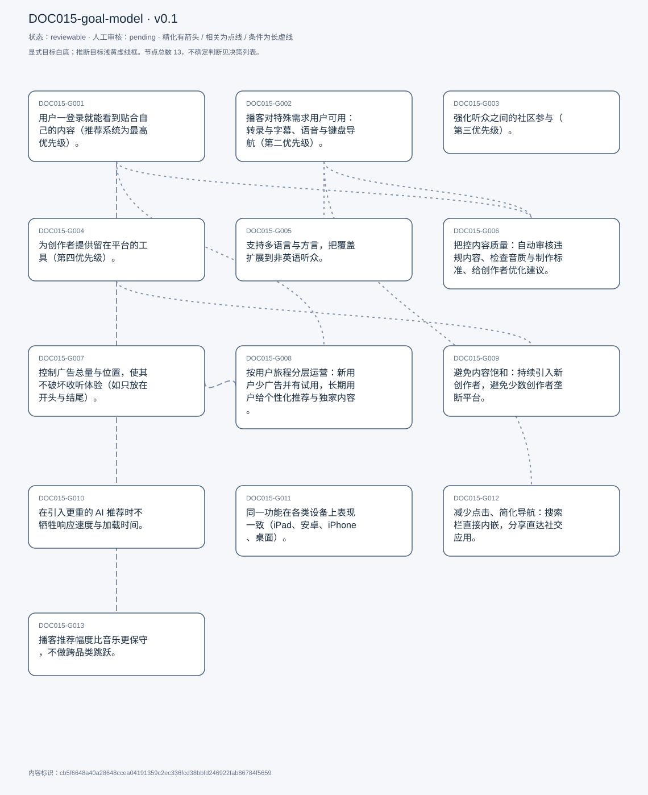
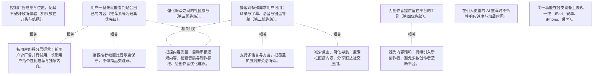

# 目标模型说明

模型：DOC015-goal-model；版本：v0.1

交付状态：reviewable；结构：passed；人工审核：pending

[交互模型](goal-model.html) · [矢量图](goal-model.svg) · [权威数据](goal-model.json)

## 目标图

## 目标

| 编号 | 表述 | 来源 | 情境 | 证据 |
|---|---|---|---|---|
| DOC015-G001 | 用户一登录就能看到贴合自己的内容（推荐系统为最高优先级）。 | explicit | 自述为当前第一优先级；优先级排序：推荐 &gt; 无障碍 &gt; 社区 &gt; 创作者工具 | E0001, E0002 |
| DOC015-G002 | 播客对特殊需求用户可用：转录与字幕、语音与键盘导航（第二优先级）。 | explicit | 自评无障碍曾是技术欠账，最近才开始补；理由：播客是特殊需求用户也能消费的媒介 | E0003, E0004, E0005 |
| DOC015-G003 | 强化听众之间的社区参与（第三优先级）。 | explicit | 手段：歌单式播放列表、点赞与保存、主题小组与论坛、直播与创作者问答 | E0006, E0007 |
| DOC015-G004 | 为创作者提供留在平台的工具（第四优先级）。 | explicit | 与创作者协作、听取其需求；提供优化建议等创作者侧能力 | E0008, E0009 |
| DOC015-G005 | 支持多语言与方言，把覆盖扩展到非英语听众。 | explicit | 近 2–3 年开始支持；理由：全球非英语使用者远多于英语使用者 | E0010, E0011 |
| DOC015-G006 | 把控内容质量：自动审核违规内容、检查音质与制作标准、给创作者优化建议。 | explicit | 流程：自动筛查 → 音质与制作标准评估 → 内容归类 → 参考用户评分 | E0012, E0013, E0014 |
| DOC015-G007 | 控制广告总量与位置，使其不破坏收听体验（如只放在开头与结尾）。 | explicit | 同时提供付费去广告订阅与定向广告；明确区分「平衡广告负载」与「透明标注赞助内容」 | E0015, E0016, E0017 |
| DOC015-G008 | 按用户旅程分层运营：新用户少广告并有试用，长期用户给个性化推荐与独家内容。 | explicit | 新用户：降干扰以鼓励探索，并提供 2–3 个月试用；长期用户：基于收听历史推荐，可获幕后内容或提前收听 | E0018, E0019, E0020 |
| DOC015-G009 | 避免内容饱和：持续引入新创作者，避免少数创作者垄断平台。 | explicit | 上月新增约 2,000 名创作者；配合推荐系统给出「意料之外但相关」的内容 | E0021, E0022 |
| DOC015-G010 | 在引入更重的 AI 推荐时不牺牲响应速度与加载时间。 | explicit | 明确权衡：不愿因处理过大数据而毁掉体验 | E0023, E0024 |
| DOC015-G011 | 同一功能在各类设备上表现一致（iPad、安卓、iPhone、桌面）。 | explicit | 曾因共用后端而导致移动端内存吃紧，已拆分代码库 | E0025, E0026 |
| DOC015-G012 | 减少点击、简化导航：搜索栏直接内嵌，分享直达社交应用。 | explicit | 改版前需先点搜索按钮再展开输入框；分享可带播客的图文表示 | E0027, E0028, E0029 |
| DOC015-G013 | 播客推荐幅度比音乐更保守，不做跨品类跳跃。 | explicit | 音乐可试探性地推陌生流派；播客偏好更稳定，跳类会失效（如给灵修听众推日常 Vlog） | E0030, E0031, E0032 |

## 关系判断（含不确定与无关系）

- DOC015-G001 / DOC015-G002：none。DOC015-G001 的对象是登录即得贴合推荐（T017），DOC015-G002 的对象是无障碍可用（字幕/语音/键盘）（T017/T043）；两处分别出自不同话题段，原文未在二者之间建立因果、手段、评价或情境包含关系，本次评估口径内未建立可采用关系。
- DOC015-G001 / DOC015-G003：none。DOC015-G001 的对象是登录即得贴合推荐（T017），DOC015-G003 的对象是社区参与（T017）；两处分别出自不同话题段，原文未在二者之间建立因果、手段、评价或情境包含关系，本次评估口径内未建立可采用关系。
- DOC015-G001 / DOC015-G004：none。DOC015-G001 的对象是登录即得贴合推荐（T017），DOC015-G004 的对象是创作者工具与留存（T017）；两处分别出自不同话题段，原文未在二者之间建立因果、手段、评价或情境包含关系，本次评估口径内未建立可采用关系。
- DOC015-G001 / DOC015-G005：none。DOC015-G001 的对象是登录即得贴合推荐（T017），DOC015-G005 的对象是多语言扩大覆盖（T019）；两处分别出自不同话题段，原文未在二者之间建立因果、手段、评价或情境包含关系，本次评估口径内未建立可采用关系。
- DOC015-G001 / DOC015-G006：related。T025 说明内容归类「helps giving the users what they actually need. In terms of suggestions」，质量与分类直接服务推荐；但 G006 还覆盖违规审核，范围更宽。
- DOC015-G001 / DOC015-G007：none。DOC015-G001 的对象是登录即得贴合推荐（T017），DOC015-G007 的对象是广告量与位置可控（T027/T041）；两处分别出自不同话题段，原文未在二者之间建立因果、手段、评价或情境包含关系，本次评估口径内未建立可采用关系。
- DOC015-G001 / DOC015-G008：related。T029 把长期用户的推荐策略直接挂在收听历史上，属于 G001 的一个分层实现；但 G008 还包含新用户去广告与试用，范围不同。
- DOC015-G001 / DOC015-G009：none。DOC015-G001 的对象是登录即得贴合推荐（T017），DOC015-G009 的对象是避免内容饱和（T039）；两处分别出自不同话题段，原文未在二者之间建立因果、手段、评价或情境包含关系，本次评估口径内未建立可采用关系。
- DOC015-G001 / DOC015-G010：none。DOC015-G001 的对象是登录即得贴合推荐（T017），DOC015-G010 的对象是低延迟与加载速度（T043）；两处分别出自不同话题段，原文未在二者之间建立因果、手段、评价或情境包含关系，本次评估口径内未建立可采用关系。
- DOC015-G001 / DOC015-G011：none。DOC015-G001 的对象是登录即得贴合推荐（T017），DOC015-G011 的对象是跨设备表现一致（T043）；两处分别出自不同话题段，原文未在二者之间建立因果、手段、评价或情境包含关系，本次评估口径内未建立可采用关系。
- DOC015-G001 / DOC015-G012：none。DOC015-G001 的对象是登录即得贴合推荐（T017），DOC015-G012 的对象是减少点击简化导航（T047）；两处分别出自不同话题段，原文未在二者之间建立因果、手段、评价或情境包含关系，本次评估口径内未建立可采用关系。
- DOC015-G001 / DOC015-G013：related。T049 讨论的正是推荐系统在播客场景下的幅度控制，是对 G001 的约束条件；但 G013 是策略边界、G001 是目标，非精化。
- DOC015-G002 / DOC015-G003：none。DOC015-G002 的对象是无障碍可用（字幕/语音/键盘）（T017/T043），DOC015-G003 的对象是社区参与（T017）；两处分别出自不同话题段，原文未在二者之间建立因果、手段、评价或情境包含关系，本次评估口径内未建立可采用关系。
- DOC015-G002 / DOC015-G004：none。DOC015-G002 的对象是无障碍可用（字幕/语音/键盘）（T017/T043），DOC015-G004 的对象是创作者工具与留存（T017）；两处分别出自不同话题段，原文未在二者之间建立因果、手段、评价或情境包含关系，本次评估口径内未建立可采用关系。
- DOC015-G002 / DOC015-G005：related。T043 在讲无障碍欠账时把「支持多语言」与「语音/键盘导航」并列为同一批未做的事，二者同属可达性范畴；但一个是语言覆盖、一个是交互方式。
- DOC015-G002 / DOC015-G006：related。T023 先说为每个播客提供转录与字幕以服务特殊需求用户，再说内容审核与优化建议；转录字幕同时服务无障碍与质量两个目的。
- DOC015-G002 / DOC015-G007：none。DOC015-G002 的对象是无障碍可用（字幕/语音/键盘）（T017/T043），DOC015-G007 的对象是广告量与位置可控（T027/T041）；两处分别出自不同话题段，原文未在二者之间建立因果、手段、评价或情境包含关系，本次评估口径内未建立可采用关系。
- DOC015-G002 / DOC015-G008：none。DOC015-G002 的对象是无障碍可用（字幕/语音/键盘）（T017/T043），DOC015-G008 的对象是按用户旅程分层运营（T029）；两处分别出自不同话题段，原文未在二者之间建立因果、手段、评价或情境包含关系，本次评估口径内未建立可采用关系。
- DOC015-G002 / DOC015-G009：none。DOC015-G002 的对象是无障碍可用（字幕/语音/键盘）（T017/T043），DOC015-G009 的对象是避免内容饱和（T039）；两处分别出自不同话题段，原文未在二者之间建立因果、手段、评价或情境包含关系，本次评估口径内未建立可采用关系。
- DOC015-G002 / DOC015-G010：none。DOC015-G002 的对象是无障碍可用（字幕/语音/键盘）（T017/T043），DOC015-G010 的对象是低延迟与加载速度（T043）；两处分别出自不同话题段，原文未在二者之间建立因果、手段、评价或情境包含关系，本次评估口径内未建立可采用关系。
- DOC015-G002 / DOC015-G011：none。DOC015-G002 的对象是无障碍可用（字幕/语音/键盘）（T017/T043），DOC015-G011 的对象是跨设备表现一致（T043）；两处分别出自不同话题段，原文未在二者之间建立因果、手段、评价或情境包含关系，本次评估口径内未建立可采用关系。
- DOC015-G002 / DOC015-G012：related。T047 在讲减少点击时把「voice commands」与「keyboard navigation」列为同批改进，说明交互简化与无障碍存在重叠；但减少点击面向所有用户。
- DOC015-G002 / DOC015-G013：none。DOC015-G002 的对象是无障碍可用（字幕/语音/键盘）（T017/T043），DOC015-G013 的对象是播客推荐幅度更保守（T049）；两处分别出自不同话题段，原文未在二者之间建立因果、手段、评价或情境包含关系，本次评估口径内未建立可采用关系。
- DOC015-G003 / DOC015-G004：none。DOC015-G003 的对象是社区参与（T017），DOC015-G004 的对象是创作者工具与留存（T017）；两处分别出自不同话题段，原文未在二者之间建立因果、手段、评价或情境包含关系，本次评估口径内未建立可采用关系。
- DOC015-G003 / DOC015-G005：none。DOC015-G003 的对象是社区参与（T017），DOC015-G005 的对象是多语言扩大覆盖（T019）；两处分别出自不同话题段，原文未在二者之间建立因果、手段、评价或情境包含关系，本次评估口径内未建立可采用关系。
- DOC015-G003 / DOC015-G006：none。DOC015-G003 的对象是社区参与（T017），DOC015-G006 的对象是内容质量把关（T023/T025）；两处分别出自不同话题段，原文未在二者之间建立因果、手段、评价或情境包含关系，本次评估口径内未建立可采用关系。
- DOC015-G003 / DOC015-G007：none。DOC015-G003 的对象是社区参与（T017），DOC015-G007 的对象是广告量与位置可控（T027/T041）；两处分别出自不同话题段，原文未在二者之间建立因果、手段、评价或情境包含关系，本次评估口径内未建立可采用关系。
- DOC015-G003 / DOC015-G008：none。DOC015-G003 的对象是社区参与（T017），DOC015-G008 的对象是按用户旅程分层运营（T029）；两处分别出自不同话题段，原文未在二者之间建立因果、手段、评价或情境包含关系，本次评估口径内未建立可采用关系。
- DOC015-G003 / DOC015-G009：none。DOC015-G003 的对象是社区参与（T017），DOC015-G009 的对象是避免内容饱和（T039）；两处分别出自不同话题段，原文未在二者之间建立因果、手段、评价或情境包含关系，本次评估口径内未建立可采用关系。
- DOC015-G003 / DOC015-G010：none。DOC015-G003 的对象是社区参与（T017），DOC015-G010 的对象是低延迟与加载速度（T043）；两处分别出自不同话题段，原文未在二者之间建立因果、手段、评价或情境包含关系，本次评估口径内未建立可采用关系。
- DOC015-G003 / DOC015-G011：none。DOC015-G003 的对象是社区参与（T017），DOC015-G011 的对象是跨设备表现一致（T043）；两处分别出自不同话题段，原文未在二者之间建立因果、手段、评价或情境包含关系，本次评估口径内未建立可采用关系。
- DOC015-G003 / DOC015-G012：none。DOC015-G003 的对象是社区参与（T017），DOC015-G012 的对象是减少点击简化导航（T047）；两处分别出自不同话题段，原文未在二者之间建立因果、手段、评价或情境包含关系，本次评估口径内未建立可采用关系。
- DOC015-G003 / DOC015-G013：none。DOC015-G003 的对象是社区参与（T017），DOC015-G013 的对象是播客推荐幅度更保守（T049）；两处分别出自不同话题段，原文未在二者之间建立因果、手段、评价或情境包含关系，本次评估口径内未建立可采用关系。
- DOC015-G004 / DOC015-G005：none。DOC015-G004 的对象是创作者工具与留存（T017），DOC015-G005 的对象是多语言扩大覆盖（T019）；两处分别出自不同话题段，原文未在二者之间建立因果、手段、评价或情境包含关系，本次评估口径内未建立可采用关系。
- DOC015-G004 / DOC015-G006：none。DOC015-G004 的对象是创作者工具与留存（T017），DOC015-G006 的对象是内容质量把关（T023/T025）；两处分别出自不同话题段，原文未在二者之间建立因果、手段、评价或情境包含关系，本次评估口径内未建立可采用关系。
- DOC015-G004 / DOC015-G007：none。DOC015-G004 的对象是创作者工具与留存（T017），DOC015-G007 的对象是广告量与位置可控（T027/T041）；两处分别出自不同话题段，原文未在二者之间建立因果、手段、评价或情境包含关系，本次评估口径内未建立可采用关系。
- DOC015-G004 / DOC015-G008：none。DOC015-G004 的对象是创作者工具与留存（T017），DOC015-G008 的对象是按用户旅程分层运营（T029）；两处分别出自不同话题段，原文未在二者之间建立因果、手段、评价或情境包含关系，本次评估口径内未建立可采用关系。
- DOC015-G004 / DOC015-G009：related。T039 说明避免饱和靠的是与创作者合作、引入新创作者，二者同属供给侧；但 G004 关注留存工具、G009 关注供给广度。
- DOC015-G004 / DOC015-G010：none。DOC015-G004 的对象是创作者工具与留存（T017），DOC015-G010 的对象是低延迟与加载速度（T043）；两处分别出自不同话题段，原文未在二者之间建立因果、手段、评价或情境包含关系，本次评估口径内未建立可采用关系。
- DOC015-G004 / DOC015-G011：none。DOC015-G004 的对象是创作者工具与留存（T017），DOC015-G011 的对象是跨设备表现一致（T043）；两处分别出自不同话题段，原文未在二者之间建立因果、手段、评价或情境包含关系，本次评估口径内未建立可采用关系。
- DOC015-G004 / DOC015-G012：none。DOC015-G004 的对象是创作者工具与留存（T017），DOC015-G012 的对象是减少点击简化导航（T047）；两处分别出自不同话题段，原文未在二者之间建立因果、手段、评价或情境包含关系，本次评估口径内未建立可采用关系。
- DOC015-G004 / DOC015-G013：none。DOC015-G004 的对象是创作者工具与留存（T017），DOC015-G013 的对象是播客推荐幅度更保守（T049）；两处分别出自不同话题段，原文未在二者之间建立因果、手段、评价或情境包含关系，本次评估口径内未建立可采用关系。
- DOC015-G005 / DOC015-G006：none。DOC015-G005 的对象是多语言扩大覆盖（T019），DOC015-G006 的对象是内容质量把关（T023/T025）；两处分别出自不同话题段，原文未在二者之间建立因果、手段、评价或情境包含关系，本次评估口径内未建立可采用关系。
- DOC015-G005 / DOC015-G007：none。DOC015-G005 的对象是多语言扩大覆盖（T019），DOC015-G007 的对象是广告量与位置可控（T027/T041）；两处分别出自不同话题段，原文未在二者之间建立因果、手段、评价或情境包含关系，本次评估口径内未建立可采用关系。
- DOC015-G005 / DOC015-G008：none。DOC015-G005 的对象是多语言扩大覆盖（T019），DOC015-G008 的对象是按用户旅程分层运营（T029）；两处分别出自不同话题段，原文未在二者之间建立因果、手段、评价或情境包含关系，本次评估口径内未建立可采用关系。
- DOC015-G005 / DOC015-G009：none。DOC015-G005 的对象是多语言扩大覆盖（T019），DOC015-G009 的对象是避免内容饱和（T039）；两处分别出自不同话题段，原文未在二者之间建立因果、手段、评价或情境包含关系，本次评估口径内未建立可采用关系。
- DOC015-G005 / DOC015-G010：none。DOC015-G005 的对象是多语言扩大覆盖（T019），DOC015-G010 的对象是低延迟与加载速度（T043）；两处分别出自不同话题段，原文未在二者之间建立因果、手段、评价或情境包含关系，本次评估口径内未建立可采用关系。
- DOC015-G005 / DOC015-G011：none。DOC015-G005 的对象是多语言扩大覆盖（T019），DOC015-G011 的对象是跨设备表现一致（T043）；两处分别出自不同话题段，原文未在二者之间建立因果、手段、评价或情境包含关系，本次评估口径内未建立可采用关系。
- DOC015-G005 / DOC015-G012：none。DOC015-G005 的对象是多语言扩大覆盖（T019），DOC015-G012 的对象是减少点击简化导航（T047）；两处分别出自不同话题段，原文未在二者之间建立因果、手段、评价或情境包含关系，本次评估口径内未建立可采用关系。
- DOC015-G005 / DOC015-G013：none。DOC015-G005 的对象是多语言扩大覆盖（T019），DOC015-G013 的对象是播客推荐幅度更保守（T049）；两处分别出自不同话题段，原文未在二者之间建立因果、手段、评价或情境包含关系，本次评估口径内未建立可采用关系。
- DOC015-G006 / DOC015-G007：none。DOC015-G006 的对象是内容质量把关（T023/T025），DOC015-G007 的对象是广告量与位置可控（T027/T041）；两处分别出自不同话题段，原文未在二者之间建立因果、手段、评价或情境包含关系，本次评估口径内未建立可采用关系。
- DOC015-G006 / DOC015-G008：none。DOC015-G006 的对象是内容质量把关（T023/T025），DOC015-G008 的对象是按用户旅程分层运营（T029）；两处分别出自不同话题段，原文未在二者之间建立因果、手段、评价或情境包含关系，本次评估口径内未建立可采用关系。
- DOC015-G006 / DOC015-G009：none。DOC015-G006 的对象是内容质量把关（T023/T025），DOC015-G009 的对象是避免内容饱和（T039）；两处分别出自不同话题段，原文未在二者之间建立因果、手段、评价或情境包含关系，本次评估口径内未建立可采用关系。
- DOC015-G006 / DOC015-G010：none。DOC015-G006 的对象是内容质量把关（T023/T025），DOC015-G010 的对象是低延迟与加载速度（T043）；两处分别出自不同话题段，原文未在二者之间建立因果、手段、评价或情境包含关系，本次评估口径内未建立可采用关系。
- DOC015-G006 / DOC015-G011：none。DOC015-G006 的对象是内容质量把关（T023/T025），DOC015-G011 的对象是跨设备表现一致（T043）；两处分别出自不同话题段，原文未在二者之间建立因果、手段、评价或情境包含关系，本次评估口径内未建立可采用关系。
- DOC015-G006 / DOC015-G012：none。DOC015-G006 的对象是内容质量把关（T023/T025），DOC015-G012 的对象是减少点击简化导航（T047）；两处分别出自不同话题段，原文未在二者之间建立因果、手段、评价或情境包含关系，本次评估口径内未建立可采用关系。
- DOC015-G006 / DOC015-G013：none。DOC015-G006 的对象是内容质量把关（T023/T025），DOC015-G013 的对象是播客推荐幅度更保守（T049）；两处分别出自不同话题段，原文未在二者之间建立因果、手段、评价或情境包含关系，本次评估口径内未建立可采用关系。
- DOC015-G007 / DOC015-G008：related。T029 说明新用户会被刻意减少广告投放以鼓励探索，是 G007 全局广告策略下的分段处理；二者是总则与例外。
- DOC015-G007 / DOC015-G009：none。DOC015-G007 的对象是广告量与位置可控（T027/T041），DOC015-G009 的对象是避免内容饱和（T039）；两处分别出自不同话题段，原文未在二者之间建立因果、手段、评价或情境包含关系，本次评估口径内未建立可采用关系。
- DOC015-G007 / DOC015-G010：none。DOC015-G007 的对象是广告量与位置可控（T027/T041），DOC015-G010 的对象是低延迟与加载速度（T043）；两处分别出自不同话题段，原文未在二者之间建立因果、手段、评价或情境包含关系，本次评估口径内未建立可采用关系。
- DOC015-G007 / DOC015-G011：none。DOC015-G007 的对象是广告量与位置可控（T027/T041），DOC015-G011 的对象是跨设备表现一致（T043）；两处分别出自不同话题段，原文未在二者之间建立因果、手段、评价或情境包含关系，本次评估口径内未建立可采用关系。
- DOC015-G007 / DOC015-G012：none。DOC015-G007 的对象是广告量与位置可控（T027/T041），DOC015-G012 的对象是减少点击简化导航（T047）；两处分别出自不同话题段，原文未在二者之间建立因果、手段、评价或情境包含关系，本次评估口径内未建立可采用关系。
- DOC015-G007 / DOC015-G013：none。DOC015-G007 的对象是广告量与位置可控（T027/T041），DOC015-G013 的对象是播客推荐幅度更保守（T049）；两处分别出自不同话题段，原文未在二者之间建立因果、手段、评价或情境包含关系，本次评估口径内未建立可采用关系。
- DOC015-G008 / DOC015-G009：none。DOC015-G008 的对象是按用户旅程分层运营（T029），DOC015-G009 的对象是避免内容饱和（T039）；两处分别出自不同话题段，原文未在二者之间建立因果、手段、评价或情境包含关系，本次评估口径内未建立可采用关系。
- DOC015-G008 / DOC015-G010：none。DOC015-G008 的对象是按用户旅程分层运营（T029），DOC015-G010 的对象是低延迟与加载速度（T043）；两处分别出自不同话题段，原文未在二者之间建立因果、手段、评价或情境包含关系，本次评估口径内未建立可采用关系。
- DOC015-G008 / DOC015-G011：none。DOC015-G008 的对象是按用户旅程分层运营（T029），DOC015-G011 的对象是跨设备表现一致（T043）；两处分别出自不同话题段，原文未在二者之间建立因果、手段、评价或情境包含关系，本次评估口径内未建立可采用关系。
- DOC015-G008 / DOC015-G012：none。DOC015-G008 的对象是按用户旅程分层运营（T029），DOC015-G012 的对象是减少点击简化导航（T047）；两处分别出自不同话题段，原文未在二者之间建立因果、手段、评价或情境包含关系，本次评估口径内未建立可采用关系。
- DOC015-G008 / DOC015-G013：none。DOC015-G008 的对象是按用户旅程分层运营（T029），DOC015-G013 的对象是播客推荐幅度更保守（T049）；两处分别出自不同话题段，原文未在二者之间建立因果、手段、评价或情境包含关系，本次评估口径内未建立可采用关系。
- DOC015-G009 / DOC015-G010：none。DOC015-G009 的对象是避免内容饱和（T039），DOC015-G010 的对象是低延迟与加载速度（T043）；两处分别出自不同话题段，原文未在二者之间建立因果、手段、评价或情境包含关系，本次评估口径内未建立可采用关系。
- DOC015-G009 / DOC015-G011：none。DOC015-G009 的对象是避免内容饱和（T039），DOC015-G011 的对象是跨设备表现一致（T043）；两处分别出自不同话题段，原文未在二者之间建立因果、手段、评价或情境包含关系，本次评估口径内未建立可采用关系。
- DOC015-G009 / DOC015-G012：none。DOC015-G009 的对象是避免内容饱和（T039），DOC015-G012 的对象是减少点击简化导航（T047）；两处分别出自不同话题段，原文未在二者之间建立因果、手段、评价或情境包含关系，本次评估口径内未建立可采用关系。
- DOC015-G009 / DOC015-G013：none。DOC015-G009 的对象是避免内容饱和（T039），DOC015-G013 的对象是播客推荐幅度更保守（T049）；两处分别出自不同话题段，原文未在二者之间建立因果、手段、评价或情境包含关系，本次评估口径内未建立可采用关系。
- DOC015-G010 / DOC015-G011：none。DOC015-G010 的对象是低延迟与加载速度（T043），DOC015-G011 的对象是跨设备表现一致（T043）；两处分别出自不同话题段，原文未在二者之间建立因果、手段、评价或情境包含关系，本次评估口径内未建立可采用关系。
- DOC015-G010 / DOC015-G012：none。DOC015-G010 的对象是低延迟与加载速度（T043），DOC015-G012 的对象是减少点击简化导航（T047）；两处分别出自不同话题段，原文未在二者之间建立因果、手段、评价或情境包含关系，本次评估口径内未建立可采用关系。
- DOC015-G010 / DOC015-G013：none。DOC015-G010 的对象是低延迟与加载速度（T043），DOC015-G013 的对象是播客推荐幅度更保守（T049）；两处分别出自不同话题段，原文未在二者之间建立因果、手段、评价或情境包含关系，本次评估口径内未建立可采用关系。
- DOC015-G011 / DOC015-G012：none。DOC015-G011 的对象是跨设备表现一致（T043），DOC015-G012 的对象是减少点击简化导航（T047）；两处分别出自不同话题段，原文未在二者之间建立因果、手段、评价或情境包含关系，本次评估口径内未建立可采用关系。
- DOC015-G011 / DOC015-G013：none。DOC015-G011 的对象是跨设备表现一致（T043），DOC015-G013 的对象是播客推荐幅度更保守（T049）；两处分别出自不同话题段，原文未在二者之间建立因果、手段、评价或情境包含关系，本次评估口径内未建立可采用关系。
- DOC015-G012 / DOC015-G013：none。DOC015-G012 的对象是减少点击简化导航（T047），DOC015-G013 的对象是播客推荐幅度更保守（T049）；两处分别出自不同话题段，原文未在二者之间建立因果、手段、评价或情境包含关系，本次评估口径内未建立可采用关系。

## 证据

### E0001 · DOC015:S018

> giving the users the right experience as soon as they log on to spotify is our main goal

原件位置：{&quot;line_start&quot;: 18, &quot;line_end&quot;: 18, &quot;start_char&quot;: 3548, &quot;end_char&quot;: 4329}

### E0002 · DOC015:S018

> if you&#x27;d asked me to prioritize it I would say the recommendations comes in at 1st

原件位置：{&quot;line_start&quot;: 18, &quot;line_end&quot;: 18, &quot;start_char&quot;: 3548, &quot;end_char&quot;: 4329}

### E0003 · DOC015:S018

> improving accessibility features in our platform is of utmost importance to us

原件位置：{&quot;line_start&quot;: 18, &quot;line_end&quot;: 18, &quot;start_char&quot;: 3548, &quot;end_char&quot;: 4329}

### E0004 · DOC015:S044

> allowing the users to navigate, spotify via voice or via their keyboards

原件位置：{&quot;line_start&quot;: 44, &quot;line_end&quot;: 44, &quot;start_char&quot;: 15941, &quot;end_char&quot;: 17354}

### E0005 · DOC015:S018

> podcast is one thing that even people with special needs can listen to

原件位置：{&quot;line_start&quot;: 18, &quot;line_end&quot;: 18, &quot;start_char&quot;: 3548, &quot;end_char&quot;: 4329}

### E0006 · DOC015:S018

> strengthening the overall community engagement among listeners

原件位置：{&quot;line_start&quot;: 18, &quot;line_end&quot;: 18, &quot;start_char&quot;: 3548, &quot;end_char&quot;: 4329}

### E0007 · DOC015:S038

> anyone and everyone can create their own playlists and people can like and even save that playlist

原件位置：{&quot;line_start&quot;: 38, &quot;line_end&quot;: 38, &quot;start_char&quot;: 11665, &quot;end_char&quot;: 12488}

### E0008 · DOC015:S018

> the tools that we can offer to the creators to stay on our platform

原件位置：{&quot;line_start&quot;: 18, &quot;line_end&quot;: 18, &quot;start_char&quot;: 3548, &quot;end_char&quot;: 4329}

### E0009 · DOC015:S024

> we also offer content optimization suggestions

原件位置：{&quot;line_start&quot;: 24, &quot;line_end&quot;: 24, &quot;start_char&quot;: 5629, &quot;end_char&quot;: 6444}

### E0010 · DOC015:S020

> started supporting multiple languages and dialects as well

原件位置：{&quot;line_start&quot;: 20, &quot;line_end&quot;: 20, &quot;start_char&quot;: 4520, &quot;end_char&quot;: 5252}

### E0011 · DOC015:S020

> we just want to broaden our reach

原件位置：{&quot;line_start&quot;: 20, &quot;line_end&quot;: 20, &quot;start_char&quot;: 4520, &quot;end_char&quot;: 5252}

### E0012 · DOC015:S024

> we also implement our content moderation tools

原件位置：{&quot;line_start&quot;: 24, &quot;line_end&quot;: 24, &quot;start_char&quot;: 5629, &quot;end_char&quot;: 6444}

### E0013 · DOC015:S026

> ensuring the audio quality and the production standards are up to mark

原件位置：{&quot;line_start&quot;: 26, &quot;line_end&quot;: 26, &quot;start_char&quot;: 6704, &quot;end_char&quot;: 7426}

### E0014 · DOC015:S024

> we also offer content optimization suggestions

原件位置：{&quot;line_start&quot;: 24, &quot;line_end&quot;: 24, &quot;start_char&quot;: 5629, &quot;end_char&quot;: 6444}

### E0015 · DOC015:S028

> we kind of balance our ad load, we ensure that the frequency and the placement of ads does not at the end of the day distract

原件位置：{&quot;line_start&quot;: 28, &quot;line_end&quot;: 28, &quot;start_char&quot;: 7773, &quot;end_char&quot;: 8379}

### E0016 · DOC015:S042

> we place ads usually just at the start or just at the end of podcasts

原件位置：{&quot;line_start&quot;: 42, &quot;line_end&quot;: 42, &quot;start_char&quot;: 14615, &quot;end_char&quot;: 15698}

### E0017 · DOC015:S042

> this clear labeling helps us maintain the trust between users and the platform

原件位置：{&quot;line_start&quot;: 42, &quot;line_end&quot;: 42, &quot;start_char&quot;: 14615, &quot;end_char&quot;: 15698}

### E0018 · DOC015:S030

> for new users, what we do is we try and minimize ads. So this encourages exploration

原件位置：{&quot;line_start&quot;: 30, &quot;line_end&quot;: 30, &quot;start_char&quot;: 8549, &quot;end_char&quot;: 9216}

### E0019 · DOC015:S030

> for a long time listeners. We offer customized recommendation based on their listening history

原件位置：{&quot;line_start&quot;: 30, &quot;line_end&quot;: 30, &quot;start_char&quot;: 8549, &quot;end_char&quot;: 9216}

### E0020 · DOC015:S030

> we also offer sometimes exclusive contents for our premium users

原件位置：{&quot;line_start&quot;: 30, &quot;line_end&quot;: 30, &quot;start_char&quot;: 8549, &quot;end_char&quot;: 9216}

### E0021 · DOC015:S040

> we really don&#x27;t wanna constrict our platform by having just a limited number of creators

原件位置：{&quot;line_start&quot;: 40, &quot;line_end&quot;: 40, &quot;start_char&quot;: 12975, &quot;end_char&quot;: 14299}

### E0022 · DOC015:S040

> last month itself we bought over 2,000 new creators on our platform

原件位置：{&quot;line_start&quot;: 40, &quot;line_end&quot;: 40, &quot;start_char&quot;: 12975, &quot;end_char&quot;: 14299}

### E0023 · DOC015:S044

> We really don&#x27;t wanna process such huge amounts of data that it kind of ruins the user experience

原件位置：{&quot;line_start&quot;: 44, &quot;line_end&quot;: 44, &quot;start_char&quot;: 15941, &quot;end_char&quot;: 17354}

### E0024 · DOC015:S044

> high latency and the low loading times

原件位置：{&quot;line_start&quot;: 44, &quot;line_end&quot;: 44, &quot;start_char&quot;: 15941, &quot;end_char&quot;: 17354}

### E0025 · DOC015:S044

> maintaining consistent sort of behavior throughout all the devices

原件位置：{&quot;line_start&quot;: 44, &quot;line_end&quot;: 44, &quot;start_char&quot;: 15941, &quot;end_char&quot;: 17354}

### E0026 · DOC015:S044

> ensure the apps. Performance is consistent throughout all the devices

原件位置：{&quot;line_start&quot;: 44, &quot;line_end&quot;: 44, &quot;start_char&quot;: 15941, &quot;end_char&quot;: 17354}

### E0027 · DOC015:S048

> we are trying to minimize our click

原件位置：{&quot;line_start&quot;: 48, &quot;line_end&quot;: 48, &quot;start_char&quot;: 19457, &quot;end_char&quot;: 20892}

### E0028 · DOC015:S048

> we&#x27;ve just integrated the search bar directly in our ux, which, looks a whole lot cleaner

原件位置：{&quot;line_start&quot;: 48, &quot;line_end&quot;: 48, &quot;start_char&quot;: 19457, &quot;end_char&quot;: 20892}

### E0029 · DOC015:S048

> users can directly just send Instagram or Whatsapp messages onto their respective groups

原件位置：{&quot;line_start&quot;: 48, &quot;line_end&quot;: 48, &quot;start_char&quot;: 19457, &quot;end_char&quot;: 20892}

### E0030 · DOC015:S050

> this kind of thing we can&#x27;t really do in the podcast space

原件位置：{&quot;line_start&quot;: 50, &quot;line_end&quot;: 50, &quot;start_char&quot;: 21290, &quot;end_char&quot;: 22401}

### E0031 · DOC015:S050

> we have to be a whole lot subtler with it

原件位置：{&quot;line_start&quot;: 50, &quot;line_end&quot;: 50, &quot;start_char&quot;: 21290, &quot;end_char&quot;: 22401}

### E0032 · DOC015:S050

> We can&#x27;t just all of a sudden just throw in a regular day, in a life of a Youtube vlogger podcast that just wouldn&#x27;t work

原件位置：{&quot;line_start&quot;: 50, &quot;line_end&quot;: 50, &quot;start_char&quot;: 21290, &quot;end_char&quot;: 22401}

## 问题、限制与版本

- 当前会话助手的开发判断，非独立盲测；无人工采纳记录。
- 结构检查已绑定当前版本；独立语义审查未执行；人工状态以实际审核记录为准。

内容标识：cb5f6648a40a28648ccea04191359c2ec336fcd38bbfd246922fab86784f5659

人工决定：

审核意见：
