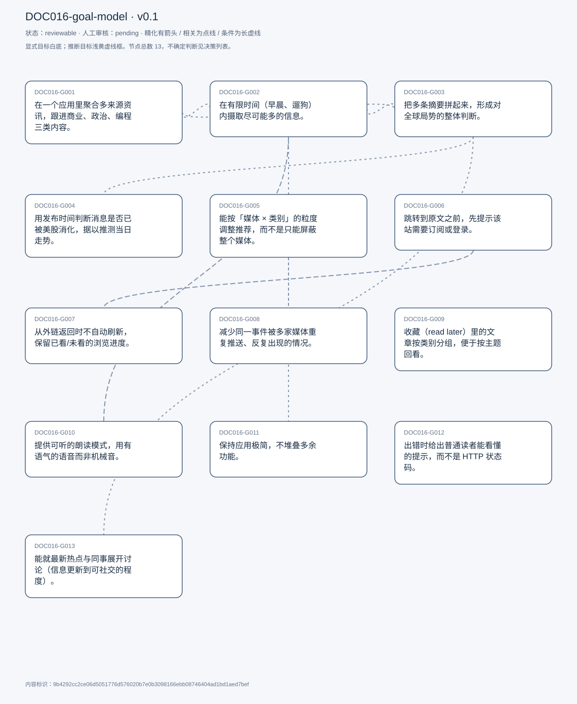
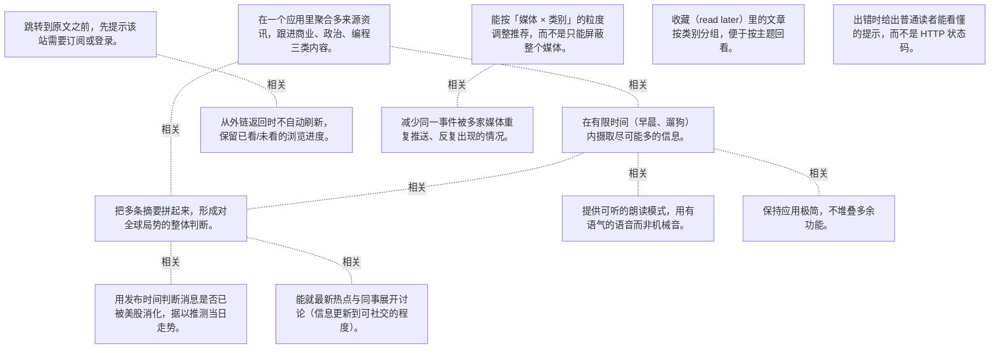

# 目标模型说明

模型：DOC016-goal-model；版本：v0.1

交付状态：reviewable；结构：passed；人工审核：pending

[交互模型](goal-model.html) · [矢量图](goal-model.svg) · [权威数据](goal-model.json)

## 目标图

## 目标

| 编号 | 表述 | 来源 | 情境 | 证据 |
|---|---|---|---|---|
| DOC016-G001 | 在一个应用里聚合多来源资讯，跟进商业、政治、编程三类内容。 | explicit | 三类的用途：炒股（商业、政治）与本职业（编程、科技股）；自评每天使用 | E0001, E0002, E0003 |
| DOC016-G002 | 在有限时间（早晨、遛狗）内摄取尽可能多的信息。 | explicit | 典型时段：上班前、遛狗途中；目标为「多看条目」而非「读完全文」 | E0004, E0005 |
| DOC016-G003 | 把多条摘要拼起来，形成对全球局势的整体判断。 | explicit | 自述为阅读逻辑：先广度后串联 | E0006 |
| DOC016-G004 | 用发布时间判断消息是否已被美股消化，据以推测当日走势。 | explicit | 区分发布时刻（原媒体）与接收时刻（进入 Feedly）；例：日本股市消息若发布于 3 小时前，美股尚未反映 | E0007, E0008 |
| DOC016-G005 | 能按「媒体 × 类别」的粒度调整推荐，而不是只能屏蔽整个媒体。 | explicit | 现状：只能整体取消订阅某媒体，无法只屏蔽其某类内容 | E0009, E0010 |
| DOC016-G006 | 跳转到原文之前，先提示该站需要订阅或登录。 | explicit | 典型：纽约时报几乎每篇都要登录再订阅；期望省掉一次往返 | E0011, E0012 |
| DOC016-G007 | 从外链返回时不自动刷新，保留已看/未看的浏览进度。 | explicit | 现状：返回即刷新，进度全丢，需从头再来；后果：有时索性关掉应用 | E0013, E0014, E0015 |
| DOC016-G008 | 减少同一事件被多家媒体重复推送、反复出现的情况。 | explicit | 成因归为推荐算法：不感兴趣的新闻换一家媒体又出现；他靠认图片判断是否重复，快速划过 | E0016, E0017 |
| DOC016-G009 | 收藏（read later）里的文章按类别分组，便于按主题回看。 | explicit | 现状：仅按时间倒序，可加星标 | E0018, E0019 |
| DOC016-G010 | 提供可听的朗读模式，用有语气的语音而非机械音。 | explicit | 场景：开车、健身、遛狗等无法盯屏的时段；自评这是最想要的功能 | E0020, E0021, E0022 |
| DOC016-G011 | 保持应用极简，不堆叠多余功能。 | explicit | 视为该应用最被认可的优点之一；与 C002 的快速摄取直接相关 | E0023, E0024 |
| DOC016-G012 | 出错时给出普通读者能看懂的提示，而不是 HTTP 状态码。 | explicit | 现状：源站 API 异常时直接把 400/500 显示在文章位置；他认为只有开发者能看懂 | E0025, E0026 |
| DOC016-G013 | 能就最新热点与同事展开讨论（信息更新到可社交的程度）。 | explicit | 被问及「怎样算一次成功的阅读」时给出；受访者补充这是此前未提到的需求 | E0027, E0028, E0029 |

## 关系判断（含不确定与无关系）

- DOC016-G001 / DOC016-G002：related。T027 说明正是极简与摘要能力让他能「gather as much information as possible within my limited morning time」；G001 是信息来源，G002 是摄取强度。
- DOC016-G001 / DOC016-G003：related。T029 的拼合判断依赖多源信息同时在场（G001 的聚合），但一个是覆盖范围、一个是理解方式。
- DOC016-G001 / DOC016-G004：none。DOC016-G001 的对象是一处聚合多源跟进三类资讯（T009/T025），DOC016-G004 的对象是用发布时间判断市场是否已反应（T041）；两处分别出自不同话题段，原文未在二者之间建立因果、手段、评价或情境包含关系，本次评估口径内未建立可采用关系。
- DOC016-G001 / DOC016-G005：none。DOC016-G001 的对象是一处聚合多源跟进三类资讯（T009/T025），DOC016-G005 的对象是按媒体×类别控制推荐（T045）；两处分别出自不同话题段，原文未在二者之间建立因果、手段、评价或情境包含关系，本次评估口径内未建立可采用关系。
- DOC016-G001 / DOC016-G006：none。DOC016-G001 的对象是一处聚合多源跟进三类资讯（T009/T025），DOC016-G006 的对象是外链前提示付费墙（T057）；两处分别出自不同话题段，原文未在二者之间建立因果、手段、评价或情境包含关系，本次评估口径内未建立可采用关系。
- DOC016-G001 / DOC016-G007：none。DOC016-G001 的对象是一处聚合多源跟进三类资讯（T009/T025），DOC016-G007 的对象是返回不刷新保留进度（T059）；两处分别出自不同话题段，原文未在二者之间建立因果、手段、评价或情境包含关系，本次评估口径内未建立可采用关系。
- DOC016-G001 / DOC016-G008：none。DOC016-G001 的对象是一处聚合多源跟进三类资讯（T009/T025），DOC016-G008 的对象是去重多源重复报道（T033）；两处分别出自不同话题段，原文未在二者之间建立因果、手段、评价或情境包含关系，本次评估口径内未建立可采用关系。
- DOC016-G001 / DOC016-G009：none。DOC016-G001 的对象是一处聚合多源跟进三类资讯（T009/T025），DOC016-G009 的对象是收藏按类别分组（T053）；两处分别出自不同话题段，原文未在二者之间建立因果、手段、评价或情境包含关系，本次评估口径内未建立可采用关系。
- DOC016-G001 / DOC016-G010：none。DOC016-G001 的对象是一处聚合多源跟进三类资讯（T009/T025），DOC016-G010 的对象是朗读模式（非机械音）（T081）；两处分别出自不同话题段，原文未在二者之间建立因果、手段、评价或情境包含关系，本次评估口径内未建立可采用关系。
- DOC016-G001 / DOC016-G011：none。DOC016-G001 的对象是一处聚合多源跟进三类资讯（T009/T025），DOC016-G011 的对象是保持极简（T023/T101）；两处分别出自不同话题段，原文未在二者之间建立因果、手段、评价或情境包含关系，本次评估口径内未建立可采用关系。
- DOC016-G001 / DOC016-G012：none。DOC016-G001 的对象是一处聚合多源跟进三类资讯（T009/T025），DOC016-G012 的对象是出错时给人话提示（T077）；两处分别出自不同话题段，原文未在二者之间建立因果、手段、评价或情境包含关系，本次评估口径内未建立可采用关系。
- DOC016-G001 / DOC016-G013：none。DOC016-G001 的对象是一处聚合多源跟进三类资讯（T009/T025），DOC016-G013 的对象是能参与热点讨论（T107）；两处分别出自不同话题段，原文未在二者之间建立因果、手段、评价或情境包含关系，本次评估口径内未建立可采用关系。
- DOC016-G002 / DOC016-G003：related。T029 把两者写在同一句里：先「read as much content」再「piece everything together」，广度摄取是拼合的前提。
- DOC016-G002 / DOC016-G004：none。DOC016-G002 的对象是短时间高密度摄取（T027/T029），DOC016-G004 的对象是用发布时间判断市场是否已反应（T041）；两处分别出自不同话题段，原文未在二者之间建立因果、手段、评价或情境包含关系，本次评估口径内未建立可采用关系。
- DOC016-G002 / DOC016-G005：none。DOC016-G002 的对象是短时间高密度摄取（T027/T029），DOC016-G005 的对象是按媒体×类别控制推荐（T045）；两处分别出自不同话题段，原文未在二者之间建立因果、手段、评价或情境包含关系，本次评估口径内未建立可采用关系。
- DOC016-G002 / DOC016-G006：none。DOC016-G002 的对象是短时间高密度摄取（T027/T029），DOC016-G006 的对象是外链前提示付费墙（T057）；两处分别出自不同话题段，原文未在二者之间建立因果、手段、评价或情境包含关系，本次评估口径内未建立可采用关系。
- DOC016-G002 / DOC016-G007：none。DOC016-G002 的对象是短时间高密度摄取（T027/T029），DOC016-G007 的对象是返回不刷新保留进度（T059）；两处分别出自不同话题段，原文未在二者之间建立因果、手段、评价或情境包含关系，本次评估口径内未建立可采用关系。
- DOC016-G002 / DOC016-G008：none。DOC016-G002 的对象是短时间高密度摄取（T027/T029），DOC016-G008 的对象是去重多源重复报道（T033）；两处分别出自不同话题段，原文未在二者之间建立因果、手段、评价或情境包含关系，本次评估口径内未建立可采用关系。
- DOC016-G002 / DOC016-G009：none。DOC016-G002 的对象是短时间高密度摄取（T027/T029），DOC016-G009 的对象是收藏按类别分组（T053）；两处分别出自不同话题段，原文未在二者之间建立因果、手段、评价或情境包含关系，本次评估口径内未建立可采用关系。
- DOC016-G002 / DOC016-G010：related。T085 说明朗读可把开车等原本无法读新闻的时段利用起来，直接扩大 G002 可用的时间池；但朗读是新增形态，不是极简路径的延伸。
- DOC016-G002 / DOC016-G011：related。T027 把「极简」列为达成快速摄取的关键能力之一，二者是手段与结果；但极简还包含不打扰、无冗余等独立价值。
- DOC016-G002 / DOC016-G012：none。DOC016-G002 的对象是短时间高密度摄取（T027/T029），DOC016-G012 的对象是出错时给人话提示（T077）；两处分别出自不同话题段，原文未在二者之间建立因果、手段、评价或情境包含关系，本次评估口径内未建立可采用关系。
- DOC016-G002 / DOC016-G013：none。DOC016-G002 的对象是短时间高密度摄取（T027/T029），DOC016-G013 的对象是能参与热点讨论（T107）；两处分别出自不同话题段，原文未在二者之间建立因果、手段、评价或情境包含关系，本次评估口径内未建立可采用关系。
- DOC016-G003 / DOC016-G004：related。T041 的时间判断服务于「把消息与市场反应对上」这一整体推理，是拼合判断的一个具体维度（时序维度）。
- DOC016-G003 / DOC016-G005：none。DOC016-G003 的对象是多条摘要拼合全局判断（T029），DOC016-G005 的对象是按媒体×类别控制推荐（T045）；两处分别出自不同话题段，原文未在二者之间建立因果、手段、评价或情境包含关系，本次评估口径内未建立可采用关系。
- DOC016-G003 / DOC016-G006：none。DOC016-G003 的对象是多条摘要拼合全局判断（T029），DOC016-G006 的对象是外链前提示付费墙（T057）；两处分别出自不同话题段，原文未在二者之间建立因果、手段、评价或情境包含关系，本次评估口径内未建立可采用关系。
- DOC016-G003 / DOC016-G007：none。DOC016-G003 的对象是多条摘要拼合全局判断（T029），DOC016-G007 的对象是返回不刷新保留进度（T059）；两处分别出自不同话题段，原文未在二者之间建立因果、手段、评价或情境包含关系，本次评估口径内未建立可采用关系。
- DOC016-G003 / DOC016-G008：none。DOC016-G003 的对象是多条摘要拼合全局判断（T029），DOC016-G008 的对象是去重多源重复报道（T033）；两处分别出自不同话题段，原文未在二者之间建立因果、手段、评价或情境包含关系，本次评估口径内未建立可采用关系。
- DOC016-G003 / DOC016-G009：none。DOC016-G003 的对象是多条摘要拼合全局判断（T029），DOC016-G009 的对象是收藏按类别分组（T053）；两处分别出自不同话题段，原文未在二者之间建立因果、手段、评价或情境包含关系，本次评估口径内未建立可采用关系。
- DOC016-G003 / DOC016-G010：none。DOC016-G003 的对象是多条摘要拼合全局判断（T029），DOC016-G010 的对象是朗读模式（非机械音）（T081）；两处分别出自不同话题段，原文未在二者之间建立因果、手段、评价或情境包含关系，本次评估口径内未建立可采用关系。
- DOC016-G003 / DOC016-G011：none。DOC016-G003 的对象是多条摘要拼合全局判断（T029），DOC016-G011 的对象是保持极简（T023/T101）；两处分别出自不同话题段，原文未在二者之间建立因果、手段、评价或情境包含关系，本次评估口径内未建立可采用关系。
- DOC016-G003 / DOC016-G012：none。DOC016-G003 的对象是多条摘要拼合全局判断（T029），DOC016-G012 的对象是出错时给人话提示（T077）；两处分别出自不同话题段，原文未在二者之间建立因果、手段、评价或情境包含关系，本次评估口径内未建立可采用关系。
- DOC016-G003 / DOC016-G013：related。T107 说明要与同事讨论就必须先理解时事，而理解依赖 G003 的拼合；但讨论还包含社交动机，超出认知目标。
- DOC016-G004 / DOC016-G005：none。DOC016-G004 的对象是用发布时间判断市场是否已反应（T041），DOC016-G005 的对象是按媒体×类别控制推荐（T045）；两处分别出自不同话题段，原文未在二者之间建立因果、手段、评价或情境包含关系，本次评估口径内未建立可采用关系。
- DOC016-G004 / DOC016-G006：none。DOC016-G004 的对象是用发布时间判断市场是否已反应（T041），DOC016-G006 的对象是外链前提示付费墙（T057）；两处分别出自不同话题段，原文未在二者之间建立因果、手段、评价或情境包含关系，本次评估口径内未建立可采用关系。
- DOC016-G004 / DOC016-G007：none。DOC016-G004 的对象是用发布时间判断市场是否已反应（T041），DOC016-G007 的对象是返回不刷新保留进度（T059）；两处分别出自不同话题段，原文未在二者之间建立因果、手段、评价或情境包含关系，本次评估口径内未建立可采用关系。
- DOC016-G004 / DOC016-G008：none。DOC016-G004 的对象是用发布时间判断市场是否已反应（T041），DOC016-G008 的对象是去重多源重复报道（T033）；两处分别出自不同话题段，原文未在二者之间建立因果、手段、评价或情境包含关系，本次评估口径内未建立可采用关系。
- DOC016-G004 / DOC016-G009：none。DOC016-G004 的对象是用发布时间判断市场是否已反应（T041），DOC016-G009 的对象是收藏按类别分组（T053）；两处分别出自不同话题段，原文未在二者之间建立因果、手段、评价或情境包含关系，本次评估口径内未建立可采用关系。
- DOC016-G004 / DOC016-G010：none。DOC016-G004 的对象是用发布时间判断市场是否已反应（T041），DOC016-G010 的对象是朗读模式（非机械音）（T081）；两处分别出自不同话题段，原文未在二者之间建立因果、手段、评价或情境包含关系，本次评估口径内未建立可采用关系。
- DOC016-G004 / DOC016-G011：none。DOC016-G004 的对象是用发布时间判断市场是否已反应（T041），DOC016-G011 的对象是保持极简（T023/T101）；两处分别出自不同话题段，原文未在二者之间建立因果、手段、评价或情境包含关系，本次评估口径内未建立可采用关系。
- DOC016-G004 / DOC016-G012：none。DOC016-G004 的对象是用发布时间判断市场是否已反应（T041），DOC016-G012 的对象是出错时给人话提示（T077）；两处分别出自不同话题段，原文未在二者之间建立因果、手段、评价或情境包含关系，本次评估口径内未建立可采用关系。
- DOC016-G004 / DOC016-G013：none。DOC016-G004 的对象是用发布时间判断市场是否已反应（T041），DOC016-G013 的对象是能参与热点讨论（T107）；两处分别出自不同话题段，原文未在二者之间建立因果、手段、评价或情境包含关系，本次评估口径内未建立可采用关系。
- DOC016-G005 / DOC016-G006：none。DOC016-G005 的对象是按媒体×类别控制推荐（T045），DOC016-G006 的对象是外链前提示付费墙（T057）；两处分别出自不同话题段，原文未在二者之间建立因果、手段、评价或情境包含关系，本次评估口径内未建立可采用关系。
- DOC016-G005 / DOC016-G007：none。DOC016-G005 的对象是按媒体×类别控制推荐（T045），DOC016-G007 的对象是返回不刷新保留进度（T059）；两处分别出自不同话题段，原文未在二者之间建立因果、手段、评价或情境包含关系，本次评估口径内未建立可采用关系。
- DOC016-G005 / DOC016-G008：related。T033 把重复推送直接归因于推荐算法，T045 又抱怨算法缺少按类别的控制；二者共同指向推荐质量，但一个是控制权、一个是去重效果。
- DOC016-G005 / DOC016-G009：none。DOC016-G005 的对象是按媒体×类别控制推荐（T045），DOC016-G009 的对象是收藏按类别分组（T053）；两处分别出自不同话题段，原文未在二者之间建立因果、手段、评价或情境包含关系，本次评估口径内未建立可采用关系。
- DOC016-G005 / DOC016-G010：none。DOC016-G005 的对象是按媒体×类别控制推荐（T045），DOC016-G010 的对象是朗读模式（非机械音）（T081）；两处分别出自不同话题段，原文未在二者之间建立因果、手段、评价或情境包含关系，本次评估口径内未建立可采用关系。
- DOC016-G005 / DOC016-G011：none。DOC016-G005 的对象是按媒体×类别控制推荐（T045），DOC016-G011 的对象是保持极简（T023/T101）；两处分别出自不同话题段，原文未在二者之间建立因果、手段、评价或情境包含关系，本次评估口径内未建立可采用关系。
- DOC016-G005 / DOC016-G012：none。DOC016-G005 的对象是按媒体×类别控制推荐（T045），DOC016-G012 的对象是出错时给人话提示（T077）；两处分别出自不同话题段，原文未在二者之间建立因果、手段、评价或情境包含关系，本次评估口径内未建立可采用关系。
- DOC016-G005 / DOC016-G013：none。DOC016-G005 的对象是按媒体×类别控制推荐（T045），DOC016-G013 的对象是能参与热点讨论（T107）；两处分别出自不同话题段，原文未在二者之间建立因果、手段、评价或情境包含关系，本次评估口径内未建立可采用关系。
- DOC016-G006 / DOC016-G007：related。T059 给出因果链：跳到付费墙 → 返回时应用刷新 → 进度丢失。G006 从源头减少跳转，G007 兜住跳转后的损失。
- DOC016-G006 / DOC016-G008：none。DOC016-G006 的对象是外链前提示付费墙（T057），DOC016-G008 的对象是去重多源重复报道（T033）；两处分别出自不同话题段，原文未在二者之间建立因果、手段、评价或情境包含关系，本次评估口径内未建立可采用关系。
- DOC016-G006 / DOC016-G009：none。DOC016-G006 的对象是外链前提示付费墙（T057），DOC016-G009 的对象是收藏按类别分组（T053）；两处分别出自不同话题段，原文未在二者之间建立因果、手段、评价或情境包含关系，本次评估口径内未建立可采用关系。
- DOC016-G006 / DOC016-G010：none。DOC016-G006 的对象是外链前提示付费墙（T057），DOC016-G010 的对象是朗读模式（非机械音）（T081）；两处分别出自不同话题段，原文未在二者之间建立因果、手段、评价或情境包含关系，本次评估口径内未建立可采用关系。
- DOC016-G006 / DOC016-G011：none。DOC016-G006 的对象是外链前提示付费墙（T057），DOC016-G011 的对象是保持极简（T023/T101）；两处分别出自不同话题段，原文未在二者之间建立因果、手段、评价或情境包含关系，本次评估口径内未建立可采用关系。
- DOC016-G006 / DOC016-G012：none。DOC016-G006 的对象是外链前提示付费墙（T057），DOC016-G012 的对象是出错时给人话提示（T077）；两处分别出自不同话题段，原文未在二者之间建立因果、手段、评价或情境包含关系，本次评估口径内未建立可采用关系。
- DOC016-G006 / DOC016-G013：none。DOC016-G006 的对象是外链前提示付费墙（T057），DOC016-G013 的对象是能参与热点讨论（T107）；两处分别出自不同话题段，原文未在二者之间建立因果、手段、评价或情境包含关系，本次评估口径内未建立可采用关系。
- DOC016-G007 / DOC016-G008：none。DOC016-G007 的对象是返回不刷新保留进度（T059），DOC016-G008 的对象是去重多源重复报道（T033）；两处分别出自不同话题段，原文未在二者之间建立因果、手段、评价或情境包含关系，本次评估口径内未建立可采用关系。
- DOC016-G007 / DOC016-G009：none。DOC016-G007 的对象是返回不刷新保留进度（T059），DOC016-G009 的对象是收藏按类别分组（T053）；两处分别出自不同话题段，原文未在二者之间建立因果、手段、评价或情境包含关系，本次评估口径内未建立可采用关系。
- DOC016-G007 / DOC016-G010：none。DOC016-G007 的对象是返回不刷新保留进度（T059），DOC016-G010 的对象是朗读模式（非机械音）（T081）；两处分别出自不同话题段，原文未在二者之间建立因果、手段、评价或情境包含关系，本次评估口径内未建立可采用关系。
- DOC016-G007 / DOC016-G011：none。DOC016-G007 的对象是返回不刷新保留进度（T059），DOC016-G011 的对象是保持极简（T023/T101）；两处分别出自不同话题段，原文未在二者之间建立因果、手段、评价或情境包含关系，本次评估口径内未建立可采用关系。
- DOC016-G007 / DOC016-G012：none。DOC016-G007 的对象是返回不刷新保留进度（T059），DOC016-G012 的对象是出错时给人话提示（T077）；两处分别出自不同话题段，原文未在二者之间建立因果、手段、评价或情境包含关系，本次评估口径内未建立可采用关系。
- DOC016-G007 / DOC016-G013：none。DOC016-G007 的对象是返回不刷新保留进度（T059），DOC016-G013 的对象是能参与热点讨论（T107）；两处分别出自不同话题段，原文未在二者之间建立因果、手段、评价或情境包含关系，本次评估口径内未建立可采用关系。
- DOC016-G008 / DOC016-G009：none。DOC016-G008 的对象是去重多源重复报道（T033），DOC016-G009 的对象是收藏按类别分组（T053）；两处分别出自不同话题段，原文未在二者之间建立因果、手段、评价或情境包含关系，本次评估口径内未建立可采用关系。
- DOC016-G008 / DOC016-G010：none。DOC016-G008 的对象是去重多源重复报道（T033），DOC016-G010 的对象是朗读模式（非机械音）（T081）；两处分别出自不同话题段，原文未在二者之间建立因果、手段、评价或情境包含关系，本次评估口径内未建立可采用关系。
- DOC016-G008 / DOC016-G011：none。DOC016-G008 的对象是去重多源重复报道（T033），DOC016-G011 的对象是保持极简（T023/T101）；两处分别出自不同话题段，原文未在二者之间建立因果、手段、评价或情境包含关系，本次评估口径内未建立可采用关系。
- DOC016-G008 / DOC016-G012：none。DOC016-G008 的对象是去重多源重复报道（T033），DOC016-G012 的对象是出错时给人话提示（T077）；两处分别出自不同话题段，原文未在二者之间建立因果、手段、评价或情境包含关系，本次评估口径内未建立可采用关系。
- DOC016-G008 / DOC016-G013：none。DOC016-G008 的对象是去重多源重复报道（T033），DOC016-G013 的对象是能参与热点讨论（T107）；两处分别出自不同话题段，原文未在二者之间建立因果、手段、评价或情境包含关系，本次评估口径内未建立可采用关系。
- DOC016-G009 / DOC016-G010：none。DOC016-G009 的对象是收藏按类别分组（T053），DOC016-G010 的对象是朗读模式（非机械音）（T081）；两处分别出自不同话题段，原文未在二者之间建立因果、手段、评价或情境包含关系，本次评估口径内未建立可采用关系。
- DOC016-G009 / DOC016-G011：none。DOC016-G009 的对象是收藏按类别分组（T053），DOC016-G011 的对象是保持极简（T023/T101）；两处分别出自不同话题段，原文未在二者之间建立因果、手段、评价或情境包含关系，本次评估口径内未建立可采用关系。
- DOC016-G009 / DOC016-G012：none。DOC016-G009 的对象是收藏按类别分组（T053），DOC016-G012 的对象是出错时给人话提示（T077）；两处分别出自不同话题段，原文未在二者之间建立因果、手段、评价或情境包含关系，本次评估口径内未建立可采用关系。
- DOC016-G009 / DOC016-G013：none。DOC016-G009 的对象是收藏按类别分组（T053），DOC016-G013 的对象是能参与热点讨论（T107）；两处分别出自不同话题段，原文未在二者之间建立因果、手段、评价或情境包含关系，本次评估口径内未建立可采用关系。
- DOC016-G010 / DOC016-G011：none。DOC016-G010 的对象是朗读模式（非机械音）（T081），DOC016-G011 的对象是保持极简（T023/T101）；两处分别出自不同话题段，原文未在二者之间建立因果、手段、评价或情境包含关系，本次评估口径内未建立可采用关系。
- DOC016-G010 / DOC016-G012：none。DOC016-G010 的对象是朗读模式（非机械音）（T081），DOC016-G012 的对象是出错时给人话提示（T077）；两处分别出自不同话题段，原文未在二者之间建立因果、手段、评价或情境包含关系，本次评估口径内未建立可采用关系。
- DOC016-G010 / DOC016-G013：none。DOC016-G010 的对象是朗读模式（非机械音）（T081），DOC016-G013 的对象是能参与热点讨论（T107）；两处分别出自不同话题段，原文未在二者之间建立因果、手段、评价或情境包含关系，本次评估口径内未建立可采用关系。
- DOC016-G011 / DOC016-G012：none。DOC016-G011 的对象是保持极简（T023/T101），DOC016-G012 的对象是出错时给人话提示（T077）；两处分别出自不同话题段，原文未在二者之间建立因果、手段、评价或情境包含关系，本次评估口径内未建立可采用关系。
- DOC016-G011 / DOC016-G013：none。DOC016-G011 的对象是保持极简（T023/T101），DOC016-G013 的对象是能参与热点讨论（T107）；两处分别出自不同话题段，原文未在二者之间建立因果、手段、评价或情境包含关系，本次评估口径内未建立可采用关系。
- DOC016-G012 / DOC016-G013：none。DOC016-G012 的对象是出错时给人话提示（T077），DOC016-G013 的对象是能参与热点讨论（T107）；两处分别出自不同话题段，原文未在二者之间建立因果、手段、评价或情境包含关系，本次评估口径内未建立可采用关系。

## 证据

### E0001 · DOC016:S026

> stay up to date with business, politics and programming

原件位置：{&quot;line_start&quot;: 26, &quot;line_end&quot;: 26, &quot;start_char&quot;: 7170, &quot;end_char&quot;: 7694}

### E0002 · DOC016:S010

> it&#x27;s my easy way to browse different news in one app basically

原件位置：{&quot;line_start&quot;: 10, &quot;line_end&quot;: 10, &quot;start_char&quot;: 1203, &quot;end_char&quot;: 1531}

### E0003 · DOC016:S010

> it basically categorized different news into different categories

原件位置：{&quot;line_start&quot;: 10, &quot;line_end&quot;: 10, &quot;start_char&quot;: 1203, &quot;end_char&quot;: 1531}

### E0004 · DOC016:S028

> gather as much information as possible within my limited morning time

原件位置：{&quot;line_start&quot;: 28, &quot;line_end&quot;: 28, &quot;start_char&quot;: 7798, &quot;end_char&quot;: 8257}

### E0005 · DOC016:S030

> read as much content and grasp as many articles as I can within a short period of time

原件位置：{&quot;line_start&quot;: 30, &quot;line_end&quot;: 30, &quot;start_char&quot;: 8480, &quot;end_char&quot;: 8766}

### E0006 · DOC016:S030

> so that I can sort of piece everything together and make certain logic behind what is exactly is going on around the world

原件位置：{&quot;line_start&quot;: 30, &quot;line_end&quot;: 30, &quot;start_char&quot;: 8480, &quot;end_char&quot;: 8766}

### E0007 · DOC016:S042

> That allows me to kind of predict what might happen in this in the Us. Stock market to today

原件位置：{&quot;line_start&quot;: 42, &quot;line_end&quot;: 42, &quot;start_char&quot;: 13810, &quot;end_char&quot;: 15005}

### E0008 · DOC016:S042

> the publish time is the original published time of that particular media, and then the receive time is, when does that article gets fetched into feedly app itself

原件位置：{&quot;line_start&quot;: 42, &quot;line_end&quot;: 42, &quot;start_char&quot;: 13810, &quot;end_char&quot;: 15005}

### E0009 · DOC016:S046

> the recommendation algorithm doesn&#x27;t really give you the flexibility to say, Hey, I I don&#x27;t like this type of news, but I do enjoy the news that is published by this media but related to other category

原件位置：{&quot;line_start&quot;: 46, &quot;line_end&quot;: 46, &quot;start_char&quot;: 15839, &quot;end_char&quot;: 16816}

### E0010 · DOC016:S046

> the only way that you can mute a a recommendation from certain media is you can unsubscribe to that particular media

原件位置：{&quot;line_start&quot;: 46, &quot;line_end&quot;: 46, &quot;start_char&quot;: 15839, &quot;end_char&quot;: 16816}

### E0011 · DOC016:S058

> Feedly can notify me in advance that this article requires you to have a subscription

原件位置：{&quot;line_start&quot;: 58, &quot;line_end&quot;: 58, &quot;start_char&quot;: 20341, &quot;end_char&quot;: 21638}

### E0012 · DOC016:S058

> that back and forth is can be saved. If there is a notification or a heads up reminder within the web app itself

原件位置：{&quot;line_start&quot;: 58, &quot;line_end&quot;: 58, &quot;start_char&quot;: 20341, &quot;end_char&quot;: 21638}

### E0013 · DOC016:S060

> the app refreshes itself without any previous, without any warning

原件位置：{&quot;line_start&quot;: 60, &quot;line_end&quot;: 60, &quot;start_char&quot;: 21743, &quot;end_char&quot;: 22379}

### E0014 · DOC016:S060

> So I will lose the current progress of going down the list

原件位置：{&quot;line_start&quot;: 60, &quot;line_end&quot;: 60, &quot;start_char&quot;: 21743, &quot;end_char&quot;: 22379}

### E0015 · DOC016:S062

> And sometimes I end up just closing the web app once for all.

原件位置：{&quot;line_start&quot;: 62, &quot;line_end&quot;: 62, &quot;start_char&quot;: 22407, &quot;end_char&quot;: 22488}

### E0016 · DOC016:S034

> the news that you weren&#x27;t interested in might showed up again. But this time it&#x27;s published by another media

原件位置：{&quot;line_start&quot;: 34, &quot;line_end&quot;: 34, &quot;start_char&quot;: 11302, &quot;end_char&quot;: 12280}

### E0017 · DOC016:S034

> the quickest way to identify it. Is buying the image of that news

原件位置：{&quot;line_start&quot;: 34, &quot;line_end&quot;: 34, &quot;start_char&quot;: 11302, &quot;end_char&quot;: 12280}

### E0018 · DOC016:S054

> Maybe by having different categories in the read. Later tab will be beneficial

原件位置：{&quot;line_start&quot;: 54, &quot;line_end&quot;: 54, &quot;start_char&quot;: 19059, &quot;end_char&quot;: 19945}

### E0019 · DOC016:S054

> the read later articles are sorted by the latest to the newest

原件位置：{&quot;line_start&quot;: 54, &quot;line_end&quot;: 54, &quot;start_char&quot;: 19059, &quot;end_char&quot;: 19945}

### E0020 · DOC016:S082

> have a reading mode where, if I&#x27;m driving, it would just read through the list

原件位置：{&quot;line_start&quot;: 82, &quot;line_end&quot;: 82, &quot;start_char&quot;: 28976, &quot;end_char&quot;: 29508}

### E0021 · DOC016:S082

> instead of all those like robotic voices

原件位置：{&quot;line_start&quot;: 82, &quot;line_end&quot;: 82, &quot;start_char&quot;: 28976, &quot;end_char&quot;: 29508}

### E0022 · DOC016:S084

> that will allow me to utilize the time where I cannot actively sit in front of my computer

原件位置：{&quot;line_start&quot;: 84, &quot;line_end&quot;: 84, &quot;start_char&quot;: 29601, &quot;end_char&quot;: 29813}

### E0023 · DOC016:S024

> it really serves as a minimalism app

原件位置：{&quot;line_start&quot;: 24, &quot;line_end&quot;: 24, &quot;start_char&quot;: 6259, &quot;end_char&quot;: 6816}

### E0024 · DOC016:S102

> the platform is is very good at keeping things at a minimalism level and doesn&#x27;t have too much at that

原件位置：{&quot;line_start&quot;: 102, &quot;line_end&quot;: 102, &quot;start_char&quot;: 33947, &quot;end_char&quot;: 34342}

### E0025 · DOC016:S078

> those code can basically only be understood by developers, but not by regular news readers

原件位置：{&quot;line_start&quot;: 78, &quot;line_end&quot;: 78, &quot;start_char&quot;: 27808, &quot;end_char&quot;: 28513}

### E0026 · DOC016:S076

> It just ended up not loading the article correctly, and actually through a few of those you know. Developer codes

原件位置：{&quot;line_start&quot;: 76, &quot;line_end&quot;: 76, &quot;start_char&quot;: 27085, &quot;end_char&quot;: 27642}

### E0027 · DOC016:S108

> just simply be able to discuss the latest event that&#x27;s happening around the world

原件位置：{&quot;line_start&quot;: 108, &quot;line_end&quot;: 108, &quot;start_char&quot;: 35252, &quot;end_char&quot;: 35750}

### E0028 · DOC016:S108

> so that you will have a common topics with your coworker

原件位置：{&quot;line_start&quot;: 108, &quot;line_end&quot;: 108, &quot;start_char&quot;: 35252, &quot;end_char&quot;: 35750}

### E0029 · DOC016:S106

> be able to discuss the trending events with my Co. Worker when I get into work

原件位置：{&quot;line_start&quot;: 106, &quot;line_end&quot;: 106, &quot;start_char&quot;: 34753, &quot;end_char&quot;: 35082}

## 问题、限制与版本

- 当前会话助手的开发判断，非独立盲测；无人工采纳记录。
- 结构检查已绑定当前版本；独立语义审查未执行；人工状态以实际审核记录为准。

内容标识：9b4292cc2ce06d5051776d576020b7e0b3098166ebb08746404ad1bd1aed7bef

人工决定：

审核意见：
