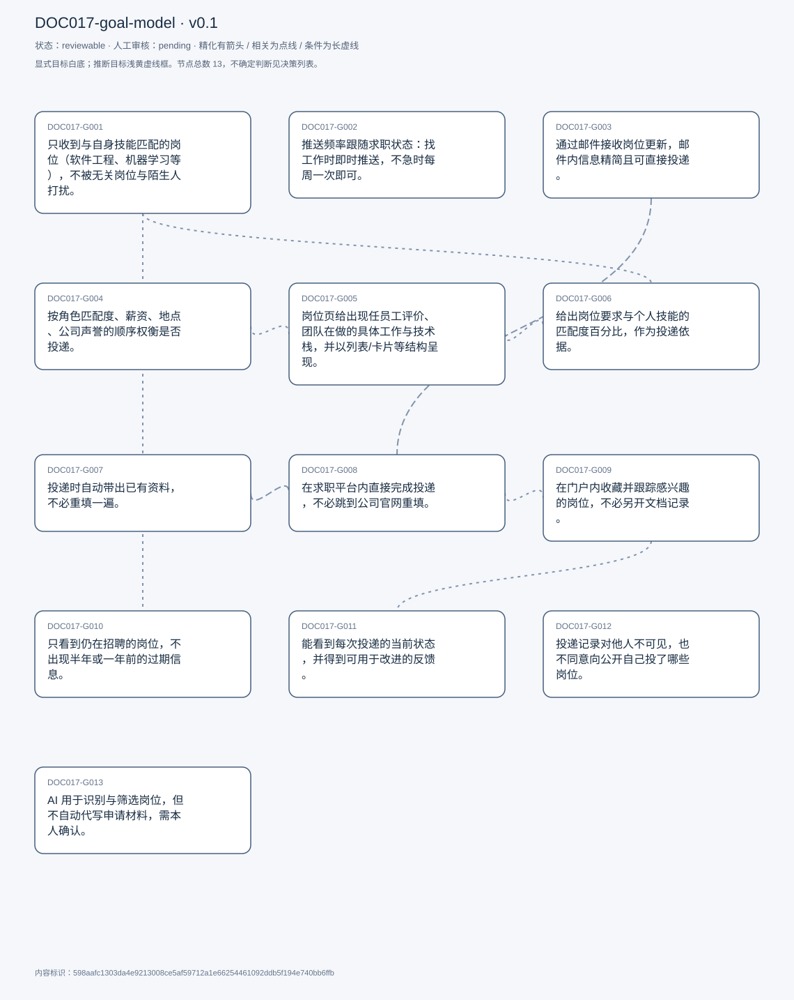
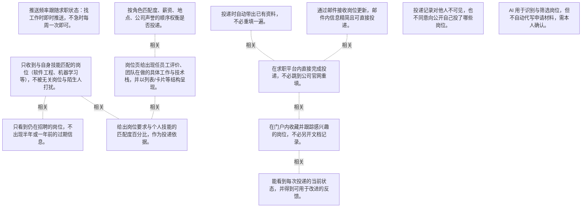

# 目标模型说明

模型：DOC017-goal-model；版本：v0.1

交付状态：reviewable；结构：passed；人工审核：pending

[交互模型](goal-model.html) · [矢量图](goal-model.svg) · [权威数据](goal-model.json)

## 目标图

## 目标

| 编号 | 表述 | 来源 | 情境 | 证据 |
|---|---|---|---|---|
| DOC017-G001 | 只收到与自身技能匹配的岗位（软件工程、机器学习等），不被无关岗位与陌生人打扰。 | explicit | 可按关键词自定义搜索；曾经因推送不准而错过岗位 | E0001, E0002, E0003 |
| DOC017-G002 | 推送频率跟随求职状态：找工作时即时推送，不急时每周一次即可。 | explicit | 背景：市场冷淡，每天只有一两条新岗位 | E0004, E0005 |
| DOC017-G003 | 通过邮件接收岗位更新，邮件内信息精简且可直接投递。 | explicit | 不排斥站内通知，但不愿把通知栏塞满 | E0006, E0007, E0008 |
| DOC017-G004 | 按角色匹配度、薪资、地点、公司声誉的顺序权衡是否投递。 | explicit | 自述为明确的优先级顺序 | E0009 |
| DOC017-G005 | 岗位页给出现任员工评价、团队在做的具体工作与技术栈，并以列表/卡片等结构呈现。 | explicit | 现状：LinkedIn 把大量文字堆在一起，需上下滚动才找到技术栈 | E0010, E0011 |
| DOC017-G006 | 给出岗位要求与个人技能的匹配度百分比，作为投递依据。 | explicit | 现状：借助第三方插件自行比对；LinkedIn 已有 AI 提示「你很适合」 | E0012, E0013 |
| DOC017-G007 | 投递时自动带出已有资料，不必重填一遍。 | explicit | 认可少量针对性的定制，但反对整体重填 | E0014, E0015 |
| DOC017-G008 | 在求职平台内直接完成投递，不必跳到公司官网重填。 | explicit | 现状：LinkedIn 投递仍跳转公司门户 | E0016, E0017 |
| DOC017-G009 | 在门户内收藏并跟踪感兴趣的岗位，不必另开文档记录。 | explicit | 现状：把 job id 记在 Notion 之类的文档里，周末统一处理 | E0018, E0019 |
| DOC017-G010 | 只看到仍在招聘的岗位，不出现半年或一年前的过期信息。 | explicit | 过期岗位会直接放弃投递 | E0020, E0021 |
| DOC017-G011 | 能看到每次投递的当前状态，并得到可用于改进的反馈。 | explicit | 按 1–10 评分时给 10 分；抱怨多数平台不提供任何反馈 | E0022, E0023, E0024 |
| DOC017-G012 | 投递记录对他人不可见，也不同意向公开自己投了哪些岗位。 | explicit | 理由：竞争压力下不想被同侪看到 | E0025, E0026 |
| DOC017-G013 | AI 用于识别与筛选岗位，但不自动代写申请材料，需本人确认。 | explicit | 对 AI 写作持保留：不可靠，须本人核实 | E0027, E0028, E0029 |

## 关系判断（含不确定与无关系）

- DOC017-G001 / DOC017-G002：none。DOC017-G001 的对象是只收匹配岗位、不受无关打扰（T003/T069），DOC017-G002 的对象是推送频率随求职状态调整（T005）；两处分别出自不同话题段，原文未在二者之间建立因果、手段、评价或情境包含关系，本次评估口径内未建立可采用关系。
- DOC017-G001 / DOC017-G003：none。DOC017-G001 的对象是只收匹配岗位、不受无关打扰（T003/T069），DOC017-G003 的对象是邮件内精简呈现可一键投递（T007/T009）；两处分别出自不同话题段，原文未在二者之间建立因果、手段、评价或情境包含关系，本次评估口径内未建立可采用关系。
- DOC017-G001 / DOC017-G004：none。DOC017-G001 的对象是只收匹配岗位、不受无关打扰（T003/T069），DOC017-G004 的对象是按角色/薪资/地点/声誉权衡（T019）；两处分别出自不同话题段，原文未在二者之间建立因果、手段、评价或情境包含关系，本次评估口径内未建立可采用关系。
- DOC017-G001 / DOC017-G005：none。DOC017-G001 的对象是只收匹配岗位、不受无关打扰（T003/T069），DOC017-G005 的对象是岗位页含关键信息且结构化呈现（T021/T023）；两处分别出自不同话题段，原文未在二者之间建立因果、手段、评价或情境包含关系，本次评估口径内未建立可采用关系。
- DOC017-G001 / DOC017-G006：related。T033 说明匹配度百分比正是用来判断岗位是否符合技能，是 G001 的实现手段（把「匹配」量化）；但百分比只是筛选工具，不等于「只收匹配」这一结果。
- DOC017-G001 / DOC017-G007：none。DOC017-G001 的对象是只收匹配岗位、不受无关打扰（T003/T069），DOC017-G007 的对象是投递复用已有资料（T073）；两处分别出自不同话题段，原文未在二者之间建立因果、手段、评价或情境包含关系，本次评估口径内未建立可采用关系。
- DOC017-G001 / DOC017-G008：none。DOC017-G001 的对象是只收匹配岗位、不受无关打扰（T003/T069），DOC017-G008 的对象是站内完成投递（T061/T067）；两处分别出自不同话题段，原文未在二者之间建立因果、手段、评价或情境包含关系，本次评估口径内未建立可采用关系。
- DOC017-G001 / DOC017-G009：none。DOC017-G001 的对象是只收匹配岗位、不受无关打扰（T003/T069），DOC017-G009 的对象是站内收藏并跟踪候选（T075/T077）；两处分别出自不同话题段，原文未在二者之间建立因果、手段、评价或情境包含关系，本次评估口径内未建立可采用关系。
- DOC017-G001 / DOC017-G010：related。T071 把「过期岗位」与「不相关岗位」并列在同一抱怨里（not having a relevant or updated job list），二者共同构成「列表质量」；但一个是内容相关、一个是时效有效。
- DOC017-G001 / DOC017-G011：none。DOC017-G001 的对象是只收匹配岗位、不受无关打扰（T003/T069），DOC017-G011 的对象是追踪投递状态与反馈（T105）；两处分别出自不同话题段，原文未在二者之间建立因果、手段、评价或情境包含关系，本次评估口径内未建立可采用关系。
- DOC017-G001 / DOC017-G012：none。DOC017-G001 的对象是只收匹配岗位、不受无关打扰（T003/T069），DOC017-G012 的对象是投递记录保密（T083）；两处分别出自不同话题段，原文未在二者之间建立因果、手段、评价或情境包含关系，本次评估口径内未建立可采用关系。
- DOC017-G001 / DOC017-G013：none。DOC017-G001 的对象是只收匹配岗位、不受无关打扰（T003/T069），DOC017-G013 的对象是AI 只辅助筛选不代写（T093/T095）；两处分别出自不同话题段，原文未在二者之间建立因果、手段、评价或情境包含关系，本次评估口径内未建立可采用关系。
- DOC017-G002 / DOC017-G003：none。DOC017-G002 的对象是推送频率随求职状态调整（T005），DOC017-G003 的对象是邮件内精简呈现可一键投递（T007/T009）；两处分别出自不同话题段，原文未在二者之间建立因果、手段、评价或情境包含关系，本次评估口径内未建立可采用关系。
- DOC017-G002 / DOC017-G004：none。DOC017-G002 的对象是推送频率随求职状态调整（T005），DOC017-G004 的对象是按角色/薪资/地点/声誉权衡（T019）；两处分别出自不同话题段，原文未在二者之间建立因果、手段、评价或情境包含关系，本次评估口径内未建立可采用关系。
- DOC017-G002 / DOC017-G005：none。DOC017-G002 的对象是推送频率随求职状态调整（T005），DOC017-G005 的对象是岗位页含关键信息且结构化呈现（T021/T023）；两处分别出自不同话题段，原文未在二者之间建立因果、手段、评价或情境包含关系，本次评估口径内未建立可采用关系。
- DOC017-G002 / DOC017-G006：none。DOC017-G002 的对象是推送频率随求职状态调整（T005），DOC017-G006 的对象是技能匹配度百分比（T033）；两处分别出自不同话题段，原文未在二者之间建立因果、手段、评价或情境包含关系，本次评估口径内未建立可采用关系。
- DOC017-G002 / DOC017-G007：none。DOC017-G002 的对象是推送频率随求职状态调整（T005），DOC017-G007 的对象是投递复用已有资料（T073）；两处分别出自不同话题段，原文未在二者之间建立因果、手段、评价或情境包含关系，本次评估口径内未建立可采用关系。
- DOC017-G002 / DOC017-G008：none。DOC017-G002 的对象是推送频率随求职状态调整（T005），DOC017-G008 的对象是站内完成投递（T061/T067）；两处分别出自不同话题段，原文未在二者之间建立因果、手段、评价或情境包含关系，本次评估口径内未建立可采用关系。
- DOC017-G002 / DOC017-G009：none。DOC017-G002 的对象是推送频率随求职状态调整（T005），DOC017-G009 的对象是站内收藏并跟踪候选（T075/T077）；两处分别出自不同话题段，原文未在二者之间建立因果、手段、评价或情境包含关系，本次评估口径内未建立可采用关系。
- DOC017-G002 / DOC017-G010：none。DOC017-G002 的对象是推送频率随求职状态调整（T005），DOC017-G010 的对象是只看到仍有效的岗位（T071）；两处分别出自不同话题段，原文未在二者之间建立因果、手段、评价或情境包含关系，本次评估口径内未建立可采用关系。
- DOC017-G002 / DOC017-G011：none。DOC017-G002 的对象是推送频率随求职状态调整（T005），DOC017-G011 的对象是追踪投递状态与反馈（T105）；两处分别出自不同话题段，原文未在二者之间建立因果、手段、评价或情境包含关系，本次评估口径内未建立可采用关系。
- DOC017-G002 / DOC017-G012：none。DOC017-G002 的对象是推送频率随求职状态调整（T005），DOC017-G012 的对象是投递记录保密（T083）；两处分别出自不同话题段，原文未在二者之间建立因果、手段、评价或情境包含关系，本次评估口径内未建立可采用关系。
- DOC017-G002 / DOC017-G013：none。DOC017-G002 的对象是推送频率随求职状态调整（T005），DOC017-G013 的对象是AI 只辅助筛选不代写（T093/T095）；两处分别出自不同话题段，原文未在二者之间建立因果、手段、评价或情境包含关系，本次评估口径内未建立可采用关系。
- DOC017-G003 / DOC017-G004：none。DOC017-G003 的对象是邮件内精简呈现可一键投递（T007/T009），DOC017-G004 的对象是按角色/薪资/地点/声誉权衡（T019）；两处分别出自不同话题段，原文未在二者之间建立因果、手段、评价或情境包含关系，本次评估口径内未建立可采用关系。
- DOC017-G003 / DOC017-G005：none。DOC017-G003 的对象是邮件内精简呈现可一键投递（T007/T009），DOC017-G005 的对象是岗位页含关键信息且结构化呈现（T021/T023）；两处分别出自不同话题段，原文未在二者之间建立因果、手段、评价或情境包含关系，本次评估口径内未建立可采用关系。
- DOC017-G003 / DOC017-G006：none。DOC017-G003 的对象是邮件内精简呈现可一键投递（T007/T009），DOC017-G006 的对象是技能匹配度百分比（T033）；两处分别出自不同话题段，原文未在二者之间建立因果、手段、评价或情境包含关系，本次评估口径内未建立可采用关系。
- DOC017-G003 / DOC017-G007：none。DOC017-G003 的对象是邮件内精简呈现可一键投递（T007/T009），DOC017-G007 的对象是投递复用已有资料（T073）；两处分别出自不同话题段，原文未在二者之间建立因果、手段、评价或情境包含关系，本次评估口径内未建立可采用关系。
- DOC017-G003 / DOC017-G008：related。T009 与 T067 的动机一致：都不愿多次跳转。G003 把投递放进邮件，G008 把投递放进站内，是同一诉求的两个入口。
- DOC017-G003 / DOC017-G009：none。DOC017-G003 的对象是邮件内精简呈现可一键投递（T007/T009），DOC017-G009 的对象是站内收藏并跟踪候选（T075/T077）；两处分别出自不同话题段，原文未在二者之间建立因果、手段、评价或情境包含关系，本次评估口径内未建立可采用关系。
- DOC017-G003 / DOC017-G010：none。DOC017-G003 的对象是邮件内精简呈现可一键投递（T007/T009），DOC017-G010 的对象是只看到仍有效的岗位（T071）；两处分别出自不同话题段，原文未在二者之间建立因果、手段、评价或情境包含关系，本次评估口径内未建立可采用关系。
- DOC017-G003 / DOC017-G011：none。DOC017-G003 的对象是邮件内精简呈现可一键投递（T007/T009），DOC017-G011 的对象是追踪投递状态与反馈（T105）；两处分别出自不同话题段，原文未在二者之间建立因果、手段、评价或情境包含关系，本次评估口径内未建立可采用关系。
- DOC017-G003 / DOC017-G012：none。DOC017-G003 的对象是邮件内精简呈现可一键投递（T007/T009），DOC017-G012 的对象是投递记录保密（T083）；两处分别出自不同话题段，原文未在二者之间建立因果、手段、评价或情境包含关系，本次评估口径内未建立可采用关系。
- DOC017-G003 / DOC017-G013：none。DOC017-G003 的对象是邮件内精简呈现可一键投递（T007/T009），DOC017-G013 的对象是AI 只辅助筛选不代写（T093/T095）；两处分别出自不同话题段，原文未在二者之间建立因果、手段、评价或情境包含关系，本次评估口径内未建立可采用关系。
- DOC017-G004 / DOC017-G005：related。T019 的四项权衡因素需要 T021 的三类信息来支撑（角色匹配、公司声誉尤其依赖员工评价）；但一个是决策权重、一个是页面内容。
- DOC017-G004 / DOC017-G006：none。DOC017-G004 的对象是按角色/薪资/地点/声誉权衡（T019），DOC017-G006 的对象是技能匹配度百分比（T033）；两处分别出自不同话题段，原文未在二者之间建立因果、手段、评价或情境包含关系，本次评估口径内未建立可采用关系。
- DOC017-G004 / DOC017-G007：none。DOC017-G004 的对象是按角色/薪资/地点/声誉权衡（T019），DOC017-G007 的对象是投递复用已有资料（T073）；两处分别出自不同话题段，原文未在二者之间建立因果、手段、评价或情境包含关系，本次评估口径内未建立可采用关系。
- DOC017-G004 / DOC017-G008：none。DOC017-G004 的对象是按角色/薪资/地点/声誉权衡（T019），DOC017-G008 的对象是站内完成投递（T061/T067）；两处分别出自不同话题段，原文未在二者之间建立因果、手段、评价或情境包含关系，本次评估口径内未建立可采用关系。
- DOC017-G004 / DOC017-G009：none。DOC017-G004 的对象是按角色/薪资/地点/声誉权衡（T019），DOC017-G009 的对象是站内收藏并跟踪候选（T075/T077）；两处分别出自不同话题段，原文未在二者之间建立因果、手段、评价或情境包含关系，本次评估口径内未建立可采用关系。
- DOC017-G004 / DOC017-G010：none。DOC017-G004 的对象是按角色/薪资/地点/声誉权衡（T019），DOC017-G010 的对象是只看到仍有效的岗位（T071）；两处分别出自不同话题段，原文未在二者之间建立因果、手段、评价或情境包含关系，本次评估口径内未建立可采用关系。
- DOC017-G004 / DOC017-G011：none。DOC017-G004 的对象是按角色/薪资/地点/声誉权衡（T019），DOC017-G011 的对象是追踪投递状态与反馈（T105）；两处分别出自不同话题段，原文未在二者之间建立因果、手段、评价或情境包含关系，本次评估口径内未建立可采用关系。
- DOC017-G004 / DOC017-G012：none。DOC017-G004 的对象是按角色/薪资/地点/声誉权衡（T019），DOC017-G012 的对象是投递记录保密（T083）；两处分别出自不同话题段，原文未在二者之间建立因果、手段、评价或情境包含关系，本次评估口径内未建立可采用关系。
- DOC017-G004 / DOC017-G013：none。DOC017-G004 的对象是按角色/薪资/地点/声誉权衡（T019），DOC017-G013 的对象是AI 只辅助筛选不代写（T093/T095）；两处分别出自不同话题段，原文未在二者之间建立因果、手段、评价或情境包含关系，本次评估口径内未建立可采用关系。
- DOC017-G005 / DOC017-G006：related。匹配度百分比属于岗位页可展示的信息之一，T023 要求这类信息结构化呈现；但百分比是算法输出，不属于 T021 列举的岗位事实。
- DOC017-G005 / DOC017-G007：none。DOC017-G005 的对象是岗位页含关键信息且结构化呈现（T021/T023），DOC017-G007 的对象是投递复用已有资料（T073）；两处分别出自不同话题段，原文未在二者之间建立因果、手段、评价或情境包含关系，本次评估口径内未建立可采用关系。
- DOC017-G005 / DOC017-G008：none。DOC017-G005 的对象是岗位页含关键信息且结构化呈现（T021/T023），DOC017-G008 的对象是站内完成投递（T061/T067）；两处分别出自不同话题段，原文未在二者之间建立因果、手段、评价或情境包含关系，本次评估口径内未建立可采用关系。
- DOC017-G005 / DOC017-G009：none。DOC017-G005 的对象是岗位页含关键信息且结构化呈现（T021/T023），DOC017-G009 的对象是站内收藏并跟踪候选（T075/T077）；两处分别出自不同话题段，原文未在二者之间建立因果、手段、评价或情境包含关系，本次评估口径内未建立可采用关系。
- DOC017-G005 / DOC017-G010：none。DOC017-G005 的对象是岗位页含关键信息且结构化呈现（T021/T023），DOC017-G010 的对象是只看到仍有效的岗位（T071）；两处分别出自不同话题段，原文未在二者之间建立因果、手段、评价或情境包含关系，本次评估口径内未建立可采用关系。
- DOC017-G005 / DOC017-G011：none。DOC017-G005 的对象是岗位页含关键信息且结构化呈现（T021/T023），DOC017-G011 的对象是追踪投递状态与反馈（T105）；两处分别出自不同话题段，原文未在二者之间建立因果、手段、评价或情境包含关系，本次评估口径内未建立可采用关系。
- DOC017-G005 / DOC017-G012：none。DOC017-G005 的对象是岗位页含关键信息且结构化呈现（T021/T023），DOC017-G012 的对象是投递记录保密（T083）；两处分别出自不同话题段，原文未在二者之间建立因果、手段、评价或情境包含关系，本次评估口径内未建立可采用关系。
- DOC017-G005 / DOC017-G013：none。DOC017-G005 的对象是岗位页含关键信息且结构化呈现（T021/T023），DOC017-G013 的对象是AI 只辅助筛选不代写（T093/T095）；两处分别出自不同话题段，原文未在二者之间建立因果、手段、评价或情境包含关系，本次评估口径内未建立可采用关系。
- DOC017-G006 / DOC017-G007：none。DOC017-G006 的对象是技能匹配度百分比（T033），DOC017-G007 的对象是投递复用已有资料（T073）；两处分别出自不同话题段，原文未在二者之间建立因果、手段、评价或情境包含关系，本次评估口径内未建立可采用关系。
- DOC017-G006 / DOC017-G008：none。DOC017-G006 的对象是技能匹配度百分比（T033），DOC017-G008 的对象是站内完成投递（T061/T067）；两处分别出自不同话题段，原文未在二者之间建立因果、手段、评价或情境包含关系，本次评估口径内未建立可采用关系。
- DOC017-G006 / DOC017-G009：none。DOC017-G006 的对象是技能匹配度百分比（T033），DOC017-G009 的对象是站内收藏并跟踪候选（T075/T077）；两处分别出自不同话题段，原文未在二者之间建立因果、手段、评价或情境包含关系，本次评估口径内未建立可采用关系。
- DOC017-G006 / DOC017-G010：none。DOC017-G006 的对象是技能匹配度百分比（T033），DOC017-G010 的对象是只看到仍有效的岗位（T071）；两处分别出自不同话题段，原文未在二者之间建立因果、手段、评价或情境包含关系，本次评估口径内未建立可采用关系。
- DOC017-G006 / DOC017-G011：none。DOC017-G006 的对象是技能匹配度百分比（T033），DOC017-G011 的对象是追踪投递状态与反馈（T105）；两处分别出自不同话题段，原文未在二者之间建立因果、手段、评价或情境包含关系，本次评估口径内未建立可采用关系。
- DOC017-G006 / DOC017-G012：none。DOC017-G006 的对象是技能匹配度百分比（T033），DOC017-G012 的对象是投递记录保密（T083）；两处分别出自不同话题段，原文未在二者之间建立因果、手段、评价或情境包含关系，本次评估口径内未建立可采用关系。
- DOC017-G006 / DOC017-G013：none。DOC017-G006 的对象是技能匹配度百分比（T033），DOC017-G013 的对象是AI 只辅助筛选不代写（T093/T095）；两处分别出自不同话题段，原文未在二者之间建立因果、手段、评价或情境包含关系，本次评估口径内未建立可采用关系。
- DOC017-G007 / DOC017-G008：related。T067 说明站内投递的前提是「所有资料已经从求职门户转过去」，资料复用是站内投递能成立的基础。
- DOC017-G007 / DOC017-G009：none。DOC017-G007 的对象是投递复用已有资料（T073），DOC017-G009 的对象是站内收藏并跟踪候选（T075/T077）；两处分别出自不同话题段，原文未在二者之间建立因果、手段、评价或情境包含关系，本次评估口径内未建立可采用关系。
- DOC017-G007 / DOC017-G010：none。DOC017-G007 的对象是投递复用已有资料（T073），DOC017-G010 的对象是只看到仍有效的岗位（T071）；两处分别出自不同话题段，原文未在二者之间建立因果、手段、评价或情境包含关系，本次评估口径内未建立可采用关系。
- DOC017-G007 / DOC017-G011：none。DOC017-G007 的对象是投递复用已有资料（T073），DOC017-G011 的对象是追踪投递状态与反馈（T105）；两处分别出自不同话题段，原文未在二者之间建立因果、手段、评价或情境包含关系，本次评估口径内未建立可采用关系。
- DOC017-G007 / DOC017-G012：none。DOC017-G007 的对象是投递复用已有资料（T073），DOC017-G012 的对象是投递记录保密（T083）；两处分别出自不同话题段，原文未在二者之间建立因果、手段、评价或情境包含关系，本次评估口径内未建立可采用关系。
- DOC017-G007 / DOC017-G013：none。DOC017-G007 的对象是投递复用已有资料（T073），DOC017-G013 的对象是AI 只辅助筛选不代写（T093/T095）；两处分别出自不同话题段，原文未在二者之间建立因果、手段、评价或情境包含关系，本次评估口径内未建立可采用关系。
- DOC017-G008 / DOC017-G009：related。收藏与投递都发生在站内，T077 明确理由是「不想跳到另一个应用」；但收藏是投递前的候选池，投递是最终动作。
- DOC017-G008 / DOC017-G010：none。DOC017-G008 的对象是站内完成投递（T061/T067），DOC017-G010 的对象是只看到仍有效的岗位（T071）；两处分别出自不同话题段，原文未在二者之间建立因果、手段、评价或情境包含关系，本次评估口径内未建立可采用关系。
- DOC017-G008 / DOC017-G011：none。DOC017-G008 的对象是站内完成投递（T061/T067），DOC017-G011 的对象是追踪投递状态与反馈（T105）；两处分别出自不同话题段，原文未在二者之间建立因果、手段、评价或情境包含关系，本次评估口径内未建立可采用关系。
- DOC017-G008 / DOC017-G012：none。DOC017-G008 的对象是站内完成投递（T061/T067），DOC017-G012 的对象是投递记录保密（T083）；两处分别出自不同话题段，原文未在二者之间建立因果、手段、评价或情境包含关系，本次评估口径内未建立可采用关系。
- DOC017-G008 / DOC017-G013：none。DOC017-G008 的对象是站内完成投递（T061/T067），DOC017-G013 的对象是AI 只辅助筛选不代写（T093/T095）；两处分别出自不同话题段，原文未在二者之间建立因果、手段、评价或情境包含关系，本次评估口径内未建立可采用关系。
- DOC017-G009 / DOC017-G010：none。DOC017-G009 的对象是站内收藏并跟踪候选（T075/T077），DOC017-G010 的对象是只看到仍有效的岗位（T071）；两处分别出自不同话题段，原文未在二者之间建立因果、手段、评价或情境包含关系，本次评估口径内未建立可采用关系。
- DOC017-G009 / DOC017-G011：related。二者都属于投递后的跟踪，T105 要状态与反馈、T077 要候选管理；但一个是已投递记录、一个是未投递候选。
- DOC017-G009 / DOC017-G012：none。DOC017-G009 的对象是站内收藏并跟踪候选（T075/T077），DOC017-G012 的对象是投递记录保密（T083）；两处分别出自不同话题段，原文未在二者之间建立因果、手段、评价或情境包含关系，本次评估口径内未建立可采用关系。
- DOC017-G009 / DOC017-G013：none。DOC017-G009 的对象是站内收藏并跟踪候选（T075/T077），DOC017-G013 的对象是AI 只辅助筛选不代写（T093/T095）；两处分别出自不同话题段，原文未在二者之间建立因果、手段、评价或情境包含关系，本次评估口径内未建立可采用关系。
- DOC017-G010 / DOC017-G011：none。DOC017-G010 的对象是只看到仍有效的岗位（T071），DOC017-G011 的对象是追踪投递状态与反馈（T105）；两处分别出自不同话题段，原文未在二者之间建立因果、手段、评价或情境包含关系，本次评估口径内未建立可采用关系。
- DOC017-G010 / DOC017-G012：none。DOC017-G010 的对象是只看到仍有效的岗位（T071），DOC017-G012 的对象是投递记录保密（T083）；两处分别出自不同话题段，原文未在二者之间建立因果、手段、评价或情境包含关系，本次评估口径内未建立可采用关系。
- DOC017-G010 / DOC017-G013：none。DOC017-G010 的对象是只看到仍有效的岗位（T071），DOC017-G013 的对象是AI 只辅助筛选不代写（T093/T095）；两处分别出自不同话题段，原文未在二者之间建立因果、手段、评价或情境包含关系，本次评估口径内未建立可采用关系。
- DOC017-G011 / DOC017-G012：none。DOC017-G011 的对象是追踪投递状态与反馈（T105），DOC017-G012 的对象是投递记录保密（T083）；两处分别出自不同话题段，原文未在二者之间建立因果、手段、评价或情境包含关系，本次评估口径内未建立可采用关系。
- DOC017-G011 / DOC017-G013：none。DOC017-G011 的对象是追踪投递状态与反馈（T105），DOC017-G013 的对象是AI 只辅助筛选不代写（T093/T095）；两处分别出自不同话题段，原文未在二者之间建立因果、手段、评价或情境包含关系，本次评估口径内未建立可采用关系。
- DOC017-G012 / DOC017-G013：none。DOC017-G012 的对象是投递记录保密（T083），DOC017-G013 的对象是AI 只辅助筛选不代写（T093/T095）；两处分别出自不同话题段，原文未在二者之间建立因果、手段、评价或情境包含关系，本次评估口径内未建立可采用关系。

## 证据

### E0001 · DOC017:S004

> job roles specific to the domain such as software engineering or machine learning roles

原件位置：{&quot;line_start&quot;: 4, &quot;line_end&quot;: 4, &quot;start_char&quot;: 358, &quot;end_char&quot;: 601}

### E0002 · DOC017:S004

> job updates based on whatever is my skill set

原件位置：{&quot;line_start&quot;: 4, &quot;line_end&quot;: 4, &quot;start_char&quot;: 358, &quot;end_char&quot;: 601}

### E0003 · DOC017:S070

> getting random job notifications. Random people reaching me out in Linkedin

原件位置：{&quot;line_start&quot;: 70, &quot;line_end&quot;: 70, &quot;start_char&quot;: 11972, &quot;end_char&quot;: 12114}

### E0004 · DOC017:S006

> it would be great if I receive at the instant

原件位置：{&quot;line_start&quot;: 6, &quot;line_end&quot;: 6, &quot;start_char&quot;: 751, &quot;end_char&quot;: 1105}

### E0005 · DOC017:S006

> if I&#x27;m not looking actively, then it&#x27;s okay to receive once in a week

原件位置：{&quot;line_start&quot;: 6, &quot;line_end&quot;: 6, &quot;start_char&quot;: 751, &quot;end_char&quot;: 1105}

### E0006 · DOC017:S008

> I would generally prefer getting via emails

原件位置：{&quot;line_start&quot;: 8, &quot;line_end&quot;: 8, &quot;start_char&quot;: 1309, &quot;end_char&quot;: 1576}

### E0007 · DOC017:S010

> should be having a direct apply button in the email itself

原件位置：{&quot;line_start&quot;: 10, &quot;line_end&quot;: 10, &quot;start_char&quot;: 1774, &quot;end_char&quot;: 2260}

### E0008 · DOC017:S010

> so that I don&#x27;t need to waste time then navigating to the app, and then again, going to the company&#x27;s portal

原件位置：{&quot;line_start&quot;: 10, &quot;line_end&quot;: 10, &quot;start_char&quot;: 1774, &quot;end_char&quot;: 2260}

### E0009 · DOC017:S020

> one is the role like, I&#x27;ll see if the role is really interesting. And I&#x27;m suitable for that role second is the payment. And then comes the location. And of course the company reputation

原件位置：{&quot;line_start&quot;: 20, &quot;line_end&quot;: 20, &quot;start_char&quot;: 4408, &quot;end_char&quot;: 4741}

### E0010 · DOC017:S022

> I would consider the reviews from the current employees. What work they are specifically working on, what text they are using

原件位置：{&quot;line_start&quot;: 22, &quot;line_end&quot;: 22, &quot;start_char&quot;: 4866, &quot;end_char&quot;: 5190}

### E0011 · DOC017:S024

> formatted in terms of list cars and tables that would be really helpful for me to navigate

原件位置：{&quot;line_start&quot;: 24, &quot;line_end&quot;: 24, &quot;start_char&quot;: 5585, &quot;end_char&quot;: 6001}

### E0012 · DOC017:S034

> it can also give some percentage out of it

原件位置：{&quot;line_start&quot;: 34, &quot;line_end&quot;: 34, &quot;start_char&quot;: 6993, &quot;end_char&quot;: 7381}

### E0013 · DOC017:S034

> I kind of use some tool out Plugin. I see if I can actually match those skill sets with me

原件位置：{&quot;line_start&quot;: 34, &quot;line_end&quot;: 34, &quot;start_char&quot;: 6993, &quot;end_char&quot;: 7381}

### E0014 · DOC017:S074

> it&#x27;s a hindrance for me to again fill all those details

原件位置：{&quot;line_start&quot;: 74, &quot;line_end&quot;: 74, &quot;start_char&quot;: 12818, &quot;end_char&quot;: 13266}

### E0015 · DOC017:S074

> I don&#x27;t want to have a lot of manual efforts in filling up just a job application

原件位置：{&quot;line_start&quot;: 74, &quot;line_end&quot;: 74, &quot;start_char&quot;: 12818, &quot;end_char&quot;: 13266}

### E0016 · DOC017:S068

> that would be really great to have integrated

原件位置：{&quot;line_start&quot;: 68, &quot;line_end&quot;: 68, &quot;start_char&quot;: 11581, &quot;end_char&quot;: 11846}

### E0017 · DOC017:S062

> there is no point in having Linkedin. In the 1st place, when I have to like navigate to other place

原件位置：{&quot;line_start&quot;: 62, &quot;line_end&quot;: 62, &quot;start_char&quot;: 10619, &quot;end_char&quot;: 10809}

### E0018 · DOC017:S078

> It&#x27;d be great to have such features in the job portal itself

原件位置：{&quot;line_start&quot;: 78, &quot;line_end&quot;: 78, &quot;start_char&quot;: 14176, &quot;end_char&quot;: 14349}

### E0019 · DOC017:S076

> have I just note down what the job id or whatever in a separate Doc

原件位置：{&quot;line_start&quot;: 76, &quot;line_end&quot;: 76, &quot;start_char&quot;: 13604, &quot;end_char&quot;: 13922}

### E0020 · DOC017:S072

> I don&#x27;t want to apply for jobs which are like one year back, or even 6 months back

原件位置：{&quot;line_start&quot;: 72, &quot;line_end&quot;: 72, &quot;start_char&quot;: 12180, &quot;end_char&quot;: 12490}

### E0021 · DOC017:S072

> not having a relevant or updated job list

原件位置：{&quot;line_start&quot;: 72, &quot;line_end&quot;: 72, &quot;start_char&quot;: 12180, &quot;end_char&quot;: 12490}

### E0022 · DOC017:S106

> I want to know what is my status of my application

原件位置：{&quot;line_start&quot;: 106, &quot;line_end&quot;: 106, &quot;start_char&quot;: 18576, &quot;end_char&quot;: 18805}

### E0023 · DOC017:S106

> if there is any feedback that would be really great for me to improve in my further applications

原件位置：{&quot;line_start&quot;: 106, &quot;line_end&quot;: 106, &quot;start_char&quot;: 18576, &quot;end_char&quot;: 18805}

### E0024 · DOC017:S108

> They don&#x27;t like provide proper feedbacks

原件位置：{&quot;line_start&quot;: 108, &quot;line_end&quot;: 108, &quot;start_char&quot;: 18840, &quot;end_char&quot;: 18991}

### E0025 · DOC017:S084

> Expose my applications

原件位置：{&quot;line_start&quot;: 84, &quot;line_end&quot;: 84, &quot;start_char&quot;: 15229, &quot;end_char&quot;: 15565}

### E0026 · DOC017:S084

> I don&#x27;t want people to know for what job roles I&#x27;m applying for

原件位置：{&quot;line_start&quot;: 84, &quot;line_end&quot;: 84, &quot;start_char&quot;: 15229, &quot;end_char&quot;: 15565}

### E0027 · DOC017:S096

> it shouldn&#x27;t be automatic

原件位置：{&quot;line_start&quot;: 96, &quot;line_end&quot;: 96, &quot;start_char&quot;: 17237, &quot;end_char&quot;: 17358}

### E0028 · DOC017:S094

> when it comes for writing applications, I think I kind of still feel that Eas are uncertain

原件位置：{&quot;line_start&quot;: 94, &quot;line_end&quot;: 94, &quot;start_char&quot;: 17010, &quot;end_char&quot;: 17210}

### E0029 · DOC017:S096

> if it is like verified by us, then it&#x27;s good

原件位置：{&quot;line_start&quot;: 96, &quot;line_end&quot;: 96, &quot;start_char&quot;: 17237, &quot;end_char&quot;: 17358}

## 问题、限制与版本

- 当前会话助手的开发判断，非独立盲测；无人工采纳记录。
- 结构检查已绑定当前版本；独立语义审查未执行；人工状态以实际审核记录为准。

内容标识：598aafc1303da4e9213008ce5af59712a1e66254461092ddb5f194e740bb6ffb

人工决定：

审核意见：
