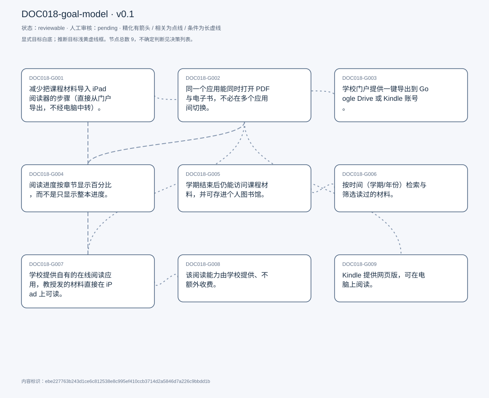
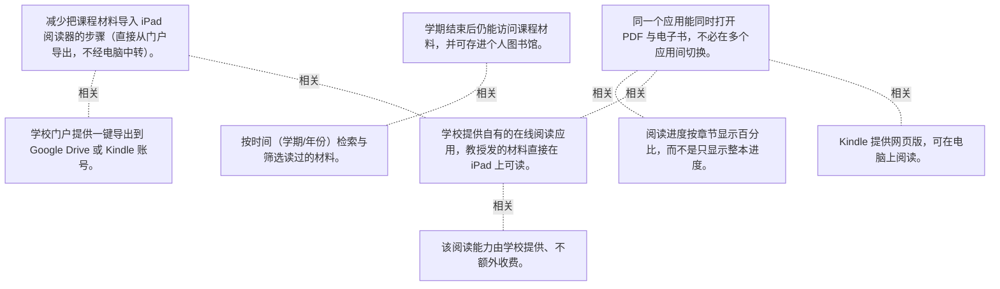

# 目标模型说明

模型：DOC018-goal-model；版本：v0.1

交付状态：reviewable；结构：passed；人工审核：pending

[交互模型](goal-model.html) · [矢量图](goal-model.svg) · [权威数据](goal-model.json)

## 目标图

## 目标

| 编号 | 表述 | 来源 | 情境 | 证据 |
|---|---|---|---|---|
| DOC018-G001 | 减少把课程材料导入 iPad 阅读器的步骤（直接从门户导出，不经电脑中转）。 | explicit | 现状路径：门户下载 → 电脑 → Google Drive → iPad 打开；自评学校门户内的阅读体验 cumbersome | E0001, E0002, E0003 |
| DOC018-G002 | 同一个应用能同时打开 PDF 与电子书，不必在多个应用间切换。 | explicit | 期望方向之一：让现有 Kindle 应用支持 PDF；现状：Kindle 读电子书、Adobe/Drive 读 PDF | E0004, E0005 |
| DOC018-G003 | 学校门户提供一键导出到 Google Drive 或 Kindle 账号。 | explicit | 被问到理想功能时给出；导出目标为「一个统一的地方」 | E0006 |
| DOC018-G004 | 阅读进度按章节显示百分比，而不是只显示整本进度。 | explicit | 现有能力：Kindle 显示章节剩余时间；动机：整本百分比在长书中显得遥遥无期，易焦虑 | E0007, E0008 |
| DOC018-G005 | 学期结束后仍能访问课程材料，并可存进个人图书馆。 | explicit | 经历：春季课程结束后 PDF 权限收回，需要重新申请；举例：软件架构课的有价值 PDF 已无法访问 | E0009, E0010, E0011 |
| DOC018-G006 | 按时间（学期/年份）检索与筛选读过的材料。 | explicit | 记忆参照：常以「spring 2023 那门课」回忆，而不是书名或 ISBN | E0012, E0013 |
| DOC018-G007 | 学校提供自有的在线阅读应用，教授发的材料直接在 iPad 上可读。 | explicit | 理由：省掉下载/上传环节；主要设备为 iPad | E0014, E0015 |
| DOC018-G008 | 该阅读能力由学校提供、不额外收费。 | explicit | 理由：学费已包含 | E0016 |
| DOC018-G009 | Kindle 提供网页版，可在电脑上阅读。 | explicit | 受访者并不确定是否存在网页版，认为有会很好 | E0017 |

## 关系判断（含不确定与无关系）

- DOC018-G001 / DOC018-G002：none。DOC018-G001 的对象是减少导入 iPad 的步骤（T037），DOC018-G002 的对象是同一应用打开 PDF 与电子书（T039）；两处分别出自不同话题段，原文未在二者之间建立因果、手段、评价或情境包含关系，本次评估口径内未建立可采用关系。
- DOC018-G001 / DOC018-G003：related。T047 的导出功能（export to Google Drive / kindle account）正是实现 G001「少步骤」的具体手段；但 G001 是结果、G003 是入口功能。
- DOC018-G001 / DOC018-G004：none。DOC018-G001 的对象是减少导入 iPad 的步骤（T037），DOC018-G004 的对象是按章节显示进度百分比（T049）；两处分别出自不同话题段，原文未在二者之间建立因果、手段、评价或情境包含关系，本次评估口径内未建立可采用关系。
- DOC018-G001 / DOC018-G005：none。DOC018-G001 的对象是减少导入 iPad 的步骤（T037），DOC018-G005 的对象是课程材料长期可访问的个人图书馆（T051）；两处分别出自不同话题段，原文未在二者之间建立因果、手段、评价或情境包含关系，本次评估口径内未建立可采用关系。
- DOC018-G001 / DOC018-G006：none。DOC018-G001 的对象是减少导入 iPad 的步骤（T037），DOC018-G006 的对象是按时间检索读过的材料（T055）；两处分别出自不同话题段，原文未在二者之间建立因果、手段、评价或情境包含关系，本次评估口径内未建立可采用关系。
- DOC018-G001 / DOC018-G007：related。T057 说明学校应用之所以好，是因为省掉「download upload」环节，与 G001 的动机相同；但二者是两条不同路径（改门户 vs 换应用）。
- DOC018-G001 / DOC018-G008：none。DOC018-G001 的对象是减少导入 iPad 的步骤（T037），DOC018-G008 的对象是由学校承担费用（T059）；两处分别出自不同话题段，原文未在二者之间建立因果、手段、评价或情境包含关系，本次评估口径内未建立可采用关系。
- DOC018-G001 / DOC018-G009：none。DOC018-G001 的对象是减少导入 iPad 的步骤（T037），DOC018-G009 的对象是Kindle 提供网页版（T011）；两处分别出自不同话题段，原文未在二者之间建立因果、手段、评价或情境包含关系，本次评估口径内未建立可采用关系。
- DOC018-G002 / DOC018-G003：none。DOC018-G002 的对象是同一应用打开 PDF 与电子书（T039），DOC018-G003 的对象是门户一键导出到 Drive/Kindle（T047）；两处分别出自不同话题段，原文未在二者之间建立因果、手段、评价或情境包含关系，本次评估口径内未建立可采用关系。
- DOC018-G002 / DOC018-G004：related。章节进度是电子书阅读器的功能，只有在支持该类内容的阅读器里才成立；但一个是阅读度量、一个是格式支持。
- DOC018-G002 / DOC018-G005：none。DOC018-G002 的对象是同一应用打开 PDF 与电子书（T039），DOC018-G005 的对象是课程材料长期可访问的个人图书馆（T051）；两处分别出自不同话题段，原文未在二者之间建立因果、手段、评价或情境包含关系，本次评估口径内未建立可采用关系。
- DOC018-G002 / DOC018-G006：none。DOC018-G002 的对象是同一应用打开 PDF 与电子书（T039），DOC018-G006 的对象是按时间检索读过的材料（T055）；两处分别出自不同话题段，原文未在二者之间建立因果、手段、评价或情境包含关系，本次评估口径内未建立可采用关系。
- DOC018-G002 / DOC018-G007：related。学校应用若上线，同样需要能读 PDF 与电子书，二者在「统一阅读场所」上重叠；但 G002 是格式能力、G007 是载体归属。
- DOC018-G002 / DOC018-G008：none。DOC018-G002 的对象是同一应用打开 PDF 与电子书（T039），DOC018-G008 的对象是由学校承担费用（T059）；两处分别出自不同话题段，原文未在二者之间建立因果、手段、评价或情境包含关系，本次评估口径内未建立可采用关系。
- DOC018-G002 / DOC018-G009：related。T011-T012 讨论 Kindle 是否有网页版，与 T043「让 Kindle 支持 PDF」同属对该应用能力的期待；但一个是访问方式、一个是格式支持。
- DOC018-G003 / DOC018-G004：none。DOC018-G003 的对象是门户一键导出到 Drive/Kindle（T047），DOC018-G004 的对象是按章节显示进度百分比（T049）；两处分别出自不同话题段，原文未在二者之间建立因果、手段、评价或情境包含关系，本次评估口径内未建立可采用关系。
- DOC018-G003 / DOC018-G005：none。DOC018-G003 的对象是门户一键导出到 Drive/Kindle（T047），DOC018-G005 的对象是课程材料长期可访问的个人图书馆（T051）；两处分别出自不同话题段，原文未在二者之间建立因果、手段、评价或情境包含关系，本次评估口径内未建立可采用关系。
- DOC018-G003 / DOC018-G006：none。DOC018-G003 的对象是门户一键导出到 Drive/Kindle（T047），DOC018-G006 的对象是按时间检索读过的材料（T055）；两处分别出自不同话题段，原文未在二者之间建立因果、手段、评价或情境包含关系，本次评估口径内未建立可采用关系。
- DOC018-G003 / DOC018-G007：none。DOC018-G003 的对象是门户一键导出到 Drive/Kindle（T047），DOC018-G007 的对象是学校自建在线阅读应用（T057）；两处分别出自不同话题段，原文未在二者之间建立因果、手段、评价或情境包含关系，本次评估口径内未建立可采用关系。
- DOC018-G003 / DOC018-G008：none。DOC018-G003 的对象是门户一键导出到 Drive/Kindle（T047），DOC018-G008 的对象是由学校承担费用（T059）；两处分别出自不同话题段，原文未在二者之间建立因果、手段、评价或情境包含关系，本次评估口径内未建立可采用关系。
- DOC018-G003 / DOC018-G009：none。DOC018-G003 的对象是门户一键导出到 Drive/Kindle（T047），DOC018-G009 的对象是Kindle 提供网页版（T011）；两处分别出自不同话题段，原文未在二者之间建立因果、手段、评价或情境包含关系，本次评估口径内未建立可采用关系。
- DOC018-G004 / DOC018-G005：none。DOC018-G004 的对象是按章节显示进度百分比（T049），DOC018-G005 的对象是课程材料长期可访问的个人图书馆（T051）；两处分别出自不同话题段，原文未在二者之间建立因果、手段、评价或情境包含关系，本次评估口径内未建立可采用关系。
- DOC018-G004 / DOC018-G006：none。DOC018-G004 的对象是按章节显示进度百分比（T049），DOC018-G006 的对象是按时间检索读过的材料（T055）；两处分别出自不同话题段，原文未在二者之间建立因果、手段、评价或情境包含关系，本次评估口径内未建立可采用关系。
- DOC018-G004 / DOC018-G007：none。DOC018-G004 的对象是按章节显示进度百分比（T049），DOC018-G007 的对象是学校自建在线阅读应用（T057）；两处分别出自不同话题段，原文未在二者之间建立因果、手段、评价或情境包含关系，本次评估口径内未建立可采用关系。
- DOC018-G004 / DOC018-G008：none。DOC018-G004 的对象是按章节显示进度百分比（T049），DOC018-G008 的对象是由学校承担费用（T059）；两处分别出自不同话题段，原文未在二者之间建立因果、手段、评价或情境包含关系，本次评估口径内未建立可采用关系。
- DOC018-G004 / DOC018-G009：none。DOC018-G004 的对象是按章节显示进度百分比（T049），DOC018-G009 的对象是Kindle 提供网页版（T011）；两处分别出自不同话题段，原文未在二者之间建立因果、手段、评价或情境包含关系，本次评估口径内未建立可采用关系。
- DOC018-G005 / DOC018-G006：related。T055 把「保存资源」列为第二优先、「按时间分类」列为第三，二者共同构成个人资料库的存取能力。
- DOC018-G005 / DOC018-G007：none。DOC018-G005 的对象是课程材料长期可访问的个人图书馆（T051），DOC018-G007 的对象是学校自建在线阅读应用（T057）；两处分别出自不同话题段，原文未在二者之间建立因果、手段、评价或情境包含关系，本次评估口径内未建立可采用关系。
- DOC018-G005 / DOC018-G008：none。DOC018-G005 的对象是课程材料长期可访问的个人图书馆（T051），DOC018-G008 的对象是由学校承担费用（T059）；两处分别出自不同话题段，原文未在二者之间建立因果、手段、评价或情境包含关系，本次评估口径内未建立可采用关系。
- DOC018-G005 / DOC018-G009：none。DOC018-G005 的对象是课程材料长期可访问的个人图书馆（T051），DOC018-G009 的对象是Kindle 提供网页版（T011）；两处分别出自不同话题段，原文未在二者之间建立因果、手段、评价或情境包含关系，本次评估口径内未建立可采用关系。
- DOC018-G006 / DOC018-G007：none。DOC018-G006 的对象是按时间检索读过的材料（T055），DOC018-G007 的对象是学校自建在线阅读应用（T057）；两处分别出自不同话题段，原文未在二者之间建立因果、手段、评价或情境包含关系，本次评估口径内未建立可采用关系。
- DOC018-G006 / DOC018-G008：none。DOC018-G006 的对象是按时间检索读过的材料（T055），DOC018-G008 的对象是由学校承担费用（T059）；两处分别出自不同话题段，原文未在二者之间建立因果、手段、评价或情境包含关系，本次评估口径内未建立可采用关系。
- DOC018-G006 / DOC018-G009：none。DOC018-G006 的对象是按时间检索读过的材料（T055），DOC018-G009 的对象是Kindle 提供网页版（T011）；两处分别出自不同话题段，原文未在二者之间建立因果、手段、评价或情境包含关系，本次评估口径内未建立可采用关系。
- DOC018-G007 / DOC018-G008：related。T059-T060 在讨论学校应用后紧接着谈费用，二者是同一提案的功能面与成本面。
- DOC018-G007 / DOC018-G009：none。DOC018-G007 的对象是学校自建在线阅读应用（T057），DOC018-G009 的对象是Kindle 提供网页版（T011）；两处分别出自不同话题段，原文未在二者之间建立因果、手段、评价或情境包含关系，本次评估口径内未建立可采用关系。
- DOC018-G008 / DOC018-G009：none。DOC018-G008 的对象是由学校承担费用（T059），DOC018-G009 的对象是Kindle 提供网页版（T011）；两处分别出自不同话题段，原文未在二者之间建立因果、手段、评价或情境包含关系，本次评估口径内未建立可采用关系。

## 证据

### E0001 · DOC018:S038

> So I can. Just, for instance, if my in in my course, or in my assignment. They send some articles I can actually export it to to drive like very easily and not to download it to my computer.

原件位置：{&quot;line_start&quot;: 38, &quot;line_end&quot;: 38, &quot;start_char&quot;: 6584, &quot;end_char&quot;: 7357}

### E0002 · DOC018:S038

> I think that I I can use less steps to actually import this content to my ipad.

原件位置：{&quot;line_start&quot;: 38, &quot;line_end&quot;: 38, &quot;start_char&quot;: 6584, &quot;end_char&quot;: 7357}

### E0003 · DOC018:S032

> Cumbersome. I don&#x27;t like the experience there.

原件位置：{&quot;line_start&quot;: 32, &quot;line_end&quot;: 32, &quot;start_char&quot;: 5453, &quot;end_char&quot;: 6059}

### E0004 · DOC018:S040

> if the same and application can handle both Pdfs and Ebook format. so I can open them in just one single place.

原件位置：{&quot;line_start&quot;: 40, &quot;line_end&quot;: 40, &quot;start_char&quot;: 7390, &quot;end_char&quot;: 7581}

### E0005 · DOC018:S044

> it will be easier if my existing kindle app can manages Pdfs

原件位置：{&quot;line_start&quot;: 44, &quot;line_end&quot;: 44, &quot;start_char&quot;: 7866, &quot;end_char&quot;: 7960}

### E0006 · DOC018:S048

> as export feature, like export to yeah export to Google drive or export to. Yeah, it should be like something like our export to kindle account.

原件位置：{&quot;line_start&quot;: 48, &quot;line_end&quot;: 48, &quot;start_char&quot;: 8160, &quot;end_char&quot;: 8362}

### E0007 · DOC018:S050

> I would love to have like by chapter, you know, by chapter. This way I get less anxious.

原件位置：{&quot;line_start&quot;: 50, &quot;line_end&quot;: 50, &quot;start_char&quot;: 8507, &quot;end_char&quot;: 9148}

### E0008 · DOC018:S050

> the application actually tells you how much time it&#x27;s remaining for the chapter

原件位置：{&quot;line_start&quot;: 50, &quot;line_end&quot;: 50, &quot;start_char&quot;: 8507, &quot;end_char&quot;: 9148}

### E0009 · DOC018:S052

> it will be relevant for at least have, like a some sort of a inside library, like a student library, where you can actually store like relevant content

原件位置：{&quot;line_start&quot;: 52, &quot;line_end&quot;: 52, &quot;start_char&quot;: 9660, &quot;end_char&quot;: 10562}

### E0010 · DOC018:S052

> I think it will be very valuable if we can, as students save them into a personal library.

原件位置：{&quot;line_start&quot;: 52, &quot;line_end&quot;: 52, &quot;start_char&quot;: 9660, &quot;end_char&quot;: 10562}

### E0011 · DOC018:S052

> there were some valuable Pdfs that I have no longer access

原件位置：{&quot;line_start&quot;: 52, &quot;line_end&quot;: 52, &quot;start_char&quot;: 9660, &quot;end_char&quot;: 10562}

### E0012 · DOC018:S056

> have like a way to yeah, to categorize in time, like, you know, sometimes you want to search like some filter filtering

原件位置：{&quot;line_start&quot;: 56, &quot;line_end&quot;: 56, &quot;start_char&quot;: 11514, &quot;end_char&quot;: 13030}

### E0013 · DOC018:S056

> either by the the month or the year. You remember you read it right.

原件位置：{&quot;line_start&quot;: 56, &quot;line_end&quot;: 56, &quot;start_char&quot;: 11514, &quot;end_char&quot;: 13030}

### E0014 · DOC018:S058

> the school should have its own application for for online reading right?

原件位置：{&quot;line_start&quot;: 58, &quot;line_end&quot;: 58, &quot;start_char&quot;: 13300, &quot;end_char&quot;: 13883}

### E0015 · DOC018:S058

> the professors just send out to you the articles right, and you have it right there in your in your ipad to read it

原件位置：{&quot;line_start&quot;: 58, &quot;line_end&quot;: 58, &quot;start_char&quot;: 13300, &quot;end_char&quot;: 13883}

### E0016 · DOC018:S060

> Pay a lot of money. They should be included, you know.

原件位置：{&quot;line_start&quot;: 60, &quot;line_end&quot;: 60, &quot;start_char&quot;: 13940, &quot;end_char&quot;: 14266}

### E0017 · DOC018:S012

> I don&#x27;t think there is a web application which, by the way, will will be. It will be cool.

原件位置：{&quot;line_start&quot;: 12, &quot;line_end&quot;: 12, &quot;start_char&quot;: 2244, &quot;end_char&quot;: 2403}

## 问题、限制与版本

- 当前会话助手的开发判断，非独立盲测；无人工采纳记录。
- 结构检查已绑定当前版本；独立语义审查未执行；人工状态以实际审核记录为准。

内容标识：ebe227763b243d1ce6c812538e8c995ef410ccb3714d2a5846d7a226c9bbdd1b

人工决定：

审核意见：
