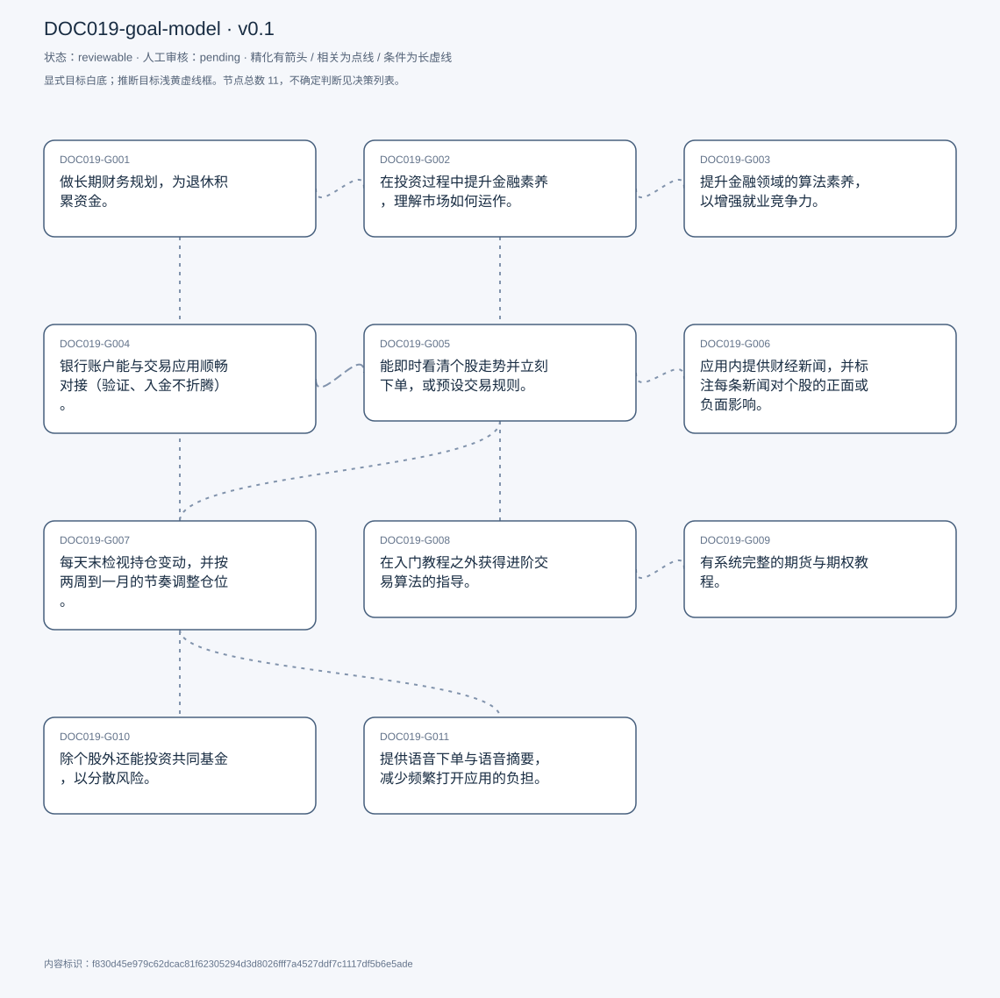
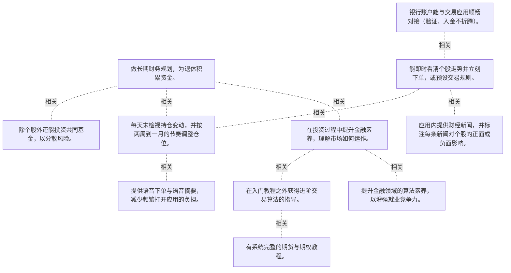

# 目标模型说明

模型：DOC019-goal-model；版本：v0.1

交付状态：reviewable；结构：passed；人工审核：pending

[交互模型](goal-model.html) · [矢量图](goal-model.svg) · [权威数据](goal-model.json)

## 目标图

## 目标

| 编号 | 表述 | 来源 | 情境 | 证据 |
|---|---|---|---|---|
| DOC019-G001 | 做长期财务规划，为退休积累资金。 | explicit | 自述为第一目标；投资以长期持有为主，不做日内交易 | E0001, E0002 |
| DOC019-G002 | 在投资过程中提升金融素养，理解市场如何运作。 | explicit | 自述为次要目标；起点：自称当时不具备金融常识，靠自学 | E0003, E0004 |
| DOC019-G003 | 提升金融领域的算法素养，以增强就业竞争力。 | explicit | 自述为三级目标 | E0005 |
| DOC019-G004 | 银行账户能与交易应用顺畅对接（验证、入金不折腾）。 | explicit | 自评这是决定用不用某个应用的关键因素；曾因无法把资金从银行转入 Coinbase 而放弃 | E0006, E0007, E0008 |
| DOC019-G005 | 能即时看清个股走势并立刻下单，或预设交易规则。 | explicit | 对下单表单本身满意（四个字段、直接了当）；复杂度集中在下单决策而非界面 | E0009, E0010 |
| DOC019-G006 | 应用内提供财经新闻，并标注每条新闻对个股的正面或负面影响。 | explicit | 以 Coinbase 的新闻区为参照：标题 + 红绿 + 币种图标；现状 Zerodha 无此功能，需另开外部资讯 | E0011, E0012, E0013 |
| DOC019-G007 | 每天末检视持仓变动，并按两周到一月的节奏调整仓位。 | explicit | 股票：每天一次；加密：约两周一次；调整依据为过去 3–6 个月表现与市值分层 | E0014, E0015, E0016 |
| DOC019-G008 | 在入门教程之外获得进阶交易算法的指导。 | explicit | 痛点：学完入门内容后不知道下一步怎么走，只能自己研究 | E0017, E0018 |
| DOC019-G009 | 有系统完整的期货与期权教程。 | explicit | 现状：Academy 只以「very running pattern」略过 | E0019, E0020 |
| DOC019-G010 | 除个股外还能投资共同基金，以分散风险。 | explicit | 理由：更安全、可投入更大金额、信任度更高；受访者不确定平台是否以此为目标 | E0021, E0022 |
| DOC019-G011 | 提供语音下单与语音摘要，减少频繁打开应用的负担。 | explicit | 被问「只改一件事」时给出的答案 | E0023, E0024, E0025 |

## 关系判断（含不确定与无关系）

- DOC019-G001 / DOC019-G002：related。T024 把二者按主/次排序：财务规划为首要，金融素养是「in the process」的伴随目标。二者同源于同一动机，但一个是结果、一个是能力成长。
- DOC019-G001 / DOC019-G003：none。DOC019-G001 的对象是长期财务规划与退休储蓄（T024），DOC019-G003 的对象是提升金融算法素养利于就业（T024）；两处分别出自不同话题段，原文未在二者之间建立因果、手段、评价或情境包含关系，本次评估口径内未建立可采用关系。
- DOC019-G001 / DOC019-G004：none。DOC019-G001 的对象是长期财务规划与退休储蓄（T024），DOC019-G004 的对象是银行账户无缝对接（T028）；两处分别出自不同话题段，原文未在二者之间建立因果、手段、评价或情境包含关系，本次评估口径内未建立可采用关系。
- DOC019-G001 / DOC019-G005：none。DOC019-G001 的对象是长期财务规划与退休储蓄（T024），DOC019-G005 的对象是看懂走势并即时下单或设规则（T028）；两处分别出自不同话题段，原文未在二者之间建立因果、手段、评价或情境包含关系，本次评估口径内未建立可采用关系。
- DOC019-G001 / DOC019-G006：none。DOC019-G001 的对象是长期财务规划与退休储蓄（T024），DOC019-G006 的对象是应用内财经新闻含正负标注（T028/T038）；两处分别出自不同话题段，原文未在二者之间建立因果、手段、评价或情境包含关系，本次评估口径内未建立可采用关系。
- DOC019-G001 / DOC019-G007：related。T030 的日检视与周期再平衡正是长期规划的执行动作；但一个是目的、一个是操作节奏。
- DOC019-G001 / DOC019-G008：none。DOC019-G001 的对象是长期财务规划与退休储蓄（T024），DOC019-G008 的对象是进阶交易算法指导（T044）；两处分别出自不同话题段，原文未在二者之间建立因果、手段、评价或情境包含关系，本次评估口径内未建立可采用关系。
- DOC019-G001 / DOC019-G009：none。DOC019-G001 的对象是长期财务规划与退休储蓄（T024），DOC019-G009 的对象是系统期货期权教程（T044）；两处分别出自不同话题段，原文未在二者之间建立因果、手段、评价或情境包含关系，本次评估口径内未建立可采用关系。
- DOC019-G001 / DOC019-G010：related。T046 说明共同基金更安全、可投入更多金额，正好契合 G001 的长期积累目标；但基金是资产类别选项，不是规划本身。
- DOC019-G001 / DOC019-G011：none。DOC019-G001 的对象是长期财务规划与退休储蓄（T024），DOC019-G011 的对象是语音下单与语音摘要（T058）；两处分别出自不同话题段，原文未在二者之间建立因果、手段、评价或情境包含关系，本次评估口径内未建立可采用关系。
- DOC019-G002 / DOC019-G003：related。T024 把金融素养列为次要、算法素养列为三级，二者是同一条学习路径上的两个层次；但一个面向理解市场、一个面向职业发展。
- DOC019-G002 / DOC019-G004：none。DOC019-G002 的对象是提升金融素养理解市场（T024），DOC019-G004 的对象是银行账户无缝对接（T028）；两处分别出自不同话题段，原文未在二者之间建立因果、手段、评价或情境包含关系，本次评估口径内未建立可采用关系。
- DOC019-G002 / DOC019-G005：none。DOC019-G002 的对象是提升金融素养理解市场（T024），DOC019-G005 的对象是看懂走势并即时下单或设规则（T028）；两处分别出自不同话题段，原文未在二者之间建立因果、手段、评价或情境包含关系，本次评估口径内未建立可采用关系。
- DOC019-G002 / DOC019-G006：none。DOC019-G002 的对象是提升金融素养理解市场（T024），DOC019-G006 的对象是应用内财经新闻含正负标注（T028/T038）；两处分别出自不同话题段，原文未在二者之间建立因果、手段、评价或情境包含关系，本次评估口径内未建立可采用关系。
- DOC019-G002 / DOC019-G007：none。DOC019-G002 的对象是提升金融素养理解市场（T024），DOC019-G007 的对象是日检视与周期再平衡（T030）；两处分别出自不同话题段，原文未在二者之间建立因果、手段、评价或情境包含关系，本次评估口径内未建立可采用关系。
- DOC019-G002 / DOC019-G008：related。T044 的进阶算法指导直接服务于 G002 的「理解市场如何运作」，是同一学习目标的具体资源；但 G008 还包含实操策略知识。
- DOC019-G002 / DOC019-G009：none。DOC019-G002 的对象是提升金融素养理解市场（T024），DOC019-G009 的对象是系统期货期权教程（T044）；两处分别出自不同话题段，原文未在二者之间建立因果、手段、评价或情境包含关系，本次评估口径内未建立可采用关系。
- DOC019-G002 / DOC019-G010：none。DOC019-G002 的对象是提升金融素养理解市场（T024），DOC019-G010 的对象是可投共同基金分散风险（T046）；两处分别出自不同话题段，原文未在二者之间建立因果、手段、评价或情境包含关系，本次评估口径内未建立可采用关系。
- DOC019-G002 / DOC019-G011：none。DOC019-G002 的对象是提升金融素养理解市场（T024），DOC019-G011 的对象是语音下单与语音摘要（T058）；两处分别出自不同话题段，原文未在二者之间建立因果、手段、评价或情境包含关系，本次评估口径内未建立可采用关系。
- DOC019-G003 / DOC019-G004：none。DOC019-G003 的对象是提升金融算法素养利于就业（T024），DOC019-G004 的对象是银行账户无缝对接（T028）；两处分别出自不同话题段，原文未在二者之间建立因果、手段、评价或情境包含关系，本次评估口径内未建立可采用关系。
- DOC019-G003 / DOC019-G005：none。DOC019-G003 的对象是提升金融算法素养利于就业（T024），DOC019-G005 的对象是看懂走势并即时下单或设规则（T028）；两处分别出自不同话题段，原文未在二者之间建立因果、手段、评价或情境包含关系，本次评估口径内未建立可采用关系。
- DOC019-G003 / DOC019-G006：none。DOC019-G003 的对象是提升金融算法素养利于就业（T024），DOC019-G006 的对象是应用内财经新闻含正负标注（T028/T038）；两处分别出自不同话题段，原文未在二者之间建立因果、手段、评价或情境包含关系，本次评估口径内未建立可采用关系。
- DOC019-G003 / DOC019-G007：none。DOC019-G003 的对象是提升金融算法素养利于就业（T024），DOC019-G007 的对象是日检视与周期再平衡（T030）；两处分别出自不同话题段，原文未在二者之间建立因果、手段、评价或情境包含关系，本次评估口径内未建立可采用关系。
- DOC019-G003 / DOC019-G008：none。DOC019-G003 的对象是提升金融算法素养利于就业（T024），DOC019-G008 的对象是进阶交易算法指导（T044）；两处分别出自不同话题段，原文未在二者之间建立因果、手段、评价或情境包含关系，本次评估口径内未建立可采用关系。
- DOC019-G003 / DOC019-G009：none。DOC019-G003 的对象是提升金融算法素养利于就业（T024），DOC019-G009 的对象是系统期货期权教程（T044）；两处分别出自不同话题段，原文未在二者之间建立因果、手段、评价或情境包含关系，本次评估口径内未建立可采用关系。
- DOC019-G003 / DOC019-G010：none。DOC019-G003 的对象是提升金融算法素养利于就业（T024），DOC019-G010 的对象是可投共同基金分散风险（T046）；两处分别出自不同话题段，原文未在二者之间建立因果、手段、评价或情境包含关系，本次评估口径内未建立可采用关系。
- DOC019-G003 / DOC019-G011：none。DOC019-G003 的对象是提升金融算法素养利于就业（T024），DOC019-G011 的对象是语音下单与语音摘要（T058）；两处分别出自不同话题段，原文未在二者之间建立因果、手段、评价或情境包含关系，本次评估口径内未建立可采用关系。
- DOC019-G004 / DOC019-G005：related。T028 把资金入账与下单交易描述为理想体验的先后两步：先能入金，才谈得上交易；但一个是接入门槛、一个是交易能力。
- DOC019-G004 / DOC019-G006：none。DOC019-G004 的对象是银行账户无缝对接（T028），DOC019-G006 的对象是应用内财经新闻含正负标注（T028/T038）；两处分别出自不同话题段，原文未在二者之间建立因果、手段、评价或情境包含关系，本次评估口径内未建立可采用关系。
- DOC019-G004 / DOC019-G007：none。DOC019-G004 的对象是银行账户无缝对接（T028），DOC019-G007 的对象是日检视与周期再平衡（T030）；两处分别出自不同话题段，原文未在二者之间建立因果、手段、评价或情境包含关系，本次评估口径内未建立可采用关系。
- DOC019-G004 / DOC019-G008：none。DOC019-G004 的对象是银行账户无缝对接（T028），DOC019-G008 的对象是进阶交易算法指导（T044）；两处分别出自不同话题段，原文未在二者之间建立因果、手段、评价或情境包含关系，本次评估口径内未建立可采用关系。
- DOC019-G004 / DOC019-G009：none。DOC019-G004 的对象是银行账户无缝对接（T028），DOC019-G009 的对象是系统期货期权教程（T044）；两处分别出自不同话题段，原文未在二者之间建立因果、手段、评价或情境包含关系，本次评估口径内未建立可采用关系。
- DOC019-G004 / DOC019-G010：none。DOC019-G004 的对象是银行账户无缝对接（T028），DOC019-G010 的对象是可投共同基金分散风险（T046）；两处分别出自不同话题段，原文未在二者之间建立因果、手段、评价或情境包含关系，本次评估口径内未建立可采用关系。
- DOC019-G004 / DOC019-G011：none。DOC019-G004 的对象是银行账户无缝对接（T028），DOC019-G011 的对象是语音下单与语音摘要（T058）；两处分别出自不同话题段，原文未在二者之间建立因果、手段、评价或情境包含关系，本次评估口径内未建立可采用关系。
- DOC019-G005 / DOC019-G006：related。T028 在同一段把「看懂走势并下单」与「单独资讯入口」并列为理想体验，资讯用于解释走势；但资讯是决策输入，不是交易能力。
- DOC019-G005 / DOC019-G007：related。T030 说明每天看盘是为了判断「has there been any changes」，再据此在下单或调仓时行动；二者是观察与行动的关系。
- DOC019-G005 / DOC019-G008：none。DOC019-G005 的对象是看懂走势并即时下单或设规则（T028），DOC019-G008 的对象是进阶交易算法指导（T044）；两处分别出自不同话题段，原文未在二者之间建立因果、手段、评价或情境包含关系，本次评估口径内未建立可采用关系。
- DOC019-G005 / DOC019-G009：none。DOC019-G005 的对象是看懂走势并即时下单或设规则（T028），DOC019-G009 的对象是系统期货期权教程（T044）；两处分别出自不同话题段，原文未在二者之间建立因果、手段、评价或情境包含关系，本次评估口径内未建立可采用关系。
- DOC019-G005 / DOC019-G010：none。DOC019-G005 的对象是看懂走势并即时下单或设规则（T028），DOC019-G010 的对象是可投共同基金分散风险（T046）；两处分别出自不同话题段，原文未在二者之间建立因果、手段、评价或情境包含关系，本次评估口径内未建立可采用关系。
- DOC019-G005 / DOC019-G011：none。DOC019-G005 的对象是看懂走势并即时下单或设规则（T028），DOC019-G011 的对象是语音下单与语音摘要（T058）；两处分别出自不同话题段，原文未在二者之间建立因果、手段、评价或情境包含关系，本次评估口径内未建立可采用关系。
- DOC019-G006 / DOC019-G007：none。DOC019-G006 的对象是应用内财经新闻含正负标注（T028/T038），DOC019-G007 的对象是日检视与周期再平衡（T030）；两处分别出自不同话题段，原文未在二者之间建立因果、手段、评价或情境包含关系，本次评估口径内未建立可采用关系。
- DOC019-G006 / DOC019-G008：none。DOC019-G006 的对象是应用内财经新闻含正负标注（T028/T038），DOC019-G008 的对象是进阶交易算法指导（T044）；两处分别出自不同话题段，原文未在二者之间建立因果、手段、评价或情境包含关系，本次评估口径内未建立可采用关系。
- DOC019-G006 / DOC019-G009：none。DOC019-G006 的对象是应用内财经新闻含正负标注（T028/T038），DOC019-G009 的对象是系统期货期权教程（T044）；两处分别出自不同话题段，原文未在二者之间建立因果、手段、评价或情境包含关系，本次评估口径内未建立可采用关系。
- DOC019-G006 / DOC019-G010：none。DOC019-G006 的对象是应用内财经新闻含正负标注（T028/T038），DOC019-G010 的对象是可投共同基金分散风险（T046）；两处分别出自不同话题段，原文未在二者之间建立因果、手段、评价或情境包含关系，本次评估口径内未建立可采用关系。
- DOC019-G006 / DOC019-G011：none。DOC019-G006 的对象是应用内财经新闻含正负标注（T028/T038），DOC019-G011 的对象是语音下单与语音摘要（T058）；两处分别出自不同话题段，原文未在二者之间建立因果、手段、评价或情境包含关系，本次评估口径内未建立可采用关系。
- DOC019-G007 / DOC019-G008：none。DOC019-G007 的对象是日检视与周期再平衡（T030），DOC019-G008 的对象是进阶交易算法指导（T044）；两处分别出自不同话题段，原文未在二者之间建立因果、手段、评价或情境包含关系，本次评估口径内未建立可采用关系。
- DOC019-G007 / DOC019-G009：none。DOC019-G007 的对象是日检视与周期再平衡（T030），DOC019-G009 的对象是系统期货期权教程（T044）；两处分别出自不同话题段，原文未在二者之间建立因果、手段、评价或情境包含关系，本次评估口径内未建立可采用关系。
- DOC019-G007 / DOC019-G010：none。DOC019-G007 的对象是日检视与周期再平衡（T030），DOC019-G010 的对象是可投共同基金分散风险（T046）；两处分别出自不同话题段，原文未在二者之间建立因果、手段、评价或情境包含关系，本次评估口径内未建立可采用关系。
- DOC019-G007 / DOC019-G011：related。T058 明确说语音功能是为了减少「going into the app all the time to check it」，直接针对 G007 的日检习惯；但语音是交互形态，不改变检视频率本身。
- DOC019-G008 / DOC019-G009：related。T044 在同一段提出两项 Academy 内容缺口（进阶算法、期货期权），同属学习资源补齐；但一个是深度、一个是主题覆盖。
- DOC019-G008 / DOC019-G010：none。DOC019-G008 的对象是进阶交易算法指导（T044），DOC019-G010 的对象是可投共同基金分散风险（T046）；两处分别出自不同话题段，原文未在二者之间建立因果、手段、评价或情境包含关系，本次评估口径内未建立可采用关系。
- DOC019-G008 / DOC019-G011：none。DOC019-G008 的对象是进阶交易算法指导（T044），DOC019-G011 的对象是语音下单与语音摘要（T058）；两处分别出自不同话题段，原文未在二者之间建立因果、手段、评价或情境包含关系，本次评估口径内未建立可采用关系。
- DOC019-G009 / DOC019-G010：none。DOC019-G009 的对象是系统期货期权教程（T044），DOC019-G010 的对象是可投共同基金分散风险（T046）；两处分别出自不同话题段，原文未在二者之间建立因果、手段、评价或情境包含关系，本次评估口径内未建立可采用关系。
- DOC019-G009 / DOC019-G011：none。DOC019-G009 的对象是系统期货期权教程（T044），DOC019-G011 的对象是语音下单与语音摘要（T058）；两处分别出自不同话题段，原文未在二者之间建立因果、手段、评价或情境包含关系，本次评估口径内未建立可采用关系。
- DOC019-G010 / DOC019-G011：none。DOC019-G010 的对象是可投共同基金分散风险（T046），DOC019-G011 的对象是语音下单与语音摘要（T058）；两处分别出自不同话题段，原文未在二者之间建立因果、手段、评价或情境包含关系，本次评估口径内未建立可采用关系。

## 证据

### E0001 · DOC019:S025

> my primary goal is financial planning long term financial planning

原件位置：{&quot;line_start&quot;: 25, &quot;line_end&quot;: 25, &quot;start_char&quot;: 12362, &quot;end_char&quot;: 12914}

### E0002 · DOC019:S025

> I want to be able to save up money for the future whenever I retire

原件位置：{&quot;line_start&quot;: 25, &quot;line_end&quot;: 25, &quot;start_char&quot;: 12362, &quot;end_char&quot;: 12914}

### E0003 · DOC019:S025

> becoming more financially literate in the process, trying to understand how markets work

原件位置：{&quot;line_start&quot;: 25, &quot;line_end&quot;: 25, &quot;start_char&quot;: 12362, &quot;end_char&quot;: 12914}

### E0004 · DOC019:S013

> I was not really very financially Literate at that point of time

原件位置：{&quot;line_start&quot;: 13, &quot;line_end&quot;: 13, &quot;start_char&quot;: 1695, &quot;end_char&quot;: 3105}

### E0005 · DOC019:S025

> becoming algorithmically literate in terms of finance that can help me in getting jobs

原件位置：{&quot;line_start&quot;: 25, &quot;line_end&quot;: 25, &quot;start_char&quot;: 12362, &quot;end_char&quot;: 12914}

### E0006 · DOC019:S029

> an ideal experience generally involves having a seamless integration with the bank account initially

原件位置：{&quot;line_start&quot;: 29, &quot;line_end&quot;: 29, &quot;start_char&quot;: 13153, &quot;end_char&quot;: 14283}

### E0007 · DOC019:S029

> that has been the deciding factor of using or not using an app

原件位置：{&quot;line_start&quot;: 29, &quot;line_end&quot;: 29, &quot;start_char&quot;: 13153, &quot;end_char&quot;: 14283}

### E0008 · DOC019:S019

> I was not able to get my cash from my bank to oh. a coin that I wanted to invest in

原件位置：{&quot;line_start&quot;: 19, &quot;line_end&quot;: 19, &quot;start_char&quot;: 5281, &quot;end_char&quot;: 6736}

### E0009 · DOC019:S029

> I&#x27;m able to understand how the how a particular stock is moving at that point of time, and I&#x27;m able to make a trade instantly

原件位置：{&quot;line_start&quot;: 29, &quot;line_end&quot;: 29, &quot;start_char&quot;: 13153, &quot;end_char&quot;: 14283}

### E0010 · DOC019:S029

> or I&#x27;m able to set up rules of for trading

原件位置：{&quot;line_start&quot;: 29, &quot;line_end&quot;: 29, &quot;start_char&quot;: 13153, &quot;end_char&quot;: 14283}

### E0011 · DOC019:S029

> a separate interface to get in financial news and understand what all things have happened in the market that can affect the different stocks

原件位置：{&quot;line_start&quot;: 29, &quot;line_end&quot;: 29, &quot;start_char&quot;: 13153, &quot;end_char&quot;: 14283}

### E0012 · DOC019:S039

> for each headline they mentioned whether this particular headline is positive news for some particular stock, or this particular headline is Negative news for some particular stock

原件位置：{&quot;line_start&quot;: 39, &quot;line_end&quot;: 39, &quot;start_char&quot;: 18307, &quot;end_char&quot;: 18967}

### E0013 · DOC019:S039

> Financial news section. No, so I it does not have that

原件位置：{&quot;line_start&quot;: 39, &quot;line_end&quot;: 39, &quot;start_char&quot;: 18307, &quot;end_char&quot;: 18967}

### E0014 · DOC019:S031

> every day at the end of the day I would just check. What has the day been like?

原件位置：{&quot;line_start&quot;: 31, &quot;line_end&quot;: 31, &quot;start_char&quot;: 14462, &quot;end_char&quot;: 15533}

### E0015 · DOC019:S031

> once in 2 weeks or so I will open it for some time to refactor my investments

原件位置：{&quot;line_start&quot;: 31, &quot;line_end&quot;: 31, &quot;start_char&quot;: 14462, &quot;end_char&quot;: 15533}

### E0016 · DOC019:S031

> for cryptocurrencies. It&#x27;s like once in 2 weeks, or something

原件位置：{&quot;line_start&quot;: 31, &quot;line_end&quot;: 31, &quot;start_char&quot;: 14462, &quot;end_char&quot;: 15533}

### E0017 · DOC019:S045

> good for me if I have some more guidance on advanced algorithms

原件位置：{&quot;line_start&quot;: 45, &quot;line_end&quot;: 45, &quot;start_char&quot;: 19886, &quot;end_char&quot;: 20924}

### E0018 · DOC019:S045

> I was very blank as to how should I go about progressing from here

原件位置：{&quot;line_start&quot;: 45, &quot;line_end&quot;: 45, &quot;start_char&quot;: 19886, &quot;end_char&quot;: 20924}

### E0019 · DOC019:S045

> they didn&#x27;t have a very comprehensive Academy on futures and Options trading

原件位置：{&quot;line_start&quot;: 45, &quot;line_end&quot;: 45, &quot;start_char&quot;: 19886, &quot;end_char&quot;: 20924}

### E0020 · DOC019:S045

> they had just mentioned it in a very running pattern at that point of time

原件位置：{&quot;line_start&quot;: 45, &quot;line_end&quot;: 45, &quot;start_char&quot;: 19886, &quot;end_char&quot;: 20924}

### E0021 · DOC019:S047

> if they also had an option of investing in mutual funds and mutual funds apart from just stocks

原件位置：{&quot;line_start&quot;: 47, &quot;line_end&quot;: 47, &quot;start_char&quot;: 20950, &quot;end_char&quot;: 21348}

### E0022 · DOC019:S047

> that would be much more safer. You would be able to put in money in there in a lot more quantity

原件位置：{&quot;line_start&quot;: 47, &quot;line_end&quot;: 47, &quot;start_char&quot;: 20950, &quot;end_char&quot;: 21348}

### E0023 · DOC019:S059

> an addition of a voicing feature would be very good

原件位置：{&quot;line_start&quot;: 59, &quot;line_end&quot;: 59, &quot;start_char&quot;: 23452, &quot;end_char&quot;: 23864}

### E0024 · DOC019:S059

> voice based orders, if it is possible. or voice based summarization

原件位置：{&quot;line_start&quot;: 59, &quot;line_end&quot;: 59, &quot;start_char&quot;: 23452, &quot;end_char&quot;: 23864}

### E0025 · DOC019:S059

> that would help me reduce the pain of going into the app all the time to check it

原件位置：{&quot;line_start&quot;: 59, &quot;line_end&quot;: 59, &quot;start_char&quot;: 23452, &quot;end_char&quot;: 23864}

## 问题、限制与版本

- 当前会话助手的开发判断，非独立盲测；无人工采纳记录。
- 结构检查已绑定当前版本；独立语义审查未执行；人工状态以实际审核记录为准。

内容标识：f830d45e979c62dcac81f62305294d3d8026fff7a4527ddf7c1117df5b6e5ade

人工决定：

审核意见：
