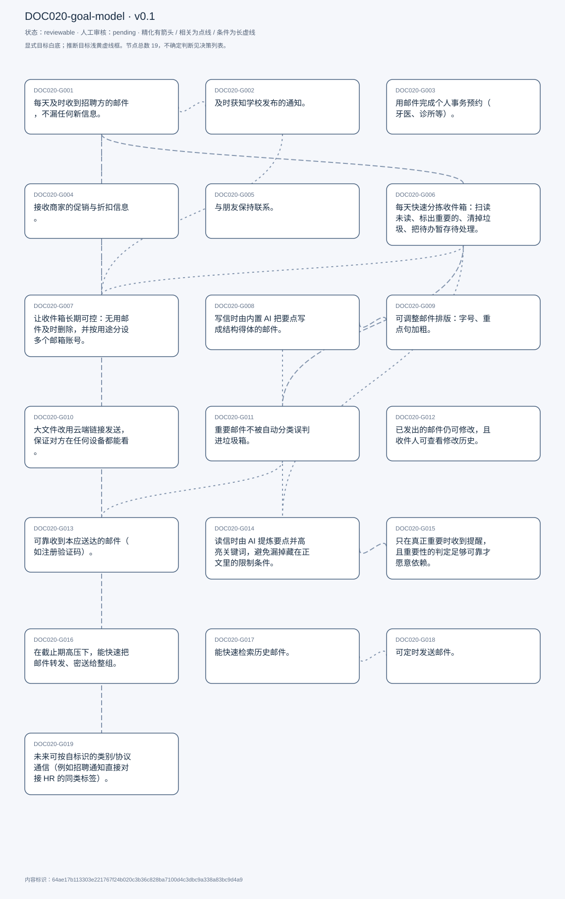
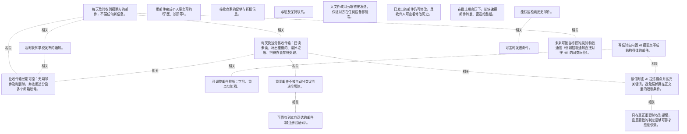

# 目标模型说明

模型：DOC020-goal-model；版本：v0.1

交付状态：reviewable；结构：passed；人工审核：pending

[交互模型](goal-model.html) · [矢量图](goal-model.svg) · [权威数据](goal-model.json)

## 目标图

## 目标

| 编号 | 表述 | 来源 | 情境 | 证据 |
|---|---|---|---|---|
| DOC020-G001 | 每天及时收到招聘方的邮件，不漏任何新信息。 | explicit | 自述为使用邮箱的第一个目标；正在求职，靠邮件接收招聘进展 | E0001, E0002 |
| DOC020-G002 | 及时获知学校发布的通知。 | explicit | 自述为第二个目标 | E0003, E0004 |
| DOC020-G003 | 用邮件完成个人事务预约（牙医、诊所等）。 | explicit | 列举为个人用途之一 | E0005, E0006 |
| DOC020-G004 | 接收商家的促销与折扣信息。 | explicit | 列举为个人用途之一 | E0007, E0008 |
| DOC020-G005 | 与朋友保持联系。 | explicit | 受访者自评这件事「rare」；优先级明显低于求职与学业用途 | E0009 |
| DOC020-G006 | 每天快速分拣收件箱：扫读未读、标出重要的、清掉垃圾、把待办暂存待处理。 | explicit | 自述典型流程：浏览器→Gmail→扫读→标记→删除→细读→打标签留待 | E0010, E0011, E0012 |
| DOC020-G007 | 让收件箱长期可控：无用邮件及时删除，并按用途分设多个邮箱账号。 | explicit | 自述两条策略：删除、分账号（招聘 / 学校 / 优惠） | E0013, E0014, E0015 |
| DOC020-G008 | 写信时由内置 AI 把要点写成结构得体的邮件。 | explicit | 现有做法：先用外部 AI 工具起草再手动调整；期望形态：直接说要点（收件人+问题）就得到成稿 | E0016, E0017, E0018 |
| DOC020-G009 | 可调整邮件排版：字号、重点句加粗。 | explicit | 写信流程的最后一步 | E0019, E0020 |
| DOC020-G010 | 大文件改用云端链接发送，保证对方在任何设备都能看。 | explicit | 自评多媒体附件「didn&#x27;t happen that much」；理由为跨平台可看，而非存储限制 | E0021, E0022 |
| DOC020-G011 | 重要邮件不被自动分类误判进垃圾箱。 | explicit | 自述第一个痛点；取舍偏好：宁可多收垃圾，也不愿漏掉重要邮件 | E0023, E0024 |
| DOC020-G012 | 已发出的邮件仍可修改，且收件人可查看修改历史。 | explicit | 现状：Gmail 只有 3 秒撤回窗口；替代方案：把「撤回」换成「可编辑」 | E0025, E0026, E0027 |
| DOC020-G013 | 可靠收到本应送达的邮件（如注册验证码）。 | explicit | 自述可靠性问题是最大障碍之一；安全/隐私问题他自评「与我关系不大」 | E0028, E0029, E0030 |
| DOC020-G014 | 读信时由 AI 提炼要点并高亮关键词，避免漏掉藏在正文里的限制条件。 | explicit | 动机：每天花大量时间逐封读完；实例：TikTok 测评邮件里「不建议做第二次」那行字被漏掉，白做一次 | E0031, E0032, E0033, E0034, E0035 |
| DOC020-G015 | 只在真正重要时收到提醒，且重要性的判定足够可靠才愿意依赖。 | explicit | 现状：应用没有可靠办法区分重要邮件；态度：宁可不用，也不依赖会漏判的 AI 判定 | E0036, E0037 |
| DOC020-G016 | 在截止期高压下，能快速把邮件转发、密送给整组。 | explicit | 被问「紧 deadline 时最关键的功能」时给出的答案；他理解的协作手段就是转发与密送 | E0038, E0039 |
| DOC020-G017 | 能快速检索历史邮件。 | explicit | 功能排序中列第一；理由：每天都在用 | E0040, E0041 |
| DOC020-G018 | 可定时发送邮件。 | explicit | 功能排序中列第二；他认为按标签筛选可以用检索替代，故排在第三 | E0042 |
| DOC020-G019 | 未来可按自标识的类别/协议通信（例如招聘通知直接对接 HR 的同类标签）。 | explicit | 他对未来的设想之一；自评「probably not that practical」，属设想而非迫切需求 | E0043, E0044 |

## 关系判断（含不确定与无关系）

- DOC020-G001 / DOC020-G002：related。T008 把二者并列为使用邮箱的两个目标，共用同一动作——每天开箱检查；但信息来源与内容完全不同（招聘进展 vs 学校通知），互不可替代。
- DOC020-G001 / DOC020-G003：none。DOC020-G001 的对象是每天及时收招聘邮件不漏信息（T008），DOC020-G003 的对象是用邮件完成个人预约（T010）；两处分别出自不同话题段，原文未在二者之间建立因果、手段、评价或情境包含关系，本次评估口径内未建立可采用关系。
- DOC020-G001 / DOC020-G004：none。DOC020-G001 的对象是每天及时收招聘邮件不漏信息（T008），DOC020-G004 的对象是接收商家促销信息（T010）；两处分别出自不同话题段，原文未在二者之间建立因果、手段、评价或情境包含关系，本次评估口径内未建立可采用关系。
- DOC020-G001 / DOC020-G005：none。DOC020-G001 的对象是每天及时收招聘邮件不漏信息（T008），DOC020-G005 的对象是与朋友保持联系（低频）（T010）；两处分别出自不同话题段，原文未在二者之间建立因果、手段、评价或情境包含关系，本次评估口径内未建立可采用关系。
- DOC020-G001 / DOC020-G006：related。T048 给出因果：因为不想漏掉招聘方的任何一条消息，所以每天开箱 5 次以上；G006 的分拣流程正是这个高频开箱的执行动作。但分拣是手段，不漏招聘信息是目的。
- DOC020-G001 / DOC020-G007：related。T016 说明分账号策略时，第一个例子就是「一个账号专门收招聘」，即用账号隔离保证 G001 的信息不被淹没。但分账号是他现有的组织习惯，不是 G001 的必要条件。
- DOC020-G001 / DOC020-G008：none。DOC020-G001 的对象是每天及时收招聘邮件不漏信息（T008），DOC020-G008 的对象是AI 从要点生成邮件（T018/T036）；两处分别出自不同话题段，原文未在二者之间建立因果、手段、评价或情境包含关系，本次评估口径内未建立可采用关系。
- DOC020-G001 / DOC020-G009：none。DOC020-G001 的对象是每天及时收招聘邮件不漏信息（T008），DOC020-G009 的对象是控制排版（字号/加粗）（T020）；两处分别出自不同话题段，原文未在二者之间建立因果、手段、评价或情境包含关系，本次评估口径内未建立可采用关系。
- DOC020-G001 / DOC020-G010：none。DOC020-G001 的对象是每天及时收招聘邮件不漏信息（T008），DOC020-G010 的对象是大文件走云链接（T022）；两处分别出自不同话题段，原文未在二者之间建立因果、手段、评价或情境包含关系，本次评估口径内未建立可采用关系。
- DOC020-G001 / DOC020-G011：none。DOC020-G001 的对象是每天及时收招聘邮件不漏信息（T008），DOC020-G011 的对象是重要邮件不被误判垃圾（T024/T026）；两处分别出自不同话题段，原文未在二者之间建立因果、手段、评价或情境包含关系，本次评估口径内未建立可采用关系。
- DOC020-G001 / DOC020-G012：none。DOC020-G001 的对象是每天及时收招聘邮件不漏信息（T008），DOC020-G012 的对象是已发邮件可编辑留历史（T028）；两处分别出自不同话题段，原文未在二者之间建立因果、手段、评价或情境包含关系，本次评估口径内未建立可采用关系。
- DOC020-G001 / DOC020-G013：none。DOC020-G001 的对象是每天及时收招聘邮件不漏信息（T008），DOC020-G013 的对象是可靠收到应达邮件（T032/T034）；两处分别出自不同话题段，原文未在二者之间建立因果、手段、评价或情境包含关系，本次评估口径内未建立可采用关系。
- DOC020-G001 / DOC020-G014：none。DOC020-G001 的对象是每天及时收招聘邮件不漏信息（T008），DOC020-G014 的对象是AI 摘要与关键词高亮（T040/T044/T046）；两处分别出自不同话题段，原文未在二者之间建立因果、手段、评价或情境包含关系，本次评估口径内未建立可采用关系。
- DOC020-G001 / DOC020-G015：none。DOC020-G001 的对象是每天及时收招聘邮件不漏信息（T008），DOC020-G015 的对象是仅在重要时提醒且判定可靠（T058）；两处分别出自不同话题段，原文未在二者之间建立因果、手段、评价或情境包含关系，本次评估口径内未建立可采用关系。
- DOC020-G001 / DOC020-G016：none。DOC020-G001 的对象是每天及时收招聘邮件不漏信息（T008），DOC020-G016 的对象是高压下转发/密送全组（T070/T072）；两处分别出自不同话题段，原文未在二者之间建立因果、手段、评价或情境包含关系，本次评估口径内未建立可采用关系。
- DOC020-G001 / DOC020-G017：none。DOC020-G001 的对象是每天及时收招聘邮件不漏信息（T008），DOC020-G017 的对象是快速检索历史邮件（T086）；两处分别出自不同话题段，原文未在二者之间建立因果、手段、评价或情境包含关系，本次评估口径内未建立可采用关系。
- DOC020-G001 / DOC020-G018：none。DOC020-G001 的对象是每天及时收招聘邮件不漏信息（T008），DOC020-G018 的对象是可定时发送（T086）；两处分别出自不同话题段，原文未在二者之间建立因果、手段、评价或情境包含关系，本次评估口径内未建立可采用关系。
- DOC020-G001 / DOC020-G019：related。T092 讲类别/协议通信时，举的第一个例子就是「给招聘通知设一个标签类别，HR 也设同一个」——即把 G001 的招聘往来升级成结构化通道。但 G019 是远景设想，G001 现在靠普通邮件即可满足。
- DOC020-G002 / DOC020-G003：none。DOC020-G002 的对象是及时获知学校通知（T008），DOC020-G003 的对象是用邮件完成个人预约（T010）；两处分别出自不同话题段，原文未在二者之间建立因果、手段、评价或情境包含关系，本次评估口径内未建立可采用关系。
- DOC020-G002 / DOC020-G004：none。DOC020-G002 的对象是及时获知学校通知（T008），DOC020-G004 的对象是接收商家促销信息（T010）；两处分别出自不同话题段，原文未在二者之间建立因果、手段、评价或情境包含关系，本次评估口径内未建立可采用关系。
- DOC020-G002 / DOC020-G005：none。DOC020-G002 的对象是及时获知学校通知（T008），DOC020-G005 的对象是与朋友保持联系（低频）（T010）；两处分别出自不同话题段，原文未在二者之间建立因果、手段、评价或情境包含关系，本次评估口径内未建立可采用关系。
- DOC020-G002 / DOC020-G006：none。DOC020-G002 的对象是及时获知学校通知（T008），DOC020-G006 的对象是每日快速分拣收件箱（T014）；两处分别出自不同话题段，原文未在二者之间建立因果、手段、评价或情境包含关系，本次评估口径内未建立可采用关系。
- DOC020-G002 / DOC020-G007：related。T016 同样把学校通知单列一个账号，理由与 G001 一致：重要来源单独隔离，避免与促销邮件混在一起。
- DOC020-G002 / DOC020-G008：none。DOC020-G002 的对象是及时获知学校通知（T008），DOC020-G008 的对象是AI 从要点生成邮件（T018/T036）；两处分别出自不同话题段，原文未在二者之间建立因果、手段、评价或情境包含关系，本次评估口径内未建立可采用关系。
- DOC020-G002 / DOC020-G009：none。DOC020-G002 的对象是及时获知学校通知（T008），DOC020-G009 的对象是控制排版（字号/加粗）（T020）；两处分别出自不同话题段，原文未在二者之间建立因果、手段、评价或情境包含关系，本次评估口径内未建立可采用关系。
- DOC020-G002 / DOC020-G010：none。DOC020-G002 的对象是及时获知学校通知（T008），DOC020-G010 的对象是大文件走云链接（T022）；两处分别出自不同话题段，原文未在二者之间建立因果、手段、评价或情境包含关系，本次评估口径内未建立可采用关系。
- DOC020-G002 / DOC020-G011：none。DOC020-G002 的对象是及时获知学校通知（T008），DOC020-G011 的对象是重要邮件不被误判垃圾（T024/T026）；两处分别出自不同话题段，原文未在二者之间建立因果、手段、评价或情境包含关系，本次评估口径内未建立可采用关系。
- DOC020-G002 / DOC020-G012：none。DOC020-G002 的对象是及时获知学校通知（T008），DOC020-G012 的对象是已发邮件可编辑留历史（T028）；两处分别出自不同话题段，原文未在二者之间建立因果、手段、评价或情境包含关系，本次评估口径内未建立可采用关系。
- DOC020-G002 / DOC020-G013：none。DOC020-G002 的对象是及时获知学校通知（T008），DOC020-G013 的对象是可靠收到应达邮件（T032/T034）；两处分别出自不同话题段，原文未在二者之间建立因果、手段、评价或情境包含关系，本次评估口径内未建立可采用关系。
- DOC020-G002 / DOC020-G014：none。DOC020-G002 的对象是及时获知学校通知（T008），DOC020-G014 的对象是AI 摘要与关键词高亮（T040/T044/T046）；两处分别出自不同话题段，原文未在二者之间建立因果、手段、评价或情境包含关系，本次评估口径内未建立可采用关系。
- DOC020-G002 / DOC020-G015：none。DOC020-G002 的对象是及时获知学校通知（T008），DOC020-G015 的对象是仅在重要时提醒且判定可靠（T058）；两处分别出自不同话题段，原文未在二者之间建立因果、手段、评价或情境包含关系，本次评估口径内未建立可采用关系。
- DOC020-G002 / DOC020-G016：none。DOC020-G002 的对象是及时获知学校通知（T008），DOC020-G016 的对象是高压下转发/密送全组（T070/T072）；两处分别出自不同话题段，原文未在二者之间建立因果、手段、评价或情境包含关系，本次评估口径内未建立可采用关系。
- DOC020-G002 / DOC020-G017：none。DOC020-G002 的对象是及时获知学校通知（T008），DOC020-G017 的对象是快速检索历史邮件（T086）；两处分别出自不同话题段，原文未在二者之间建立因果、手段、评价或情境包含关系，本次评估口径内未建立可采用关系。
- DOC020-G002 / DOC020-G018：none。DOC020-G002 的对象是及时获知学校通知（T008），DOC020-G018 的对象是可定时发送（T086）；两处分别出自不同话题段，原文未在二者之间建立因果、手段、评价或情境包含关系，本次评估口径内未建立可采用关系。
- DOC020-G002 / DOC020-G019：none。DOC020-G002 的对象是及时获知学校通知（T008），DOC020-G019 的对象是按类别协议跨组织通信（T092）；两处分别出自不同话题段，原文未在二者之间建立因果、手段、评价或情境包含关系，本次评估口径内未建立可采用关系。
- DOC020-G003 / DOC020-G004：none。DOC020-G003 的对象是用邮件完成个人预约（T010），DOC020-G004 的对象是接收商家促销信息（T010）；两处分别出自不同话题段，原文未在二者之间建立因果、手段、评价或情境包含关系，本次评估口径内未建立可采用关系。
- DOC020-G003 / DOC020-G005：none。DOC020-G003 的对象是用邮件完成个人预约（T010），DOC020-G005 的对象是与朋友保持联系（低频）（T010）；两处分别出自不同话题段，原文未在二者之间建立因果、手段、评价或情境包含关系，本次评估口径内未建立可采用关系。
- DOC020-G003 / DOC020-G006：none。DOC020-G003 的对象是用邮件完成个人预约（T010），DOC020-G006 的对象是每日快速分拣收件箱（T014）；两处分别出自不同话题段，原文未在二者之间建立因果、手段、评价或情境包含关系，本次评估口径内未建立可采用关系。
- DOC020-G003 / DOC020-G007：none。DOC020-G003 的对象是用邮件完成个人预约（T010），DOC020-G007 的对象是收件箱长期可控（删除+分账号）（T016）；两处分别出自不同话题段，原文未在二者之间建立因果、手段、评价或情境包含关系，本次评估口径内未建立可采用关系。
- DOC020-G003 / DOC020-G008：none。DOC020-G003 的对象是用邮件完成个人预约（T010），DOC020-G008 的对象是AI 从要点生成邮件（T018/T036）；两处分别出自不同话题段，原文未在二者之间建立因果、手段、评价或情境包含关系，本次评估口径内未建立可采用关系。
- DOC020-G003 / DOC020-G009：none。DOC020-G003 的对象是用邮件完成个人预约（T010），DOC020-G009 的对象是控制排版（字号/加粗）（T020）；两处分别出自不同话题段，原文未在二者之间建立因果、手段、评价或情境包含关系，本次评估口径内未建立可采用关系。
- DOC020-G003 / DOC020-G010：none。DOC020-G003 的对象是用邮件完成个人预约（T010），DOC020-G010 的对象是大文件走云链接（T022）；两处分别出自不同话题段，原文未在二者之间建立因果、手段、评价或情境包含关系，本次评估口径内未建立可采用关系。
- DOC020-G003 / DOC020-G011：none。DOC020-G003 的对象是用邮件完成个人预约（T010），DOC020-G011 的对象是重要邮件不被误判垃圾（T024/T026）；两处分别出自不同话题段，原文未在二者之间建立因果、手段、评价或情境包含关系，本次评估口径内未建立可采用关系。
- DOC020-G003 / DOC020-G012：none。DOC020-G003 的对象是用邮件完成个人预约（T010），DOC020-G012 的对象是已发邮件可编辑留历史（T028）；两处分别出自不同话题段，原文未在二者之间建立因果、手段、评价或情境包含关系，本次评估口径内未建立可采用关系。
- DOC020-G003 / DOC020-G013：none。DOC020-G003 的对象是用邮件完成个人预约（T010），DOC020-G013 的对象是可靠收到应达邮件（T032/T034）；两处分别出自不同话题段，原文未在二者之间建立因果、手段、评价或情境包含关系，本次评估口径内未建立可采用关系。
- DOC020-G003 / DOC020-G014：none。DOC020-G003 的对象是用邮件完成个人预约（T010），DOC020-G014 的对象是AI 摘要与关键词高亮（T040/T044/T046）；两处分别出自不同话题段，原文未在二者之间建立因果、手段、评价或情境包含关系，本次评估口径内未建立可采用关系。
- DOC020-G003 / DOC020-G015：none。DOC020-G003 的对象是用邮件完成个人预约（T010），DOC020-G015 的对象是仅在重要时提醒且判定可靠（T058）；两处分别出自不同话题段，原文未在二者之间建立因果、手段、评价或情境包含关系，本次评估口径内未建立可采用关系。
- DOC020-G003 / DOC020-G016：none。DOC020-G003 的对象是用邮件完成个人预约（T010），DOC020-G016 的对象是高压下转发/密送全组（T070/T072）；两处分别出自不同话题段，原文未在二者之间建立因果、手段、评价或情境包含关系，本次评估口径内未建立可采用关系。
- DOC020-G003 / DOC020-G017：none。DOC020-G003 的对象是用邮件完成个人预约（T010），DOC020-G017 的对象是快速检索历史邮件（T086）；两处分别出自不同话题段，原文未在二者之间建立因果、手段、评价或情境包含关系，本次评估口径内未建立可采用关系。
- DOC020-G003 / DOC020-G018：none。DOC020-G003 的对象是用邮件完成个人预约（T010），DOC020-G018 的对象是可定时发送（T086）；两处分别出自不同话题段，原文未在二者之间建立因果、手段、评价或情境包含关系，本次评估口径内未建立可采用关系。
- DOC020-G003 / DOC020-G019：none。DOC020-G003 的对象是用邮件完成个人预约（T010），DOC020-G019 的对象是按类别协议跨组织通信（T092）；两处分别出自不同话题段，原文未在二者之间建立因果、手段、评价或情境包含关系，本次评估口径内未建立可采用关系。
- DOC020-G004 / DOC020-G005：none。DOC020-G004 的对象是接收商家促销信息（T010），DOC020-G005 的对象是与朋友保持联系（低频）（T010）；两处分别出自不同话题段，原文未在二者之间建立因果、手段、评价或情境包含关系，本次评估口径内未建立可采用关系。
- DOC020-G004 / DOC020-G006：none。DOC020-G004 的对象是接收商家促销信息（T010），DOC020-G006 的对象是每日快速分拣收件箱（T014）；两处分别出自不同话题段，原文未在二者之间建立因果、手段、评价或情境包含关系，本次评估口径内未建立可采用关系。
- DOC020-G004 / DOC020-G007：none。DOC020-G004 的对象是接收商家促销信息（T010），DOC020-G007 的对象是收件箱长期可控（删除+分账号）（T016）；两处分别出自不同话题段，原文未在二者之间建立因果、手段、评价或情境包含关系，本次评估口径内未建立可采用关系。
- DOC020-G004 / DOC020-G008：none。DOC020-G004 的对象是接收商家促销信息（T010），DOC020-G008 的对象是AI 从要点生成邮件（T018/T036）；两处分别出自不同话题段，原文未在二者之间建立因果、手段、评价或情境包含关系，本次评估口径内未建立可采用关系。
- DOC020-G004 / DOC020-G009：none。DOC020-G004 的对象是接收商家促销信息（T010），DOC020-G009 的对象是控制排版（字号/加粗）（T020）；两处分别出自不同话题段，原文未在二者之间建立因果、手段、评价或情境包含关系，本次评估口径内未建立可采用关系。
- DOC020-G004 / DOC020-G010：none。DOC020-G004 的对象是接收商家促销信息（T010），DOC020-G010 的对象是大文件走云链接（T022）；两处分别出自不同话题段，原文未在二者之间建立因果、手段、评价或情境包含关系，本次评估口径内未建立可采用关系。
- DOC020-G004 / DOC020-G011：none。DOC020-G004 的对象是接收商家促销信息（T010），DOC020-G011 的对象是重要邮件不被误判垃圾（T024/T026）；两处分别出自不同话题段，原文未在二者之间建立因果、手段、评价或情境包含关系，本次评估口径内未建立可采用关系。
- DOC020-G004 / DOC020-G012：none。DOC020-G004 的对象是接收商家促销信息（T010），DOC020-G012 的对象是已发邮件可编辑留历史（T028）；两处分别出自不同话题段，原文未在二者之间建立因果、手段、评价或情境包含关系，本次评估口径内未建立可采用关系。
- DOC020-G004 / DOC020-G013：none。DOC020-G004 的对象是接收商家促销信息（T010），DOC020-G013 的对象是可靠收到应达邮件（T032/T034）；两处分别出自不同话题段，原文未在二者之间建立因果、手段、评价或情境包含关系，本次评估口径内未建立可采用关系。
- DOC020-G004 / DOC020-G014：none。DOC020-G004 的对象是接收商家促销信息（T010），DOC020-G014 的对象是AI 摘要与关键词高亮（T040/T044/T046）；两处分别出自不同话题段，原文未在二者之间建立因果、手段、评价或情境包含关系，本次评估口径内未建立可采用关系。
- DOC020-G004 / DOC020-G015：none。DOC020-G004 的对象是接收商家促销信息（T010），DOC020-G015 的对象是仅在重要时提醒且判定可靠（T058）；两处分别出自不同话题段，原文未在二者之间建立因果、手段、评价或情境包含关系，本次评估口径内未建立可采用关系。
- DOC020-G004 / DOC020-G016：none。DOC020-G004 的对象是接收商家促销信息（T010），DOC020-G016 的对象是高压下转发/密送全组（T070/T072）；两处分别出自不同话题段，原文未在二者之间建立因果、手段、评价或情境包含关系，本次评估口径内未建立可采用关系。
- DOC020-G004 / DOC020-G017：none。DOC020-G004 的对象是接收商家促销信息（T010），DOC020-G017 的对象是快速检索历史邮件（T086）；两处分别出自不同话题段，原文未在二者之间建立因果、手段、评价或情境包含关系，本次评估口径内未建立可采用关系。
- DOC020-G004 / DOC020-G018：none。DOC020-G004 的对象是接收商家促销信息（T010），DOC020-G018 的对象是可定时发送（T086）；两处分别出自不同话题段，原文未在二者之间建立因果、手段、评价或情境包含关系，本次评估口径内未建立可采用关系。
- DOC020-G004 / DOC020-G019：none。DOC020-G004 的对象是接收商家促销信息（T010），DOC020-G019 的对象是按类别协议跨组织通信（T092）；两处分别出自不同话题段，原文未在二者之间建立因果、手段、评价或情境包含关系，本次评估口径内未建立可采用关系。
- DOC020-G005 / DOC020-G006：none。DOC020-G005 的对象是与朋友保持联系（低频）（T010），DOC020-G006 的对象是每日快速分拣收件箱（T014）；两处分别出自不同话题段，原文未在二者之间建立因果、手段、评价或情境包含关系，本次评估口径内未建立可采用关系。
- DOC020-G005 / DOC020-G007：none。DOC020-G005 的对象是与朋友保持联系（低频）（T010），DOC020-G007 的对象是收件箱长期可控（删除+分账号）（T016）；两处分别出自不同话题段，原文未在二者之间建立因果、手段、评价或情境包含关系，本次评估口径内未建立可采用关系。
- DOC020-G005 / DOC020-G008：none。DOC020-G005 的对象是与朋友保持联系（低频）（T010），DOC020-G008 的对象是AI 从要点生成邮件（T018/T036）；两处分别出自不同话题段，原文未在二者之间建立因果、手段、评价或情境包含关系，本次评估口径内未建立可采用关系。
- DOC020-G005 / DOC020-G009：none。DOC020-G005 的对象是与朋友保持联系（低频）（T010），DOC020-G009 的对象是控制排版（字号/加粗）（T020）；两处分别出自不同话题段，原文未在二者之间建立因果、手段、评价或情境包含关系，本次评估口径内未建立可采用关系。
- DOC020-G005 / DOC020-G010：none。DOC020-G005 的对象是与朋友保持联系（低频）（T010），DOC020-G010 的对象是大文件走云链接（T022）；两处分别出自不同话题段，原文未在二者之间建立因果、手段、评价或情境包含关系，本次评估口径内未建立可采用关系。
- DOC020-G005 / DOC020-G011：none。DOC020-G005 的对象是与朋友保持联系（低频）（T010），DOC020-G011 的对象是重要邮件不被误判垃圾（T024/T026）；两处分别出自不同话题段，原文未在二者之间建立因果、手段、评价或情境包含关系，本次评估口径内未建立可采用关系。
- DOC020-G005 / DOC020-G012：none。DOC020-G005 的对象是与朋友保持联系（低频）（T010），DOC020-G012 的对象是已发邮件可编辑留历史（T028）；两处分别出自不同话题段，原文未在二者之间建立因果、手段、评价或情境包含关系，本次评估口径内未建立可采用关系。
- DOC020-G005 / DOC020-G013：none。DOC020-G005 的对象是与朋友保持联系（低频）（T010），DOC020-G013 的对象是可靠收到应达邮件（T032/T034）；两处分别出自不同话题段，原文未在二者之间建立因果、手段、评价或情境包含关系，本次评估口径内未建立可采用关系。
- DOC020-G005 / DOC020-G014：none。DOC020-G005 的对象是与朋友保持联系（低频）（T010），DOC020-G014 的对象是AI 摘要与关键词高亮（T040/T044/T046）；两处分别出自不同话题段，原文未在二者之间建立因果、手段、评价或情境包含关系，本次评估口径内未建立可采用关系。
- DOC020-G005 / DOC020-G015：none。DOC020-G005 的对象是与朋友保持联系（低频）（T010），DOC020-G015 的对象是仅在重要时提醒且判定可靠（T058）；两处分别出自不同话题段，原文未在二者之间建立因果、手段、评价或情境包含关系，本次评估口径内未建立可采用关系。
- DOC020-G005 / DOC020-G016：none。DOC020-G005 的对象是与朋友保持联系（低频）（T010），DOC020-G016 的对象是高压下转发/密送全组（T070/T072）；两处分别出自不同话题段，原文未在二者之间建立因果、手段、评价或情境包含关系，本次评估口径内未建立可采用关系。
- DOC020-G005 / DOC020-G017：none。DOC020-G005 的对象是与朋友保持联系（低频）（T010），DOC020-G017 的对象是快速检索历史邮件（T086）；两处分别出自不同话题段，原文未在二者之间建立因果、手段、评价或情境包含关系，本次评估口径内未建立可采用关系。
- DOC020-G005 / DOC020-G018：none。DOC020-G005 的对象是与朋友保持联系（低频）（T010），DOC020-G018 的对象是可定时发送（T086）；两处分别出自不同话题段，原文未在二者之间建立因果、手段、评价或情境包含关系，本次评估口径内未建立可采用关系。
- DOC020-G005 / DOC020-G019：none。DOC020-G005 的对象是与朋友保持联系（低频）（T010），DOC020-G019 的对象是按类别协议跨组织通信（T092）；两处分别出自不同话题段，原文未在二者之间建立因果、手段、评价或情境包含关系，本次评估口径内未建立可采用关系。
- DOC020-G006 / DOC020-G007：related。T016 开头就是「as I said, I would delete those mails」——把 T014 分拣里的删除动作，扩展成日常清理策略；两者一个管单次过筛、一个管长期整洁。
- DOC020-G006 / DOC020-G008：none。DOC020-G006 的对象是每日快速分拣收件箱（T014），DOC020-G008 的对象是AI 从要点生成邮件（T018/T036）；两处分别出自不同话题段，原文未在二者之间建立因果、手段、评价或情境包含关系，本次评估口径内未建立可采用关系。
- DOC020-G006 / DOC020-G009：none。DOC020-G006 的对象是每日快速分拣收件箱（T014），DOC020-G009 的对象是控制排版（字号/加粗）（T020）；两处分别出自不同话题段，原文未在二者之间建立因果、手段、评价或情境包含关系，本次评估口径内未建立可采用关系。
- DOC020-G006 / DOC020-G010：none。DOC020-G006 的对象是每日快速分拣收件箱（T014），DOC020-G010 的对象是大文件走云链接（T022）；两处分别出自不同话题段，原文未在二者之间建立因果、手段、评价或情境包含关系，本次评估口径内未建立可采用关系。
- DOC020-G006 / DOC020-G011：related。T014 的分拣流程里「trash or spam 就直接删」这一步，依赖垃圾判定可信；T024 指出重要邮件会被判进垃圾箱，等于让分拣在第一步就丢掉该留的信。但一个是流程、一个是判定质量，分拣本身不解决误判。
- DOC020-G006 / DOC020-G012：none。DOC020-G006 的对象是每日快速分拣收件箱（T014），DOC020-G012 的对象是已发邮件可编辑留历史（T028）；两处分别出自不同话题段，原文未在二者之间建立因果、手段、评价或情境包含关系，本次评估口径内未建立可采用关系。
- DOC020-G006 / DOC020-G013：none。DOC020-G006 的对象是每日快速分拣收件箱（T014），DOC020-G013 的对象是可靠收到应达邮件（T032/T034）；两处分别出自不同话题段，原文未在二者之间建立因果、手段、评价或情境包含关系，本次评估口径内未建立可采用关系。
- DOC020-G006 / DOC020-G014：related。T052 说简化日常的办法是别让他逐封读完，T014 的流程恰恰是逐封扫读；AI 摘要正是替掉这一步。但摘要只压缩阅读量，不替代标记与待办暂存。
- DOC020-G006 / DOC020-G015：none。DOC020-G006 的对象是每日快速分拣收件箱（T014），DOC020-G015 的对象是仅在重要时提醒且判定可靠（T058）；两处分别出自不同话题段，原文未在二者之间建立因果、手段、评价或情境包含关系，本次评估口径内未建立可采用关系。
- DOC020-G006 / DOC020-G016：none。DOC020-G006 的对象是每日快速分拣收件箱（T014），DOC020-G016 的对象是高压下转发/密送全组（T070/T072）；两处分别出自不同话题段，原文未在二者之间建立因果、手段、评价或情境包含关系，本次评估口径内未建立可采用关系。
- DOC020-G006 / DOC020-G017：none。DOC020-G006 的对象是每日快速分拣收件箱（T014），DOC020-G017 的对象是快速检索历史邮件（T086）；两处分别出自不同话题段，原文未在二者之间建立因果、手段、评价或情境包含关系，本次评估口径内未建立可采用关系。
- DOC020-G006 / DOC020-G018：none。DOC020-G006 的对象是每日快速分拣收件箱（T014），DOC020-G018 的对象是可定时发送（T086）；两处分别出自不同话题段，原文未在二者之间建立因果、手段、评价或情境包含关系，本次评估口径内未建立可采用关系。
- DOC020-G006 / DOC020-G019：none。DOC020-G006 的对象是每日快速分拣收件箱（T014），DOC020-G019 的对象是按类别协议跨组织通信（T092）；两处分别出自不同话题段，原文未在二者之间建立因果、手段、评价或情境包含关系，本次评估口径内未建立可采用关系。
- DOC020-G007 / DOC020-G008：none。DOC020-G007 的对象是收件箱长期可控（删除+分账号）（T016），DOC020-G008 的对象是AI 从要点生成邮件（T018/T036）；两处分别出自不同话题段，原文未在二者之间建立因果、手段、评价或情境包含关系，本次评估口径内未建立可采用关系。
- DOC020-G007 / DOC020-G009：none。DOC020-G007 的对象是收件箱长期可控（删除+分账号）（T016），DOC020-G009 的对象是控制排版（字号/加粗）（T020）；两处分别出自不同话题段，原文未在二者之间建立因果、手段、评价或情境包含关系，本次评估口径内未建立可采用关系。
- DOC020-G007 / DOC020-G010：none。DOC020-G007 的对象是收件箱长期可控（删除+分账号）（T016），DOC020-G010 的对象是大文件走云链接（T022）；两处分别出自不同话题段，原文未在二者之间建立因果、手段、评价或情境包含关系，本次评估口径内未建立可采用关系。
- DOC020-G007 / DOC020-G011：none。DOC020-G007 的对象是收件箱长期可控（删除+分账号）（T016），DOC020-G011 的对象是重要邮件不被误判垃圾（T024/T026）；两处分别出自不同话题段，原文未在二者之间建立因果、手段、评价或情境包含关系，本次评估口径内未建立可采用关系。
- DOC020-G007 / DOC020-G012：none。DOC020-G007 的对象是收件箱长期可控（删除+分账号）（T016），DOC020-G012 的对象是已发邮件可编辑留历史（T028）；两处分别出自不同话题段，原文未在二者之间建立因果、手段、评价或情境包含关系，本次评估口径内未建立可采用关系。
- DOC020-G007 / DOC020-G013：none。DOC020-G007 的对象是收件箱长期可控（删除+分账号）（T016），DOC020-G013 的对象是可靠收到应达邮件（T032/T034）；两处分别出自不同话题段，原文未在二者之间建立因果、手段、评价或情境包含关系，本次评估口径内未建立可采用关系。
- DOC020-G007 / DOC020-G014：none。DOC020-G007 的对象是收件箱长期可控（删除+分账号）（T016），DOC020-G014 的对象是AI 摘要与关键词高亮（T040/T044/T046）；两处分别出自不同话题段，原文未在二者之间建立因果、手段、评价或情境包含关系，本次评估口径内未建立可采用关系。
- DOC020-G007 / DOC020-G015：none。DOC020-G007 的对象是收件箱长期可控（删除+分账号）（T016），DOC020-G015 的对象是仅在重要时提醒且判定可靠（T058）；两处分别出自不同话题段，原文未在二者之间建立因果、手段、评价或情境包含关系，本次评估口径内未建立可采用关系。
- DOC020-G007 / DOC020-G016：none。DOC020-G007 的对象是收件箱长期可控（删除+分账号）（T016），DOC020-G016 的对象是高压下转发/密送全组（T070/T072）；两处分别出自不同话题段，原文未在二者之间建立因果、手段、评价或情境包含关系，本次评估口径内未建立可采用关系。
- DOC020-G007 / DOC020-G017：none。DOC020-G007 的对象是收件箱长期可控（删除+分账号）（T016），DOC020-G017 的对象是快速检索历史邮件（T086）；两处分别出自不同话题段，原文未在二者之间建立因果、手段、评价或情境包含关系，本次评估口径内未建立可采用关系。
- DOC020-G007 / DOC020-G018：none。DOC020-G007 的对象是收件箱长期可控（删除+分账号）（T016），DOC020-G018 的对象是可定时发送（T086）；两处分别出自不同话题段，原文未在二者之间建立因果、手段、评价或情境包含关系，本次评估口径内未建立可采用关系。
- DOC020-G007 / DOC020-G019：none。DOC020-G007 的对象是收件箱长期可控（删除+分账号）（T016），DOC020-G019 的对象是按类别协议跨组织通信（T092）；两处分别出自不同话题段，原文未在二者之间建立因果、手段、评价或情境包含关系，本次评估口径内未建立可采用关系。
- DOC020-G008 / DOC020-G009：related。T018 与 T020 是连续两轮：先用 AI 起草、再手动调字号与加粗，属同一次写信动作的前后两步。但排版是他自己的偏好，与 AI 无关。
- DOC020-G008 / DOC020-G010：none。DOC020-G008 的对象是AI 从要点生成邮件（T018/T036），DOC020-G010 的对象是大文件走云链接（T022）；两处分别出自不同话题段，原文未在二者之间建立因果、手段、评价或情境包含关系，本次评估口径内未建立可采用关系。
- DOC020-G008 / DOC020-G011：none。DOC020-G008 的对象是AI 从要点生成邮件（T018/T036），DOC020-G011 的对象是重要邮件不被误判垃圾（T024/T026）；两处分别出自不同话题段，原文未在二者之间建立因果、手段、评价或情境包含关系，本次评估口径内未建立可采用关系。
- DOC020-G008 / DOC020-G012：none。DOC020-G008 的对象是AI 从要点生成邮件（T018/T036），DOC020-G012 的对象是已发邮件可编辑留历史（T028）；两处分别出自不同话题段，原文未在二者之间建立因果、手段、评价或情境包含关系，本次评估口径内未建立可采用关系。
- DOC020-G008 / DOC020-G013：none。DOC020-G008 的对象是AI 从要点生成邮件（T018/T036），DOC020-G013 的对象是可靠收到应达邮件（T032/T034）；两处分别出自不同话题段，原文未在二者之间建立因果、手段、评价或情境包含关系，本次评估口径内未建立可采用关系。
- DOC020-G008 / DOC020-G014：related。T090 把二者一并提出：「embed some AI assistant to help us read and write emails」——写对应 G008、读对应 G014；是同一 AI 助手的两个方向，但输入输出完全不同。
- DOC020-G008 / DOC020-G015：none。DOC020-G008 的对象是AI 从要点生成邮件（T018/T036），DOC020-G015 的对象是仅在重要时提醒且判定可靠（T058）；两处分别出自不同话题段，原文未在二者之间建立因果、手段、评价或情境包含关系，本次评估口径内未建立可采用关系。
- DOC020-G008 / DOC020-G016：none。DOC020-G008 的对象是AI 从要点生成邮件（T018/T036），DOC020-G016 的对象是高压下转发/密送全组（T070/T072）；两处分别出自不同话题段，原文未在二者之间建立因果、手段、评价或情境包含关系，本次评估口径内未建立可采用关系。
- DOC020-G008 / DOC020-G017：none。DOC020-G008 的对象是AI 从要点生成邮件（T018/T036），DOC020-G017 的对象是快速检索历史邮件（T086）；两处分别出自不同话题段，原文未在二者之间建立因果、手段、评价或情境包含关系，本次评估口径内未建立可采用关系。
- DOC020-G008 / DOC020-G018：none。DOC020-G008 的对象是AI 从要点生成邮件（T018/T036），DOC020-G018 的对象是可定时发送（T086）；两处分别出自不同话题段，原文未在二者之间建立因果、手段、评价或情境包含关系，本次评估口径内未建立可采用关系。
- DOC020-G008 / DOC020-G019：none。DOC020-G008 的对象是AI 从要点生成邮件（T018/T036），DOC020-G019 的对象是按类别协议跨组织通信（T092）；两处分别出自不同话题段，原文未在二者之间建立因果、手段、评价或情境包含关系，本次评估口径内未建立可采用关系。
- DOC020-G009 / DOC020-G010：none。DOC020-G009 的对象是控制排版（字号/加粗）（T020），DOC020-G010 的对象是大文件走云链接（T022）；两处分别出自不同话题段，原文未在二者之间建立因果、手段、评价或情境包含关系，本次评估口径内未建立可采用关系。
- DOC020-G009 / DOC020-G011：none。DOC020-G009 的对象是控制排版（字号/加粗）（T020），DOC020-G011 的对象是重要邮件不被误判垃圾（T024/T026）；两处分别出自不同话题段，原文未在二者之间建立因果、手段、评价或情境包含关系，本次评估口径内未建立可采用关系。
- DOC020-G009 / DOC020-G012：none。DOC020-G009 的对象是控制排版（字号/加粗）（T020），DOC020-G012 的对象是已发邮件可编辑留历史（T028）；两处分别出自不同话题段，原文未在二者之间建立因果、手段、评价或情境包含关系，本次评估口径内未建立可采用关系。
- DOC020-G009 / DOC020-G013：none。DOC020-G009 的对象是控制排版（字号/加粗）（T020），DOC020-G013 的对象是可靠收到应达邮件（T032/T034）；两处分别出自不同话题段，原文未在二者之间建立因果、手段、评价或情境包含关系，本次评估口径内未建立可采用关系。
- DOC020-G009 / DOC020-G014：none。DOC020-G009 的对象是控制排版（字号/加粗）（T020），DOC020-G014 的对象是AI 摘要与关键词高亮（T040/T044/T046）；两处分别出自不同话题段，原文未在二者之间建立因果、手段、评价或情境包含关系，本次评估口径内未建立可采用关系。
- DOC020-G009 / DOC020-G015：none。DOC020-G009 的对象是控制排版（字号/加粗）（T020），DOC020-G015 的对象是仅在重要时提醒且判定可靠（T058）；两处分别出自不同话题段，原文未在二者之间建立因果、手段、评价或情境包含关系，本次评估口径内未建立可采用关系。
- DOC020-G009 / DOC020-G016：none。DOC020-G009 的对象是控制排版（字号/加粗）（T020），DOC020-G016 的对象是高压下转发/密送全组（T070/T072）；两处分别出自不同话题段，原文未在二者之间建立因果、手段、评价或情境包含关系，本次评估口径内未建立可采用关系。
- DOC020-G009 / DOC020-G017：none。DOC020-G009 的对象是控制排版（字号/加粗）（T020），DOC020-G017 的对象是快速检索历史邮件（T086）；两处分别出自不同话题段，原文未在二者之间建立因果、手段、评价或情境包含关系，本次评估口径内未建立可采用关系。
- DOC020-G009 / DOC020-G018：none。DOC020-G009 的对象是控制排版（字号/加粗）（T020），DOC020-G018 的对象是可定时发送（T086）；两处分别出自不同话题段，原文未在二者之间建立因果、手段、评价或情境包含关系，本次评估口径内未建立可采用关系。
- DOC020-G009 / DOC020-G019：none。DOC020-G009 的对象是控制排版（字号/加粗）（T020），DOC020-G019 的对象是按类别协议跨组织通信（T092）；两处分别出自不同话题段，原文未在二者之间建立因果、手段、评价或情境包含关系，本次评估口径内未建立可采用关系。
- DOC020-G010 / DOC020-G011：none。DOC020-G010 的对象是大文件走云链接（T022），DOC020-G011 的对象是重要邮件不被误判垃圾（T024/T026）；两处分别出自不同话题段，原文未在二者之间建立因果、手段、评价或情境包含关系，本次评估口径内未建立可采用关系。
- DOC020-G010 / DOC020-G012：none。DOC020-G010 的对象是大文件走云链接（T022），DOC020-G012 的对象是已发邮件可编辑留历史（T028）；两处分别出自不同话题段，原文未在二者之间建立因果、手段、评价或情境包含关系，本次评估口径内未建立可采用关系。
- DOC020-G010 / DOC020-G013：none。DOC020-G010 的对象是大文件走云链接（T022），DOC020-G013 的对象是可靠收到应达邮件（T032/T034）；两处分别出自不同话题段，原文未在二者之间建立因果、手段、评价或情境包含关系，本次评估口径内未建立可采用关系。
- DOC020-G010 / DOC020-G014：none。DOC020-G010 的对象是大文件走云链接（T022），DOC020-G014 的对象是AI 摘要与关键词高亮（T040/T044/T046）；两处分别出自不同话题段，原文未在二者之间建立因果、手段、评价或情境包含关系，本次评估口径内未建立可采用关系。
- DOC020-G010 / DOC020-G015：none。DOC020-G010 的对象是大文件走云链接（T022），DOC020-G015 的对象是仅在重要时提醒且判定可靠（T058）；两处分别出自不同话题段，原文未在二者之间建立因果、手段、评价或情境包含关系，本次评估口径内未建立可采用关系。
- DOC020-G010 / DOC020-G016：none。DOC020-G010 的对象是大文件走云链接（T022），DOC020-G016 的对象是高压下转发/密送全组（T070/T072）；两处分别出自不同话题段，原文未在二者之间建立因果、手段、评价或情境包含关系，本次评估口径内未建立可采用关系。
- DOC020-G010 / DOC020-G017：none。DOC020-G010 的对象是大文件走云链接（T022），DOC020-G017 的对象是快速检索历史邮件（T086）；两处分别出自不同话题段，原文未在二者之间建立因果、手段、评价或情境包含关系，本次评估口径内未建立可采用关系。
- DOC020-G010 / DOC020-G018：none。DOC020-G010 的对象是大文件走云链接（T022），DOC020-G018 的对象是可定时发送（T086）；两处分别出自不同话题段，原文未在二者之间建立因果、手段、评价或情境包含关系，本次评估口径内未建立可采用关系。
- DOC020-G010 / DOC020-G019：none。DOC020-G010 的对象是大文件走云链接（T022），DOC020-G019 的对象是按类别协议跨组织通信（T092）；两处分别出自不同话题段，原文未在二者之间建立因果、手段、评价或情境包含关系，本次评估口径内未建立可采用关系。
- DOC020-G011 / DOC020-G012：none。DOC020-G011 的对象是重要邮件不被误判垃圾（T024/T026），DOC020-G012 的对象是已发邮件可编辑留历史（T028）；两处分别出自不同话题段，原文未在二者之间建立因果、手段、评价或情境包含关系，本次评估口径内未建立可采用关系。
- DOC020-G011 / DOC020-G013：related。T024 与 T032 在同一个「当前客户端的困难」回答块里并列：一个是重要邮件被判进垃圾箱、一个是邮件根本没到。结果相同——该看到的重要邮件没进入视野；成因不同，任何一方都不能代替另一方。
- DOC020-G011 / DOC020-G014：none。DOC020-G011 的对象是重要邮件不被误判垃圾（T024/T026），DOC020-G014 的对象是AI 摘要与关键词高亮（T040/T044/T046）；两处分别出自不同话题段，原文未在二者之间建立因果、手段、评价或情境包含关系，本次评估口径内未建立可采用关系。
- DOC020-G011 / DOC020-G015：uncertain。两处对「重要性判错」的取舍方向相反：T026 说宁可多收垃圾也不愿漏掉重要邮件（接受误报）；T058 说判定不可靠时宁可不收提醒（回避误报）。同一权衡下两种偏好并存，受访者未做统一表态，也可能分别针对「垃圾过滤」与「提醒触发」两个不同环节——无法据此判定二者是互补还是冲突。
- DOC020-G011 / DOC020-G016：none。DOC020-G011 的对象是重要邮件不被误判垃圾（T024/T026），DOC020-G016 的对象是高压下转发/密送全组（T070/T072）；两处分别出自不同话题段，原文未在二者之间建立因果、手段、评价或情境包含关系，本次评估口径内未建立可采用关系。
- DOC020-G011 / DOC020-G017：none。DOC020-G011 的对象是重要邮件不被误判垃圾（T024/T026），DOC020-G017 的对象是快速检索历史邮件（T086）；两处分别出自不同话题段，原文未在二者之间建立因果、手段、评价或情境包含关系，本次评估口径内未建立可采用关系。
- DOC020-G011 / DOC020-G018：none。DOC020-G011 的对象是重要邮件不被误判垃圾（T024/T026），DOC020-G018 的对象是可定时发送（T086）；两处分别出自不同话题段，原文未在二者之间建立因果、手段、评价或情境包含关系，本次评估口径内未建立可采用关系。
- DOC020-G011 / DOC020-G019：none。DOC020-G011 的对象是重要邮件不被误判垃圾（T024/T026），DOC020-G019 的对象是按类别协议跨组织通信（T092）；两处分别出自不同话题段，原文未在二者之间建立因果、手段、评价或情境包含关系，本次评估口径内未建立可采用关系。
- DOC020-G012 / DOC020-G013：none。DOC020-G012 的对象是已发邮件可编辑留历史（T028），DOC020-G013 的对象是可靠收到应达邮件（T032/T034）；两处分别出自不同话题段，原文未在二者之间建立因果、手段、评价或情境包含关系，本次评估口径内未建立可采用关系。
- DOC020-G012 / DOC020-G014：none。DOC020-G012 的对象是已发邮件可编辑留历史（T028），DOC020-G014 的对象是AI 摘要与关键词高亮（T040/T044/T046）；两处分别出自不同话题段，原文未在二者之间建立因果、手段、评价或情境包含关系，本次评估口径内未建立可采用关系。
- DOC020-G012 / DOC020-G015：none。DOC020-G012 的对象是已发邮件可编辑留历史（T028），DOC020-G015 的对象是仅在重要时提醒且判定可靠（T058）；两处分别出自不同话题段，原文未在二者之间建立因果、手段、评价或情境包含关系，本次评估口径内未建立可采用关系。
- DOC020-G012 / DOC020-G016：none。DOC020-G012 的对象是已发邮件可编辑留历史（T028），DOC020-G016 的对象是高压下转发/密送全组（T070/T072）；两处分别出自不同话题段，原文未在二者之间建立因果、手段、评价或情境包含关系，本次评估口径内未建立可采用关系。
- DOC020-G012 / DOC020-G017：none。DOC020-G012 的对象是已发邮件可编辑留历史（T028），DOC020-G017 的对象是快速检索历史邮件（T086）；两处分别出自不同话题段，原文未在二者之间建立因果、手段、评价或情境包含关系，本次评估口径内未建立可采用关系。
- DOC020-G012 / DOC020-G018：none。DOC020-G012 的对象是已发邮件可编辑留历史（T028），DOC020-G018 的对象是可定时发送（T086）；两处分别出自不同话题段，原文未在二者之间建立因果、手段、评价或情境包含关系，本次评估口径内未建立可采用关系。
- DOC020-G012 / DOC020-G019：none。DOC020-G012 的对象是已发邮件可编辑留历史（T028），DOC020-G019 的对象是按类别协议跨组织通信（T092）；两处分别出自不同话题段，原文未在二者之间建立因果、手段、评价或情境包含关系，本次评估口径内未建立可采用关系。
- DOC020-G013 / DOC020-G014：none。DOC020-G013 的对象是可靠收到应达邮件（T032/T034），DOC020-G014 的对象是AI 摘要与关键词高亮（T040/T044/T046）；两处分别出自不同话题段，原文未在二者之间建立因果、手段、评价或情境包含关系，本次评估口径内未建立可采用关系。
- DOC020-G013 / DOC020-G015：none。DOC020-G013 的对象是可靠收到应达邮件（T032/T034），DOC020-G015 的对象是仅在重要时提醒且判定可靠（T058）；两处分别出自不同话题段，原文未在二者之间建立因果、手段、评价或情境包含关系，本次评估口径内未建立可采用关系。
- DOC020-G013 / DOC020-G016：none。DOC020-G013 的对象是可靠收到应达邮件（T032/T034），DOC020-G016 的对象是高压下转发/密送全组（T070/T072）；两处分别出自不同话题段，原文未在二者之间建立因果、手段、评价或情境包含关系，本次评估口径内未建立可采用关系。
- DOC020-G013 / DOC020-G017：none。DOC020-G013 的对象是可靠收到应达邮件（T032/T034），DOC020-G017 的对象是快速检索历史邮件（T086）；两处分别出自不同话题段，原文未在二者之间建立因果、手段、评价或情境包含关系，本次评估口径内未建立可采用关系。
- DOC020-G013 / DOC020-G018：none。DOC020-G013 的对象是可靠收到应达邮件（T032/T034），DOC020-G018 的对象是可定时发送（T086）；两处分别出自不同话题段，原文未在二者之间建立因果、手段、评价或情境包含关系，本次评估口径内未建立可采用关系。
- DOC020-G013 / DOC020-G019：none。DOC020-G013 的对象是可靠收到应达邮件（T032/T034），DOC020-G019 的对象是按类别协议跨组织通信（T092）；两处分别出自不同话题段，原文未在二者之间建立因果、手段、评价或情境包含关系，本次评估口径内未建立可采用关系。
- DOC020-G014 / DOC020-G015：related。T058 用「让 AI 找重要邮件」作反例说明不可靠，与 G014 的 AI 代读属同一能力族；但 G014 允许人复核摘要，G015 的提醒一旦漏判就直接失效，可靠性要求更高。
- DOC020-G014 / DOC020-G016：none。DOC020-G014 的对象是AI 摘要与关键词高亮（T040/T044/T046），DOC020-G016 的对象是高压下转发/密送全组（T070/T072）；两处分别出自不同话题段，原文未在二者之间建立因果、手段、评价或情境包含关系，本次评估口径内未建立可采用关系。
- DOC020-G014 / DOC020-G017：none。DOC020-G014 的对象是AI 摘要与关键词高亮（T040/T044/T046），DOC020-G017 的对象是快速检索历史邮件（T086）；两处分别出自不同话题段，原文未在二者之间建立因果、手段、评价或情境包含关系，本次评估口径内未建立可采用关系。
- DOC020-G014 / DOC020-G018：none。DOC020-G014 的对象是AI 摘要与关键词高亮（T040/T044/T046），DOC020-G018 的对象是可定时发送（T086）；两处分别出自不同话题段，原文未在二者之间建立因果、手段、评价或情境包含关系，本次评估口径内未建立可采用关系。
- DOC020-G014 / DOC020-G019：none。DOC020-G014 的对象是AI 摘要与关键词高亮（T040/T044/T046），DOC020-G019 的对象是按类别协议跨组织通信（T092）；两处分别出自不同话题段，原文未在二者之间建立因果、手段、评价或情境包含关系，本次评估口径内未建立可采用关系。
- DOC020-G015 / DOC020-G016：none。DOC020-G015 的对象是仅在重要时提醒且判定可靠（T058），DOC020-G016 的对象是高压下转发/密送全组（T070/T072）；两处分别出自不同话题段，原文未在二者之间建立因果、手段、评价或情境包含关系，本次评估口径内未建立可采用关系。
- DOC020-G015 / DOC020-G017：none。DOC020-G015 的对象是仅在重要时提醒且判定可靠（T058），DOC020-G017 的对象是快速检索历史邮件（T086）；两处分别出自不同话题段，原文未在二者之间建立因果、手段、评价或情境包含关系，本次评估口径内未建立可采用关系。
- DOC020-G015 / DOC020-G018：none。DOC020-G015 的对象是仅在重要时提醒且判定可靠（T058），DOC020-G018 的对象是可定时发送（T086）；两处分别出自不同话题段，原文未在二者之间建立因果、手段、评价或情境包含关系，本次评估口径内未建立可采用关系。
- DOC020-G015 / DOC020-G019：none。DOC020-G015 的对象是仅在重要时提醒且判定可靠（T058），DOC020-G019 的对象是按类别协议跨组织通信（T092）；两处分别出自不同话题段，原文未在二者之间建立因果、手段、评价或情境包含关系，本次评估口径内未建立可采用关系。
- DOC020-G016 / DOC020-G017：none。DOC020-G016 的对象是高压下转发/密送全组（T070/T072），DOC020-G017 的对象是快速检索历史邮件（T086）；两处分别出自不同话题段，原文未在二者之间建立因果、手段、评价或情境包含关系，本次评估口径内未建立可采用关系。
- DOC020-G016 / DOC020-G018：none。DOC020-G016 的对象是高压下转发/密送全组（T070/T072），DOC020-G018 的对象是可定时发送（T086）；两处分别出自不同话题段，原文未在二者之间建立因果、手段、评价或情境包含关系，本次评估口径内未建立可采用关系。
- DOC020-G016 / DOC020-G019：none。DOC020-G016 的对象是高压下转发/密送全组（T070/T072），DOC020-G019 的对象是按类别协议跨组织通信（T092）；两处分别出自不同话题段，原文未在二者之间建立因果、手段、评价或情境包含关系，本次评估口径内未建立可采用关系。
- DOC020-G017 / DOC020-G018：related。T086 在同一次排序里给出次序：检索第一（每天都用）、定时第二、按标签筛选第三（他认为可用检索替代）。二者是同一优先级表里的相邻项，但一个是回顾、一个是延后发送。
- DOC020-G017 / DOC020-G019：none。DOC020-G017 的对象是快速检索历史邮件（T086），DOC020-G019 的对象是按类别协议跨组织通信（T092）；两处分别出自不同话题段，原文未在二者之间建立因果、手段、评价或情境包含关系，本次评估口径内未建立可采用关系。
- DOC020-G018 / DOC020-G019：none。DOC020-G018 的对象是可定时发送（T086），DOC020-G019 的对象是按类别协议跨组织通信（T092）；两处分别出自不同话题段，原文未在二者之间建立因果、手段、评价或情境包含关系，本次评估口径内未建立可采用关系。

## 证据

### E0001 · DOC020:S010

> one of the goals that I would use email currently is to get the email from recruiters

原件位置：{&quot;line_start&quot;: 10, &quot;line_end&quot;: 10, &quot;start_char&quot;: 1428, &quot;end_char&quot;: 1803}

### E0002 · DOC020:S010

> I would check my email every day to make sure that I I didn&#x27;t lose any new information on that

原件位置：{&quot;line_start&quot;: 10, &quot;line_end&quot;: 10, &quot;start_char&quot;: 1428, &quot;end_char&quot;: 1803}

### E0003 · DOC020:S010

> my second goal would be to check about the news that broadcasted by school

原件位置：{&quot;line_start&quot;: 10, &quot;line_end&quot;: 10, &quot;start_char&quot;: 1428, &quot;end_char&quot;: 1803}

### E0004 · DOC020:S010

> This kind of notification

原件位置：{&quot;line_start&quot;: 10, &quot;line_end&quot;: 10, &quot;start_char&quot;: 1428, &quot;end_char&quot;: 1803}

### E0005 · DOC020:S012

> so for personal purpose, I use it. For booking

原件位置：{&quot;line_start&quot;: 12, &quot;line_end&quot;: 12, &quot;start_char&quot;: 2290, &quot;end_char&quot;: 2628}

### E0006 · DOC020:S012

> dentist or clinic or booking the appointment

原件位置：{&quot;line_start&quot;: 12, &quot;line_end&quot;: 12, &quot;start_char&quot;: 2290, &quot;end_char&quot;: 2628}

### E0007 · DOC020:S012

> I use email to get the information from merchandise, like, if they have sales or discounts

原件位置：{&quot;line_start&quot;: 12, &quot;line_end&quot;: 12, &quot;start_char&quot;: 2290, &quot;end_char&quot;: 2628}

### E0008 · DOC020:S012

> I&#x27;ll get it from an email

原件位置：{&quot;line_start&quot;: 12, &quot;line_end&quot;: 12, &quot;start_char&quot;: 2290, &quot;end_char&quot;: 2628}

### E0009 · DOC020:S012

> But I also use email to contact with my friends

原件位置：{&quot;line_start&quot;: 12, &quot;line_end&quot;: 12, &quot;start_char&quot;: 2290, &quot;end_char&quot;: 2628}

### E0010 · DOC020:S016

> I look at those mails that I haven&#x27;t read, and I take a quick glance on every mail

原件位置：{&quot;line_start&quot;: 16, &quot;line_end&quot;: 16, &quot;start_char&quot;: 3554, &quot;end_char&quot;: 4194}

### E0011 · DOC020:S016

> if that&#x27;s something I think is important. I will 1st market

原件位置：{&quot;line_start&quot;: 16, &quot;line_end&quot;: 16, &quot;start_char&quot;: 3554, &quot;end_char&quot;: 4194}

### E0012 · DOC020:S016

> I would just like tag it and then leave it there

原件位置：{&quot;line_start&quot;: 16, &quot;line_end&quot;: 16, &quot;start_char&quot;: 3554, &quot;end_char&quot;: 4194}

### E0013 · DOC020:S018

> I would delete those mails that are not that important to make it more clear

原件位置：{&quot;line_start&quot;: 18, &quot;line_end&quot;: 18, &quot;start_char&quot;: 4796, &quot;end_char&quot;: 5420}

### E0014 · DOC020:S018

> I do this by have separate emails

原件位置：{&quot;line_start&quot;: 18, &quot;line_end&quot;: 18, &quot;start_char&quot;: 4796, &quot;end_char&quot;: 5420}

### E0015 · DOC020:S018

> So that&#x27;s kind of 2 strategy. I used

原件位置：{&quot;line_start&quot;: 18, &quot;line_end&quot;: 18, &quot;start_char&quot;: 4796, &quot;end_char&quot;: 5420}

### E0016 · DOC020:S020

> I would 1st list my main point

原件位置：{&quot;line_start&quot;: 20, &quot;line_end&quot;: 20, &quot;start_char&quot;: 6068, &quot;end_char&quot;: 6481}

### E0017 · DOC020:S020

> I would ask the AI Assistant tool to compose an email for me

原件位置：{&quot;line_start&quot;: 20, &quot;line_end&quot;: 20, &quot;start_char&quot;: 6068, &quot;end_char&quot;: 6481}

### E0018 · DOC020:S038

> the feature I want is the AI assistance that is in bills in the email

原件位置：{&quot;line_start&quot;: 38, &quot;line_end&quot;: 38, &quot;start_char&quot;: 11337, &quot;end_char&quot;: 11876}

### E0019 · DOC020:S022

> Also adjust the font size and mark the marks

原件位置：{&quot;line_start&quot;: 22, &quot;line_end&quot;: 22, &quot;start_char&quot;: 6508, &quot;end_char&quot;: 6648}

### E0020 · DOC020:S022

> mark the important sentence as bold, and then send it

原件位置：{&quot;line_start&quot;: 22, &quot;line_end&quot;: 22, &quot;start_char&quot;: 6508, &quot;end_char&quot;: 6648}

### E0021 · DOC020:S024

> I would probably upload it to the cloud and then send the link

原件位置：{&quot;line_start&quot;: 24, &quot;line_end&quot;: 24, &quot;start_char&quot;: 7076, &quot;end_char&quot;: 7498}

### E0022 · DOC020:S024

> it&#x27;s easier for the client to view it in any platform, including like Mobile or laptop

原件位置：{&quot;line_start&quot;: 24, &quot;line_end&quot;: 24, &quot;start_char&quot;: 7076, &quot;end_char&quot;: 7498}

### E0023 · DOC020:S026

> there are some important emails that will like end up in the spans folder

原件位置：{&quot;line_start&quot;: 26, &quot;line_end&quot;: 26, &quot;start_char&quot;: 7966, &quot;end_char&quot;: 8273}

### E0024 · DOC020:S028

> I would rather receive some spans instead of ignoring some important messages

原件位置：{&quot;line_start&quot;: 28, &quot;line_end&quot;: 28, &quot;start_char&quot;: 8299, &quot;end_char&quot;: 8682}

### E0025 · DOC020:S030

> It would probably be better if there&#x27;s an function of editing the email instead of sending a new one

原件位置：{&quot;line_start&quot;: 30, &quot;line_end&quot;: 30, &quot;start_char&quot;: 8710, &quot;end_char&quot;: 9057}

### E0026 · DOC020:S030

> They could see the new email and old email, but they will see the new one

原件位置：{&quot;line_start&quot;: 30, &quot;line_end&quot;: 30, &quot;start_char&quot;: 8710, &quot;end_char&quot;: 9057}

### E0027 · DOC020:S030

> if they want, they could see the editing history

原件位置：{&quot;line_start&quot;: 30, &quot;line_end&quot;: 30, &quot;start_char&quot;: 8710, &quot;end_char&quot;: 9057}

### E0028 · DOC020:S034

> sometimes I would not receive some emails

原件位置：{&quot;line_start&quot;: 34, &quot;line_end&quot;: 34, &quot;start_char&quot;: 9883, &quot;end_char&quot;: 10339}

### E0029 · DOC020:S034

> when you register some website and then send email to your inbox, and for some reason they&#x27;re just not there

原件位置：{&quot;line_start&quot;: 34, &quot;line_end&quot;: 34, &quot;start_char&quot;: 9883, &quot;end_char&quot;: 10339}

### E0030 · DOC020:S036

> that&#x27;s something that is quite an obstacle for me

原件位置：{&quot;line_start&quot;: 36, &quot;line_end&quot;: 36, &quot;start_char&quot;: 10369, &quot;end_char&quot;: 10457}

### E0031 · DOC020:S042

> If AI assistant could help me. Get the main point of that email

原件位置：{&quot;line_start&quot;: 42, &quot;line_end&quot;: 42, &quot;start_char&quot;: 12482, &quot;end_char&quot;: 12577}

### E0032 · DOC020:S046

> this highlights the keywords something like the

原件位置：{&quot;line_start&quot;: 46, &quot;line_end&quot;: 46, &quot;start_char&quot;: 12771, &quot;end_char&quot;: 12843}

### E0033 · DOC020:S048

> I won&#x27;t miss missed out some keywords

原件位置：{&quot;line_start&quot;: 48, &quot;line_end&quot;: 48, &quot;start_char&quot;: 12919, &quot;end_char&quot;: 13552}

### E0034 · DOC020:S048

> I saw there&#x27;s a small line on in the email saying, like you, we don&#x27;t recommend you to take this twice

原件位置：{&quot;line_start&quot;: 48, &quot;line_end&quot;: 48, &quot;start_char&quot;: 12919, &quot;end_char&quot;: 13552}

### E0035 · DOC020:S054

> that would be very helpful, because I spend a lot of time just reading every email

原件位置：{&quot;line_start&quot;: 54, &quot;line_end&quot;: 54, &quot;start_char&quot;: 14722, &quot;end_char&quot;: 14974}

### E0036 · DOC020:S060

> it would be good to receive notification for some important messages

原件位置：{&quot;line_start&quot;: 60, &quot;line_end&quot;: 60, &quot;start_char&quot;: 15992, &quot;end_char&quot;: 16521}

### E0037 · DOC020:S060

> I would probably not want to rely on that. Unless it&#x27;s really reliable

原件位置：{&quot;line_start&quot;: 60, &quot;line_end&quot;: 60, &quot;start_char&quot;: 15992, &quot;end_char&quot;: 16521}

### E0038 · DOC020:S072

> the function of forwarding the email. And BBC, like, sent to all the people in my group

原件位置：{&quot;line_start&quot;: 72, &quot;line_end&quot;: 72, &quot;start_char&quot;: 17792, &quot;end_char&quot;: 17947}

### E0039 · DOC020:S074

> That would be very important when it comes to working on deadlines

原件位置：{&quot;line_start&quot;: 74, &quot;line_end&quot;: 74, &quot;start_char&quot;: 17979, &quot;end_char&quot;: 18072}

### E0040 · DOC020:S088

> the most important would definitely be searching

原件位置：{&quot;line_start&quot;: 88, &quot;line_end&quot;: 88, &quot;start_char&quot;: 19994, &quot;end_char&quot;: 20253}

### E0041 · DOC020:S088

> I use it every day

原件位置：{&quot;line_start&quot;: 88, &quot;line_end&quot;: 88, &quot;start_char&quot;: 19994, &quot;end_char&quot;: 20253}

### E0042 · DOC020:S088

> the second one will probably be scheduling

原件位置：{&quot;line_start&quot;: 88, &quot;line_end&quot;: 88, &quot;start_char&quot;: 19994, &quot;end_char&quot;: 20253}

### E0043 · DOC020:S094

> we could have different category or protocol emails

原件位置：{&quot;line_start&quot;: 94, &quot;line_end&quot;: 94, &quot;start_char&quot;: 21149, &quot;end_char&quot;: 21656}

### E0044 · DOC020:S094

> if I self identify a category that say, given an id for 8,000, and if my friend also set up this like 8,000 in his app, then we could communicate

原件位置：{&quot;line_start&quot;: 94, &quot;line_end&quot;: 94, &quot;start_char&quot;: 21149, &quot;end_char&quot;: 21656}

## 问题、限制与版本

- 两处对「重要性判错」的取舍方向相反：T026 说宁可多收垃圾也不愿漏掉重要邮件（接受误报）；T058 说判定不可靠时宁可不收提醒（回避误报）。同一权衡下两种偏好并存，受访者未做统一表态，也可能分别针对「垃圾过滤」与「提醒触发」两个不同环节——无法据此判定二者是互补还是冲突。
- 当前会话助手的开发判断，非独立盲测；无人工采纳记录。
- 结构检查已绑定当前版本；独立语义审查未执行；人工状态以实际审核记录为准。

内容标识：64ae17b113303e221767f24b020c3b36c828ba7100d4c3dbc9a338a83bc9d4a9

人工决定：

审核意见：
