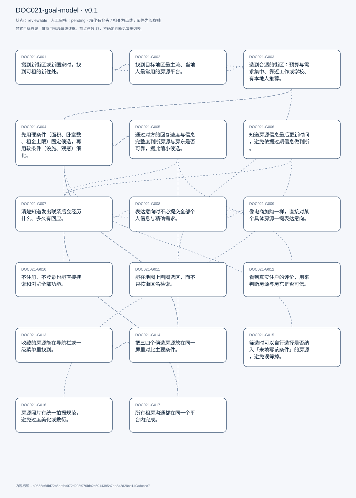
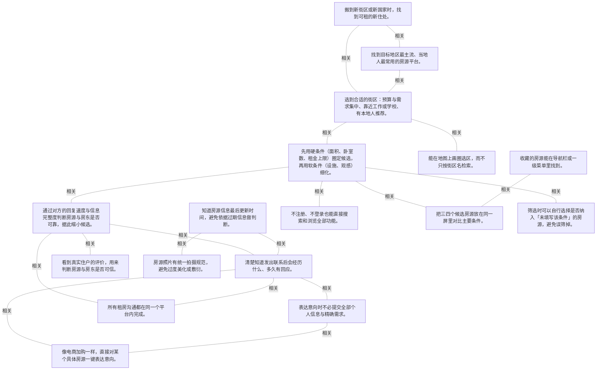

# 目标模型说明

模型：DOC021-goal-model；版本：v0.1

交付状态：reviewable；结构：passed；人工审核：pending

[交互模型](goal-model.html) · [矢量图](goal-model.svg) · [权威数据](goal-model.json)

## 目标图

## 目标

| 编号 | 表述 | 来源 | 情境 | 证据 |
|---|---|---|---|---|
| DOC021-G001 | 搬到新街区或新国家时，找到可租的新住处。 | explicit | 自述唯一触发情境：迁居；手段为搜索网络与房源类网页应用 | E0001, E0002 |
| DOC021-G002 | 找到目标地区最主流、当地人最常用的房源平台。 | explicit | 理由：可能是在另一个国家，不知道当地用哪个站 | E0003, E0004 |
| DOC021-G003 | 选到合适的街区：预算与需求集中、靠近工作或学校、有本地人推荐。 | explicit | 三条依据：平台上房源聚集、熟人推荐、通勤/就学距离 | E0005, E0006, E0007 |
| DOC021-G004 | 先用硬条件（面积、卧室数、租金上限）圈定候选，再用软条件（设施、观感）细化。 | explicit | 自述筛选顺序：size/bedroom/budget → amenities/looks | E0008, E0009 |
| DOC021-G005 | 通过对方的回复速度与信息完整度判断房源与房东是否可靠，据此缩小候选。 | explicit | 回复快且信息全 → 加分；回复慢、信息少、态度可疑 → 减分 | E0010, E0011, E0012 |
| DOC021-G006 | 知道房源信息最后更新时间，避免依据过期信息做判断。 | explicit | 现状：详情页无更新时间；后果：可能是过期或错误信息，不敢信 | E0013, E0014, E0015 |
| DOC021-G007 | 清楚知道发出联系后会经历什么、多久有回应。 | explicit | 参照电商的配送预期；自己提出用时间线/流程图展示后续步骤 | E0016, E0017, E0018 |
| DOC021-G008 | 表达意向时不必提交全部个人信息与精确需求。 | explicit | 表单把姓名、邮箱、手机、入住日、卧室数、浴室数、留言全设为必填；他常在填表前就放弃并绕开流程 | E0019, E0020, E0021 |
| DOC021-G009 | 像电商加购一样，直接对某个具体房源一键表达意向。 | explicit | 理由：房源是有限选项，不是定制品，无需长表单描述需求 | E0022, E0023 |
| DOC021-G010 | 不注册、不登录也能直接搜索和浏览全部功能。 | explicit | 理由：看房不需要账号，也没有需要个性化的内容；可接受：想保存信息时再选择性注册 | E0024, E0025, E0026 |
| DOC021-G011 | 能在地图上画圈选区，而不只按街区名检索。 | explicit | 理由：按街区名太死，边界外两百米的合适房源会被漏掉 | E0027, E0028 |
| DOC021-G012 | 看到真实住户的评价，用来判断房源与房东是否可信。 | explicit | 评价被他列为「喜欢」的两件事之一；详情页确实会带住户评价 | E0029, E0030, E0031 |
| DOC021-G013 | 收藏的房源能在导航栏或一级菜单里找到。 | explicit | 现状：点了收藏但找不到存到哪里，菜单里没有入口 | E0032, E0033, E0034 |
| DOC021-G014 | 把三四个候选房源放在同一屏里对比主要条件。 | explicit | 自述「没找到有网站做这个」；结尾再次强调这是他最想补的功能 | E0035, E0036, E0037 |
| DOC021-G015 | 筛选时可以自行选择是否纳入「未填写该条件」的房源，避免误筛掉。 | explicit | 担心：房东没勾选「可养宠」但实际允许，一筛就漏；方案：加一个 include unspecified 复选框 | E0038, E0039, E0040 |
| DOC021-G016 | 房源照片有统一拍摄规范，避免过度美化或敷衍。 | explicit | 现状：有人拍得很随便、有人刻意拍得比实景好；设想：规定采光与角度 | E0041, E0042 |
| DOC021-G017 | 所有租房沟通都在同一个平台内完成。 | explicit | 现状：几乎全部沟通都转到平台外（邮件、电话、地图找官网）；原因：站内流程不透明、按钮含义不明 | E0043, E0044, E0045 |

## 关系判断（含不确定与无关系）

- DOC021-G001 / DOC021-G002：related。T003–T005 是同一流程的起点：迁居触发找房，第一步是弄清当地用哪个站。但找房是目的，选平台是手段，且在国内搬迁时他并不需要这一步。
- DOC021-G001 / DOC021-G003：related。T007 说明在陌生城市找房时，选街区是决定后续一切检索的第一步——街区名直接成为搜索词。但选区只是找房的一个环节。
- DOC021-G001 / DOC021-G004：none。DOC021-G001 的对象是迁居时找到新住处（T003），DOC021-G004 的对象是硬条件筛选+软条件细选（T009）；两处分别出自不同话题段，原文未在二者之间建立因果、手段、评价或情境包含关系，本次评估口径内未建立可采用关系。
- DOC021-G001 / DOC021-G005：none。DOC021-G001 的对象是迁居时找到新住处（T003），DOC021-G005 的对象是从回复判断可靠性（T011）；两处分别出自不同话题段，原文未在二者之间建立因果、手段、评价或情境包含关系，本次评估口径内未建立可采用关系。
- DOC021-G001 / DOC021-G006：none。DOC021-G001 的对象是迁居时找到新住处（T003），DOC021-G006 的对象是知道信息更新时间（T019/T059）；两处分别出自不同话题段，原文未在二者之间建立因果、手段、评价或情境包含关系，本次评估口径内未建立可采用关系。
- DOC021-G001 / DOC021-G007：none。DOC021-G001 的对象是迁居时找到新住处（T003），DOC021-G007 的对象是了解联系后流程（T021/T025）；两处分别出自不同话题段，原文未在二者之间建立因果、手段、评价或情境包含关系，本次评估口径内未建立可采用关系。
- DOC021-G001 / DOC021-G008：none。DOC021-G001 的对象是迁居时找到新住处（T003），DOC021-G008 的对象是不必提交全部信息（T023/T027）；两处分别出自不同话题段，原文未在二者之间建立因果、手段、评价或情境包含关系，本次评估口径内未建立可采用关系。
- DOC021-G001 / DOC021-G009：none。DOC021-G001 的对象是迁居时找到新住处（T003），DOC021-G009 的对象是加购式一键意向（T025）；两处分别出自不同话题段，原文未在二者之间建立因果、手段、评价或情境包含关系，本次评估口径内未建立可采用关系。
- DOC021-G001 / DOC021-G010：none。DOC021-G001 的对象是迁居时找到新住处（T003），DOC021-G010 的对象是免注册浏览（T033/T043）；两处分别出自不同话题段，原文未在二者之间建立因果、手段、评价或情境包含关系，本次评估口径内未建立可采用关系。
- DOC021-G001 / DOC021-G011：none。DOC021-G001 的对象是迁居时找到新住处（T003），DOC021-G011 的对象是地图画圈选区（T033）；两处分别出自不同话题段，原文未在二者之间建立因果、手段、评价或情境包含关系，本次评估口径内未建立可采用关系。
- DOC021-G001 / DOC021-G012：none。DOC021-G001 的对象是迁居时找到新住处（T003），DOC021-G012 的对象是住户评价（T033/T069）；两处分别出自不同话题段，原文未在二者之间建立因果、手段、评价或情境包含关系，本次评估口径内未建立可采用关系。
- DOC021-G001 / DOC021-G013：none。DOC021-G001 的对象是迁居时找到新住处（T003），DOC021-G013 的对象是收藏可被找到（T035/T039）；两处分别出自不同话题段，原文未在二者之间建立因果、手段、评价或情境包含关系，本次评估口径内未建立可采用关系。
- DOC021-G001 / DOC021-G014：none。DOC021-G001 的对象是迁居时找到新住处（T003），DOC021-G014 的对象是多房源同屏对比（T037/T071）；两处分别出自不同话题段，原文未在二者之间建立因果、手段、评价或情境包含关系，本次评估口径内未建立可采用关系。
- DOC021-G001 / DOC021-G015：none。DOC021-G001 的对象是迁居时找到新住处（T003），DOC021-G015 的对象是筛选含未填选项（T051）；两处分别出自不同话题段，原文未在二者之间建立因果、手段、评价或情境包含关系，本次评估口径内未建立可采用关系。
- DOC021-G001 / DOC021-G016：none。DOC021-G001 的对象是迁居时找到新住处（T003），DOC021-G016 的对象是照片拍摄规范（T059）；两处分别出自不同话题段，原文未在二者之间建立因果、手段、评价或情境包含关系，本次评估口径内未建立可采用关系。
- DOC021-G001 / DOC021-G017：none。DOC021-G001 的对象是迁居时找到新住处（T003），DOC021-G017 的对象是沟通留在单一平台（T071/T073）；两处分别出自不同话题段，原文未在二者之间建立因果、手段、评价或情境包含关系，本次评估口径内未建立可采用关系。
- DOC021-G002 / DOC021-G003：related。T005 的运行顺序是：先定街区，再用街区名去搜当地网站；说明街区名同时充当「找平台」的检索词。两者互相依赖，但一个是地域选择、一个是平台选择。
- DOC021-G002 / DOC021-G004：none。DOC021-G002 的对象是找到当地主流房源平台（T005），DOC021-G004 的对象是硬条件筛选+软条件细选（T009）；两处分别出自不同话题段，原文未在二者之间建立因果、手段、评价或情境包含关系，本次评估口径内未建立可采用关系。
- DOC021-G002 / DOC021-G005：none。DOC021-G002 的对象是找到当地主流房源平台（T005），DOC021-G005 的对象是从回复判断可靠性（T011）；两处分别出自不同话题段，原文未在二者之间建立因果、手段、评价或情境包含关系，本次评估口径内未建立可采用关系。
- DOC021-G002 / DOC021-G006：none。DOC021-G002 的对象是找到当地主流房源平台（T005），DOC021-G006 的对象是知道信息更新时间（T019/T059）；两处分别出自不同话题段，原文未在二者之间建立因果、手段、评价或情境包含关系，本次评估口径内未建立可采用关系。
- DOC021-G002 / DOC021-G007：none。DOC021-G002 的对象是找到当地主流房源平台（T005），DOC021-G007 的对象是了解联系后流程（T021/T025）；两处分别出自不同话题段，原文未在二者之间建立因果、手段、评价或情境包含关系，本次评估口径内未建立可采用关系。
- DOC021-G002 / DOC021-G008：none。DOC021-G002 的对象是找到当地主流房源平台（T005），DOC021-G008 的对象是不必提交全部信息（T023/T027）；两处分别出自不同话题段，原文未在二者之间建立因果、手段、评价或情境包含关系，本次评估口径内未建立可采用关系。
- DOC021-G002 / DOC021-G009：none。DOC021-G002 的对象是找到当地主流房源平台（T005），DOC021-G009 的对象是加购式一键意向（T025）；两处分别出自不同话题段，原文未在二者之间建立因果、手段、评价或情境包含关系，本次评估口径内未建立可采用关系。
- DOC021-G002 / DOC021-G010：none。DOC021-G002 的对象是找到当地主流房源平台（T005），DOC021-G010 的对象是免注册浏览（T033/T043）；两处分别出自不同话题段，原文未在二者之间建立因果、手段、评价或情境包含关系，本次评估口径内未建立可采用关系。
- DOC021-G002 / DOC021-G011：none。DOC021-G002 的对象是找到当地主流房源平台（T005），DOC021-G011 的对象是地图画圈选区（T033）；两处分别出自不同话题段，原文未在二者之间建立因果、手段、评价或情境包含关系，本次评估口径内未建立可采用关系。
- DOC021-G002 / DOC021-G012：none。DOC021-G002 的对象是找到当地主流房源平台（T005），DOC021-G012 的对象是住户评价（T033/T069）；两处分别出自不同话题段，原文未在二者之间建立因果、手段、评价或情境包含关系，本次评估口径内未建立可采用关系。
- DOC021-G002 / DOC021-G013：none。DOC021-G002 的对象是找到当地主流房源平台（T005），DOC021-G013 的对象是收藏可被找到（T035/T039）；两处分别出自不同话题段，原文未在二者之间建立因果、手段、评价或情境包含关系，本次评估口径内未建立可采用关系。
- DOC021-G002 / DOC021-G014：none。DOC021-G002 的对象是找到当地主流房源平台（T005），DOC021-G014 的对象是多房源同屏对比（T037/T071）；两处分别出自不同话题段，原文未在二者之间建立因果、手段、评价或情境包含关系，本次评估口径内未建立可采用关系。
- DOC021-G002 / DOC021-G015：none。DOC021-G002 的对象是找到当地主流房源平台（T005），DOC021-G015 的对象是筛选含未填选项（T051）；两处分别出自不同话题段，原文未在二者之间建立因果、手段、评价或情境包含关系，本次评估口径内未建立可采用关系。
- DOC021-G002 / DOC021-G016：none。DOC021-G002 的对象是找到当地主流房源平台（T005），DOC021-G016 的对象是照片拍摄规范（T059）；两处分别出自不同话题段，原文未在二者之间建立因果、手段、评价或情境包含关系，本次评估口径内未建立可采用关系。
- DOC021-G002 / DOC021-G017：none。DOC021-G002 的对象是找到当地主流房源平台（T005），DOC021-G017 的对象是沟通留在单一平台（T071/T073）；两处分别出自不同话题段，原文未在二者之间建立因果、手段、评价或情境包含关系，本次评估口径内未建立可采用关系。
- DOC021-G003 / DOC021-G004：related。T009 的筛选发生在街区已定之后：先在选定区域内按面积、卧室、预算出候选。街区决定「在哪找」，筛选决定「找哪一套」。
- DOC021-G003 / DOC021-G005：none。DOC021-G003 的对象是选到合适街区（T007），DOC021-G005 的对象是从回复判断可靠性（T011）；两处分别出自不同话题段，原文未在二者之间建立因果、手段、评价或情境包含关系，本次评估口径内未建立可采用关系。
- DOC021-G003 / DOC021-G006：none。DOC021-G003 的对象是选到合适街区（T007），DOC021-G006 的对象是知道信息更新时间（T019/T059）；两处分别出自不同话题段，原文未在二者之间建立因果、手段、评价或情境包含关系，本次评估口径内未建立可采用关系。
- DOC021-G003 / DOC021-G007：none。DOC021-G003 的对象是选到合适街区（T007），DOC021-G007 的对象是了解联系后流程（T021/T025）；两处分别出自不同话题段，原文未在二者之间建立因果、手段、评价或情境包含关系，本次评估口径内未建立可采用关系。
- DOC021-G003 / DOC021-G008：none。DOC021-G003 的对象是选到合适街区（T007），DOC021-G008 的对象是不必提交全部信息（T023/T027）；两处分别出自不同话题段，原文未在二者之间建立因果、手段、评价或情境包含关系，本次评估口径内未建立可采用关系。
- DOC021-G003 / DOC021-G009：none。DOC021-G003 的对象是选到合适街区（T007），DOC021-G009 的对象是加购式一键意向（T025）；两处分别出自不同话题段，原文未在二者之间建立因果、手段、评价或情境包含关系，本次评估口径内未建立可采用关系。
- DOC021-G003 / DOC021-G010：none。DOC021-G003 的对象是选到合适街区（T007），DOC021-G010 的对象是免注册浏览（T033/T043）；两处分别出自不同话题段，原文未在二者之间建立因果、手段、评价或情境包含关系，本次评估口径内未建立可采用关系。
- DOC021-G003 / DOC021-G011：related。T033 把画圈选区作为按街区名检索的替代：街区边界太死，圈选可以扩展到边界外两百米的合适房源。两者解决同一个问题——划定搜索范围，但粒度不同。
- DOC021-G003 / DOC021-G012：none。DOC021-G003 的对象是选到合适街区（T007），DOC021-G012 的对象是住户评价（T033/T069）；两处分别出自不同话题段，原文未在二者之间建立因果、手段、评价或情境包含关系，本次评估口径内未建立可采用关系。
- DOC021-G003 / DOC021-G013：none。DOC021-G003 的对象是选到合适街区（T007），DOC021-G013 的对象是收藏可被找到（T035/T039）；两处分别出自不同话题段，原文未在二者之间建立因果、手段、评价或情境包含关系，本次评估口径内未建立可采用关系。
- DOC021-G003 / DOC021-G014：none。DOC021-G003 的对象是选到合适街区（T007），DOC021-G014 的对象是多房源同屏对比（T037/T071）；两处分别出自不同话题段，原文未在二者之间建立因果、手段、评价或情境包含关系，本次评估口径内未建立可采用关系。
- DOC021-G003 / DOC021-G015：none。DOC021-G003 的对象是选到合适街区（T007），DOC021-G015 的对象是筛选含未填选项（T051）；两处分别出自不同话题段，原文未在二者之间建立因果、手段、评价或情境包含关系，本次评估口径内未建立可采用关系。
- DOC021-G003 / DOC021-G016：none。DOC021-G003 的对象是选到合适街区（T007），DOC021-G016 的对象是照片拍摄规范（T059）；两处分别出自不同话题段，原文未在二者之间建立因果、手段、评价或情境包含关系，本次评估口径内未建立可采用关系。
- DOC021-G003 / DOC021-G017：none。DOC021-G003 的对象是选到合适街区（T007），DOC021-G017 的对象是沟通留在单一平台（T071/T073）；两处分别出自不同话题段，原文未在二者之间建立因果、手段、评价或情境包含关系，本次评估口径内未建立可采用关系。
- DOC021-G004 / DOC021-G005：related。T011 明确说「筛到剩几个之后，才开始联系」，用回复质量再缩一轮。前者是信息筛选、后者是人际验证，顺序固定但手段不同。
- DOC021-G004 / DOC021-G006：none。DOC021-G004 的对象是硬条件筛选+软条件细选（T009），DOC021-G006 的对象是知道信息更新时间（T019/T059）；两处分别出自不同话题段，原文未在二者之间建立因果、手段、评价或情境包含关系，本次评估口径内未建立可采用关系。
- DOC021-G004 / DOC021-G007：none。DOC021-G004 的对象是硬条件筛选+软条件细选（T009），DOC021-G007 的对象是了解联系后流程（T021/T025）；两处分别出自不同话题段，原文未在二者之间建立因果、手段、评价或情境包含关系，本次评估口径内未建立可采用关系。
- DOC021-G004 / DOC021-G008：none。DOC021-G004 的对象是硬条件筛选+软条件细选（T009），DOC021-G008 的对象是不必提交全部信息（T023/T027）；两处分别出自不同话题段，原文未在二者之间建立因果、手段、评价或情境包含关系，本次评估口径内未建立可采用关系。
- DOC021-G004 / DOC021-G009：none。DOC021-G004 的对象是硬条件筛选+软条件细选（T009），DOC021-G009 的对象是加购式一键意向（T025）；两处分别出自不同话题段，原文未在二者之间建立因果、手段、评价或情境包含关系，本次评估口径内未建立可采用关系。
- DOC021-G004 / DOC021-G010：related。T043–T045 说免注册的理由是「直接开始搜索、看到全部功能」——搜索与筛选正是 G004 的动作。但 G010 是准入条件，G004 是核心任务。
- DOC021-G004 / DOC021-G011：none。DOC021-G004 的对象是硬条件筛选+软条件细选（T009），DOC021-G011 的对象是地图画圈选区（T033）；两处分别出自不同话题段，原文未在二者之间建立因果、手段、评价或情境包含关系，本次评估口径内未建立可采用关系。
- DOC021-G004 / DOC021-G012：none。DOC021-G004 的对象是硬条件筛选+软条件细选（T009），DOC021-G012 的对象是住户评价（T033/T069）；两处分别出自不同话题段，原文未在二者之间建立因果、手段、评价或情境包含关系，本次评估口径内未建立可采用关系。
- DOC021-G004 / DOC021-G013：none。DOC021-G004 的对象是硬条件筛选+软条件细选（T009），DOC021-G013 的对象是收藏可被找到（T035/T039）；两处分别出自不同话题段，原文未在二者之间建立因果、手段、评价或情境包含关系，本次评估口径内未建立可采用关系。
- DOC021-G004 / DOC021-G014：related。T037 说对比的是「筛出来的三四个选项」，即对比发生在筛选之后，用于在少量候选中定夺。但筛选缩小范围、对比辅助取舍。
- DOC021-G004 / DOC021-G015：related。T051 指出筛选机制本身的漏洞：只匹配已填写的字段，会漏掉未填写但事实符合条件的房源。G015 是对 G004 的直接修正，不改变筛选目的，只改变匹配口径。
- DOC021-G004 / DOC021-G016：none。DOC021-G004 的对象是硬条件筛选+软条件细选（T009），DOC021-G016 的对象是照片拍摄规范（T059）；两处分别出自不同话题段，原文未在二者之间建立因果、手段、评价或情境包含关系，本次评估口径内未建立可采用关系。
- DOC021-G004 / DOC021-G017：none。DOC021-G004 的对象是硬条件筛选+软条件细选（T009），DOC021-G017 的对象是沟通留在单一平台（T071/T073）；两处分别出自不同话题段，原文未在二者之间建立因果、手段、评价或情境包含关系，本次评估口径内未建立可采用关系。
- DOC021-G005 / DOC021-G006：none。DOC021-G005 的对象是从回复判断可靠性（T011），DOC021-G006 的对象是知道信息更新时间（T019/T059）；两处分别出自不同话题段，原文未在二者之间建立因果、手段、评价或情境包含关系，本次评估口径内未建立可采用关系。
- DOC021-G005 / DOC021-G007：related。T021 说「看不到流程就没有信任，也没有推进的热情」——正是对 G005 中「对方像联系不上」这一判断的解释。但 G005 是判断对方、G007 是要求平台交代流程。
- DOC021-G005 / DOC021-G008：none。DOC021-G005 的对象是从回复判断可靠性（T011），DOC021-G008 的对象是不必提交全部信息（T023/T027）；两处分别出自不同话题段，原文未在二者之间建立因果、手段、评价或情境包含关系，本次评估口径内未建立可采用关系。
- DOC021-G005 / DOC021-G009：none。DOC021-G005 的对象是从回复判断可靠性（T011），DOC021-G009 的对象是加购式一键意向（T025）；两处分别出自不同话题段，原文未在二者之间建立因果、手段、评价或情境包含关系，本次评估口径内未建立可采用关系。
- DOC021-G005 / DOC021-G010：none。DOC021-G005 的对象是从回复判断可靠性（T011），DOC021-G010 的对象是免注册浏览（T033/T043）；两处分别出自不同话题段，原文未在二者之间建立因果、手段、评价或情境包含关系，本次评估口径内未建立可采用关系。
- DOC021-G005 / DOC021-G011：none。DOC021-G005 的对象是从回复判断可靠性（T011），DOC021-G011 的对象是地图画圈选区（T033）；两处分别出自不同话题段，原文未在二者之间建立因果、手段、评价或情境包含关系，本次评估口径内未建立可采用关系。
- DOC021-G005 / DOC021-G012：related。T033 说评价让房源「feel more trusted」，与 G005 用回复速度推断可靠属同一类信任信号；但评价来自历史住户、回复来自当前房东，一个事后、一个事前。
- DOC021-G005 / DOC021-G013：none。DOC021-G005 的对象是从回复判断可靠性（T011），DOC021-G013 的对象是收藏可被找到（T035/T039）；两处分别出自不同话题段，原文未在二者之间建立因果、手段、评价或情境包含关系，本次评估口径内未建立可采用关系。
- DOC021-G005 / DOC021-G014：none。DOC021-G005 的对象是从回复判断可靠性（T011），DOC021-G014 的对象是多房源同屏对比（T037/T071）；两处分别出自不同话题段，原文未在二者之间建立因果、手段、评价或情境包含关系，本次评估口径内未建立可采用关系。
- DOC021-G005 / DOC021-G015：none。DOC021-G005 的对象是从回复判断可靠性（T011），DOC021-G015 的对象是筛选含未填选项（T051）；两处分别出自不同话题段，原文未在二者之间建立因果、手段、评价或情境包含关系，本次评估口径内未建立可采用关系。
- DOC021-G005 / DOC021-G016：none。DOC021-G005 的对象是从回复判断可靠性（T011），DOC021-G016 的对象是照片拍摄规范（T059）；两处分别出自不同话题段，原文未在二者之间建立因果、手段、评价或情境包含关系，本次评估口径内未建立可采用关系。
- DOC021-G005 / DOC021-G017：related。T017 说明正因为站内沟通不可信，他才长期转到站外；G017 想把沟通收回平台，前提是平台内能获得与站外同等的可靠回应。
- DOC021-G006 / DOC021-G007：related。T019–T021 把「信息何时更新」与「后续流程是什么」并列为不确定性来源，两者都通过给出确定信息来建立信任。但一个关于数据时效、一个关于流程预期。
- DOC021-G006 / DOC021-G008：none。DOC021-G006 的对象是知道信息更新时间（T019/T059），DOC021-G008 的对象是不必提交全部信息（T023/T027）；两处分别出自不同话题段，原文未在二者之间建立因果、手段、评价或情境包含关系，本次评估口径内未建立可采用关系。
- DOC021-G006 / DOC021-G009：none。DOC021-G006 的对象是知道信息更新时间（T019/T059），DOC021-G009 的对象是加购式一键意向（T025）；两处分别出自不同话题段，原文未在二者之间建立因果、手段、评价或情境包含关系，本次评估口径内未建立可采用关系。
- DOC021-G006 / DOC021-G010：none。DOC021-G006 的对象是知道信息更新时间（T019/T059），DOC021-G010 的对象是免注册浏览（T033/T043）；两处分别出自不同话题段，原文未在二者之间建立因果、手段、评价或情境包含关系，本次评估口径内未建立可采用关系。
- DOC021-G006 / DOC021-G011：none。DOC021-G006 的对象是知道信息更新时间（T019/T059），DOC021-G011 的对象是地图画圈选区（T033）；两处分别出自不同话题段，原文未在二者之间建立因果、手段、评价或情境包含关系，本次评估口径内未建立可采用关系。
- DOC021-G006 / DOC021-G012：none。DOC021-G006 的对象是知道信息更新时间（T019/T059），DOC021-G012 的对象是住户评价（T033/T069）；两处分别出自不同话题段，原文未在二者之间建立因果、手段、评价或情境包含关系，本次评估口径内未建立可采用关系。
- DOC021-G006 / DOC021-G013：none。DOC021-G006 的对象是知道信息更新时间（T019/T059），DOC021-G013 的对象是收藏可被找到（T035/T039）；两处分别出自不同话题段，原文未在二者之间建立因果、手段、评价或情境包含关系，本次评估口径内未建立可采用关系。
- DOC021-G006 / DOC021-G014：none。DOC021-G006 的对象是知道信息更新时间（T019/T059），DOC021-G014 的对象是多房源同屏对比（T037/T071）；两处分别出自不同话题段，原文未在二者之间建立因果、手段、评价或情境包含关系，本次评估口径内未建立可采用关系。
- DOC021-G006 / DOC021-G015：none。DOC021-G006 的对象是知道信息更新时间（T019/T059），DOC021-G015 的对象是筛选含未填选项（T051）；两处分别出自不同话题段，原文未在二者之间建立因果、手段、评价或情境包含关系，本次评估口径内未建立可采用关系。
- DOC021-G006 / DOC021-G016：related。T059 在同一段把照片质量与更新时间并列为「信息不可信」的两个来源，并各给了一个平台侧解法（拍摄规范、显示更新时间）。但一个管视觉真实性、一个管数据新鲜度。
- DOC021-G006 / DOC021-G017：none。DOC021-G006 的对象是知道信息更新时间（T019/T059），DOC021-G017 的对象是沟通留在单一平台（T071/T073）；两处分别出自不同话题段，原文未在二者之间建立因果、手段、评价或情境包含关系，本次评估口径内未建立可采用关系。
- DOC021-G007 / DOC021-G008：related。T023 把「必填项太多」与「不知道提交后会怎样」放在同一段抱怨里：信息付出的成本高，回报却不可预期。但 G008 要减少付出、G007 要增加回报的可见性。
- DOC021-G007 / DOC021-G009：related。T025 的加购式方案同时解决两件事：一键表达意向（G009）与给出类似物流的后续预期（G007）。但加购是操作形态，流程可见是信息呈现。
- DOC021-G007 / DOC021-G010：none。DOC021-G007 的对象是了解联系后流程（T021/T025），DOC021-G010 的对象是免注册浏览（T033/T043）；两处分别出自不同话题段，原文未在二者之间建立因果、手段、评价或情境包含关系，本次评估口径内未建立可采用关系。
- DOC021-G007 / DOC021-G011：none。DOC021-G007 的对象是了解联系后流程（T021/T025），DOC021-G011 的对象是地图画圈选区（T033）；两处分别出自不同话题段，原文未在二者之间建立因果、手段、评价或情境包含关系，本次评估口径内未建立可采用关系。
- DOC021-G007 / DOC021-G012：none。DOC021-G007 的对象是了解联系后流程（T021/T025），DOC021-G012 的对象是住户评价（T033/T069）；两处分别出自不同话题段，原文未在二者之间建立因果、手段、评价或情境包含关系，本次评估口径内未建立可采用关系。
- DOC021-G007 / DOC021-G013：none。DOC021-G007 的对象是了解联系后流程（T021/T025），DOC021-G013 的对象是收藏可被找到（T035/T039）；两处分别出自不同话题段，原文未在二者之间建立因果、手段、评价或情境包含关系，本次评估口径内未建立可采用关系。
- DOC021-G007 / DOC021-G014：none。DOC021-G007 的对象是了解联系后流程（T021/T025），DOC021-G014 的对象是多房源同屏对比（T037/T071）；两处分别出自不同话题段，原文未在二者之间建立因果、手段、评价或情境包含关系，本次评估口径内未建立可采用关系。
- DOC021-G007 / DOC021-G015：none。DOC021-G007 的对象是了解联系后流程（T021/T025），DOC021-G015 的对象是筛选含未填选项（T051）；两处分别出自不同话题段，原文未在二者之间建立因果、手段、评价或情境包含关系，本次评估口径内未建立可采用关系。
- DOC021-G007 / DOC021-G016：none。DOC021-G007 的对象是了解联系后流程（T021/T025），DOC021-G016 的对象是照片拍摄规范（T059）；两处分别出自不同话题段，原文未在二者之间建立因果、手段、评价或情境包含关系，本次评估口径内未建立可采用关系。
- DOC021-G007 / DOC021-G017：related。T073 给出明确因果：流程清楚且快，他才愿意把沟通全留在站内；不透明是他转去站外的直接原因。但 G007 是沟通信任的前提，G017 是渠道归属的结果。
- DOC021-G008 / DOC021-G009：related。T025–T027 是同一诉求的两步替代方案：先取消长表单（G008 少给信息），再用加购式操作表达意向（G009 少走流程）。但 G008 管数据暴露、G009 管交互步骤。
- DOC021-G008 / DOC021-G010：none。DOC021-G008 的对象是不必提交全部信息（T023/T027），DOC021-G010 的对象是免注册浏览（T033/T043）；两处分别出自不同话题段，原文未在二者之间建立因果、手段、评价或情境包含关系，本次评估口径内未建立可采用关系。
- DOC021-G008 / DOC021-G011：none。DOC021-G008 的对象是不必提交全部信息（T023/T027），DOC021-G011 的对象是地图画圈选区（T033）；两处分别出自不同话题段，原文未在二者之间建立因果、手段、评价或情境包含关系，本次评估口径内未建立可采用关系。
- DOC021-G008 / DOC021-G012：none。DOC021-G008 的对象是不必提交全部信息（T023/T027），DOC021-G012 的对象是住户评价（T033/T069）；两处分别出自不同话题段，原文未在二者之间建立因果、手段、评价或情境包含关系，本次评估口径内未建立可采用关系。
- DOC021-G008 / DOC021-G013：none。DOC021-G008 的对象是不必提交全部信息（T023/T027），DOC021-G013 的对象是收藏可被找到（T035/T039）；两处分别出自不同话题段，原文未在二者之间建立因果、手段、评价或情境包含关系，本次评估口径内未建立可采用关系。
- DOC021-G008 / DOC021-G014：none。DOC021-G008 的对象是不必提交全部信息（T023/T027），DOC021-G014 的对象是多房源同屏对比（T037/T071）；两处分别出自不同话题段，原文未在二者之间建立因果、手段、评价或情境包含关系，本次评估口径内未建立可采用关系。
- DOC021-G008 / DOC021-G015：none。DOC021-G008 的对象是不必提交全部信息（T023/T027），DOC021-G015 的对象是筛选含未填选项（T051）；两处分别出自不同话题段，原文未在二者之间建立因果、手段、评价或情境包含关系，本次评估口径内未建立可采用关系。
- DOC021-G008 / DOC021-G016：none。DOC021-G008 的对象是不必提交全部信息（T023/T027），DOC021-G016 的对象是照片拍摄规范（T059）；两处分别出自不同话题段，原文未在二者之间建立因果、手段、评价或情境包含关系，本次评估口径内未建立可采用关系。
- DOC021-G008 / DOC021-G017：none。DOC021-G008 的对象是不必提交全部信息（T023/T027），DOC021-G017 的对象是沟通留在单一平台（T071/T073）；两处分别出自不同话题段，原文未在二者之间建立因果、手段、评价或情境包含关系，本次评估口径内未建立可采用关系。
- DOC021-G009 / DOC021-G010：none。DOC021-G009 的对象是加购式一键意向（T025），DOC021-G010 的对象是免注册浏览（T033/T043）；两处分别出自不同话题段，原文未在二者之间建立因果、手段、评价或情境包含关系，本次评估口径内未建立可采用关系。
- DOC021-G009 / DOC021-G011：none。DOC021-G009 的对象是加购式一键意向（T025），DOC021-G011 的对象是地图画圈选区（T033）；两处分别出自不同话题段，原文未在二者之间建立因果、手段、评价或情境包含关系，本次评估口径内未建立可采用关系。
- DOC021-G009 / DOC021-G012：none。DOC021-G009 的对象是加购式一键意向（T025），DOC021-G012 的对象是住户评价（T033/T069）；两处分别出自不同话题段，原文未在二者之间建立因果、手段、评价或情境包含关系，本次评估口径内未建立可采用关系。
- DOC021-G009 / DOC021-G013：none。DOC021-G009 的对象是加购式一键意向（T025），DOC021-G013 的对象是收藏可被找到（T035/T039）；两处分别出自不同话题段，原文未在二者之间建立因果、手段、评价或情境包含关系，本次评估口径内未建立可采用关系。
- DOC021-G009 / DOC021-G014：none。DOC021-G009 的对象是加购式一键意向（T025），DOC021-G014 的对象是多房源同屏对比（T037/T071）；两处分别出自不同话题段，原文未在二者之间建立因果、手段、评价或情境包含关系，本次评估口径内未建立可采用关系。
- DOC021-G009 / DOC021-G015：none。DOC021-G009 的对象是加购式一键意向（T025），DOC021-G015 的对象是筛选含未填选项（T051）；两处分别出自不同话题段，原文未在二者之间建立因果、手段、评价或情境包含关系，本次评估口径内未建立可采用关系。
- DOC021-G009 / DOC021-G016：none。DOC021-G009 的对象是加购式一键意向（T025），DOC021-G016 的对象是照片拍摄规范（T059）；两处分别出自不同话题段，原文未在二者之间建立因果、手段、评价或情境包含关系，本次评估口径内未建立可采用关系。
- DOC021-G009 / DOC021-G017：none。DOC021-G009 的对象是加购式一键意向（T025），DOC021-G017 的对象是沟通留在单一平台（T071/T073）；两处分别出自不同话题段，原文未在二者之间建立因果、手段、评价或情境包含关系，本次评估口径内未建立可采用关系。
- DOC021-G010 / DOC021-G011：none。DOC021-G010 的对象是免注册浏览（T033/T043），DOC021-G011 的对象是地图画圈选区（T033）；两处分别出自不同话题段，原文未在二者之间建立因果、手段、评价或情境包含关系，本次评估口径内未建立可采用关系。
- DOC021-G010 / DOC021-G012：none。DOC021-G010 的对象是免注册浏览（T033/T043），DOC021-G012 的对象是住户评价（T033/T069）；两处分别出自不同话题段，原文未在二者之间建立因果、手段、评价或情境包含关系，本次评估口径内未建立可采用关系。
- DOC021-G010 / DOC021-G013：uncertain。两者可能互斥：T032 反对「必须注册才能搜索」，T043 认为只在「想保存信息」时才需要账号；而 T035–T038 要求的收藏本质上是需要持久化的账户能力。原文没有说明免注册状态下收藏存在哪里（本地？匿名会话？），也没有说他接受为收藏而注册。两种解释都成立，不能自行裁决。
- DOC021-G010 / DOC021-G014：none。DOC021-G010 的对象是免注册浏览（T033/T043），DOC021-G014 的对象是多房源同屏对比（T037/T071）；两处分别出自不同话题段，原文未在二者之间建立因果、手段、评价或情境包含关系，本次评估口径内未建立可采用关系。
- DOC021-G010 / DOC021-G015：none。DOC021-G010 的对象是免注册浏览（T033/T043），DOC021-G015 的对象是筛选含未填选项（T051）；两处分别出自不同话题段，原文未在二者之间建立因果、手段、评价或情境包含关系，本次评估口径内未建立可采用关系。
- DOC021-G010 / DOC021-G016：none。DOC021-G010 的对象是免注册浏览（T033/T043），DOC021-G016 的对象是照片拍摄规范（T059）；两处分别出自不同话题段，原文未在二者之间建立因果、手段、评价或情境包含关系，本次评估口径内未建立可采用关系。
- DOC021-G010 / DOC021-G017：none。DOC021-G010 的对象是免注册浏览（T033/T043），DOC021-G017 的对象是沟通留在单一平台（T071/T073）；两处分别出自不同话题段，原文未在二者之间建立因果、手段、评价或情境包含关系，本次评估口径内未建立可采用关系。
- DOC021-G011 / DOC021-G012：none。DOC021-G011 的对象是地图画圈选区（T033），DOC021-G012 的对象是住户评价（T033/T069）；两处分别出自不同话题段，原文未在二者之间建立因果、手段、评价或情境包含关系，本次评估口径内未建立可采用关系。
- DOC021-G011 / DOC021-G013：none。DOC021-G011 的对象是地图画圈选区（T033），DOC021-G013 的对象是收藏可被找到（T035/T039）；两处分别出自不同话题段，原文未在二者之间建立因果、手段、评价或情境包含关系，本次评估口径内未建立可采用关系。
- DOC021-G011 / DOC021-G014：none。DOC021-G011 的对象是地图画圈选区（T033），DOC021-G014 的对象是多房源同屏对比（T037/T071）；两处分别出自不同话题段，原文未在二者之间建立因果、手段、评价或情境包含关系，本次评估口径内未建立可采用关系。
- DOC021-G011 / DOC021-G015：none。DOC021-G011 的对象是地图画圈选区（T033），DOC021-G015 的对象是筛选含未填选项（T051）；两处分别出自不同话题段，原文未在二者之间建立因果、手段、评价或情境包含关系，本次评估口径内未建立可采用关系。
- DOC021-G011 / DOC021-G016：none。DOC021-G011 的对象是地图画圈选区（T033），DOC021-G016 的对象是照片拍摄规范（T059）；两处分别出自不同话题段，原文未在二者之间建立因果、手段、评价或情境包含关系，本次评估口径内未建立可采用关系。
- DOC021-G011 / DOC021-G017：none。DOC021-G011 的对象是地图画圈选区（T033），DOC021-G017 的对象是沟通留在单一平台（T071/T073）；两处分别出自不同话题段，原文未在二者之间建立因果、手段、评价或情境包含关系，本次评估口径内未建立可采用关系。
- DOC021-G012 / DOC021-G013：none。DOC021-G012 的对象是住户评价（T033/T069），DOC021-G013 的对象是收藏可被找到（T035/T039）；两处分别出自不同话题段，原文未在二者之间建立因果、手段、评价或情境包含关系，本次评估口径内未建立可采用关系。
- DOC021-G012 / DOC021-G014：none。DOC021-G012 的对象是住户评价（T033/T069），DOC021-G014 的对象是多房源同屏对比（T037/T071）；两处分别出自不同话题段，原文未在二者之间建立因果、手段、评价或情境包含关系，本次评估口径内未建立可采用关系。
- DOC021-G012 / DOC021-G015：none。DOC021-G012 的对象是住户评价（T033/T069），DOC021-G015 的对象是筛选含未填选项（T051）；两处分别出自不同话题段，原文未在二者之间建立因果、手段、评价或情境包含关系，本次评估口径内未建立可采用关系。
- DOC021-G012 / DOC021-G016：none。DOC021-G012 的对象是住户评价（T033/T069），DOC021-G016 的对象是照片拍摄规范（T059）；两处分别出自不同话题段，原文未在二者之间建立因果、手段、评价或情境包含关系，本次评估口径内未建立可采用关系。
- DOC021-G012 / DOC021-G017：none。DOC021-G012 的对象是住户评价（T033/T069），DOC021-G017 的对象是沟通留在单一平台（T071/T073）；两处分别出自不同话题段，原文未在二者之间建立因果、手段、评价或情境包含关系，本次评估口径内未建立可采用关系。
- DOC021-G013 / DOC021-G014：related。T037 在同一段先说想要对比、再说收藏找不到：收集候选（收藏）与比较候选（对比）是同一条决策链的相邻两步。但一个是存储入口、一个是并列呈现。
- DOC021-G013 / DOC021-G015：none。DOC021-G013 的对象是收藏可被找到（T035/T039），DOC021-G015 的对象是筛选含未填选项（T051）；两处分别出自不同话题段，原文未在二者之间建立因果、手段、评价或情境包含关系，本次评估口径内未建立可采用关系。
- DOC021-G013 / DOC021-G016：none。DOC021-G013 的对象是收藏可被找到（T035/T039），DOC021-G016 的对象是照片拍摄规范（T059）；两处分别出自不同话题段，原文未在二者之间建立因果、手段、评价或情境包含关系，本次评估口径内未建立可采用关系。
- DOC021-G013 / DOC021-G017：none。DOC021-G013 的对象是收藏可被找到（T035/T039），DOC021-G017 的对象是沟通留在单一平台（T071/T073）；两处分别出自不同话题段，原文未在二者之间建立因果、手段、评价或情境包含关系，本次评估口径内未建立可采用关系。
- DOC021-G014 / DOC021-G015：none。DOC021-G014 的对象是多房源同屏对比（T037/T071），DOC021-G015 的对象是筛选含未填选项（T051）；两处分别出自不同话题段，原文未在二者之间建立因果、手段、评价或情境包含关系，本次评估口径内未建立可采用关系。
- DOC021-G014 / DOC021-G016：none。DOC021-G014 的对象是多房源同屏对比（T037/T071），DOC021-G016 的对象是照片拍摄规范（T059）；两处分别出自不同话题段，原文未在二者之间建立因果、手段、评价或情境包含关系，本次评估口径内未建立可采用关系。
- DOC021-G014 / DOC021-G017：none。DOC021-G014 的对象是多房源同屏对比（T037/T071），DOC021-G017 的对象是沟通留在单一平台（T071/T073）；两处分别出自不同话题段，原文未在二者之间建立因果、手段、评价或情境包含关系，本次评估口径内未建立可采用关系。
- DOC021-G015 / DOC021-G016：none。DOC021-G015 的对象是筛选含未填选项（T051），DOC021-G016 的对象是照片拍摄规范（T059）；两处分别出自不同话题段，原文未在二者之间建立因果、手段、评价或情境包含关系，本次评估口径内未建立可采用关系。
- DOC021-G015 / DOC021-G017：none。DOC021-G015 的对象是筛选含未填选项（T051），DOC021-G017 的对象是沟通留在单一平台（T071/T073）；两处分别出自不同话题段，原文未在二者之间建立因果、手段、评价或情境包含关系，本次评估口径内未建立可采用关系。
- DOC021-G016 / DOC021-G017：none。DOC021-G016 的对象是照片拍摄规范（T059），DOC021-G017 的对象是沟通留在单一平台（T071/T073）；两处分别出自不同话题段，原文未在二者之间建立因果、手段、评价或情境包含关系，本次评估口径内未建立可采用关系。

## 证据

### E0001 · DOC021:S004

> Mainly when I move to a new neighborhood or to a new country, I need to find a new place

原件位置：{&quot;line_start&quot;: 4, &quot;line_end&quot;: 4, &quot;start_char&quot;: 887, &quot;end_char&quot;: 1063}

### E0002 · DOC021:S004

> I usually search on the Internet and use this type of web apps

原件位置：{&quot;line_start&quot;: 4, &quot;line_end&quot;: 4, &quot;start_char&quot;: 887, &quot;end_char&quot;: 1063}

### E0003 · DOC021:S006

> I want to be familiar with which websites are the most popular or most used there

原件位置：{&quot;line_start&quot;: 6, &quot;line_end&quot;: 6, &quot;start_char&quot;: 1359, &quot;end_char&quot;: 1717}

### E0004 · DOC021:S006

> sometimes it&#x27;s another country

原件位置：{&quot;line_start&quot;: 6, &quot;line_end&quot;: 6, &quot;start_char&quot;: 1359, &quot;end_char&quot;: 1717}

### E0005 · DOC021:S008

> there are options that fits my budget and fits my requirements more clustered in specific neighborhoods

原件位置：{&quot;line_start&quot;: 8, &quot;line_end&quot;: 8, &quot;start_char&quot;: 1982, &quot;end_char&quot;: 2639}

### E0006 · DOC021:S008

> asking people who lives, for example in that country, if they have any recommendation for the places

原件位置：{&quot;line_start&quot;: 8, &quot;line_end&quot;: 8, &quot;start_char&quot;: 1982, &quot;end_char&quot;: 2639}

### E0007 · DOC021:S008

> I will usually pick a neighborhood that&#x27;s close to that area

原件位置：{&quot;line_start&quot;: 8, &quot;line_end&quot;: 8, &quot;start_char&quot;: 1982, &quot;end_char&quot;: 2639}

### E0008 · DOC021:S010

> I will search by like the size of the place, or sometimes by bedroom counts. and with also a budget limit

原件位置：{&quot;line_start&quot;: 10, &quot;line_end&quot;: 10, &quot;start_char&quot;: 2881, &quot;end_char&quot;: 3439}

### E0009 · DOC021:S010

> I can start filtering it down, using other non very important criteria, such as if they have, like some amenities

原件位置：{&quot;line_start&quot;: 10, &quot;line_end&quot;: 10, &quot;start_char&quot;: 2881, &quot;end_char&quot;: 3439}

### E0010 · DOC021:S012

> how fast they will reply might affect my choices

原件位置：{&quot;line_start&quot;: 12, &quot;line_end&quot;: 12, &quot;start_char&quot;: 3788, &quot;end_char&quot;: 4432}

### E0011 · DOC021:S012

> some people will not respond as quickly as the others, or not provide enough information

原件位置：{&quot;line_start&quot;: 12, &quot;line_end&quot;: 12, &quot;start_char&quot;: 3788, &quot;end_char&quot;: 4432}

### E0012 · DOC021:S012

> I&#x27;ll start with the communication process, which will help me also to narrow down my options

原件位置：{&quot;line_start&quot;: 12, &quot;line_end&quot;: 12, &quot;start_char&quot;: 3788, &quot;end_char&quot;: 4432}

### E0013 · DOC021:S020

> You don&#x27;t know when was the time the information was lastly updated

原件位置：{&quot;line_start&quot;: 20, &quot;line_end&quot;: 20, &quot;start_char&quot;: 6155, &quot;end_char&quot;: 7009}

### E0014 · DOC021:S020

> It might be like outdated. It might be wrong

原件位置：{&quot;line_start&quot;: 20, &quot;line_end&quot;: 20, &quot;start_char&quot;: 6155, &quot;end_char&quot;: 7009}

### E0015 · DOC021:S060

> to be able to see when it was last updated

原件位置：{&quot;line_start&quot;: 60, &quot;line_end&quot;: 60, &quot;start_char&quot;: 21794, &quot;end_char&quot;: 22600}

### E0016 · DOC021:S022

> a small visual of the timeline that, like the website, can show me what are the next steps

原件位置：{&quot;line_start&quot;: 22, &quot;line_end&quot;: 22, &quot;start_char&quot;: 7321, &quot;end_char&quot;: 8033}

### E0017 · DOC021:S026

> I would love like to know if I just proceeded with this option, what will happen when they would they respond to me?

原件位置：{&quot;line_start&quot;: 26, &quot;line_end&quot;: 26, &quot;start_char&quot;: 9705, &quot;end_char&quot;: 10596}

### E0018 · DOC021:S026

> this a sort of visibility, and like deterministic steps, will make me more happy to to engage in this process

原件位置：{&quot;line_start&quot;: 26, &quot;line_end&quot;: 26, &quot;start_char&quot;: 9705, &quot;end_char&quot;: 10596}

### E0019 · DOC021:S024

> when you&#x27;re searching for a house, you&#x27;re not necessarily having all these informations

原件位置：{&quot;line_start&quot;: 24, &quot;line_end&quot;: 24, &quot;start_char&quot;: 8390, &quot;end_char&quot;: 9480}

### E0020 · DOC021:S024

> all of them are required fields, and you still don&#x27;t know a lot about the one who is providing this house

原件位置：{&quot;line_start&quot;: 24, &quot;line_end&quot;: 24, &quot;start_char&quot;: 8390, &quot;end_char&quot;: 9480}

### E0021 · DOC021:S028

> before that step I think it&#x27;s not necessary to give all the information

原件位置：{&quot;line_start&quot;: 28, &quot;line_end&quot;: 28, &quot;start_char&quot;: 10888, &quot;end_char&quot;: 11373}

### E0022 · DOC021:S026

> they can just list it with their specification, and I can have something similar to the concept of. Add to cart

原件位置：{&quot;line_start&quot;: 26, &quot;line_end&quot;: 26, &quot;start_char&quot;: 9705, &quot;end_char&quot;: 10596}

### E0023 · DOC021:S026

> there are limited options in housing, you&#x27;re not customizing something that doesn&#x27;t exist

原件位置：{&quot;line_start&quot;: 26, &quot;line_end&quot;: 26, &quot;start_char&quot;: 9705, &quot;end_char&quot;: 10596}

### E0024 · DOC021:S034

> one of the things that I don&#x27;t like is actually these extra steps like requiring you to register in the website

原件位置：{&quot;line_start&quot;: 34, &quot;line_end&quot;: 34, &quot;start_char&quot;: 12828, &quot;end_char&quot;: 13862}

### E0025 · DOC021:S044

> sometimes it&#x27;s weird to to be like to be enforced to register or log in

原件位置：{&quot;line_start&quot;: 44, &quot;line_end&quot;: 44, &quot;start_char&quot;: 16377, &quot;end_char&quot;: 16858}

### E0026 · DOC021:S044

> It could be optional thing like if you want your information saved

原件位置：{&quot;line_start&quot;: 44, &quot;line_end&quot;: 44, &quot;start_char&quot;: 16377, &quot;end_char&quot;: 16858}

### E0027 · DOC021:S034

> they provide sometimes a map with a drawing tool where you can just draw a circle around the place you&#x27;re interested in

原件位置：{&quot;line_start&quot;: 34, &quot;line_end&quot;: 34, &quot;start_char&quot;: 12828, &quot;end_char&quot;: 13862}

### E0028 · DOC021:S034

> if there is a very good option just 2 meters away, it will not be considered

原件位置：{&quot;line_start&quot;: 34, &quot;line_end&quot;: 34, &quot;start_char&quot;: 12828, &quot;end_char&quot;: 13862}

### E0029 · DOC021:S034

> another thing that I like is providing reviews

原件位置：{&quot;line_start&quot;: 34, &quot;line_end&quot;: 34, &quot;start_char&quot;: 12828, &quot;end_char&quot;: 13862}

### E0030 · DOC021:S034

> reviews from people, makes. makes places feel more trusted

原件位置：{&quot;line_start&quot;: 34, &quot;line_end&quot;: 34, &quot;start_char&quot;: 12828, &quot;end_char&quot;: 13862}

### E0031 · DOC021:S070

> sometimes it also includes reviews from people who who has lived there

原件位置：{&quot;line_start&quot;: 70, &quot;line_end&quot;: 70, &quot;start_char&quot;: 23807, &quot;end_char&quot;: 24312}

### E0032 · DOC021:S036

> there is a button called favorites

原件位置：{&quot;line_start&quot;: 36, &quot;line_end&quot;: 36, &quot;start_char&quot;: 14063, &quot;end_char&quot;: 14820}

### E0033 · DOC021:S036

> I can&#x27;t find where where it&#x27;s saving it

原件位置：{&quot;line_start&quot;: 36, &quot;line_end&quot;: 36, &quot;start_char&quot;: 14063, &quot;end_char&quot;: 14820}

### E0034 · DOC021:S040

> It should be like on the nav bar, or at least at the menu, at the like 1st level of the menu

原件位置：{&quot;line_start&quot;: 40, &quot;line_end&quot;: 40, &quot;start_char&quot;: 15685, &quot;end_char&quot;: 15897}

### E0035 · DOC021:S038

> I wish, if there is an option for comparison, like, sometimes I like 3 or 4 options like, I want to collect them all in in like a single page

原件位置：{&quot;line_start&quot;: 38, &quot;line_end&quot;: 38, &quot;start_char&quot;: 14999, &quot;end_char&quot;: 15511}

### E0036 · DOC021:S038

> I haven&#x27;t found some website that&#x27;s applying it

原件位置：{&quot;line_start&quot;: 38, &quot;line_end&quot;: 38, &quot;start_char&quot;: 14999, &quot;end_char&quot;: 15511}

### E0037 · DOC021:S072

> I just want to mention it again about comparing between several options

原件位置：{&quot;line_start&quot;: 72, &quot;line_end&quot;: 72, &quot;start_char&quot;: 24688, &quot;end_char&quot;: 25448}

### E0038 · DOC021:S052

> when I just filtered by allowing a pet, they will just show for me the ones that has confirmed

原件位置：{&quot;line_start&quot;: 52, &quot;line_end&quot;: 52, &quot;start_char&quot;: 18838, &quot;end_char&quot;: 19821}

### E0039 · DOC021:S052

> I have this fear that maybe I filtered by something, and I missed options that were not entered appropriately

原件位置：{&quot;line_start&quot;: 52, &quot;line_end&quot;: 52, &quot;start_char&quot;: 18838, &quot;end_char&quot;: 19821}

### E0040 · DOC021:S054

> maybe if there is like a check box called include, for example, like the options that didn&#x27;t determine

原件位置：{&quot;line_start&quot;: 54, &quot;line_end&quot;: 54, &quot;start_char&quot;: 19984, &quot;end_char&quot;: 20391}

### E0041 · DOC021:S060

> People don&#x27;t put much effort in the pictures which could lead the person to change his mind

原件位置：{&quot;line_start&quot;: 60, &quot;line_end&quot;: 60, &quot;start_char&quot;: 21794, &quot;end_char&quot;: 22600}

### E0042 · DOC021:S060

> some sort of rules that enforces people who own these properties to take the picture in a specific format

原件位置：{&quot;line_start&quot;: 60, &quot;line_end&quot;: 60, &quot;start_char&quot;: 21794, &quot;end_char&quot;: 22600}

### E0043 · DOC021:S072

> It will be great to have all the housing communication in a single place

原件位置：{&quot;line_start&quot;: 72, &quot;line_end&quot;: 72, &quot;start_char&quot;: 24688, &quot;end_char&quot;: 25448}

### E0044 · DOC021:S074

> never try something else, and just keep the communication in in the website

原件位置：{&quot;line_start&quot;: 74, &quot;line_end&quot;: 74, &quot;start_char&quot;: 25831, &quot;end_char&quot;: 26455}

### E0045 · DOC021:S018

> I mainly use this type of platforms like as a way to discover places. But I actually usually proceed with different type of communication outside of these apps

原件位置：{&quot;line_start&quot;: 18, &quot;line_end&quot;: 18, &quot;start_char&quot;: 5479, &quot;end_char&quot;: 5981}

## 问题、限制与版本

- 两者可能互斥：T032 反对「必须注册才能搜索」，T043 认为只在「想保存信息」时才需要账号；而 T035–T038 要求的收藏本质上是需要持久化的账户能力。原文没有说明免注册状态下收藏存在哪里（本地？匿名会话？），也没有说他接受为收藏而注册。两种解释都成立，不能自行裁决。
- 当前会话助手的开发判断，非独立盲测；无人工采纳记录。
- 结构检查已绑定当前版本；独立语义审查未执行；人工状态以实际审核记录为准。

内容标识：a9858d6dbf72b5defbc072d208f970bfa2c6914395a7ee8a2d28ce140adcccc7

人工决定：

审核意见：
