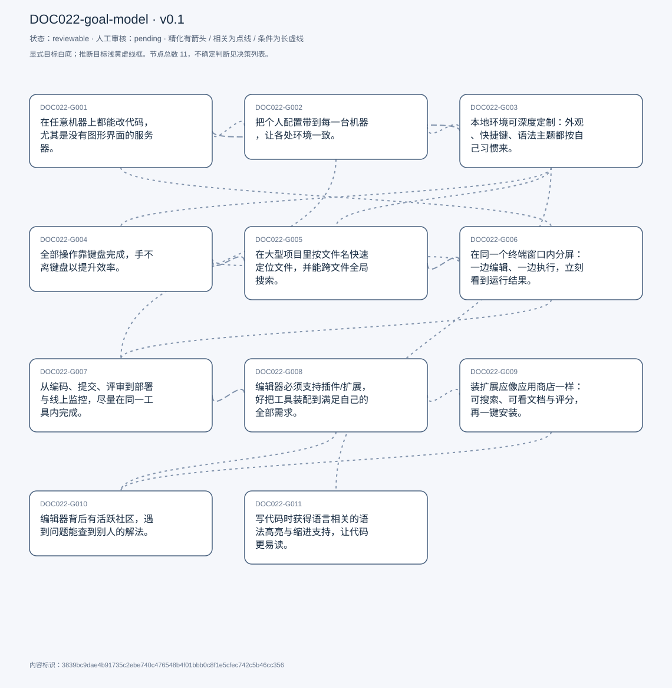

# 目标模型说明

模型：DOC022-goal-model；版本：v0.1

交付状态：reviewable；结构：passed；人工审核：pending

[交互模型](goal-model.html) · [矢量图](goal-model.svg) · [权威数据](goal-model.json)

## 目标图

## 目标

| 编号 | 表述 | 来源 | 情境 | 证据 |
|---|---|---|---|---|
| DOC022-G001 | 在任意机器上都能改代码，尤其是没有图形界面的服务器。 | explicit | 选择 vim 的实用理由：机器上不一定装了别的编辑器；服务器只能通过终端访问，无法运行图形界面编辑器 | E0001, E0002, E0003 |
| DOC022-G002 | 把个人配置带到每一台机器，让各处环境一致。 | explicit | 做法：维护一份 vim 配置文件，复制到服务器即可复现本地体验；这也是他称 vim「轻」的第二层含义 | E0004, E0005, E0006 |
| DOC022-G003 | 本地环境可深度定制：外观、快捷键、语法主题都按自己习惯来。 | explicit | 做法：装一堆插件、改界面「让它看起来很酷」；快捷键自定义到 ctrl+P / ctrl+E / 反斜杠+P | E0007, E0008, E0009 |
| DOC022-G004 | 全部操作靠键盘完成，手不离键盘以提升效率。 | explicit | 自述这是 vim 效率优势的核心；自评「酷」的旧动机已淡化，但效率理由保留 | E0010, E0011 |
| DOC022-G005 | 在大型项目里按文件名快速定位文件，并能跨文件全局搜索。 | explicit | 手段：模糊搜索插件（fuzzy finder）+ 文件树 | E0012, E0013, E0014 |
| DOC022-G006 | 在同一个终端窗口内分屏：一边编辑、一边执行，立刻看到运行结果。 | explicit | 工具：tmux 分左右两栏（命令行 / vim）；修改后切到命令行执行，结果立刻可见 | E0015, E0016 |
| DOC022-G007 | 从编码、提交、评审到部署与线上监控，尽量在同一工具内完成。 | explicit | 现状对比：终端工作流需频繁切浏览器（GitHub/Jenkins/AWS/Kibana）；VS Code 靠各类扩展把整条流水线收进编辑器 | E0017, E0018, E0019 |
| DOC022-G008 | 编辑器必须支持插件/扩展，好把工具装配到满足自己的全部需求。 | explicit | 理由：裸编辑器只负责改文本，开发者需要的远不止这些 | E0020, E0021 |
| DOC022-G009 | 装扩展应像应用商店一样：可搜索、可看文档与评分，再一键安装。 | explicit | 对照：vim 插件要翻 GitHub 页面、往配置文件里粘代码 | E0022, E0023 |
| DOC022-G010 | 编辑器背后有活跃社区，遇到问题能查到别人的解法。 | explicit | 他自己的 vim 学习路径：看 YouTube、Stack Overflow、问 GPT，几乎不读官方文档 | E0024, E0025 |
| DOC022-G011 | 写代码时获得语言相关的语法高亮与缩进支持，让代码更易读。 | explicit | 他以此区分「代码空间」与记事本；承认这是编辑器的基础能力，不含个性化 | E0026, E0027 |

## 关系判断（含不确定与无关系）

- DOC022-G001 / DOC022-G002：related。T031 把配置可迁移直接服务于「换机器也能干活」：把同一份配置放到服务器，远端环境就与本地一致。但 G001 是能不能改，G002 是改得顺不顺手。
- DOC022-G001 / DOC022-G003：related。T015 说本地会装插件、改界面，但服务器上只能用裸 vim——定制被限制在本地，不能破坏服务器可用性。两者共存但边界明确，互不替代。
- DOC022-G001 / DOC022-G004：none。DOC022-G001 的对象是任意机器尤其服务器上改代码（T015/T021），DOC022-G004 的对象是全键盘操作提效（T055/T063）；两处分别出自不同话题段，原文未在二者之间建立因果、手段、评价或情境包含关系，本次评估口径内未建立可采用关系。
- DOC022-G001 / DOC022-G005：none。DOC022-G001 的对象是任意机器尤其服务器上改代码（T015/T021），DOC022-G005 的对象是项目内快速定位与全局搜索（T033/T041）；两处分别出自不同话题段，原文未在二者之间建立因果、手段、评价或情境包含关系，本次评估口径内未建立可采用关系。
- DOC022-G001 / DOC022-G006：related。T051 描述的工作流整体跑在终端里（tmux + vim + 命令行），终端正是 G001 访问服务器的方式。但 G001 是可达性、G006 是同一终端内的布局效率。
- DOC022-G001 / DOC022-G007：none。DOC022-G001 的对象是任意机器尤其服务器上改代码（T015/T021），DOC022-G007 的对象是全流程收在同一工具（T081/T087）；两处分别出自不同话题段，原文未在二者之间建立因果、手段、评价或情境包含关系，本次评估口径内未建立可采用关系。
- DOC022-G001 / DOC022-G008：none。DOC022-G001 的对象是任意机器尤其服务器上改代码（T015/T021），DOC022-G008 的对象是支持插件扩展（T103）；两处分别出自不同话题段，原文未在二者之间建立因果、手段、评价或情境包含关系，本次评估口径内未建立可采用关系。
- DOC022-G001 / DOC022-G009：none。DOC022-G001 的对象是任意机器尤其服务器上改代码（T015/T021），DOC022-G009 的对象是应用商店式装扩展（T097）；两处分别出自不同话题段，原文未在二者之间建立因果、手段、评价或情境包含关系，本次评估口径内未建立可采用关系。
- DOC022-G001 / DOC022-G010：none。DOC022-G001 的对象是任意机器尤其服务器上改代码（T015/T021），DOC022-G010 的对象是活跃社区可查解法（T109）；两处分别出自不同话题段，原文未在二者之间建立因果、手段、评价或情境包含关系，本次评估口径内未建立可采用关系。
- DOC022-G001 / DOC022-G011：none。DOC022-G001 的对象是任意机器尤其服务器上改代码（T015/T021），DOC022-G011 的对象是语法高亮与缩进（T009/T011）；两处分别出自不同话题段，原文未在二者之间建立因果、手段、评价或情境包含关系，本次评估口径内未建立可采用关系。
- DOC022-G002 / DOC022-G003：related。定制的内容（插件、快捷键、主题）都写在配置文件里，配置可迁移就等于定制可迁移，两者是同一份文件的两面。但 G003 是内容、G002 是分发。
- DOC022-G002 / DOC022-G004：none。DOC022-G002 的对象是配置带到每台机器（T031），DOC022-G004 的对象是全键盘操作提效（T055/T063）；两处分别出自不同话题段，原文未在二者之间建立因果、手段、评价或情境包含关系，本次评估口径内未建立可采用关系。
- DOC022-G002 / DOC022-G005：none。DOC022-G002 的对象是配置带到每台机器（T031），DOC022-G005 的对象是项目内快速定位与全局搜索（T033/T041）；两处分别出自不同话题段，原文未在二者之间建立因果、手段、评价或情境包含关系，本次评估口径内未建立可采用关系。
- DOC022-G002 / DOC022-G006：none。DOC022-G002 的对象是配置带到每台机器（T031），DOC022-G006 的对象是终端分屏编辑与执行（T051）；两处分别出自不同话题段，原文未在二者之间建立因果、手段、评价或情境包含关系，本次评估口径内未建立可采用关系。
- DOC022-G002 / DOC022-G007：related。T069 直接对比了两种做法：vim 靠维护并搬移配置文件，VS Code 靠账号同步设置。目标相同——到哪台机器都是熟悉的环境；手段不同。
- DOC022-G002 / DOC022-G008：none。DOC022-G002 的对象是配置带到每台机器（T031），DOC022-G008 的对象是支持插件扩展（T103）；两处分别出自不同话题段，原文未在二者之间建立因果、手段、评价或情境包含关系，本次评估口径内未建立可采用关系。
- DOC022-G002 / DOC022-G009：none。DOC022-G002 的对象是配置带到每台机器（T031），DOC022-G009 的对象是应用商店式装扩展（T097）；两处分别出自不同话题段，原文未在二者之间建立因果、手段、评价或情境包含关系，本次评估口径内未建立可采用关系。
- DOC022-G002 / DOC022-G010：none。DOC022-G002 的对象是配置带到每台机器（T031），DOC022-G010 的对象是活跃社区可查解法（T109）；两处分别出自不同话题段，原文未在二者之间建立因果、手段、评价或情境包含关系，本次评估口径内未建立可采用关系。
- DOC022-G002 / DOC022-G011：none。DOC022-G002 的对象是配置带到每台机器（T031），DOC022-G011 的对象是语法高亮与缩进（T009/T011）；两处分别出自不同话题段，原文未在二者之间建立因果、手段、评价或情境包含关系，本次评估口径内未建立可采用关系。
- DOC022-G003 / DOC022-G004：related。T035–T051 的自定义核心就是键位（ctrl+P、ctrl+E、反斜杠+P），把常用动作绑到键盘，正是「手不离键盘」的实现方式。但 G003 还包含外观等与效率无关的部分。
- DOC022-G003 / DOC022-G005：related。T051 把模糊搜索绑到 ctrl+P，说明定位文件这个能力是通过自定义键位接入工作流的。但 G005 解决「找得到」、G003 解决「按我的习惯触发」。
- DOC022-G003 / DOC022-G006：none。DOC022-G003 的对象是深度定制外观与快捷键（T015/T035），DOC022-G006 的对象是终端分屏编辑与执行（T051）；两处分别出自不同话题段，原文未在二者之间建立因果、手段、评价或情境包含关系，本次评估口径内未建立可采用关系。
- DOC022-G003 / DOC022-G007：none。DOC022-G003 的对象是深度定制外观与快捷键（T015/T035），DOC022-G007 的对象是全流程收在同一工具（T081/T087）；两处分别出自不同话题段，原文未在二者之间建立因果、手段、评价或情境包含关系，本次评估口径内未建立可采用关系。
- DOC022-G003 / DOC022-G008：none。DOC022-G003 的对象是深度定制外观与快捷键（T015/T035），DOC022-G008 的对象是支持插件扩展（T103）；两处分别出自不同话题段，原文未在二者之间建立因果、手段、评价或情境包含关系，本次评估口径内未建立可采用关系。
- DOC022-G003 / DOC022-G009：none。DOC022-G003 的对象是深度定制外观与快捷键（T015/T035），DOC022-G009 的对象是应用商店式装扩展（T097）；两处分别出自不同话题段，原文未在二者之间建立因果、手段、评价或情境包含关系，本次评估口径内未建立可采用关系。
- DOC022-G003 / DOC022-G010：none。DOC022-G003 的对象是深度定制外观与快捷键（T015/T035），DOC022-G010 的对象是活跃社区可查解法（T109）；两处分别出自不同话题段，原文未在二者之间建立因果、手段、评价或情境包含关系，本次评估口径内未建立可采用关系。
- DOC022-G003 / DOC022-G011：related。T035 提到语法高亮与配色也能在配置文件里自定义，说明 G011 的基础能力是 G003 的定制对象之一。但 G011 是标配能力，G003 是个性化。
- DOC022-G004 / DOC022-G005：related。模糊搜索被绑成快捷键后，找文件不再需要鼠标点文件树——G005 的效率红利正是靠 G004 的全键盘前提兑现的。
- DOC022-G004 / DOC022-G006：related。T051 的 tmux 切窗口、ctrl+P 开文件全在键盘上完成，分屏本身也靠键盘切换，两者共同构成「手不离键盘」的工作流。但 G006 是多窗口布局、G004 是输入方式。
- DOC022-G004 / DOC022-G007：none。DOC022-G004 的对象是全键盘操作提效（T055/T063），DOC022-G007 的对象是全流程收在同一工具（T081/T087）；两处分别出自不同话题段，原文未在二者之间建立因果、手段、评价或情境包含关系，本次评估口径内未建立可采用关系。
- DOC022-G004 / DOC022-G008：none。DOC022-G004 的对象是全键盘操作提效（T055/T063），DOC022-G008 的对象是支持插件扩展（T103）；两处分别出自不同话题段，原文未在二者之间建立因果、手段、评价或情境包含关系，本次评估口径内未建立可采用关系。
- DOC022-G004 / DOC022-G009：none。DOC022-G004 的对象是全键盘操作提效（T055/T063），DOC022-G009 的对象是应用商店式装扩展（T097）；两处分别出自不同话题段，原文未在二者之间建立因果、手段、评价或情境包含关系，本次评估口径内未建立可采用关系。
- DOC022-G004 / DOC022-G010：none。DOC022-G004 的对象是全键盘操作提效（T055/T063），DOC022-G010 的对象是活跃社区可查解法（T109）；两处分别出自不同话题段，原文未在二者之间建立因果、手段、评价或情境包含关系，本次评估口径内未建立可采用关系。
- DOC022-G004 / DOC022-G011：none。DOC022-G004 的对象是全键盘操作提效（T055/T063），DOC022-G011 的对象是语法高亮与缩进（T009/T011）；两处分别出自不同话题段，原文未在二者之间建立因果、手段、评价或情境包含关系，本次评估口径内未建立可采用关系。
- DOC022-G005 / DOC022-G006：related。T051 的完整流程是：文件树或模糊搜索打开文件 → 编辑 → 切到旁边命令行执行。定位文件是分屏工作流的前半段。
- DOC022-G005 / DOC022-G007：none。DOC022-G005 的对象是项目内快速定位与全局搜索（T033/T041），DOC022-G007 的对象是全流程收在同一工具（T081/T087）；两处分别出自不同话题段，原文未在二者之间建立因果、手段、评价或情境包含关系，本次评估口径内未建立可采用关系。
- DOC022-G005 / DOC022-G008：none。DOC022-G005 的对象是项目内快速定位与全局搜索（T033/T041），DOC022-G008 的对象是支持插件扩展（T103）；两处分别出自不同话题段，原文未在二者之间建立因果、手段、评价或情境包含关系，本次评估口径内未建立可采用关系。
- DOC022-G005 / DOC022-G009：none。DOC022-G005 的对象是项目内快速定位与全局搜索（T033/T041），DOC022-G009 的对象是应用商店式装扩展（T097）；两处分别出自不同话题段，原文未在二者之间建立因果、手段、评价或情境包含关系，本次评估口径内未建立可采用关系。
- DOC022-G005 / DOC022-G010：none。DOC022-G005 的对象是项目内快速定位与全局搜索（T033/T041），DOC022-G010 的对象是活跃社区可查解法（T109）；两处分别出自不同话题段，原文未在二者之间建立因果、手段、评价或情境包含关系，本次评估口径内未建立可采用关系。
- DOC022-G005 / DOC022-G011：none。DOC022-G005 的对象是项目内快速定位与全局搜索（T033/T041），DOC022-G011 的对象是语法高亮与缩进（T009/T011）；两处分别出自不同话题段，原文未在二者之间建立因果、手段、评价或情境包含关系，本次评估口径内未建立可采用关系。
- DOC022-G006 / DOC022-G007：related。T087 把两套流程逐项对照：终端工作流在改完代码后必须切到浏览器做评审、部署、监控；G007 正是要把这些步骤收回同一界面。但 G006 只覆盖编码与执行。
- DOC022-G006 / DOC022-G008：none。DOC022-G006 的对象是终端分屏编辑与执行（T051），DOC022-G008 的对象是支持插件扩展（T103）；两处分别出自不同话题段，原文未在二者之间建立因果、手段、评价或情境包含关系，本次评估口径内未建立可采用关系。
- DOC022-G006 / DOC022-G009：none。DOC022-G006 的对象是终端分屏编辑与执行（T051），DOC022-G009 的对象是应用商店式装扩展（T097）；两处分别出自不同话题段，原文未在二者之间建立因果、手段、评价或情境包含关系，本次评估口径内未建立可采用关系。
- DOC022-G006 / DOC022-G010：none。DOC022-G006 的对象是终端分屏编辑与执行（T051），DOC022-G010 的对象是活跃社区可查解法（T109）；两处分别出自不同话题段，原文未在二者之间建立因果、手段、评价或情境包含关系，本次评估口径内未建立可采用关系。
- DOC022-G006 / DOC022-G011：none。DOC022-G006 的对象是终端分屏编辑与执行（T051），DOC022-G011 的对象是语法高亮与缩进（T009/T011）；两处分别出自不同话题段，原文未在二者之间建立因果、手段、评价或情境包含关系，本次评估口径内未建立可采用关系。
- DOC022-G007 / DOC022-G008：related。T091 说明整条流水线是靠一个个扩展接进来的（GitHub、Actions、Azure、Datadog），G008 是 G007 的实现前提。但 G008 是能力开放，G007 是具体结果。
- DOC022-G007 / DOC022-G009：none。DOC022-G007 的对象是全流程收在同一工具（T081/T087），DOC022-G009 的对象是应用商店式装扩展（T097）；两处分别出自不同话题段，原文未在二者之间建立因果、手段、评价或情境包含关系，本次评估口径内未建立可采用关系。
- DOC022-G007 / DOC022-G010：none。DOC022-G007 的对象是全流程收在同一工具（T081/T087），DOC022-G010 的对象是活跃社区可查解法（T109）；两处分别出自不同话题段，原文未在二者之间建立因果、手段、评价或情境包含关系，本次评估口径内未建立可采用关系。
- DOC022-G007 / DOC022-G011：none。DOC022-G007 的对象是全流程收在同一工具（T081/T087），DOC022-G011 的对象是语法高亮与缩进（T009/T011）；两处分别出自不同话题段，原文未在二者之间建立因果、手段、评价或情境包含关系，本次评估口径内未建立可采用关系。
- DOC022-G008 / DOC022-G009：related。两者都关于扩展：G008 要求「能有扩展」，G009 要求「好找好评估好装」。前者是生态存在性、后者是获取体验；vim 有插件但安装体验差，正好说明二者可分离。
- DOC022-G008 / DOC022-G010：related。T103 把两者直接绑定：「有插件/扩展意味着有整个社区在支持它，没人想用一个没有社区的产品」。但 G008 是机制、G010 是人。
- DOC022-G008 / DOC022-G011：none。DOC022-G008 的对象是支持插件扩展（T103），DOC022-G011 的对象是语法高亮与缩进（T009/T011）；两处分别出自不同话题段，原文未在二者之间建立因果、手段、评价或情境包含关系，本次评估口径内未建立可采用关系。
- DOC022-G009 / DOC022-G010：related。T097 说商店里能看到文档、评分与讨论，正是社区信息在安装环节的呈现；G010 要的「能查别人怎么解决」在这个页面就能看到一部分。但 G010 还包括安装之后的长期求助。
- DOC022-G009 / DOC022-G011：none。DOC022-G009 的对象是应用商店式装扩展（T097），DOC022-G011 的对象是语法高亮与缩进（T009/T011）；两处分别出自不同话题段，原文未在二者之间建立因果、手段、评价或情境包含关系，本次评估口径内未建立可采用关系。
- DOC022-G010 / DOC022-G011：none。DOC022-G010 的对象是活跃社区可查解法（T109），DOC022-G011 的对象是语法高亮与缩进（T009/T011）；两处分别出自不同话题段，原文未在二者之间建立因果、手段、评价或情境包含关系，本次评估口径内未建立可采用关系。

## 证据

### E0001 · DOC022:S016

> You have to work at different machines

原件位置：{&quot;line_start&quot;: 16, &quot;line_end&quot;: 16, &quot;start_char&quot;: 3563, &quot;end_char&quot;: 5456}

### E0002 · DOC022:S016

> when I have to like change some things at at the server, I can just easily open the vim and and modify the code

原件位置：{&quot;line_start&quot;: 16, &quot;line_end&quot;: 16, &quot;start_char&quot;: 3563, &quot;end_char&quot;: 5456}

### E0003 · DOC022:S022

> you can only run vim on the terminal, because you can only access to the command line interface

原件位置：{&quot;line_start&quot;: 22, &quot;line_end&quot;: 22, &quot;start_char&quot;: 5921, &quot;end_char&quot;: 6792}

### E0004 · DOC022:S032

> make every system just like your local local customization

原件位置：{&quot;line_start&quot;: 32, &quot;line_end&quot;: 32, &quot;start_char&quot;: 8888, &quot;end_char&quot;: 10550}

### E0005 · DOC022:S032

> if you put put it in the server and and the server will will be just like your local beam

原件位置：{&quot;line_start&quot;: 32, &quot;line_end&quot;: 32, &quot;start_char&quot;: 8888, &quot;end_char&quot;: 10550}

### E0006 · DOC022:S016

> if I don&#x27;t get used to the vim, I may find difficulty to easily modify codes on the server

原件位置：{&quot;line_start&quot;: 16, &quot;line_end&quot;: 16, &quot;start_char&quot;: 3563, &quot;end_char&quot;: 5456}

### E0007 · DOC022:S016

> I will like customize them to to. I will install a bunch of like cool plugins

原件位置：{&quot;line_start&quot;: 16, &quot;line_end&quot;: 16, &quot;start_char&quot;: 3563, &quot;end_char&quot;: 5456}

### E0008 · DOC022:S036

> I can customize like, which shortcut I want to activate it

原件位置：{&quot;line_start&quot;: 36, &quot;line_end&quot;: 36, &quot;start_char&quot;: 12170, &quot;end_char&quot;: 12785}

### E0009 · DOC022:S052

> control. P is open the file in this project

原件位置：{&quot;line_start&quot;: 52, &quot;line_end&quot;: 52, &quot;start_char&quot;: 14854, &quot;end_char&quot;: 17255}

### E0010 · DOC022:S056

> everything you do is on the keyboard

原件位置：{&quot;line_start&quot;: 56, &quot;line_end&quot;: 56, &quot;start_char&quot;: 17794, &quot;end_char&quot;: 20204}

### E0011 · DOC022:S064

> keep keeping your hands on the keyboard. Just do improve your efficiency

原件位置：{&quot;line_start&quot;: 64, &quot;line_end&quot;: 64, &quot;start_char&quot;: 23069, &quot;end_char&quot;: 23931}

### E0012 · DOC022:S034

> I can install like fuzzy search in in my, in my vein

原件位置：{&quot;line_start&quot;: 34, &quot;line_end&quot;: 34, &quot;start_char&quot;: 10619, &quot;end_char&quot;: 12062}

### E0013 · DOC022:S042

> helps you to find the file by its name

原件位置：{&quot;line_start&quot;: 42, &quot;line_end&quot;: 42, &quot;start_char&quot;: 13127, &quot;end_char&quot;: 14120}

### E0014 · DOC022:S042

> you can search the stream across every files in your project

原件位置：{&quot;line_start&quot;: 42, &quot;line_end&quot;: 42, &quot;start_char&quot;: 13127, &quot;end_char&quot;: 14120}

### E0015 · DOC022:S052

> I will split the tmox split the window into half, and one is for command line one is for vim

原件位置：{&quot;line_start&quot;: 52, &quot;line_end&quot;: 52, &quot;start_char&quot;: 14854, &quot;end_char&quot;: 17255}

### E0016 · DOC022:S052

> I will execute the code. There, I can. I can just see the result immediately

原件位置：{&quot;line_start&quot;: 52, &quot;line_end&quot;: 52, &quot;start_char&quot;: 14854, &quot;end_char&quot;: 17255}

### E0017 · DOC022:S082

> the whole pipeline is integrating Vs code like

原件位置：{&quot;line_start&quot;: 82, &quot;line_end&quot;: 82, &quot;start_char&quot;: 31361, &quot;end_char&quot;: 33174}

### E0018 · DOC022:S088

> Everything can be finished on Vs code

原件位置：{&quot;line_start&quot;: 88, &quot;line_end&quot;: 88, &quot;start_char&quot;: 33645, &quot;end_char&quot;: 36008}

### E0019 · DOC022:S092

> There&#x27;s a extension on the Vs code

原件位置：{&quot;line_start&quot;: 92, &quot;line_end&quot;: 92, &quot;start_char&quot;: 36373, &quot;end_char&quot;: 37578}

### E0020 · DOC022:S104

> there&#x27;s a must for editor

原件位置：{&quot;line_start&quot;: 104, &quot;line_end&quot;: 104, &quot;start_char&quot;: 40238, &quot;end_char&quot;: 40952}

### E0021 · DOC022:S104

> The the editor must supports plugins or extensions

原件位置：{&quot;line_start&quot;: 104, &quot;line_end&quot;: 104, &quot;start_char&quot;: 40238, &quot;end_char&quot;: 40952}

### E0022 · DOC022:S098

> just go to the marketplace and search the extension you want

原件位置：{&quot;line_start&quot;: 98, &quot;line_end&quot;: 98, &quot;start_char&quot;: 39061, &quot;end_char&quot;: 39845}

### E0023 · DOC022:S098

> You can see the ratings

原件位置：{&quot;line_start&quot;: 98, &quot;line_end&quot;: 98, &quot;start_char&quot;: 39061, &quot;end_char&quot;: 39845}

### E0024 · DOC022:S110

> when it has a community, you can, you can see how people solve issues

原件位置：{&quot;line_start&quot;: 110, &quot;line_end&quot;: 110, &quot;start_char&quot;: 41457, &quot;end_char&quot;: 42787}

### E0025 · DOC022:S110

> How big is the community

原件位置：{&quot;line_start&quot;: 110, &quot;line_end&quot;: 110, &quot;start_char&quot;: 41457, &quot;end_char&quot;: 42787}

### E0026 · DOC022:S010

> you may have to like, like customize like in indent distance, or some like highlighting

原件位置：{&quot;line_start&quot;: 10, &quot;line_end&quot;: 10, &quot;start_char&quot;: 1105, &quot;end_char&quot;: 1774}

### E0027 · DOC022:S012

> The syntax highlighting will help you like read the code better

原件位置：{&quot;line_start&quot;: 12, &quot;line_end&quot;: 12, &quot;start_char&quot;: 1918, &quot;end_char&quot;: 3104}

## 问题、限制与版本

- 当前会话助手的开发判断，非独立盲测；无人工采纳记录。
- 结构检查已绑定当前版本；独立语义审查未执行；人工状态以实际审核记录为准。

内容标识：3839bc9dae4b91735c2ebe740c476548b4f01bbb0c8f1e5cfec742c5b46cc356

人工决定：

审核意见：
