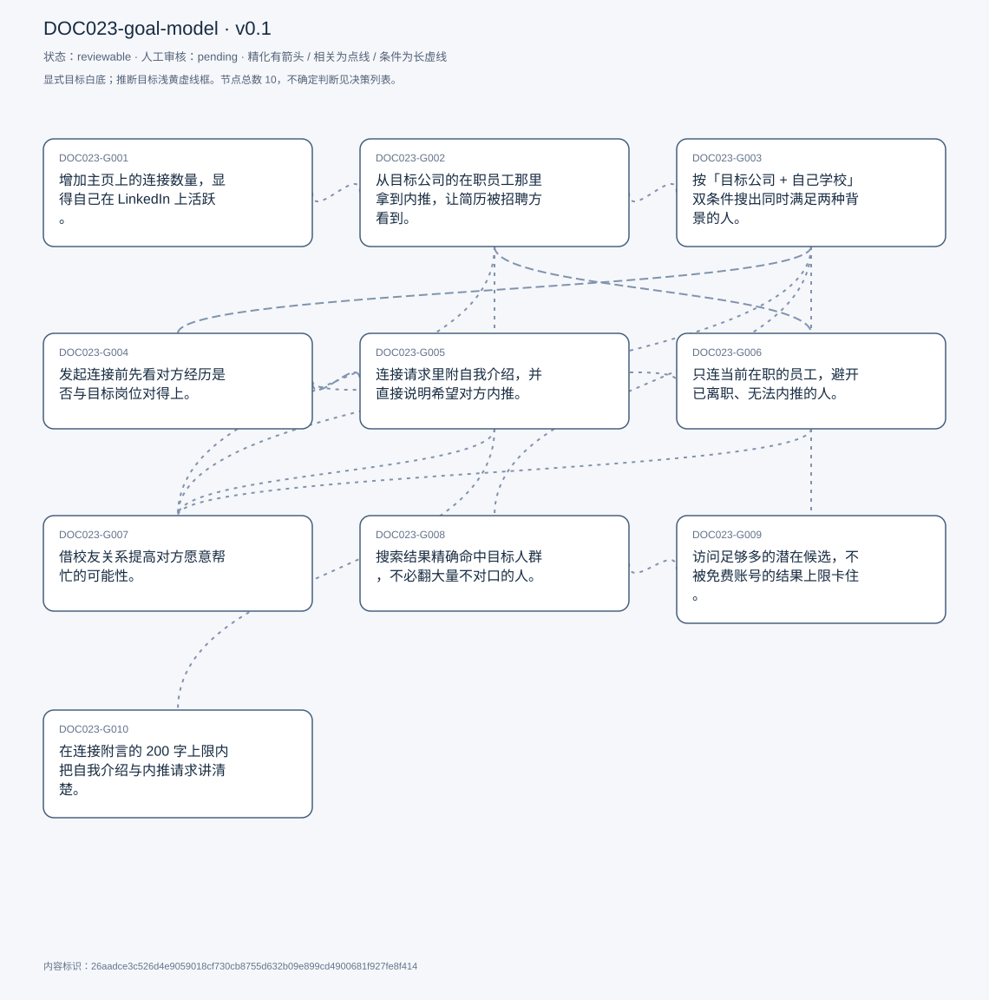
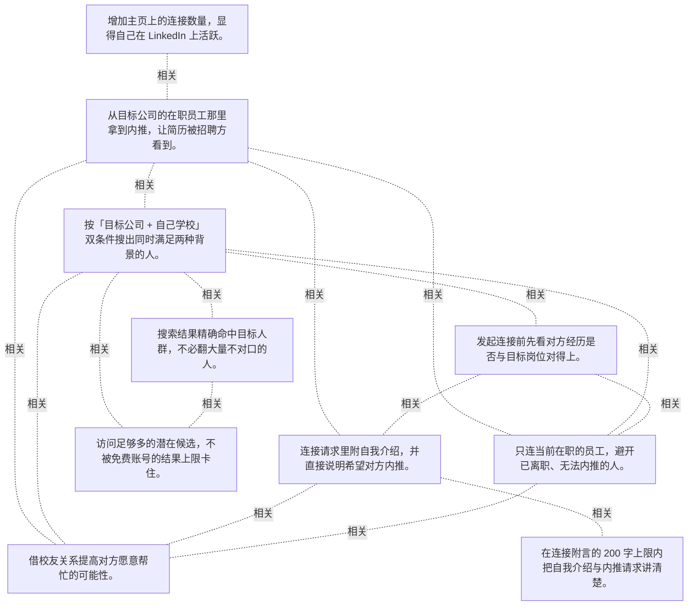

# 目标模型说明

模型：DOC023-goal-model；版本：v0.1

交付状态：reviewable；结构：passed；人工审核：pending

[交互模型](goal-model.html) · [矢量图](goal-model.svg) · [权威数据](goal-model.json)

## 目标图

## 目标

| 编号 | 表述 | 来源 | 情境 | 证据 |
|---|---|---|---|---|
| DOC023-G001 | 增加主页上的连接数量，显得自己在 LinkedIn 上活跃。 | explicit | 自述为两个主要目标之一；理由是对外展示活跃度 | E0001, E0002 |
| DOC023-G002 | 从目标公司的在职员工那里拿到内推，让简历被招聘方看到。 | explicit | 自述为第二个主要目标；判断依据：实习与全职申请竞争激烈 | E0003, E0004 |
| DOC023-G003 | 按「目标公司 + 自己学校」双条件搜出同时满足两种背景的人。 | explicit | 做法：搜索框同时输入公司名与大学名；理由：公司决定能不能内推，校友决定愿不愿意帮 | E0005, E0006, E0007 |
| DOC023-G004 | 发起连接前先看对方经历是否与目标岗位对得上。 | explicit | 顺序：搜索结果 → 点进主页看经历 → 合适才点 connect | E0008, E0009 |
| DOC023-G005 | 连接请求里附自我介绍，并直接说明希望对方内推。 | explicit | LinkedIn 允许在连接请求里附一段 note | E0010, E0011 |
| DOC023-G006 | 只连当前在职的员工，避开已离职、无法内推的人。 | explicit | 理由：只有在职员工才有内推资格；搜索会混入前员工，需要人工剔除 | E0012, E0013 |
| DOC023-G007 | 借校友关系提高对方愿意帮忙的可能性。 | explicit | 理由：同校的人对母校体验好，更愿意帮校友；做法：消息里点明自己也是该校学生 | E0014, E0015 |
| DOC023-G008 | 搜索结果精确命中目标人群，不必翻大量不对口的人。 | explicit | 现状：结果常只满足一个条件或都不满足 | E0016, E0017 |
| DOC023-G009 | 访问足够多的潜在候选，不被免费账号的结果上限卡住。 | explicit | 现状：非会员只能看有限列表，最坏情况只给一两条甚至没有 | E0018, E0019 |
| DOC023-G010 | 在连接附言的 200 字上限内把自我介绍与内推请求讲清楚。 | explicit | 非会员上限 200 字符；自述压缩措辞很花时间 | E0020, E0021, E0022 |

## 关系判断（含不确定与无关系）

- DOC023-G001 / DOC023-G002：related。T003 把二者并列为两个主要目标，且共用同一个动作——发连接请求：一次连接既抬高连接数，也可能带来内推。但一个是展示性指标、一个是实际收益。
- DOC023-G001 / DOC023-G003：none。DOC023-G001 的对象是连接数做大显得活跃（T003），DOC023-G003 的对象是公司+学校双条件搜人（T007/T009）；两处分别出自不同话题段，原文未在二者之间建立因果、手段、评价或情境包含关系，本次评估口径内未建立可采用关系。
- DOC023-G001 / DOC023-G004：none。DOC023-G001 的对象是连接数做大显得活跃（T003），DOC023-G004 的对象是连接前核实经历（T007）；两处分别出自不同话题段，原文未在二者之间建立因果、手段、评价或情境包含关系，本次评估口径内未建立可采用关系。
- DOC023-G001 / DOC023-G005：none。DOC023-G001 的对象是连接数做大显得活跃（T003），DOC023-G005 的对象是附言自荐并求内推（T007）；两处分别出自不同话题段，原文未在二者之间建立因果、手段、评价或情境包含关系，本次评估口径内未建立可采用关系。
- DOC023-G001 / DOC023-G006：uncertain。两者可能互相拉扯：T003 要的是连接数增长（广度指标），T009 却只连当前在职且同校的人（极窄的精度）。若严格按 G006 执行，连接数增长会很慢；若为 G001 放宽标准，就会连一些无法内推的人。原文没有说明他是否也接受纯为数量而连接，也没有给出两者的优先级，无法自行裁决。
- DOC023-G001 / DOC023-G007：none。DOC023-G001 的对象是连接数做大显得活跃（T003），DOC023-G007 的对象是借校友关系提高意愿（T009/T011）；两处分别出自不同话题段，原文未在二者之间建立因果、手段、评价或情境包含关系，本次评估口径内未建立可采用关系。
- DOC023-G001 / DOC023-G008：none。DOC023-G001 的对象是连接数做大显得活跃（T003），DOC023-G008 的对象是搜索结果精确命中（T013）；两处分别出自不同话题段，原文未在二者之间建立因果、手段、评价或情境包含关系，本次评估口径内未建立可采用关系。
- DOC023-G001 / DOC023-G009：none。DOC023-G001 的对象是连接数做大显得活跃（T003），DOC023-G009 的对象是访问足够候选不受限（T013/T015）；两处分别出自不同话题段，原文未在二者之间建立因果、手段、评价或情境包含关系，本次评估口径内未建立可采用关系。
- DOC023-G001 / DOC023-G010：none。DOC023-G001 的对象是连接数做大显得活跃（T003），DOC023-G010 的对象是200 字内讲清（T017）；两处分别出自不同话题段，原文未在二者之间建立因果、手段、评价或情境包含关系，本次评估口径内未建立可采用关系。
- DOC023-G002 / DOC023-G003：related。T007 的搜索条件就是为内推服务的：公司决定对方能不能推、学校决定对方愿不愿推，两个关键词各自对应内推成立的一半条件。
- DOC023-G002 / DOC023-G004：none。DOC023-G002 的对象是从在职员工拿内推（T003），DOC023-G004 的对象是连接前核实经历（T007）；两处分别出自不同话题段，原文未在二者之间建立因果、手段、评价或情境包含关系，本次评估口径内未建立可采用关系。
- DOC023-G002 / DOC023-G005：related。T007 的连接流程把「加好友」与「提内推」合成一步：附言里既自我介绍也直接说明来意。但 G005 是沟通方式，G002 是最终想要的结果。
- DOC023-G002 / DOC023-G006：related。T011 给出硬约束：只有在职员工才有内推资格，所以 G002 能否达成取决于 G006 的筛选是否准确。但 G006 是必要条件，不是充分条件——在职也可能拒绝。
- DOC023-G002 / DOC023-G007：related。T011 用校友身份解释「为什么对方愿意帮」：公司条件解决资格问题，学校条件解决意愿问题，两者共同提高内推成功率。但一个是硬门槛、一个是软倾向。
- DOC023-G002 / DOC023-G008：none。DOC023-G002 的对象是从在职员工拿内推（T003），DOC023-G008 的对象是搜索结果精确命中（T013）；两处分别出自不同话题段，原文未在二者之间建立因果、手段、评价或情境包含关系，本次评估口径内未建立可采用关系。
- DOC023-G002 / DOC023-G009：none。DOC023-G002 的对象是从在职员工拿内推（T003），DOC023-G009 的对象是访问足够候选不受限（T013/T015）；两处分别出自不同话题段，原文未在二者之间建立因果、手段、评价或情境包含关系，本次评估口径内未建立可采用关系。
- DOC023-G002 / DOC023-G010：none。DOC023-G002 的对象是从在职员工拿内推（T003），DOC023-G010 的对象是200 字内讲清（T017）；两处分别出自不同话题段，原文未在二者之间建立因果、手段、评价或情境包含关系，本次评估口径内未建立可采用关系。
- DOC023-G003 / DOC023-G004：related。T007 的流程是搜索结果 → 点进主页核实 → 再点连接；搜索给候选，主页核对确认经历是否对口。但 G003 决定「谁进候选」，G004 决定「谁被排除」。
- DOC023-G003 / DOC023-G005：none。DOC023-G003 的对象是公司+学校双条件搜人（T007/T009），DOC023-G005 的对象是附言自荐并求内推（T007）；两处分别出自不同话题段，原文未在二者之间建立因果、手段、评价或情境包含关系，本次评估口径内未建立可采用关系。
- DOC023-G003 / DOC023-G006：related。T009 指出按公司搜会混入前员工，说明双条件搜索本身不能保证「在职」；G006 是对 G003 结果的必要修正。
- DOC023-G003 / DOC023-G007：related。T011 把「加学校名」这个搜索动作直接解释为借校友关系提高意愿——搜索条件与沟通策略是同一考虑的两端。但一个是筛人、一个是说服。
- DOC023-G003 / DOC023-G008：related。T013 抱怨的正是双条件搜索的精度：结果常只满足一半条件或都不满足，导致要人工翻查。G008 是对 G003 执行质量的直接要求。
- DOC023-G003 / DOC023-G009：related。T013 把「结果不精确」与「非会员只能看有限列表」并列为障碍，两者都限制了他能拿到的候选池。但一个是精度问题、一个是容量问题。
- DOC023-G003 / DOC023-G010：none。DOC023-G003 的对象是公司+学校双条件搜人（T007/T009），DOC023-G010 的对象是200 字内讲清（T017）；两处分别出自不同话题段，原文未在二者之间建立因果、手段、评价或情境包含关系，本次评估口径内未建立可采用关系。
- DOC023-G004 / DOC023-G005：related。T007 的流程是看完主页再决定连接，而连接必附一段自我介绍——核实结果决定要不要发、以及消息怎么写。但一个是判断、一个是表达。
- DOC023-G004 / DOC023-G006：related。T007 说查看经历就是为了确认对方是否为目标岗位背景；T009 的排除依据（前员工、只满足一个条件）正是从主页读出来的。G004 是 G006 的执行手段。
- DOC023-G004 / DOC023-G007：none。DOC023-G004 的对象是连接前核实经历（T007），DOC023-G007 的对象是借校友关系提高意愿（T009/T011）；两处分别出自不同话题段，原文未在二者之间建立因果、手段、评价或情境包含关系，本次评估口径内未建立可采用关系。
- DOC023-G004 / DOC023-G008：none。DOC023-G004 的对象是连接前核实经历（T007），DOC023-G008 的对象是搜索结果精确命中（T013）；两处分别出自不同话题段，原文未在二者之间建立因果、手段、评价或情境包含关系，本次评估口径内未建立可采用关系。
- DOC023-G004 / DOC023-G009：none。DOC023-G004 的对象是连接前核实经历（T007），DOC023-G009 的对象是访问足够候选不受限（T013/T015）；两处分别出自不同话题段，原文未在二者之间建立因果、手段、评价或情境包含关系，本次评估口径内未建立可采用关系。
- DOC023-G004 / DOC023-G010：none。DOC023-G004 的对象是连接前核实经历（T007），DOC023-G010 的对象是200 字内讲清（T017）；两处分别出自不同话题段，原文未在二者之间建立因果、手段、评价或情境包含关系，本次评估口径内未建立可采用关系。
- DOC023-G005 / DOC023-G006：none。DOC023-G005 的对象是附言自荐并求内推（T007），DOC023-G006 的对象是只连在职员工（T009/T011）；两处分别出自不同话题段，原文未在二者之间建立因果、手段、评价或情境包含关系，本次评估口径内未建立可采用关系。
- DOC023-G005 / DOC023-G007：related。T009 说他会在消息里点明自己也是该校学生，正是把 G007 的校友优势落实到附言文本上。但 G007 是策略，G005 是承载它的载体。
- DOC023-G005 / DOC023-G008：none。DOC023-G005 的对象是附言自荐并求内推（T007），DOC023-G008 的对象是搜索结果精确命中（T013）；两处分别出自不同话题段，原文未在二者之间建立因果、手段、评价或情境包含关系，本次评估口径内未建立可采用关系。
- DOC023-G005 / DOC023-G009：none。DOC023-G005 的对象是附言自荐并求内推（T007），DOC023-G009 的对象是访问足够候选不受限（T013/T015）；两处分别出自不同话题段，原文未在二者之间建立因果、手段、评价或情境包含关系，本次评估口径内未建立可采用关系。
- DOC023-G005 / DOC023-G010：related。T017 的 200 字上限直接压在 G005 的附言上：自我介绍 + 内推请求要在极短篇幅里说完，他因此反复压缩措辞。但 G010 是篇幅约束，G005 是内容诉求。
- DOC023-G006 / DOC023-G007：related。T009–T011 把两个筛人条件并列：在职解决「能不能推」，同校解决「愿不愿推」。二者互补，缺一个都会降低成功率。
- DOC023-G006 / DOC023-G008：none。DOC023-G006 的对象是只连在职员工（T009/T011），DOC023-G008 的对象是搜索结果精确命中（T013）；两处分别出自不同话题段，原文未在二者之间建立因果、手段、评价或情境包含关系，本次评估口径内未建立可采用关系。
- DOC023-G006 / DOC023-G009：none。DOC023-G006 的对象是只连在职员工（T009/T011），DOC023-G009 的对象是访问足够候选不受限（T013/T015）；两处分别出自不同话题段，原文未在二者之间建立因果、手段、评价或情境包含关系，本次评估口径内未建立可采用关系。
- DOC023-G006 / DOC023-G010：none。DOC023-G006 的对象是只连在职员工（T009/T011），DOC023-G010 的对象是200 字内讲清（T017）；两处分别出自不同话题段，原文未在二者之间建立因果、手段、评价或情境包含关系，本次评估口径内未建立可采用关系。
- DOC023-G007 / DOC023-G008：none。DOC023-G007 的对象是借校友关系提高意愿（T009/T011），DOC023-G008 的对象是搜索结果精确命中（T013）；两处分别出自不同话题段，原文未在二者之间建立因果、手段、评价或情境包含关系，本次评估口径内未建立可采用关系。
- DOC023-G007 / DOC023-G009：none。DOC023-G007 的对象是借校友关系提高意愿（T009/T011），DOC023-G009 的对象是访问足够候选不受限（T013/T015）；两处分别出自不同话题段，原文未在二者之间建立因果、手段、评价或情境包含关系，本次评估口径内未建立可采用关系。
- DOC023-G007 / DOC023-G010：none。DOC023-G007 的对象是借校友关系提高意愿（T009/T011），DOC023-G010 的对象是200 字内讲清（T017）；两处分别出自不同话题段，原文未在二者之间建立因果、手段、评价或情境包含关系，本次评估口径内未建立可采用关系。
- DOC023-G008 / DOC023-G009：related。T013 把搜索结果不精确与免费额度受限并列为同一段障碍，两者共同导致「翻很多人也找不到足够候选」。但精确度靠算法、容量靠付费。
- DOC023-G008 / DOC023-G010：none。DOC023-G008 的对象是搜索结果精确命中（T013），DOC023-G010 的对象是200 字内讲清（T017）；两处分别出自不同话题段，原文未在二者之间建立因果、手段、评价或情境包含关系，本次评估口径内未建立可采用关系。
- DOC023-G009 / DOC023-G010：none。DOC023-G009 的对象是访问足够候选不受限（T013/T015），DOC023-G010 的对象是200 字内讲清（T017）；两处分别出自不同话题段，原文未在二者之间建立因果、手段、评价或情境包含关系，本次评估口径内未建立可采用关系。

## 证据

### E0001 · DOC023:S004

> the 1st one is to enlarge my the number of my connections on my profile

原件位置：{&quot;line_start&quot;: 4, &quot;line_end&quot;: 4, &quot;start_char&quot;: 393, &quot;end_char&quot;: 1351}

### E0002 · DOC023:S004

> to show people that I&#x27;m active on Linkedin

原件位置：{&quot;line_start&quot;: 4, &quot;line_end&quot;: 4, &quot;start_char&quot;: 393, &quot;end_char&quot;: 1351}

### E0003 · DOC023:S004

> my sec second goal is to to get referrals from current employees

原件位置：{&quot;line_start&quot;: 4, &quot;line_end&quot;: 4, &quot;start_char&quot;: 393, &quot;end_char&quot;: 1351}

### E0004 · DOC023:S004

> sometimes a referral really helps to get my resume being seen by recruiters

原件位置：{&quot;line_start&quot;: 4, &quot;line_end&quot;: 4, &quot;start_char&quot;: 393, &quot;end_char&quot;: 1351}

### E0005 · DOC023:S008

> I will like type my company and my university in the search bar

原件位置：{&quot;line_start&quot;: 8, &quot;line_end&quot;: 8, &quot;start_char&quot;: 1780, &quot;end_char&quot;: 3096}

### E0006 · DOC023:S010

> I will only choose people who is currently a company employee and who was my university&#x27;s student

原件位置：{&quot;line_start&quot;: 10, &quot;line_end&quot;: 10, &quot;start_char&quot;: 3265, &quot;end_char&quot;: 4277}

### E0007 · DOC023:S012

> Students who attend the same university tends to like want to help the alumni

原件位置：{&quot;line_start&quot;: 12, &quot;line_end&quot;: 12, &quot;start_char&quot;: 4343, &quot;end_char&quot;: 5033}

### E0008 · DOC023:S008

> I am going to click on, click into their profile and to see about their experience

原件位置：{&quot;line_start&quot;: 8, &quot;line_end&quot;: 8, &quot;start_char&quot;: 1780, &quot;end_char&quot;: 3096}

### E0009 · DOC023:S008

> If their experience are the exactly what I&#x27;m looking for. Then I&#x27;m going to hit the connect button

原件位置：{&quot;line_start&quot;: 8, &quot;line_end&quot;: 8, &quot;start_char&quot;: 1780, &quot;end_char&quot;: 3096}

### E0010 · DOC023:S008

> I will usually like add a message to introduce myself

原件位置：{&quot;line_start&quot;: 8, &quot;line_end&quot;: 8, &quot;start_char&quot;: 1780, &quot;end_char&quot;: 3096}

### E0011 · DOC023:S008

> If they will like to refer me for the position

原件位置：{&quot;line_start&quot;: 8, &quot;line_end&quot;: 8, &quot;start_char&quot;: 1780, &quot;end_char&quot;: 3096}

### E0012 · DOC023:S010

> They are not current employees, so they are not able to refer me for the position

原件位置：{&quot;line_start&quot;: 10, &quot;line_end&quot;: 10, &quot;start_char&quot;: 3265, &quot;end_char&quot;: 4277}

### E0013 · DOC023:S012

> only company employee is able to refer me

原件位置：{&quot;line_start&quot;: 12, &quot;line_end&quot;: 12, &quot;start_char&quot;: 4343, &quot;end_char&quot;: 5033}

### E0014 · DOC023:S012

> Students who attend the same university tends to like want to help the alumni

原件位置：{&quot;line_start&quot;: 12, &quot;line_end&quot;: 12, &quot;start_char&quot;: 4343, &quot;end_char&quot;: 5033}

### E0015 · DOC023:S010

> who was my university&#x27;s student

原件位置：{&quot;line_start&quot;: 10, &quot;line_end&quot;: 10, &quot;start_char&quot;: 3265, &quot;end_char&quot;: 4277}

### E0016 · DOC023:S014

> Linking doesn&#x27;t like always provides me with the result I want

原件位置：{&quot;line_start&quot;: 14, &quot;line_end&quot;: 14, &quot;start_char&quot;: 5240, &quot;end_char&quot;: 6003}

### E0017 · DOC023:S014

> I may go through like a lot of people in the search result

原件位置：{&quot;line_start&quot;: 14, &quot;line_end&quot;: 14, &quot;start_char&quot;: 5240, &quot;end_char&quot;: 6003}

### E0018 · DOC023:S014

> you&#x27;re probably gonna able to access like a limited list of people

原件位置：{&quot;line_start&quot;: 14, &quot;line_end&quot;: 14, &quot;start_char&quot;: 5240, &quot;end_char&quot;: 6003}

### E0019 · DOC023:S016

> purchase the linking premium

原件位置：{&quot;line_start&quot;: 16, &quot;line_end&quot;: 16, &quot;start_char&quot;: 6113, &quot;end_char&quot;: 6717}

### E0020 · DOC023:S018

> there is also, like a character limitations for the note

原件位置：{&quot;line_start&quot;: 18, &quot;line_end&quot;: 18, &quot;start_char&quot;: 6879, &quot;end_char&quot;: 7584}

### E0021 · DOC023:S018

> for a non-member is 200 characters

原件位置：{&quot;line_start&quot;: 18, &quot;line_end&quot;: 18, &quot;start_char&quot;: 6879, &quot;end_char&quot;: 7584}

### E0022 · DOC023:S018

> it really takes some time for me to like, shrink them words in my message

原件位置：{&quot;line_start&quot;: 18, &quot;line_end&quot;: 18, &quot;start_char&quot;: 6879, &quot;end_char&quot;: 7584}

## 问题、限制与版本

- 两者可能互相拉扯：T003 要的是连接数增长（广度指标），T009 却只连当前在职且同校的人（极窄的精度）。若严格按 G006 执行，连接数增长会很慢；若为 G001 放宽标准，就会连一些无法内推的人。原文没有说明他是否也接受纯为数量而连接，也没有给出两者的优先级，无法自行裁决。
- 当前会话助手的开发判断，非独立盲测；无人工采纳记录。
- 结构检查已绑定当前版本；独立语义审查未执行；人工状态以实际审核记录为准。

内容标识：26aadce3c526d4e9059018cf730cb8755d632b09e899cd4900681f927fe8f414

人工决定：

审核意见：
