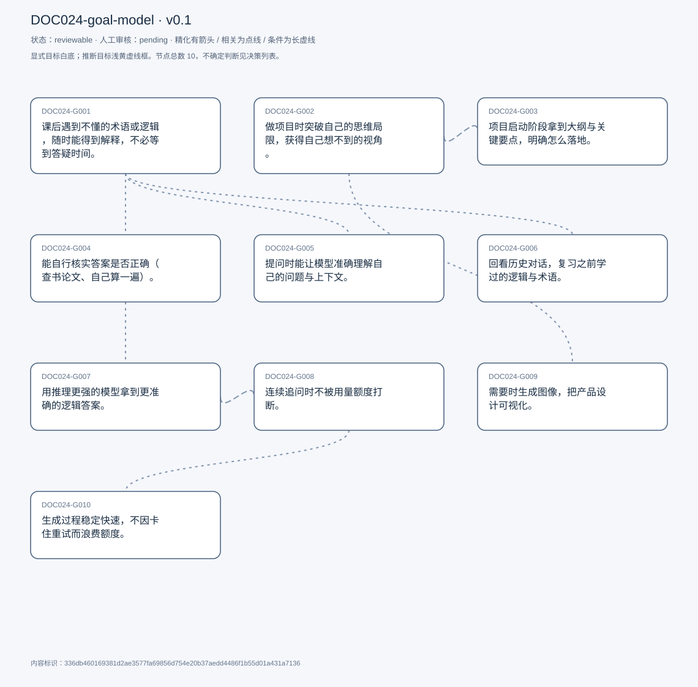
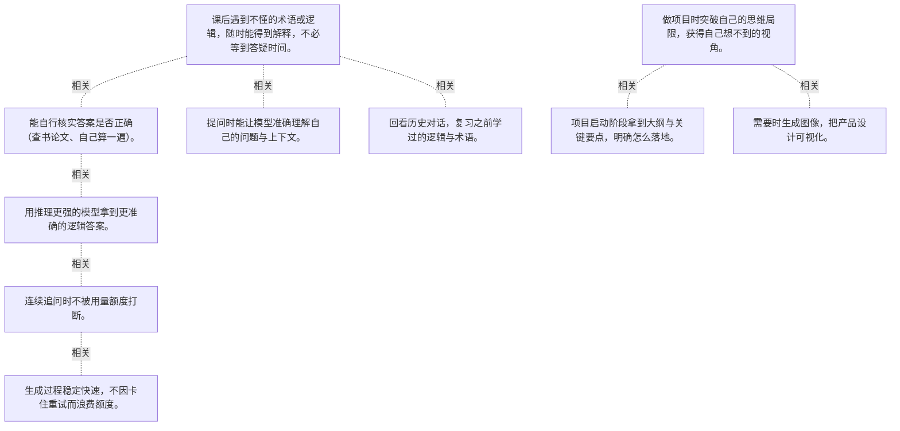

# 目标模型说明

模型：DOC024-goal-model；版本：v0.1

交付状态：reviewable；结构：passed；人工审核：pending

[交互模型](goal-model.html) · [矢量图](goal-model.svg) · [权威数据](goal-model.json)

## 目标图

## 目标

| 编号 | 表述 | 来源 | 情境 | 证据 |
|---|---|---|---|---|
| DOC024-G001 | 课后遇到不懂的术语或逻辑，随时能得到解释，不必等到答疑时间。 | explicit | 触发：课堂上听不懂且当天没有 office hour；等待成本：可能要等到明天甚至下周 | E0001, E0002, E0003 |
| DOC024-G002 | 做项目时突破自己的思维局限，获得自己想不到的视角。 | explicit | 自述「我自己的脑子是有限的」；用途：创意发想，而非执行 | E0004, E0005 |
| DOC024-G003 | 项目启动阶段拿到大纲与关键要点，明确怎么落地。 | explicit | 阶段限定：只在项目开始时用，中途不用 | E0006, E0007 |
| DOC024-G004 | 能自行核实答案是否正确（查书论文、自己算一遍）。 | explicit | 方法一：术语查在线资料/书/论文；方法二：计算结果自己复算；理由：模型并非总是正确，高层问题尤其难看出错 | E0008, E0009, E0010 |
| DOC024-G005 | 提问时能让模型准确理解自己的问题与上下文。 | explicit | 做法：组织语言、附图片与文档辅助说明；动机：怕被误解后得到不想要的答案 | E0011, E0012, E0013 |
| DOC024-G006 | 回看历史对话，复习之前学过的逻辑与术语。 | explicit | 左侧历史栏可点回旧对话；自评使用频率很高 | E0014, E0015 |
| DOC024-G007 | 用推理更强的模型拿到更准确的逻辑答案。 | explicit | o1 会花更长时间思考，但答案更准确；旧模型在解释时会出现逻辑错误 | E0016, E0017, E0018 |
| DOC024-G008 | 连续追问时不被用量额度打断。 | explicit | 免费额度偏低，用完要等次日甚至数日；会员可对高等级模型持续追问 | E0019, E0020 |
| DOC024-G009 | 需要时生成图像，把产品设计可视化。 | explicit | 自评「不常用」；用法：先生成再按需求细化 | E0021, E0022 |
| DOC024-G010 | 生成过程稳定快速，不因卡住重试而浪费额度。 | explicit | 问题：生成慢、会卡住，重试要再扣一次额度；后果：浪费时间与模型调用次数 | E0023, E0024 |

## 关系判断（含不确定与无关系）

- DOC024-G001 / DOC024-G002：none。DOC024-G001 的对象是随时得到术语与逻辑解释（T005/T009），DOC024-G002 的对象是项目上获得新视角（T007/T009）；两处分别出自不同话题段，原文未在二者之间建立因果、手段、评价或情境包含关系，本次评估口径内未建立可采用关系。
- DOC024-G001 / DOC024-G003：none。DOC024-G001 的对象是随时得到术语与逻辑解释（T005/T009），DOC024-G003 的对象是项目启动拿到大纲要点（T015）；两处分别出自不同话题段，原文未在二者之间建立因果、手段、评价或情境包含关系，本次评估口径内未建立可采用关系。
- DOC024-G001 / DOC024-G004：related。T013 说明他主要用两类方式核实：查书与论文（针对术语）、自己复算（针对计算）。这正是 G001 的配套动作——要答案快，就得自己兜住准确性。但 G004 是校验手段，G001 是获取渠道。
- DOC024-G001 / DOC024-G005：related。T017 说提问前会先组织语言、附材料，理由是怕被误解后得到不想要的答案——这是 G001 能否兑现的前提。但 G005 管输入质量、G001 管输出可得。
- DOC024-G001 / DOC024-G006：related。T021 说历史功能用得最多，用来看之前问过的术语与逻辑——把一次性的答疑沉淀成可复习的材料。但 G006 是 G001 的后续利用，不是获取渠道本身。
- DOC024-G001 / DOC024-G007：none。DOC024-G001 的对象是随时得到术语与逻辑解释（T005/T009），DOC024-G007 的对象是用高推理模型求准确（T025）；两处分别出自不同话题段，原文未在二者之间建立因果、手段、评价或情境包含关系，本次评估口径内未建立可采用关系。
- DOC024-G001 / DOC024-G008：none。DOC024-G001 的对象是随时得到术语与逻辑解释（T005/T009），DOC024-G008 的对象是追问不被额度打断（T029）；两处分别出自不同话题段，原文未在二者之间建立因果、手段、评价或情境包含关系，本次评估口径内未建立可采用关系。
- DOC024-G001 / DOC024-G009：none。DOC024-G001 的对象是随时得到术语与逻辑解释（T005/T009），DOC024-G009 的对象是生成图像做可视化（T011）；两处分别出自不同话题段，原文未在二者之间建立因果、手段、评价或情境包含关系，本次评估口径内未建立可采用关系。
- DOC024-G001 / DOC024-G010：none。DOC024-G001 的对象是随时得到术语与逻辑解释（T005/T009），DOC024-G010 的对象是生成稳定快速不浪费额度（T031）；两处分别出自不同话题段，原文未在二者之间建立因果、手段、评价或情境包含关系，本次评估口径内未建立可采用关系。
- DOC024-G002 / DOC024-G003：related。T015 说项目开始时同一个会话里既能得到想法、也能得到大纲与要点，二者处于同一阶段。但想法是发散内容、大纲是结构化步骤。
- DOC024-G002 / DOC024-G004：none。DOC024-G002 的对象是项目上获得新视角（T007/T009），DOC024-G004 的对象是能自行核实答案（T013）；两处分别出自不同话题段，原文未在二者之间建立因果、手段、评价或情境包含关系，本次评估口径内未建立可采用关系。
- DOC024-G002 / DOC024-G005：none。DOC024-G002 的对象是项目上获得新视角（T007/T009），DOC024-G005 的对象是让模型准确理解上下文（T017）；两处分别出自不同话题段，原文未在二者之间建立因果、手段、评价或情境包含关系，本次评估口径内未建立可采用关系。
- DOC024-G002 / DOC024-G006：none。DOC024-G002 的对象是项目上获得新视角（T007/T009），DOC024-G006 的对象是回看历史对话复习（T021）；两处分别出自不同话题段，原文未在二者之间建立因果、手段、评价或情境包含关系，本次评估口径内未建立可采用关系。
- DOC024-G002 / DOC024-G007：none。DOC024-G002 的对象是项目上获得新视角（T007/T009），DOC024-G007 的对象是用高推理模型求准确（T025）；两处分别出自不同话题段，原文未在二者之间建立因果、手段、评价或情境包含关系，本次评估口径内未建立可采用关系。
- DOC024-G002 / DOC024-G008：none。DOC024-G002 的对象是项目上获得新视角（T007/T009），DOC024-G008 的对象是追问不被额度打断（T029）；两处分别出自不同话题段，原文未在二者之间建立因果、手段、评价或情境包含关系，本次评估口径内未建立可采用关系。
- DOC024-G002 / DOC024-G009：related。T011 把图像生成放在「设计新产品、想看到它长什么样」的场景里，与 G002 同属项目早期的构想环节。但一个是文字视角、一个是视觉呈现。
- DOC024-G002 / DOC024-G010：none。DOC024-G002 的对象是项目上获得新视角（T007/T009），DOC024-G010 的对象是生成稳定快速不浪费额度（T031）；两处分别出自不同话题段，原文未在二者之间建立因果、手段、评价或情境包含关系，本次评估口径内未建立可采用关系。
- DOC024-G003 / DOC024-G004：none。DOC024-G003 的对象是项目启动拿到大纲要点（T015），DOC024-G004 的对象是能自行核实答案（T013）；两处分别出自不同话题段，原文未在二者之间建立因果、手段、评价或情境包含关系，本次评估口径内未建立可采用关系。
- DOC024-G003 / DOC024-G005：none。DOC024-G003 的对象是项目启动拿到大纲要点（T015），DOC024-G005 的对象是让模型准确理解上下文（T017）；两处分别出自不同话题段，原文未在二者之间建立因果、手段、评价或情境包含关系，本次评估口径内未建立可采用关系。
- DOC024-G003 / DOC024-G006：none。DOC024-G003 的对象是项目启动拿到大纲要点（T015），DOC024-G006 的对象是回看历史对话复习（T021）；两处分别出自不同话题段，原文未在二者之间建立因果、手段、评价或情境包含关系，本次评估口径内未建立可采用关系。
- DOC024-G003 / DOC024-G007：none。DOC024-G003 的对象是项目启动拿到大纲要点（T015），DOC024-G007 的对象是用高推理模型求准确（T025）；两处分别出自不同话题段，原文未在二者之间建立因果、手段、评价或情境包含关系，本次评估口径内未建立可采用关系。
- DOC024-G003 / DOC024-G008：none。DOC024-G003 的对象是项目启动拿到大纲要点（T015），DOC024-G008 的对象是追问不被额度打断（T029）；两处分别出自不同话题段，原文未在二者之间建立因果、手段、评价或情境包含关系，本次评估口径内未建立可采用关系。
- DOC024-G003 / DOC024-G009：none。DOC024-G003 的对象是项目启动拿到大纲要点（T015），DOC024-G009 的对象是生成图像做可视化（T011）；两处分别出自不同话题段，原文未在二者之间建立因果、手段、评价或情境包含关系，本次评估口径内未建立可采用关系。
- DOC024-G003 / DOC024-G010：none。DOC024-G003 的对象是项目启动拿到大纲要点（T015），DOC024-G010 的对象是生成稳定快速不浪费额度（T031）；两处分别出自不同话题段，原文未在二者之间建立因果、手段、评价或情境包含关系，本次评估口径内未建立可采用关系。
- DOC024-G004 / DOC024-G005：none。DOC024-G004 的对象是能自行核实答案（T013），DOC024-G005 的对象是让模型准确理解上下文（T017）；两处分别出自不同话题段，原文未在二者之间建立因果、手段、评价或情境包含关系，本次评估口径内未建立可采用关系。
- DOC024-G004 / DOC024-G006：none。DOC024-G004 的对象是能自行核实答案（T013），DOC024-G006 的对象是回看历史对话复习（T021）；两处分别出自不同话题段，原文未在二者之间建立因果、手段、评价或情境包含关系，本次评估口径内未建立可采用关系。
- DOC024-G004 / DOC024-G007：related。T013 承认高层问题很难看出错误，T025 说 o1 靠更长的推理减少逻辑错误——更强的模型正是对「核实不了」这一局限的补位。但一个是人工校验、一个是模型侧改进，不能互相替代。
- DOC024-G004 / DOC024-G008：none。DOC024-G004 的对象是能自行核实答案（T013），DOC024-G008 的对象是追问不被额度打断（T029）；两处分别出自不同话题段，原文未在二者之间建立因果、手段、评价或情境包含关系，本次评估口径内未建立可采用关系。
- DOC024-G004 / DOC024-G009：none。DOC024-G004 的对象是能自行核实答案（T013），DOC024-G009 的对象是生成图像做可视化（T011）；两处分别出自不同话题段，原文未在二者之间建立因果、手段、评价或情境包含关系，本次评估口径内未建立可采用关系。
- DOC024-G004 / DOC024-G010：none。DOC024-G004 的对象是能自行核实答案（T013），DOC024-G010 的对象是生成稳定快速不浪费额度（T031）；两处分别出自不同话题段，原文未在二者之间建立因果、手段、评价或情境包含关系，本次评估口径内未建立可采用关系。
- DOC024-G005 / DOC024-G006：none。DOC024-G005 的对象是让模型准确理解上下文（T017），DOC024-G006 的对象是回看历史对话复习（T021）；两处分别出自不同话题段，原文未在二者之间建立因果、手段、评价或情境包含关系，本次评估口径内未建立可采用关系。
- DOC024-G005 / DOC024-G007：none。DOC024-G005 的对象是让模型准确理解上下文（T017），DOC024-G007 的对象是用高推理模型求准确（T025）；两处分别出自不同话题段，原文未在二者之间建立因果、手段、评价或情境包含关系，本次评估口径内未建立可采用关系。
- DOC024-G005 / DOC024-G008：none。DOC024-G005 的对象是让模型准确理解上下文（T017），DOC024-G008 的对象是追问不被额度打断（T029）；两处分别出自不同话题段，原文未在二者之间建立因果、手段、评价或情境包含关系，本次评估口径内未建立可采用关系。
- DOC024-G005 / DOC024-G009：none。DOC024-G005 的对象是让模型准确理解上下文（T017），DOC024-G009 的对象是生成图像做可视化（T011）；两处分别出自不同话题段，原文未在二者之间建立因果、手段、评价或情境包含关系，本次评估口径内未建立可采用关系。
- DOC024-G005 / DOC024-G010：none。DOC024-G005 的对象是让模型准确理解上下文（T017），DOC024-G010 的对象是生成稳定快速不浪费额度（T031）；两处分别出自不同话题段，原文未在二者之间建立因果、手段、评价或情境包含关系，本次评估口径内未建立可采用关系。
- DOC024-G006 / DOC024-G007：none。DOC024-G006 的对象是回看历史对话复习（T021），DOC024-G007 的对象是用高推理模型求准确（T025）；两处分别出自不同话题段，原文未在二者之间建立因果、手段、评价或情境包含关系，本次评估口径内未建立可采用关系。
- DOC024-G006 / DOC024-G008：none。DOC024-G006 的对象是回看历史对话复习（T021），DOC024-G008 的对象是追问不被额度打断（T029）；两处分别出自不同话题段，原文未在二者之间建立因果、手段、评价或情境包含关系，本次评估口径内未建立可采用关系。
- DOC024-G006 / DOC024-G009：none。DOC024-G006 的对象是回看历史对话复习（T021），DOC024-G009 的对象是生成图像做可视化（T011）；两处分别出自不同话题段，原文未在二者之间建立因果、手段、评价或情境包含关系，本次评估口径内未建立可采用关系。
- DOC024-G006 / DOC024-G010：none。DOC024-G006 的对象是回看历史对话复习（T021），DOC024-G010 的对象是生成稳定快速不浪费额度（T031）；两处分别出自不同话题段，原文未在二者之间建立因果、手段、评价或情境包含关系，本次评估口径内未建立可采用关系。
- DOC024-G007 / DOC024-G008：related。T029 说得很直接：想持续追问高等级模型，但免费额度低，所以买会员。G008 是为 G007 服务的容量条件。但额度是使用门槛，推理质量是能力上限。
- DOC024-G007 / DOC024-G009：none。DOC024-G007 的对象是用高推理模型求准确（T025），DOC024-G009 的对象是生成图像做可视化（T011）；两处分别出自不同话题段，原文未在二者之间建立因果、手段、评价或情境包含关系，本次评估口径内未建立可采用关系。
- DOC024-G007 / DOC024-G010：uncertain。两者在时间上直接对冲：T025 说更准的答案来自「更长时间思考」，T031 又抱怨生成本来就慢、卡住还要重试。想要更准就得接受更慢，想要更快就可能退回较弱模型，受访者没有对这对权衡表态，也没说清哪些场景愿意等。
- DOC024-G008 / DOC024-G009：none。DOC024-G008 的对象是追问不被额度打断（T029），DOC024-G009 的对象是生成图像做可视化（T011）；两处分别出自不同话题段，原文未在二者之间建立因果、手段、评价或情境包含关系，本次评估口径内未建立可采用关系。
- DOC024-G008 / DOC024-G010：related。T031 说重试会再扣一次额度——G010 的卡顿问题会直接消耗 G008 想保住的额度，两者共用同一份配额。但一个是配额多少、一个是消耗速度。
- DOC024-G009 / DOC024-G010：none。DOC024-G009 的对象是生成图像做可视化（T011），DOC024-G010 的对象是生成稳定快速不浪费额度（T031）；两处分别出自不同话题段，原文未在二者之间建立因果、手段、评价或情境包含关系，本次评估口径内未建立可采用关系。

## 证据

### E0001 · DOC024:S006

> I don&#x27;t understand, or some questions after class, and there is no office hours

原件位置：{&quot;line_start&quot;: 6, &quot;line_end&quot;: 6, &quot;start_char&quot;: 544, &quot;end_char&quot;: 846}

### E0002 · DOC024:S010

> you have to wait till tomorrow, or even next week to answer those questions

原件位置：{&quot;line_start&quot;: 10, &quot;line_end&quot;: 10, &quot;start_char&quot;: 1644, &quot;end_char&quot;: 2393}

### E0003 · DOC024:S010

> you can ask it like at any time

原件位置：{&quot;line_start&quot;: 10, &quot;line_end&quot;: 10, &quot;start_char&quot;: 1644, &quot;end_char&quot;: 2393}

### E0004 · DOC024:S008

> generate some ideas for my project

原件位置：{&quot;line_start&quot;: 8, &quot;line_end&quot;: 8, &quot;start_char&quot;: 948, &quot;end_char&quot;: 1475}

### E0005 · DOC024:S010

> using chat, Gpt is giving me more perspective perspectives

原件位置：{&quot;line_start&quot;: 10, &quot;line_end&quot;: 10, &quot;start_char&quot;: 1644, &quot;end_char&quot;: 2393}

### E0006 · DOC024:S016

> it can give me an outline about what you should do

原件位置：{&quot;line_start&quot;: 16, &quot;line_end&quot;: 16, &quot;start_char&quot;: 4051, &quot;end_char&quot;: 5258}

### E0007 · DOC024:S016

> what are the points that are important

原件位置：{&quot;line_start&quot;: 16, &quot;line_end&quot;: 16, &quot;start_char&quot;: 4051, &quot;end_char&quot;: 5258}

### E0008 · DOC024:S014

> there are a lot of materials online you can find

原件位置：{&quot;line_start&quot;: 14, &quot;line_end&quot;: 14, &quot;start_char&quot;: 3051, &quot;end_char&quot;: 3819}

### E0009 · DOC024:S014

> you should calculate those by yourself and then check if the result it provides you is correct

原件位置：{&quot;line_start&quot;: 14, &quot;line_end&quot;: 14, &quot;start_char&quot;: 3051, &quot;end_char&quot;: 3819}

### E0010 · DOC024:S014

> chatgpt is not always correct

原件位置：{&quot;line_start&quot;: 14, &quot;line_end&quot;: 14, &quot;start_char&quot;: 3051, &quot;end_char&quot;: 3819}

### E0011 · DOC024:S018

> I will try to organize my language to make chat, gpt, understand what I&#x27;m saying

原件位置：{&quot;line_start&quot;: 18, &quot;line_end&quot;: 18, &quot;start_char&quot;: 5391, &quot;end_char&quot;: 6348}

### E0012 · DOC024:S018

> sometimes I will also attach some images and also some documents to chat

原件位置：{&quot;line_start&quot;: 18, &quot;line_end&quot;: 18, &quot;start_char&quot;: 5391, &quot;end_char&quot;: 6348}

### E0013 · DOC024:S018

> it&#x27;s better illustration of my questions

原件位置：{&quot;line_start&quot;: 18, &quot;line_end&quot;: 18, &quot;start_char&quot;: 5391, &quot;end_char&quot;: 6348}

### E0014 · DOC024:S022

> you can just click the history and see like what Chat Gpt told you before

原件位置：{&quot;line_start&quot;: 22, &quot;line_end&quot;: 22, &quot;start_char&quot;: 7237, &quot;end_char&quot;: 7747}

### E0015 · DOC024:S022

> It&#x27;s really nice for you to go back and review the chat

原件位置：{&quot;line_start&quot;: 22, &quot;line_end&quot;: 22, &quot;start_char&quot;: 7237, &quot;end_char&quot;: 7747}

### E0016 · DOC024:S026

> the o, 1 model is better at logic and reasoning

原件位置：{&quot;line_start&quot;: 26, &quot;line_end&quot;: 26, &quot;start_char&quot;: 8153, &quot;end_char&quot;: 8529}

### E0017 · DOC024:S026

> it will take more time to think and analyze the logic, but the answer will be more accurate

原件位置：{&quot;line_start&quot;: 26, &quot;line_end&quot;: 26, &quot;start_char&quot;: 8153, &quot;end_char&quot;: 8529}

### E0018 · DOC024:S026

> before Chat Gpt will have some logic mistakes when explaining something

原件位置：{&quot;line_start&quot;: 26, &quot;line_end&quot;: 26, &quot;start_char&quot;: 8153, &quot;end_char&quot;: 8529}

### E0019 · DOC024:S030

> you have unlimited access to the highest level model

原件位置：{&quot;line_start&quot;: 30, &quot;line_end&quot;: 30, &quot;start_char&quot;: 8869, &quot;end_char&quot;: 9846}

### E0020 · DOC024:S030

> the limit for the normal user is like a little bit low

原件位置：{&quot;line_start&quot;: 30, &quot;line_end&quot;: 30, &quot;start_char&quot;: 8869, &quot;end_char&quot;: 9846}

### E0021 · DOC024:S012

> when I have to design a new product. and I want to visualize it

原件位置：{&quot;line_start&quot;: 12, &quot;line_end&quot;: 12, &quot;start_char&quot;: 2580, &quot;end_char&quot;: 2930}

### E0022 · DOC024:S012

> I will use chat gpt, to generate the image for me

原件位置：{&quot;line_start&quot;: 12, &quot;line_end&quot;: 12, &quot;start_char&quot;: 2580, &quot;end_char&quot;: 2930}

### E0023 · DOC024:S032

> it can take really long time for it to generate the answer

原件位置：{&quot;line_start&quot;: 32, &quot;line_end&quot;: 32, &quot;start_char&quot;: 9977, &quot;end_char&quot;: 10756}

### E0024 · DOC024:S032

> if you regenerate it, it will use the limit of your

原件位置：{&quot;line_start&quot;: 32, &quot;line_end&quot;: 32, &quot;start_char&quot;: 9977, &quot;end_char&quot;: 10756}

## 问题、限制与版本

- 两者在时间上直接对冲：T025 说更准的答案来自「更长时间思考」，T031 又抱怨生成本来就慢、卡住还要重试。想要更准就得接受更慢，想要更快就可能退回较弱模型，受访者没有对这对权衡表态，也没说清哪些场景愿意等。
- 当前会话助手的开发判断，非独立盲测；无人工采纳记录。
- 结构检查已绑定当前版本；独立语义审查未执行；人工状态以实际审核记录为准。

内容标识：336db460169381d2ae3577fa69856d754e20b37aedd4486f1b55d01a431a7136

人工决定：

审核意见：
