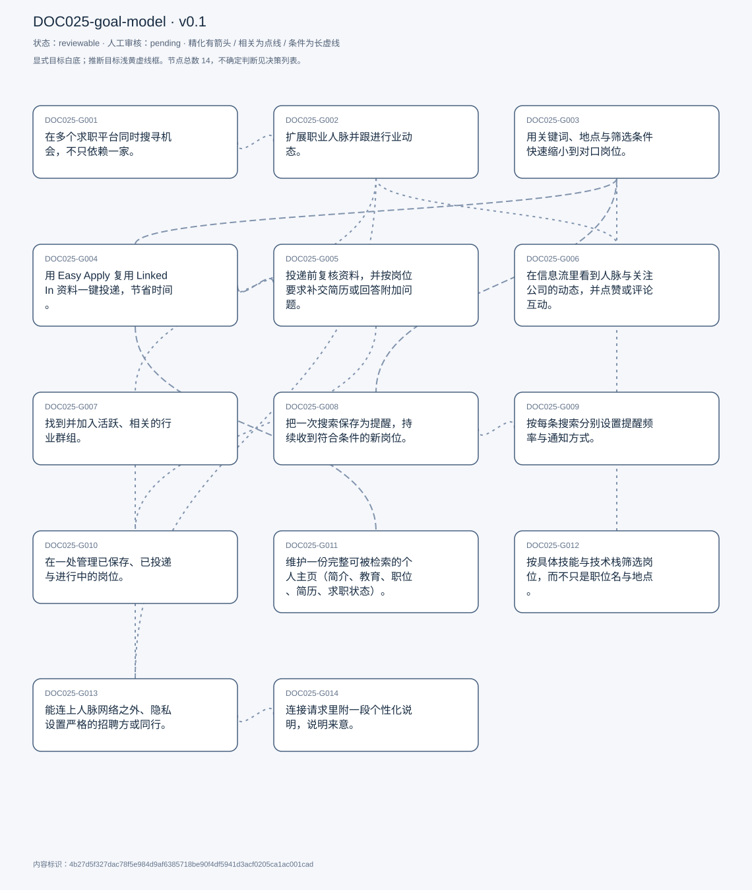
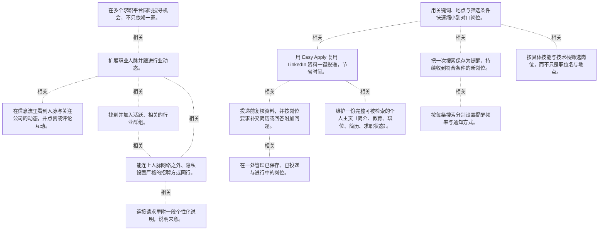

# 目标模型说明

模型：DOC025-goal-model；版本：v0.1

交付状态：reviewable；结构：passed；人工审核：pending

[交互模型](goal-model.html) · [矢量图](goal-model.svg) · [权威数据](goal-model.json)

## 目标图

## 目标

| 编号 | 表述 | 来源 | 情境 | 证据 |
|---|---|---|---|---|
| DOC025-G001 | 在多个求职平台同时搜寻机会，不只依赖一家。 | explicit | 背景：当前市场行情不好；做法：各求职网站 + LinkedIn 并行 | E0001, E0002 |
| DOC025-G002 | 扩展职业人脉并跟进行业动态。 | explicit | 自述用 LinkedIn 的两条理由之一 | E0003 |
| DOC025-G003 | 用关键词、地点与筛选条件快速缩小到对口岗位。 | explicit | 路径：Jobs 标签 → 搜索框 → 关键词/地点 → 发布日期、经验等级等筛选 | E0004, E0005, E0006 |
| DOC025-G004 | 用 Easy Apply 复用 LinkedIn 资料一键投递，节省时间。 | explicit | 自评这是最省时间的功能 | E0007, E0008 |
| DOC025-G005 | 投递前复核资料，并按岗位要求补交简历或回答附加问题。 | explicit | 流程：Easy Apply → 复核 → 可选上传简历/答题 → 提交 | E0009, E0010, E0011 |
| DOC025-G006 | 在信息流里看到人脉与关注公司的动态，并点赞或评论互动。 | explicit | 自评这是使用最频繁的功能；打开应用即落在首页信息流 | E0012, E0013, E0014 |
| DOC025-G007 | 找到并加入活跃、相关的行业群组。 | explicit | 路径：My Network → 推荐群组 → see all → join；判据：looks active and relevant | E0015, E0016 |
| DOC025-G008 | 把一次搜索保存为提醒，持续收到符合条件的新岗位。 | explicit | 开关：get job alerts for this search；渠道：App 通知或邮件，取决于设置 | E0017, E0018 |
| DOC025-G009 | 按每条搜索分别设置提醒频率与通知方式。 | explicit | 可选：每天 / 每周；路径：Jobs → Preferences → Job alert → 铅笔图标 | E0019, E0020, E0021 |
| DOC025-G010 | 在一处管理已保存、已投递与进行中的岗位。 | explicit | 路径：Jobs → My Jobs → Saved / In progress / Applied / Archived | E0022, E0023 |
| DOC025-G011 | 维护一份完整可被检索的个人主页（简介、教育、职位、简历、求职状态）。 | explicit | 做法：Add section 逐块编辑；上传简历；打开 Open to work 并设偏好 | E0024, E0025, E0026 |
| DOC025-G012 | 按具体技能与技术栈筛选岗位，而不只是职位名与地点。 | explicit | 现状：筛选维度有限，没有技能/语言粒度；动机：想找提到某框架或语言的岗位 | E0027, E0028 |
| DOC025-G013 | 能连上人脉网络之外、隐私设置严格的招聘方或同行。 | explicit | 现状：站外连接受限，请求常被忽略；他怀疑与隐私设置和外网限制有关 | E0029, E0030 |
| DOC025-G014 | 连接请求里附一段个性化说明，说明来意。 | explicit | 路径：点 Connect → 选 Add a note → 写一句话 → 发送 | E0031, E0032 |

## 关系判断（含不确定与无关系）

- DOC025-G001 / DOC025-G002：related。T003 把找机会与人脉/行业信息并列为使用 LinkedIn 的两条理由，且都在同一段求职语境下；但一个是岗位供给的广度、一个是人的网络，互不替代。
- DOC025-G001 / DOC025-G003：none。DOC025-G001 的对象是多平台并行找机会（T003），DOC025-G003 的对象是关键词+筛选定位岗位（T005）；两处分别出自不同话题段，原文未在二者之间建立因果、手段、评价或情境包含关系，本次评估口径内未建立可采用关系。
- DOC025-G001 / DOC025-G004：none。DOC025-G001 的对象是多平台并行找机会（T003），DOC025-G004 的对象是Easy Apply 一键投递（T005）；两处分别出自不同话题段，原文未在二者之间建立因果、手段、评价或情境包含关系，本次评估口径内未建立可采用关系。
- DOC025-G001 / DOC025-G005：none。DOC025-G001 的对象是多平台并行找机会（T003），DOC025-G005 的对象是投递前复核补齐材料（T005）；两处分别出自不同话题段，原文未在二者之间建立因果、手段、评价或情境包含关系，本次评估口径内未建立可采用关系。
- DOC025-G001 / DOC025-G006：none。DOC025-G001 的对象是多平台并行找机会（T003），DOC025-G006 的对象是信息流看动态并互动（T007）；两处分别出自不同话题段，原文未在二者之间建立因果、手段、评价或情境包含关系，本次评估口径内未建立可采用关系。
- DOC025-G001 / DOC025-G007：none。DOC025-G001 的对象是多平台并行找机会（T003），DOC025-G007 的对象是加入活跃群组（T011）；两处分别出自不同话题段，原文未在二者之间建立因果、手段、评价或情境包含关系，本次评估口径内未建立可采用关系。
- DOC025-G001 / DOC025-G008：none。DOC025-G001 的对象是多平台并行找机会（T003），DOC025-G008 的对象是保存搜索收岗位提醒（T013）；两处分别出自不同话题段，原文未在二者之间建立因果、手段、评价或情境包含关系，本次评估口径内未建立可采用关系。
- DOC025-G001 / DOC025-G009：none。DOC025-G001 的对象是多平台并行找机会（T003），DOC025-G009 的对象是自定义提醒频率（T015）；两处分别出自不同话题段，原文未在二者之间建立因果、手段、评价或情境包含关系，本次评估口径内未建立可采用关系。
- DOC025-G001 / DOC025-G010：none。DOC025-G001 的对象是多平台并行找机会（T003），DOC025-G010 的对象是管理已保存与已投递（T017）；两处分别出自不同话题段，原文未在二者之间建立因果、手段、评价或情境包含关系，本次评估口径内未建立可采用关系。
- DOC025-G001 / DOC025-G011：none。DOC025-G001 的对象是多平台并行找机会（T003），DOC025-G011 的对象是维护个人主页（T019）；两处分别出自不同话题段，原文未在二者之间建立因果、手段、评价或情境包含关系，本次评估口径内未建立可采用关系。
- DOC025-G001 / DOC025-G012：none。DOC025-G001 的对象是多平台并行找机会（T003），DOC025-G012 的对象是按技能筛选岗位（T021）；两处分别出自不同话题段，原文未在二者之间建立因果、手段、评价或情境包含关系，本次评估口径内未建立可采用关系。
- DOC025-G001 / DOC025-G013：none。DOC025-G001 的对象是多平台并行找机会（T003），DOC025-G013 的对象是连上网络外的人（T021）；两处分别出自不同话题段，原文未在二者之间建立因果、手段、评价或情境包含关系，本次评估口径内未建立可采用关系。
- DOC025-G001 / DOC025-G014：none。DOC025-G001 的对象是多平台并行找机会（T003），DOC025-G014 的对象是连接附个性化说明（T011）；两处分别出自不同话题段，原文未在二者之间建立因果、手段、评价或情境包含关系，本次评估口径内未建立可采用关系。
- DOC025-G002 / DOC025-G003：none。DOC025-G002 的对象是扩人脉与跟行业动态（T003），DOC025-G003 的对象是关键词+筛选定位岗位（T005）；两处分别出自不同话题段，原文未在二者之间建立因果、手段、评价或情境包含关系，本次评估口径内未建立可采用关系。
- DOC025-G002 / DOC025-G004：none。DOC025-G002 的对象是扩人脉与跟行业动态（T003），DOC025-G004 的对象是Easy Apply 一键投递（T005）；两处分别出自不同话题段，原文未在二者之间建立因果、手段、评价或情境包含关系，本次评估口径内未建立可采用关系。
- DOC025-G002 / DOC025-G005：none。DOC025-G002 的对象是扩人脉与跟行业动态（T003），DOC025-G005 的对象是投递前复核补齐材料（T005）；两处分别出自不同话题段，原文未在二者之间建立因果、手段、评价或情境包含关系，本次评估口径内未建立可采用关系。
- DOC025-G002 / DOC025-G006：related。T007 说信息流的内容主要来自人脉更新与关注公司，G006 正是 G002 中「跟进行业动态」的日常载体。但浏览是消费信息，扩人脉是建关系。
- DOC025-G002 / DOC025-G007：related。T011 说加入群组后既能看组内帖子、也能连组内的人——群组是扩人脉的具体渠道之一。但群组只是多条渠道中的一条。
- DOC025-G002 / DOC025-G008：none。DOC025-G002 的对象是扩人脉与跟行业动态（T003），DOC025-G008 的对象是保存搜索收岗位提醒（T013）；两处分别出自不同话题段，原文未在二者之间建立因果、手段、评价或情境包含关系，本次评估口径内未建立可采用关系。
- DOC025-G002 / DOC025-G009：none。DOC025-G002 的对象是扩人脉与跟行业动态（T003），DOC025-G009 的对象是自定义提醒频率（T015）；两处分别出自不同话题段，原文未在二者之间建立因果、手段、评价或情境包含关系，本次评估口径内未建立可采用关系。
- DOC025-G002 / DOC025-G010：none。DOC025-G002 的对象是扩人脉与跟行业动态（T003），DOC025-G010 的对象是管理已保存与已投递（T017）；两处分别出自不同话题段，原文未在二者之间建立因果、手段、评价或情境包含关系，本次评估口径内未建立可采用关系。
- DOC025-G002 / DOC025-G011：none。DOC025-G002 的对象是扩人脉与跟行业动态（T003），DOC025-G011 的对象是维护个人主页（T019）；两处分别出自不同话题段，原文未在二者之间建立因果、手段、评价或情境包含关系，本次评估口径内未建立可采用关系。
- DOC025-G002 / DOC025-G012：none。DOC025-G002 的对象是扩人脉与跟行业动态（T003），DOC025-G012 的对象是按技能筛选岗位（T021）；两处分别出自不同话题段，原文未在二者之间建立因果、手段、评价或情境包含关系，本次评估口径内未建立可采用关系。
- DOC025-G002 / DOC025-G013：related。T021 的障碍恰恰卡在 G002 上：想连的人连不上，人脉扩张就受限。但 G013 是可达性障碍，G002 是目的。
- DOC025-G002 / DOC025-G014：none。DOC025-G002 的对象是扩人脉与跟行业动态（T003），DOC025-G014 的对象是连接附个性化说明（T011）；两处分别出自不同话题段，原文未在二者之间建立因果、手段、评价或情境包含关系，本次评估口径内未建立可采用关系。
- DOC025-G003 / DOC025-G004：related。T005 的流程是搜出结果 → 点进岗位 → Easy Apply，两步首尾相接。但 G003 决定看到什么，G004 决定投得多快。
- DOC025-G003 / DOC025-G005：none。DOC025-G003 的对象是关键词+筛选定位岗位（T005），DOC025-G005 的对象是投递前复核补齐材料（T005）；两处分别出自不同话题段，原文未在二者之间建立因果、手段、评价或情境包含关系，本次评估口径内未建立可采用关系。
- DOC025-G003 / DOC025-G006：none。DOC025-G003 的对象是关键词+筛选定位岗位（T005），DOC025-G006 的对象是信息流看动态并互动（T007）；两处分别出自不同话题段，原文未在二者之间建立因果、手段、评价或情境包含关系，本次评估口径内未建立可采用关系。
- DOC025-G003 / DOC025-G007：none。DOC025-G003 的对象是关键词+筛选定位岗位（T005），DOC025-G007 的对象是加入活跃群组（T011）；两处分别出自不同话题段，原文未在二者之间建立因果、手段、评价或情境包含关系，本次评估口径内未建立可采用关系。
- DOC025-G003 / DOC025-G008：related。T013 说提醒的依据就是保存下来的搜索筛选，G008 等于把 G003 的一次性检索变成持续订阅。但搜索是主动、提醒是被动。
- DOC025-G003 / DOC025-G009：none。DOC025-G003 的对象是关键词+筛选定位岗位（T005），DOC025-G009 的对象是自定义提醒频率（T015）；两处分别出自不同话题段，原文未在二者之间建立因果、手段、评价或情境包含关系，本次评估口径内未建立可采用关系。
- DOC025-G003 / DOC025-G010：none。DOC025-G003 的对象是关键词+筛选定位岗位（T005），DOC025-G010 的对象是管理已保存与已投递（T017）；两处分别出自不同话题段，原文未在二者之间建立因果、手段、评价或情境包含关系，本次评估口径内未建立可采用关系。
- DOC025-G003 / DOC025-G011：none。DOC025-G003 的对象是关键词+筛选定位岗位（T005），DOC025-G011 的对象是维护个人主页（T019）；两处分别出自不同话题段，原文未在二者之间建立因果、手段、评价或情境包含关系，本次评估口径内未建立可采用关系。
- DOC025-G003 / DOC025-G012：related。T021 指出筛选维度只有职位名与地点，缺少技能/技术栈——直接针对 G003 的筛选能力提出扩展。但 G012 不是提高精度，而是新增维度。
- DOC025-G003 / DOC025-G013：none。DOC025-G003 的对象是关键词+筛选定位岗位（T005），DOC025-G013 的对象是连上网络外的人（T021）；两处分别出自不同话题段，原文未在二者之间建立因果、手段、评价或情境包含关系，本次评估口径内未建立可采用关系。
- DOC025-G003 / DOC025-G014：none。DOC025-G003 的对象是关键词+筛选定位岗位（T005），DOC025-G014 的对象是连接附个性化说明（T011）；两处分别出自不同话题段，原文未在二者之间建立因果、手段、评价或情境包含关系，本次评估口径内未建立可采用关系。
- DOC025-G004 / DOC025-G005：related。T005 的投递是两步：Easy Apply 拉取资料 → 复核并按岗位补交简历或答题 → 提交。一个求快、一个求全，缺一不可。
- DOC025-G004 / DOC025-G006：none。DOC025-G004 的对象是Easy Apply 一键投递（T005），DOC025-G006 的对象是信息流看动态并互动（T007）；两处分别出自不同话题段，原文未在二者之间建立因果、手段、评价或情境包含关系，本次评估口径内未建立可采用关系。
- DOC025-G004 / DOC025-G007：none。DOC025-G004 的对象是Easy Apply 一键投递（T005），DOC025-G007 的对象是加入活跃群组（T011）；两处分别出自不同话题段，原文未在二者之间建立因果、手段、评价或情境包含关系，本次评估口径内未建立可采用关系。
- DOC025-G004 / DOC025-G008：none。DOC025-G004 的对象是Easy Apply 一键投递（T005），DOC025-G008 的对象是保存搜索收岗位提醒（T013）；两处分别出自不同话题段，原文未在二者之间建立因果、手段、评价或情境包含关系，本次评估口径内未建立可采用关系。
- DOC025-G004 / DOC025-G009：none。DOC025-G004 的对象是Easy Apply 一键投递（T005），DOC025-G009 的对象是自定义提醒频率（T015）；两处分别出自不同话题段，原文未在二者之间建立因果、手段、评价或情境包含关系，本次评估口径内未建立可采用关系。
- DOC025-G004 / DOC025-G010：none。DOC025-G004 的对象是Easy Apply 一键投递（T005），DOC025-G010 的对象是管理已保存与已投递（T017）；两处分别出自不同话题段，原文未在二者之间建立因果、手段、评价或情境包含关系，本次评估口径内未建立可采用关系。
- DOC025-G004 / DOC025-G011：related。T005 明说 Easy Apply 直接复用 LinkedIn 主页资料——主页完整度决定一键投递的质量。但 G011 是长期维护的资产，G004 是使用它的方式。
- DOC025-G004 / DOC025-G012：none。DOC025-G004 的对象是Easy Apply 一键投递（T005），DOC025-G012 的对象是按技能筛选岗位（T021）；两处分别出自不同话题段，原文未在二者之间建立因果、手段、评价或情境包含关系，本次评估口径内未建立可采用关系。
- DOC025-G004 / DOC025-G013：none。DOC025-G004 的对象是Easy Apply 一键投递（T005），DOC025-G013 的对象是连上网络外的人（T021）；两处分别出自不同话题段，原文未在二者之间建立因果、手段、评价或情境包含关系，本次评估口径内未建立可采用关系。
- DOC025-G004 / DOC025-G014：none。DOC025-G004 的对象是Easy Apply 一键投递（T005），DOC025-G014 的对象是连接附个性化说明（T011）；两处分别出自不同话题段，原文未在二者之间建立因果、手段、评价或情境包含关系，本次评估口径内未建立可采用关系。
- DOC025-G005 / DOC025-G006：none。DOC025-G005 的对象是投递前复核补齐材料（T005），DOC025-G006 的对象是信息流看动态并互动（T007）；两处分别出自不同话题段，原文未在二者之间建立因果、手段、评价或情境包含关系，本次评估口径内未建立可采用关系。
- DOC025-G005 / DOC025-G007：none。DOC025-G005 的对象是投递前复核补齐材料（T005），DOC025-G007 的对象是加入活跃群组（T011）；两处分别出自不同话题段，原文未在二者之间建立因果、手段、评价或情境包含关系，本次评估口径内未建立可采用关系。
- DOC025-G005 / DOC025-G008：none。DOC025-G005 的对象是投递前复核补齐材料（T005），DOC025-G008 的对象是保存搜索收岗位提醒（T013）；两处分别出自不同话题段，原文未在二者之间建立因果、手段、评价或情境包含关系，本次评估口径内未建立可采用关系。
- DOC025-G005 / DOC025-G009：none。DOC025-G005 的对象是投递前复核补齐材料（T005），DOC025-G009 的对象是自定义提醒频率（T015）；两处分别出自不同话题段，原文未在二者之间建立因果、手段、评价或情境包含关系，本次评估口径内未建立可采用关系。
- DOC025-G005 / DOC025-G010：related。T017 的 Applied / In progress 分类正是提交之后的去处，G010 承接 G005 的投递结果。但 G005 是提交前把关，G010 是提交后跟踪。
- DOC025-G005 / DOC025-G011：none。DOC025-G005 的对象是投递前复核补齐材料（T005），DOC025-G011 的对象是维护个人主页（T019）；两处分别出自不同话题段，原文未在二者之间建立因果、手段、评价或情境包含关系，本次评估口径内未建立可采用关系。
- DOC025-G005 / DOC025-G012：none。DOC025-G005 的对象是投递前复核补齐材料（T005），DOC025-G012 的对象是按技能筛选岗位（T021）；两处分别出自不同话题段，原文未在二者之间建立因果、手段、评价或情境包含关系，本次评估口径内未建立可采用关系。
- DOC025-G005 / DOC025-G013：none。DOC025-G005 的对象是投递前复核补齐材料（T005），DOC025-G013 的对象是连上网络外的人（T021）；两处分别出自不同话题段，原文未在二者之间建立因果、手段、评价或情境包含关系，本次评估口径内未建立可采用关系。
- DOC025-G005 / DOC025-G014：none。DOC025-G005 的对象是投递前复核补齐材料（T005），DOC025-G014 的对象是连接附个性化说明（T011）；两处分别出自不同话题段，原文未在二者之间建立因果、手段、评价或情境包含关系，本次评估口径内未建立可采用关系。
- DOC025-G006 / DOC025-G007：none。DOC025-G006 的对象是信息流看动态并互动（T007），DOC025-G007 的对象是加入活跃群组（T011）；两处分别出自不同话题段，原文未在二者之间建立因果、手段、评价或情境包含关系，本次评估口径内未建立可采用关系。
- DOC025-G006 / DOC025-G008：none。DOC025-G006 的对象是信息流看动态并互动（T007），DOC025-G008 的对象是保存搜索收岗位提醒（T013）；两处分别出自不同话题段，原文未在二者之间建立因果、手段、评价或情境包含关系，本次评估口径内未建立可采用关系。
- DOC025-G006 / DOC025-G009：none。DOC025-G006 的对象是信息流看动态并互动（T007），DOC025-G009 的对象是自定义提醒频率（T015）；两处分别出自不同话题段，原文未在二者之间建立因果、手段、评价或情境包含关系，本次评估口径内未建立可采用关系。
- DOC025-G006 / DOC025-G010：none。DOC025-G006 的对象是信息流看动态并互动（T007），DOC025-G010 的对象是管理已保存与已投递（T017）；两处分别出自不同话题段，原文未在二者之间建立因果、手段、评价或情境包含关系，本次评估口径内未建立可采用关系。
- DOC025-G006 / DOC025-G011：none。DOC025-G006 的对象是信息流看动态并互动（T007），DOC025-G011 的对象是维护个人主页（T019）；两处分别出自不同话题段，原文未在二者之间建立因果、手段、评价或情境包含关系，本次评估口径内未建立可采用关系。
- DOC025-G006 / DOC025-G012：none。DOC025-G006 的对象是信息流看动态并互动（T007），DOC025-G012 的对象是按技能筛选岗位（T021）；两处分别出自不同话题段，原文未在二者之间建立因果、手段、评价或情境包含关系，本次评估口径内未建立可采用关系。
- DOC025-G006 / DOC025-G013：none。DOC025-G006 的对象是信息流看动态并互动（T007），DOC025-G013 的对象是连上网络外的人（T021）；两处分别出自不同话题段，原文未在二者之间建立因果、手段、评价或情境包含关系，本次评估口径内未建立可采用关系。
- DOC025-G006 / DOC025-G014：none。DOC025-G006 的对象是信息流看动态并互动（T007），DOC025-G014 的对象是连接附个性化说明（T011）；两处分别出自不同话题段，原文未在二者之间建立因果、手段、评价或情境包含关系，本次评估口径内未建立可采用关系。
- DOC025-G007 / DOC025-G008：none。DOC025-G007 的对象是加入活跃群组（T011），DOC025-G008 的对象是保存搜索收岗位提醒（T013）；两处分别出自不同话题段，原文未在二者之间建立因果、手段、评价或情境包含关系，本次评估口径内未建立可采用关系。
- DOC025-G007 / DOC025-G009：none。DOC025-G007 的对象是加入活跃群组（T011），DOC025-G009 的对象是自定义提醒频率（T015）；两处分别出自不同话题段，原文未在二者之间建立因果、手段、评价或情境包含关系，本次评估口径内未建立可采用关系。
- DOC025-G007 / DOC025-G010：none。DOC025-G007 的对象是加入活跃群组（T011），DOC025-G010 的对象是管理已保存与已投递（T017）；两处分别出自不同话题段，原文未在二者之间建立因果、手段、评价或情境包含关系，本次评估口径内未建立可采用关系。
- DOC025-G007 / DOC025-G011：none。DOC025-G007 的对象是加入活跃群组（T011），DOC025-G011 的对象是维护个人主页（T019）；两处分别出自不同话题段，原文未在二者之间建立因果、手段、评价或情境包含关系，本次评估口径内未建立可采用关系。
- DOC025-G007 / DOC025-G012：none。DOC025-G007 的对象是加入活跃群组（T011），DOC025-G012 的对象是按技能筛选岗位（T021）；两处分别出自不同话题段，原文未在二者之间建立因果、手段、评价或情境包含关系，本次评估口径内未建立可采用关系。
- DOC025-G007 / DOC025-G013：related。T011 说成为群组成员后可以连接组内的人——同群组相当于绕过「网络外」限制的一条路径。但 G007 是进入圈子，G013 是扩大可连接范围。
- DOC025-G007 / DOC025-G014：none。DOC025-G007 的对象是加入活跃群组（T011），DOC025-G014 的对象是连接附个性化说明（T011）；两处分别出自不同话题段，原文未在二者之间建立因果、手段、评价或情境包含关系，本次评估口径内未建立可采用关系。
- DOC025-G008 / DOC025-G009：related。T015 的偏好设置就是为提醒服务的：可为每条保存的搜索单独设每天/每周与通知渠道。但 G008 是要不要提醒，G009 是提醒多少。
- DOC025-G008 / DOC025-G010：none。DOC025-G008 的对象是保存搜索收岗位提醒（T013），DOC025-G010 的对象是管理已保存与已投递（T017）；两处分别出自不同话题段，原文未在二者之间建立因果、手段、评价或情境包含关系，本次评估口径内未建立可采用关系。
- DOC025-G008 / DOC025-G011：none。DOC025-G008 的对象是保存搜索收岗位提醒（T013），DOC025-G011 的对象是维护个人主页（T019）；两处分别出自不同话题段，原文未在二者之间建立因果、手段、评价或情境包含关系，本次评估口径内未建立可采用关系。
- DOC025-G008 / DOC025-G012：none。DOC025-G008 的对象是保存搜索收岗位提醒（T013），DOC025-G012 的对象是按技能筛选岗位（T021）；两处分别出自不同话题段，原文未在二者之间建立因果、手段、评价或情境包含关系，本次评估口径内未建立可采用关系。
- DOC025-G008 / DOC025-G013：none。DOC025-G008 的对象是保存搜索收岗位提醒（T013），DOC025-G013 的对象是连上网络外的人（T021）；两处分别出自不同话题段，原文未在二者之间建立因果、手段、评价或情境包含关系，本次评估口径内未建立可采用关系。
- DOC025-G008 / DOC025-G014：none。DOC025-G008 的对象是保存搜索收岗位提醒（T013），DOC025-G014 的对象是连接附个性化说明（T011）；两处分别出自不同话题段，原文未在二者之间建立因果、手段、评价或情境包含关系，本次评估口径内未建立可采用关系。
- DOC025-G009 / DOC025-G010：none。DOC025-G009 的对象是自定义提醒频率（T015），DOC025-G010 的对象是管理已保存与已投递（T017）；两处分别出自不同话题段，原文未在二者之间建立因果、手段、评价或情境包含关系，本次评估口径内未建立可采用关系。
- DOC025-G009 / DOC025-G011：none。DOC025-G009 的对象是自定义提醒频率（T015），DOC025-G011 的对象是维护个人主页（T019）；两处分别出自不同话题段，原文未在二者之间建立因果、手段、评价或情境包含关系，本次评估口径内未建立可采用关系。
- DOC025-G009 / DOC025-G012：none。DOC025-G009 的对象是自定义提醒频率（T015），DOC025-G012 的对象是按技能筛选岗位（T021）；两处分别出自不同话题段，原文未在二者之间建立因果、手段、评价或情境包含关系，本次评估口径内未建立可采用关系。
- DOC025-G009 / DOC025-G013：none。DOC025-G009 的对象是自定义提醒频率（T015），DOC025-G013 的对象是连上网络外的人（T021）；两处分别出自不同话题段，原文未在二者之间建立因果、手段、评价或情境包含关系，本次评估口径内未建立可采用关系。
- DOC025-G009 / DOC025-G014：none。DOC025-G009 的对象是自定义提醒频率（T015），DOC025-G014 的对象是连接附个性化说明（T011）；两处分别出自不同话题段，原文未在二者之间建立因果、手段、评价或情境包含关系，本次评估口径内未建立可采用关系。
- DOC025-G010 / DOC025-G011：none。DOC025-G010 的对象是管理已保存与已投递（T017），DOC025-G011 的对象是维护个人主页（T019）；两处分别出自不同话题段，原文未在二者之间建立因果、手段、评价或情境包含关系，本次评估口径内未建立可采用关系。
- DOC025-G010 / DOC025-G012：none。DOC025-G010 的对象是管理已保存与已投递（T017），DOC025-G012 的对象是按技能筛选岗位（T021）；两处分别出自不同话题段，原文未在二者之间建立因果、手段、评价或情境包含关系，本次评估口径内未建立可采用关系。
- DOC025-G010 / DOC025-G013：none。DOC025-G010 的对象是管理已保存与已投递（T017），DOC025-G013 的对象是连上网络外的人（T021）；两处分别出自不同话题段，原文未在二者之间建立因果、手段、评价或情境包含关系，本次评估口径内未建立可采用关系。
- DOC025-G010 / DOC025-G014：none。DOC025-G010 的对象是管理已保存与已投递（T017），DOC025-G014 的对象是连接附个性化说明（T011）；两处分别出自不同话题段，原文未在二者之间建立因果、手段、评价或情境包含关系，本次评估口径内未建立可采用关系。
- DOC025-G011 / DOC025-G012：none。DOC025-G011 的对象是维护个人主页（T019），DOC025-G012 的对象是按技能筛选岗位（T021）；两处分别出自不同话题段，原文未在二者之间建立因果、手段、评价或情境包含关系，本次评估口径内未建立可采用关系。
- DOC025-G011 / DOC025-G013：none。DOC025-G011 的对象是维护个人主页（T019），DOC025-G013 的对象是连上网络外的人（T021）；两处分别出自不同话题段，原文未在二者之间建立因果、手段、评价或情境包含关系，本次评估口径内未建立可采用关系。
- DOC025-G011 / DOC025-G014：none。DOC025-G011 的对象是维护个人主页（T019），DOC025-G014 的对象是连接附个性化说明（T011）；两处分别出自不同话题段，原文未在二者之间建立因果、手段、评价或情境包含关系，本次评估口径内未建立可采用关系。
- DOC025-G012 / DOC025-G013：none。DOC025-G012 的对象是按技能筛选岗位（T021），DOC025-G013 的对象是连上网络外的人（T021）；两处分别出自不同话题段，原文未在二者之间建立因果、手段、评价或情境包含关系，本次评估口径内未建立可采用关系。
- DOC025-G012 / DOC025-G014：none。DOC025-G012 的对象是按技能筛选岗位（T021），DOC025-G014 的对象是连接附个性化说明（T011）；两处分别出自不同话题段，原文未在二者之间建立因果、手段、评价或情境包含关系，本次评估口径内未建立可采用关系。
- DOC025-G013 / DOC025-G014：related。T011 的附言是提高连接通过率的手段，而 T021 说请求常因网络外限制被忽略——附言正是对 G013 障碍的一种补救。但附言改善说服力，不能突破平台限制。

## 证据

### E0001 · DOC025:S004

> explored the opportunities on various job boards

原件位置：{&quot;line_start&quot;: 4, &quot;line_end&quot;: 4, &quot;start_char&quot;: 179, &quot;end_char&quot;: 715}

### E0002 · DOC025:S004

> the market is not that good now

原件位置：{&quot;line_start&quot;: 4, &quot;line_end&quot;: 4, &quot;start_char&quot;: 179, &quot;end_char&quot;: 715}

### E0003 · DOC025:S004

> Linkedin helped me expand my professional network and stay updated with the industry

原件位置：{&quot;line_start&quot;: 4, &quot;line_end&quot;: 4, &quot;start_char&quot;: 179, &quot;end_char&quot;: 715}

### E0004 · DOC025:S006

> I&#x27;ll just type in keywords

原件位置：{&quot;line_start&quot;: 6, &quot;line_end&quot;: 6, &quot;start_char&quot;: 863, &quot;end_char&quot;: 1899}

### E0005 · DOC025:S006

> I can also apply some filters for the jobs that I&#x27;m looking for

原件位置：{&quot;line_start&quot;: 6, &quot;line_end&quot;: 6, &quot;start_char&quot;: 863, &quot;end_char&quot;: 1899}

### E0006 · DOC025:S006

> I can select the date posted or experience levels

原件位置：{&quot;line_start&quot;: 6, &quot;line_end&quot;: 6, &quot;start_char&quot;: 863, &quot;end_char&quot;: 1899}

### E0007 · DOC025:S006

> a feature that is called easy apply

原件位置：{&quot;line_start&quot;: 6, &quot;line_end&quot;: 6, &quot;start_char&quot;: 863, &quot;end_char&quot;: 1899}

### E0008 · DOC025:S006

> I can automatically use my Linkedin profile for the application

原件位置：{&quot;line_start&quot;: 6, &quot;line_end&quot;: 6, &quot;start_char&quot;: 863, &quot;end_char&quot;: 1899}

### E0009 · DOC025:S006

> Linkedin might ask me to review my details

原件位置：{&quot;line_start&quot;: 6, &quot;line_end&quot;: 6, &quot;start_char&quot;: 863, &quot;end_char&quot;: 1899}

### E0010 · DOC025:S006

> prompt me to upload additional resume

原件位置：{&quot;line_start&quot;: 6, &quot;line_end&quot;: 6, &quot;start_char&quot;: 863, &quot;end_char&quot;: 1899}

### E0011 · DOC025:S006

> answers specific questions

原件位置：{&quot;line_start&quot;: 6, &quot;line_end&quot;: 6, &quot;start_char&quot;: 863, &quot;end_char&quot;: 1899}

### E0012 · DOC025:S008

> the feature that I use most frequently, I would say, is checking the news feed

原件位置：{&quot;line_start&quot;: 8, &quot;line_end&quot;: 8, &quot;start_char&quot;: 2062, &quot;end_char&quot;: 2695}

### E0013 · DOC025:S008

> the posts are usually from the updates of my connections

原件位置：{&quot;line_start&quot;: 8, &quot;line_end&quot;: 8, &quot;start_char&quot;: 2062, &quot;end_char&quot;: 2695}

### E0014 · DOC025:S008

> I can tap like, or sometimes I&#x27;ll leave a comment

原件位置：{&quot;line_start&quot;: 8, &quot;line_end&quot;: 8, &quot;start_char&quot;: 2062, &quot;end_char&quot;: 2695}

### E0015 · DOC025:S012

> there&#x27;s a button to see all new groups

原件位置：{&quot;line_start&quot;: 12, &quot;line_end&quot;: 12, &quot;start_char&quot;: 3049, &quot;end_char&quot;: 4452}

### E0016 · DOC025:S012

> If I find a group that looks active and relevant

原件位置：{&quot;line_start&quot;: 12, &quot;line_end&quot;: 12, &quot;start_char&quot;: 3049, &quot;end_char&quot;: 4452}

### E0017 · DOC025:S014

> there&#x27;s a get job alerts for this search

原件位置：{&quot;line_start&quot;: 14, &quot;line_end&quot;: 14, &quot;start_char&quot;: 4781, &quot;end_char&quot;: 5427}

### E0018 · DOC025:S014

> Linkedin will send you notification

原件位置：{&quot;line_start&quot;: 14, &quot;line_end&quot;: 14, &quot;start_char&quot;: 4781, &quot;end_char&quot;: 5427}

### E0019 · DOC025:S016

> you can like, manage the frequency

原件位置：{&quot;line_start&quot;: 16, &quot;line_end&quot;: 16, &quot;start_char&quot;: 5626, &quot;end_char&quot;: 6135}

### E0020 · DOC025:S016

> whether you want to receive the recommendation on a daily basis, or like once a week

原件位置：{&quot;line_start&quot;: 16, &quot;line_end&quot;: 16, &quot;start_char&quot;: 5626, &quot;end_char&quot;: 6135}

### E0021 · DOC025:S016

> set the notification type

原件位置：{&quot;line_start&quot;: 16, &quot;line_end&quot;: 16, &quot;start_char&quot;: 5626, &quot;end_char&quot;: 6135}

### E0022 · DOC025:S018

> there&#x27;s a save jobs

原件位置：{&quot;line_start&quot;: 18, &quot;line_end&quot;: 18, &quot;start_char&quot;: 6244, &quot;end_char&quot;: 6707}

### E0023 · DOC025:S018

> which are in progress or applied or archived

原件位置：{&quot;line_start&quot;: 18, &quot;line_end&quot;: 18, &quot;start_char&quot;: 6244, &quot;end_char&quot;: 6707}

### E0024 · DOC025:S020

> you can add the add section button

原件位置：{&quot;line_start&quot;: 20, &quot;line_end&quot;: 20, &quot;start_char&quot;: 6842, &quot;end_char&quot;: 7830}

### E0025 · DOC025:S020

> you can upload your resume to Linkedin

原件位置：{&quot;line_start&quot;: 20, &quot;line_end&quot;: 20, &quot;start_char&quot;: 6842, &quot;end_char&quot;: 7830}

### E0026 · DOC025:S020

> you just click on the open to button on your profile page

原件位置：{&quot;line_start&quot;: 20, &quot;line_end&quot;: 20, &quot;start_char&quot;: 6842, &quot;end_char&quot;: 7830}

### E0027 · DOC025:S022

> filter the jobs by specific skills or technologies rather than just job titles or locations

原件位置：{&quot;line_start&quot;: 22, &quot;line_end&quot;: 22, &quot;start_char&quot;: 8014, &quot;end_char&quot;: 8720}

### E0028 · DOC025:S022

> Linkedin doesn&#x27;t provide these granular options

原件位置：{&quot;line_start&quot;: 22, &quot;line_end&quot;: 22, &quot;start_char&quot;: 8014, &quot;end_char&quot;: 8720}

### E0029 · DOC025:S022

> connecting with certain people who have strict privacy settings

原件位置：{&quot;line_start&quot;: 22, &quot;line_end&quot;: 22, &quot;start_char&quot;: 8014, &quot;end_char&quot;: 8720}

### E0030 · DOC025:S022

> Linkedin limits the direct connections with people outside the network

原件位置：{&quot;line_start&quot;: 22, &quot;line_end&quot;: 22, &quot;start_char&quot;: 8014, &quot;end_char&quot;: 8720}

### E0031 · DOC025:S012

> Linkedin will give me the option to add a note

原件位置：{&quot;line_start&quot;: 12, &quot;line_end&quot;: 12, &quot;start_char&quot;: 3049, &quot;end_char&quot;: 4452}

### E0032 · DOC025:S012

> I can add a personal message

原件位置：{&quot;line_start&quot;: 12, &quot;line_end&quot;: 12, &quot;start_char&quot;: 3049, &quot;end_char&quot;: 4452}

## 问题、限制与版本

- 当前会话助手的开发判断，非独立盲测；无人工采纳记录。
- 结构检查已绑定当前版本；独立语义审查未执行；人工状态以实际审核记录为准。

内容标识：4b27d5f327dac78f5e984d9af6385718be90f4df5941d3acf0205ca1ac001cad

人工决定：

审核意见：
