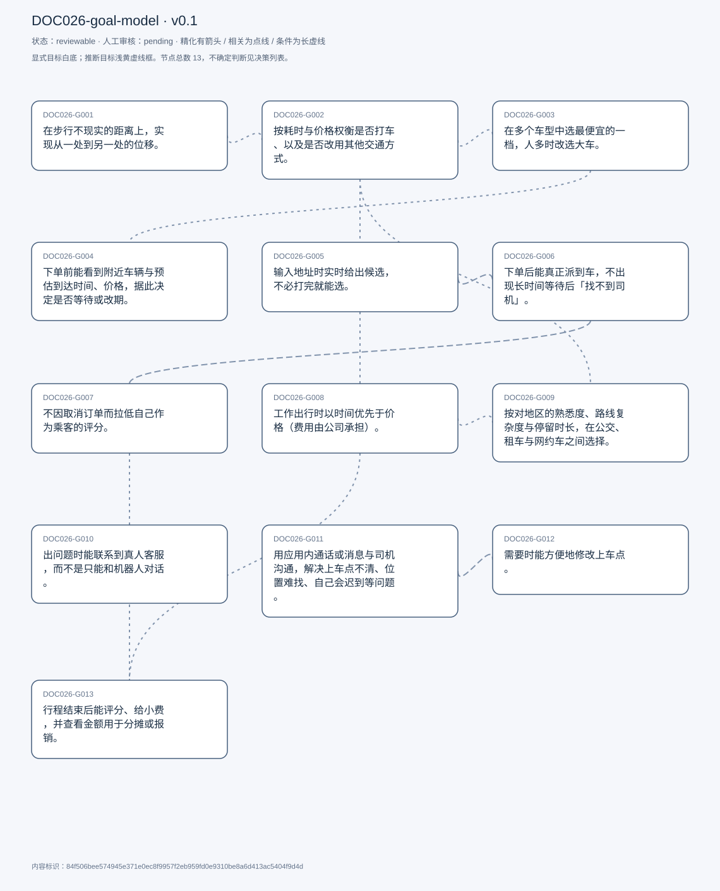
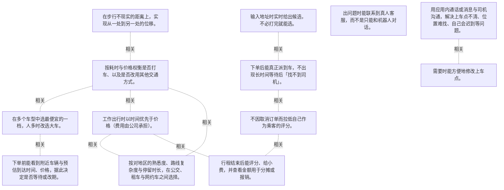

# 目标模型说明

模型：DOC026-goal-model；版本：v0.1

交付状态：reviewable；结构：passed；人工审核：pending

[交互模型](goal-model.html) · [矢量图](goal-model.svg) · [权威数据](goal-model.json)

## 目标图

## 目标

| 编号 | 表述 | 来源 | 情境 | 证据 |
|---|---|---|---|---|
| DOC026-G001 | 在步行不现实的距离上，实现从一处到另一处的位移。 | explicit | 自述这是使用 Uber 的主要目标；对照：能走到的地方就走 | E0001, E0002 |
| DOC026-G002 | 按耗时与价格权衡是否打车、以及是否改用其他交通方式。 | explicit | 两条判据：时间成本、价格；他会主动比较开车、公交、步行 | E0003, E0004 |
| DOC026-G003 | 在多个车型中选最便宜的一档，人多时改选大车。 | explicit | 默认选最便宜；例外：同行人多时看座位数 | E0005, E0006, E0007 |
| DOC026-G004 | 下单前能看到附近车辆与预估到达时间、价格，据此决定是否等待或改期。 | explicit | 界面会显示地图上的车辆与「X 分钟之外」；若价格过高可以选择晚点再走 | E0008, E0009 |
| DOC026-G005 | 输入地址时实时给出候选，不必打完就能选。 | explicit | 自评「kind of helpful」 | E0010, E0011 |
| DOC026-G006 | 下单后能真正派到车，不出现长时间等待后「找不到司机」。 | explicit | 症状：显示有车、点了要等很久，最后说找不到司机；他猜测是应用夸大供给，或司机看到请求后拒单 | E0012, E0013 |
| DOC026-G007 | 不因取消订单而拉低自己作为乘客的评分。 | explicit | 他知道司机能看到乘客评分；因此尽量不取消，即使等待体验很差 | E0014, E0015 |
| DOC026-G008 | 工作出行时以时间优先于价格（费用由公司承担）。 | explicit | 前提：公司报销；取舍：多花 20 美元换少等 20 分钟可接受 | E0016, E0017 |
| DOC026-G009 | 按对地区的熟悉度、路线复杂度与停留时长，在公交、租车与网约车之间选择。 | explicit | 公交：熟悉地区且顺路才坐；租车：多天行程更自由；网约车：路线复杂时兜底 | E0018, E0019, E0020 |
| DOC026-G010 | 出问题时能联系到真人客服，而不是只能和机器人对话。 | explicit | 起因：Uber Eats 送餐时间预估错误，客服体验极差，此后停用该服务；他怀疑对方是聊天机器人 | E0021, E0022 |
| DOC026-G011 | 用应用内通话或消息与司机沟通，解决上车点不清、位置难找、自己会迟到等问题。 | explicit | 场景：门牌难找、GPS 差、地点太热闹；用途：提前告知、多停靠时说明延误 | E0023, E0024, E0025 |
| DOC026-G012 | 需要时能方便地修改上车点。 | explicit | 现状：改版后只在「不用当前定位」时才容易改；替代做法：直接打电话告诉司机 | E0026, E0027 |
| DOC026-G013 | 行程结束后能评分、给小费，并查看金额用于分摊或报销。 | explicit | 最常回看的是评分与小费入口；金额用于与朋友分摊或作为报销凭证 | E0028, E0029, E0030 |

## 关系判断（含不确定与无关系）

- DOC026-G001 / DOC026-G002：related。T005–T007 是目的与判据：位移是目的，时间与价格决定用什么方式完成它。但 G001 与工具无关，G002 只在有多个选项时才有意义。
- DOC026-G001 / DOC026-G003：none。DOC026-G001 的对象是从一处到另一处（T005），DOC026-G003 的对象是车型里选最便宜的（T011）；两处分别出自不同话题段，原文未在二者之间建立因果、手段、评价或情境包含关系，本次评估口径内未建立可采用关系。
- DOC026-G001 / DOC026-G004：none。DOC026-G001 的对象是从一处到另一处（T005），DOC026-G004 的对象是看到附近车与预估价（T011）；两处分别出自不同话题段，原文未在二者之间建立因果、手段、评价或情境包含关系，本次评估口径内未建立可采用关系。
- DOC026-G001 / DOC026-G005：none。DOC026-G001 的对象是从一处到另一处（T005），DOC026-G005 的对象是地址自动补全（T011）；两处分别出自不同话题段，原文未在二者之间建立因果、手段、评价或情境包含关系，本次评估口径内未建立可采用关系。
- DOC026-G001 / DOC026-G006：none。DOC026-G001 的对象是从一处到另一处（T005），DOC026-G006 的对象是能真正派到车（T013）；两处分别出自不同话题段，原文未在二者之间建立因果、手段、评价或情境包含关系，本次评估口径内未建立可采用关系。
- DOC026-G001 / DOC026-G007：none。DOC026-G001 的对象是从一处到另一处（T005），DOC026-G007 的对象是不因取消掉评分（T013）；两处分别出自不同话题段，原文未在二者之间建立因果、手段、评价或情境包含关系，本次评估口径内未建立可采用关系。
- DOC026-G001 / DOC026-G008：none。DOC026-G001 的对象是从一处到另一处（T005），DOC026-G008 的对象是工作出行时间优先（T019）；两处分别出自不同话题段，原文未在二者之间建立因果、手段、评价或情境包含关系，本次评估口径内未建立可采用关系。
- DOC026-G001 / DOC026-G009：none。DOC026-G001 的对象是从一处到另一处（T005），DOC026-G009 的对象是多方式间取舍（T021）；两处分别出自不同话题段，原文未在二者之间建立因果、手段、评价或情境包含关系，本次评估口径内未建立可采用关系。
- DOC026-G001 / DOC026-G010：none。DOC026-G001 的对象是从一处到另一处（T005），DOC026-G010 的对象是联系到真人客服（T031）；两处分别出自不同话题段，原文未在二者之间建立因果、手段、评价或情境包含关系，本次评估口径内未建立可采用关系。
- DOC026-G001 / DOC026-G011：none。DOC026-G001 的对象是从一处到另一处（T005），DOC026-G011 的对象是与司机通话沟通（T039）；两处分别出自不同话题段，原文未在二者之间建立因果、手段、评价或情境包含关系，本次评估口径内未建立可采用关系。
- DOC026-G001 / DOC026-G012：none。DOC026-G001 的对象是从一处到另一处（T005），DOC026-G012 的对象是能改上车点（T041）；两处分别出自不同话题段，原文未在二者之间建立因果、手段、评价或情境包含关系，本次评估口径内未建立可采用关系。
- DOC026-G001 / DOC026-G013：none。DOC026-G001 的对象是从一处到另一处（T005），DOC026-G013 的对象是行程后评分与查金额（T045）；两处分别出自不同话题段，原文未在二者之间建立因果、手段、评价或情境包含关系，本次评估口径内未建立可采用关系。
- DOC026-G002 / DOC026-G003：related。T011 的选车策略就是 G002 的价格判据在下单环节的具体执行：默认选最便宜，人多时才为座位数加钱。但 G002 还包含「别的方式更划算就不打车」。
- DOC026-G002 / DOC026-G004：none。DOC026-G002 的对象是按时间与价格权衡（T007），DOC026-G004 的对象是看到附近车与预估价（T011）；两处分别出自不同话题段，原文未在二者之间建立因果、手段、评价或情境包含关系，本次评估口径内未建立可采用关系。
- DOC026-G002 / DOC026-G005：none。DOC026-G002 的对象是按时间与价格权衡（T007），DOC026-G005 的对象是地址自动补全（T011）；两处分别出自不同话题段，原文未在二者之间建立因果、手段、评价或情境包含关系，本次评估口径内未建立可采用关系。
- DOC026-G002 / DOC026-G006：none。DOC026-G002 的对象是按时间与价格权衡（T007），DOC026-G006 的对象是能真正派到车（T013）；两处分别出自不同话题段，原文未在二者之间建立因果、手段、评价或情境包含关系，本次评估口径内未建立可采用关系。
- DOC026-G002 / DOC026-G007：none。DOC026-G002 的对象是按时间与价格权衡（T007），DOC026-G007 的对象是不因取消掉评分（T013）；两处分别出自不同话题段，原文未在二者之间建立因果、手段、评价或情境包含关系，本次评估口径内未建立可采用关系。
- DOC026-G002 / DOC026-G008：related。T019 给出同一个权衡在两种场景下的不同权重：私人自付时看价格，工作报销时看时间。规则相同、系数不同。
- DOC026-G002 / DOC026-G009：related。T021 把权衡从「打不打车」扩展到「公交/租车/网约车怎么选」，判据仍是时间、成本与便利。但 G009 多了熟悉度与路线复杂度两个维度。
- DOC026-G002 / DOC026-G010：none。DOC026-G002 的对象是按时间与价格权衡（T007），DOC026-G010 的对象是联系到真人客服（T031）；两处分别出自不同话题段，原文未在二者之间建立因果、手段、评价或情境包含关系，本次评估口径内未建立可采用关系。
- DOC026-G002 / DOC026-G011：none。DOC026-G002 的对象是按时间与价格权衡（T007），DOC026-G011 的对象是与司机通话沟通（T039）；两处分别出自不同话题段，原文未在二者之间建立因果、手段、评价或情境包含关系，本次评估口径内未建立可采用关系。
- DOC026-G002 / DOC026-G012：none。DOC026-G002 的对象是按时间与价格权衡（T007），DOC026-G012 的对象是能改上车点（T041）；两处分别出自不同话题段，原文未在二者之间建立因果、手段、评价或情境包含关系，本次评估口径内未建立可采用关系。
- DOC026-G002 / DOC026-G013：none。DOC026-G002 的对象是按时间与价格权衡（T007），DOC026-G013 的对象是行程后评分与查金额（T045）；两处分别出自不同话题段，原文未在二者之间建立因果、手段、评价或情境包含关系，本次评估口径内未建立可采用关系。
- DOC026-G003 / DOC026-G004：related。T011 两个界面元素在同一屏：车型与价格列表、附近车辆地图；他据此判断此刻值不值得走。但 G003 是选哪一档，G004 是决定要不要现在走。
- DOC026-G003 / DOC026-G005：none。DOC026-G003 的对象是车型里选最便宜的（T011），DOC026-G005 的对象是地址自动补全（T011）；两处分别出自不同话题段，原文未在二者之间建立因果、手段、评价或情境包含关系，本次评估口径内未建立可采用关系。
- DOC026-G003 / DOC026-G006：none。DOC026-G003 的对象是车型里选最便宜的（T011），DOC026-G006 的对象是能真正派到车（T013）；两处分别出自不同话题段，原文未在二者之间建立因果、手段、评价或情境包含关系，本次评估口径内未建立可采用关系。
- DOC026-G003 / DOC026-G007：none。DOC026-G003 的对象是车型里选最便宜的（T011），DOC026-G007 的对象是不因取消掉评分（T013）；两处分别出自不同话题段，原文未在二者之间建立因果、手段、评价或情境包含关系，本次评估口径内未建立可采用关系。
- DOC026-G003 / DOC026-G008：none。DOC026-G003 的对象是车型里选最便宜的（T011），DOC026-G008 的对象是工作出行时间优先（T019）；两处分别出自不同话题段，原文未在二者之间建立因果、手段、评价或情境包含关系，本次评估口径内未建立可采用关系。
- DOC026-G003 / DOC026-G009：none。DOC026-G003 的对象是车型里选最便宜的（T011），DOC026-G009 的对象是多方式间取舍（T021）；两处分别出自不同话题段，原文未在二者之间建立因果、手段、评价或情境包含关系，本次评估口径内未建立可采用关系。
- DOC026-G003 / DOC026-G010：none。DOC026-G003 的对象是车型里选最便宜的（T011），DOC026-G010 的对象是联系到真人客服（T031）；两处分别出自不同话题段，原文未在二者之间建立因果、手段、评价或情境包含关系，本次评估口径内未建立可采用关系。
- DOC026-G003 / DOC026-G011：none。DOC026-G003 的对象是车型里选最便宜的（T011），DOC026-G011 的对象是与司机通话沟通（T039）；两处分别出自不同话题段，原文未在二者之间建立因果、手段、评价或情境包含关系，本次评估口径内未建立可采用关系。
- DOC026-G003 / DOC026-G012：none。DOC026-G003 的对象是车型里选最便宜的（T011），DOC026-G012 的对象是能改上车点（T041）；两处分别出自不同话题段，原文未在二者之间建立因果、手段、评价或情境包含关系，本次评估口径内未建立可采用关系。
- DOC026-G003 / DOC026-G013：none。DOC026-G003 的对象是车型里选最便宜的（T011），DOC026-G013 的对象是行程后评分与查金额（T045）；两处分别出自不同话题段，原文未在二者之间建立因果、手段、评价或情境包含关系，本次评估口径内未建立可采用关系。
- DOC026-G004 / DOC026-G005：none。DOC026-G004 的对象是看到附近车与预估价（T011），DOC026-G005 的对象是地址自动补全（T011）；两处分别出自不同话题段，原文未在二者之间建立因果、手段、评价或情境包含关系，本次评估口径内未建立可采用关系。
- DOC026-G004 / DOC026-G006：uncertain。两者可能相互矛盾：G004 依赖「地图上显示附近有车」来做决定，T013 却说他遇到过显示有车、点了却长时间排程、最终提示找不到司机，并自认可能是「应用夸大了能力」或「司机拒单」。若前者成立，G004 提供的信息就是误导；若后者成立，信息本身没错，是供给波动。他本人并列两种解释、未做判断，因此二者关系无法定论。
- DOC026-G004 / DOC026-G007：none。DOC026-G004 的对象是看到附近车与预估价（T011），DOC026-G007 的对象是不因取消掉评分（T013）；两处分别出自不同话题段，原文未在二者之间建立因果、手段、评价或情境包含关系，本次评估口径内未建立可采用关系。
- DOC026-G004 / DOC026-G008：none。DOC026-G004 的对象是看到附近车与预估价（T011），DOC026-G008 的对象是工作出行时间优先（T019）；两处分别出自不同话题段，原文未在二者之间建立因果、手段、评价或情境包含关系，本次评估口径内未建立可采用关系。
- DOC026-G004 / DOC026-G009：none。DOC026-G004 的对象是看到附近车与预估价（T011），DOC026-G009 的对象是多方式间取舍（T021）；两处分别出自不同话题段，原文未在二者之间建立因果、手段、评价或情境包含关系，本次评估口径内未建立可采用关系。
- DOC026-G004 / DOC026-G010：none。DOC026-G004 的对象是看到附近车与预估价（T011），DOC026-G010 的对象是联系到真人客服（T031）；两处分别出自不同话题段，原文未在二者之间建立因果、手段、评价或情境包含关系，本次评估口径内未建立可采用关系。
- DOC026-G004 / DOC026-G011：none。DOC026-G004 的对象是看到附近车与预估价（T011），DOC026-G011 的对象是与司机通话沟通（T039）；两处分别出自不同话题段，原文未在二者之间建立因果、手段、评价或情境包含关系，本次评估口径内未建立可采用关系。
- DOC026-G004 / DOC026-G012：none。DOC026-G004 的对象是看到附近车与预估价（T011），DOC026-G012 的对象是能改上车点（T041）；两处分别出自不同话题段，原文未在二者之间建立因果、手段、评价或情境包含关系，本次评估口径内未建立可采用关系。
- DOC026-G004 / DOC026-G013：none。DOC026-G004 的对象是看到附近车与预估价（T011），DOC026-G013 的对象是行程后评分与查金额（T045）；两处分别出自不同话题段，原文未在二者之间建立因果、手段、评价或情境包含关系，本次评估口径内未建立可采用关系。
- DOC026-G005 / DOC026-G006：related。T011–T013 是同一次下单的前后两段：地址输入顺滑，但点了下单未必派得到车。输入体验好不能保证履约。
- DOC026-G005 / DOC026-G007：none。DOC026-G005 的对象是地址自动补全（T011），DOC026-G007 的对象是不因取消掉评分（T013）；两处分别出自不同话题段，原文未在二者之间建立因果、手段、评价或情境包含关系，本次评估口径内未建立可采用关系。
- DOC026-G005 / DOC026-G008：none。DOC026-G005 的对象是地址自动补全（T011），DOC026-G008 的对象是工作出行时间优先（T019）；两处分别出自不同话题段，原文未在二者之间建立因果、手段、评价或情境包含关系，本次评估口径内未建立可采用关系。
- DOC026-G005 / DOC026-G009：none。DOC026-G005 的对象是地址自动补全（T011），DOC026-G009 的对象是多方式间取舍（T021）；两处分别出自不同话题段，原文未在二者之间建立因果、手段、评价或情境包含关系，本次评估口径内未建立可采用关系。
- DOC026-G005 / DOC026-G010：none。DOC026-G005 的对象是地址自动补全（T011），DOC026-G010 的对象是联系到真人客服（T031）；两处分别出自不同话题段，原文未在二者之间建立因果、手段、评价或情境包含关系，本次评估口径内未建立可采用关系。
- DOC026-G005 / DOC026-G011：none。DOC026-G005 的对象是地址自动补全（T011），DOC026-G011 的对象是与司机通话沟通（T039）；两处分别出自不同话题段，原文未在二者之间建立因果、手段、评价或情境包含关系，本次评估口径内未建立可采用关系。
- DOC026-G005 / DOC026-G012：none。DOC026-G005 的对象是地址自动补全（T011），DOC026-G012 的对象是能改上车点（T041）；两处分别出自不同话题段，原文未在二者之间建立因果、手段、评价或情境包含关系，本次评估口径内未建立可采用关系。
- DOC026-G005 / DOC026-G013：none。DOC026-G005 的对象是地址自动补全（T011），DOC026-G013 的对象是行程后评分与查金额（T045）；两处分别出自不同话题段，原文未在二者之间建立因果、手段、评价或情境包含关系，本次评估口径内未建立可采用关系。
- DOC026-G006 / DOC026-G007：related。T013 把两者拴在一起：正因为派不到车，他才想取消，但又怕掉评分，于是硬等。G006 的失败直接制造了 G007 的压力。
- DOC026-G006 / DOC026-G008：none。DOC026-G006 的对象是能真正派到车（T013），DOC026-G008 的对象是工作出行时间优先（T019）；两处分别出自不同话题段，原文未在二者之间建立因果、手段、评价或情境包含关系，本次评估口径内未建立可采用关系。
- DOC026-G006 / DOC026-G009：none。DOC026-G006 的对象是能真正派到车（T013），DOC026-G009 的对象是多方式间取舍（T021）；两处分别出自不同话题段，原文未在二者之间建立因果、手段、评价或情境包含关系，本次评估口径内未建立可采用关系。
- DOC026-G006 / DOC026-G010：none。DOC026-G006 的对象是能真正派到车（T013），DOC026-G010 的对象是联系到真人客服（T031）；两处分别出自不同话题段，原文未在二者之间建立因果、手段、评价或情境包含关系，本次评估口径内未建立可采用关系。
- DOC026-G006 / DOC026-G011：none。DOC026-G006 的对象是能真正派到车（T013），DOC026-G011 的对象是与司机通话沟通（T039）；两处分别出自不同话题段，原文未在二者之间建立因果、手段、评价或情境包含关系，本次评估口径内未建立可采用关系。
- DOC026-G006 / DOC026-G012：none。DOC026-G006 的对象是能真正派到车（T013），DOC026-G012 的对象是能改上车点（T041）；两处分别出自不同话题段，原文未在二者之间建立因果、手段、评价或情境包含关系，本次评估口径内未建立可采用关系。
- DOC026-G006 / DOC026-G013：none。DOC026-G006 的对象是能真正派到车（T013），DOC026-G013 的对象是行程后评分与查金额（T045）；两处分别出自不同话题段，原文未在二者之间建立因果、手段、评价或情境包含关系，本次评估口径内未建立可采用关系。
- DOC026-G007 / DOC026-G008：none。DOC026-G007 的对象是不因取消掉评分（T013），DOC026-G008 的对象是工作出行时间优先（T019）；两处分别出自不同话题段，原文未在二者之间建立因果、手段、评价或情境包含关系，本次评估口径内未建立可采用关系。
- DOC026-G007 / DOC026-G009：none。DOC026-G007 的对象是不因取消掉评分（T013），DOC026-G009 的对象是多方式间取舍（T021）；两处分别出自不同话题段，原文未在二者之间建立因果、手段、评价或情境包含关系，本次评估口径内未建立可采用关系。
- DOC026-G007 / DOC026-G010：none。DOC026-G007 的对象是不因取消掉评分（T013），DOC026-G010 的对象是联系到真人客服（T031）；两处分别出自不同话题段，原文未在二者之间建立因果、手段、评价或情境包含关系，本次评估口径内未建立可采用关系。
- DOC026-G007 / DOC026-G011：none。DOC026-G007 的对象是不因取消掉评分（T013），DOC026-G011 的对象是与司机通话沟通（T039）；两处分别出自不同话题段，原文未在二者之间建立因果、手段、评价或情境包含关系，本次评估口径内未建立可采用关系。
- DOC026-G007 / DOC026-G012：none。DOC026-G007 的对象是不因取消掉评分（T013），DOC026-G012 的对象是能改上车点（T041）；两处分别出自不同话题段，原文未在二者之间建立因果、手段、评价或情境包含关系，本次评估口径内未建立可采用关系。
- DOC026-G007 / DOC026-G013：related。T013 与 T045 是同一评分体系的两端：他担心乘客评分被司机看到（G007），同时行程结束要給司机评分（G013）。但一个是被评价、一个是评价他人。
- DOC026-G008 / DOC026-G009：related。T021 说工作出行有免费公交卡，所以常规通勤直接坐公交——工作场景下的成本约束被外部消解，选择就转向便利性。但 G008 是权重、G009 是方式选择。
- DOC026-G008 / DOC026-G010：none。DOC026-G008 的对象是工作出行时间优先（T019），DOC026-G010 的对象是联系到真人客服（T031）；两处分别出自不同话题段，原文未在二者之间建立因果、手段、评价或情境包含关系，本次评估口径内未建立可采用关系。
- DOC026-G008 / DOC026-G011：none。DOC026-G008 的对象是工作出行时间优先（T019），DOC026-G011 的对象是与司机通话沟通（T039）；两处分别出自不同话题段，原文未在二者之间建立因果、手段、评价或情境包含关系，本次评估口径内未建立可采用关系。
- DOC026-G008 / DOC026-G012：none。DOC026-G008 的对象是工作出行时间优先（T019），DOC026-G012 的对象是能改上车点（T041）；两处分别出自不同话题段，原文未在二者之间建立因果、手段、评价或情境包含关系，本次评估口径内未建立可采用关系。
- DOC026-G008 / DOC026-G013：related。T045 说明工作出行后会把金额当报销凭证，正是 G008「公司报销」这一前提在行程结束后的落实。但 G008 影响下单决策，G013 是事后取证。
- DOC026-G009 / DOC026-G010：none。DOC026-G009 的对象是多方式间取舍（T021），DOC026-G010 的对象是联系到真人客服（T031）；两处分别出自不同话题段，原文未在二者之间建立因果、手段、评价或情境包含关系，本次评估口径内未建立可采用关系。
- DOC026-G009 / DOC026-G011：none。DOC026-G009 的对象是多方式间取舍（T021），DOC026-G011 的对象是与司机通话沟通（T039）；两处分别出自不同话题段，原文未在二者之间建立因果、手段、评价或情境包含关系，本次评估口径内未建立可采用关系。
- DOC026-G009 / DOC026-G012：none。DOC026-G009 的对象是多方式间取舍（T021），DOC026-G012 的对象是能改上车点（T041）；两处分别出自不同话题段，原文未在二者之间建立因果、手段、评价或情境包含关系，本次评估口径内未建立可采用关系。
- DOC026-G009 / DOC026-G013：none。DOC026-G009 的对象是多方式间取舍（T021），DOC026-G013 的对象是行程后评分与查金额（T045）；两处分别出自不同话题段，原文未在二者之间建立因果、手段、评价或情境包含关系，本次评估口径内未建立可采用关系。
- DOC026-G010 / DOC026-G011：none。DOC026-G010 的对象是联系到真人客服（T031），DOC026-G011 的对象是与司机通话沟通（T039）；两处分别出自不同话题段，原文未在二者之间建立因果、手段、评价或情境包含关系，本次评估口径内未建立可采用关系。
- DOC026-G010 / DOC026-G012：none。DOC026-G010 的对象是联系到真人客服（T031），DOC026-G012 的对象是能改上车点（T041）；两处分别出自不同话题段，原文未在二者之间建立因果、手段、评价或情境包含关系，本次评估口径内未建立可采用关系。
- DOC026-G010 / DOC026-G013：none。DOC026-G010 的对象是联系到真人客服（T031），DOC026-G013 的对象是行程后评分与查金额（T045）；两处分别出自不同话题段，原文未在二者之间建立因果、手段、评价或情境包含关系，本次评估口径内未建立可采用关系。
- DOC026-G011 / DOC026-G012：related。T041 给出替代关系：应用内改上车点变麻烦后，他改为打电话告知司机——G011 是 G012 失效时的兜底通道。但通话能解释、不能改变系统里的上车点。
- DOC026-G011 / DOC026-G013：none。DOC026-G011 的对象是与司机通话沟通（T039），DOC026-G013 的对象是行程后评分与查金额（T045）；两处分别出自不同话题段，原文未在二者之间建立因果、手段、评价或情境包含关系，本次评估口径内未建立可采用关系。
- DOC026-G012 / DOC026-G013：none。DOC026-G012 的对象是能改上车点（T041），DOC026-G013 的对象是行程后评分与查金额（T045）；两处分别出自不同话题段，原文未在二者之间建立因果、手段、评价或情境包含关系，本次评估口径内未建立可采用关系。

## 证据

### E0001 · DOC026:S006

> the main goal is transportation to get from one place to another

原件位置：{&quot;line_start&quot;: 6, &quot;line_end&quot;: 6, &quot;start_char&quot;: 557, &quot;end_char&quot;: 689}

### E0002 · DOC026:S008

> if it&#x27;s going to take like an hour and a half to get someplace. So I&#x27;ll just walk even if it&#x27;s kind of far away

原件位置：{&quot;line_start&quot;: 8, &quot;line_end&quot;: 8, &quot;start_char&quot;: 867, &quot;end_char&quot;: 1341}

### E0003 · DOC026:S008

> it&#x27;s usually the amount of time it will take or the price in deciding whether or not to take ride

原件位置：{&quot;line_start&quot;: 8, &quot;line_end&quot;: 8, &quot;start_char&quot;: 867, &quot;end_char&quot;: 1341}

### E0004 · DOC026:S008

> whether or not I&#x27;m able to drive there or I want to drive there or if there are other better means of transportation

原件位置：{&quot;line_start&quot;: 8, &quot;line_end&quot;: 8, &quot;start_char&quot;: 867, &quot;end_char&quot;: 1341}

### E0005 · DOC026:S012

> I usually just go for The cheapest one, to be honest

原件位置：{&quot;line_start&quot;: 12, &quot;line_end&quot;: 12, &quot;start_char&quot;: 1700, &quot;end_char&quot;: 3018}

### E0006 · DOC026:S012

> unless if i&#x27;m going with more people

原件位置：{&quot;line_start&quot;: 12, &quot;line_end&quot;: 12, &quot;start_char&quot;: 1700, &quot;end_char&quot;: 3018}

### E0007 · DOC026:S012

> there&#x27;s a comfort that can sit four people

原件位置：{&quot;line_start&quot;: 12, &quot;line_end&quot;: 12, &quot;start_char&quot;: 1700, &quot;end_char&quot;: 3018}

### E0008 · DOC026:S012

> I can also see a map with a couple different Ubers around

原件位置：{&quot;line_start&quot;: 12, &quot;line_end&quot;: 12, &quot;start_char&quot;: 1700, &quot;end_char&quot;: 3018}

### E0009 · DOC026:S012

> if the price was too high, then I can choose to wait

原件位置：{&quot;line_start&quot;: 12, &quot;line_end&quot;: 12, &quot;start_char&quot;: 1700, &quot;end_char&quot;: 3018}

### E0010 · DOC026:S012

> a couple of different options pop up as I&#x27;m typing it

原件位置：{&quot;line_start&quot;: 12, &quot;line_end&quot;: 12, &quot;start_char&quot;: 1700, &quot;end_char&quot;: 3018}

### E0011 · DOC026:S012

> I can just click on whatever comes up before I necessarily finish typing it

原件位置：{&quot;line_start&quot;: 12, &quot;line_end&quot;: 12, &quot;start_char&quot;: 1700, &quot;end_char&quot;: 3018}

### E0012 · DOC026:S014

> it will take a really long time to actually schedule it

原件位置：{&quot;line_start&quot;: 14, &quot;line_end&quot;: 14, &quot;start_char&quot;: 3221, &quot;end_char&quot;: 4284}

### E0013 · DOC026:S014

> it will end up saying that can&#x27;t find a driver

原件位置：{&quot;line_start&quot;: 14, &quot;line_end&quot;: 14, &quot;start_char&quot;: 3221, &quot;end_char&quot;: 4284}

### E0014 · DOC026:S014

> I usually try not to cancel a ride

原件位置：{&quot;line_start&quot;: 14, &quot;line_end&quot;: 14, &quot;start_char&quot;: 3221, &quot;end_char&quot;: 4284}

### E0015 · DOC026:S014

> the drivers will see a rating of the passenger as well. And I think that that damages my rating

原件位置：{&quot;line_start&quot;: 14, &quot;line_end&quot;: 14, &quot;start_char&quot;: 3221, &quot;end_char&quot;: 4284}

### E0016 · DOC026:S020

> i usually care less about the price and more about the time in that case

原件位置：{&quot;line_start&quot;: 20, &quot;line_end&quot;: 20, &quot;start_char&quot;: 5112, &quot;end_char&quot;: 5685}

### E0017 · DOC026:S020

> my work is going to cover it

原件位置：{&quot;line_start&quot;: 20, &quot;line_end&quot;: 20, &quot;start_char&quot;: 5112, &quot;end_char&quot;: 5685}

### E0018 · DOC026:S022

> it usually depends on both how familiar I am with the area

原件位置：{&quot;line_start&quot;: 22, &quot;line_end&quot;: 22, &quot;start_char&quot;: 5966, &quot;end_char&quot;: 6994}

### E0019 · DOC026:S022

> if it&#x27;s complicated like that, I would probably prefer And Uber in that case

原件位置：{&quot;line_start&quot;: 22, &quot;line_end&quot;: 22, &quot;start_char&quot;: 5966, &quot;end_char&quot;: 6994}

### E0020 · DOC026:S022

> give me a little bit more freedom to rent a car than to do a ride share every time

原件位置：{&quot;line_start&quot;: 22, &quot;line_end&quot;: 22, &quot;start_char&quot;: 5966, &quot;end_char&quot;: 6994}

### E0021 · DOC026:S032

> I wanted to talk to a person

原件位置：{&quot;line_start&quot;: 32, &quot;line_end&quot;: 32, &quot;start_char&quot;: 8115, &quot;end_char&quot;: 8611}

### E0022 · DOC026:S032

> I think I was probably talking to a chat bot

原件位置：{&quot;line_start&quot;: 32, &quot;line_end&quot;: 32, &quot;start_char&quot;: 8115, &quot;end_char&quot;: 8611}

### E0023 · DOC026:S040

> I actually find that very helpful

原件位置：{&quot;line_start&quot;: 40, &quot;line_end&quot;: 40, &quot;start_char&quot;: 10447, &quot;end_char&quot;: 11204}

### E0024 · DOC026:S040

> calling on their way to pick me up is usually really helpful

原件位置：{&quot;line_start&quot;: 40, &quot;line_end&quot;: 40, &quot;start_char&quot;: 10447, &quot;end_char&quot;: 11204}

### E0025 · DOC026:S040

> maybe the house numbers are hard to see

原件位置：{&quot;line_start&quot;: 40, &quot;line_end&quot;: 40, &quot;start_char&quot;: 10447, &quot;end_char&quot;: 11204}

### E0026 · DOC026:S042

> I think that it&#x27;s not as simple to change it

原件位置：{&quot;line_start&quot;: 42, &quot;line_end&quot;: 42, &quot;start_char&quot;: 11438, &quot;end_char&quot;: 12185}

### E0027 · DOC026:S042

> I give the driver a heads up instead of doing it on the app

原件位置：{&quot;line_start&quot;: 42, &quot;line_end&quot;: 42, &quot;start_char&quot;: 11438, &quot;end_char&quot;: 12185}

### E0028 · DOC026:S046

> they give you the option to rate the driver

原件位置：{&quot;line_start&quot;: 46, &quot;line_end&quot;: 46, &quot;start_char&quot;: 12569, &quot;end_char&quot;: 13178}

### E0029 · DOC026:S046

> look at how much the ride was so that I could split split up the charge

原件位置：{&quot;line_start&quot;: 46, &quot;line_end&quot;: 46, &quot;start_char&quot;: 12569, &quot;end_char&quot;: 13178}

### E0030 · DOC026:S046

> I can use that as a receipt to get reimbursed

原件位置：{&quot;line_start&quot;: 46, &quot;line_end&quot;: 46, &quot;start_char&quot;: 12569, &quot;end_char&quot;: 13178}

## 问题、限制与版本

- 两者可能相互矛盾：G004 依赖「地图上显示附近有车」来做决定，T013 却说他遇到过显示有车、点了却长时间排程、最终提示找不到司机，并自认可能是「应用夸大了能力」或「司机拒单」。若前者成立，G004 提供的信息就是误导；若后者成立，信息本身没错，是供给波动。他本人并列两种解释、未做判断，因此二者关系无法定论。
- 当前会话助手的开发判断，非独立盲测；无人工采纳记录。
- 结构检查已绑定当前版本；独立语义审查未执行；人工状态以实际审核记录为准。

内容标识：84f506bee574945e371e0ec8f9957f2eb959fd0e9310be8a6d413ac5404f9d4d

人工决定：

审核意见：
