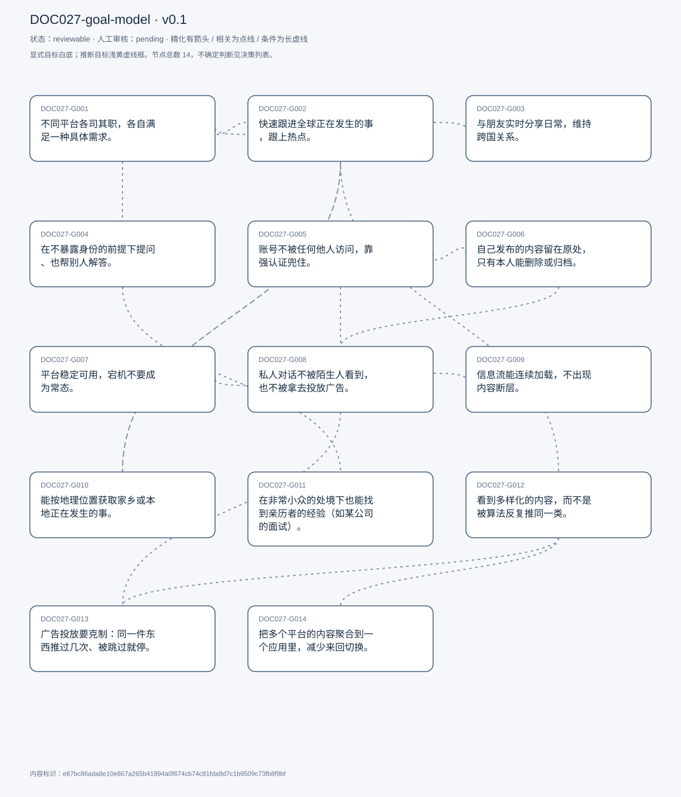
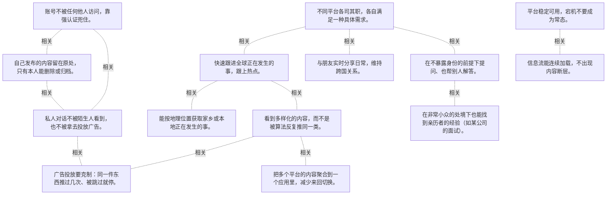

# 目标模型说明

模型：DOC027-goal-model；版本：v0.1

交付状态：reviewable；结构：passed；人工审核：pending

[交互模型](goal-model.html) · [矢量图](goal-model.svg) · [权威数据](goal-model.json)

## 目标图

## 目标

| 编号 | 表述 | 来源 | 情境 | 证据 |
|---|---|---|---|---|
| DOC027-G001 | 不同平台各司其职，各自满足一种具体需求。 | explicit | 反对用一个平台包办所有需求；分工：Twitter 看新闻、Snapchat 连朋友、Reddit 匿名问答 | E0001, E0002 |
| DOC027-G002 | 快速跟进全球正在发生的事，跟上热点。 | explicit | 手段：点开一个 trending hashtag 就能看完全世界在讨论什么 | E0003, E0004, E0005 |
| DOC027-G003 | 与朋友实时分享日常，维持跨国关系。 | explicit | 场景：人在美国，朋友在印度；形式：即时发照片/视频 | E0006, E0007 |
| DOC027-G004 | 在不暴露身份的前提下提问、也帮别人解答。 | explicit | 手段：按兴趣分组的 subreddit；用途：找食谱、找城市里的某样东西、问经验 | E0008, E0009, E0010 |
| DOC027-G005 | 账号不被任何他人访问，靠强认证兜住。 | explicit | 自述这是最重要的功能；参照 Signal：一次性备份码作为永久 2FA，换设备必须输入 | E0011, E0012, E0013 |
| DOC027-G006 | 自己发布的内容留在原处，只有本人能删除或归档。 | explicit | 反感：帖子莫名消失；诉求：数据归属明确 | E0014, E0015 |
| DOC027-G007 | 平台稳定可用，宕机不要成为常态。 | explicit | 可接受偶发中断；频繁宕机会直接导致流失 | E0016, E0017 |
| DOC027-G008 | 私人对话不被陌生人看到，也不被拿去投放广告。 | explicit | 最大抱怨：聊完冰箱就看到冰箱广告；诉求：数据加密 | E0018, E0019, E0020 |
| DOC027-G009 | 信息流能连续加载，不出现内容断层。 | explicit | 症状：滑到某处加载不出来，只能回顶部刷新；代价：担心错过中间漏掉的帖子 | E0021, E0022, E0023 |
| DOC027-G010 | 能按地理位置获取家乡或本地正在发生的事。 | explicit | 问题：Twitter 已按美国定位推送，看不到印度热点；印度的 hashtag 本身有地域性 | E0024, E0025 |
| DOC027-G011 | 在非常小众的处境下也能找到亲历者的经验（如某公司的面试）。 | explicit | 一般性问题 Reddit 很好用；极小众问题常常无人回答 | E0026, E0027, E0028 |
| DOC027-G012 | 看到多样化的内容，而不是被算法反复推同一类。 | explicit | Instagram 的推荐逻辑会强化已点赞的类型；他要的是 assortment 而非单一 stream | E0029, E0030, E0031 |
| DOC027-G013 | 广告投放要克制：同一件东西推过几次、被跳过就停。 | explicit | 被问「有魔法棒想改什么」时的答案；反面：只因提过一次就被反复推同类广告 | E0032, E0033, E0034 |
| DOC027-G014 | 把多个平台的内容聚合到一个应用里，减少来回切换。 | explicit | 设想：可自选接入哪些平台；收益：一处看完所有内容 | E0035, E0036, E0037 |

## 关系判断（含不确定与无关系）

- DOC027-G001 / DOC027-G002：related。T005 用一个具体例子解释「分工」：Twitter 承担「跟进全球热点」这一职责。但 G001 是一个关于工具选择的总体原则，G002 是其中一个具体需求。
- DOC027-G001 / DOC027-G003：related。T005 用 Snapchat 说明分工中的「与朋友实时联系」这一格，理由是该平台的照片即时发送体验。但 G003 只涉及亲密关系，G001 还覆盖信息与匿名需求。
- DOC027-G001 / DOC027-G004：related。T005 把 Reddit 定位为「匿名 + 兴趣分组」的那一格，正是分工原则下的第三种职责。但 G004 依赖匿名这一平台特性，其他平台无法替代。
- DOC027-G001 / DOC027-G005：none。DOC027-G001 的对象是平台各司其职（T005），DOC027-G005 的对象是账号强认证（T011/T019）；两处分别出自不同话题段，原文未在二者之间建立因果、手段、评价或情境包含关系，本次评估口径内未建立可采用关系。
- DOC027-G001 / DOC027-G006：none。DOC027-G001 的对象是平台各司其职（T005），DOC027-G006 的对象是内容不被平台弄丢（T013）；两处分别出自不同话题段，原文未在二者之间建立因果、手段、评价或情境包含关系，本次评估口径内未建立可采用关系。
- DOC027-G001 / DOC027-G007：none。DOC027-G001 的对象是平台各司其职（T005），DOC027-G007 的对象是平台稳定少宕机（T013）；两处分别出自不同话题段，原文未在二者之间建立因果、手段、评价或情境包含关系，本次评估口径内未建立可采用关系。
- DOC027-G001 / DOC027-G008：none。DOC027-G001 的对象是平台各司其职（T005），DOC027-G008 的对象是对话私密不被投放（T039/T045）；两处分别出自不同话题段，原文未在二者之间建立因果、手段、评价或情境包含关系，本次评估口径内未建立可采用关系。
- DOC027-G001 / DOC027-G009：none。DOC027-G001 的对象是平台各司其职（T005），DOC027-G009 的对象是信息流连续加载（T047）；两处分别出自不同话题段，原文未在二者之间建立因果、手段、评价或情境包含关系，本次评估口径内未建立可采用关系。
- DOC027-G001 / DOC027-G010：none。DOC027-G001 的对象是平台各司其职（T005），DOC027-G010 的对象是按地点看家乡新闻（T009）；两处分别出自不同话题段，原文未在二者之间建立因果、手段、评价或情境包含关系，本次评估口径内未建立可采用关系。
- DOC027-G001 / DOC027-G011：none。DOC027-G001 的对象是平台各司其职（T005），DOC027-G011 的对象是找到小众经验信息（T053）；两处分别出自不同话题段，原文未在二者之间建立因果、手段、评价或情境包含关系，本次评估口径内未建立可采用关系。
- DOC027-G001 / DOC027-G012：none。DOC027-G001 的对象是平台各司其职（T005），DOC027-G012 的对象是内容多样化（T079/T087）；两处分别出自不同话题段，原文未在二者之间建立因果、手段、评价或情境包含关系，本次评估口径内未建立可采用关系。
- DOC027-G001 / DOC027-G013：none。DOC027-G001 的对象是平台各司其职（T005），DOC027-G013 的对象是广告克制可跳过（T101）；两处分别出自不同话题段，原文未在二者之间建立因果、手段、评价或情境包含关系，本次评估口径内未建立可采用关系。
- DOC027-G001 / DOC027-G014：uncertain。两者方向相反：T005 认为平台的价值来自分工明确（Twitter 看新闻、Snapchat 连朋友、Reddit 保匿名），T105 又想把它们并到一个应用里，理由是切换太费时。他的设想是「可自选接入的聚合器」，但没说聚合后即时性、匿名性这些依附于平台形态的特性如何保留。是互补还是相互削弱，原文未给答案。
- DOC027-G002 / DOC027-G003：none。DOC027-G002 的对象是跟进全球热点（T005），DOC027-G003 的对象是与朋友实时分享（T005）；两处分别出自不同话题段，原文未在二者之间建立因果、手段、评价或情境包含关系，本次评估口径内未建立可采用关系。
- DOC027-G002 / DOC027-G004：none。DOC027-G002 的对象是跟进全球热点（T005），DOC027-G004 的对象是匿名提问与互助（T005）；两处分别出自不同话题段，原文未在二者之间建立因果、手段、评价或情境包含关系，本次评估口径内未建立可采用关系。
- DOC027-G002 / DOC027-G005：none。DOC027-G002 的对象是跟进全球热点（T005），DOC027-G005 的对象是账号强认证（T011/T019）；两处分别出自不同话题段，原文未在二者之间建立因果、手段、评价或情境包含关系，本次评估口径内未建立可采用关系。
- DOC027-G002 / DOC027-G006：none。DOC027-G002 的对象是跟进全球热点（T005），DOC027-G006 的对象是内容不被平台弄丢（T013）；两处分别出自不同话题段，原文未在二者之间建立因果、手段、评价或情境包含关系，本次评估口径内未建立可采用关系。
- DOC027-G002 / DOC027-G007：none。DOC027-G002 的对象是跟进全球热点（T005），DOC027-G007 的对象是平台稳定少宕机（T013）；两处分别出自不同话题段，原文未在二者之间建立因果、手段、评价或情境包含关系，本次评估口径内未建立可采用关系。
- DOC027-G002 / DOC027-G008：none。DOC027-G002 的对象是跟进全球热点（T005），DOC027-G008 的对象是对话私密不被投放（T039/T045）；两处分别出自不同话题段，原文未在二者之间建立因果、手段、评价或情境包含关系，本次评估口径内未建立可采用关系。
- DOC027-G002 / DOC027-G009：none。DOC027-G002 的对象是跟进全球热点（T005），DOC027-G009 的对象是信息流连续加载（T047）；两处分别出自不同话题段，原文未在二者之间建立因果、手段、评价或情境包含关系，本次评估口径内未建立可采用关系。
- DOC027-G002 / DOC027-G010：related。T009 指出同一个新闻需求被地理设置卡住：Twitter 按所在地推送，就看不到印度的热点。G010 是 G002 在跨国生活场景下的必要条件。但一个是内容类型、一个是地域范围。
- DOC027-G002 / DOC027-G011：none。DOC027-G002 的对象是跟进全球热点（T005），DOC027-G011 的对象是找到小众经验信息（T053）；两处分别出自不同话题段，原文未在二者之间建立因果、手段、评价或情境包含关系，本次评估口径内未建立可采用关系。
- DOC027-G002 / DOC027-G012：related。T079 把「看热点」与「内容同质」放在一起讲：算法只推他点赞过的类型，就看不到世界上别的新鲜事。但 G002 要的是时效，G012 要的是广度。
- DOC027-G002 / DOC027-G013：none。DOC027-G002 的对象是跟进全球热点（T005），DOC027-G013 的对象是广告克制可跳过（T101）；两处分别出自不同话题段，原文未在二者之间建立因果、手段、评价或情境包含关系，本次评估口径内未建立可采用关系。
- DOC027-G002 / DOC027-G014：none。DOC027-G002 的对象是跟进全球热点（T005），DOC027-G014 的对象是跨平台聚合（T105）；两处分别出自不同话题段，原文未在二者之间建立因果、手段、评价或情境包含关系，本次评估口径内未建立可采用关系。
- DOC027-G003 / DOC027-G004：none。DOC027-G003 的对象是与朋友实时分享（T005），DOC027-G004 的对象是匿名提问与互助（T005）；两处分别出自不同话题段，原文未在二者之间建立因果、手段、评价或情境包含关系，本次评估口径内未建立可采用关系。
- DOC027-G003 / DOC027-G005：none。DOC027-G003 的对象是与朋友实时分享（T005），DOC027-G005 的对象是账号强认证（T011/T019）；两处分别出自不同话题段，原文未在二者之间建立因果、手段、评价或情境包含关系，本次评估口径内未建立可采用关系。
- DOC027-G003 / DOC027-G006：none。DOC027-G003 的对象是与朋友实时分享（T005），DOC027-G006 的对象是内容不被平台弄丢（T013）；两处分别出自不同话题段，原文未在二者之间建立因果、手段、评价或情境包含关系，本次评估口径内未建立可采用关系。
- DOC027-G003 / DOC027-G007：none。DOC027-G003 的对象是与朋友实时分享（T005），DOC027-G007 的对象是平台稳定少宕机（T013）；两处分别出自不同话题段，原文未在二者之间建立因果、手段、评价或情境包含关系，本次评估口径内未建立可采用关系。
- DOC027-G003 / DOC027-G008：none。DOC027-G003 的对象是与朋友实时分享（T005），DOC027-G008 的对象是对话私密不被投放（T039/T045）；两处分别出自不同话题段，原文未在二者之间建立因果、手段、评价或情境包含关系，本次评估口径内未建立可采用关系。
- DOC027-G003 / DOC027-G009：none。DOC027-G003 的对象是与朋友实时分享（T005），DOC027-G009 的对象是信息流连续加载（T047）；两处分别出自不同话题段，原文未在二者之间建立因果、手段、评价或情境包含关系，本次评估口径内未建立可采用关系。
- DOC027-G003 / DOC027-G010：none。DOC027-G003 的对象是与朋友实时分享（T005），DOC027-G010 的对象是按地点看家乡新闻（T009）；两处分别出自不同话题段，原文未在二者之间建立因果、手段、评价或情境包含关系，本次评估口径内未建立可采用关系。
- DOC027-G003 / DOC027-G011：none。DOC027-G003 的对象是与朋友实时分享（T005），DOC027-G011 的对象是找到小众经验信息（T053）；两处分别出自不同话题段，原文未在二者之间建立因果、手段、评价或情境包含关系，本次评估口径内未建立可采用关系。
- DOC027-G003 / DOC027-G012：none。DOC027-G003 的对象是与朋友实时分享（T005），DOC027-G012 的对象是内容多样化（T079/T087）；两处分别出自不同话题段，原文未在二者之间建立因果、手段、评价或情境包含关系，本次评估口径内未建立可采用关系。
- DOC027-G003 / DOC027-G013：none。DOC027-G003 的对象是与朋友实时分享（T005），DOC027-G013 的对象是广告克制可跳过（T101）；两处分别出自不同话题段，原文未在二者之间建立因果、手段、评价或情境包含关系，本次评估口径内未建立可采用关系。
- DOC027-G003 / DOC027-G014：none。DOC027-G003 的对象是与朋友实时分享（T005），DOC027-G014 的对象是跨平台聚合（T105）；两处分别出自不同话题段，原文未在二者之间建立因果、手段、评价或情境包含关系，本次评估口径内未建立可采用关系。
- DOC027-G004 / DOC027-G005：none。DOC027-G004 的对象是匿名提问与互助（T005），DOC027-G005 的对象是账号强认证（T011/T019）；两处分别出自不同话题段，原文未在二者之间建立因果、手段、评价或情境包含关系，本次评估口径内未建立可采用关系。
- DOC027-G004 / DOC027-G006：none。DOC027-G004 的对象是匿名提问与互助（T005），DOC027-G006 的对象是内容不被平台弄丢（T013）；两处分别出自不同话题段，原文未在二者之间建立因果、手段、评价或情境包含关系，本次评估口径内未建立可采用关系。
- DOC027-G004 / DOC027-G007：none。DOC027-G004 的对象是匿名提问与互助（T005），DOC027-G007 的对象是平台稳定少宕机（T013）；两处分别出自不同话题段，原文未在二者之间建立因果、手段、评价或情境包含关系，本次评估口径内未建立可采用关系。
- DOC027-G004 / DOC027-G008：none。DOC027-G004 的对象是匿名提问与互助（T005），DOC027-G008 的对象是对话私密不被投放（T039/T045）；两处分别出自不同话题段，原文未在二者之间建立因果、手段、评价或情境包含关系，本次评估口径内未建立可采用关系。
- DOC027-G004 / DOC027-G009：none。DOC027-G004 的对象是匿名提问与互助（T005），DOC027-G009 的对象是信息流连续加载（T047）；两处分别出自不同话题段，原文未在二者之间建立因果、手段、评价或情境包含关系，本次评估口径内未建立可采用关系。
- DOC027-G004 / DOC027-G010：none。DOC027-G004 的对象是匿名提问与互助（T005），DOC027-G010 的对象是按地点看家乡新闻（T009）；两处分别出自不同话题段，原文未在二者之间建立因果、手段、评价或情境包含关系，本次评估口径内未建立可采用关系。
- DOC027-G004 / DOC027-G011：related。T053 区分一般问题与小众问题：Reddit 的匿名问答对前者有效，对后者常常无人应答。G011 是 G004 的能力边界，不是另一个渠道。
- DOC027-G004 / DOC027-G012：none。DOC027-G004 的对象是匿名提问与互助（T005），DOC027-G012 的对象是内容多样化（T079/T087）；两处分别出自不同话题段，原文未在二者之间建立因果、手段、评价或情境包含关系，本次评估口径内未建立可采用关系。
- DOC027-G004 / DOC027-G013：none。DOC027-G004 的对象是匿名提问与互助（T005），DOC027-G013 的对象是广告克制可跳过（T101）；两处分别出自不同话题段，原文未在二者之间建立因果、手段、评价或情境包含关系，本次评估口径内未建立可采用关系。
- DOC027-G004 / DOC027-G014：none。DOC027-G004 的对象是匿名提问与互助（T005），DOC027-G014 的对象是跨平台聚合（T105）；两处分别出自不同话题段，原文未在二者之间建立因果、手段、评价或情境包含关系，本次评估口径内未建立可采用关系。
- DOC027-G005 / DOC027-G006：related。T011–T013 把认证与数据归属并列为最重要的两件事，二者共同构成「账号是我的」这一控制权：一个防别人进来，一个防平台拿走。
- DOC027-G005 / DOC027-G007：none。DOC027-G005 的对象是账号强认证（T011/T019），DOC027-G007 的对象是平台稳定少宕机（T013）；两处分别出自不同话题段，原文未在二者之间建立因果、手段、评价或情境包含关系，本次评估口径内未建立可采用关系。
- DOC027-G005 / DOC027-G008：related。T019–T031 用 Signal 说明认证与加密是一体的：备份码防他人登录，端到端加密防他人读取。但 G005 管入口、G008 管内容。
- DOC027-G005 / DOC027-G009：none。DOC027-G005 的对象是账号强认证（T011/T019），DOC027-G009 的对象是信息流连续加载（T047）；两处分别出自不同话题段，原文未在二者之间建立因果、手段、评价或情境包含关系，本次评估口径内未建立可采用关系。
- DOC027-G005 / DOC027-G010：none。DOC027-G005 的对象是账号强认证（T011/T019），DOC027-G010 的对象是按地点看家乡新闻（T009）；两处分别出自不同话题段，原文未在二者之间建立因果、手段、评价或情境包含关系，本次评估口径内未建立可采用关系。
- DOC027-G005 / DOC027-G011：none。DOC027-G005 的对象是账号强认证（T011/T019），DOC027-G011 的对象是找到小众经验信息（T053）；两处分别出自不同话题段，原文未在二者之间建立因果、手段、评价或情境包含关系，本次评估口径内未建立可采用关系。
- DOC027-G005 / DOC027-G012：none。DOC027-G005 的对象是账号强认证（T011/T019），DOC027-G012 的对象是内容多样化（T079/T087）；两处分别出自不同话题段，原文未在二者之间建立因果、手段、评价或情境包含关系，本次评估口径内未建立可采用关系。
- DOC027-G005 / DOC027-G013：none。DOC027-G005 的对象是账号强认证（T011/T019），DOC027-G013 的对象是广告克制可跳过（T101）；两处分别出自不同话题段，原文未在二者之间建立因果、手段、评价或情境包含关系，本次评估口径内未建立可采用关系。
- DOC027-G005 / DOC027-G014：none。DOC027-G005 的对象是账号强认证（T011/T019），DOC027-G014 的对象是跨平台聚合（T105）；两处分别出自不同话题段，原文未在二者之间建立因果、手段、评价或情境包含关系，本次评估口径内未建立可采用关系。
- DOC027-G006 / DOC027-G007：none。DOC027-G006 的对象是内容不被平台弄丢（T013），DOC027-G007 的对象是平台稳定少宕机（T013）；两处分别出自不同话题段，原文未在二者之间建立因果、手段、评价或情境包含关系，本次评估口径内未建立可采用关系。
- DOC027-G006 / DOC027-G008：related。两者都是「我的数据归我」的不同侧面：G006 要内容留在原处不被删，G008 要内容不被读取与变现。但一个关于存续、一个关于保密。
- DOC027-G006 / DOC027-G009：none。DOC027-G006 的对象是内容不被平台弄丢（T013），DOC027-G009 的对象是信息流连续加载（T047）；两处分别出自不同话题段，原文未在二者之间建立因果、手段、评价或情境包含关系，本次评估口径内未建立可采用关系。
- DOC027-G006 / DOC027-G010：none。DOC027-G006 的对象是内容不被平台弄丢（T013），DOC027-G010 的对象是按地点看家乡新闻（T009）；两处分别出自不同话题段，原文未在二者之间建立因果、手段、评价或情境包含关系，本次评估口径内未建立可采用关系。
- DOC027-G006 / DOC027-G011：none。DOC027-G006 的对象是内容不被平台弄丢（T013），DOC027-G011 的对象是找到小众经验信息（T053）；两处分别出自不同话题段，原文未在二者之间建立因果、手段、评价或情境包含关系，本次评估口径内未建立可采用关系。
- DOC027-G006 / DOC027-G012：none。DOC027-G006 的对象是内容不被平台弄丢（T013），DOC027-G012 的对象是内容多样化（T079/T087）；两处分别出自不同话题段，原文未在二者之间建立因果、手段、评价或情境包含关系，本次评估口径内未建立可采用关系。
- DOC027-G006 / DOC027-G013：none。DOC027-G006 的对象是内容不被平台弄丢（T013），DOC027-G013 的对象是广告克制可跳过（T101）；两处分别出自不同话题段，原文未在二者之间建立因果、手段、评价或情境包含关系，本次评估口径内未建立可采用关系。
- DOC027-G006 / DOC027-G014：none。DOC027-G006 的对象是内容不被平台弄丢（T013），DOC027-G014 的对象是跨平台聚合（T105）；两处分别出自不同话题段，原文未在二者之间建立因果、手段、评价或情境包含关系，本次评估口径内未建立可采用关系。
- DOC027-G007 / DOC027-G008：none。DOC027-G007 的对象是平台稳定少宕机（T013），DOC027-G008 的对象是对话私密不被投放（T039/T045）；两处分别出自不同话题段，原文未在二者之间建立因果、手段、评价或情境包含关系，本次评估口径内未建立可采用关系。
- DOC027-G007 / DOC027-G009：related。T047–T049 的加载断层与 T013 的宕机都是可用性问题，但层级不同：宕机是整个服务不可用，断层是单次会话的内容流中断。
- DOC027-G007 / DOC027-G010：none。DOC027-G007 的对象是平台稳定少宕机（T013），DOC027-G010 的对象是按地点看家乡新闻（T009）；两处分别出自不同话题段，原文未在二者之间建立因果、手段、评价或情境包含关系，本次评估口径内未建立可采用关系。
- DOC027-G007 / DOC027-G011：none。DOC027-G007 的对象是平台稳定少宕机（T013），DOC027-G011 的对象是找到小众经验信息（T053）；两处分别出自不同话题段，原文未在二者之间建立因果、手段、评价或情境包含关系，本次评估口径内未建立可采用关系。
- DOC027-G007 / DOC027-G012：none。DOC027-G007 的对象是平台稳定少宕机（T013），DOC027-G012 的对象是内容多样化（T079/T087）；两处分别出自不同话题段，原文未在二者之间建立因果、手段、评价或情境包含关系，本次评估口径内未建立可采用关系。
- DOC027-G007 / DOC027-G013：none。DOC027-G007 的对象是平台稳定少宕机（T013），DOC027-G013 的对象是广告克制可跳过（T101）；两处分别出自不同话题段，原文未在二者之间建立因果、手段、评价或情境包含关系，本次评估口径内未建立可采用关系。
- DOC027-G007 / DOC027-G014：none。DOC027-G007 的对象是平台稳定少宕机（T013），DOC027-G014 的对象是跨平台聚合（T105）；两处分别出自不同话题段，原文未在二者之间建立因果、手段、评价或情境包含关系，本次评估口径内未建立可采用关系。
- DOC027-G008 / DOC027-G009：none。DOC027-G008 的对象是对话私密不被投放（T039/T045），DOC027-G009 的对象是信息流连续加载（T047）；两处分别出自不同话题段，原文未在二者之间建立因果、手段、评价或情境包含关系，本次评估口径内未建立可采用关系。
- DOC027-G008 / DOC027-G010：none。DOC027-G008 的对象是对话私密不被投放（T039/T045），DOC027-G010 的对象是按地点看家乡新闻（T009）；两处分别出自不同话题段，原文未在二者之间建立因果、手段、评价或情境包含关系，本次评估口径内未建立可采用关系。
- DOC027-G008 / DOC027-G011：none。DOC027-G008 的对象是对话私密不被投放（T039/T045），DOC027-G011 的对象是找到小众经验信息（T053）；两处分别出自不同话题段，原文未在二者之间建立因果、手段、评价或情境包含关系，本次评估口径内未建立可采用关系。
- DOC027-G008 / DOC027-G012：none。DOC027-G008 的对象是对话私密不被投放（T039/T045），DOC027-G012 的对象是内容多样化（T079/T087）；两处分别出自不同话题段，原文未在二者之间建立因果、手段、评价或情境包含关系，本次评估口径内未建立可采用关系。
- DOC027-G008 / DOC027-G013：related。T041 直接给出因果链：对话被读取 → 据此投广告。G013 要解决的是这条链的末端表现，G008 要切断的是源头。
- DOC027-G008 / DOC027-G014：none。DOC027-G008 的对象是对话私密不被投放（T039/T045），DOC027-G014 的对象是跨平台聚合（T105）；两处分别出自不同话题段，原文未在二者之间建立因果、手段、评价或情境包含关系，本次评估口径内未建立可采用关系。
- DOC027-G009 / DOC027-G010：none。DOC027-G009 的对象是信息流连续加载（T047），DOC027-G010 的对象是按地点看家乡新闻（T009）；两处分别出自不同话题段，原文未在二者之间建立因果、手段、评价或情境包含关系，本次评估口径内未建立可采用关系。
- DOC027-G009 / DOC027-G011：none。DOC027-G009 的对象是信息流连续加载（T047），DOC027-G011 的对象是找到小众经验信息（T053）；两处分别出自不同话题段，原文未在二者之间建立因果、手段、评价或情境包含关系，本次评估口径内未建立可采用关系。
- DOC027-G009 / DOC027-G012：none。DOC027-G009 的对象是信息流连续加载（T047），DOC027-G012 的对象是内容多样化（T079/T087）；两处分别出自不同话题段，原文未在二者之间建立因果、手段、评价或情境包含关系，本次评估口径内未建立可采用关系。
- DOC027-G009 / DOC027-G013：none。DOC027-G009 的对象是信息流连续加载（T047），DOC027-G013 的对象是广告克制可跳过（T101）；两处分别出自不同话题段，原文未在二者之间建立因果、手段、评价或情境包含关系，本次评估口径内未建立可采用关系。
- DOC027-G009 / DOC027-G014：none。DOC027-G009 的对象是信息流连续加载（T047），DOC027-G014 的对象是跨平台聚合（T105）；两处分别出自不同话题段，原文未在二者之间建立因果、手段、评价或情境包含关系，本次评估口径内未建立可采用关系。
- DOC027-G010 / DOC027-G011：none。DOC027-G010 的对象是按地点看家乡新闻（T009），DOC027-G011 的对象是找到小众经验信息（T053）；两处分别出自不同话题段，原文未在二者之间建立因果、手段、评价或情境包含关系，本次评估口径内未建立可采用关系。
- DOC027-G010 / DOC027-G012：none。DOC027-G010 的对象是按地点看家乡新闻（T009），DOC027-G012 的对象是内容多样化（T079/T087）；两处分别出自不同话题段，原文未在二者之间建立因果、手段、评价或情境包含关系，本次评估口径内未建立可采用关系。
- DOC027-G010 / DOC027-G013：none。DOC027-G010 的对象是按地点看家乡新闻（T009），DOC027-G013 的对象是广告克制可跳过（T101）；两处分别出自不同话题段，原文未在二者之间建立因果、手段、评价或情境包含关系，本次评估口径内未建立可采用关系。
- DOC027-G010 / DOC027-G014：none。DOC027-G010 的对象是按地点看家乡新闻（T009），DOC027-G014 的对象是跨平台聚合（T105）；两处分别出自不同话题段，原文未在二者之间建立因果、手段、评价或情境包含关系，本次评估口径内未建立可采用关系。
- DOC027-G011 / DOC027-G012：none。DOC027-G011 的对象是找到小众经验信息（T053），DOC027-G012 的对象是内容多样化（T079/T087）；两处分别出自不同话题段，原文未在二者之间建立因果、手段、评价或情境包含关系，本次评估口径内未建立可采用关系。
- DOC027-G011 / DOC027-G013：none。DOC027-G011 的对象是找到小众经验信息（T053），DOC027-G013 的对象是广告克制可跳过（T101）；两处分别出自不同话题段，原文未在二者之间建立因果、手段、评价或情境包含关系，本次评估口径内未建立可采用关系。
- DOC027-G011 / DOC027-G014：none。DOC027-G011 的对象是找到小众经验信息（T053），DOC027-G014 的对象是跨平台聚合（T105）；两处分别出自不同话题段，原文未在二者之间建立因果、手段、评价或情境包含关系，本次评估口径内未建立可采用关系。
- DOC027-G012 / DOC027-G013：related。T045 与 T081 是同一句抱怨的两种对象：反复推同类广告、反复推同类内容，都是「只看过一次就被当成偏好」。但一个是商业推送、一个是内容推荐。
- DOC027-G012 / DOC027-G014：related。T105 把聚合应用的价值直接说成「拿到 assortment」——从多个平台各取一部分，正是获得多样内容的机制。但 G014 还包含省去切换的成本。
- DOC027-G013 / DOC027-G014：none。DOC027-G013 的对象是广告克制可跳过（T101），DOC027-G014 的对象是跨平台聚合（T105）；两处分别出自不同话题段，原文未在二者之间建立因果、手段、评价或情境包含关系，本次评估口径内未建立可采用关系。

## 证据

### E0001 · DOC027:S006

> each platform caters to like a specific need of mine

原件位置：{&quot;line_start&quot;: 6, &quot;line_end&quot;: 6, &quot;start_char&quot;: 1084, &quot;end_char&quot;: 2891}

### E0002 · DOC027:S006

> different needs of mind

原件位置：{&quot;line_start&quot;: 6, &quot;line_end&quot;: 6, &quot;start_char&quot;: 1084, &quot;end_char&quot;: 2891}

### E0003 · DOC027:S006

> Twitter is kind of like my go to news app

原件位置：{&quot;line_start&quot;: 6, &quot;line_end&quot;: 6, &quot;start_char&quot;: 1084, &quot;end_char&quot;: 2891}

### E0004 · DOC027:S006

> tap like one particular hashtag whatever is trending

原件位置：{&quot;line_start&quot;: 6, &quot;line_end&quot;: 6, &quot;start_char&quot;: 1084, &quot;end_char&quot;: 2891}

### E0005 · DOC027:S006

> go through everything that is happening around the world

原件位置：{&quot;line_start&quot;: 6, &quot;line_end&quot;: 6, &quot;start_char&quot;: 1084, &quot;end_char&quot;: 2891}

### E0006 · DOC027:S006

> It&#x27;s very easy for me to connect to stay connected to my friends in real time

原件位置：{&quot;line_start&quot;: 6, &quot;line_end&quot;: 6, &quot;start_char&quot;: 1084, &quot;end_char&quot;: 2891}

### E0007 · DOC027:S006

> I just send them that picture through Snapchat

原件位置：{&quot;line_start&quot;: 6, &quot;line_end&quot;: 6, &quot;start_char&quot;: 1084, &quot;end_char&quot;: 2891}

### E0008 · DOC027:S006

> it helps me keep my anonymity intact

原件位置：{&quot;line_start&quot;: 6, &quot;line_end&quot;: 6, &quot;start_char&quot;: 1084, &quot;end_char&quot;: 2891}

### E0009 · DOC027:S006

> these subreddits which basically cater to one particular interest groups

原件位置：{&quot;line_start&quot;: 6, &quot;line_end&quot;: 6, &quot;start_char&quot;: 1084, &quot;end_char&quot;: 2891}

### E0010 · DOC027:S006

> ask like, maybe a question, or maybe help other people

原件位置：{&quot;line_start&quot;: 6, &quot;line_end&quot;: 6, &quot;start_char&quot;: 1084, &quot;end_char&quot;: 2891}

### E0011 · DOC027:S012

> the most important feature for me is the important feature for me, is authentication

原件位置：{&quot;line_start&quot;: 12, &quot;line_end&quot;: 12, &quot;start_char&quot;: 4564, &quot;end_char&quot;: 4787}

### E0012 · DOC027:S020

> it will give you like a backup code

原件位置：{&quot;line_start&quot;: 20, &quot;line_end&quot;: 20, &quot;start_char&quot;: 5956, &quot;end_char&quot;: 6478}

### E0013 · DOC027:S024

> my particular account cannot be accessed by anyone else other than me

原件位置：{&quot;line_start&quot;: 24, &quot;line_end&quot;: 24, &quot;start_char&quot;: 7025, &quot;end_char&quot;: 7437}

### E0014 · DOC027:S014

> I they should be there until, and unless I delete them or I archive them

原件位置：{&quot;line_start&quot;: 14, &quot;line_end&quot;: 14, &quot;start_char&quot;: 4811, &quot;end_char&quot;: 5410}

### E0015 · DOC027:S014

> data being in its own place is important

原件位置：{&quot;line_start&quot;: 14, &quot;line_end&quot;: 14, &quot;start_char&quot;: 4811, &quot;end_char&quot;: 5410}

### E0016 · DOC027:S014

> I don&#x27;t want those outages to be that often

原件位置：{&quot;line_start&quot;: 14, &quot;line_end&quot;: 14, &quot;start_char&quot;: 4811, &quot;end_char&quot;: 5410}

### E0017 · DOC027:S014

> if they are too regular, then they might lose me as a customer

原件位置：{&quot;line_start&quot;: 14, &quot;line_end&quot;: 14, &quot;start_char&quot;: 4811, &quot;end_char&quot;: 5410}

### E0018 · DOC027:S040

> see through my text or my conversation

原件位置：{&quot;line_start&quot;: 40, &quot;line_end&quot;: 40, &quot;start_char&quot;: 11671, &quot;end_char&quot;: 11992}

### E0019 · DOC027:S042

> Also like then on top of that give ads to me around

原件位置：{&quot;line_start&quot;: 42, &quot;line_end&quot;: 42, &quot;start_char&quot;: 12023, &quot;end_char&quot;: 12095}

### E0020 · DOC027:S046

> the 1st important thing is, I think, data privacy for me

原件位置：{&quot;line_start&quot;: 46, &quot;line_end&quot;: 46, &quot;start_char&quot;: 12353, &quot;end_char&quot;: 12566}

### E0021 · DOC027:S048

> At 1 point there will be like kind of like a lag where the data isn&#x27;t being loaded

原件位置：{&quot;line_start&quot;: 48, &quot;line_end&quot;: 48, &quot;start_char&quot;: 12592, &quot;end_char&quot;: 12840}

### E0022 · DOC027:S050

> start like a new kind of like a refresh

原件位置：{&quot;line_start&quot;: 50, &quot;line_end&quot;: 50, &quot;start_char&quot;: 12865, &quot;end_char&quot;: 13252}

### E0023 · DOC027:S050

> maybe I just missed one particular post

原件位置：{&quot;line_start&quot;: 50, &quot;line_end&quot;: 50, &quot;start_char&quot;: 12865, &quot;end_char&quot;: 13252}

### E0024 · DOC027:S010

> if I wanna get to know about the news or the things that are happening back in India

原件位置：{&quot;line_start&quot;: 10, &quot;line_end&quot;: 10, &quot;start_char&quot;: 3652, &quot;end_char&quot;: 4269}

### E0025 · DOC027:S010

> Twitter is kind of now set to my location in us

原件位置：{&quot;line_start&quot;: 10, &quot;line_end&quot;: 10, &quot;start_char&quot;: 3652, &quot;end_char&quot;: 4269}

### E0026 · DOC027:S054

> I am in a very particular, very niche situation

原件位置：{&quot;line_start&quot;: 54, &quot;line_end&quot;: 54, &quot;start_char&quot;: 13770, &quot;end_char&quot;: 14571}

### E0027 · DOC027:S056

> there&#x27;s no person who has like passed that particular interview

原件位置：{&quot;line_start&quot;: 56, &quot;line_end&quot;: 56, &quot;start_char&quot;: 14597, &quot;end_char&quot;: 15043}

### E0028 · DOC027:S056

> I probably wouldn&#x27;t get any answers for that

原件位置：{&quot;line_start&quot;: 56, &quot;line_end&quot;: 56, &quot;start_char&quot;: 14597, &quot;end_char&quot;: 15043}

### E0029 · DOC027:S080

> Instagram thinks that I like that content, and it&#x27;ll keep showing me similar content

原件位置：{&quot;line_start&quot;: 80, &quot;line_end&quot;: 80, &quot;start_char&quot;: 19600, &quot;end_char&quot;: 20191}

### E0030 · DOC027:S080

> whereas I want to be shown like different kind of content

原件位置：{&quot;line_start&quot;: 80, &quot;line_end&quot;: 80, &quot;start_char&quot;: 19600, &quot;end_char&quot;: 20191}

### E0031 · DOC027:S088

> I want like an assortment of content, not just one particular stream of content

原件位置：{&quot;line_start&quot;: 88, &quot;line_end&quot;: 88, &quot;start_char&quot;: 21513, &quot;end_char&quot;: 21929}

### E0032 · DOC027:S102

> use basic human judgment and not just throw random ads at me

原件位置：{&quot;line_start&quot;: 102, &quot;line_end&quot;: 102, &quot;start_char&quot;: 24395, &quot;end_char&quot;: 25030}

### E0033 · DOC027:S104

> maybe this person wants to buy a refrigerator. So let&#x27;s just give them 2 ads

原件位置：{&quot;line_start&quot;: 104, &quot;line_end&quot;: 104, &quot;start_char&quot;: 25055, &quot;end_char&quot;: 25592}

### E0034 · DOC027:S104

> if they skip those ads, then we will stop showing refrigerator ads

原件位置：{&quot;line_start&quot;: 104, &quot;line_end&quot;: 104, &quot;start_char&quot;: 25055, &quot;end_char&quot;: 25592}

### E0035 · DOC027:S106

> it will have all of my favorite applications in one place

原件位置：{&quot;line_start&quot;: 106, &quot;line_end&quot;: 106, &quot;start_char&quot;: 25820, &quot;end_char&quot;: 26644}

### E0036 · DOC027:S106

> give me, like an assortment of different kind of content

原件位置：{&quot;line_start&quot;: 106, &quot;line_end&quot;: 106, &quot;start_char&quot;: 25820, &quot;end_char&quot;: 26644}

### E0037 · DOC027:S108

> I kind of like waste a lot of time just switching between apps

原件位置：{&quot;line_start&quot;: 108, &quot;line_end&quot;: 108, &quot;start_char&quot;: 26671, &quot;end_char&quot;: 26854}

## 问题、限制与版本

- 两者方向相反：T005 认为平台的价值来自分工明确（Twitter 看新闻、Snapchat 连朋友、Reddit 保匿名），T105 又想把它们并到一个应用里，理由是切换太费时。他的设想是「可自选接入的聚合器」，但没说聚合后即时性、匿名性这些依附于平台形态的特性如何保留。是互补还是相互削弱，原文未给答案。
- 当前会话助手的开发判断，非独立盲测；无人工采纳记录。
- 结构检查已绑定当前版本；独立语义审查未执行；人工状态以实际审核记录为准。

内容标识：e87bc86ada8e10e867a265b41994a0f674cb74c81fda9d7c1b9509c73fb8f9bf

人工决定：

审核意见：
