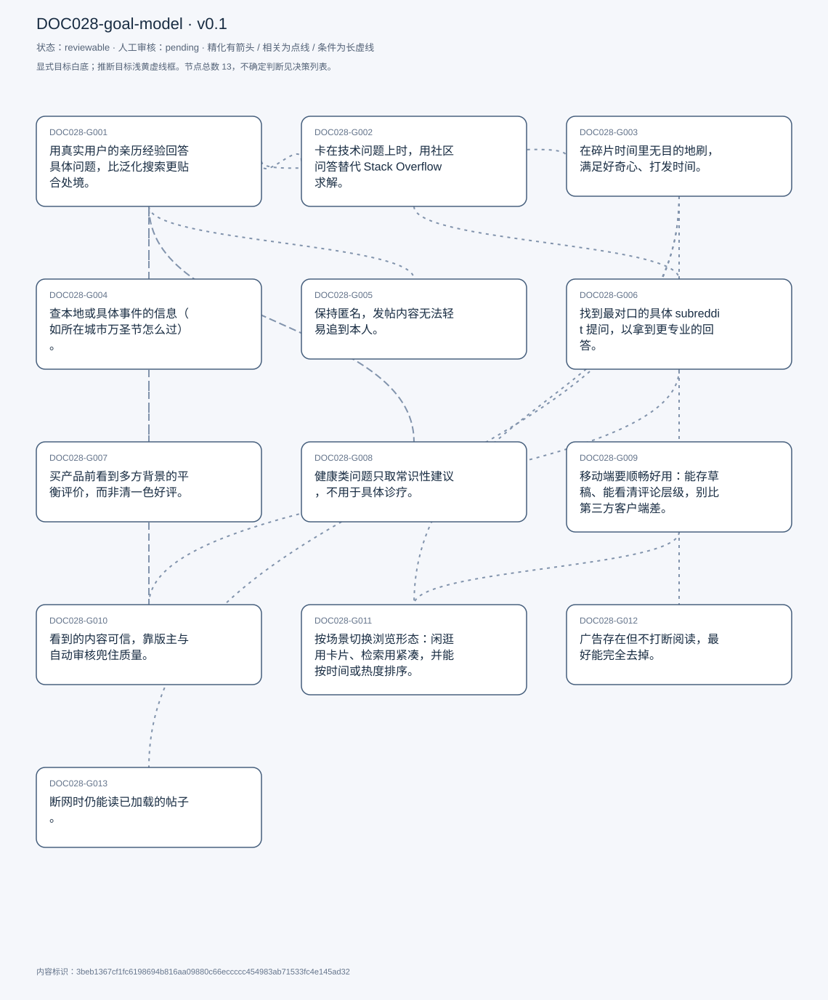
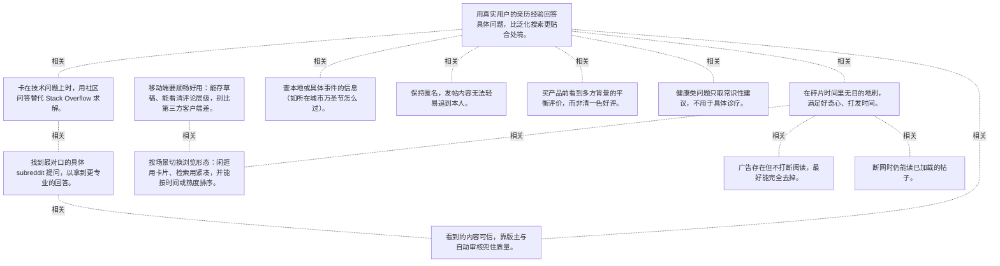

# 目标模型说明

模型：DOC028-goal-model；版本：v0.1

交付状态：reviewable；结构：passed；人工审核：pending

[交互模型](goal-model.html) · [矢量图](goal-model.svg) · [权威数据](goal-model.json)

## 目标图

## 目标

| 编号 | 表述 | 来源 | 情境 | 证据 |
|---|---|---|---|---|
| DOC028-G001 | 用真实用户的亲历经验回答具体问题，比泛化搜索更贴合处境。 | explicit | 自述这是使用 Reddit 的首要理由；对比对象：Google 只给泛化结果 | E0001, E0002, E0003 |
| DOC028-G002 | 卡在技术问题上时，用社区问答替代 Stack Overflow 求解。 | explicit | 自述用途之一；场景：代码问题、需要他人思路 | E0004, E0005 |
| DOC028-G003 | 在碎片时间里无目的地刷，满足好奇心、打发时间。 | explicit | 没有预设目标时即为此模式；常见时段：吃饭、坐车 | E0006, E0007 |
| DOC028-G004 | 查本地或具体事件的信息（如所在城市万圣节怎么过）。 | explicit | 做法：在城市 subreddit 内按关键词搜 | E0008, E0009 |
| DOC028-G005 | 保持匿名，发帖内容无法轻易追到本人。 | explicit | 自述这是 Reddit 的核心卖点；机制：除用户名外不公开任何信息 | E0010, E0011 |
| DOC028-G006 | 找到最对口的具体 subreddit 提问，以拿到更专业的回答。 | explicit | 现状：subreddit 数量庞大且重叠，难找对；期望：用 AI 帮忙定位该发到哪个版块 | E0012, E0013, E0014 |
| DOC028-G007 | 买产品前看到多方背景的平衡评价，而非清一色好评。 | explicit | 对比：亚马逊多是好评，Reddit 有不同背景的人的看法；实例：买笔记本前做过大量调研 | E0015, E0016 |
| DOC028-G008 | 健康类问题只取常识性建议，不用于具体诊疗。 | explicit | 渠道：AskDocs 等有医护回答的版块；边界：一般性问题可信，具体病症不信 | E0017, E0018 |
| DOC028-G009 | 移动端要顺畅好用：能存草稿、能看清评论层级，别比第三方客户端差。 | explicit | 现状：官方 App 慢且笨重，只能用桌面端；自评第三方套壳 App 反而更好 | E0019, E0020, E0021 |
| DOC028-G010 | 看到的内容可信，靠版主与自动审核兜住质量。 | explicit | 机制：自动机器人初筛 + 人工版主把关；判断：有人工介入比纯算法可靠 | E0022, E0023 |
| DOC028-G011 | 按场景切换浏览形态：闲逛用卡片、检索用紧凑，并能按时间或热度排序。 | explicit | 排序：new / top / trending / rising；视图：card / compact | E0024, E0025, E0026 |
| DOC028-G012 | 广告存在但不打断阅读，最好能完全去掉。 | explicit | 评价：广告克制、位置固定、一次只有一条；他自己装了广告拦截，也考虑过买会员去广告 | E0027, E0028, E0029 |
| DOC028-G013 | 断网时仍能读已加载的帖子。 | explicit | 限制：不能刷新、不能发新帖；自评「not very comprehensive」 | E0030, E0031 |

## 关系判断（含不确定与无关系）

- DOC028-G001 / DOC028-G002：related。两者都是「向有经验的人要答案」，技术求助只是其中一个专业领域；T003 把 Reddit 当 Stack Overflow 替代，依据仍是 G001 的亲历经验优于泛化结论。但 G002 有明确的技术正确性判据，G001 更依赖情境。
- DOC028-G001 / DOC028-G003：related。T009 把使用分成两种状态：有预设问题（G001 的搜索模式）与无预设目标（G003 的闲逛模式）。同一平台、两套行为，他自己做了明确区分。
- DOC028-G001 / DOC028-G004：related。T003 的万圣节例子本质也是「问有本地经验的人」，只是把范围收窄到城市版块。G004 是 G001 在地域维度上的具体化。
- DOC028-G001 / DOC028-G005：related。T011 把匿名列为平台核心价值；匿名使他能问出不便具名的问题（求职、健康、职业困惑），这正是 G001 的适用场景。但匿名是条件，不是答案本身。
- DOC028-G001 / DOC028-G006：none。DOC028-G001 的对象是用亲历经验答具体问题（T005），DOC028-G006 的对象是找到最对口 subreddit（T051/T059）；两处分别出自不同话题段，原文未在二者之间建立因果、手段、评价或情境包含关系，本次评估口径内未建立可采用关系。
- DOC028-G001 / DOC028-G007：related。T033 说 Reddit 的评价优势正是「不同背景的人的真实体验」，与 G001 的「personal experiences over facts」同一逻辑，只是对象换成商品。
- DOC028-G001 / DOC028-G008：related。T035 的健康咨询同样是「向有经验者提问」，但他主动划了边界：只取常识、不用于具体诊疗。说明 G001 的适用范围有领域差异。
- DOC028-G001 / DOC028-G009：none。DOC028-G001 的对象是用亲历经验答具体问题（T005），DOC028-G009 的对象是移动端顺畅（T027/T063）；两处分别出自不同话题段，原文未在二者之间建立因果、手段、评价或情境包含关系，本次评估口径内未建立可采用关系。
- DOC028-G001 / DOC028-G010：related。T029 说帖子可信靠版主把关——如果内容不可信，G001 要的「可用经验」就不成立。但 G010 是质量保障机制，G001 是内容诉求。
- DOC028-G001 / DOC028-G011：none。DOC028-G001 的对象是用亲历经验答具体问题（T005），DOC028-G011 的对象是视图与排序可切换（T041/T043）；两处分别出自不同话题段，原文未在二者之间建立因果、手段、评价或情境包含关系，本次评估口径内未建立可采用关系。
- DOC028-G001 / DOC028-G012：none。DOC028-G001 的对象是用亲历经验答具体问题（T005），DOC028-G012 的对象是广告不干扰（T045）；两处分别出自不同话题段，原文未在二者之间建立因果、手段、评价或情境包含关系，本次评估口径内未建立可采用关系。
- DOC028-G001 / DOC028-G013：none。DOC028-G001 的对象是用亲历经验答具体问题（T005），DOC028-G013 的对象是离线可读（T039）；两处分别出自不同话题段，原文未在二者之间建立因果、手段、评价或情境包含关系，本次评估口径内未建立可采用关系。
- DOC028-G002 / DOC028-G003：none。DOC028-G002 的对象是技术问题求助（T003），DOC028-G003 的对象是碎片时间闲逛（T003/T025）；两处分别出自不同话题段，原文未在二者之间建立因果、手段、评价或情境包含关系，本次评估口径内未建立可采用关系。
- DOC028-G002 / DOC028-G004：none。DOC028-G002 的对象是技术问题求助（T003），DOC028-G004 的对象是查本地事件信息（T003）；两处分别出自不同话题段，原文未在二者之间建立因果、手段、评价或情境包含关系，本次评估口径内未建立可采用关系。
- DOC028-G002 / DOC028-G005：none。DOC028-G002 的对象是技术问题求助（T003），DOC028-G005 的对象是保持匿名（T011）；两处分别出自不同话题段，原文未在二者之间建立因果、手段、评价或情境包含关系，本次评估口径内未建立可采用关系。
- DOC028-G002 / DOC028-G006：related。T059 举的例子（发在泛版 food 可能没人答，发在细分版更可能有懂行的人回）与 G002 的处境一致：技术问题也需落到对口版块才有人接。但 G006 是所有提问的通用前置。
- DOC028-G002 / DOC028-G007：none。DOC028-G002 的对象是技术问题求助（T003），DOC028-G007 的对象是买前看平衡评价（T033）；两处分别出自不同话题段，原文未在二者之间建立因果、手段、评价或情境包含关系，本次评估口径内未建立可采用关系。
- DOC028-G002 / DOC028-G008：none。DOC028-G002 的对象是技术问题求助（T003），DOC028-G008 的对象是健康常识咨询（T035）；两处分别出自不同话题段，原文未在二者之间建立因果、手段、评价或情境包含关系，本次评估口径内未建立可采用关系。
- DOC028-G002 / DOC028-G009：none。DOC028-G002 的对象是技术问题求助（T003），DOC028-G009 的对象是移动端顺畅（T027/T063）；两处分别出自不同话题段，原文未在二者之间建立因果、手段、评价或情境包含关系，本次评估口径内未建立可采用关系。
- DOC028-G002 / DOC028-G010：none。DOC028-G002 的对象是技术问题求助（T003），DOC028-G010 的对象是内容可信靠审核（T029）；两处分别出自不同话题段，原文未在二者之间建立因果、手段、评价或情境包含关系，本次评估口径内未建立可采用关系。
- DOC028-G002 / DOC028-G011：none。DOC028-G002 的对象是技术问题求助（T003），DOC028-G011 的对象是视图与排序可切换（T041/T043）；两处分别出自不同话题段，原文未在二者之间建立因果、手段、评价或情境包含关系，本次评估口径内未建立可采用关系。
- DOC028-G002 / DOC028-G012：none。DOC028-G002 的对象是技术问题求助（T003），DOC028-G012 的对象是广告不干扰（T045）；两处分别出自不同话题段，原文未在二者之间建立因果、手段、评价或情境包含关系，本次评估口径内未建立可采用关系。
- DOC028-G002 / DOC028-G013：none。DOC028-G002 的对象是技术问题求助（T003），DOC028-G013 的对象是离线可读（T039）；两处分别出自不同话题段，原文未在二者之间建立因果、手段、评价或情境包含关系，本次评估口径内未建立可采用关系。
- DOC028-G003 / DOC028-G004：none。DOC028-G003 的对象是碎片时间闲逛（T003/T025），DOC028-G004 的对象是查本地事件信息（T003）；两处分别出自不同话题段，原文未在二者之间建立因果、手段、评价或情境包含关系，本次评估口径内未建立可采用关系。
- DOC028-G003 / DOC028-G005：none。DOC028-G003 的对象是碎片时间闲逛（T003/T025），DOC028-G005 的对象是保持匿名（T011）；两处分别出自不同话题段，原文未在二者之间建立因果、手段、评价或情境包含关系，本次评估口径内未建立可采用关系。
- DOC028-G003 / DOC028-G006：none。DOC028-G003 的对象是碎片时间闲逛（T003/T025），DOC028-G006 的对象是找到最对口 subreddit（T051/T059）；两处分别出自不同话题段，原文未在二者之间建立因果、手段、评价或情境包含关系，本次评估口径内未建立可采用关系。
- DOC028-G003 / DOC028-G007：none。DOC028-G003 的对象是碎片时间闲逛（T003/T025），DOC028-G007 的对象是买前看平衡评价（T033）；两处分别出自不同话题段，原文未在二者之间建立因果、手段、评价或情境包含关系，本次评估口径内未建立可采用关系。
- DOC028-G003 / DOC028-G008：none。DOC028-G003 的对象是碎片时间闲逛（T003/T025），DOC028-G008 的对象是健康常识咨询（T035）；两处分别出自不同话题段，原文未在二者之间建立因果、手段、评价或情境包含关系，本次评估口径内未建立可采用关系。
- DOC028-G003 / DOC028-G009：none。DOC028-G003 的对象是碎片时间闲逛（T003/T025），DOC028-G009 的对象是移动端顺畅（T027/T063）；两处分别出自不同话题段，原文未在二者之间建立因果、手段、评价或情境包含关系，本次评估口径内未建立可采用关系。
- DOC028-G003 / DOC028-G010：none。DOC028-G003 的对象是碎片时间闲逛（T003/T025），DOC028-G010 的对象是内容可信靠审核（T029）；两处分别出自不同话题段，原文未在二者之间建立因果、手段、评价或情境包含关系，本次评估口径内未建立可采用关系。
- DOC028-G003 / DOC028-G011：related。T043 直接按使用模式选视图：闲逛用卡片、检索用紧凑。G011 是 G003 的界面适配手段，但 G011 也服务于检索场景。
- DOC028-G003 / DOC028-G012：related。T045 说广告只出现在首页且位置固定——受影响最直接的正是无目标浏览（G003）这种长时间停留在信息流的行为。但 G012 是干扰控制，G003 是使用动机。
- DOC028-G003 / DOC028-G013：related。T039 说断网时只能读已缓存的 feed——可用的正是浏览模式，不能发帖也就做不了 G001 的提问。两者是同一能力在不同网络条件下的边界。
- DOC028-G004 / DOC028-G005：none。DOC028-G004 的对象是查本地事件信息（T003），DOC028-G005 的对象是保持匿名（T011）；两处分别出自不同话题段，原文未在二者之间建立因果、手段、评价或情境包含关系，本次评估口径内未建立可采用关系。
- DOC028-G004 / DOC028-G006：none。DOC028-G004 的对象是查本地事件信息（T003），DOC028-G006 的对象是找到最对口 subreddit（T051/T059）；两处分别出自不同话题段，原文未在二者之间建立因果、手段、评价或情境包含关系，本次评估口径内未建立可采用关系。
- DOC028-G004 / DOC028-G007：none。DOC028-G004 的对象是查本地事件信息（T003），DOC028-G007 的对象是买前看平衡评价（T033）；两处分别出自不同话题段，原文未在二者之间建立因果、手段、评价或情境包含关系，本次评估口径内未建立可采用关系。
- DOC028-G004 / DOC028-G008：none。DOC028-G004 的对象是查本地事件信息（T003），DOC028-G008 的对象是健康常识咨询（T035）；两处分别出自不同话题段，原文未在二者之间建立因果、手段、评价或情境包含关系，本次评估口径内未建立可采用关系。
- DOC028-G004 / DOC028-G009：none。DOC028-G004 的对象是查本地事件信息（T003），DOC028-G009 的对象是移动端顺畅（T027/T063）；两处分别出自不同话题段，原文未在二者之间建立因果、手段、评价或情境包含关系，本次评估口径内未建立可采用关系。
- DOC028-G004 / DOC028-G010：none。DOC028-G004 的对象是查本地事件信息（T003），DOC028-G010 的对象是内容可信靠审核（T029）；两处分别出自不同话题段，原文未在二者之间建立因果、手段、评价或情境包含关系，本次评估口径内未建立可采用关系。
- DOC028-G004 / DOC028-G011：none。DOC028-G004 的对象是查本地事件信息（T003），DOC028-G011 的对象是视图与排序可切换（T041/T043）；两处分别出自不同话题段，原文未在二者之间建立因果、手段、评价或情境包含关系，本次评估口径内未建立可采用关系。
- DOC028-G004 / DOC028-G012：none。DOC028-G004 的对象是查本地事件信息（T003），DOC028-G012 的对象是广告不干扰（T045）；两处分别出自不同话题段，原文未在二者之间建立因果、手段、评价或情境包含关系，本次评估口径内未建立可采用关系。
- DOC028-G004 / DOC028-G013：none。DOC028-G004 的对象是查本地事件信息（T003），DOC028-G013 的对象是离线可读（T039）；两处分别出自不同话题段，原文未在二者之间建立因果、手段、评价或情境包含关系，本次评估口径内未建立可采用关系。
- DOC028-G005 / DOC028-G006：none。DOC028-G005 的对象是保持匿名（T011），DOC028-G006 的对象是找到最对口 subreddit（T051/T059）；两处分别出自不同话题段，原文未在二者之间建立因果、手段、评价或情境包含关系，本次评估口径内未建立可采用关系。
- DOC028-G005 / DOC028-G007：none。DOC028-G005 的对象是保持匿名（T011），DOC028-G007 的对象是买前看平衡评价（T033）；两处分别出自不同话题段，原文未在二者之间建立因果、手段、评价或情境包含关系，本次评估口径内未建立可采用关系。
- DOC028-G005 / DOC028-G008：none。DOC028-G005 的对象是保持匿名（T011），DOC028-G008 的对象是健康常识咨询（T035）；两处分别出自不同话题段，原文未在二者之间建立因果、手段、评价或情境包含关系，本次评估口径内未建立可采用关系。
- DOC028-G005 / DOC028-G009：none。DOC028-G005 的对象是保持匿名（T011），DOC028-G009 的对象是移动端顺畅（T027/T063）；两处分别出自不同话题段，原文未在二者之间建立因果、手段、评价或情境包含关系，本次评估口径内未建立可采用关系。
- DOC028-G005 / DOC028-G010：none。DOC028-G005 的对象是保持匿名（T011），DOC028-G010 的对象是内容可信靠审核（T029）；两处分别出自不同话题段，原文未在二者之间建立因果、手段、评价或情境包含关系，本次评估口径内未建立可采用关系。
- DOC028-G005 / DOC028-G011：none。DOC028-G005 的对象是保持匿名（T011），DOC028-G011 的对象是视图与排序可切换（T041/T043）；两处分别出自不同话题段，原文未在二者之间建立因果、手段、评价或情境包含关系，本次评估口径内未建立可采用关系。
- DOC028-G005 / DOC028-G012：none。DOC028-G005 的对象是保持匿名（T011），DOC028-G012 的对象是广告不干扰（T045）；两处分别出自不同话题段，原文未在二者之间建立因果、手段、评价或情境包含关系，本次评估口径内未建立可采用关系。
- DOC028-G005 / DOC028-G013：none。DOC028-G005 的对象是保持匿名（T011），DOC028-G013 的对象是离线可读（T039）；两处分别出自不同话题段，原文未在二者之间建立因果、手段、评价或情境包含关系，本次评估口径内未建立可采用关系。
- DOC028-G006 / DOC028-G007：none。DOC028-G006 的对象是找到最对口 subreddit（T051/T059），DOC028-G007 的对象是买前看平衡评价（T033）；两处分别出自不同话题段，原文未在二者之间建立因果、手段、评价或情境包含关系，本次评估口径内未建立可采用关系。
- DOC028-G006 / DOC028-G008：none。DOC028-G006 的对象是找到最对口 subreddit（T051/T059），DOC028-G008 的对象是健康常识咨询（T035）；两处分别出自不同话题段，原文未在二者之间建立因果、手段、评价或情境包含关系，本次评估口径内未建立可采用关系。
- DOC028-G006 / DOC028-G009：none。DOC028-G006 的对象是找到最对口 subreddit（T051/T059），DOC028-G009 的对象是移动端顺畅（T027/T063）；两处分别出自不同话题段，原文未在二者之间建立因果、手段、评价或情境包含关系，本次评估口径内未建立可采用关系。
- DOC028-G006 / DOC028-G010：related。T029 与 T057 都说内容质量「取决于 subreddit」：版主强则帖子可靠。而 G006 要找的正是这类版块，两者互为条件——找到对口版块才有强审核，强审核才让对口版块的回答可信。
- DOC028-G006 / DOC028-G011：none。DOC028-G006 的对象是找到最对口 subreddit（T051/T059），DOC028-G011 的对象是视图与排序可切换（T041/T043）；两处分别出自不同话题段，原文未在二者之间建立因果、手段、评价或情境包含关系，本次评估口径内未建立可采用关系。
- DOC028-G006 / DOC028-G012：none。DOC028-G006 的对象是找到最对口 subreddit（T051/T059），DOC028-G012 的对象是广告不干扰（T045）；两处分别出自不同话题段，原文未在二者之间建立因果、手段、评价或情境包含关系，本次评估口径内未建立可采用关系。
- DOC028-G006 / DOC028-G013：none。DOC028-G006 的对象是找到最对口 subreddit（T051/T059），DOC028-G013 的对象是离线可读（T039）；两处分别出自不同话题段，原文未在二者之间建立因果、手段、评价或情境包含关系，本次评估口径内未建立可采用关系。
- DOC028-G007 / DOC028-G008：none。DOC028-G007 的对象是买前看平衡评价（T033），DOC028-G008 的对象是健康常识咨询（T035）；两处分别出自不同话题段，原文未在二者之间建立因果、手段、评价或情境包含关系，本次评估口径内未建立可采用关系。
- DOC028-G007 / DOC028-G009：none。DOC028-G007 的对象是买前看平衡评价（T033），DOC028-G009 的对象是移动端顺畅（T027/T063）；两处分别出自不同话题段，原文未在二者之间建立因果、手段、评价或情境包含关系，本次评估口径内未建立可采用关系。
- DOC028-G007 / DOC028-G010：none。DOC028-G007 的对象是买前看平衡评价（T033），DOC028-G010 的对象是内容可信靠审核（T029）；两处分别出自不同话题段，原文未在二者之间建立因果、手段、评价或情境包含关系，本次评估口径内未建立可采用关系。
- DOC028-G007 / DOC028-G011：none。DOC028-G007 的对象是买前看平衡评价（T033），DOC028-G011 的对象是视图与排序可切换（T041/T043）；两处分别出自不同话题段，原文未在二者之间建立因果、手段、评价或情境包含关系，本次评估口径内未建立可采用关系。
- DOC028-G007 / DOC028-G012：none。DOC028-G007 的对象是买前看平衡评价（T033），DOC028-G012 的对象是广告不干扰（T045）；两处分别出自不同话题段，原文未在二者之间建立因果、手段、评价或情境包含关系，本次评估口径内未建立可采用关系。
- DOC028-G007 / DOC028-G013：none。DOC028-G007 的对象是买前看平衡评价（T033），DOC028-G013 的对象是离线可读（T039）；两处分别出自不同话题段，原文未在二者之间建立因果、手段、评价或情境包含关系，本次评估口径内未建立可采用关系。
- DOC028-G008 / DOC028-G009：none。DOC028-G008 的对象是健康常识咨询（T035），DOC028-G009 的对象是移动端顺畅（T027/T063）；两处分别出自不同话题段，原文未在二者之间建立因果、手段、评价或情境包含关系，本次评估口径内未建立可采用关系。
- DOC028-G008 / DOC028-G010：none。DOC028-G008 的对象是健康常识咨询（T035），DOC028-G010 的对象是内容可信靠审核（T029）；两处分别出自不同话题段，原文未在二者之间建立因果、手段、评价或情境包含关系，本次评估口径内未建立可采用关系。
- DOC028-G008 / DOC028-G011：none。DOC028-G008 的对象是健康常识咨询（T035），DOC028-G011 的对象是视图与排序可切换（T041/T043）；两处分别出自不同话题段，原文未在二者之间建立因果、手段、评价或情境包含关系，本次评估口径内未建立可采用关系。
- DOC028-G008 / DOC028-G012：none。DOC028-G008 的对象是健康常识咨询（T035），DOC028-G012 的对象是广告不干扰（T045）；两处分别出自不同话题段，原文未在二者之间建立因果、手段、评价或情境包含关系，本次评估口径内未建立可采用关系。
- DOC028-G008 / DOC028-G013：none。DOC028-G008 的对象是健康常识咨询（T035），DOC028-G013 的对象是离线可读（T039）；两处分别出自不同话题段，原文未在二者之间建立因果、手段、评价或情境包含关系，本次评估口径内未建立可采用关系。
- DOC028-G009 / DOC028-G010：none。DOC028-G009 的对象是移动端顺畅（T027/T063），DOC028-G010 的对象是内容可信靠审核（T029）；两处分别出自不同话题段，原文未在二者之间建立因果、手段、评价或情境包含关系，本次评估口径内未建立可采用关系。
- DOC028-G009 / DOC028-G011：related。T027 抱怨移动端评论层级看不清，而 T043 说的卡片/紧凑视图正是同一类「呈现密度」问题。但 G009 是平台端体验，G011 是用户可调的偏好。
- DOC028-G009 / DOC028-G012：none。DOC028-G009 的对象是移动端顺畅（T027/T063），DOC028-G012 的对象是广告不干扰（T045）；两处分别出自不同话题段，原文未在二者之间建立因果、手段、评价或情境包含关系，本次评估口径内未建立可采用关系。
- DOC028-G009 / DOC028-G013：none。DOC028-G009 的对象是移动端顺畅（T027/T063），DOC028-G013 的对象是离线可读（T039）；两处分别出自不同话题段，原文未在二者之间建立因果、手段、评价或情境包含关系，本次评估口径内未建立可采用关系。
- DOC028-G010 / DOC028-G011：none。DOC028-G010 的对象是内容可信靠审核（T029），DOC028-G011 的对象是视图与排序可切换（T041/T043）；两处分别出自不同话题段，原文未在二者之间建立因果、手段、评价或情境包含关系，本次评估口径内未建立可采用关系。
- DOC028-G010 / DOC028-G012：none。DOC028-G010 的对象是内容可信靠审核（T029），DOC028-G012 的对象是广告不干扰（T045）；两处分别出自不同话题段，原文未在二者之间建立因果、手段、评价或情境包含关系，本次评估口径内未建立可采用关系。
- DOC028-G010 / DOC028-G013：none。DOC028-G010 的对象是内容可信靠审核（T029），DOC028-G013 的对象是离线可读（T039）；两处分别出自不同话题段，原文未在二者之间建立因果、手段、评价或情境包含关系，本次评估口径内未建立可采用关系。
- DOC028-G011 / DOC028-G012：none。DOC028-G011 的对象是视图与排序可切换（T041/T043），DOC028-G012 的对象是广告不干扰（T045）；两处分别出自不同话题段，原文未在二者之间建立因果、手段、评价或情境包含关系，本次评估口径内未建立可采用关系。
- DOC028-G011 / DOC028-G013：none。DOC028-G011 的对象是视图与排序可切换（T041/T043），DOC028-G013 的对象是离线可读（T039）；两处分别出自不同话题段，原文未在二者之间建立因果、手段、评价或情境包含关系，本次评估口径内未建立可采用关系。
- DOC028-G012 / DOC028-G013：none。DOC028-G012 的对象是广告不干扰（T045），DOC028-G013 的对象是离线可读（T039）；两处分别出自不同话题段，原文未在二者之间建立因果、手段、评价或情境包含关系，本次评估口径内未建立可采用关系。

## 证据

### E0001 · DOC028:S006

> I get personal experiences over facts

原件位置：{&quot;line_start&quot;: 6, &quot;line_end&quot;: 6, &quot;start_char&quot;: 1461, &quot;end_char&quot;: 2304}

### E0002 · DOC028:S006

> these personal experiences are mostly legitimate

原件位置：{&quot;line_start&quot;: 6, &quot;line_end&quot;: 6, &quot;start_char&quot;: 1461, &quot;end_char&quot;: 2304}

### E0003 · DOC028:S006

> to get more targeted results to the problem that I&#x27;m facing

原件位置：{&quot;line_start&quot;: 6, &quot;line_end&quot;: 6, &quot;start_char&quot;: 1461, &quot;end_char&quot;: 2304}

### E0004 · DOC028:S004

> I also use Reddit as an alternative for stack overflow

原件位置：{&quot;line_start&quot;: 4, &quot;line_end&quot;: 4, &quot;start_char&quot;: 249, &quot;end_char&quot;: 1323}

### E0005 · DOC028:S004

> I use those when I&#x27;m stuck on a problem

原件位置：{&quot;line_start&quot;: 4, &quot;line_end&quot;: 4, &quot;start_char&quot;: 249, &quot;end_char&quot;: 1323}

### E0006 · DOC028:S004

> I log in just to kill some time

原件位置：{&quot;line_start&quot;: 4, &quot;line_end&quot;: 4, &quot;start_char&quot;: 249, &quot;end_char&quot;: 1323}

### E0007 · DOC028:S026

> it&#x27;s usually when I have like some downtime

原件位置：{&quot;line_start&quot;: 26, &quot;line_end&quot;: 26, &quot;start_char&quot;: 12708, &quot;end_char&quot;: 13558}

### E0008 · DOC028:S004

> I browse my city&#x27;s subreddit with keyword

原件位置：{&quot;line_start&quot;: 4, &quot;line_end&quot;: 4, &quot;start_char&quot;: 249, &quot;end_char&quot;: 1323}

### E0009 · DOC028:S004

> I wanted to know what happens during Halloween

原件位置：{&quot;line_start&quot;: 4, &quot;line_end&quot;: 4, &quot;start_char&quot;: 249, &quot;end_char&quot;: 1323}

### E0010 · DOC028:S012

> the USP. Of Reddit is anonymity

原件位置：{&quot;line_start&quot;: 12, &quot;line_end&quot;: 12, &quot;start_char&quot;: 5204, &quot;end_char&quot;: 6527}

### E0011 · DOC028:S012

> it&#x27;s really hard to trace a post back to the person

原件位置：{&quot;line_start&quot;: 12, &quot;line_end&quot;: 12, &quot;start_char&quot;: 5204, &quot;end_char&quot;: 6527}

### E0012 · DOC028:S052

> the ability to find a subreddit is quite complicated

原件位置：{&quot;line_start&quot;: 52, &quot;line_end&quot;: 52, &quot;start_char&quot;: 25876, &quot;end_char&quot;: 26838}

### E0013 · DOC028:S060

> there&#x27;s much more value in posting in a specific subreddit

原件位置：{&quot;line_start&quot;: 60, &quot;line_end&quot;: 60, &quot;start_char&quot;: 29362, &quot;end_char&quot;: 30088}

### E0014 · DOC028:S060

> a geni tool to find a particular subreddit

原件位置：{&quot;line_start&quot;: 60, &quot;line_end&quot;: 60, &quot;start_char&quot;: 29362, &quot;end_char&quot;: 30088}

### E0015 · DOC028:S034

> Reddit is more of a balanced perspective

原件位置：{&quot;line_start&quot;: 34, &quot;line_end&quot;: 34, &quot;start_char&quot;: 17558, &quot;end_char&quot;: 18356}

### E0016 · DOC028:S034

> I&#x27;ve made a lot of purchase decisions because of reviews I&#x27;ve seen on Reddit

原件位置：{&quot;line_start&quot;: 34, &quot;line_end&quot;: 34, &quot;start_char&quot;: 17558, &quot;end_char&quot;: 18356}

### E0017 · DOC028:S036

> it&#x27;s good for general health, related questions

原件位置：{&quot;line_start&quot;: 36, &quot;line_end&quot;: 36, &quot;start_char&quot;: 18545, &quot;end_char&quot;: 19616}

### E0018 · DOC028:S036

> I would not trust for health, related things specific

原件位置：{&quot;line_start&quot;: 36, &quot;line_end&quot;: 36, &quot;start_char&quot;: 18545, &quot;end_char&quot;: 19616}

### E0019 · DOC028:S028

> The mobile platform is quite slow and clunky

原件位置：{&quot;line_start&quot;: 28, &quot;line_end&quot;: 28, &quot;start_char&quot;: 13792, &quot;end_char&quot;: 14741}

### E0020 · DOC028:S028

> you can&#x27;t save it as a draft which you can do on desktop

原件位置：{&quot;line_start&quot;: 28, &quot;line_end&quot;: 28, &quot;start_char&quot;: 13792, &quot;end_char&quot;: 14741}

### E0021 · DOC028:S064

> the mobile app ui again should be much better

原件位置：{&quot;line_start&quot;: 64, &quot;line_end&quot;: 64, &quot;start_char&quot;: 30696, &quot;end_char&quot;: 31273}

### E0022 · DOC028:S030

> if a community has a strong, a strong set of moderators, then the posts themselves are reliable

原件位置：{&quot;line_start&quot;: 30, &quot;line_end&quot;: 30, &quot;start_char&quot;: 14881, &quot;end_char&quot;: 15693}

### E0023 · DOC028:S030

> since there is a human element involved in moderating a community

原件位置：{&quot;line_start&quot;: 30, &quot;line_end&quot;: 30, &quot;start_char&quot;: 14881, &quot;end_char&quot;: 15693}

### E0024 · DOC028:S042

> you can sort posts by new by top by trending, rising

原件位置：{&quot;line_start&quot;: 42, &quot;line_end&quot;: 42, &quot;start_char&quot;: 21467, &quot;end_char&quot;: 21900}

### E0025 · DOC028:S044

> you can have like card view or compact view

原件位置：{&quot;line_start&quot;: 44, &quot;line_end&quot;: 44, &quot;start_char&quot;: 22018, &quot;end_char&quot;: 22872}

### E0026 · DOC028:S044

> when I said that, I&#x27;m just using it as a passive activity, I prefer, like card mode

原件位置：{&quot;line_start&quot;: 44, &quot;line_end&quot;: 44, &quot;start_char&quot;: 22018, &quot;end_char&quot;: 22872}

### E0027 · DOC028:S046

> The ads are quite subtle

原件位置：{&quot;line_start&quot;: 46, &quot;line_end&quot;: 46, &quot;start_char&quot;: 23034, &quot;end_char&quot;: 24080}

### E0028 · DOC028:S046

> There&#x27;s only one at any given time

原件位置：{&quot;line_start&quot;: 46, &quot;line_end&quot;: 46, &quot;start_char&quot;: 23034, &quot;end_char&quot;: 24080}

### E0029 · DOC028:S046

> it is better to have an ad free experience

原件位置：{&quot;line_start&quot;: 46, &quot;line_end&quot;: 46, &quot;start_char&quot;: 23034, &quot;end_char&quot;: 24080}

### E0030 · DOC028:S040

> If you lose Internet connection it does save your feed

原件位置：{&quot;line_start&quot;: 40, &quot;line_end&quot;: 40, &quot;start_char&quot;: 20326, &quot;end_char&quot;: 21208}

### E0031 · DOC028:S040

> it won&#x27;t allow you to make new posts, nor will it refresh the feed

原件位置：{&quot;line_start&quot;: 40, &quot;line_end&quot;: 40, &quot;start_char&quot;: 20326, &quot;end_char&quot;: 21208}

## 问题、限制与版本

- 当前会话助手的开发判断，非独立盲测；无人工采纳记录。
- 结构检查已绑定当前版本；独立语义审查未执行；人工状态以实际审核记录为准。

内容标识：3beb1367cf1fc6198694b816aa09880c66eccccc454983ab71533fc4e145ad32

人工决定：

审核意见：
