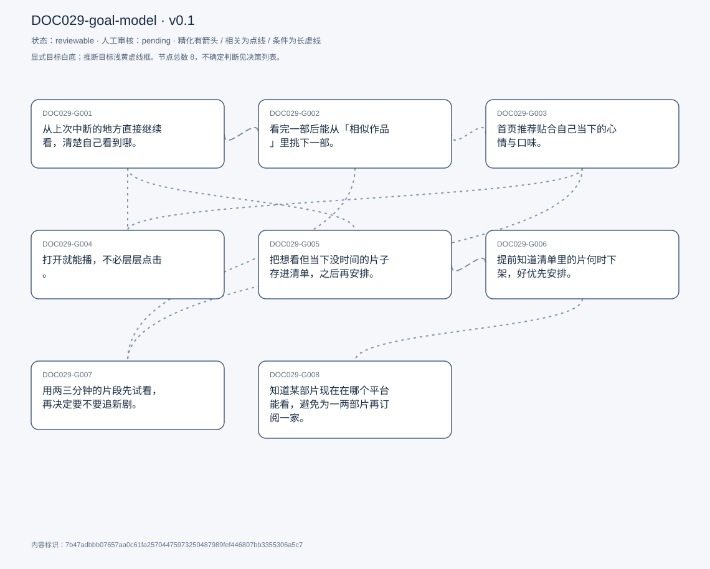
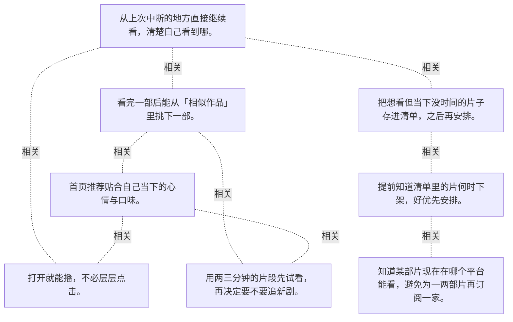

# 目标模型说明

模型：DOC029-goal-model；版本：v0.1

交付状态：reviewable；结构：passed；人工审核：pending

[交互模型](goal-model.html) · [矢量图](goal-model.svg) · [权威数据](goal-model.json)

## 目标图

## 目标

| 编号 | 表述 | 来源 | 情境 | 证据 |
|---|---|---|---|---|
| DOC029-G001 | 从上次中断的地方直接继续看，清楚自己看到哪。 | explicit | 入口：首页「Continue Watching」轮播；卡片会显示已看进度与时间点 | E0001, E0002 |
| DOC029-G002 | 看完一部后能从「相似作品」里挑下一部。 | explicit | 入口：详情弹窗末尾的 More Like This；自评这正是 Netflix 的强项 | E0003, E0004 |
| DOC029-G003 | 首页推荐贴合自己当下的心情与口味。 | explicit | 自述这是选 Netflix 而非其他平台的首要原因；判断标准：推荐与想看的剧的匹配度 | E0005, E0006 |
| DOC029-G004 | 打开就能播，不必层层点击。 | explicit | 场景：吃饭时想马上看点什么；自评这是「方便」的具体含义 | E0007, E0008 |
| DOC029-G005 | 把想看但当下没时间的片子存进清单，之后再安排。 | explicit | 入口：My List；用途：留住「当时没空看」的内容 | E0009, E0010 |
| DOC029-G006 | 提前知道清单里的片何时下架，好优先安排。 | explicit | 痛点：等有空时片子已经下架；设想：下架前一个月开始提醒 | E0011, E0012, E0013 |
| DOC029-G007 | 用两三分钟的片段先试看，再决定要不要追新剧。 | explicit | 现状：他为此专门去 YouTube 找片段；期望：在 Netflix 内提供片段轮播，并可一键进入正片 | E0014, E0015, E0016 |
| DOC029-G008 | 知道某部片现在在哪个平台能看，避免为一两部片再订阅一家。 | explicit | 成因：平台按合约轮换片库；代价：要么找不到，要么额外付费 | E0017, E0018 |

## 关系判断（含不确定与无关系）

- DOC029-G001 / DOC029-G002：related。T017–T021 是相邻两步：从续看轮播点进某部剧 → 在详情弹窗末尾看到 More Like This。续看负责接上旧内容，相似推荐负责找到下一部。
- DOC029-G001 / DOC029-G003：none。DOC029-G001 的对象是从上次中断处继续看（T017），DOC029-G003 的对象是推荐贴合当下心情（T013/T015）；两处分别出自不同话题段，原文未在二者之间建立因果、手段、评价或情境包含关系，本次评估口径内未建立可采用关系。
- DOC029-G001 / DOC029-G004：related。T017 说续看让他「在很短时间内、很方便地」接上进度，T013 把「不用点很多按钮」列为选择 Netflix 的理由——续看正是少点击的一种实现。但 G004 还包括首播路径。
- DOC029-G001 / DOC029-G005：related。T017 把 Continue Watching 与 My List 并列为首页两个入口，前者是「看了一半」、后者是「还没开始」。两者都服务于「今天没看完，下次接着来」这一需求。
- DOC029-G001 / DOC029-G006：none。DOC029-G001 的对象是从上次中断处继续看（T017），DOC029-G006 的对象是知悉待看片何时下架（T025/T029）；两处分别出自不同话题段，原文未在二者之间建立因果、手段、评价或情境包含关系，本次评估口径内未建立可采用关系。
- DOC029-G001 / DOC029-G007：none。DOC029-G001 的对象是从上次中断处继续看（T017），DOC029-G007 的对象是短片段试看再决定（T033）；两处分别出自不同话题段，原文未在二者之间建立因果、手段、评价或情境包含关系，本次评估口径内未建立可采用关系。
- DOC029-G001 / DOC029-G008：none。DOC029-G001 的对象是从上次中断处继续看（T017），DOC029-G008 的对象是知道片在哪个平台（T025）；两处分别出自不同话题段，原文未在二者之间建立因果、手段、评价或情境包含关系，本次评估口径内未建立可采用关系。
- DOC029-G002 / DOC029-G003：related。两者都由同一套推荐系统支撑：首页给「你可能想看」，详情页给「与这部相似」。但 G003 面向当下心情的宽泛匹配，G002 面向单部作品的类比。
- DOC029-G002 / DOC029-G004：none。DOC029-G002 的对象是从相似作品挑下一部（T021），DOC029-G004 的对象是少步骤快速开播（T013）；两处分别出自不同话题段，原文未在二者之间建立因果、手段、评价或情境包含关系，本次评估口径内未建立可采用关系。
- DOC029-G002 / DOC029-G005：none。DOC029-G002 的对象是从相似作品挑下一部（T021），DOC029-G005 的对象是存清单按节奏看（T017）；两处分别出自不同话题段，原文未在二者之间建立因果、手段、评价或情境包含关系，本次评估口径内未建立可采用关系。
- DOC029-G002 / DOC029-G006：none。DOC029-G002 的对象是从相似作品挑下一部（T021），DOC029-G006 的对象是知悉待看片何时下架（T025/T029）；两处分别出自不同话题段，原文未在二者之间建立因果、手段、评价或情境包含关系，本次评估口径内未建立可采用关系。
- DOC029-G002 / DOC029-G007：related。两者都是「决定看什么」的辅助：相似推荐靠类比推断，试看片段靠直接体验。T033 说的正是推荐不够时他跑去 YouTube 看片段。
- DOC029-G002 / DOC029-G008：none。DOC029-G002 的对象是从相似作品挑下一部（T021），DOC029-G008 的对象是知道片在哪个平台（T025）；两处分别出自不同话题段，原文未在二者之间建立因果、手段、评价或情境包含关系，本次评估口径内未建立可采用关系。
- DOC029-G003 / DOC029-G004：related。T013 把「推荐贴口味」与「不用多点几下」放在同一段作为偏好理由：推荐准就减少挑选成本，落脚点仍是快点开播。但一个是内容匹配、一个是交互路径。
- DOC029-G003 / DOC029-G005：none。DOC029-G003 的对象是推荐贴合当下心情（T013/T015），DOC029-G005 的对象是存清单按节奏看（T017）；两处分别出自不同话题段，原文未在二者之间建立因果、手段、评价或情境包含关系，本次评估口径内未建立可采用关系。
- DOC029-G003 / DOC029-G006：none。DOC029-G003 的对象是推荐贴合当下心情（T013/T015），DOC029-G006 的对象是知悉待看片何时下架（T025/T029）；两处分别出自不同话题段，原文未在二者之间建立因果、手段、评价或情境包含关系，本次评估口径内未建立可采用关系。
- DOC029-G003 / DOC029-G007：related。T037 把片段轮播说成推荐系统的一种延伸（「personalized review」），用来解决「犹豫不决」。但推荐是替你选，试看是让你自己试。
- DOC029-G003 / DOC029-G008：none。DOC029-G003 的对象是推荐贴合当下心情（T013/T015），DOC029-G008 的对象是知道片在哪个平台（T025）；两处分别出自不同话题段，原文未在二者之间建立因果、手段、评价或情境包含关系，本次评估口径内未建立可采用关系。
- DOC029-G004 / DOC029-G005：none。DOC029-G004 的对象是少步骤快速开播（T013），DOC029-G005 的对象是存清单按节奏看（T017）；两处分别出自不同话题段，原文未在二者之间建立因果、手段、评价或情境包含关系，本次评估口径内未建立可采用关系。
- DOC029-G004 / DOC029-G006：none。DOC029-G004 的对象是少步骤快速开播（T013），DOC029-G006 的对象是知悉待看片何时下架（T025/T029）；两处分别出自不同话题段，原文未在二者之间建立因果、手段、评价或情境包含关系，本次评估口径内未建立可采用关系。
- DOC029-G004 / DOC029-G007：none。DOC029-G004 的对象是少步骤快速开播（T013），DOC029-G007 的对象是短片段试看再决定（T033）；两处分别出自不同话题段，原文未在二者之间建立因果、手段、评价或情境包含关系，本次评估口径内未建立可采用关系。
- DOC029-G004 / DOC029-G008：none。DOC029-G004 的对象是少步骤快速开播（T013），DOC029-G008 的对象是知道片在哪个平台（T025）；两处分别出自不同话题段，原文未在二者之间建立因果、手段、评价或情境包含关系，本次评估口径内未建立可采用关系。
- DOC029-G005 / DOC029-G006：related。T029 的方案直接作用在清单上：从「我保存的片单」里提前一个月推即将下架的，让我排优先级。没有 G005 的清单，G006 的提醒就无从谈起。
- DOC029-G005 / DOC029-G007：none。DOC029-G005 的对象是存清单按节奏看（T017），DOC029-G007 的对象是短片段试看再决定（T033）；两处分别出自不同话题段，原文未在二者之间建立因果、手段、评价或情境包含关系，本次评估口径内未建立可采用关系。
- DOC029-G005 / DOC029-G008：none。DOC029-G005 的对象是存清单按节奏看（T017），DOC029-G008 的对象是知道片在哪个平台（T025）；两处分别出自不同话题段，原文未在二者之间建立因果、手段、评价或情境包含关系，本次评估口径内未建立可采用关系。
- DOC029-G006 / DOC029-G007：none。DOC029-G006 的对象是知悉待看片何时下架（T025/T029），DOC029-G007 的对象是短片段试看再决定（T033）；两处分别出自不同话题段，原文未在二者之间建立因果、手段、评价或情境包含关系，本次评估口径内未建立可采用关系。
- DOC029-G006 / DOC029-G008：related。T025 是一件事的两面：片子下架后，要么找不到在哪能看，要么再买一份订阅。提醒争取时间，跨平台查询解决去处。但一个防患于未然、一个事后补救。
- DOC029-G007 / DOC029-G008：none。DOC029-G007 的对象是短片段试看再决定（T033），DOC029-G008 的对象是知道片在哪个平台（T025）；两处分别出自不同话题段，原文未在二者之间建立因果、手段、评价或情境包含关系，本次评估口径内未建立可采用关系。

## 证据

### E0001 · DOC029:S018

> they show me the con continue watching for my Carousal

原件位置：{&quot;line_start&quot;: 18, &quot;line_end&quot;: 18, &quot;start_char&quot;: 3114, &quot;end_char&quot;: 5715}

### E0002 · DOC029:S018

> right where I left off they I&#x27;m able to get back into it

原件位置：{&quot;line_start&quot;: 18, &quot;line_end&quot;: 18, &quot;start_char&quot;: 3114, &quot;end_char&quot;: 5715}

### E0003 · DOC029:S022

> They have the they have a section called more like this

原件位置：{&quot;line_start&quot;: 22, &quot;line_end&quot;: 22, &quot;start_char&quot;: 6380, &quot;end_char&quot;: 7474}

### E0004 · DOC029:S022

> shows the shows that are like similar to the show that I was currently watching

原件位置：{&quot;line_start&quot;: 22, &quot;line_end&quot;: 22, &quot;start_char&quot;: 6380, &quot;end_char&quot;: 7474}

### E0005 · DOC029:S014

> It seems to be very tailored to my needs. And what I&#x27;m like in the mood for today

原件位置：{&quot;line_start&quot;: 14, &quot;line_end&quot;: 14, &quot;start_char&quot;: 1960, &quot;end_char&quot;: 2608}

### E0006 · DOC029:S016

> it does a very good job in matching me with the show that I want to watch

原件位置：{&quot;line_start&quot;: 16, &quot;line_end&quot;: 16, &quot;start_char&quot;: 2764, &quot;end_char&quot;: 2864}

### E0007 · DOC029:S014

> I don&#x27;t have to click a lot of buttons to get started to watch a movie

原件位置：{&quot;line_start&quot;: 14, &quot;line_end&quot;: 14, &quot;start_char&quot;: 1960, &quot;end_char&quot;: 2608}

### E0008 · DOC029:S014

> it feels very convenient to use

原件位置：{&quot;line_start&quot;: 14, &quot;line_end&quot;: 14, &quot;start_char&quot;: 1960, &quot;end_char&quot;: 2608}

### E0009 · DOC029:S018

> my list, which is basically the movies or shows I have planned to watch later on

原件位置：{&quot;line_start&quot;: 18, &quot;line_end&quot;: 18, &quot;start_char&quot;: 3114, &quot;end_char&quot;: 5715}

### E0010 · DOC029:S018

> the show that I didn&#x27;t get time to watch right now

原件位置：{&quot;line_start&quot;: 18, &quot;line_end&quot;: 18, &quot;start_char&quot;: 3114, &quot;end_char&quot;: 5715}

### E0011 · DOC029:S026

> whenever I get the time to watch it and go back sometimes is not on Netflix

原件位置：{&quot;line_start&quot;: 26, &quot;line_end&quot;: 26, &quot;start_char&quot;: 8091, &quot;end_char&quot;: 8735}

### E0012 · DOC029:S030

> start recommending me like one month before they get removed

原件位置：{&quot;line_start&quot;: 30, &quot;line_end&quot;: 30, &quot;start_char&quot;: 9040, &quot;end_char&quot;: 9679}

### E0013 · DOC029:S030

> So I can prioritize what I want to watch

原件位置：{&quot;line_start&quot;: 30, &quot;line_end&quot;: 30, &quot;start_char&quot;: 9040, &quot;end_char&quot;: 9679}

### E0014 · DOC029:S034

> so that if I want to try a new show, I can like straight away, go to those clips and decide if that suits me

原件位置：{&quot;line_start&quot;: 34, &quot;line_end&quot;: 34, &quot;start_char&quot;: 10331, &quot;end_char&quot;: 11428}

### E0015 · DOC029:S034

> Netflix itself can start offering me a recommendation carousel

原件位置：{&quot;line_start&quot;: 34, &quot;line_end&quot;: 34, &quot;start_char&quot;: 10331, &quot;end_char&quot;: 11428}

### E0016 · DOC029:S038

> sometimes I&#x27;m indecisive. And I just want to have a preview of the show but I&#x27;m not able to do that on Netflix itself

原件位置：{&quot;line_start&quot;: 38, &quot;line_end&quot;: 38, &quot;start_char&quot;: 12162, &quot;end_char&quot;: 12865}

### E0017 · DOC029:S026

> so I have trouble finding on which platform is it on?

原件位置：{&quot;line_start&quot;: 26, &quot;line_end&quot;: 26, &quot;start_char&quot;: 8091, &quot;end_char&quot;: 8735}

### E0018 · DOC029:S026

> I have to buy a new subscription for a platform

原件位置：{&quot;line_start&quot;: 26, &quot;line_end&quot;: 26, &quot;start_char&quot;: 8091, &quot;end_char&quot;: 8735}

## 问题、限制与版本

- 当前会话助手的开发判断，非独立盲测；无人工采纳记录。
- 结构检查已绑定当前版本；独立语义审查未执行；人工状态以实际审核记录为准。

内容标识：7b47adbbb07657aa0c61fa25704475973250487989fef446807bb3355306a5c7

人工决定：

审核意见：
