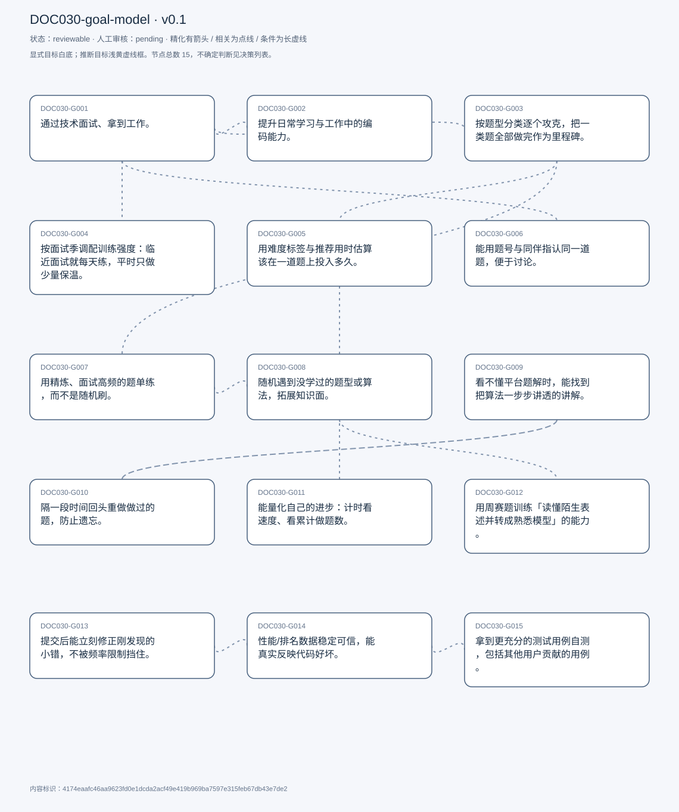
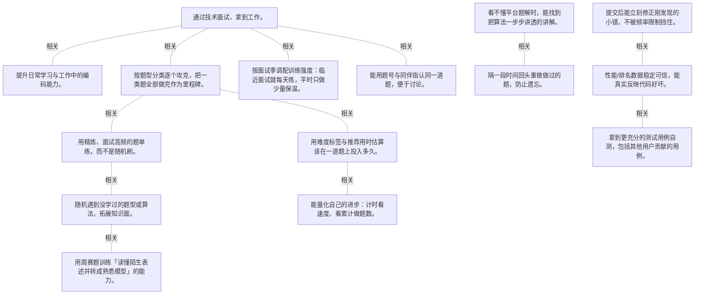

# 目标模型说明

模型：DOC030-goal-model；版本：v0.1

交付状态：reviewable；结构：passed；人工审核：pending

[交互模型](goal-model.html) · [矢量图](goal-model.svg) · [权威数据](goal-model.json)

## 目标图

## 目标

| 编号 | 表述 | 来源 | 情境 | 证据 |
|---|---|---|---|---|
| DOC030-G001 | 通过技术面试、拿到工作。 | explicit | 自述这是刷题的主要目的；起因：找第一份实习 | E0001, E0002 |
| DOC030-G002 | 提升日常学习与工作中的编码能力。 | explicit | 作为「拿到工作」之外的附带目的 | E0003, E0004 |
| DOC030-G003 | 按题型分类逐个攻克，把一类题全部做完作为里程碑。 | explicit | 分类维度：数组、树等；里程碑：某分类全部完成 | E0005, E0006, E0007 |
| DOC030-G004 | 按面试季调配训练强度：临近面试就每天练，平时只做少量保温。 | explicit | 高强度：状态好时一天 10 题以上；低强度：2 题、easy–medium、防手生 | E0008, E0009, E0010 |
| DOC030-G005 | 用难度标签与推荐用时估算该在一道题上投入多久。 | explicit | 平台给的 easy/medium/hard 作为粗略时间参照；他也知道难度与真实耗时并不完全对应 | E0011, E0012, E0013 |
| DOC030-G006 | 能用题号与同伴指认同一道题，便于讨论。 | explicit | 做法：朋友面试遇到同题，直接把 LeetCode 题号发过来；反例：不同平台时只能靠描述、还得让对方去找 | E0014, E0015 |
| DOC030-G007 | 用精炼、面试高频的题单练，而不是随机刷。 | explicit | 平台：NeetCode；理由：题单更精炼、更贴近面试实际考的 | E0016, E0017 |
| DOC030-G008 | 随机遇到没学过的题型或算法，拓展知识面。 | explicit | 平台：LeetCode 随机题；与「精炼题单」互补 | E0018, E0019 |
| DOC030-G009 | 看不懂平台题解时，能找到把算法一步步讲透的讲解。 | explicit | LeetCode 的题解描述不够直观；GeeksforGeeks 会走一遍完整算法并给更多例子 | E0020, E0021 |
| DOC030-G010 | 隔一段时间回头重做做过的题，防止遗忘。 | explicit | 看完题解后仍要重做；目的：真正记住 | E0022, E0023 |
| DOC030-G011 | 能量化自己的进步：计时看速度、看累计做题数。 | explicit | 计时器：开始/提交时手动开关；题量计数带来信心 | E0024, E0025 |
| DOC030-G012 | 用周赛题训练「读懂陌生表述并转成熟悉模型」的能力。 | explicit | 周赛题措辞与常见练习题不同；他只取题目、不入赛（周日时间与压力） | E0026, E0027 |
| DOC030-G013 | 提交后能立刻修正刚发现的小错，不被频率限制挡住。 | explicit | 场景：点了提交才想起漏了 else，一秒内补上却提交不了 | E0028, E0029 |
| DOC030-G014 | 性能/排名数据稳定可信，能真实反映代码好坏。 | explicit | 同一份两年前的代码，性能指标反而下降 | E0030, E0031 |
| DOC030-G015 | 拿到更充分的测试用例自测，包括其他用户贡献的用例。 | explicit | 现状：每题只给 1–3 个用例，要提交才知道漏了什么 | E0032, E0033, E0034 |

## 关系判断（含不确定与无关系）

- DOC030-G001 / DOC030-G002：related。T009 把两者并列：「主要目的是拿工作，其次想练编码能力」。同一批练习产生两种收益，但一个是外部结果、一个是能力沉淀。
- DOC030-G001 / DOC030-G003：related。T011 的里程碑（把某类题全部做完）是达成面试准备的执行方式，分类覆盖正是为面试考察面服务。但 G003 只描述组织方式，不保证面试结果。
- DOC030-G001 / DOC030-G004：related。T013 说练习集中在面试季，T015 说知道有面试就每天练——训练强度直接由求职进度驱动。但 G004 是节奏安排，G001 是目标本身。
- DOC030-G001 / DOC030-G005：none。DOC030-G001 的对象是通过面试拿工作（T001/T009），DOC030-G005 的对象是难度与推荐用时估算（T019/T031）；两处分别出自不同话题段，原文未在二者之间建立因果、手段、评价或情境包含关系，本次评估口径内未建立可采用关系。
- DOC030-G001 / DOC030-G006：related。T005 的例子最能说明：朋友刚面完，直接把面试里遇到的题号发过来，他照着练——题号是把面试现场的经验传给同伴的载体。但 G006 也用于日常讨论。
- DOC030-G001 / DOC030-G007：none。DOC030-G001 的对象是通过面试拿工作（T001/T009），DOC030-G007 的对象是精炼高频题单（T007）；两处分别出自不同话题段，原文未在二者之间建立因果、手段、评价或情境包含关系，本次评估口径内未建立可采用关系。
- DOC030-G001 / DOC030-G008：none。DOC030-G001 的对象是通过面试拿工作（T001/T009），DOC030-G008 的对象是发现新题型（T007）；两处分别出自不同话题段，原文未在二者之间建立因果、手段、评价或情境包含关系，本次评估口径内未建立可采用关系。
- DOC030-G001 / DOC030-G009：none。DOC030-G001 的对象是通过面试拿工作（T001/T009），DOC030-G009 的对象是看懂题解推导（T003）；两处分别出自不同话题段，原文未在二者之间建立因果、手段、评价或情境包含关系，本次评估口径内未建立可采用关系。
- DOC030-G001 / DOC030-G010：none。DOC030-G001 的对象是通过面试拿工作（T001/T009），DOC030-G010 的对象是隔期回头复习（T017）；两处分别出自不同话题段，原文未在二者之间建立因果、手段、评价或情境包含关系，本次评估口径内未建立可采用关系。
- DOC030-G001 / DOC030-G011：none。DOC030-G001 的对象是通过面试拿工作（T001/T009），DOC030-G011 的对象是量化进步（计时+题数）（T029/T033）；两处分别出自不同话题段，原文未在二者之间建立因果、手段、评价或情境包含关系，本次评估口径内未建立可采用关系。
- DOC030-G001 / DOC030-G012：none。DOC030-G001 的对象是通过面试拿工作（T001/T009），DOC030-G012 的对象是周赛题训练读题转化（T035）；两处分别出自不同话题段，原文未在二者之间建立因果、手段、评价或情境包含关系，本次评估口径内未建立可采用关系。
- DOC030-G001 / DOC030-G013：none。DOC030-G001 的对象是通过面试拿工作（T001/T009），DOC030-G013 的对象是提交后能立即修正（T027）；两处分别出自不同话题段，原文未在二者之间建立因果、手段、评价或情境包含关系，本次评估口径内未建立可采用关系。
- DOC030-G001 / DOC030-G014：none。DOC030-G001 的对象是通过面试拿工作（T001/T009），DOC030-G014 的对象是性能指标可信（T027）；两处分别出自不同话题段，原文未在二者之间建立因果、手段、评价或情境包含关系，本次评估口径内未建立可采用关系。
- DOC030-G001 / DOC030-G015：none。DOC030-G001 的对象是通过面试拿工作（T001/T009），DOC030-G015 的对象是更充分的测试用例（T031）；两处分别出自不同话题段，原文未在二者之间建立因果、手段、评价或情境包含关系，本次评估口径内未建立可采用关系。
- DOC030-G002 / DOC030-G003：none。DOC030-G002 的对象是提升日常编码能力（T009），DOC030-G003 的对象是按题型分类攻克（T011）；两处分别出自不同话题段，原文未在二者之间建立因果、手段、评价或情境包含关系，本次评估口径内未建立可采用关系。
- DOC030-G002 / DOC030-G004：none。DOC030-G002 的对象是提升日常编码能力（T009），DOC030-G004 的对象是按面试季调配强度（T013/T015）；两处分别出自不同话题段，原文未在二者之间建立因果、手段、评价或情境包含关系，本次评估口径内未建立可采用关系。
- DOC030-G002 / DOC030-G005：none。DOC030-G002 的对象是提升日常编码能力（T009），DOC030-G005 的对象是难度与推荐用时估算（T019/T031）；两处分别出自不同话题段，原文未在二者之间建立因果、手段、评价或情境包含关系，本次评估口径内未建立可采用关系。
- DOC030-G002 / DOC030-G006：none。DOC030-G002 的对象是提升日常编码能力（T009），DOC030-G006 的对象是题号指认同一题（T005）；两处分别出自不同话题段，原文未在二者之间建立因果、手段、评价或情境包含关系，本次评估口径内未建立可采用关系。
- DOC030-G002 / DOC030-G007：none。DOC030-G002 的对象是提升日常编码能力（T009），DOC030-G007 的对象是精炼高频题单（T007）；两处分别出自不同话题段，原文未在二者之间建立因果、手段、评价或情境包含关系，本次评估口径内未建立可采用关系。
- DOC030-G002 / DOC030-G008：none。DOC030-G002 的对象是提升日常编码能力（T009），DOC030-G008 的对象是发现新题型（T007）；两处分别出自不同话题段，原文未在二者之间建立因果、手段、评价或情境包含关系，本次评估口径内未建立可采用关系。
- DOC030-G002 / DOC030-G009：none。DOC030-G002 的对象是提升日常编码能力（T009），DOC030-G009 的对象是看懂题解推导（T003）；两处分别出自不同话题段，原文未在二者之间建立因果、手段、评价或情境包含关系，本次评估口径内未建立可采用关系。
- DOC030-G002 / DOC030-G010：none。DOC030-G002 的对象是提升日常编码能力（T009），DOC030-G010 的对象是隔期回头复习（T017）；两处分别出自不同话题段，原文未在二者之间建立因果、手段、评价或情境包含关系，本次评估口径内未建立可采用关系。
- DOC030-G002 / DOC030-G011：none。DOC030-G002 的对象是提升日常编码能力（T009），DOC030-G011 的对象是量化进步（计时+题数）（T029/T033）；两处分别出自不同话题段，原文未在二者之间建立因果、手段、评价或情境包含关系，本次评估口径内未建立可采用关系。
- DOC030-G002 / DOC030-G012：none。DOC030-G002 的对象是提升日常编码能力（T009），DOC030-G012 的对象是周赛题训练读题转化（T035）；两处分别出自不同话题段，原文未在二者之间建立因果、手段、评价或情境包含关系，本次评估口径内未建立可采用关系。
- DOC030-G002 / DOC030-G013：none。DOC030-G002 的对象是提升日常编码能力（T009），DOC030-G013 的对象是提交后能立即修正（T027）；两处分别出自不同话题段，原文未在二者之间建立因果、手段、评价或情境包含关系，本次评估口径内未建立可采用关系。
- DOC030-G002 / DOC030-G014：none。DOC030-G002 的对象是提升日常编码能力（T009），DOC030-G014 的对象是性能指标可信（T027）；两处分别出自不同话题段，原文未在二者之间建立因果、手段、评价或情境包含关系，本次评估口径内未建立可采用关系。
- DOC030-G002 / DOC030-G015：none。DOC030-G002 的对象是提升日常编码能力（T009），DOC030-G015 的对象是更充分的测试用例（T031）；两处分别出自不同话题段，原文未在二者之间建立因果、手段、评价或情境包含关系，本次评估口径内未建立可采用关系。
- DOC030-G003 / DOC030-G004：none。DOC030-G003 的对象是按题型分类攻克（T011），DOC030-G004 的对象是按面试季调配强度（T013/T015）；两处分别出自不同话题段，原文未在二者之间建立因果、手段、评价或情境包含关系，本次评估口径内未建立可采用关系。
- DOC030-G003 / DOC030-G005：related。T023 说平台同时按「类别」与「难度」两个维度组织题目，他两边都用：按类别扫盲、按难度估时。两个维度正交，但共同构成练习计划。
- DOC030-G003 / DOC030-G006：none。DOC030-G003 的对象是按题型分类攻克（T011），DOC030-G006 的对象是题号指认同一题（T005）；两处分别出自不同话题段，原文未在二者之间建立因果、手段、评价或情境包含关系，本次评估口径内未建立可采用关系。
- DOC030-G003 / DOC030-G007：related。T011 说 NeetCode 把某一类的题浓缩成十道左右，他按这个清单逐类推进——精炼题单是分类攻克的现成目录。但 G007 还包含「只练高频」这一层筛选。
- DOC030-G003 / DOC030-G008：none。DOC030-G003 的对象是按题型分类攻克（T011），DOC030-G008 的对象是发现新题型（T007）；两处分别出自不同话题段，原文未在二者之间建立因果、手段、评价或情境包含关系，本次评估口径内未建立可采用关系。
- DOC030-G003 / DOC030-G009：none。DOC030-G003 的对象是按题型分类攻克（T011），DOC030-G009 的对象是看懂题解推导（T003）；两处分别出自不同话题段，原文未在二者之间建立因果、手段、评价或情境包含关系，本次评估口径内未建立可采用关系。
- DOC030-G003 / DOC030-G010：none。DOC030-G003 的对象是按题型分类攻克（T011），DOC030-G010 的对象是隔期回头复习（T017）；两处分别出自不同话题段，原文未在二者之间建立因果、手段、评价或情境包含关系，本次评估口径内未建立可采用关系。
- DOC030-G003 / DOC030-G011：none。DOC030-G003 的对象是按题型分类攻克（T011），DOC030-G011 的对象是量化进步（计时+题数）（T029/T033）；两处分别出自不同话题段，原文未在二者之间建立因果、手段、评价或情境包含关系，本次评估口径内未建立可采用关系。
- DOC030-G003 / DOC030-G012：none。DOC030-G003 的对象是按题型分类攻克（T011），DOC030-G012 的对象是周赛题训练读题转化（T035）；两处分别出自不同话题段，原文未在二者之间建立因果、手段、评价或情境包含关系，本次评估口径内未建立可采用关系。
- DOC030-G003 / DOC030-G013：none。DOC030-G003 的对象是按题型分类攻克（T011），DOC030-G013 的对象是提交后能立即修正（T027）；两处分别出自不同话题段，原文未在二者之间建立因果、手段、评价或情境包含关系，本次评估口径内未建立可采用关系。
- DOC030-G003 / DOC030-G014：none。DOC030-G003 的对象是按题型分类攻克（T011），DOC030-G014 的对象是性能指标可信（T027）；两处分别出自不同话题段，原文未在二者之间建立因果、手段、评价或情境包含关系，本次评估口径内未建立可采用关系。
- DOC030-G003 / DOC030-G015：none。DOC030-G003 的对象是按题型分类攻克（T011），DOC030-G015 的对象是更充分的测试用例（T031）；两处分别出自不同话题段，原文未在二者之间建立因果、手段、评价或情境包含关系，本次评估口径内未建立可采用关系。
- DOC030-G004 / DOC030-G005：none。DOC030-G004 的对象是按面试季调配强度（T013/T015），DOC030-G005 的对象是难度与推荐用时估算（T019/T031）；两处分别出自不同话题段，原文未在二者之间建立因果、手段、评价或情境包含关系，本次评估口径内未建立可采用关系。
- DOC030-G004 / DOC030-G006：none。DOC030-G004 的对象是按面试季调配强度（T013/T015），DOC030-G006 的对象是题号指认同一题（T005）；两处分别出自不同话题段，原文未在二者之间建立因果、手段、评价或情境包含关系，本次评估口径内未建立可采用关系。
- DOC030-G004 / DOC030-G007：none。DOC030-G004 的对象是按面试季调配强度（T013/T015），DOC030-G007 的对象是精炼高频题单（T007）；两处分别出自不同话题段，原文未在二者之间建立因果、手段、评价或情境包含关系，本次评估口径内未建立可采用关系。
- DOC030-G004 / DOC030-G008：none。DOC030-G004 的对象是按面试季调配强度（T013/T015），DOC030-G008 的对象是发现新题型（T007）；两处分别出自不同话题段，原文未在二者之间建立因果、手段、评价或情境包含关系，本次评估口径内未建立可采用关系。
- DOC030-G004 / DOC030-G009：none。DOC030-G004 的对象是按面试季调配强度（T013/T015），DOC030-G009 的对象是看懂题解推导（T003）；两处分别出自不同话题段，原文未在二者之间建立因果、手段、评价或情境包含关系，本次评估口径内未建立可采用关系。
- DOC030-G004 / DOC030-G010：none。DOC030-G004 的对象是按面试季调配强度（T013/T015），DOC030-G010 的对象是隔期回头复习（T017）；两处分别出自不同话题段，原文未在二者之间建立因果、手段、评价或情境包含关系，本次评估口径内未建立可采用关系。
- DOC030-G004 / DOC030-G011：none。DOC030-G004 的对象是按面试季调配强度（T013/T015），DOC030-G011 的对象是量化进步（计时+题数）（T029/T033）；两处分别出自不同话题段，原文未在二者之间建立因果、手段、评价或情境包含关系，本次评估口径内未建立可采用关系。
- DOC030-G004 / DOC030-G012：none。DOC030-G004 的对象是按面试季调配强度（T013/T015），DOC030-G012 的对象是周赛题训练读题转化（T035）；两处分别出自不同话题段，原文未在二者之间建立因果、手段、评价或情境包含关系，本次评估口径内未建立可采用关系。
- DOC030-G004 / DOC030-G013：none。DOC030-G004 的对象是按面试季调配强度（T013/T015），DOC030-G013 的对象是提交后能立即修正（T027）；两处分别出自不同话题段，原文未在二者之间建立因果、手段、评价或情境包含关系，本次评估口径内未建立可采用关系。
- DOC030-G004 / DOC030-G014：none。DOC030-G004 的对象是按面试季调配强度（T013/T015），DOC030-G014 的对象是性能指标可信（T027）；两处分别出自不同话题段，原文未在二者之间建立因果、手段、评价或情境包含关系，本次评估口径内未建立可采用关系。
- DOC030-G004 / DOC030-G015：none。DOC030-G004 的对象是按面试季调配强度（T013/T015），DOC030-G015 的对象是更充分的测试用例（T031）；两处分别出自不同话题段，原文未在二者之间建立因果、手段、评价或情境包含关系，本次评估口径内未建立可采用关系。
- DOC030-G005 / DOC030-G006：none。DOC030-G005 的对象是难度与推荐用时估算（T019/T031），DOC030-G006 的对象是题号指认同一题（T005）；两处分别出自不同话题段，原文未在二者之间建立因果、手段、评价或情境包含关系，本次评估口径内未建立可采用关系。
- DOC030-G005 / DOC030-G007：none。DOC030-G005 的对象是难度与推荐用时估算（T019/T031），DOC030-G007 的对象是精炼高频题单（T007）；两处分别出自不同话题段，原文未在二者之间建立因果、手段、评价或情境包含关系，本次评估口径内未建立可采用关系。
- DOC030-G005 / DOC030-G008：none。DOC030-G005 的对象是难度与推荐用时估算（T019/T031），DOC030-G008 的对象是发现新题型（T007）；两处分别出自不同话题段，原文未在二者之间建立因果、手段、评价或情境包含关系，本次评估口径内未建立可采用关系。
- DOC030-G005 / DOC030-G009：none。DOC030-G005 的对象是难度与推荐用时估算（T019/T031），DOC030-G009 的对象是看懂题解推导（T003）；两处分别出自不同话题段，原文未在二者之间建立因果、手段、评价或情境包含关系，本次评估口径内未建立可采用关系。
- DOC030-G005 / DOC030-G010：none。DOC030-G005 的对象是难度与推荐用时估算（T019/T031），DOC030-G010 的对象是隔期回头复习（T017）；两处分别出自不同话题段，原文未在二者之间建立因果、手段、评价或情境包含关系，本次评估口径内未建立可采用关系。
- DOC030-G005 / DOC030-G011：related。T029 的计时让「目标用时」变成可验证的数字：20–30 分钟做完一道 medium 就是达标的判据。但 G005 是事前预估，G011 是事后度量。
- DOC030-G005 / DOC030-G012：none。DOC030-G005 的对象是难度与推荐用时估算（T019/T031），DOC030-G012 的对象是周赛题训练读题转化（T035）；两处分别出自不同话题段，原文未在二者之间建立因果、手段、评价或情境包含关系，本次评估口径内未建立可采用关系。
- DOC030-G005 / DOC030-G013：none。DOC030-G005 的对象是难度与推荐用时估算（T019/T031），DOC030-G013 的对象是提交后能立即修正（T027）；两处分别出自不同话题段，原文未在二者之间建立因果、手段、评价或情境包含关系，本次评估口径内未建立可采用关系。
- DOC030-G005 / DOC030-G014：none。DOC030-G005 的对象是难度与推荐用时估算（T019/T031），DOC030-G014 的对象是性能指标可信（T027）；两处分别出自不同话题段，原文未在二者之间建立因果、手段、评价或情境包含关系，本次评估口径内未建立可采用关系。
- DOC030-G005 / DOC030-G015：none。DOC030-G005 的对象是难度与推荐用时估算（T019/T031），DOC030-G015 的对象是更充分的测试用例（T031）；两处分别出自不同话题段，原文未在二者之间建立因果、手段、评价或情境包含关系，本次评估口径内未建立可采用关系。
- DOC030-G006 / DOC030-G007：none。DOC030-G006 的对象是题号指认同一题（T005），DOC030-G007 的对象是精炼高频题单（T007）；两处分别出自不同话题段，原文未在二者之间建立因果、手段、评价或情境包含关系，本次评估口径内未建立可采用关系。
- DOC030-G006 / DOC030-G008：none。DOC030-G006 的对象是题号指认同一题（T005），DOC030-G008 的对象是发现新题型（T007）；两处分别出自不同话题段，原文未在二者之间建立因果、手段、评价或情境包含关系，本次评估口径内未建立可采用关系。
- DOC030-G006 / DOC030-G009：none。DOC030-G006 的对象是题号指认同一题（T005），DOC030-G009 的对象是看懂题解推导（T003）；两处分别出自不同话题段，原文未在二者之间建立因果、手段、评价或情境包含关系，本次评估口径内未建立可采用关系。
- DOC030-G006 / DOC030-G010：none。DOC030-G006 的对象是题号指认同一题（T005），DOC030-G010 的对象是隔期回头复习（T017）；两处分别出自不同话题段，原文未在二者之间建立因果、手段、评价或情境包含关系，本次评估口径内未建立可采用关系。
- DOC030-G006 / DOC030-G011：none。DOC030-G006 的对象是题号指认同一题（T005），DOC030-G011 的对象是量化进步（计时+题数）（T029/T033）；两处分别出自不同话题段，原文未在二者之间建立因果、手段、评价或情境包含关系，本次评估口径内未建立可采用关系。
- DOC030-G006 / DOC030-G012：none。DOC030-G006 的对象是题号指认同一题（T005），DOC030-G012 的对象是周赛题训练读题转化（T035）；两处分别出自不同话题段，原文未在二者之间建立因果、手段、评价或情境包含关系，本次评估口径内未建立可采用关系。
- DOC030-G006 / DOC030-G013：none。DOC030-G006 的对象是题号指认同一题（T005），DOC030-G013 的对象是提交后能立即修正（T027）；两处分别出自不同话题段，原文未在二者之间建立因果、手段、评价或情境包含关系，本次评估口径内未建立可采用关系。
- DOC030-G006 / DOC030-G014：none。DOC030-G006 的对象是题号指认同一题（T005），DOC030-G014 的对象是性能指标可信（T027）；两处分别出自不同话题段，原文未在二者之间建立因果、手段、评价或情境包含关系，本次评估口径内未建立可采用关系。
- DOC030-G006 / DOC030-G015：none。DOC030-G006 的对象是题号指认同一题（T005），DOC030-G015 的对象是更充分的测试用例（T031）；两处分别出自不同话题段，原文未在二者之间建立因果、手段、评价或情境包含关系，本次评估口径内未建立可采用关系。
- DOC030-G007 / DOC030-G008：related。T007 明确分工：NeetCode 练面试高频、LeetCode 随机刷来发现没学过的算法。同一目的（面试准备）下的收敛与发散两种策略。
- DOC030-G007 / DOC030-G009：none。DOC030-G007 的对象是精炼高频题单（T007），DOC030-G009 的对象是看懂题解推导（T003）；两处分别出自不同话题段，原文未在二者之间建立因果、手段、评价或情境包含关系，本次评估口径内未建立可采用关系。
- DOC030-G007 / DOC030-G010：none。DOC030-G007 的对象是精炼高频题单（T007），DOC030-G010 的对象是隔期回头复习（T017）；两处分别出自不同话题段，原文未在二者之间建立因果、手段、评价或情境包含关系，本次评估口径内未建立可采用关系。
- DOC030-G007 / DOC030-G011：none。DOC030-G007 的对象是精炼高频题单（T007），DOC030-G011 的对象是量化进步（计时+题数）（T029/T033）；两处分别出自不同话题段，原文未在二者之间建立因果、手段、评价或情境包含关系，本次评估口径内未建立可采用关系。
- DOC030-G007 / DOC030-G012：none。DOC030-G007 的对象是精炼高频题单（T007），DOC030-G012 的对象是周赛题训练读题转化（T035）；两处分别出自不同话题段，原文未在二者之间建立因果、手段、评价或情境包含关系，本次评估口径内未建立可采用关系。
- DOC030-G007 / DOC030-G013：none。DOC030-G007 的对象是精炼高频题单（T007），DOC030-G013 的对象是提交后能立即修正（T027）；两处分别出自不同话题段，原文未在二者之间建立因果、手段、评价或情境包含关系，本次评估口径内未建立可采用关系。
- DOC030-G007 / DOC030-G014：none。DOC030-G007 的对象是精炼高频题单（T007），DOC030-G014 的对象是性能指标可信（T027）；两处分别出自不同话题段，原文未在二者之间建立因果、手段、评价或情境包含关系，本次评估口径内未建立可采用关系。
- DOC030-G007 / DOC030-G015：none。DOC030-G007 的对象是精炼高频题单（T007），DOC030-G015 的对象是更充分的测试用例（T031）；两处分别出自不同话题段，原文未在二者之间建立因果、手段、评价或情境包含关系，本次评估口径内未建立可采用关系。
- DOC030-G008 / DOC030-G009：none。DOC030-G008 的对象是发现新题型（T007），DOC030-G009 的对象是看懂题解推导（T003）；两处分别出自不同话题段，原文未在二者之间建立因果、手段、评价或情境包含关系，本次评估口径内未建立可采用关系。
- DOC030-G008 / DOC030-G010：none。DOC030-G008 的对象是发现新题型（T007），DOC030-G010 的对象是隔期回头复习（T017）；两处分别出自不同话题段，原文未在二者之间建立因果、手段、评价或情境包含关系，本次评估口径内未建立可采用关系。
- DOC030-G008 / DOC030-G011：none。DOC030-G008 的对象是发现新题型（T007），DOC030-G011 的对象是量化进步（计时+题数）（T029/T033）；两处分别出自不同话题段，原文未在二者之间建立因果、手段、评价或情境包含关系，本次评估口径内未建立可采用关系。
- DOC030-G008 / DOC030-G012：related。T035 说周赛题措辞陌生，练的是把新表述转成熟悉模型——这正是 G008「遇到没学过的题型」的受控版本。但周赛是限时整套，随机题是单题。
- DOC030-G008 / DOC030-G013：none。DOC030-G008 的对象是发现新题型（T007），DOC030-G013 的对象是提交后能立即修正（T027）；两处分别出自不同话题段，原文未在二者之间建立因果、手段、评价或情境包含关系，本次评估口径内未建立可采用关系。
- DOC030-G008 / DOC030-G014：none。DOC030-G008 的对象是发现新题型（T007），DOC030-G014 的对象是性能指标可信（T027）；两处分别出自不同话题段，原文未在二者之间建立因果、手段、评价或情境包含关系，本次评估口径内未建立可采用关系。
- DOC030-G008 / DOC030-G015：none。DOC030-G008 的对象是发现新题型（T007），DOC030-G015 的对象是更充分的测试用例（T031）；两处分别出自不同话题段，原文未在二者之间建立因果、手段、评价或情境包含关系，本次评估口径内未建立可采用关系。
- DOC030-G009 / DOC030-G010：related。T017 说看完题解、照着做一遍还不够，隔段时间要回头重做才不会忘。看题解解决「当下不会」，复习解决「过后遗忘」。
- DOC030-G009 / DOC030-G011：none。DOC030-G009 的对象是看懂题解推导（T003），DOC030-G011 的对象是量化进步（计时+题数）（T029/T033）；两处分别出自不同话题段，原文未在二者之间建立因果、手段、评价或情境包含关系，本次评估口径内未建立可采用关系。
- DOC030-G009 / DOC030-G012：none。DOC030-G009 的对象是看懂题解推导（T003），DOC030-G012 的对象是周赛题训练读题转化（T035）；两处分别出自不同话题段，原文未在二者之间建立因果、手段、评价或情境包含关系，本次评估口径内未建立可采用关系。
- DOC030-G009 / DOC030-G013：none。DOC030-G009 的对象是看懂题解推导（T003），DOC030-G013 的对象是提交后能立即修正（T027）；两处分别出自不同话题段，原文未在二者之间建立因果、手段、评价或情境包含关系，本次评估口径内未建立可采用关系。
- DOC030-G009 / DOC030-G014：none。DOC030-G009 的对象是看懂题解推导（T003），DOC030-G014 的对象是性能指标可信（T027）；两处分别出自不同话题段，原文未在二者之间建立因果、手段、评价或情境包含关系，本次评估口径内未建立可采用关系。
- DOC030-G009 / DOC030-G015：none。DOC030-G009 的对象是看懂题解推导（T003），DOC030-G015 的对象是更充分的测试用例（T031）；两处分别出自不同话题段，原文未在二者之间建立因果、手段、评价或情境包含关系，本次评估口径内未建立可采用关系。
- DOC030-G010 / DOC030-G011：none。DOC030-G010 的对象是隔期回头复习（T017），DOC030-G011 的对象是量化进步（计时+题数）（T029/T033）；两处分别出自不同话题段，原文未在二者之间建立因果、手段、评价或情境包含关系，本次评估口径内未建立可采用关系。
- DOC030-G010 / DOC030-G012：none。DOC030-G010 的对象是隔期回头复习（T017），DOC030-G012 的对象是周赛题训练读题转化（T035）；两处分别出自不同话题段，原文未在二者之间建立因果、手段、评价或情境包含关系，本次评估口径内未建立可采用关系。
- DOC030-G010 / DOC030-G013：none。DOC030-G010 的对象是隔期回头复习（T017），DOC030-G013 的对象是提交后能立即修正（T027）；两处分别出自不同话题段，原文未在二者之间建立因果、手段、评价或情境包含关系，本次评估口径内未建立可采用关系。
- DOC030-G010 / DOC030-G014：none。DOC030-G010 的对象是隔期回头复习（T017），DOC030-G014 的对象是性能指标可信（T027）；两处分别出自不同话题段，原文未在二者之间建立因果、手段、评价或情境包含关系，本次评估口径内未建立可采用关系。
- DOC030-G010 / DOC030-G015：none。DOC030-G010 的对象是隔期回头复习（T017），DOC030-G015 的对象是更充分的测试用例（T031）；两处分别出自不同话题段，原文未在二者之间建立因果、手段、评价或情境包含关系，本次评估口径内未建立可采用关系。
- DOC030-G011 / DOC030-G012：none。DOC030-G011 的对象是量化进步（计时+题数）（T029/T033），DOC030-G012 的对象是周赛题训练读题转化（T035）；两处分别出自不同话题段，原文未在二者之间建立因果、手段、评价或情境包含关系，本次评估口径内未建立可采用关系。
- DOC030-G011 / DOC030-G013：none。DOC030-G011 的对象是量化进步（计时+题数）（T029/T033），DOC030-G013 的对象是提交后能立即修正（T027）；两处分别出自不同话题段，原文未在二者之间建立因果、手段、评价或情境包含关系，本次评估口径内未建立可采用关系。
- DOC030-G011 / DOC030-G014：none。DOC030-G011 的对象是量化进步（计时+题数）（T029/T033），DOC030-G014 的对象是性能指标可信（T027）；两处分别出自不同话题段，原文未在二者之间建立因果、手段、评价或情境包含关系，本次评估口径内未建立可采用关系。
- DOC030-G011 / DOC030-G015：none。DOC030-G011 的对象是量化进步（计时+题数）（T029/T033），DOC030-G015 的对象是更充分的测试用例（T031）；两处分别出自不同话题段，原文未在二者之间建立因果、手段、评价或情境包含关系，本次评估口径内未建立可采用关系。
- DOC030-G012 / DOC030-G013：none。DOC030-G012 的对象是周赛题训练读题转化（T035），DOC030-G013 的对象是提交后能立即修正（T027）；两处分别出自不同话题段，原文未在二者之间建立因果、手段、评价或情境包含关系，本次评估口径内未建立可采用关系。
- DOC030-G012 / DOC030-G014：none。DOC030-G012 的对象是周赛题训练读题转化（T035），DOC030-G014 的对象是性能指标可信（T027）；两处分别出自不同话题段，原文未在二者之间建立因果、手段、评价或情境包含关系，本次评估口径内未建立可采用关系。
- DOC030-G012 / DOC030-G015：none。DOC030-G012 的对象是周赛题训练读题转化（T035），DOC030-G015 的对象是更充分的测试用例（T031）；两处分别出自不同话题段，原文未在二者之间建立因果、手段、评价或情境包含关系，本次评估口径内未建立可采用关系。
- DOC030-G013 / DOC030-G014：related。两者都在提交环节出问题：一个不让马上重交，一个给出的性能数据不可信。但一个是流程限制、一个是数据质量。
- DOC030-G013 / DOC030-G015：none。DOC030-G013 的对象是提交后能立即修正（T027），DOC030-G015 的对象是更充分的测试用例（T031）；两处分别出自不同话题段，原文未在二者之间建立因果、手段、评价或情境包含关系，本次评估口径内未建立可采用关系。
- DOC030-G014 / DOC030-G015：related。T031 的诉求本质是「别等提交才知道错」：用例充分就能在本地自测，性能与通过率的反馈才可信。但 G015 是输入（用例），G014 是输出（指标）。

## 证据

### E0001 · DOC030:S010

> the main purpose is just to get a job

原件位置：{&quot;line_start&quot;: 10, &quot;line_end&quot;: 10, &quot;start_char&quot;: 4485, &quot;end_char&quot;: 4820}

### E0002 · DOC030:S002

> I practice them mainly for the job interviews

原件位置：{&quot;line_start&quot;: 2, &quot;line_end&quot;: 2, &quot;start_char&quot;: 148, &quot;end_char&quot;: 737}

### E0003 · DOC030:S010

> I want to like practice my coding skills

原件位置：{&quot;line_start&quot;: 10, &quot;line_end&quot;: 10, &quot;start_char&quot;: 4485, &quot;end_char&quot;: 4820}

### E0004 · DOC030:S010

> beneficial in my daily work as a student, but also my work

原件位置：{&quot;line_start&quot;: 10, &quot;line_end&quot;: 10, &quot;start_char&quot;: 4485, &quot;end_char&quot;: 4820}

### E0005 · DOC030:S012

> there&#x27;s questions on arrays. There&#x27;s questions on trees

原件位置：{&quot;line_start&quot;: 12, &quot;line_end&quot;: 12, &quot;start_char&quot;: 4960, &quot;end_char&quot;: 5580}

### E0006 · DOC030:S012

> I want to finish all the array questions in this category

原件位置：{&quot;line_start&quot;: 12, &quot;line_end&quot;: 12, &quot;start_char&quot;: 4960, &quot;end_char&quot;: 5580}

### E0007 · DOC030:S012

> I will fulfill my masterm

原件位置：{&quot;line_start&quot;: 12, &quot;line_end&quot;: 12, &quot;start_char&quot;: 4960, &quot;end_char&quot;: 5580}

### E0008 · DOC030:S014

> I usually just practicing code practice code questions during the interviewing season

原件位置：{&quot;line_start&quot;: 14, &quot;line_end&quot;: 14, &quot;start_char&quot;: 5704, &quot;end_char&quot;: 6194}

### E0009 · DOC030:S014

> if my mood is okay, I can do like 10 questions a day

原件位置：{&quot;line_start&quot;: 14, &quot;line_end&quot;: 14, &quot;start_char&quot;: 5704, &quot;end_char&quot;: 6194}

### E0010 · DOC030:S016

> I will practice daily if I know that an interview is coming

原件位置：{&quot;line_start&quot;: 16, &quot;line_end&quot;: 16, &quot;start_char&quot;: 6389, &quot;end_char&quot;: 7306}

### E0011 · DOC030:S020

> it does give me like a rough time on how much time I should spend on it

原件位置：{&quot;line_start&quot;: 20, &quot;line_end&quot;: 20, &quot;start_char&quot;: 9582, &quot;end_char&quot;: 10863}

### E0012 · DOC030:S032

> propose like a recommended time for solving a question

原件位置：{&quot;line_start&quot;: 32, &quot;line_end&quot;: 32, &quot;start_char&quot;: 15447, &quot;end_char&quot;: 16929}

### E0013 · DOC030:S020

> Some medium questions actually take long, like a longer time than harder questions

原件位置：{&quot;line_start&quot;: 20, &quot;line_end&quot;: 20, &quot;start_char&quot;: 9582, &quot;end_char&quot;: 10863}

### E0014 · DOC030:S006

> he just sent me, like the the leetcode question numbers to me

原件位置：{&quot;line_start&quot;: 6, &quot;line_end&quot;: 6, &quot;start_char&quot;: 2541, &quot;end_char&quot;: 3222}

### E0015 · DOC030:S006

> if we&#x27;re using the same platform he can just send me the number

原件位置：{&quot;line_start&quot;: 6, &quot;line_end&quot;: 6, &quot;start_char&quot;: 2541, &quot;end_char&quot;: 3222}

### E0016 · DOC030:S008

> it gives me like a more a more concise list of the questions that I should be practicing

原件位置：{&quot;line_start&quot;: 8, &quot;line_end&quot;: 8, &quot;start_char&quot;: 3523, &quot;end_char&quot;: 4368}

### E0017 · DOC030:S008

> these questions are more popular in in the job interviews

原件位置：{&quot;line_start&quot;: 8, &quot;line_end&quot;: 8, &quot;start_char&quot;: 3523, &quot;end_char&quot;: 4368}

### E0018 · DOC030:S008

> I just want to try a random question to just test myself

原件位置：{&quot;line_start&quot;: 8, &quot;line_end&quot;: 8, &quot;start_char&quot;: 3523, &quot;end_char&quot;: 4368}

### E0019 · DOC030:S008

> to see if there&#x27;s a new algorithm that I haven&#x27;t learned

原件位置：{&quot;line_start&quot;: 8, &quot;line_end&quot;: 8, &quot;start_char&quot;: 3523, &quot;end_char&quot;: 4368}

### E0020 · DOC030:S004

> on GrreksForGreeks. It actually, like, walk through the the exact algorithm

原件位置：{&quot;line_start&quot;: 4, &quot;line_end&quot;: 4, &quot;start_char&quot;: 1054, &quot;end_char&quot;: 2170}

### E0021 · DOC030:S004

> provide more descriptions and more examples

原件位置：{&quot;line_start&quot;: 4, &quot;line_end&quot;: 4, &quot;start_char&quot;: 1054, &quot;end_char&quot;: 2170}

### E0022 · DOC030:S018

> it&#x27;s also really important to go back to this question some other time

原件位置：{&quot;line_start&quot;: 18, &quot;line_end&quot;: 18, &quot;start_char&quot;: 7400, &quot;end_char&quot;: 9127}

### E0023 · DOC030:S018

> to make sure that you don&#x27;t forget

原件位置：{&quot;line_start&quot;: 18, &quot;line_end&quot;: 18, &quot;start_char&quot;: 7400, &quot;end_char&quot;: 9127}

### E0024 · DOC030:S030

> I usually just time myself on how long it takes for me to solve

原件位置：{&quot;line_start&quot;: 30, &quot;line_end&quot;: 30, &quot;start_char&quot;: 14783, &quot;end_char&quot;: 15302}

### E0025 · DOC030:S034

> it also have a feature to to track all the questions I did

原件位置：{&quot;line_start&quot;: 34, &quot;line_end&quot;: 34, &quot;start_char&quot;: 17118, &quot;end_char&quot;: 17640}

### E0026 · DOC030:S036

> the questions from the weekly contest. They are they are worded differently

原件位置：{&quot;line_start&quot;: 36, &quot;line_end&quot;: 36, &quot;start_char&quot;: 17855, &quot;end_char&quot;: 18692}

### E0027 · DOC030:S036

> helps me to gain the reading skills, to transform, like a new set

原件位置：{&quot;line_start&quot;: 36, &quot;line_end&quot;: 36, &quot;start_char&quot;: 17855, &quot;end_char&quot;: 18692}

### E0028 · DOC030:S028

> If I click submit right after that the platform doesn&#x27;t allow me to do that

原件位置：{&quot;line_start&quot;: 28, &quot;line_end&quot;: 28, &quot;start_char&quot;: 13645, &quot;end_char&quot;: 14655}

### E0029 · DOC030:S028

> you need to wait for a while to submit again

原件位置：{&quot;line_start&quot;: 28, &quot;line_end&quot;: 28, &quot;start_char&quot;: 13645, &quot;end_char&quot;: 14655}

### E0030 · DOC030:S028

> the performance is not always correct

原件位置：{&quot;line_start&quot;: 28, &quot;line_end&quot;: 28, &quot;start_char&quot;: 13645, &quot;end_char&quot;: 14655}

### E0031 · DOC030:S028

> it really does not reflect how well my code is

原件位置：{&quot;line_start&quot;: 28, &quot;line_end&quot;: 28, &quot;start_char&quot;: 13645, &quot;end_char&quot;: 14655}

### E0032 · DOC030:S032

> I really want it to add more test cases

原件位置：{&quot;line_start&quot;: 32, &quot;line_end&quot;: 32, &quot;start_char&quot;: 15447, &quot;end_char&quot;: 16929}

### E0033 · DOC030:S032

> they just give us like one to 3 test case

原件位置：{&quot;line_start&quot;: 32, &quot;line_end&quot;: 32, &quot;start_char&quot;: 15447, &quot;end_char&quot;: 16929}

### E0034 · DOC030:S032

> allow other users to add their custom at their test cases

原件位置：{&quot;line_start&quot;: 32, &quot;line_end&quot;: 32, &quot;start_char&quot;: 15447, &quot;end_char&quot;: 16929}

## 问题、限制与版本

- 当前会话助手的开发判断，非独立盲测；无人工采纳记录。
- 结构检查已绑定当前版本；独立语义审查未执行；人工状态以实际审核记录为准。

内容标识：4174eaafc46aa9623fd0e1dcda2acf49e419b969ba7597e315feb67db43e7de2

人工决定：

审核意见：
