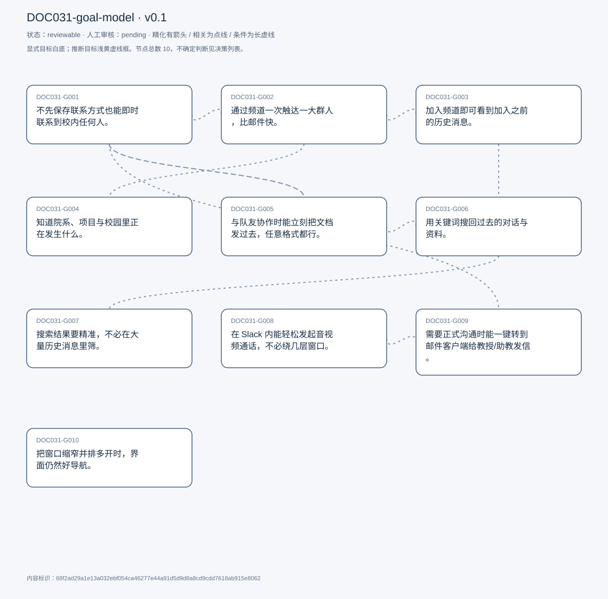
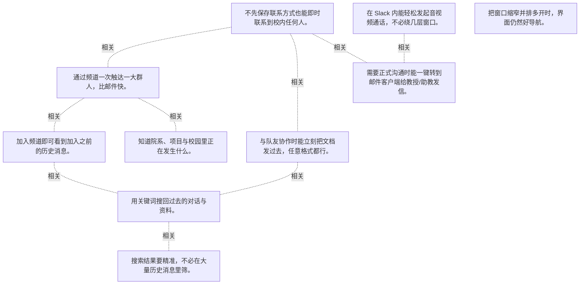

# 目标模型说明

模型：DOC031-goal-model；版本：v0.1

交付状态：reviewable；结构：passed；人工审核：pending

[交互模型](goal-model.html) · [矢量图](goal-model.svg) · [权威数据](goal-model.json)

## 目标图

## 目标

| 编号 | 表述 | 来源 | 情境 | 证据 |
|---|---|---|---|---|
| DOC031-G001 | 不先保存联系方式也能即时联系到校内任何人。 | explicit | 自评这是 Slack 优于其他应用之处；只需知道姓名即可检索并发起对话 | E0001, E0002, E0003 |
| DOC031-G002 | 通过频道一次触达一大群人，比邮件快。 | explicit | 对比对象：邮件 | E0004, E0005 |
| DOC031-G003 | 加入频道即可看到加入之前的历史消息。 | explicit | 自评这是相对其他应用的优势 | E0006, E0007 |
| DOC031-G004 | 知道院系、项目与校园里正在发生什么。 | explicit | 渠道：如软件工程项目的 MSC 频道 | E0008, E0009 |
| DOC031-G005 | 与队友协作时能立刻把文档发过去，任意格式都行。 | explicit | 自评这是最常用的功能；流程：打开对方页面 → 点附件 → 选文件 → 发送 | E0010, E0011, E0012 |
| DOC031-G006 | 用关键词搜回过去的对话与资料。 | explicit | 场景：找上学期某位教授说过的内容 | E0013, E0014 |
| DOC031-G007 | 搜索结果要精准，不必在大量历史消息里筛。 | explicit | 问题：结果太多，除非确切知道要找什么否则很难定位 | E0015, E0016 |
| DOC031-G008 | 在 Slack 内能轻松发起音视频通话，不必绕几层窗口。 | explicit | 对照：Microsoft Teams 里更直接；现状：功能存在但入口深 | E0017, E0018 |
| DOC031-G009 | 需要正式沟通时能一键转到邮件客户端给教授/助教发信。 | explicit | 场景：对 TA 或教授的正式往来仍以邮件为准 | E0019, E0020 |
| DOC031-G010 | 把窗口缩窄并排多开时，界面仍然好导航。 | explicit | 个人习惯：同时开三个窗口并排；现状：缩小后很难操作 | E0021, E0022 |

## 关系判断（含不确定与无关系）

- DOC031-G001 / DOC031-G002：related。T007–T009 是同一条沟通需求的两个尺度：一对一即时触达、一对多广播。前者靠姓名检索，后者靠频道，都省去先建立联系的成本。
- DOC031-G001 / DOC031-G003：none。DOC031-G001 的对象是无需存联系方式即可联系（T007），DOC031-G003 的对象是频道历史触手可及（T009）；两处分别出自不同话题段，原文未在二者之间建立因果、手段、评价或情境包含关系，本次评估口径内未建立可采用关系。
- DOC031-G001 / DOC031-G004：none。DOC031-G001 的对象是无需存联系方式即可联系（T007），DOC031-G004 的对象是知晓院系与校园动态（T009）；两处分别出自不同话题段，原文未在二者之间建立因果、手段、评价或情境包含关系，本次评估口径内未建立可采用关系。
- DOC031-G001 / DOC031-G005：related。T013 自己把文件分享归到第一个目标下：「circling back to the first goal... share a document instantly」。分享文档是即时沟通的具体内容之一。
- DOC031-G001 / DOC031-G006：none。DOC031-G001 的对象是无需存联系方式即可联系（T007），DOC031-G006 的对象是关键词搜回旧内容（T019）；两处分别出自不同话题段，原文未在二者之间建立因果、手段、评价或情境包含关系，本次评估口径内未建立可采用关系。
- DOC031-G001 / DOC031-G007：none。DOC031-G001 的对象是无需存联系方式即可联系（T007），DOC031-G007 的对象是搜索精准不过载（T019）；两处分别出自不同话题段，原文未在二者之间建立因果、手段、评价或情境包含关系，本次评估口径内未建立可采用关系。
- DOC031-G001 / DOC031-G008：none。DOC031-G001 的对象是无需存联系方式即可联系（T007），DOC031-G008 的对象是音视频通话易发起（T021）；两处分别出自不同话题段，原文未在二者之间建立因果、手段、评价或情境包含关系，本次评估口径内未建立可采用关系。
- DOC031-G001 / DOC031-G009：related。T027 点出 Slack 的边界：对教授与 TA 的正式沟通仍应走邮件，所以在即时沟通之后还需要一条转邮件的出口。但 G009 是跨应用衔接，G001 是站内即时性。
- DOC031-G001 / DOC031-G010：none。DOC031-G001 的对象是无需存联系方式即可联系（T007），DOC031-G010 的对象是窄窗口可导航（T031）；两处分别出自不同话题段，原文未在二者之间建立因果、手段、评价或情境包含关系，本次评估口径内未建立可采用关系。
- DOC031-G002 / DOC031-G003：related。T009 把频道的好处说成两层：能广而告之，也能翻看入群前的历史。前者是发送侧、后者是接收侧，共用同一容器。
- DOC031-G002 / DOC031-G004：related。T009 说频道让他知道系里、项目与校园在发生什么——G004 是加入频道后的实际收益。但 G002 是自己发声，G004 是接收信息。
- DOC031-G002 / DOC031-G005：none。DOC031-G002 的对象是频道一次触达广众（T009），DOC031-G005 的对象是协作时快速发文档（T011）；两处分别出自不同话题段，原文未在二者之间建立因果、手段、评价或情境包含关系，本次评估口径内未建立可采用关系。
- DOC031-G002 / DOC031-G006：none。DOC031-G002 的对象是频道一次触达广众（T009），DOC031-G006 的对象是关键词搜回旧内容（T019）；两处分别出自不同话题段，原文未在二者之间建立因果、手段、评价或情境包含关系，本次评估口径内未建立可采用关系。
- DOC031-G002 / DOC031-G007：none。DOC031-G002 的对象是频道一次触达广众（T009），DOC031-G007 的对象是搜索精准不过载（T019）；两处分别出自不同话题段，原文未在二者之间建立因果、手段、评价或情境包含关系，本次评估口径内未建立可采用关系。
- DOC031-G002 / DOC031-G008：none。DOC031-G002 的对象是频道一次触达广众（T009），DOC031-G008 的对象是音视频通话易发起（T021）；两处分别出自不同话题段，原文未在二者之间建立因果、手段、评价或情境包含关系，本次评估口径内未建立可采用关系。
- DOC031-G002 / DOC031-G009：none。DOC031-G002 的对象是频道一次触达广众（T009），DOC031-G009 的对象是一键转邮件（T027）；两处分别出自不同话题段，原文未在二者之间建立因果、手段、评价或情境包含关系，本次评估口径内未建立可采用关系。
- DOC031-G002 / DOC031-G010：none。DOC031-G002 的对象是频道一次触达广众（T009），DOC031-G010 的对象是窄窗口可导航（T031）；两处分别出自不同话题段，原文未在二者之间建立因果、手段、评价或情境包含关系，本次评估口径内未建立可采用关系。
- DOC031-G003 / DOC031-G004：none。DOC031-G003 的对象是频道历史触手可及（T009），DOC031-G004 的对象是知晓院系与校园动态（T009）；两处分别出自不同话题段，原文未在二者之间建立因果、手段、评价或情境包含关系，本次评估口径内未建立可采用关系。
- DOC031-G003 / DOC031-G005：none。DOC031-G003 的对象是频道历史触手可及（T009），DOC031-G005 的对象是协作时快速发文档（T011）；两处分别出自不同话题段，原文未在二者之间建立因果、手段、评价或情境包含关系，本次评估口径内未建立可采用关系。
- DOC031-G003 / DOC031-G006：related。T019 说搜索结果里会出现「入群之前的频道内容」——正因为历史全量可检索，搜索才有那么多可搜的东西。G003 是 G006 的数据基础，也是它过载的根源。
- DOC031-G003 / DOC031-G007：uncertain。同一特性既是优势也是负担：T009 称赞「加入频道就能看到入群前所有历史」，T019 又抱怨正因为历史全量可见，关键词搜索会返回过多结果、难以定位。是保留全量历史并改进检索，还是收窄历史范围，受访者没有表态，两种取舍都成立。
- DOC031-G003 / DOC031-G008：none。DOC031-G003 的对象是频道历史触手可及（T009），DOC031-G008 的对象是音视频通话易发起（T021）；两处分别出自不同话题段，原文未在二者之间建立因果、手段、评价或情境包含关系，本次评估口径内未建立可采用关系。
- DOC031-G003 / DOC031-G009：none。DOC031-G003 的对象是频道历史触手可及（T009），DOC031-G009 的对象是一键转邮件（T027）；两处分别出自不同话题段，原文未在二者之间建立因果、手段、评价或情境包含关系，本次评估口径内未建立可采用关系。
- DOC031-G003 / DOC031-G010：none。DOC031-G003 的对象是频道历史触手可及（T009），DOC031-G010 的对象是窄窗口可导航（T031）；两处分别出自不同话题段，原文未在二者之间建立因果、手段、评价或情境包含关系，本次评估口径内未建立可采用关系。
- DOC031-G004 / DOC031-G005：none。DOC031-G004 的对象是知晓院系与校园动态（T009），DOC031-G005 的对象是协作时快速发文档（T011）；两处分别出自不同话题段，原文未在二者之间建立因果、手段、评价或情境包含关系，本次评估口径内未建立可采用关系。
- DOC031-G004 / DOC031-G006：none。DOC031-G004 的对象是知晓院系与校园动态（T009），DOC031-G006 的对象是关键词搜回旧内容（T019）；两处分别出自不同话题段，原文未在二者之间建立因果、手段、评价或情境包含关系，本次评估口径内未建立可采用关系。
- DOC031-G004 / DOC031-G007：none。DOC031-G004 的对象是知晓院系与校园动态（T009），DOC031-G007 的对象是搜索精准不过载（T019）；两处分别出自不同话题段，原文未在二者之间建立因果、手段、评价或情境包含关系，本次评估口径内未建立可采用关系。
- DOC031-G004 / DOC031-G008：none。DOC031-G004 的对象是知晓院系与校园动态（T009），DOC031-G008 的对象是音视频通话易发起（T021）；两处分别出自不同话题段，原文未在二者之间建立因果、手段、评价或情境包含关系，本次评估口径内未建立可采用关系。
- DOC031-G004 / DOC031-G009：none。DOC031-G004 的对象是知晓院系与校园动态（T009），DOC031-G009 的对象是一键转邮件（T027）；两处分别出自不同话题段，原文未在二者之间建立因果、手段、评价或情境包含关系，本次评估口径内未建立可采用关系。
- DOC031-G004 / DOC031-G010：none。DOC031-G004 的对象是知晓院系与校园动态（T009），DOC031-G010 的对象是窄窗口可导航（T031）；两处分别出自不同话题段，原文未在二者之间建立因果、手段、评价或情境包含关系，本次评估口径内未建立可采用关系。
- DOC031-G005 / DOC031-G006：related。T018–T019 连着问「怎么搜回过去的对话或文件」，说明分享过的文档也要靠搜索找回。但 G005 是发送、G006 是事后检索。
- DOC031-G005 / DOC031-G007：none。DOC031-G005 的对象是协作时快速发文档（T011），DOC031-G007 的对象是搜索精准不过载（T019）；两处分别出自不同话题段，原文未在二者之间建立因果、手段、评价或情境包含关系，本次评估口径内未建立可采用关系。
- DOC031-G005 / DOC031-G008：none。DOC031-G005 的对象是协作时快速发文档（T011），DOC031-G008 的对象是音视频通话易发起（T021）；两处分别出自不同话题段，原文未在二者之间建立因果、手段、评价或情境包含关系，本次评估口径内未建立可采用关系。
- DOC031-G005 / DOC031-G009：none。DOC031-G005 的对象是协作时快速发文档（T011），DOC031-G009 的对象是一键转邮件（T027）；两处分别出自不同话题段，原文未在二者之间建立因果、手段、评价或情境包含关系，本次评估口径内未建立可采用关系。
- DOC031-G005 / DOC031-G010：none。DOC031-G005 的对象是协作时快速发文档（T011），DOC031-G010 的对象是窄窗口可导航（T031）；两处分别出自不同话题段，原文未在二者之间建立因果、手段、评价或情境包含关系，本次评估口径内未建立可采用关系。
- DOC031-G006 / DOC031-G007：related。T019 把搜索能力与搜索精度放在同一段：能搜到，但结果太多。G007 是对 G006 的质量要求，不是另一项能力。
- DOC031-G006 / DOC031-G008：none。DOC031-G006 的对象是关键词搜回旧内容（T019），DOC031-G008 的对象是音视频通话易发起（T021）；两处分别出自不同话题段，原文未在二者之间建立因果、手段、评价或情境包含关系，本次评估口径内未建立可采用关系。
- DOC031-G006 / DOC031-G009：none。DOC031-G006 的对象是关键词搜回旧内容（T019），DOC031-G009 的对象是一键转邮件（T027）；两处分别出自不同话题段，原文未在二者之间建立因果、手段、评价或情境包含关系，本次评估口径内未建立可采用关系。
- DOC031-G006 / DOC031-G010：none。DOC031-G006 的对象是关键词搜回旧内容（T019），DOC031-G010 的对象是窄窗口可导航（T031）；两处分别出自不同话题段，原文未在二者之间建立因果、手段、评价或情境包含关系，本次评估口径内未建立可采用关系。
- DOC031-G007 / DOC031-G008：none。DOC031-G007 的对象是搜索精准不过载（T019），DOC031-G008 的对象是音视频通话易发起（T021）；两处分别出自不同话题段，原文未在二者之间建立因果、手段、评价或情境包含关系，本次评估口径内未建立可采用关系。
- DOC031-G007 / DOC031-G009：none。DOC031-G007 的对象是搜索精准不过载（T019），DOC031-G009 的对象是一键转邮件（T027）；两处分别出自不同话题段，原文未在二者之间建立因果、手段、评价或情境包含关系，本次评估口径内未建立可采用关系。
- DOC031-G007 / DOC031-G010：none。DOC031-G007 的对象是搜索精准不过载（T019），DOC031-G010 的对象是窄窗口可导航（T031）；两处分别出自不同话题段，原文未在二者之间建立因果、手段、评价或情境包含关系，本次评估口径内未建立可采用关系。
- DOC031-G008 / DOC031-G009：related。T027 在同一回答里并列提出「快速邮件」与「通话入口更显眼」，两者都是补齐 Slack 相对 Teams 的短板。但一个是站内能力、一个是跨应用跳转。
- DOC031-G008 / DOC031-G010：none。DOC031-G008 的对象是音视频通话易发起（T021），DOC031-G010 的对象是窄窗口可导航（T031）；两处分别出自不同话题段，原文未在二者之间建立因果、手段、评价或情境包含关系，本次评估口径内未建立可采用关系。
- DOC031-G009 / DOC031-G010：none。DOC031-G009 的对象是一键转邮件（T027），DOC031-G010 的对象是窄窗口可导航（T031）；两处分别出自不同话题段，原文未在二者之间建立因果、手段、评价或情境包含关系，本次评估口径内未建立可采用关系。

## 证据

### E0001 · DOC031:S008

> it&#x27;s instant communication with anyone I wish to talk to within the university

原件位置：{&quot;line_start&quot;: 8, &quot;line_end&quot;: 8, &quot;start_char&quot;: 1690, &quot;end_char&quot;: 2240}

### E0002 · DOC031:S008

> I don&#x27;t need to like save anybody&#x27;s information

原件位置：{&quot;line_start&quot;: 8, &quot;line_end&quot;: 8, &quot;start_char&quot;: 1690, &quot;end_char&quot;: 2240}

### E0003 · DOC031:S008

> if I know their name, or sometimes even their last name, I can look them up

原件位置：{&quot;line_start&quot;: 8, &quot;line_end&quot;: 8, &quot;start_char&quot;: 1690, &quot;end_char&quot;: 2240}

### E0004 · DOC031:S010

> the channel feature within slack, where I can reach a wide audience immediately

原件位置：{&quot;line_start&quot;: 10, &quot;line_end&quot;: 10, &quot;start_char&quot;: 2423, &quot;end_char&quot;: 3333}

### E0005 · DOC031:S010

> if I was doing that over email or something, it would take me more time

原件位置：{&quot;line_start&quot;: 10, &quot;line_end&quot;: 10, &quot;start_char&quot;: 2423, &quot;end_char&quot;: 3333}

### E0006 · DOC031:S010

> I have the history of that channel at my fingertips

原件位置：{&quot;line_start&quot;: 10, &quot;line_end&quot;: 10, &quot;start_char&quot;: 2423, &quot;end_char&quot;: 3333}

### E0007 · DOC031:S010

> I have access to information that was there before I even joined the channel

原件位置：{&quot;line_start&quot;: 10, &quot;line_end&quot;: 10, &quot;start_char&quot;: 2423, &quot;end_char&quot;: 3333}

### E0008 · DOC031:S010

> I like to hear what&#x27;s happening around within the department

原件位置：{&quot;line_start&quot;: 10, &quot;line_end&quot;: 10, &quot;start_char&quot;: 2423, &quot;end_char&quot;: 3333}

### E0009 · DOC031:S010

> what&#x27;s happening around campus

原件位置：{&quot;line_start&quot;: 10, &quot;line_end&quot;: 10, &quot;start_char&quot;: 2423, &quot;end_char&quot;: 3333}

### E0010 · DOC031:S012

> my most used feature is sharing documents when collaborating with teammates

原件位置：{&quot;line_start&quot;: 12, &quot;line_end&quot;: 12, &quot;start_char&quot;: 3565, &quot;end_char&quot;: 3737}

### E0011 · DOC031:S018

> at the bottom, there is an option to attach a document

原件位置：{&quot;line_start&quot;: 18, &quot;line_end&quot;: 18, &quot;start_char&quot;: 4310, &quot;end_char&quot;: 5272}

### E0012 · DOC031:S018

> I can attach any type of file I want

原件位置：{&quot;line_start&quot;: 18, &quot;line_end&quot;: 18, &quot;start_char&quot;: 4310, &quot;end_char&quot;: 5272}

### E0013 · DOC031:S020

> there is a search feature that I would use to I would enter keywords

原件位置：{&quot;line_start&quot;: 20, &quot;line_end&quot;: 20, &quot;start_char&quot;: 5505, &quot;end_char&quot;: 6394}

### E0014 · DOC031:S020

> it would display a list of you know matches

原件位置：{&quot;line_start&quot;: 20, &quot;line_end&quot;: 20, &quot;start_char&quot;: 5505, &quot;end_char&quot;: 6394}

### E0015 · DOC031:S020

> sometimes when I search for a keyword or keywords, I get way too much information

原件位置：{&quot;line_start&quot;: 20, &quot;line_end&quot;: 20, &quot;start_char&quot;: 5505, &quot;end_char&quot;: 6394}

### E0016 · DOC031:S020

> it&#x27;s a little difficult to pass through things unless I know exactly what I&#x27;m looking for

原件位置：{&quot;line_start&quot;: 20, &quot;line_end&quot;: 20, &quot;start_char&quot;: 5505, &quot;end_char&quot;: 6394}

### E0017 · DOC031:S022

> it&#x27;s a little harder to have video calls or audio calls

原件位置：{&quot;line_start&quot;: 22, &quot;line_end&quot;: 22, &quot;start_char&quot;: 6606, &quot;end_char&quot;: 7030}

### E0018 · DOC031:S022

> there are different windows to navigate to to get to that feature

原件位置：{&quot;line_start&quot;: 22, &quot;line_end&quot;: 22, &quot;start_char&quot;: 6606, &quot;end_char&quot;: 7030}

### E0019 · DOC031:S028

> I would like a quick email feature

原件位置：{&quot;line_start&quot;: 28, &quot;line_end&quot;: 28, &quot;start_char&quot;: 8274, &quot;end_char&quot;: 8904}

### E0020 · DOC031:S028

> there are certain situations where you know an email is expected

原件位置：{&quot;line_start&quot;: 28, &quot;line_end&quot;: 28, &quot;start_char&quot;: 8274, &quot;end_char&quot;: 8904}

### E0021 · DOC031:S032

> shrink the size of slack browser window

原件位置：{&quot;line_start&quot;: 32, &quot;line_end&quot;: 32, &quot;start_char&quot;: 9644, &quot;end_char&quot;: 10209}

### E0022 · DOC031:S032

> I feel like it&#x27;s a little hard to navigate through the application

原件位置：{&quot;line_start&quot;: 32, &quot;line_end&quot;: 32, &quot;start_char&quot;: 9644, &quot;end_char&quot;: 10209}

## 问题、限制与版本

- 同一特性既是优势也是负担：T009 称赞「加入频道就能看到入群前所有历史」，T019 又抱怨正因为历史全量可见，关键词搜索会返回过多结果、难以定位。是保留全量历史并改进检索，还是收窄历史范围，受访者没有表态，两种取舍都成立。
- 当前会话助手的开发判断，非独立盲测；无人工采纳记录。
- 结构检查已绑定当前版本；独立语义审查未执行；人工状态以实际审核记录为准。

内容标识：68f2ad29a1e13a032ebf054ca46277e44a91d5d9d8a8cd9cdd7618ab915e8062

人工决定：

审核意见：
