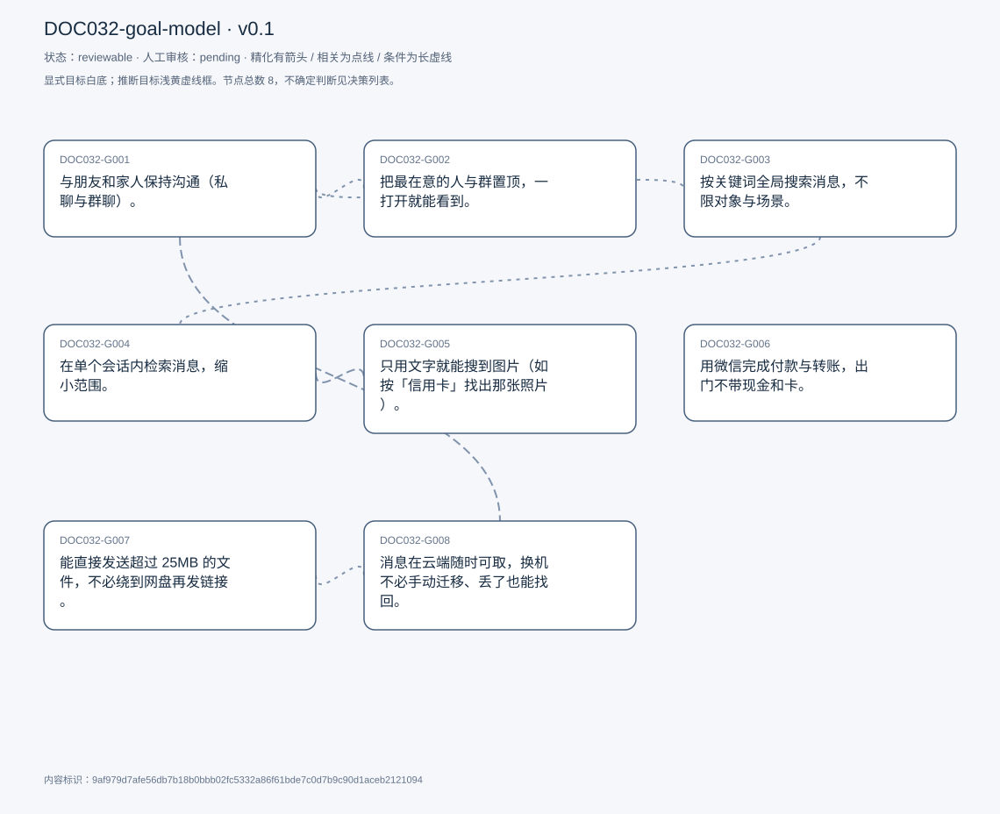
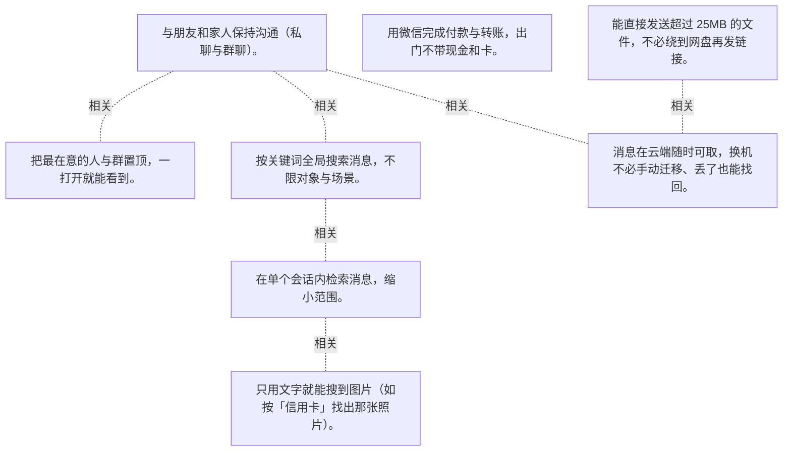

# 目标模型说明

模型：DOC032-goal-model；版本：v0.1

交付状态：reviewable；结构：passed；人工审核：pending

[交互模型](goal-model.html) · [矢量图](goal-model.svg) · [权威数据](goal-model.json)

## 目标图

## 目标

| 编号 | 表述 | 来源 | 情境 | 证据 |
|---|---|---|---|---|
| DOC032-G001 | 与朋友和家人保持沟通（私聊与群聊）。 | explicit | 自述这是使用微信的主要目标；对象限定为熟人，而非陌生人 | E0001, E0002 |
| DOC032-G002 | 把最在意的人与群置顶，一打开就能看到。 | explicit | 对象：女朋友与关心的群；理由：这些人是他最在乎的 | E0003, E0004, E0005 |
| DOC032-G003 | 按关键词全局搜索消息，不限对象与场景。 | explicit | 入口：顶部搜索栏；范围：私聊与群聊全部命中 | E0006, E0007 |
| DOC032-G004 | 在单个会话内检索消息，缩小范围。 | explicit | 入口：会话右上角三点 → 搜索消息；可只搜该对话内的内容 | E0008, E0009, E0010 |
| DOC032-G005 | 只用文字就能搜到图片（如按「信用卡」找出那张照片）。 | explicit | 实例：20 天前发过信用卡照片，靠关键词直接找到；替代方案：往上翻到那一天，很费时 | E0011, E0012 |
| DOC032-G006 | 用微信完成付款与转账，出门不带现金和卡。 | explicit | 自评这是「最有用的功能」；方式：扫码或出示付款码，指纹/面容确认 | E0013, E0014 |
| DOC032-G007 | 能直接发送超过 25MB 的文件，不必绕到网盘再发链接。 | explicit | 现状：超出限制只能上传云盘发链接 | E0015, E0016 |
| DOC032-G008 | 消息在云端随时可取，换机不必手动迁移、丢了也能找回。 | explicit | 现状：消息只存在本机，不存服务器；代价：换机要手动搬、手机丢了全没、还占本地空间 | E0017, E0018, E0019 |

## 关系判断（含不确定与无关系）

- DOC032-G001 / DOC032-G002：related。T021–T023 的置顶本质是对沟通对象排序：把最在意的人放在列表最上方，减少每次打开时的寻找成本。但 G001 是全部往来，G002 只处理其中几个。
- DOC032-G001 / DOC032-G003：related。T025 的搜索用于找回沟通过的内容，是沟通记录的二次利用。但 G001 是当下交流，G003 是回溯历史。
- DOC032-G001 / DOC032-G004：none。DOC032-G001 的对象是与朋友家人沟通（T013），DOC032-G004 的对象是会话内检索（T025/T027）；两处分别出自不同话题段，原文未在二者之间建立因果、手段、评价或情境包含关系，本次评估口径内未建立可采用关系。
- DOC032-G001 / DOC032-G005：none。DOC032-G001 的对象是与朋友家人沟通（T013），DOC032-G005 的对象是按文字搜图片（T045）；两处分别出自不同话题段，原文未在二者之间建立因果、手段、评价或情境包含关系，本次评估口径内未建立可采用关系。
- DOC032-G001 / DOC032-G006：none。DOC032-G001 的对象是与朋友家人沟通（T013），DOC032-G006 的对象是微信支付（T033）；两处分别出自不同话题段，原文未在二者之间建立因果、手段、评价或情境包含关系，本次评估口径内未建立可采用关系。
- DOC032-G001 / DOC032-G007：none。DOC032-G001 的对象是与朋友家人沟通（T013），DOC032-G007 的对象是发送大文件（T055）；两处分别出自不同话题段，原文未在二者之间建立因果、手段、评价或情境包含关系，本次评估口径内未建立可采用关系。
- DOC032-G001 / DOC032-G008：related。T071 说希望「所有消息一直可用」，隐含的正是与家人朋友的长期往来记录。但 G008 是存储形态，G001 是沟通本身。
- DOC032-G002 / DOC032-G003：none。DOC032-G002 的对象是最在意的人置顶（T021），DOC032-G003 的对象是全局关键词搜消息（T025）；两处分别出自不同话题段，原文未在二者之间建立因果、手段、评价或情境包含关系，本次评估口径内未建立可采用关系。
- DOC032-G002 / DOC032-G004：none。DOC032-G002 的对象是最在意的人置顶（T021），DOC032-G004 的对象是会话内检索（T025/T027）；两处分别出自不同话题段，原文未在二者之间建立因果、手段、评价或情境包含关系，本次评估口径内未建立可采用关系。
- DOC032-G002 / DOC032-G005：none。DOC032-G002 的对象是最在意的人置顶（T021），DOC032-G005 的对象是按文字搜图片（T045）；两处分别出自不同话题段，原文未在二者之间建立因果、手段、评价或情境包含关系，本次评估口径内未建立可采用关系。
- DOC032-G002 / DOC032-G006：none。DOC032-G002 的对象是最在意的人置顶（T021），DOC032-G006 的对象是微信支付（T033）；两处分别出自不同话题段，原文未在二者之间建立因果、手段、评价或情境包含关系，本次评估口径内未建立可采用关系。
- DOC032-G002 / DOC032-G007：none。DOC032-G002 的对象是最在意的人置顶（T021），DOC032-G007 的对象是发送大文件（T055）；两处分别出自不同话题段，原文未在二者之间建立因果、手段、评价或情境包含关系，本次评估口径内未建立可采用关系。
- DOC032-G002 / DOC032-G008：none。DOC032-G002 的对象是最在意的人置顶（T021），DOC032-G008 的对象是消息云端可取（T059/T071）；两处分别出自不同话题段，原文未在二者之间建立因果、手段、评价或情境包含关系，本次评估口径内未建立可采用关系。
- DOC032-G003 / DOC032-G004：related。T025 把两者说成同一次检索的两种入口：顶部搜索栏搜全部，会话内三点菜单只搜该对话。范围不同，机制相同。
- DOC032-G003 / DOC032-G005：none。DOC032-G003 的对象是全局关键词搜消息（T025），DOC032-G005 的对象是按文字搜图片（T045）；两处分别出自不同话题段，原文未在二者之间建立因果、手段、评价或情境包含关系，本次评估口径内未建立可采用关系。
- DOC032-G003 / DOC032-G006：none。DOC032-G003 的对象是全局关键词搜消息（T025），DOC032-G006 的对象是微信支付（T033）；两处分别出自不同话题段，原文未在二者之间建立因果、手段、评价或情境包含关系，本次评估口径内未建立可采用关系。
- DOC032-G003 / DOC032-G007：none。DOC032-G003 的对象是全局关键词搜消息（T025），DOC032-G007 的对象是发送大文件（T055）；两处分别出自不同话题段，原文未在二者之间建立因果、手段、评价或情境包含关系，本次评估口径内未建立可采用关系。
- DOC032-G003 / DOC032-G008：none。DOC032-G003 的对象是全局关键词搜消息（T025），DOC032-G008 的对象是消息云端可取（T059/T071）；两处分别出自不同话题段，原文未在二者之间建立因果、手段、评价或情境包含关系，本次评估口径内未建立可采用关系。
- DOC032-G004 / DOC032-G005：related。T027 说会话内搜索「even search for image」，T045 把按文字搜图列为最有用功能之一——它是会话内检索的一个特例，靠图像内容识别扩展了可搜对象。
- DOC032-G004 / DOC032-G006：none。DOC032-G004 的对象是会话内检索（T025/T027），DOC032-G006 的对象是微信支付（T033）；两处分别出自不同话题段，原文未在二者之间建立因果、手段、评价或情境包含关系，本次评估口径内未建立可采用关系。
- DOC032-G004 / DOC032-G007：none。DOC032-G004 的对象是会话内检索（T025/T027），DOC032-G007 的对象是发送大文件（T055）；两处分别出自不同话题段，原文未在二者之间建立因果、手段、评价或情境包含关系，本次评估口径内未建立可采用关系。
- DOC032-G004 / DOC032-G008：none。DOC032-G004 的对象是会话内检索（T025/T027），DOC032-G008 的对象是消息云端可取（T059/T071）；两处分别出自不同话题段，原文未在二者之间建立因果、手段、评价或情境包含关系，本次评估口径内未建立可采用关系。
- DOC032-G005 / DOC032-G006：none。DOC032-G005 的对象是按文字搜图片（T045），DOC032-G006 的对象是微信支付（T033）；两处分别出自不同话题段，原文未在二者之间建立因果、手段、评价或情境包含关系，本次评估口径内未建立可采用关系。
- DOC032-G005 / DOC032-G007：none。DOC032-G005 的对象是按文字搜图片（T045），DOC032-G007 的对象是发送大文件（T055）；两处分别出自不同话题段，原文未在二者之间建立因果、手段、评价或情境包含关系，本次评估口径内未建立可采用关系。
- DOC032-G005 / DOC032-G008：none。DOC032-G005 的对象是按文字搜图片（T045），DOC032-G008 的对象是消息云端可取（T059/T071）；两处分别出自不同话题段，原文未在二者之间建立因果、手段、评价或情境包含关系，本次评估口径内未建立可采用关系。
- DOC032-G006 / DOC032-G007：none。DOC032-G006 的对象是微信支付（T033），DOC032-G007 的对象是发送大文件（T055）；两处分别出自不同话题段，原文未在二者之间建立因果、手段、评价或情境包含关系，本次评估口径内未建立可采用关系。
- DOC032-G006 / DOC032-G008：none。DOC032-G006 的对象是微信支付（T033），DOC032-G008 的对象是消息云端可取（T059/T071）；两处分别出自不同话题段，原文未在二者之间建立因果、手段、评价或情境包含关系，本次评估口径内未建立可采用关系。
- DOC032-G007 / DOC032-G008：related。两者都是承载能力不足：文件受 25MB 限制只能走云盘，消息不受云端保存只能留本机。一个管传输、一个管留存，但都指向「微信不是为重度内容设计的」。

## 证据

### E0001 · DOC032:S014

> the main goal for me to use Wechat is just communicating with my friends and family

原件位置：{&quot;line_start&quot;: 14, &quot;line_end&quot;: 14, &quot;start_char&quot;: 3302, &quot;end_char&quot;: 3470}

### E0002 · DOC032:S016

> I could choose to open a private chat or group chat

原件位置：{&quot;line_start&quot;: 16, &quot;line_end&quot;: 16, &quot;start_char&quot;: 3688, &quot;end_char&quot;: 4069}

### E0003 · DOC032:S022

> there&#x27;s a feature called Ping

原件位置：{&quot;line_start&quot;: 22, &quot;line_end&quot;: 22, &quot;start_char&quot;: 4981, &quot;end_char&quot;: 5335}

### E0004 · DOC032:S022

> the 1st chat box I could see is my girlfriend

原件位置：{&quot;line_start&quot;: 22, &quot;line_end&quot;: 22, &quot;start_char&quot;: 4981, &quot;end_char&quot;: 5335}

### E0005 · DOC032:S024

> they are friends or families that I cares most about

原件位置：{&quot;line_start&quot;: 24, &quot;line_end&quot;: 24, &quot;start_char&quot;: 5562, &quot;end_char&quot;: 5756}

### E0006 · DOC032:S026

> all the relevant messages, no matter with whom

原件位置：{&quot;line_start&quot;: 26, &quot;line_end&quot;: 26, &quot;start_char&quot;: 5948, &quot;end_char&quot;: 6500}

### E0007 · DOC032:S026

> I will simply type the messages at the top of the screen

原件位置：{&quot;line_start&quot;: 26, &quot;line_end&quot;: 26, &quot;start_char&quot;: 5948, &quot;end_char&quot;: 6500}

### E0008 · DOC032:S026

> I can go to the chat interface and touch a additional settings button

原件位置：{&quot;line_start&quot;: 26, &quot;line_end&quot;: 26, &quot;start_char&quot;: 5948, &quot;end_char&quot;: 6500}

### E0009 · DOC032:S028

> a search message and I simply type the search message

原件位置：{&quot;line_start&quot;: 28, &quot;line_end&quot;: 28, &quot;start_char&quot;: 6572, &quot;end_char&quot;: 7119}

### E0010 · DOC032:S028

> all the messages relevant with apple will pop up

原件位置：{&quot;line_start&quot;: 28, &quot;line_end&quot;: 28, &quot;start_char&quot;: 6572, &quot;end_char&quot;: 7119}

### E0011 · DOC032:S046

> I could search for some certain image through stress typing the award

原件位置：{&quot;line_start&quot;: 46, &quot;line_end&quot;: 46, &quot;start_char&quot;: 10071, &quot;end_char&quot;: 10437}

### E0012 · DOC032:S048

> I could just simply type credit card, and it will show up the messages with that credit card

原件位置：{&quot;line_start&quot;: 48, &quot;line_end&quot;: 48, &quot;start_char&quot;: 10578, &quot;end_char&quot;: 11133}

### E0013 · DOC032:S034

> the most useful feature in wechat

原件位置：{&quot;line_start&quot;: 34, &quot;line_end&quot;: 34, &quot;start_char&quot;: 7809, &quot;end_char&quot;: 8342}

### E0014 · DOC032:S034

> we could just pay by wechat

原件位置：{&quot;line_start&quot;: 34, &quot;line_end&quot;: 34, &quot;start_char&quot;: 7809, &quot;end_char&quot;: 8342}

### E0015 · DOC032:S056

> wechat will limits the size of the file to be transferred

原件位置：{&quot;line_start&quot;: 56, &quot;line_end&quot;: 56, &quot;start_char&quot;: 11936, &quot;end_char&quot;: 12335}

### E0016 · DOC032:S056

> I have to save my file on some cloud drive and send a link

原件位置：{&quot;line_start&quot;: 56, &quot;line_end&quot;: 56, &quot;start_char&quot;: 11936, &quot;end_char&quot;: 12335}

### E0017 · DOC032:S060

> all the messages are on your phone

原件位置：{&quot;line_start&quot;: 60, &quot;line_end&quot;: 60, &quot;start_char&quot;: 12658, &quot;end_char&quot;: 13167}

### E0018 · DOC032:S060

> I have to manually and transfer all the messages to a new phone

原件位置：{&quot;line_start&quot;: 60, &quot;line_end&quot;: 60, &quot;start_char&quot;: 12658, &quot;end_char&quot;: 13167}

### E0019 · DOC032:S072

> I wanna keep all my messages available all the time

原件位置：{&quot;line_start&quot;: 72, &quot;line_end&quot;: 72, &quot;start_char&quot;: 14426, &quot;end_char&quot;: 14770}

## 问题、限制与版本

- 当前会话助手的开发判断，非独立盲测；无人工采纳记录。
- 结构检查已绑定当前版本；独立语义审查未执行；人工状态以实际审核记录为准。

内容标识：9af979d7afe56db7b18b0bbb02fc5332a86f61bde7c0d7b9c90d1aceb2121094

人工决定：

审核意见：
