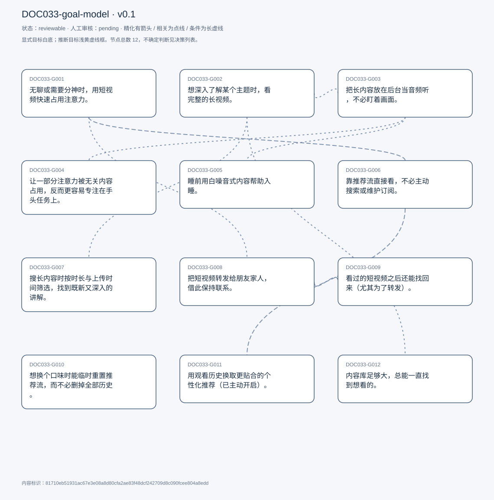
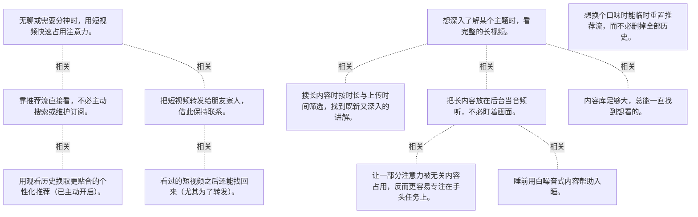

# 目标模型说明

模型：DOC033-goal-model；版本：v0.1

交付状态：reviewable；结构：passed；人工审核：pending

[交互模型](goal-model.html) · [矢量图](goal-model.svg) · [权威数据](goal-model.json)

## 目标图

## 目标

| 编号 | 表述 | 来源 | 情境 | 证据 |
|---|---|---|---|---|
| DOC033-G001 | 无聊或需要分神时，用短视频快速占用注意力。 | explicit | 触发：刚睡醒、吃完饭的空档；形态：打开即进 Shorts，不主动挑 | E0001, E0002 |
| DOC033-G002 | 想深入了解某个主题时，看完整的长视频。 | explicit | 与 Shorts 相对的另一半使用 | E0003, E0004 |
| DOC033-G003 | 把长内容放在后台当音频听，不必盯着画面。 | explicit | 内容类型：播客、直播回放、有声书；自评「没耐心看画面」 | E0005, E0006, E0007 |
| DOC033-G004 | 让一部分注意力被无关内容占用，反而更容易专注在手头任务上。 | explicit | 典型：解 LeetCode 时后台放心理学类内容；他自己承认有时会完全走神、没注意到换片 | E0008, E0009 |
| DOC033-G005 | 睡前用白噪音式内容帮助入睡。 | explicit | 频率：不常发生但确实有；副作用：睡着后自动播到长广告 | E0010, E0011 |
| DOC033-G006 | 靠推荐流直接看，不必主动搜索或维护订阅。 | explicit | 不关注任何创作者；自述 shorts 里根本不搜索 | E0012, E0013, E0014 |
| DOC033-G007 | 搜长内容时按时长与上传时间筛选，找到既新又深入的讲解。 | explicit | 筛选：时长选「超过 20 分钟」、上传日期选最近；场景：技术概念有多个版本，需要最新且讲透 | E0015, E0016, E0017 |
| DOC033-G008 | 把短视频转发给朋友家人，借此保持联系。 | explicit | 渠道：WhatsApp；只转 Shorts，不转长视频 | E0018, E0019 |
| DOC033-G009 | 看过的短视频之后还能找回来（尤其为了转发）。 | explicit | 难点：只记得零碎细节（如背景音乐），标题不具检索性；实例：想发给妹妹但找不到 | E0020, E0021, E0022 |
| DOC033-G010 | 想换个口味时能临时重置推荐流，而不必删掉全部历史。 | explicit | 现状：只能开无痕或退出登录；他自己说这种事很久没发生了 | E0023, E0024 |
| DOC033-G011 | 用观看历史换取更贴合的个性化推荐（已主动开启）。 | explicit | 过去曾暂停历史，因推荐不准而重新开启；权衡结论：无明显坏处、有好处 | E0025, E0026 |
| DOC033-G012 | 内容库足够大，总能一直找到想看的。 | explicit | 自评这是最喜欢的「非功能特性」；价值：可一直找下去直到找到喜欢的 | E0027, E0028 |

## 关系判断（含不确定与无关系）

- DOC033-G001 / DOC033-G002：none。DOC033-G001 的对象是无聊刷短视频分神（T021），DOC033-G002 的对象是深入主题看长视频（T015/T021）；两处分别出自不同话题段，原文未在二者之间建立因果、手段、评价或情境包含关系，本次评估口径内未建立可采用关系。
- DOC033-G001 / DOC033-G003：none。DOC033-G001 的对象是无聊刷短视频分神（T021），DOC033-G003 的对象是后台当音频听（T023/T025）；两处分别出自不同话题段，原文未在二者之间建立因果、手段、评价或情境包含关系，本次评估口径内未建立可采用关系。
- DOC033-G001 / DOC033-G004：none。DOC033-G001 的对象是无聊刷短视频分神（T021），DOC033-G004 的对象是占用部分注意力助专注（T065）；两处分别出自不同话题段，原文未在二者之间建立因果、手段、评价或情境包含关系，本次评估口径内未建立可采用关系。
- DOC033-G001 / DOC033-G005：none。DOC033-G001 的对象是无聊刷短视频分神（T021），DOC033-G005 的对象是睡前白噪音助眠（T045）；两处分别出自不同话题段，原文未在二者之间建立因果、手段、评价或情境包含关系，本次评估口径内未建立可采用关系。
- DOC033-G001 / DOC033-G006：related。T049 说刷 Shorts 时从不搜索，「算法给什么就看什么」——无聊分神这一诉求完全由推荐流承接。但 G001 是要被占住，G006 是不主动挑。
- DOC033-G001 / DOC033-G007：none。DOC033-G001 的对象是无聊刷短视频分神（T021），DOC033-G007 的对象是时长与时间筛选（T129/T135）；两处分别出自不同话题段，原文未在二者之间建立因果、手段、评价或情境包含关系，本次评估口径内未建立可采用关系。
- DOC033-G001 / DOC033-G008：related。T137 说分享的是 Shorts 而非长视频——分享对象正是 G001 场景里刷到的内容。刷到 → 转发，构成同一条链路。
- DOC033-G001 / DOC033-G009：none。DOC033-G001 的对象是无聊刷短视频分神（T021），DOC033-G009 的对象是找回看过的短视频（T141/T163）；两处分别出自不同话题段，原文未在二者之间建立因果、手段、评价或情境包含关系，本次评估口径内未建立可采用关系。
- DOC033-G001 / DOC033-G010：none。DOC033-G001 的对象是无聊刷短视频分神（T021），DOC033-G010 的对象是临时重置推荐流（T151/T167）；两处分别出自不同话题段，原文未在二者之间建立因果、手段、评价或情境包含关系，本次评估口径内未建立可采用关系。
- DOC033-G001 / DOC033-G011：none。DOC033-G001 的对象是无聊刷短视频分神（T021），DOC033-G011 的对象是用观看历史换个性化（T053/T057）；两处分别出自不同话题段，原文未在二者之间建立因果、手段、评价或情境包含关系，本次评估口径内未建立可采用关系。
- DOC033-G001 / DOC033-G012：none。DOC033-G001 的对象是无聊刷短视频分神（T021），DOC033-G012 的对象是内容库足够大（T121/T123）；两处分别出自不同话题段，原文未在二者之间建立因果、手段、评价或情境包含关系，本次评估口径内未建立可采用关系。
- DOC033-G002 / DOC033-G003：related。T023 把长内容的用法分成两种：坐在电脑前看，和做别的事时后台听。同一批内容、两种消费强度。
- DOC033-G002 / DOC033-G004：none。DOC033-G002 的对象是深入主题看长视频（T015/T021），DOC033-G004 的对象是占用部分注意力助专注（T065）；两处分别出自不同话题段，原文未在二者之间建立因果、手段、评价或情境包含关系，本次评估口径内未建立可采用关系。
- DOC033-G002 / DOC033-G005：none。DOC033-G002 的对象是深入主题看长视频（T015/T021），DOC033-G005 的对象是睡前白噪音助眠（T045）；两处分别出自不同话题段，原文未在二者之间建立因果、手段、评价或情境包含关系，本次评估口径内未建立可采用关系。
- DOC033-G002 / DOC033-G006：none。DOC033-G002 的对象是深入主题看长视频（T015/T021），DOC033-G006 的对象是靠推荐不靠搜索（T049/T051）；两处分别出自不同话题段，原文未在二者之间建立因果、手段、评价或情境包含关系，本次评估口径内未建立可采用关系。
- DOC033-G002 / DOC033-G007：related。T135 说搜长内容时会同时用「超过 20 分钟」与「最近上传」两个筛选，理由是技术概念有多个版本、需要既新又讲透。筛选直接服务于 G002 的深入需求。
- DOC033-G002 / DOC033-G008：none。DOC033-G002 的对象是深入主题看长视频（T015/T021），DOC033-G008 的对象是分享短视频给亲友（T137）；两处分别出自不同话题段，原文未在二者之间建立因果、手段、评价或情境包含关系，本次评估口径内未建立可采用关系。
- DOC033-G002 / DOC033-G009：none。DOC033-G002 的对象是深入主题看长视频（T015/T021），DOC033-G009 的对象是找回看过的短视频（T141/T163）；两处分别出自不同话题段，原文未在二者之间建立因果、手段、评价或情境包含关系，本次评估口径内未建立可采用关系。
- DOC033-G002 / DOC033-G010：none。DOC033-G002 的对象是深入主题看长视频（T015/T021），DOC033-G010 的对象是临时重置推荐流（T151/T167）；两处分别出自不同话题段，原文未在二者之间建立因果、手段、评价或情境包含关系，本次评估口径内未建立可采用关系。
- DOC033-G002 / DOC033-G011：none。DOC033-G002 的对象是深入主题看长视频（T015/T021），DOC033-G011 的对象是用观看历史换个性化（T053/T057）；两处分别出自不同话题段，原文未在二者之间建立因果、手段、评价或情境包含关系，本次评估口径内未建立可采用关系。
- DOC033-G002 / DOC033-G012：related。T123 说正因为库足够大，才能一直找下去直到找到想看的——G012 是 G002「想深入就有得看」的供给基础。但 G012 也服务于闲逛。
- DOC033-G003 / DOC033-G004：related。T065 说明后台放音是为了「一部分脑子被占住」，这正是 G003 在使用场景上的延伸：从被动听到主动用来调专注。但 G004 还包含对效果的怀疑。
- DOC033-G003 / DOC033-G005：related。T045 把助眠归到「放着不看」这一类用法里，靠白噪音式内容入睡——是后台音频的夜间版本。但 G005 不需要注意力，反而要关掉注意力。
- DOC033-G003 / DOC033-G006：none。DOC033-G003 的对象是后台当音频听（T023/T025），DOC033-G006 的对象是靠推荐不靠搜索（T049/T051）；两处分别出自不同话题段，原文未在二者之间建立因果、手段、评价或情境包含关系，本次评估口径内未建立可采用关系。
- DOC033-G003 / DOC033-G007：none。DOC033-G003 的对象是后台当音频听（T023/T025），DOC033-G007 的对象是时长与时间筛选（T129/T135）；两处分别出自不同话题段，原文未在二者之间建立因果、手段、评价或情境包含关系，本次评估口径内未建立可采用关系。
- DOC033-G003 / DOC033-G008：none。DOC033-G003 的对象是后台当音频听（T023/T025），DOC033-G008 的对象是分享短视频给亲友（T137）；两处分别出自不同话题段，原文未在二者之间建立因果、手段、评价或情境包含关系，本次评估口径内未建立可采用关系。
- DOC033-G003 / DOC033-G009：none。DOC033-G003 的对象是后台当音频听（T023/T025），DOC033-G009 的对象是找回看过的短视频（T141/T163）；两处分别出自不同话题段，原文未在二者之间建立因果、手段、评价或情境包含关系，本次评估口径内未建立可采用关系。
- DOC033-G003 / DOC033-G010：none。DOC033-G003 的对象是后台当音频听（T023/T025），DOC033-G010 的对象是临时重置推荐流（T151/T167）；两处分别出自不同话题段，原文未在二者之间建立因果、手段、评价或情境包含关系，本次评估口径内未建立可采用关系。
- DOC033-G003 / DOC033-G011：none。DOC033-G003 的对象是后台当音频听（T023/T025），DOC033-G011 的对象是用观看历史换个性化（T053/T057）；两处分别出自不同话题段，原文未在二者之间建立因果、手段、评价或情境包含关系，本次评估口径内未建立可采用关系。
- DOC033-G003 / DOC033-G012：none。DOC033-G003 的对象是后台当音频听（T023/T025），DOC033-G012 的对象是内容库足够大（T121/T123）；两处分别出自不同话题段，原文未在二者之间建立因果、手段、评价或情境包含关系，本次评估口径内未建立可采用关系。
- DOC033-G004 / DOC033-G005：none。DOC033-G004 的对象是占用部分注意力助专注（T065），DOC033-G005 的对象是睡前白噪音助眠（T045）；两处分别出自不同话题段，原文未在二者之间建立因果、手段、评价或情境包含关系，本次评估口径内未建立可采用关系。
- DOC033-G004 / DOC033-G006：none。DOC033-G004 的对象是占用部分注意力助专注（T065），DOC033-G006 的对象是靠推荐不靠搜索（T049/T051）；两处分别出自不同话题段，原文未在二者之间建立因果、手段、评价或情境包含关系，本次评估口径内未建立可采用关系。
- DOC033-G004 / DOC033-G007：none。DOC033-G004 的对象是占用部分注意力助专注（T065），DOC033-G007 的对象是时长与时间筛选（T129/T135）；两处分别出自不同话题段，原文未在二者之间建立因果、手段、评价或情境包含关系，本次评估口径内未建立可采用关系。
- DOC033-G004 / DOC033-G008：none。DOC033-G004 的对象是占用部分注意力助专注（T065），DOC033-G008 的对象是分享短视频给亲友（T137）；两处分别出自不同话题段，原文未在二者之间建立因果、手段、评价或情境包含关系，本次评估口径内未建立可采用关系。
- DOC033-G004 / DOC033-G009：none。DOC033-G004 的对象是占用部分注意力助专注（T065），DOC033-G009 的对象是找回看过的短视频（T141/T163）；两处分别出自不同话题段，原文未在二者之间建立因果、手段、评价或情境包含关系，本次评估口径内未建立可采用关系。
- DOC033-G004 / DOC033-G010：none。DOC033-G004 的对象是占用部分注意力助专注（T065），DOC033-G010 的对象是临时重置推荐流（T151/T167）；两处分别出自不同话题段，原文未在二者之间建立因果、手段、评价或情境包含关系，本次评估口径内未建立可采用关系。
- DOC033-G004 / DOC033-G011：none。DOC033-G004 的对象是占用部分注意力助专注（T065），DOC033-G011 的对象是用观看历史换个性化（T053/T057）；两处分别出自不同话题段，原文未在二者之间建立因果、手段、评价或情境包含关系，本次评估口径内未建立可采用关系。
- DOC033-G004 / DOC033-G012：none。DOC033-G004 的对象是占用部分注意力助专注（T065），DOC033-G012 的对象是内容库足够大（T121/T123）；两处分别出自不同话题段，原文未在二者之间建立因果、手段、评价或情境包含关系，本次评估口径内未建立可采用关系。
- DOC033-G005 / DOC033-G006：none。DOC033-G005 的对象是睡前白噪音助眠（T045），DOC033-G006 的对象是靠推荐不靠搜索（T049/T051）；两处分别出自不同话题段，原文未在二者之间建立因果、手段、评价或情境包含关系，本次评估口径内未建立可采用关系。
- DOC033-G005 / DOC033-G007：none。DOC033-G005 的对象是睡前白噪音助眠（T045），DOC033-G007 的对象是时长与时间筛选（T129/T135）；两处分别出自不同话题段，原文未在二者之间建立因果、手段、评价或情境包含关系，本次评估口径内未建立可采用关系。
- DOC033-G005 / DOC033-G008：none。DOC033-G005 的对象是睡前白噪音助眠（T045），DOC033-G008 的对象是分享短视频给亲友（T137）；两处分别出自不同话题段，原文未在二者之间建立因果、手段、评价或情境包含关系，本次评估口径内未建立可采用关系。
- DOC033-G005 / DOC033-G009：none。DOC033-G005 的对象是睡前白噪音助眠（T045），DOC033-G009 的对象是找回看过的短视频（T141/T163）；两处分别出自不同话题段，原文未在二者之间建立因果、手段、评价或情境包含关系，本次评估口径内未建立可采用关系。
- DOC033-G005 / DOC033-G010：none。DOC033-G005 的对象是睡前白噪音助眠（T045），DOC033-G010 的对象是临时重置推荐流（T151/T167）；两处分别出自不同话题段，原文未在二者之间建立因果、手段、评价或情境包含关系，本次评估口径内未建立可采用关系。
- DOC033-G005 / DOC033-G011：none。DOC033-G005 的对象是睡前白噪音助眠（T045），DOC033-G011 的对象是用观看历史换个性化（T053/T057）；两处分别出自不同话题段，原文未在二者之间建立因果、手段、评价或情境包含关系，本次评估口径内未建立可采用关系。
- DOC033-G005 / DOC033-G012：none。DOC033-G005 的对象是睡前白噪音助眠（T045），DOC033-G012 的对象是内容库足够大（T121/T123）；两处分别出自不同话题段，原文未在二者之间建立因果、手段、评价或情境包含关系，本次评估口径内未建立可采用关系。
- DOC033-G006 / DOC033-G007：none。DOC033-G006 的对象是靠推荐不靠搜索（T049/T051），DOC033-G007 的对象是时长与时间筛选（T129/T135）；两处分别出自不同话题段，原文未在二者之间建立因果、手段、评价或情境包含关系，本次评估口径内未建立可采用关系。
- DOC033-G006 / DOC033-G008：none。DOC033-G006 的对象是靠推荐不靠搜索（T049/T051），DOC033-G008 的对象是分享短视频给亲友（T137）；两处分别出自不同话题段，原文未在二者之间建立因果、手段、评价或情境包含关系，本次评估口径内未建立可采用关系。
- DOC033-G006 / DOC033-G009：none。DOC033-G006 的对象是靠推荐不靠搜索（T049/T051），DOC033-G009 的对象是找回看过的短视频（T141/T163）；两处分别出自不同话题段，原文未在二者之间建立因果、手段、评价或情境包含关系，本次评估口径内未建立可采用关系。
- DOC033-G006 / DOC033-G010：uncertain。两者对同一机制提出相反要求：G006 完全依赖推荐流、并主动开启历史来喂它；G010 又希望在某些时刻「一把清掉」当前 feed、只做临时重置。她没有说明这两种需求如何共存（是分账号、临时无痕，还是在同一账号上做时间切片），也没说清多久会想重置一次。
- DOC033-G006 / DOC033-G011：related。T053 说曾关掉历史导致推荐失准、feed 全是无关内容，于是重新开启——G011 是 G006 成立的前提。但 G011 是一个具体的开关选择，G006 是整体策略。
- DOC033-G006 / DOC033-G012：none。DOC033-G006 的对象是靠推荐不靠搜索（T049/T051），DOC033-G012 的对象是内容库足够大（T121/T123）；两处分别出自不同话题段，原文未在二者之间建立因果、手段、评价或情境包含关系，本次评估口径内未建立可采用关系。
- DOC033-G007 / DOC033-G008：none。DOC033-G007 的对象是时长与时间筛选（T129/T135），DOC033-G008 的对象是分享短视频给亲友（T137）；两处分别出自不同话题段，原文未在二者之间建立因果、手段、评价或情境包含关系，本次评估口径内未建立可采用关系。
- DOC033-G007 / DOC033-G009：none。DOC033-G007 的对象是时长与时间筛选（T129/T135），DOC033-G009 的对象是找回看过的短视频（T141/T163）；两处分别出自不同话题段，原文未在二者之间建立因果、手段、评价或情境包含关系，本次评估口径内未建立可采用关系。
- DOC033-G007 / DOC033-G010：none。DOC033-G007 的对象是时长与时间筛选（T129/T135），DOC033-G010 的对象是临时重置推荐流（T151/T167）；两处分别出自不同话题段，原文未在二者之间建立因果、手段、评价或情境包含关系，本次评估口径内未建立可采用关系。
- DOC033-G007 / DOC033-G011：none。DOC033-G007 的对象是时长与时间筛选（T129/T135），DOC033-G011 的对象是用观看历史换个性化（T053/T057）；两处分别出自不同话题段，原文未在二者之间建立因果、手段、评价或情境包含关系，本次评估口径内未建立可采用关系。
- DOC033-G007 / DOC033-G012：none。DOC033-G007 的对象是时长与时间筛选（T129/T135），DOC033-G012 的对象是内容库足够大（T121/T123）；两处分别出自不同话题段，原文未在二者之间建立因果、手段、评价或情境包含关系，本次评估口径内未建立可采用关系。
- DOC033-G008 / DOC033-G009：related。T143 给了直接因果：想转发给妹妹，却只记得内容细节、找不回那条 Shorts。分享需求暴露了检索能力的缺口。但 G009 还服务于单纯回看。
- DOC033-G008 / DOC033-G010：none。DOC033-G008 的对象是分享短视频给亲友（T137），DOC033-G010 的对象是临时重置推荐流（T151/T167）；两处分别出自不同话题段，原文未在二者之间建立因果、手段、评价或情境包含关系，本次评估口径内未建立可采用关系。
- DOC033-G008 / DOC033-G011：none。DOC033-G008 的对象是分享短视频给亲友（T137），DOC033-G011 的对象是用观看历史换个性化（T053/T057）；两处分别出自不同话题段，原文未在二者之间建立因果、手段、评价或情境包含关系，本次评估口径内未建立可采用关系。
- DOC033-G008 / DOC033-G012：none。DOC033-G008 的对象是分享短视频给亲友（T137），DOC033-G012 的对象是内容库足够大（T121/T123）；两处分别出自不同话题段，原文未在二者之间建立因果、手段、评价或情境包含关系，本次评估口径内未建立可采用关系。
- DOC033-G009 / DOC033-G010：none。DOC033-G009 的对象是找回看过的短视频（T141/T163），DOC033-G010 的对象是临时重置推荐流（T151/T167）；两处分别出自不同话题段，原文未在二者之间建立因果、手段、评价或情境包含关系，本次评估口径内未建立可采用关系。
- DOC033-G009 / DOC033-G011：none。DOC033-G009 的对象是找回看过的短视频（T141/T163），DOC033-G011 的对象是用观看历史换个性化（T053/T057）；两处分别出自不同话题段，原文未在二者之间建立因果、手段、评价或情境包含关系，本次评估口径内未建立可采用关系。
- DOC033-G009 / DOC033-G012：none。DOC033-G009 的对象是找回看过的短视频（T141/T163），DOC033-G012 的对象是内容库足够大（T121/T123）；两处分别出自不同话题段，原文未在二者之间建立因果、手段、评价或情境包含关系，本次评估口径内未建立可采用关系。
- DOC033-G010 / DOC033-G011：none。DOC033-G010 的对象是临时重置推荐流（T151/T167），DOC033-G011 的对象是用观看历史换个性化（T053/T057）；两处分别出自不同话题段，原文未在二者之间建立因果、手段、评价或情境包含关系，本次评估口径内未建立可采用关系。
- DOC033-G010 / DOC033-G012：none。DOC033-G010 的对象是临时重置推荐流（T151/T167），DOC033-G012 的对象是内容库足够大（T121/T123）；两处分别出自不同话题段，原文未在二者之间建立因果、手段、评价或情境包含关系，本次评估口径内未建立可采用关系。
- DOC033-G011 / DOC033-G012：none。DOC033-G011 的对象是用观看历史换个性化（T053/T057），DOC033-G012 的对象是内容库足够大（T121/T123）；两处分别出自不同话题段，原文未在二者之间建立因果、手段、评价或情境包含关系，本次评估口径内未建立可采用关系。

## 证据

### E0001 · DOC033:S022

> Youtube shorts is when I&#x27;m bored and I want to be entertained

原件位置：{&quot;line_start&quot;: 22, &quot;line_end&quot;: 22, &quot;start_char&quot;: 2697, &quot;end_char&quot;: 3051}

### E0002 · DOC033:S022

> something to occupy my mind. Distract myself

原件位置：{&quot;line_start&quot;: 22, &quot;line_end&quot;: 22, &quot;start_char&quot;: 2697, &quot;end_char&quot;: 3051}

### E0003 · DOC033:S022

> long form content is, for when like I said I&#x27;d I&#x27;d want to dive deeper into a subject

原件位置：{&quot;line_start&quot;: 22, &quot;line_end&quot;: 22, &quot;start_char&quot;: 2697, &quot;end_char&quot;: 3051}

### E0004 · DOC033:S016

> when I want to specifically look for a longer form content

原件位置：{&quot;line_start&quot;: 16, &quot;line_end&quot;: 16, &quot;start_char&quot;: 1596, &quot;end_char&quot;: 1950}

### E0005 · DOC033:S024

> I like to keep it playing in the background sometimes when I&#x27;m performing like other tasks

原件位置：{&quot;line_start&quot;: 24, &quot;line_end&quot;: 24, &quot;start_char&quot;: 3188, &quot;end_char&quot;: 3461}

### E0006 · DOC033:S026

> I listen mainly to the audio

原件位置：{&quot;line_start&quot;: 26, &quot;line_end&quot;: 26, &quot;start_char&quot;: 3644, &quot;end_char&quot;: 3776}

### E0007 · DOC033:S048

> I can just get the value from the content just by listening to them

原件位置：{&quot;line_start&quot;: 48, &quot;line_end&quot;: 48, &quot;start_char&quot;: 7414, &quot;end_char&quot;: 7738}

### E0008 · DOC033:S066

> keep one portion of my brain occupied while the other portion is busy doing something else

原件位置：{&quot;line_start&quot;: 66, &quot;line_end&quot;: 66, &quot;start_char&quot;: 12709, &quot;end_char&quot;: 13650}

### E0009 · DOC033:S066

> that helps me focus

原件位置：{&quot;line_start&quot;: 66, &quot;line_end&quot;: 66, &quot;start_char&quot;: 12709, &quot;end_char&quot;: 13650}

### E0010 · DOC033:S046

> playing videos to fall asleep like leaving some sort of white noise on

原件位置：{&quot;line_start&quot;: 46, &quot;line_end&quot;: 46, &quot;start_char&quot;: 6741, &quot;end_char&quot;: 7134}

### E0011 · DOC033:S152

> sometimes when I leave like a video on to sleep

原件位置：{&quot;line_start&quot;: 152, &quot;line_end&quot;: 152, &quot;start_char&quot;: 26756, &quot;end_char&quot;: 27414}

### E0012 · DOC033:S050

> I can just click around in my Youtube recommendations most of the time

原件位置：{&quot;line_start&quot;: 50, &quot;line_end&quot;: 50, &quot;start_char&quot;: 8040, &quot;end_char&quot;: 8436}

### E0013 · DOC033:S050

> I don&#x27;t think I ever search for anything in shorts

原件位置：{&quot;line_start&quot;: 50, &quot;line_end&quot;: 50, &quot;start_char&quot;: 8040, &quot;end_char&quot;: 8436}

### E0014 · DOC033:S052

> just based off of my viewing history. It&#x27;s my feed has been customized

原件位置：{&quot;line_start&quot;: 52, &quot;line_end&quot;: 52, &quot;start_char&quot;: 8654, &quot;end_char&quot;: 8868}

### E0015 · DOC033:S130

> I use a lot on Youtube in while looking for videos is the time filter

原件位置：{&quot;line_start&quot;: 130, &quot;line_end&quot;: 130, &quot;start_char&quot;: 22267, &quot;end_char&quot;: 22554}

### E0016 · DOC033:S136

> duration helps me find like the kind of content I&#x27;m looking for

原件位置：{&quot;line_start&quot;: 136, &quot;line_end&quot;: 136, &quot;start_char&quot;: 23300, &quot;end_char&quot;: 23736}

### E0017 · DOC033:S136

> I would like to look for the latest

原件位置：{&quot;line_start&quot;: 136, &quot;line_end&quot;: 136, &quot;start_char&quot;: 23300, &quot;end_char&quot;: 23736}

### E0018 · DOC033:S138

> I use the share button to share videos shorts on Whatsapp

原件位置：{&quot;line_start&quot;: 138, &quot;line_end&quot;: 138, &quot;start_char&quot;: 23843, &quot;end_char&quot;: 24052}

### E0019 · DOC033:S138

> to keep in touch with friends and family

原件位置：{&quot;line_start&quot;: 138, &quot;line_end&quot;: 138, &quot;start_char&quot;: 23843, &quot;end_char&quot;: 24052}

### E0020 · DOC033:S142

> hard to find a short once you watched it

原件位置：{&quot;line_start&quot;: 142, &quot;line_end&quot;: 142, &quot;start_char&quot;: 24534, &quot;end_char&quot;: 24973}

### E0021 · DOC033:S142

> the titles of shorts are like, not very memorable

原件位置：{&quot;line_start&quot;: 142, &quot;line_end&quot;: 142, &quot;start_char&quot;: 24534, &quot;end_char&quot;: 24973}

### E0022 · DOC033:S164

> being able to search Youtube shorts more effectively

原件位置：{&quot;line_start&quot;: 164, &quot;line_end&quot;: 164, &quot;start_char&quot;: 30299, &quot;end_char&quot;: 30414}

### E0023 · DOC033:S152

> I want to immediately erase all of that into from my feed

原件位置：{&quot;line_start&quot;: 152, &quot;line_end&quot;: 152, &quot;start_char&quot;: 26756, &quot;end_char&quot;: 27414}

### E0024 · DOC033:S168

> people just want to refresh their watch history, but not like completely

原件位置：{&quot;line_start&quot;: 168, &quot;line_end&quot;: 168, &quot;start_char&quot;: 30843, &quot;end_char&quot;: 31253}

### E0025 · DOC033:S054

> I actually switched on viewing history

原件位置：{&quot;line_start&quot;: 54, &quot;line_end&quot;: 54, &quot;start_char&quot;: 9159, &quot;end_char&quot;: 9706}

### E0026 · DOC033:S058

> there are upsides of me having a personalized feed

原件位置：{&quot;line_start&quot;: 58, &quot;line_end&quot;: 58, &quot;start_char&quot;: 10067, &quot;end_char&quot;: 10532}

### E0027 · DOC033:S122

> the largest accessible repository of videos

原件位置：{&quot;line_start&quot;: 122, &quot;line_end&quot;: 122, &quot;start_char&quot;: 21177, &quot;end_char&quot;: 21412}

### E0028 · DOC033:S124

> I can keep looking until I find something I like

原件位置：{&quot;line_start&quot;: 124, &quot;line_end&quot;: 124, &quot;start_char&quot;: 21543, &quot;end_char&quot;: 21803}

## 问题、限制与版本

- 两者对同一机制提出相反要求：G006 完全依赖推荐流、并主动开启历史来喂它；G010 又希望在某些时刻「一把清掉」当前 feed、只做临时重置。她没有说明这两种需求如何共存（是分账号、临时无痕，还是在同一账号上做时间切片），也没说清多久会想重置一次。
- 当前会话助手的开发判断，非独立盲测；无人工采纳记录。
- 结构检查已绑定当前版本；独立语义审查未执行；人工状态以实际审核记录为准。

内容标识：81710eb51931ac67e3e08a8d80cfa2ae83f48dcf242709d8c090fcee804a8edd

人工决定：

审核意见：
