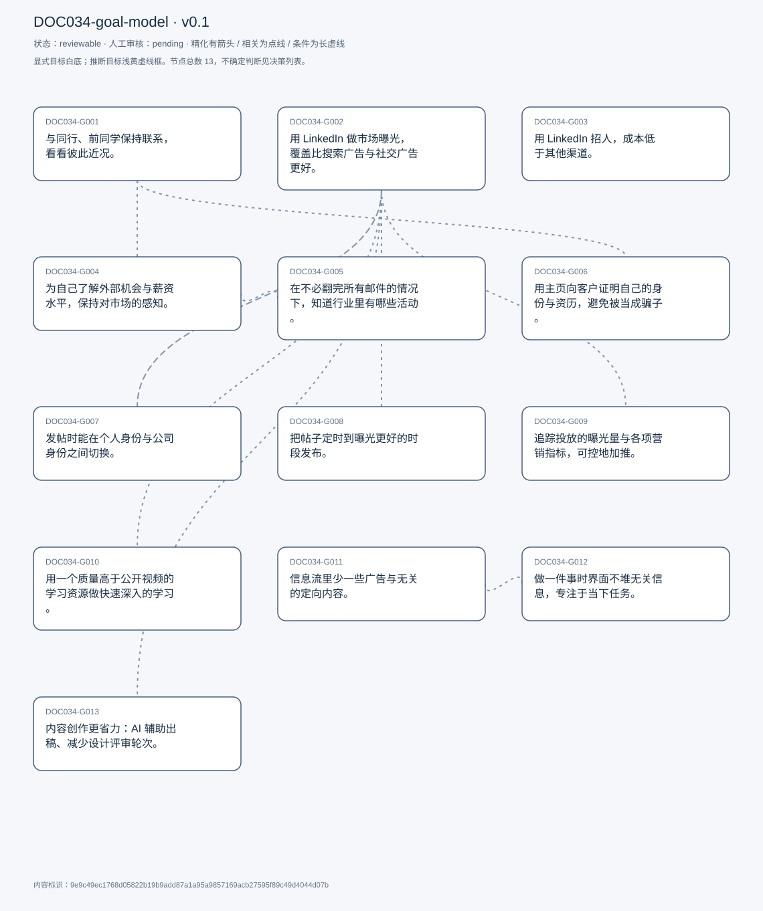
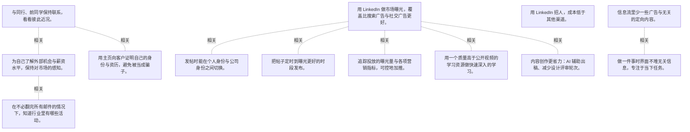

# 目标模型说明

模型：DOC034-goal-model；版本：v0.1

交付状态：reviewable；结构：passed；人工审核：pending

[交互模型](goal-model.html) · [矢量图](goal-model.svg) · [权威数据](goal-model.json)

## 目标图

## 目标

| 编号 | 表述 | 来源 | 情境 | 证据 |
|---|---|---|---|---|
| DOC034-G001 | 与同行、前同学保持联系，看看彼此近况。 | explicit | 自述这是 LinkedIn 上的主要动作之一 | E0001, E0002 |
| DOC034-G002 | 用 LinkedIn 做市场曝光，覆盖比搜索广告与社交广告更好。 | explicit | 本行业营销的主要渠道之一；发帖工具简单易用 | E0003, E0004, E0005 |
| DOC034-G003 | 用 LinkedIn 招人，成本低于其他渠道。 | explicit | 但也承认某些垂直社区（如 Laravel）招人效果更好 | E0006, E0007 |
| DOC034-G004 | 为自己了解外部机会与薪资水平，保持对市场的感知。 | explicit | 自评「keeps you motivated」 | E0008, E0009 |
| DOC034-G005 | 在不必翻完所有邮件的情况下，知道行业里有哪些活动。 | explicit | 痛点：邮件量像消防水管，无法逐一跟进；用法：有空时上来看看有什么会议/活动 | E0010, E0011 |
| DOC034-G006 | 用主页向客户证明自己的身份与资历，避免被当成骗子。 | explicit | 功能定位：可信度背书，而非职业发展 | E0012, E0013 |
| DOC034-G007 | 发帖时能在个人身份与公司身份之间切换。 | explicit | 他同时运营公司页与个人号 | E0014, E0015 |
| DOC034-G008 | 把帖子定时到曝光更好的时段发布。 | explicit | 做法：傍晚写好、定到次日上午 9 点；理由：晚上发曝光少 | E0016, E0017 |
| DOC034-G009 | 追踪投放的曝光量与各项营销指标，可控地加推。 | explicit | 可付费加推，价格与预计提升事先告知 | E0018, E0019 |
| DOC034-G010 | 用一个质量高于公开视频的学习资源做快速深入的学习。 | explicit | 资源：LinkedIn 收购的 Lynda 课程；对比：质量优于 YouTube | E0020, E0021 |
| DOC034-G011 | 信息流里少一些广告与无关的定向内容。 | explicit | 自评这是最大的一项不满 | E0022, E0023, E0024 |
| DOC034-G012 | 做一件事时界面不堆无关信息，专注于当下任务。 | explicit | 场景：上来只为发一条帖子拿曝光；问题：界面元素过多，形成噪音 | E0025, E0026 |
| DOC034-G013 | 内容创作更省力：AI 辅助出稿、减少设计评审轮次。 | explicit | 痛点：设计资源稀缺、走完整营销流程太慢 | E0027, E0028, E0029 |

## 关系判断（含不确定与无关系）

- DOC034-G001 / DOC034-G002：none。DOC034-G001 的对象是与同行保持联系（T003），DOC034-G002 的对象是营销曝光（T003/T007）；两处分别出自不同话题段，原文未在二者之间建立因果、手段、评价或情境包含关系，本次评估口径内未建立可采用关系。
- DOC034-G001 / DOC034-G003：none。DOC034-G001 的对象是与同行保持联系（T003），DOC034-G003 的对象是低成本招人（T003）；两处分别出自不同话题段，原文未在二者之间建立因果、手段、评价或情境包含关系，本次评估口径内未建立可采用关系。
- DOC034-G001 / DOC034-G004：related。T003 把「连同行」与「看外部机会」并列为两件事，但 T005 又说他的机会多来自现有人脉——人脉是机会的来源之一。但 G004 还包括薪资行情这类公开信息。
- DOC034-G001 / DOC034-G005：none。DOC034-G001 的对象是与同行保持联系（T003），DOC034-G005 的对象是获知行业活动（T003）；两处分别出自不同话题段，原文未在二者之间建立因果、手段、评价或情境包含关系，本次评估口径内未建立可采用关系。
- DOC034-G001 / DOC034-G006：related。T005 说主页让客户确认「发邮件的人确实是这个人」，这是建立新联系前的信任前置。但 G006 面向客户核实，G001 面向同行维系。
- DOC034-G001 / DOC034-G007：none。DOC034-G001 的对象是与同行保持联系（T003），DOC034-G007 的对象是个人/公司身份切换（T009）；两处分别出自不同话题段，原文未在二者之间建立因果、手段、评价或情境包含关系，本次评估口径内未建立可采用关系。
- DOC034-G001 / DOC034-G008：none。DOC034-G001 的对象是与同行保持联系（T003），DOC034-G008 的对象是定时到最佳时段（T009）；两处分别出自不同话题段，原文未在二者之间建立因果、手段、评价或情境包含关系，本次评估口径内未建立可采用关系。
- DOC034-G001 / DOC034-G009：none。DOC034-G001 的对象是与同行保持联系（T003），DOC034-G009 的对象是追踪曝光与营销指标（T007）；两处分别出自不同话题段，原文未在二者之间建立因果、手段、评价或情境包含关系，本次评估口径内未建立可采用关系。
- DOC034-G001 / DOC034-G010：none。DOC034-G001 的对象是与同行保持联系（T003），DOC034-G010 的对象是高质量在线学习（T007）；两处分别出自不同话题段，原文未在二者之间建立因果、手段、评价或情境包含关系，本次评估口径内未建立可采用关系。
- DOC034-G001 / DOC034-G011：none。DOC034-G001 的对象是与同行保持联系（T003），DOC034-G011 的对象是信息流少广告噪音（T017）；两处分别出自不同话题段，原文未在二者之间建立因果、手段、评价或情境包含关系，本次评估口径内未建立可采用关系。
- DOC034-G001 / DOC034-G012：none。DOC034-G001 的对象是与同行保持联系（T003），DOC034-G012 的对象是界面聚焦当前任务（T017）；两处分别出自不同话题段，原文未在二者之间建立因果、手段、评价或情境包含关系，本次评估口径内未建立可采用关系。
- DOC034-G001 / DOC034-G013：none。DOC034-G001 的对象是与同行保持联系（T003），DOC034-G013 的对象是内容创作自动化（T021）；两处分别出自不同话题段，原文未在二者之间建立因果、手段、评价或情境包含关系，本次评估口径内未建立可采用关系。
- DOC034-G002 / DOC034-G003：none。DOC034-G002 的对象是营销曝光（T003/T007），DOC034-G003 的对象是低成本招人（T003）；两处分别出自不同话题段，原文未在二者之间建立因果、手段、评价或情境包含关系，本次评估口径内未建立可采用关系。
- DOC034-G002 / DOC034-G004：none。DOC034-G002 的对象是营销曝光（T003/T007），DOC034-G004 的对象是了解外部机会与薪资（T003）；两处分别出自不同话题段，原文未在二者之间建立因果、手段、评价或情境包含关系，本次评估口径内未建立可采用关系。
- DOC034-G002 / DOC034-G005：none。DOC034-G002 的对象是营销曝光（T003/T007），DOC034-G005 的对象是获知行业活动（T003）；两处分别出自不同话题段，原文未在二者之间建立因果、手段、评价或情境包含关系，本次评估口径内未建立可采用关系。
- DOC034-G002 / DOC034-G006：none。DOC034-G002 的对象是营销曝光（T003/T007），DOC034-G006 的对象是主页可信度背书（T005）；两处分别出自不同话题段，原文未在二者之间建立因果、手段、评价或情境包含关系，本次评估口径内未建立可采用关系。
- DOC034-G002 / DOC034-G007：related。T009 的发帖流程第一步就是选身份：个人号还是公司页。G007 是 G002 的执行前提——发错身份等于营销失效。
- DOC034-G002 / DOC034-G008：related。T009 说傍晚发曝光少，所以定到次日上午 9 点。定时是营销曝光最大化的手段之一，但只影响时点、不影响内容质量。
- DOC034-G002 / DOC034-G009：related。T007 说发帖后可追踪曝光与各项营销指标，并可按预算加推——指标是营销效果的度量与放大器。但 G009 是评估环节，G002 是投放本身。
- DOC034-G002 / DOC034-G010：related。T007 举的学习例子就是「营销上怎么做得更好」，说明学习资源服务于营销能力。但 G010 也可用于技术栈等与营销无关的主题。
- DOC034-G002 / DOC034-G011：none。DOC034-G002 的对象是营销曝光（T003/T007），DOC034-G011 的对象是信息流少广告噪音（T017）；两处分别出自不同话题段，原文未在二者之间建立因果、手段、评价或情境包含关系，本次评估口径内未建立可采用关系。
- DOC034-G002 / DOC034-G012：none。DOC034-G002 的对象是营销曝光（T003/T007），DOC034-G012 的对象是界面聚焦当前任务（T017）；两处分别出自不同话题段，原文未在二者之间建立因果、手段、评价或情境包含关系，本次评估口径内未建立可采用关系。
- DOC034-G002 / DOC034-G013：related。T021–T023 把「内容创作自动化」直接连到营销产出：设计资源稀缺、评审轮次多，限制了发帖速度与质量。但 G013 是产能问题，G002 是渠道效果。
- DOC034-G003 / DOC034-G004：none。DOC034-G003 的对象是低成本招人（T003），DOC034-G004 的对象是了解外部机会与薪资（T003）；两处分别出自不同话题段，原文未在二者之间建立因果、手段、评价或情境包含关系，本次评估口径内未建立可采用关系。
- DOC034-G003 / DOC034-G005：none。DOC034-G003 的对象是低成本招人（T003），DOC034-G005 的对象是获知行业活动（T003）；两处分别出自不同话题段，原文未在二者之间建立因果、手段、评价或情境包含关系，本次评估口径内未建立可采用关系。
- DOC034-G003 / DOC034-G006：none。DOC034-G003 的对象是低成本招人（T003），DOC034-G006 的对象是主页可信度背书（T005）；两处分别出自不同话题段，原文未在二者之间建立因果、手段、评价或情境包含关系，本次评估口径内未建立可采用关系。
- DOC034-G003 / DOC034-G007：none。DOC034-G003 的对象是低成本招人（T003），DOC034-G007 的对象是个人/公司身份切换（T009）；两处分别出自不同话题段，原文未在二者之间建立因果、手段、评价或情境包含关系，本次评估口径内未建立可采用关系。
- DOC034-G003 / DOC034-G008：none。DOC034-G003 的对象是低成本招人（T003），DOC034-G008 的对象是定时到最佳时段（T009）；两处分别出自不同话题段，原文未在二者之间建立因果、手段、评价或情境包含关系，本次评估口径内未建立可采用关系。
- DOC034-G003 / DOC034-G009：none。DOC034-G003 的对象是低成本招人（T003），DOC034-G009 的对象是追踪曝光与营销指标（T007）；两处分别出自不同话题段，原文未在二者之间建立因果、手段、评价或情境包含关系，本次评估口径内未建立可采用关系。
- DOC034-G003 / DOC034-G010：none。DOC034-G003 的对象是低成本招人（T003），DOC034-G010 的对象是高质量在线学习（T007）；两处分别出自不同话题段，原文未在二者之间建立因果、手段、评价或情境包含关系，本次评估口径内未建立可采用关系。
- DOC034-G003 / DOC034-G011：none。DOC034-G003 的对象是低成本招人（T003），DOC034-G011 的对象是信息流少广告噪音（T017）；两处分别出自不同话题段，原文未在二者之间建立因果、手段、评价或情境包含关系，本次评估口径内未建立可采用关系。
- DOC034-G003 / DOC034-G012：none。DOC034-G003 的对象是低成本招人（T003），DOC034-G012 的对象是界面聚焦当前任务（T017）；两处分别出自不同话题段，原文未在二者之间建立因果、手段、评价或情境包含关系，本次评估口径内未建立可采用关系。
- DOC034-G003 / DOC034-G013：none。DOC034-G003 的对象是低成本招人（T003），DOC034-G013 的对象是内容创作自动化（T021）；两处分别出自不同话题段，原文未在二者之间建立因果、手段、评价或情境包含关系，本次评估口径内未建立可采用关系。
- DOC034-G004 / DOC034-G005：related。T003 把「看机会」与「看活动」并列为「保持对行业感知」的两个动作，动机相同（不想错过外部信息）。但一个面向职位、一个面向线下活动。
- DOC034-G004 / DOC034-G006：none。DOC034-G004 的对象是了解外部机会与薪资（T003），DOC034-G006 的对象是主页可信度背书（T005）；两处分别出自不同话题段，原文未在二者之间建立因果、手段、评价或情境包含关系，本次评估口径内未建立可采用关系。
- DOC034-G004 / DOC034-G007：none。DOC034-G004 的对象是了解外部机会与薪资（T003），DOC034-G007 的对象是个人/公司身份切换（T009）；两处分别出自不同话题段，原文未在二者之间建立因果、手段、评价或情境包含关系，本次评估口径内未建立可采用关系。
- DOC034-G004 / DOC034-G008：none。DOC034-G004 的对象是了解外部机会与薪资（T003），DOC034-G008 的对象是定时到最佳时段（T009）；两处分别出自不同话题段，原文未在二者之间建立因果、手段、评价或情境包含关系，本次评估口径内未建立可采用关系。
- DOC034-G004 / DOC034-G009：none。DOC034-G004 的对象是了解外部机会与薪资（T003），DOC034-G009 的对象是追踪曝光与营销指标（T007）；两处分别出自不同话题段，原文未在二者之间建立因果、手段、评价或情境包含关系，本次评估口径内未建立可采用关系。
- DOC034-G004 / DOC034-G010：none。DOC034-G004 的对象是了解外部机会与薪资（T003），DOC034-G010 的对象是高质量在线学习（T007）；两处分别出自不同话题段，原文未在二者之间建立因果、手段、评价或情境包含关系，本次评估口径内未建立可采用关系。
- DOC034-G004 / DOC034-G011：none。DOC034-G004 的对象是了解外部机会与薪资（T003），DOC034-G011 的对象是信息流少广告噪音（T017）；两处分别出自不同话题段，原文未在二者之间建立因果、手段、评价或情境包含关系，本次评估口径内未建立可采用关系。
- DOC034-G004 / DOC034-G012：none。DOC034-G004 的对象是了解外部机会与薪资（T003），DOC034-G012 的对象是界面聚焦当前任务（T017）；两处分别出自不同话题段，原文未在二者之间建立因果、手段、评价或情境包含关系，本次评估口径内未建立可采用关系。
- DOC034-G004 / DOC034-G013：none。DOC034-G004 的对象是了解外部机会与薪资（T003），DOC034-G013 的对象是内容创作自动化（T021）；两处分别出自不同话题段，原文未在二者之间建立因果、手段、评价或情境包含关系，本次评估口径内未建立可采用关系。
- DOC034-G005 / DOC034-G006：none。DOC034-G005 的对象是获知行业活动（T003），DOC034-G006 的对象是主页可信度背书（T005）；两处分别出自不同话题段，原文未在二者之间建立因果、手段、评价或情境包含关系，本次评估口径内未建立可采用关系。
- DOC034-G005 / DOC034-G007：none。DOC034-G005 的对象是获知行业活动（T003），DOC034-G007 的对象是个人/公司身份切换（T009）；两处分别出自不同话题段，原文未在二者之间建立因果、手段、评价或情境包含关系，本次评估口径内未建立可采用关系。
- DOC034-G005 / DOC034-G008：none。DOC034-G005 的对象是获知行业活动（T003），DOC034-G008 的对象是定时到最佳时段（T009）；两处分别出自不同话题段，原文未在二者之间建立因果、手段、评价或情境包含关系，本次评估口径内未建立可采用关系。
- DOC034-G005 / DOC034-G009：none。DOC034-G005 的对象是获知行业活动（T003），DOC034-G009 的对象是追踪曝光与营销指标（T007）；两处分别出自不同话题段，原文未在二者之间建立因果、手段、评价或情境包含关系，本次评估口径内未建立可采用关系。
- DOC034-G005 / DOC034-G010：none。DOC034-G005 的对象是获知行业活动（T003），DOC034-G010 的对象是高质量在线学习（T007）；两处分别出自不同话题段，原文未在二者之间建立因果、手段、评价或情境包含关系，本次评估口径内未建立可采用关系。
- DOC034-G005 / DOC034-G011：none。DOC034-G005 的对象是获知行业活动（T003），DOC034-G011 的对象是信息流少广告噪音（T017）；两处分别出自不同话题段，原文未在二者之间建立因果、手段、评价或情境包含关系，本次评估口径内未建立可采用关系。
- DOC034-G005 / DOC034-G012：none。DOC034-G005 的对象是获知行业活动（T003），DOC034-G012 的对象是界面聚焦当前任务（T017）；两处分别出自不同话题段，原文未在二者之间建立因果、手段、评价或情境包含关系，本次评估口径内未建立可采用关系。
- DOC034-G005 / DOC034-G013：none。DOC034-G005 的对象是获知行业活动（T003），DOC034-G013 的对象是内容创作自动化（T021）；两处分别出自不同话题段，原文未在二者之间建立因果、手段、评价或情境包含关系，本次评估口径内未建立可采用关系。
- DOC034-G006 / DOC034-G007：none。DOC034-G006 的对象是主页可信度背书（T005），DOC034-G007 的对象是个人/公司身份切换（T009）；两处分别出自不同话题段，原文未在二者之间建立因果、手段、评价或情境包含关系，本次评估口径内未建立可采用关系。
- DOC034-G006 / DOC034-G008：none。DOC034-G006 的对象是主页可信度背书（T005），DOC034-G008 的对象是定时到最佳时段（T009）；两处分别出自不同话题段，原文未在二者之间建立因果、手段、评价或情境包含关系，本次评估口径内未建立可采用关系。
- DOC034-G006 / DOC034-G009：none。DOC034-G006 的对象是主页可信度背书（T005），DOC034-G009 的对象是追踪曝光与营销指标（T007）；两处分别出自不同话题段，原文未在二者之间建立因果、手段、评价或情境包含关系，本次评估口径内未建立可采用关系。
- DOC034-G006 / DOC034-G010：none。DOC034-G006 的对象是主页可信度背书（T005），DOC034-G010 的对象是高质量在线学习（T007）；两处分别出自不同话题段，原文未在二者之间建立因果、手段、评价或情境包含关系，本次评估口径内未建立可采用关系。
- DOC034-G006 / DOC034-G011：none。DOC034-G006 的对象是主页可信度背书（T005），DOC034-G011 的对象是信息流少广告噪音（T017）；两处分别出自不同话题段，原文未在二者之间建立因果、手段、评价或情境包含关系，本次评估口径内未建立可采用关系。
- DOC034-G006 / DOC034-G012：none。DOC034-G006 的对象是主页可信度背书（T005），DOC034-G012 的对象是界面聚焦当前任务（T017）；两处分别出自不同话题段，原文未在二者之间建立因果、手段、评价或情境包含关系，本次评估口径内未建立可采用关系。
- DOC034-G006 / DOC034-G013：none。DOC034-G006 的对象是主页可信度背书（T005），DOC034-G013 的对象是内容创作自动化（T021）；两处分别出自不同话题段，原文未在二者之间建立因果、手段、评价或情境包含关系，本次评估口径内未建立可采用关系。
- DOC034-G007 / DOC034-G008：none。DOC034-G007 的对象是个人/公司身份切换（T009），DOC034-G008 的对象是定时到最佳时段（T009）；两处分别出自不同话题段，原文未在二者之间建立因果、手段、评价或情境包含关系，本次评估口径内未建立可采用关系。
- DOC034-G007 / DOC034-G009：none。DOC034-G007 的对象是个人/公司身份切换（T009），DOC034-G009 的对象是追踪曝光与营销指标（T007）；两处分别出自不同话题段，原文未在二者之间建立因果、手段、评价或情境包含关系，本次评估口径内未建立可采用关系。
- DOC034-G007 / DOC034-G010：none。DOC034-G007 的对象是个人/公司身份切换（T009），DOC034-G010 的对象是高质量在线学习（T007）；两处分别出自不同话题段，原文未在二者之间建立因果、手段、评价或情境包含关系，本次评估口径内未建立可采用关系。
- DOC034-G007 / DOC034-G011：none。DOC034-G007 的对象是个人/公司身份切换（T009），DOC034-G011 的对象是信息流少广告噪音（T017）；两处分别出自不同话题段，原文未在二者之间建立因果、手段、评价或情境包含关系，本次评估口径内未建立可采用关系。
- DOC034-G007 / DOC034-G012：none。DOC034-G007 的对象是个人/公司身份切换（T009），DOC034-G012 的对象是界面聚焦当前任务（T017）；两处分别出自不同话题段，原文未在二者之间建立因果、手段、评价或情境包含关系，本次评估口径内未建立可采用关系。
- DOC034-G007 / DOC034-G013：none。DOC034-G007 的对象是个人/公司身份切换（T009），DOC034-G013 的对象是内容创作自动化（T021）；两处分别出自不同话题段，原文未在二者之间建立因果、手段、评价或情境包含关系，本次评估口径内未建立可采用关系。
- DOC034-G008 / DOC034-G009：none。DOC034-G008 的对象是定时到最佳时段（T009），DOC034-G009 的对象是追踪曝光与营销指标（T007）；两处分别出自不同话题段，原文未在二者之间建立因果、手段、评价或情境包含关系，本次评估口径内未建立可采用关系。
- DOC034-G008 / DOC034-G010：none。DOC034-G008 的对象是定时到最佳时段（T009），DOC034-G010 的对象是高质量在线学习（T007）；两处分别出自不同话题段，原文未在二者之间建立因果、手段、评价或情境包含关系，本次评估口径内未建立可采用关系。
- DOC034-G008 / DOC034-G011：none。DOC034-G008 的对象是定时到最佳时段（T009），DOC034-G011 的对象是信息流少广告噪音（T017）；两处分别出自不同话题段，原文未在二者之间建立因果、手段、评价或情境包含关系，本次评估口径内未建立可采用关系。
- DOC034-G008 / DOC034-G012：none。DOC034-G008 的对象是定时到最佳时段（T009），DOC034-G012 的对象是界面聚焦当前任务（T017）；两处分别出自不同话题段，原文未在二者之间建立因果、手段、评价或情境包含关系，本次评估口径内未建立可采用关系。
- DOC034-G008 / DOC034-G013：none。DOC034-G008 的对象是定时到最佳时段（T009），DOC034-G013 的对象是内容创作自动化（T021）；两处分别出自不同话题段，原文未在二者之间建立因果、手段、评价或情境包含关系，本次评估口径内未建立可采用关系。
- DOC034-G009 / DOC034-G010：none。DOC034-G009 的对象是追踪曝光与营销指标（T007），DOC034-G010 的对象是高质量在线学习（T007）；两处分别出自不同话题段，原文未在二者之间建立因果、手段、评价或情境包含关系，本次评估口径内未建立可采用关系。
- DOC034-G009 / DOC034-G011：none。DOC034-G009 的对象是追踪曝光与营销指标（T007），DOC034-G011 的对象是信息流少广告噪音（T017）；两处分别出自不同话题段，原文未在二者之间建立因果、手段、评价或情境包含关系，本次评估口径内未建立可采用关系。
- DOC034-G009 / DOC034-G012：none。DOC034-G009 的对象是追踪曝光与营销指标（T007），DOC034-G012 的对象是界面聚焦当前任务（T017）；两处分别出自不同话题段，原文未在二者之间建立因果、手段、评价或情境包含关系，本次评估口径内未建立可采用关系。
- DOC034-G009 / DOC034-G013：none。DOC034-G009 的对象是追踪曝光与营销指标（T007），DOC034-G013 的对象是内容创作自动化（T021）；两处分别出自不同话题段，原文未在二者之间建立因果、手段、评价或情境包含关系，本次评估口径内未建立可采用关系。
- DOC034-G010 / DOC034-G011：none。DOC034-G010 的对象是高质量在线学习（T007），DOC034-G011 的对象是信息流少广告噪音（T017）；两处分别出自不同话题段，原文未在二者之间建立因果、手段、评价或情境包含关系，本次评估口径内未建立可采用关系。
- DOC034-G010 / DOC034-G012：none。DOC034-G010 的对象是高质量在线学习（T007），DOC034-G012 的对象是界面聚焦当前任务（T017）；两处分别出自不同话题段，原文未在二者之间建立因果、手段、评价或情境包含关系，本次评估口径内未建立可采用关系。
- DOC034-G010 / DOC034-G013：none。DOC034-G010 的对象是高质量在线学习（T007），DOC034-G013 的对象是内容创作自动化（T021）；两处分别出自不同话题段，原文未在二者之间建立因果、手段、评价或情境包含关系，本次评估口径内未建立可采用关系。
- DOC034-G011 / DOC034-G012：related。T017 把两者作为同一段不满的两层：广告与定向内容塞满信息流（内容层），界面元素过多（结构层）。但前者靠投放策略解决、后者靠 UI 改版。
- DOC034-G011 / DOC034-G013：none。DOC034-G011 的对象是信息流少广告噪音（T017），DOC034-G013 的对象是内容创作自动化（T021）；两处分别出自不同话题段，原文未在二者之间建立因果、手段、评价或情境包含关系，本次评估口径内未建立可采用关系。
- DOC034-G012 / DOC034-G013：none。DOC034-G012 的对象是界面聚焦当前任务（T017），DOC034-G013 的对象是内容创作自动化（T021）；两处分别出自不同话题段，原文未在二者之间建立因果、手段、评价或情境包含关系，本次评估口径内未建立可采用关系。

## 证据

### E0001 · DOC034:S004

> networking just connecting with other colleagues, or maybe kind of past classmates

原件位置：{&quot;line_start&quot;: 4, &quot;line_end&quot;: 4, &quot;start_char&quot;: 1026, &quot;end_char&quot;: 2459}

### E0002 · DOC034:S004

> see what they&#x27;re up to

原件位置：{&quot;line_start&quot;: 4, &quot;line_end&quot;: 4, &quot;start_char&quot;: 1026, &quot;end_char&quot;: 2459}

### E0003 · DOC034:S004

> We do a lot of marketing especially in my field

原件位置：{&quot;line_start&quot;: 4, &quot;line_end&quot;: 4, &quot;start_char&quot;: 1026, &quot;end_char&quot;: 2459}

### E0004 · DOC034:S004

> marketing the exposure, there is far better than we might get

原件位置：{&quot;line_start&quot;: 4, &quot;line_end&quot;: 4, &quot;start_char&quot;: 1026, &quot;end_char&quot;: 2459}

### E0005 · DOC034:S008

> the tools that they have to like post you know, marketing things are are very, very easy and user friendly

原件位置：{&quot;line_start&quot;: 8, &quot;line_end&quot;: 8, &quot;start_char&quot;: 3866, &quot;end_char&quot;: 5444}

### E0006 · DOC034:S004

> We do a lot of recruiting as well through Linkedin

原件位置：{&quot;line_start&quot;: 4, &quot;line_end&quot;: 4, &quot;start_char&quot;: 1026, &quot;end_char&quot;: 2459}

### E0007 · DOC034:S004

> it&#x27;s fairly low cost compared to some of the other competitors

原件位置：{&quot;line_start&quot;: 4, &quot;line_end&quot;: 4, &quot;start_char&quot;: 1026, &quot;end_char&quot;: 2459}

### E0008 · DOC034:S004

> looking for jobs for myself

原件位置：{&quot;line_start&quot;: 4, &quot;line_end&quot;: 4, &quot;start_char&quot;: 1026, &quot;end_char&quot;: 2459}

### E0009 · DOC034:S004

> see what some of the salary ranges and things like that

原件位置：{&quot;line_start&quot;: 4, &quot;line_end&quot;: 4, &quot;start_char&quot;: 1026, &quot;end_char&quot;: 2459}

### E0010 · DOC034:S004

> A lot of organizations will post, you know. Hey, we have an upcoming conference

原件位置：{&quot;line_start&quot;: 4, &quot;line_end&quot;: 4, &quot;start_char&quot;: 1026, &quot;end_char&quot;: 2459}

### E0011 · DOC034:S004

> I drink from the fire hose of emails

原件位置：{&quot;line_start&quot;: 4, &quot;line_end&quot;: 4, &quot;start_char&quot;: 1026, &quot;end_char&quot;: 2459}

### E0012 · DOC034:S006

> it just lends a little bit of a you know. a bit of credibility

原件位置：{&quot;line_start&quot;: 6, &quot;line_end&quot;: 6, &quot;start_char&quot;: 2705, &quot;end_char&quot;: 3703}

### E0013 · DOC034:S006

> another resource for people to check in and just make sure. Okay, I&#x27;m not like a Scammer

原件位置：{&quot;line_start&quot;: 6, &quot;line_end&quot;: 6, &quot;start_char&quot;: 2705, &quot;end_char&quot;: 3703}

### E0014 · DOC034:S010

> I can toggle between one or both

原件位置：{&quot;line_start&quot;: 10, &quot;line_end&quot;: 10, &quot;start_char&quot;: 5606, &quot;end_char&quot;: 7239}

### E0015 · DOC034:S010

> I operate the Linkedin for my company, as well as for kind of my special profile

原件位置：{&quot;line_start&quot;: 10, &quot;line_end&quot;: 10, &quot;start_char&quot;: 5606, &quot;end_char&quot;: 7239}

### E0016 · DOC034:S010

> I can schedule it for later

原件位置：{&quot;line_start&quot;: 10, &quot;line_end&quot;: 10, &quot;start_char&quot;: 5606, &quot;end_char&quot;: 7239}

### E0017 · DOC034:S010

> It&#x27;s just not going to get as many impressions

原件位置：{&quot;line_start&quot;: 10, &quot;line_end&quot;: 10, &quot;start_char&quot;: 5606, &quot;end_char&quot;: 7239}

### E0018 · DOC034:S008

> you can kind of keep track of all your impressions and all of your different marketing metrics

原件位置：{&quot;line_start&quot;: 8, &quot;line_end&quot;: 8, &quot;start_char&quot;: 3866, &quot;end_char&quot;: 5444}

### E0019 · DOC034:S008

> here&#x27;s how much it&#x27;s gonna get boosted

原件位置：{&quot;line_start&quot;: 8, &quot;line_end&quot;: 8, &quot;start_char&quot;: 3866, &quot;end_char&quot;: 5444}

### E0020 · DOC034:S008

> when they purchased Linda, which was their kind of e-learning platform

原件位置：{&quot;line_start&quot;: 8, &quot;line_end&quot;: 8, &quot;start_char&quot;: 3866, &quot;end_char&quot;: 5444}

### E0021 · DOC034:S008

> in terms of quality it would definitely exceed

原件位置：{&quot;line_start&quot;: 8, &quot;line_end&quot;: 8, &quot;start_char&quot;: 3866, &quot;end_char&quot;: 5444}

### E0022 · DOC034:S018

> the amount of ads and the amount of you know targeted stuff feels a little much

原件位置：{&quot;line_start&quot;: 18, &quot;line_end&quot;: 18, &quot;start_char&quot;: 9415, &quot;end_char&quot;: 10132}

### E0023 · DOC034:S018

> It just kind of clouds your feed

原件位置：{&quot;line_start&quot;: 18, &quot;line_end&quot;: 18, &quot;start_char&quot;: 9415, &quot;end_char&quot;: 10132}

### E0024 · DOC034:S018

> there&#x27;s a lot of irrelevant stuff there

原件位置：{&quot;line_start&quot;: 18, &quot;line_end&quot;: 18, &quot;start_char&quot;: 9415, &quot;end_char&quot;: 10132}

### E0025 · DOC034:S018

> certain parts of the interface. our just too cluttered

原件位置：{&quot;line_start&quot;: 18, &quot;line_end&quot;: 18, &quot;start_char&quot;: 9415, &quot;end_char&quot;: 10132}

### E0026 · DOC034:S018

> I&#x27;m there for a reason. I have a mission

原件位置：{&quot;line_start&quot;: 18, &quot;line_end&quot;: 18, &quot;start_char&quot;: 9415, &quot;end_char&quot;: 10132}

### E0027 · DOC034:S022

> support for content development, and then, you know, would be great to have more of that kind of automated

原件位置：{&quot;line_start&quot;: 22, &quot;line_end&quot;: 22, &quot;start_char&quot;: 11333, &quot;end_char&quot;: 11661}

### E0028 · DOC034:S024

> Design is at a premium, and that just always takes a while

原件位置：{&quot;line_start&quot;: 24, &quot;line_end&quot;: 24, &quot;start_char&quot;: 11687, &quot;end_char&quot;: 11941}

### E0029 · DOC034:S024

> without having to be, you know, reviewed 6 times

原件位置：{&quot;line_start&quot;: 24, &quot;line_end&quot;: 24, &quot;start_char&quot;: 11687, &quot;end_char&quot;: 11941}

## 问题、限制与版本

- 当前会话助手的开发判断，非独立盲测；无人工采纳记录。
- 结构检查已绑定当前版本；独立语义审查未执行；人工状态以实际审核记录为准。

内容标识：9e9c49ec1768d05822b19b9add87a1a95a9857169acb27595f89c49d4044d07b

人工决定：

审核意见：
