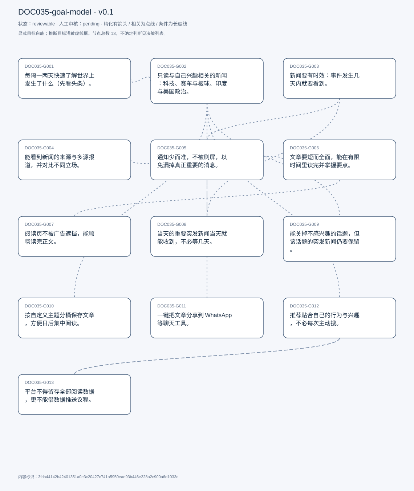
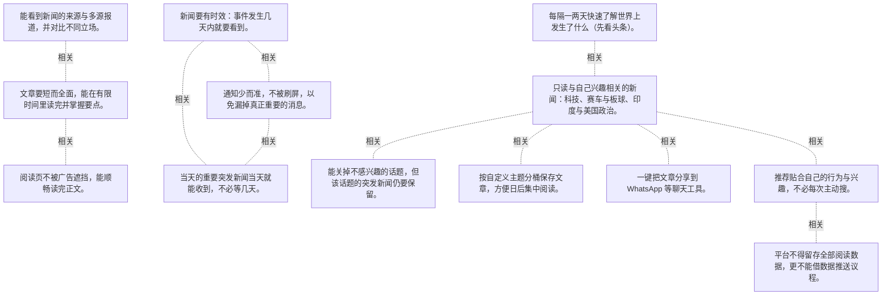

# 目标模型说明

模型：DOC035-goal-model；版本：v0.1

交付状态：reviewable；结构：passed；人工审核：pending

[交互模型](goal-model.html) · [矢量图](goal-model.svg) · [权威数据](goal-model.json)

## 目标图

## 目标

| 编号 | 表述 | 来源 | 情境 | 证据 |
|---|---|---|---|---|
| DOC035-G001 | 每隔一两天快速了解世界上发生了什么（先看头条）。 | explicit | 频率：两天一次；路径：打开 Google News → 看头条 → 往下滚 | E0001, E0002 |
| DOC035-G002 | 只读与自己兴趣相关的新闻：科技、赛车与板球、印度与美国政治。 | explicit | 三类主题：科技公司与 AI 模型、F1/板球、政治 | E0003, E0004, E0005 |
| DOC035-G003 | 新闻要有时效：事件发生几天内就要看到。 | explicit | 反面例子：F1 新闻提前两周看到没有意义；判断依据：「relevant」首先看时间 | E0006, E0007 |
| DOC035-G004 | 能看到新闻的来源与多源报道，并对比不同立场。 | explicit | Google News 会标出来源；他会把同一新闻再搜一遍看不同观点 | E0008, E0009 |
| DOC035-G005 | 通知少而准，不被刷屏，以免漏掉真正重要的消息。 | explicit | 实例：演唱会开票日被大量推送淹没，错过购票 | E0010, E0011, E0012 |
| DOC035-G006 | 文章要短而全面，能在有限时间里读完并掌握要点。 | explicit | 现状：大媒体动辄上千词，读完效率低；期望：small but comprehensive | E0013, E0014 |
| DOC035-G007 | 阅读页不被广告遮挡，能顺畅读完正文。 | explicit | 问题：广告甚至盖住正文 | E0015, E0016 |
| DOC035-G008 | 当天的重要突发新闻当天就能收到，不必等几天。 | explicit | 自评重要性 9/10；底线：当天内送达 | E0017, E0018 |
| DOC035-G009 | 能关掉不感兴趣的话题，但该话题的突发新闻仍要保留。 | explicit | 类比 Instagram 的「减少此类内容」；例外：突发新闻仍要出现，只是不要深度分析 | E0019, E0020 |
| DOC035-G010 | 按自定义主题分桶保存文章，方便日后集中阅读。 | explicit | 参照 Pinterest / Google Images 的 board；现状：只有 archive / bookmark | E0021, E0022 |
| DOC035-G011 | 一键把文章分享到 WhatsApp 等聊天工具。 | explicit | 现状：复制链接或直接调起 WhatsApp | E0023, E0024 |
| DOC035-G012 | 推荐贴合自己的行为与兴趣，不必每次主动搜。 | explicit | Google 搜索页的推荐、App 通知都按行为推送 | E0025, E0026 |
| DOC035-G013 | 平台不得留存全部阅读数据，更不能借数据推送议程。 | explicit | 可接受的边界：仅用于推荐；担忧：媒体立场通过算法渗透 | E0027, E0028 |

## 关系判断（含不确定与无关系）

- DOC035-G001 / DOC035-G002：related。T003 描述的动作就是：先扫头条，再往下滚找「与兴趣相关」的文章。看头条是覆盖面，挑兴趣是筛选，前者给范围、后者给取舍。
- DOC035-G001 / DOC035-G003：none。DOC035-G001 的对象是隔天看头条了解大事（T001/T003），DOC035-G003 的对象是新闻要及时（T009）；两处分别出自不同话题段，原文未在二者之间建立因果、手段、评价或情境包含关系，本次评估口径内未建立可采用关系。
- DOC035-G001 / DOC035-G004：none。DOC035-G001 的对象是隔天看头条了解大事（T001/T003），DOC035-G004 的对象是来源可查多源对比（T011）；两处分别出自不同话题段，原文未在二者之间建立因果、手段、评价或情境包含关系，本次评估口径内未建立可采用关系。
- DOC035-G001 / DOC035-G005：none。DOC035-G001 的对象是隔天看头条了解大事（T001/T003），DOC035-G005 的对象是通知少而准（T013）；两处分别出自不同话题段，原文未在二者之间建立因果、手段、评价或情境包含关系，本次评估口径内未建立可采用关系。
- DOC035-G001 / DOC035-G006：none。DOC035-G001 的对象是隔天看头条了解大事（T001/T003），DOC035-G006 的对象是文章短而全面（T013/T017）；两处分别出自不同话题段，原文未在二者之间建立因果、手段、评价或情境包含关系，本次评估口径内未建立可采用关系。
- DOC035-G001 / DOC035-G007：none。DOC035-G001 的对象是隔天看头条了解大事（T001/T003），DOC035-G007 的对象是阅读页无广告遮挡（T017）；两处分别出自不同话题段，原文未在二者之间建立因果、手段、评价或情境包含关系，本次评估口径内未建立可采用关系。
- DOC035-G001 / DOC035-G008：none。DOC035-G001 的对象是隔天看头条了解大事（T001/T003），DOC035-G008 的对象是突发当天必达（T037）；两处分别出自不同话题段，原文未在二者之间建立因果、手段、评价或情境包含关系，本次评估口径内未建立可采用关系。
- DOC035-G001 / DOC035-G009：none。DOC035-G001 的对象是隔天看头条了解大事（T001/T003），DOC035-G009 的对象是可关话题但保留突发（T041）；两处分别出自不同话题段，原文未在二者之间建立因果、手段、评价或情境包含关系，本次评估口径内未建立可采用关系。
- DOC035-G001 / DOC035-G010：none。DOC035-G001 的对象是隔天看头条了解大事（T001/T003），DOC035-G010 的对象是主题分桶收藏（T027）；两处分别出自不同话题段，原文未在二者之间建立因果、手段、评价或情境包含关系，本次评估口径内未建立可采用关系。
- DOC035-G001 / DOC035-G011：none。DOC035-G001 的对象是隔天看头条了解大事（T001/T003），DOC035-G011 的对象是一键分享到 WhatsApp（T025）；两处分别出自不同话题段，原文未在二者之间建立因果、手段、评价或情境包含关系，本次评估口径内未建立可采用关系。
- DOC035-G001 / DOC035-G012：none。DOC035-G001 的对象是隔天看头条了解大事（T001/T003），DOC035-G012 的对象是推荐贴合行为兴趣（T021/T039）；两处分别出自不同话题段，原文未在二者之间建立因果、手段、评价或情境包含关系，本次评估口径内未建立可采用关系。
- DOC035-G001 / DOC035-G013：none。DOC035-G001 的对象是隔天看头条了解大事（T001/T003），DOC035-G013 的对象是数据不被留存与议程化（T029/T047）；两处分别出自不同话题段，原文未在二者之间建立因果、手段、评价或情境包含关系，本次评估口径内未建立可采用关系。
- DOC035-G002 / DOC035-G003：none。DOC035-G002 的对象是只读兴趣相关内容（T005/T007），DOC035-G003 的对象是新闻要及时（T009）；两处分别出自不同话题段，原文未在二者之间建立因果、手段、评价或情境包含关系，本次评估口径内未建立可采用关系。
- DOC035-G002 / DOC035-G004：none。DOC035-G002 的对象是只读兴趣相关内容（T005/T007），DOC035-G004 的对象是来源可查多源对比（T011）；两处分别出自不同话题段，原文未在二者之间建立因果、手段、评价或情境包含关系，本次评估口径内未建立可采用关系。
- DOC035-G002 / DOC035-G005：none。DOC035-G002 的对象是只读兴趣相关内容（T005/T007），DOC035-G005 的对象是通知少而准（T013）；两处分别出自不同话题段，原文未在二者之间建立因果、手段、评价或情境包含关系，本次评估口径内未建立可采用关系。
- DOC035-G002 / DOC035-G006：none。DOC035-G002 的对象是只读兴趣相关内容（T005/T007），DOC035-G006 的对象是文章短而全面（T013/T017）；两处分别出自不同话题段，原文未在二者之间建立因果、手段、评价或情境包含关系，本次评估口径内未建立可采用关系。
- DOC035-G002 / DOC035-G007：none。DOC035-G002 的对象是只读兴趣相关内容（T005/T007），DOC035-G007 的对象是阅读页无广告遮挡（T017）；两处分别出自不同话题段，原文未在二者之间建立因果、手段、评价或情境包含关系，本次评估口径内未建立可采用关系。
- DOC035-G002 / DOC035-G008：none。DOC035-G002 的对象是只读兴趣相关内容（T005/T007），DOC035-G008 的对象是突发当天必达（T037）；两处分别出自不同话题段，原文未在二者之间建立因果、手段、评价或情境包含关系，本次评估口径内未建立可采用关系。
- DOC035-G002 / DOC035-G009：related。T041 想在推荐里关掉某些话题，正是对「只看兴趣」的负向操作：既可以加，也可以减。但 G009 附带一条硬约束——突发新闻不受此限。
- DOC035-G002 / DOC035-G010：related。T027 的分桶按主题建（正是他关心的科技/体育/政治），收藏动作以兴趣为前提。但 G010 是事后整理，G002 是当下筛选。
- DOC035-G002 / DOC035-G011：related。T025 说「如果我感兴趣的文章想分享」，分享对象由兴趣筛选决定。但 G011 是社交行为，G002 是筛选标准。
- DOC035-G002 / DOC035-G012：related。T039 说最满意的功能就是「它跟踪我的行为」，把兴趣变成推荐——G012 是 G002 的自动化实现。但 G002 也包括他主动扫首页找内容。
- DOC035-G002 / DOC035-G013：none。DOC035-G002 的对象是只读兴趣相关内容（T005/T007），DOC035-G013 的对象是数据不被留存与议程化（T029/T047）；两处分别出自不同话题段，原文未在二者之间建立因果、手段、评价或情境包含关系，本次评估口径内未建立可采用关系。
- DOC035-G003 / DOC035-G004：none。DOC035-G003 的对象是新闻要及时（T009），DOC035-G004 的对象是来源可查多源对比（T011）；两处分别出自不同话题段，原文未在二者之间建立因果、手段、评价或情境包含关系，本次评估口径内未建立可采用关系。
- DOC035-G003 / DOC035-G005：related。T013 把「通知刷屏」与「漏掉重要新闻」放进同一句因果：通知是时效的兑现渠道，通道太吵反而失效。但 G005 管信噪比，G003 管到达时间。
- DOC035-G003 / DOC035-G006：none。DOC035-G003 的对象是新闻要及时（T009），DOC035-G006 的对象是文章短而全面（T013/T017）；两处分别出自不同话题段，原文未在二者之间建立因果、手段、评价或情境包含关系，本次评估口径内未建立可采用关系。
- DOC035-G003 / DOC035-G007：none。DOC035-G003 的对象是新闻要及时（T009），DOC035-G007 的对象是阅读页无广告遮挡（T017）；两处分别出自不同话题段，原文未在二者之间建立因果、手段、评价或情境包含关系，本次评估口径内未建立可采用关系。
- DOC035-G003 / DOC035-G008：related。T009 说常规新闻要几天内看到，T037 说突发必须当天到位——同一条时效要求的两档强度。但 G008 的紧迫度明显更高（自评 9/10）。
- DOC035-G003 / DOC035-G009：none。DOC035-G003 的对象是新闻要及时（T009），DOC035-G009 的对象是可关话题但保留突发（T041）；两处分别出自不同话题段，原文未在二者之间建立因果、手段、评价或情境包含关系，本次评估口径内未建立可采用关系。
- DOC035-G003 / DOC035-G010：none。DOC035-G003 的对象是新闻要及时（T009），DOC035-G010 的对象是主题分桶收藏（T027）；两处分别出自不同话题段，原文未在二者之间建立因果、手段、评价或情境包含关系，本次评估口径内未建立可采用关系。
- DOC035-G003 / DOC035-G011：none。DOC035-G003 的对象是新闻要及时（T009），DOC035-G011 的对象是一键分享到 WhatsApp（T025）；两处分别出自不同话题段，原文未在二者之间建立因果、手段、评价或情境包含关系，本次评估口径内未建立可采用关系。
- DOC035-G003 / DOC035-G012：none。DOC035-G003 的对象是新闻要及时（T009），DOC035-G012 的对象是推荐贴合行为兴趣（T021/T039）；两处分别出自不同话题段，原文未在二者之间建立因果、手段、评价或情境包含关系，本次评估口径内未建立可采用关系。
- DOC035-G003 / DOC035-G013：none。DOC035-G003 的对象是新闻要及时（T009），DOC035-G013 的对象是数据不被留存与议程化（T029/T047）；两处分别出自不同话题段，原文未在二者之间建立因果、手段、评价或情境包含关系，本次评估口径内未建立可采用关系。
- DOC035-G004 / DOC035-G005：none。DOC035-G004 的对象是来源可查多源对比（T011），DOC035-G005 的对象是通知少而准（T013）；两处分别出自不同话题段，原文未在二者之间建立因果、手段、评价或情境包含关系，本次评估口径内未建立可采用关系。
- DOC035-G004 / DOC035-G006：related。T031 说比较不同媒体时看三件事：文章长度、发布时效、立场。G006 正是其中一条比较维度，同时也是阅读负担的约束。
- DOC035-G004 / DOC035-G007：none。DOC035-G004 的对象是来源可查多源对比（T011），DOC035-G007 的对象是阅读页无广告遮挡（T017）；两处分别出自不同话题段，原文未在二者之间建立因果、手段、评价或情境包含关系，本次评估口径内未建立可采用关系。
- DOC035-G004 / DOC035-G008：none。DOC035-G004 的对象是来源可查多源对比（T011），DOC035-G008 的对象是突发当天必达（T037）；两处分别出自不同话题段，原文未在二者之间建立因果、手段、评价或情境包含关系，本次评估口径内未建立可采用关系。
- DOC035-G004 / DOC035-G009：none。DOC035-G004 的对象是来源可查多源对比（T011），DOC035-G009 的对象是可关话题但保留突发（T041）；两处分别出自不同话题段，原文未在二者之间建立因果、手段、评价或情境包含关系，本次评估口径内未建立可采用关系。
- DOC035-G004 / DOC035-G010：none。DOC035-G004 的对象是来源可查多源对比（T011），DOC035-G010 的对象是主题分桶收藏（T027）；两处分别出自不同话题段，原文未在二者之间建立因果、手段、评价或情境包含关系，本次评估口径内未建立可采用关系。
- DOC035-G004 / DOC035-G011：none。DOC035-G004 的对象是来源可查多源对比（T011），DOC035-G011 的对象是一键分享到 WhatsApp（T025）；两处分别出自不同话题段，原文未在二者之间建立因果、手段、评价或情境包含关系，本次评估口径内未建立可采用关系。
- DOC035-G004 / DOC035-G012：none。DOC035-G004 的对象是来源可查多源对比（T011），DOC035-G012 的对象是推荐贴合行为兴趣（T021/T039）；两处分别出自不同话题段，原文未在二者之间建立因果、手段、评价或情境包含关系，本次评估口径内未建立可采用关系。
- DOC035-G004 / DOC035-G013：none。DOC035-G004 的对象是来源可查多源对比（T011），DOC035-G013 的对象是数据不被留存与议程化（T029/T047）；两处分别出自不同话题段，原文未在二者之间建立因果、手段、评价或情境包含关系，本次评估口径内未建立可采用关系。
- DOC035-G005 / DOC035-G006：none。DOC035-G005 的对象是通知少而准（T013），DOC035-G006 的对象是文章短而全面（T013/T017）；两处分别出自不同话题段，原文未在二者之间建立因果、手段、评价或情境包含关系，本次评估口径内未建立可采用关系。
- DOC035-G005 / DOC035-G007：none。DOC035-G005 的对象是通知少而准（T013），DOC035-G007 的对象是阅读页无广告遮挡（T017）；两处分别出自不同话题段，原文未在二者之间建立因果、手段、评价或情境包含关系，本次评估口径内未建立可采用关系。
- DOC035-G005 / DOC035-G008：related。两者都在调通知：一个要求重要消息必达（当天），一个要求不刷屏。T021 明确说「通知不该被滥用」，正是因为滥用会让必达失效。
- DOC035-G005 / DOC035-G009：none。DOC035-G005 的对象是通知少而准（T013），DOC035-G009 的对象是可关话题但保留突发（T041）；两处分别出自不同话题段，原文未在二者之间建立因果、手段、评价或情境包含关系，本次评估口径内未建立可采用关系。
- DOC035-G005 / DOC035-G010：none。DOC035-G005 的对象是通知少而准（T013），DOC035-G010 的对象是主题分桶收藏（T027）；两处分别出自不同话题段，原文未在二者之间建立因果、手段、评价或情境包含关系，本次评估口径内未建立可采用关系。
- DOC035-G005 / DOC035-G011：none。DOC035-G005 的对象是通知少而准（T013），DOC035-G011 的对象是一键分享到 WhatsApp（T025）；两处分别出自不同话题段，原文未在二者之间建立因果、手段、评价或情境包含关系，本次评估口径内未建立可采用关系。
- DOC035-G005 / DOC035-G012：none。DOC035-G005 的对象是通知少而准（T013），DOC035-G012 的对象是推荐贴合行为兴趣（T021/T039）；两处分别出自不同话题段，原文未在二者之间建立因果、手段、评价或情境包含关系，本次评估口径内未建立可采用关系。
- DOC035-G005 / DOC035-G013：none。DOC035-G005 的对象是通知少而准（T013），DOC035-G013 的对象是数据不被留存与议程化（T029/T047）；两处分别出自不同话题段，原文未在二者之间建立因果、手段、评价或情境包含关系，本次评估口径内未建立可采用关系。
- DOC035-G006 / DOC035-G007：related。T017 把「短而全面」与「无广告遮挡」并列为理想阅读体验的两条，都服务于「在有限时间里读完」。但一个管内容密度、一个管版面干扰。
- DOC035-G006 / DOC035-G008：none。DOC035-G006 的对象是文章短而全面（T013/T017），DOC035-G008 的对象是突发当天必达（T037）；两处分别出自不同话题段，原文未在二者之间建立因果、手段、评价或情境包含关系，本次评估口径内未建立可采用关系。
- DOC035-G006 / DOC035-G009：none。DOC035-G006 的对象是文章短而全面（T013/T017），DOC035-G009 的对象是可关话题但保留突发（T041）；两处分别出自不同话题段，原文未在二者之间建立因果、手段、评价或情境包含关系，本次评估口径内未建立可采用关系。
- DOC035-G006 / DOC035-G010：none。DOC035-G006 的对象是文章短而全面（T013/T017），DOC035-G010 的对象是主题分桶收藏（T027）；两处分别出自不同话题段，原文未在二者之间建立因果、手段、评价或情境包含关系，本次评估口径内未建立可采用关系。
- DOC035-G006 / DOC035-G011：none。DOC035-G006 的对象是文章短而全面（T013/T017），DOC035-G011 的对象是一键分享到 WhatsApp（T025）；两处分别出自不同话题段，原文未在二者之间建立因果、手段、评价或情境包含关系，本次评估口径内未建立可采用关系。
- DOC035-G006 / DOC035-G012：none。DOC035-G006 的对象是文章短而全面（T013/T017），DOC035-G012 的对象是推荐贴合行为兴趣（T021/T039）；两处分别出自不同话题段，原文未在二者之间建立因果、手段、评价或情境包含关系，本次评估口径内未建立可采用关系。
- DOC035-G006 / DOC035-G013：none。DOC035-G006 的对象是文章短而全面（T013/T017），DOC035-G013 的对象是数据不被留存与议程化（T029/T047）；两处分别出自不同话题段，原文未在二者之间建立因果、手段、评价或情境包含关系，本次评估口径内未建立可采用关系。
- DOC035-G007 / DOC035-G008：none。DOC035-G007 的对象是阅读页无广告遮挡（T017），DOC035-G008 的对象是突发当天必达（T037）；两处分别出自不同话题段，原文未在二者之间建立因果、手段、评价或情境包含关系，本次评估口径内未建立可采用关系。
- DOC035-G007 / DOC035-G009：none。DOC035-G007 的对象是阅读页无广告遮挡（T017），DOC035-G009 的对象是可关话题但保留突发（T041）；两处分别出自不同话题段，原文未在二者之间建立因果、手段、评价或情境包含关系，本次评估口径内未建立可采用关系。
- DOC035-G007 / DOC035-G010：none。DOC035-G007 的对象是阅读页无广告遮挡（T017），DOC035-G010 的对象是主题分桶收藏（T027）；两处分别出自不同话题段，原文未在二者之间建立因果、手段、评价或情境包含关系，本次评估口径内未建立可采用关系。
- DOC035-G007 / DOC035-G011：none。DOC035-G007 的对象是阅读页无广告遮挡（T017），DOC035-G011 的对象是一键分享到 WhatsApp（T025）；两处分别出自不同话题段，原文未在二者之间建立因果、手段、评价或情境包含关系，本次评估口径内未建立可采用关系。
- DOC035-G007 / DOC035-G012：none。DOC035-G007 的对象是阅读页无广告遮挡（T017），DOC035-G012 的对象是推荐贴合行为兴趣（T021/T039）；两处分别出自不同话题段，原文未在二者之间建立因果、手段、评价或情境包含关系，本次评估口径内未建立可采用关系。
- DOC035-G007 / DOC035-G013：none。DOC035-G007 的对象是阅读页无广告遮挡（T017），DOC035-G013 的对象是数据不被留存与议程化（T029/T047）；两处分别出自不同话题段，原文未在二者之间建立因果、手段、评价或情境包含关系，本次评估口径内未建立可采用关系。
- DOC035-G008 / DOC035-G009：none。DOC035-G008 的对象是突发当天必达（T037），DOC035-G009 的对象是可关话题但保留突发（T041）；两处分别出自不同话题段，原文未在二者之间建立因果、手段、评价或情境包含关系，本次评估口径内未建立可采用关系。
- DOC035-G008 / DOC035-G010：none。DOC035-G008 的对象是突发当天必达（T037），DOC035-G010 的对象是主题分桶收藏（T027）；两处分别出自不同话题段，原文未在二者之间建立因果、手段、评价或情境包含关系，本次评估口径内未建立可采用关系。
- DOC035-G008 / DOC035-G011：none。DOC035-G008 的对象是突发当天必达（T037），DOC035-G011 的对象是一键分享到 WhatsApp（T025）；两处分别出自不同话题段，原文未在二者之间建立因果、手段、评价或情境包含关系，本次评估口径内未建立可采用关系。
- DOC035-G008 / DOC035-G012：none。DOC035-G008 的对象是突发当天必达（T037），DOC035-G012 的对象是推荐贴合行为兴趣（T021/T039）；两处分别出自不同话题段，原文未在二者之间建立因果、手段、评价或情境包含关系，本次评估口径内未建立可采用关系。
- DOC035-G008 / DOC035-G013：none。DOC035-G008 的对象是突发当天必达（T037），DOC035-G013 的对象是数据不被留存与议程化（T029/T047）；两处分别出自不同话题段，原文未在二者之间建立因果、手段、评价或情境包含关系，本次评估口径内未建立可采用关系。
- DOC035-G009 / DOC035-G010：none。DOC035-G009 的对象是可关话题但保留突发（T041），DOC035-G010 的对象是主题分桶收藏（T027）；两处分别出自不同话题段，原文未在二者之间建立因果、手段、评价或情境包含关系，本次评估口径内未建立可采用关系。
- DOC035-G009 / DOC035-G011：none。DOC035-G009 的对象是可关话题但保留突发（T041），DOC035-G011 的对象是一键分享到 WhatsApp（T025）；两处分别出自不同话题段，原文未在二者之间建立因果、手段、评价或情境包含关系，本次评估口径内未建立可采用关系。
- DOC035-G009 / DOC035-G012：none。DOC035-G009 的对象是可关话题但保留突发（T041），DOC035-G012 的对象是推荐贴合行为兴趣（T021/T039）；两处分别出自不同话题段，原文未在二者之间建立因果、手段、评价或情境包含关系，本次评估口径内未建立可采用关系。
- DOC035-G009 / DOC035-G013：none。DOC035-G009 的对象是可关话题但保留突发（T041），DOC035-G013 的对象是数据不被留存与议程化（T029/T047）；两处分别出自不同话题段，原文未在二者之间建立因果、手段、评价或情境包含关系，本次评估口径内未建立可采用关系。
- DOC035-G010 / DOC035-G011：none。DOC035-G010 的对象是主题分桶收藏（T027），DOC035-G011 的对象是一键分享到 WhatsApp（T025）；两处分别出自不同话题段，原文未在二者之间建立因果、手段、评价或情境包含关系，本次评估口径内未建立可采用关系。
- DOC035-G010 / DOC035-G012：none。DOC035-G010 的对象是主题分桶收藏（T027），DOC035-G012 的对象是推荐贴合行为兴趣（T021/T039）；两处分别出自不同话题段，原文未在二者之间建立因果、手段、评价或情境包含关系，本次评估口径内未建立可采用关系。
- DOC035-G010 / DOC035-G013：none。DOC035-G010 的对象是主题分桶收藏（T027），DOC035-G013 的对象是数据不被留存与议程化（T029/T047）；两处分别出自不同话题段，原文未在二者之间建立因果、手段、评价或情境包含关系，本次评估口径内未建立可采用关系。
- DOC035-G011 / DOC035-G012：none。DOC035-G011 的对象是一键分享到 WhatsApp（T025），DOC035-G012 的对象是推荐贴合行为兴趣（T021/T039）；两处分别出自不同话题段，原文未在二者之间建立因果、手段、评价或情境包含关系，本次评估口径内未建立可采用关系。
- DOC035-G011 / DOC035-G013：none。DOC035-G011 的对象是一键分享到 WhatsApp（T025），DOC035-G013 的对象是数据不被留存与议程化（T029/T047）；两处分别出自不同话题段，原文未在二者之间建立因果、手段、评价或情境包含关系，本次评估口径内未建立可采用关系。
- DOC035-G012 / DOC035-G013：related。T047 划了明确边界：推荐可以用我的数据，但平台不能全量留存、更不能借数据推议程。G013 是 G012 的约束条件，不是对立目标。

## 证据

### E0001 · DOC035:S002

> I check the news through the news application once in 2 days

原件位置：{&quot;line_start&quot;: 2, &quot;line_end&quot;: 2, &quot;start_char&quot;: 190, &quot;end_char&quot;: 583}

### E0002 · DOC035:S004

> the headlines that they have headline articles of the top stories

原件位置：{&quot;line_start&quot;: 4, &quot;line_end&quot;: 4, &quot;start_char&quot;: 697, &quot;end_char&quot;: 1662}

### E0003 · DOC035:S008

> some of the content that I&#x27;m interested is in technology

原件位置：{&quot;line_start&quot;: 8, &quot;line_end&quot;: 8, &quot;start_char&quot;: 2364, &quot;end_char&quot;: 3351}

### E0004 · DOC035:S008

> another category of content that I&#x27;m interested in is in sports

原件位置：{&quot;line_start&quot;: 8, &quot;line_end&quot;: 8, &quot;start_char&quot;: 2364, &quot;end_char&quot;: 3351}

### E0005 · DOC035:S008

> another major aspect of reading news is getting to know

原件位置：{&quot;line_start&quot;: 8, &quot;line_end&quot;: 8, &quot;start_char&quot;: 2364, &quot;end_char&quot;: 3351}

### E0006 · DOC035:S010

> the timing is a very important part for my own personal interests

原件位置：{&quot;line_start&quot;: 10, &quot;line_end&quot;: 10, &quot;start_char&quot;: 3453, &quot;end_char&quot;: 4186}

### E0007 · DOC035:S010

> If an event has happened today, then I would like to get the news

原件位置：{&quot;line_start&quot;: 10, &quot;line_end&quot;: 10, &quot;start_char&quot;: 3453, &quot;end_char&quot;: 4186}

### E0008 · DOC035:S012

> all of the sources are cited

原件位置：{&quot;line_start&quot;: 12, &quot;line_end&quot;: 12, &quot;start_char&quot;: 4292, &quot;end_char&quot;: 4946}

### E0009 · DOC035:S012

> you tend to get what? From where the news is coming from

原件位置：{&quot;line_start&quot;: 12, &quot;line_end&quot;: 12, &quot;start_char&quot;: 4292, &quot;end_char&quot;: 4946}

### E0010 · DOC035:S014

> they tend to spam a lot

原件位置：{&quot;line_start&quot;: 14, &quot;line_end&quot;: 14, &quot;start_char&quot;: 5081, &quot;end_char&quot;: 6297}

### E0011 · DOC035:S014

> this might lead to missing a few important news

原件位置：{&quot;line_start&quot;: 14, &quot;line_end&quot;: 14, &quot;start_char&quot;: 5081, &quot;end_char&quot;: 6297}

### E0012 · DOC035:S022

> notification should not be should not be spammed

原件位置：{&quot;line_start&quot;: 22, &quot;line_end&quot;: 22, &quot;start_char&quot;: 8064, &quot;end_char&quot;: 9036}

### E0013 · DOC035:S014

> the articles have a huge amount of content

原件位置：{&quot;line_start&quot;: 14, &quot;line_end&quot;: 14, &quot;start_char&quot;: 5081, &quot;end_char&quot;: 6297}

### E0014 · DOC035:S018

> if the article is smaller but comprehensive

原件位置：{&quot;line_start&quot;: 18, &quot;line_end&quot;: 18, &quot;start_char&quot;: 7192, &quot;end_char&quot;: 7861}

### E0015 · DOC035:S018

> not hammered by unnecessary ads

原件位置：{&quot;line_start&quot;: 18, &quot;line_end&quot;: 18, &quot;start_char&quot;: 7192, &quot;end_char&quot;: 7861}

### E0016 · DOC035:S018

> a lot of ads that even cover the content

原件位置：{&quot;line_start&quot;: 18, &quot;line_end&quot;: 18, &quot;start_char&quot;: 7192, &quot;end_char&quot;: 7861}

### E0017 · DOC035:S038

> it should at least give me all the breaking news from the

原件位置：{&quot;line_start&quot;: 38, &quot;line_end&quot;: 38, &quot;start_char&quot;: 13973, &quot;end_char&quot;: 14553}

### E0018 · DOC035:S038

> 9 is my level for importance to see breaking news alerts

原件位置：{&quot;line_start&quot;: 38, &quot;line_end&quot;: 38, &quot;start_char&quot;: 13973, &quot;end_char&quot;: 14553}

### E0019 · DOC035:S042

> there should be a feature to disable that topic

原件位置：{&quot;line_start&quot;: 42, &quot;line_end&quot;: 42, &quot;start_char&quot;: 15978, &quot;end_char&quot;: 16777}

### E0020 · DOC035:S042

> if there is a breaking news with that in that event that you&#x27;re not interested in, it should still show you

原件位置：{&quot;line_start&quot;: 42, &quot;line_end&quot;: 42, &quot;start_char&quot;: 15978, &quot;end_char&quot;: 16777}

### E0021 · DOC035:S028

> defined topic buckets

原件位置：{&quot;line_start&quot;: 28, &quot;line_end&quot;: 28, &quot;start_char&quot;: 10299, &quot;end_char&quot;: 10969}

### E0022 · DOC035:S028

> you can add multiple news articles to that topic bucket

原件位置：{&quot;line_start&quot;: 28, &quot;line_end&quot;: 28, &quot;start_char&quot;: 10299, &quot;end_char&quot;: 10969}

### E0023 · DOC035:S026

> just copy the link and share it on various chat applications

原件位置：{&quot;line_start&quot;: 26, &quot;line_end&quot;: 26, &quot;start_char&quot;: 9762, &quot;end_char&quot;: 10179}

### E0024 · DOC035:S026

> if there is an option to share it directly via Whatsapp

原件位置：{&quot;line_start&quot;: 26, &quot;line_end&quot;: 26, &quot;start_char&quot;: 9762, &quot;end_char&quot;: 10179}

### E0025 · DOC035:S040

> it tracks my behavior

原件位置：{&quot;line_start&quot;: 40, &quot;line_end&quot;: 40, &quot;start_char&quot;: 14656, &quot;end_char&quot;: 15859}

### E0026 · DOC035:S022

> curated to what you search and what you do on the Google App

原件位置：{&quot;line_start&quot;: 22, &quot;line_end&quot;: 22, &quot;start_char&quot;: 8064, &quot;end_char&quot;: 9036}

### E0027 · DOC035:S048

> the company should not be able to like store all of the data

原件位置：{&quot;line_start&quot;: 48, &quot;line_end&quot;: 48, &quot;start_char&quot;: 18173, &quot;end_char&quot;: 18813}

### E0028 · DOC035:S030

> they might be able to push some agenda on me

原件位置：{&quot;line_start&quot;: 30, &quot;line_end&quot;: 30, &quot;start_char&quot;: 11113, &quot;end_char&quot;: 11767}

## 问题、限制与版本

- 当前会话助手的开发判断，非独立盲测；无人工采纳记录。
- 结构检查已绑定当前版本；独立语义审查未执行；人工状态以实际审核记录为准。

内容标识：3fda44142b42401351a0e3c20427c741a5950eae93b446e228a2c900a6d1033d

人工决定：

审核意见：
