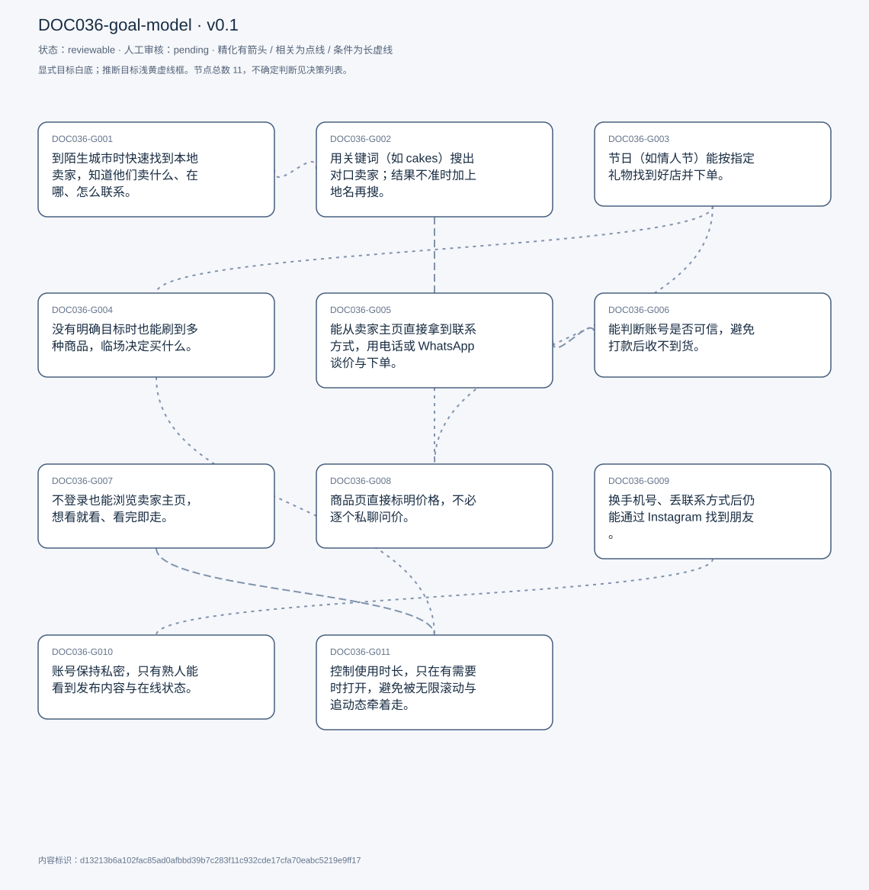
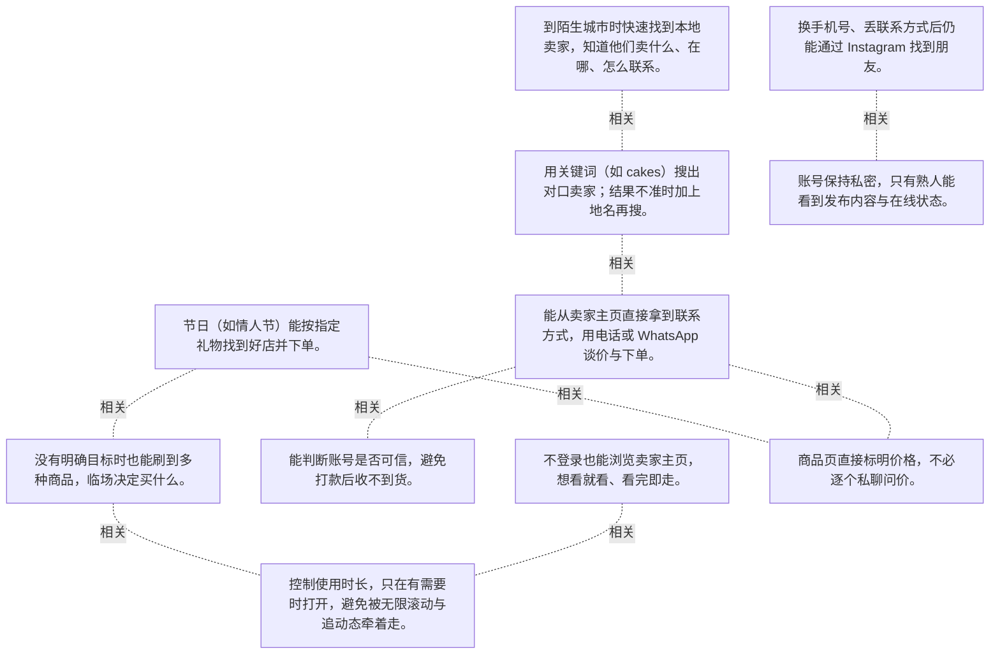

# 目标模型说明

模型：DOC036-goal-model；版本：v0.1

交付状态：reviewable；结构：passed；人工审核：pending

[交互模型](goal-model.html) · [矢量图](goal-model.svg) · [权威数据](goal-model.json)

## 目标图

## 目标

| 编号 | 表述 | 来源 | 情境 | 证据 |
|---|---|---|---|---|
| DOC036-G001 | 到陌生城市时快速找到本地卖家，知道他们卖什么、在哪、怎么联系。 | explicit | 背景：从喀麦隆到加纳、德国、卢旺达，现在在美国；价值：卖家主页同时给出位置、电话与产品 | E0001, E0002, E0003 |
| DOC036-G002 | 用关键词（如 cakes）搜出对口卖家；结果不准时加上地名再搜。 | explicit | 做法：搜 cakes → 不满意就加「cakes in Rwanda」 | E0004, E0005 |
| DOC036-G003 | 节日（如情人节）能按指定礼物找到好店并下单。 | explicit | 示例：给女友订一家好店的蛋糕 | E0006, E0007 |
| DOC036-G004 | 没有明确目标时也能刷到多种商品，临场决定买什么。 | explicit | 对照：实体店逛一圈再决定的体验 | E0008, E0009, E0010 |
| DOC036-G005 | 能从卖家主页直接拿到联系方式，用电话或 WhatsApp 谈价与下单。 | explicit | 现状：平台内不能直接下单，必须联系卖家；偏好：直接打 bio 里的号码，比站内聊天快 | E0011, E0012, E0013 |
| DOC036-G006 | 能判断账号是否可信，避免打款后收不到货。 | explicit | 曾被恶意账号要求先付款；判据：老帖互动量应显著高于新帖，若全部一致反而可疑 | E0014, E0015, E0016 |
| DOC036-G007 | 不登录也能浏览卖家主页，想看就看、看完即走。 | explicit | 现状：不登录什么都看不到，连卖家主页也不行；他为此研究出一套「只在需要时登录、用完登出并删应用」的用法 | E0017, E0018, E0019 |
| DOC036-G008 | 商品页直接标明价格，不必逐个私聊问价。 | explicit | 现状：主页只展示产品图，不含价格 | E0020, E0021 |
| DOC036-G009 | 换手机号、丢联系方式后仍能通过 Instagram 找到朋友。 | explicit | 背景：多国迁移，号码常换 | E0022, E0023 |
| DOC036-G010 | 账号保持私密，只有熟人能看到发布内容与在线状态。 | explicit | 理由：公开生活细节可能在未来被用来对付自己 | E0024, E0025 |
| DOC036-G011 | 控制使用时长，只在有需要时打开，避免被无限滚动与追动态牵着走。 | explicit | 机制：无限滚动 + 想知道别人在干什么；做法：用完登出、删应用 | E0026, E0027, E0028 |

## 关系判断（含不确定与无关系）

- DOC036-G001 / DOC036-G002：related。T012 说明搜索会优先返回「所在地区的卖家」，关键词与地域在同一检索动作里合并。但 G001 的成立依赖位置信息，G002 只依赖关键词。
- DOC036-G001 / DOC036-G003：none。DOC036-G001 的对象是陌生城市找到本地卖家（T056/T012），DOC036-G003 的对象是节日按指定礼物下单（T010）；两处分别出自不同话题段，原文未在二者之间建立因果、手段、评价或情境包含关系，本次评估口径内未建立可采用关系。
- DOC036-G001 / DOC036-G004：none。DOC036-G001 的对象是陌生城市找到本地卖家（T056/T012），DOC036-G004 的对象是开放式浏览临场决定（T022）；两处分别出自不同话题段，原文未在二者之间建立因果、手段、评价或情境包含关系，本次评估口径内未建立可采用关系。
- DOC036-G001 / DOC036-G005：none。DOC036-G001 的对象是陌生城市找到本地卖家（T056/T012），DOC036-G005 的对象是从 bio 拿联系方式沟通（T016）；两处分别出自不同话题段，原文未在二者之间建立因果、手段、评价或情境包含关系，本次评估口径内未建立可采用关系。
- DOC036-G001 / DOC036-G006：none。DOC036-G001 的对象是陌生城市找到本地卖家（T056/T012），DOC036-G006 的对象是判断账号可信避诈骗（T014/T062）；两处分别出自不同话题段，原文未在二者之间建立因果、手段、评价或情境包含关系，本次评估口径内未建立可采用关系。
- DOC036-G001 / DOC036-G007：none。DOC036-G001 的对象是陌生城市找到本地卖家（T056/T012），DOC036-G007 的对象是免登录浏览（T024/T052）；两处分别出自不同话题段，原文未在二者之间建立因果、手段、评价或情境包含关系，本次评估口径内未建立可采用关系。
- DOC036-G001 / DOC036-G008：none。DOC036-G001 的对象是陌生城市找到本地卖家（T056/T012），DOC036-G008 的对象是商品明码标价（T058）；两处分别出自不同话题段，原文未在二者之间建立因果、手段、评价或情境包含关系，本次评估口径内未建立可采用关系。
- DOC036-G001 / DOC036-G009：none。DOC036-G001 的对象是陌生城市找到本地卖家（T056/T012），DOC036-G009 的对象是丢联系方式仍能找到朋友（T030）；两处分别出自不同话题段，原文未在二者之间建立因果、手段、评价或情境包含关系，本次评估口径内未建立可采用关系。
- DOC036-G001 / DOC036-G010：none。DOC036-G001 的对象是陌生城市找到本地卖家（T056/T012），DOC036-G010 的对象是账号私密只给熟人看（T026）；两处分别出自不同话题段，原文未在二者之间建立因果、手段、评价或情境包含关系，本次评估口径内未建立可采用关系。
- DOC036-G001 / DOC036-G011：none。DOC036-G001 的对象是陌生城市找到本地卖家（T056/T012），DOC036-G011 的对象是限制使用时长（T032/T034）；两处分别出自不同话题段，原文未在二者之间建立因果、手段、评价或情境包含关系，本次评估口径内未建立可采用关系。
- DOC036-G002 / DOC036-G003：none。DOC036-G002 的对象是关键词搜卖家（T012），DOC036-G003 的对象是节日按指定礼物下单（T010）；两处分别出自不同话题段，原文未在二者之间建立因果、手段、评价或情境包含关系，本次评估口径内未建立可采用关系。
- DOC036-G002 / DOC036-G004：none。DOC036-G002 的对象是关键词搜卖家（T012），DOC036-G004 的对象是开放式浏览临场决定（T022）；两处分别出自不同话题段，原文未在二者之间建立因果、手段、评价或情境包含关系，本次评估口径内未建立可采用关系。
- DOC036-G002 / DOC036-G005：related。T012–T016 是连续流程：搜到账号 → 打开主页 → 从 bio 拿电话 → 联系卖家。搜索是入口，沟通是成交前必经的一步。
- DOC036-G002 / DOC036-G006：none。DOC036-G002 的对象是关键词搜卖家（T012），DOC036-G006 的对象是判断账号可信避诈骗（T014/T062）；两处分别出自不同话题段，原文未在二者之间建立因果、手段、评价或情境包含关系，本次评估口径内未建立可采用关系。
- DOC036-G002 / DOC036-G007：none。DOC036-G002 的对象是关键词搜卖家（T012），DOC036-G007 的对象是免登录浏览（T024/T052）；两处分别出自不同话题段，原文未在二者之间建立因果、手段、评价或情境包含关系，本次评估口径内未建立可采用关系。
- DOC036-G002 / DOC036-G008：none。DOC036-G002 的对象是关键词搜卖家（T012），DOC036-G008 的对象是商品明码标价（T058）；两处分别出自不同话题段，原文未在二者之间建立因果、手段、评价或情境包含关系，本次评估口径内未建立可采用关系。
- DOC036-G002 / DOC036-G009：none。DOC036-G002 的对象是关键词搜卖家（T012），DOC036-G009 的对象是丢联系方式仍能找到朋友（T030）；两处分别出自不同话题段，原文未在二者之间建立因果、手段、评价或情境包含关系，本次评估口径内未建立可采用关系。
- DOC036-G002 / DOC036-G010：none。DOC036-G002 的对象是关键词搜卖家（T012），DOC036-G010 的对象是账号私密只给熟人看（T026）；两处分别出自不同话题段，原文未在二者之间建立因果、手段、评价或情境包含关系，本次评估口径内未建立可采用关系。
- DOC036-G002 / DOC036-G011：none。DOC036-G002 的对象是关键词搜卖家（T012），DOC036-G011 的对象是限制使用时长（T032/T034）；两处分别出自不同话题段，原文未在二者之间建立因果、手段、评价或情境包含关系，本次评估口径内未建立可采用关系。
- DOC036-G003 / DOC036-G004：related。T022 与 T010 是他自己区分的两种购物状态：有明确礼物目标时搜索，没有目标时浏览。同一平台、两套路径。
- DOC036-G003 / DOC036-G005：none。DOC036-G003 的对象是节日按指定礼物下单（T010），DOC036-G005 的对象是从 bio 拿联系方式沟通（T016）；两处分别出自不同话题段，原文未在二者之间建立因果、手段、评价或情境包含关系，本次评估口径内未建立可采用关系。
- DOC036-G003 / DOC036-G006：none。DOC036-G003 的对象是节日按指定礼物下单（T010），DOC036-G006 的对象是判断账号可信避诈骗（T014/T062）；两处分别出自不同话题段，原文未在二者之间建立因果、手段、评价或情境包含关系，本次评估口径内未建立可采用关系。
- DOC036-G003 / DOC036-G007：none。DOC036-G003 的对象是节日按指定礼物下单（T010），DOC036-G007 的对象是免登录浏览（T024/T052）；两处分别出自不同话题段，原文未在二者之间建立因果、手段、评价或情境包含关系，本次评估口径内未建立可采用关系。
- DOC036-G003 / DOC036-G008：related。节日买礼物有预算与时效压力，价格不透明会拖慢决策——明码标价对 G003 的价值最直接。但 G008 对所有购买场景都成立。
- DOC036-G003 / DOC036-G009：none。DOC036-G003 的对象是节日按指定礼物下单（T010），DOC036-G009 的对象是丢联系方式仍能找到朋友（T030）；两处分别出自不同话题段，原文未在二者之间建立因果、手段、评价或情境包含关系，本次评估口径内未建立可采用关系。
- DOC036-G003 / DOC036-G010：none。DOC036-G003 的对象是节日按指定礼物下单（T010），DOC036-G010 的对象是账号私密只给熟人看（T026）；两处分别出自不同话题段，原文未在二者之间建立因果、手段、评价或情境包含关系，本次评估口径内未建立可采用关系。
- DOC036-G003 / DOC036-G011：none。DOC036-G003 的对象是节日按指定礼物下单（T010），DOC036-G011 的对象是限制使用时长（T032/T034）；两处分别出自不同话题段，原文未在二者之间建立因果、手段、评价或情境包含关系，本次评估口径内未建立可采用关系。
- DOC036-G004 / DOC036-G005：none。DOC036-G004 的对象是开放式浏览临场决定（T022），DOC036-G005 的对象是从 bio 拿联系方式沟通（T016）；两处分别出自不同话题段，原文未在二者之间建立因果、手段、评价或情境包含关系，本次评估口径内未建立可采用关系。
- DOC036-G004 / DOC036-G006：none。DOC036-G004 的对象是开放式浏览临场决定（T022），DOC036-G006 的对象是判断账号可信避诈骗（T014/T062）；两处分别出自不同话题段，原文未在二者之间建立因果、手段、评价或情境包含关系，本次评估口径内未建立可采用关系。
- DOC036-G004 / DOC036-G007：none。DOC036-G004 的对象是开放式浏览临场决定（T022），DOC036-G007 的对象是免登录浏览（T024/T052）；两处分别出自不同话题段，原文未在二者之间建立因果、手段、评价或情境包含关系，本次评估口径内未建立可采用关系。
- DOC036-G004 / DOC036-G008：none。DOC036-G004 的对象是开放式浏览临场决定（T022），DOC036-G008 的对象是商品明码标价（T058）；两处分别出自不同话题段，原文未在二者之间建立因果、手段、评价或情境包含关系，本次评估口径内未建立可采用关系。
- DOC036-G004 / DOC036-G009：none。DOC036-G004 的对象是开放式浏览临场决定（T022），DOC036-G009 的对象是丢联系方式仍能找到朋友（T030）；两处分别出自不同话题段，原文未在二者之间建立因果、手段、评价或情境包含关系，本次评估口径内未建立可采用关系。
- DOC036-G004 / DOC036-G010：none。DOC036-G004 的对象是开放式浏览临场决定（T022），DOC036-G010 的对象是账号私密只给熟人看（T026）；两处分别出自不同话题段，原文未在二者之间建立因果、手段、评价或情境包含关系，本次评估口径内未建立可采用关系。
- DOC036-G004 / DOC036-G011：related。T034 说开放式浏览 + 无限滚动 + 追动态三者叠加才成瘾，T032 说因此只在有需要时打开。G004 是他喜欢的体验，也是 G011 要防的对象。
- DOC036-G005 / DOC036-G006：related。T062 说他正是靠主页里的互动量分布判断账号真伪——联系之前先验账号。但 G005 是拿到联系方式，G006 是判断要不要联系。
- DOC036-G005 / DOC036-G007：none。DOC036-G005 的对象是从 bio 拿联系方式沟通（T016），DOC036-G007 的对象是免登录浏览（T024/T052）；两处分别出自不同话题段，原文未在二者之间建立因果、手段、评价或情境包含关系，本次评估口径内未建立可采用关系。
- DOC036-G005 / DOC036-G008：related。T059 说的正是这个流程的缺口：主页没有价格，所以必须加对方问价。明码标价能省掉第一轮沟通，但不能替代后续下单。
- DOC036-G005 / DOC036-G009：none。DOC036-G005 的对象是从 bio 拿联系方式沟通（T016），DOC036-G009 的对象是丢联系方式仍能找到朋友（T030）；两处分别出自不同话题段，原文未在二者之间建立因果、手段、评价或情境包含关系，本次评估口径内未建立可采用关系。
- DOC036-G005 / DOC036-G010：none。DOC036-G005 的对象是从 bio 拿联系方式沟通（T016），DOC036-G010 的对象是账号私密只给熟人看（T026）；两处分别出自不同话题段，原文未在二者之间建立因果、手段、评价或情境包含关系，本次评估口径内未建立可采用关系。
- DOC036-G005 / DOC036-G011：none。DOC036-G005 的对象是从 bio 拿联系方式沟通（T016），DOC036-G011 的对象是限制使用时长（T032/T034）；两处分别出自不同话题段，原文未在二者之间建立因果、手段、评价或情境包含关系，本次评估口径内未建立可采用关系。
- DOC036-G006 / DOC036-G007：none。DOC036-G006 的对象是判断账号可信避诈骗（T014/T062），DOC036-G007 的对象是免登录浏览（T024/T052）；两处分别出自不同话题段，原文未在二者之间建立因果、手段、评价或情境包含关系，本次评估口径内未建立可采用关系。
- DOC036-G006 / DOC036-G008：none。DOC036-G006 的对象是判断账号可信避诈骗（T014/T062），DOC036-G008 的对象是商品明码标价（T058）；两处分别出自不同话题段，原文未在二者之间建立因果、手段、评价或情境包含关系，本次评估口径内未建立可采用关系。
- DOC036-G006 / DOC036-G009：none。DOC036-G006 的对象是判断账号可信避诈骗（T014/T062），DOC036-G009 的对象是丢联系方式仍能找到朋友（T030）；两处分别出自不同话题段，原文未在二者之间建立因果、手段、评价或情境包含关系，本次评估口径内未建立可采用关系。
- DOC036-G006 / DOC036-G010：none。DOC036-G006 的对象是判断账号可信避诈骗（T014/T062），DOC036-G010 的对象是账号私密只给熟人看（T026）；两处分别出自不同话题段，原文未在二者之间建立因果、手段、评价或情境包含关系，本次评估口径内未建立可采用关系。
- DOC036-G006 / DOC036-G011：none。DOC036-G006 的对象是判断账号可信避诈骗（T014/T062），DOC036-G011 的对象是限制使用时长（T032/T034）；两处分别出自不同话题段，原文未在二者之间建立因果、手段、评价或情境包含关系，本次评估口径内未建立可采用关系。
- DOC036-G007 / DOC036-G008：none。DOC036-G007 的对象是免登录浏览（T024/T052），DOC036-G008 的对象是商品明码标价（T058）；两处分别出自不同话题段，原文未在二者之间建立因果、手段、评价或情境包含关系，本次评估口径内未建立可采用关系。
- DOC036-G007 / DOC036-G009：none。DOC036-G007 的对象是免登录浏览（T024/T052），DOC036-G009 的对象是丢联系方式仍能找到朋友（T030）；两处分别出自不同话题段，原文未在二者之间建立因果、手段、评价或情境包含关系，本次评估口径内未建立可采用关系。
- DOC036-G007 / DOC036-G010：none。DOC036-G007 的对象是免登录浏览（T024/T052），DOC036-G010 的对象是账号私密只给熟人看（T026）；两处分别出自不同话题段，原文未在二者之间建立因果、手段、评价或情境包含关系，本次评估口径内未建立可采用关系。
- DOC036-G007 / DOC036-G011：related。T052 把两者绑在一起：他正是靠「登录门槛 + 用完登出删应用」来限制使用。若免登录浏览实现，这条自控杠杆就失效——同一诉求的正面与负面。
- DOC036-G008 / DOC036-G009：none。DOC036-G008 的对象是商品明码标价（T058），DOC036-G009 的对象是丢联系方式仍能找到朋友（T030）；两处分别出自不同话题段，原文未在二者之间建立因果、手段、评价或情境包含关系，本次评估口径内未建立可采用关系。
- DOC036-G008 / DOC036-G010：none。DOC036-G008 的对象是商品明码标价（T058），DOC036-G010 的对象是账号私密只给熟人看（T026）；两处分别出自不同话题段，原文未在二者之间建立因果、手段、评价或情境包含关系，本次评估口径内未建立可采用关系。
- DOC036-G008 / DOC036-G011：none。DOC036-G008 的对象是商品明码标价（T058），DOC036-G011 的对象是限制使用时长（T032/T034）；两处分别出自不同话题段，原文未在二者之间建立因果、手段、评价或情境包含关系，本次评估口径内未建立可采用关系。
- DOC036-G009 / DOC036-G010：related。T026–T030 把社交与隐私放在一起讲：他愿意用 Instagram 维系朋友，但把账号设为私密、只给熟人看。但 G009 要的是可达性，G010 要的是可见范围。
- DOC036-G009 / DOC036-G011：none。DOC036-G009 的对象是丢联系方式仍能找到朋友（T030），DOC036-G011 的对象是限制使用时长（T032/T034）；两处分别出自不同话题段，原文未在二者之间建立因果、手段、评价或情境包含关系，本次评估口径内未建立可采用关系。
- DOC036-G010 / DOC036-G011：none。DOC036-G010 的对象是账号私密只给熟人看（T026），DOC036-G011 的对象是限制使用时长（T032/T034）；两处分别出自不同话题段，原文未在二者之间建立因果、手段、评价或情境包含关系，本次评估口径内未建立可采用关系。

## 证据

### E0001 · DOC036:S057

> when you go to a new place. You don&#x27;t really know, like the vendors there

原件位置：{&quot;line_start&quot;: 57, &quot;line_end&quot;: 57, &quot;start_char&quot;: 23873, &quot;end_char&quot;: 24872}

### E0002 · DOC036:S013

> it will search for like cake vendors in the area you are in

原件位置：{&quot;line_start&quot;: 13, &quot;line_end&quot;: 13, &quot;start_char&quot;: 2695, &quot;end_char&quot;: 3754}

### E0003 · DOC036:S057

> their bios. You also have their location

原件位置：{&quot;line_start&quot;: 57, &quot;line_end&quot;: 57, &quot;start_char&quot;: 23873, &quot;end_char&quot;: 24872}

### E0004 · DOC036:S013

> you can now enter the name of of what you want to look for

原件位置：{&quot;line_start&quot;: 13, &quot;line_end&quot;: 13, &quot;start_char&quot;: 2695, &quot;end_char&quot;: 3754}

### E0005 · DOC036:S013

> I&#x27;ll just add maybe the name of the location

原件位置：{&quot;line_start&quot;: 13, &quot;line_end&quot;: 13, &quot;start_char&quot;: 2695, &quot;end_char&quot;: 3754}

### E0006 · DOC036:S011

> I use Instagram mainly to shop on days like Valentine&#x27;s Day

原件位置：{&quot;line_start&quot;: 11, &quot;line_end&quot;: 11, &quot;start_char&quot;: 967, &quot;end_char&quot;: 2415}

### E0007 · DOC036:S011

> get my my girlfriend, maybe a cake from a really good spot

原件位置：{&quot;line_start&quot;: 11, &quot;line_end&quot;: 11, &quot;start_char&quot;: 967, &quot;end_char&quot;: 2415}

### E0008 · DOC036:S023

> there are some times when I go with a very open mind

原件位置：{&quot;line_start&quot;: 23, &quot;line_end&quot;: 23, &quot;start_char&quot;: 7601, &quot;end_char&quot;: 8459}

### E0009 · DOC036:S023

> shuffle through like a bunch of images and a bunch of products

原件位置：{&quot;line_start&quot;: 23, &quot;line_end&quot;: 23, &quot;start_char&quot;: 7601, &quot;end_char&quot;: 8459}

### E0010 · DOC036:S023

> I might end up picking something that you know I not imagine I&#x27;ll pick

原件位置：{&quot;line_start&quot;: 23, &quot;line_end&quot;: 23, &quot;start_char&quot;: 7601, &quot;end_char&quot;: 8459}

### E0011 · DOC036:S017

> in the account, bio, that that is where I would see, like, maybe their phone number

原件位置：{&quot;line_start&quot;: 17, &quot;line_end&quot;: 17, &quot;start_char&quot;: 5779, &quot;end_char&quot;: 6695}

### E0012 · DOC036:S017

> I would always prefer to, you know, reach out to the number they&#x27;ve specified

原件位置：{&quot;line_start&quot;: 17, &quot;line_end&quot;: 17, &quot;start_char&quot;: 5779, &quot;end_char&quot;: 6695}

### E0013 · DOC036:S015

> you need to still get in touch with the vendor

原件位置：{&quot;line_start&quot;: 15, &quot;line_end&quot;: 15, &quot;start_char&quot;: 3899, &quot;end_char&quot;: 5526}

### E0014 · DOC036:S015

> this Instagram account was actually a malicious account

原件位置：{&quot;line_start&quot;: 15, &quot;line_end&quot;: 15, &quot;start_char&quot;: 3899, &quot;end_char&quot;: 5526}

### E0015 · DOC036:S063

> if I go to your gallery, and I realize that your products more or less have similar likes

原件位置：{&quot;line_start&quot;: 63, &quot;line_end&quot;: 63, &quot;start_char&quot;: 27668, &quot;end_char&quot;: 28930}

### E0016 · DOC036:S063

> helps me to know which accounts are probably good and which ones are not good

原件位置：{&quot;line_start&quot;: 63, &quot;line_end&quot;: 63, &quot;start_char&quot;: 27668, &quot;end_char&quot;: 28930}

### E0017 · DOC036:S025

> I would have loved to use the application without signing in

原件位置：{&quot;line_start&quot;: 25, &quot;line_end&quot;: 25, &quot;start_char&quot;: 8722, &quot;end_char&quot;: 11314}

### E0018 · DOC036:S025

> each time I have to use it I have to sign it

原件位置：{&quot;line_start&quot;: 25, &quot;line_end&quot;: 25, &quot;start_char&quot;: 8722, &quot;end_char&quot;: 11314}

### E0019 · DOC036:S053

> I cannot access anything in the app. If I&#x27;ve not logged in

原件位置：{&quot;line_start&quot;: 53, &quot;line_end&quot;: 53, &quot;start_char&quot;: 21809, &quot;end_char&quot;: 23309}

### E0020 · DOC036:S059

> that is also something I feel like they should put on the website

原件位置：{&quot;line_start&quot;: 59, &quot;line_end&quot;: 59, &quot;start_char&quot;: 25163, &quot;end_char&quot;: 26410}

### E0021 · DOC036:S059

> They don&#x27;t put the price of the products

原件位置：{&quot;line_start&quot;: 59, &quot;line_end&quot;: 59, &quot;start_char&quot;: 25163, &quot;end_char&quot;: 26410}

### E0022 · DOC036:S031

> I could always lodge back there and get to you

原件位置：{&quot;line_start&quot;: 31, &quot;line_end&quot;: 31, &quot;start_char&quot;: 13459, &quot;end_char&quot;: 14590}

### E0023 · DOC036:S031

> I keep changing my phone numbers

原件位置：{&quot;line_start&quot;: 31, &quot;line_end&quot;: 31, &quot;start_char&quot;: 13459, &quot;end_char&quot;: 14590}

### E0024 · DOC036:S027

> I make sure I have a private account

原件位置：{&quot;line_start&quot;: 27, &quot;line_end&quot;: 27, &quot;start_char&quot;: 11593, &quot;end_char&quot;: 13063}

### E0025 · DOC036:S027

> only very close friends of me

原件位置：{&quot;line_start&quot;: 27, &quot;line_end&quot;: 27, &quot;start_char&quot;: 11593, &quot;end_char&quot;: 13063}

### E0026 · DOC036:S035

> it has an infinity school where it just keeps on updating content as you scroll down

原件位置：{&quot;line_start&quot;: 35, &quot;line_end&quot;: 35, &quot;start_char&quot;: 16662, &quot;end_char&quot;: 17620}

### E0027 · DOC036:S035

> those things make it kind of addictive and very time consuming

原件位置：{&quot;line_start&quot;: 35, &quot;line_end&quot;: 35, &quot;start_char&quot;: 16662, &quot;end_char&quot;: 17620}

### E0028 · DOC036:S033

> I try to stay away from it when I&#x27;m when I&#x27;m not having any use for it

原件位置：{&quot;line_start&quot;: 33, &quot;line_end&quot;: 33, &quot;start_char&quot;: 15203, &quot;end_char&quot;: 16248}

## 问题、限制与版本

- 当前会话助手的开发判断，非独立盲测；无人工采纳记录。
- 结构检查已绑定当前版本；独立语义审查未执行；人工状态以实际审核记录为准。

内容标识：d13213b6a102fac85ad0afbbd39b7c283f11c932cde17cfa70eabc5219e9ff17

人工决定：

审核意见：
