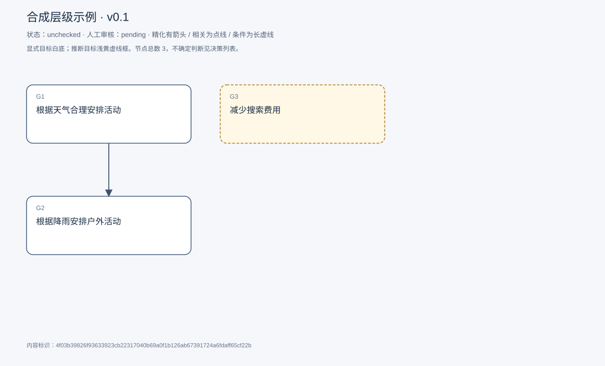
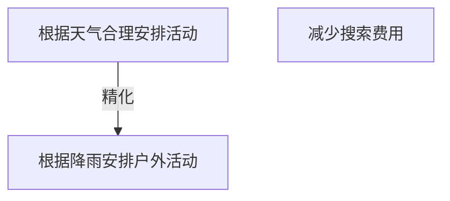

# 目标模型说明

模型：合成层级示例；版本：v0.1

交付状态：unchecked；结构：not_run；人工审核：pending

[交互模型](goal-model.html) · [矢量图](goal-model.svg) · [权威数据](goal-model.json)

## 目标图

## 目标

| 编号 | 表述 | 来源 | 情境 | 证据 |
|---|---|---|---|---|
| G1 | 根据天气合理安排活动 | explicit |  | E1 |
| G2 | 根据降雨安排户外活动 | explicit |  | E2 |
| G3 | 减少搜索费用 | inferred |  | E3 |

## 关系判断（含不确定与无关系）

- G1 / G2：refinement。合成示例：户外活动为范围具体化。
- G1 / G3：none。材料未建立联系。
- G2 / G3：uncertain。需用户确认。

## 证据

### E1 · S1

> 根据天气合理安排活动

原件位置：{&quot;paragraph&quot;: 1}

### E2 · S2

> 根据降雨安排户外活动

原件位置：{&quot;paragraph&quot;: 2}

### E3 · S3

> 减少搜索费用

原件位置：{&quot;paragraph&quot;: 3}

## 问题、限制与版本

- 需审核G2与G3关系。
- 合成例，不代表实际提取效果。

内容标识：4f03b39826f93633923cb22317040b69a0f1b126ab67391724a6fdaff65cf22b

人工决定：

审核意见：
