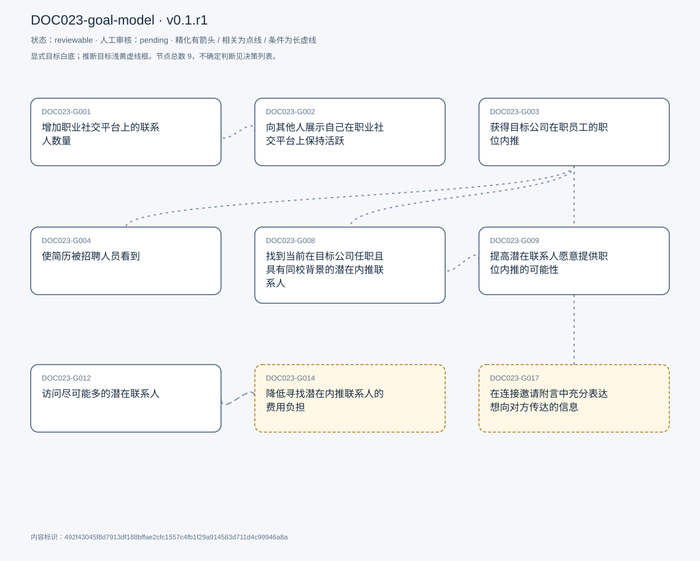
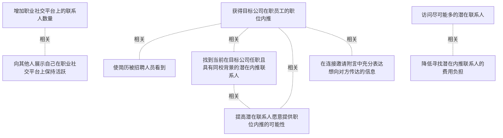

# 目标模型说明

模型：DOC023-goal-model；版本：v0.1.r1

交付状态：reviewable；结构：passed；人工审核：pending

[交互模型](goal-model.html) · [矢量图](goal-model.svg) · [权威数据](goal-model.json)

## 目标图

## 目标

| 编号 | 表述 | 来源 | 情境 | 证据 |
|---|---|---|---|---|
| DOC023-G001 | 增加职业社交平台上的联系人数量 | explicit |  | E0001 |
| DOC023-G002 | 向其他人展示自己在职业社交平台上保持活跃 | explicit |  | E0002 |
| DOC023-G003 | 获得目标公司在职员工的职位内推 | explicit | 实习或全职职位申请 | E0003, E0004 |
| DOC023-G004 | 使简历被招聘人员看到 | explicit | 职位申请 | E0005 |
| DOC023-G008 | 找到当前在目标公司任职且具有同校背景的潜在内推联系人 | explicit | 通过职业社交平台寻找内推 | E0006 |
| DOC023-G009 | 提高潜在联系人愿意提供职位内推的可能性 | explicit | 通过共同学校背景建立联系 | E0007 |
| DOC023-G012 | 访问尽可能多的潜在联系人 | explicit | 寻找内推联系人；访问范围受会员条件影响 | E0008 |
| DOC023-G014 | 降低寻找潜在内推联系人的费用负担 | inferred | 高级会员付费搜索 | E0009, E0010 |
| DOC023-G017 | 在连接邀请附言中充分表达想向对方传达的信息 | inferred | 对方尚未接受连接邀请；附言长度受限 | E0011 |

## 关系判断（含不确定与无关系）

- DOC023-G001 / DOC023-G002：related。T003明确把增加联系人数量与展示活跃联系起来；此处是行为结果关联，不判成精化。
- DOC023-G001 / DOC023-G003：uncertain。联系人数量增加可能影响内推，但访谈没有确认数量本身与内推的关系。
- DOC023-G001 / DOC023-G004：none。当前材料没有建立联系人数量与简历曝光之间可直接采用的关系。
- DOC023-G001 / DOC023-G008：uncertain。泛化的联系人数量与合资格内推联系人可能重叠，但适用目的未被充分区分。
- DOC023-G001 / DOC023-G009：none。未直接说明联系人数量如何影响单个联系人内推意愿。
- DOC023-G001 / DOC023-G012：none。增加已建立联系人数量与扩大可访问搜索范围不是同一结果，材料没有明确关系。
- DOC023-G001 / DOC023-G014：none。未建立联系人数量与费用改善之间的可采用关系。
- DOC023-G001 / DOC023-G017：none。未建立联系人数量与附言表达充分性之间的明确关系。
- DOC023-G002 / DOC023-G003：none。没有说明展示活跃能带来内推，不能用一般社交常识补充。
- DOC023-G002 / DOC023-G004：none。没有建立活跃展示与招聘人员看到简历的直接联系。
- DOC023-G002 / DOC023-G008：none。活跃展示与筛选合资格联系人未在访谈中建立关系。
- DOC023-G002 / DOC023-G009：none。未说明活跃展示影响内推意愿。
- DOC023-G002 / DOC023-G012：none。活跃展示与搜索访问范围没有可采用联系。
- DOC023-G002 / DOC023-G014：none。未说明活跃展示与降低费用的关系。
- DOC023-G002 / DOC023-G017：none。活跃展示与邀请附言表达未建立可采用关系。
- DOC023-G003 / DOC023-G004：related。T003明确说明内推有助于简历被招聘人员看到；这是结果关联，非范围具体化。
- DOC023-G003 / DOC023-G008：related。T011说明只有目标公司员工能提供内推，T009描述联系人资格，构成有依据的关联而非精化。
- DOC023-G003 / DOC023-G009：related。T009把提高对方愿意内推的可能性作为联系同校员工的目的，关联内推结果但不是子目标分解。
- DOC023-G003 / DOC023-G012：uncertain。更多可访问联系人是否改善内推结果未被直接确认，保留待审。
- DOC023-G003 / DOC023-G014：none。费用负担与成功获得内推之间没有明确建立的关系。
- DOC023-G003 / DOC023-G017：related。T017在寻求内推的连接邀请中描述附言表达困难，因此两者在该情境中相关，不判精化。
- DOC023-G004 / DOC023-G008：none。合资格联系人的选择到简历曝光存在中间步骤，未将其自动串成关系。
- DOC023-G004 / DOC023-G009：uncertain。内推意愿与简历曝光存在可能的间接路径，但未直接说明，保留不确定。
- DOC023-G004 / DOC023-G012：none。搜索访问范围与简历曝光未建立直接关系。
- DOC023-G004 / DOC023-G014：none。费用改善与简历曝光未建立可采用关系。
- DOC023-G004 / DOC023-G017：none。邀请附言表达与简历曝光未建立直接关系。
- DOC023-G008 / DOC023-G009：related。T009及T011直接以同校背景解释提高帮助与内推意愿的可能性。
- DOC023-G008 / DOC023-G012：uncertain。访问更多候选与找到合资格联系人可能有关，但不是所有更多结果都符合资格。
- DOC023-G008 / DOC023-G014：none。材料未建立资格匹配与降低费用之间的确定联系。
- DOC023-G008 / DOC023-G017：none。资格匹配与表达充分性是不同困难，未建立可采用关系。
- DOC023-G009 / DOC023-G012：none。更多可访问联系人不等于个体内推意愿提高，材料未建立联系。
- DOC023-G009 / DOC023-G014：none。材料未说明减轻费用如何影响对方内推意愿。
- DOC023-G009 / DOC023-G017：uncertain。更充分表达可能影响内推意愿，但访谈未明确该作用。
- DOC023-G012 / DOC023-G014：related。T015把购买会员扩大访问范围与费用高联系起来，存在成本权衡，条件为付费搜索。
- DOC023-G012 / DOC023-G017：none。搜索访问范围与附言表达未建立直接关系。
- DOC023-G014 / DOC023-G017：none。费用与附言限制均涉及会员情境，但共同背景不足以建立目标间关系。

## 证据

### E0001 · DOC023:T003

> the 1st one is to enlarge my the number of my connections on my profile.

原件位置：{&quot;turn&quot;: &quot;3&quot;, &quot;start_char&quot;: 413, &quot;end_char&quot;: 1351}

### E0002 · DOC023:T003

> to show people that I&#x27;m active on Linkedin.

原件位置：{&quot;turn&quot;: &quot;3&quot;, &quot;start_char&quot;: 413, &quot;end_char&quot;: 1351}

### E0003 · DOC023:T003

> my sec second goal is to to get referrals from current employees

原件位置：{&quot;turn&quot;: &quot;3&quot;, &quot;start_char&quot;: 413, &quot;end_char&quot;: 1351}

### E0004 · DOC023:T011

> only company employee is able to refer me.

原件位置：{&quot;turn&quot;: &quot;11&quot;, &quot;start_char&quot;: 4363, &quot;end_char&quot;: 5033}

### E0005 · DOC023:T003

> a referral really helps to get my resume being seen by recruiters.

原件位置：{&quot;turn&quot;: &quot;3&quot;, &quot;start_char&quot;: 413, &quot;end_char&quot;: 1351}

### E0006 · DOC023:T009

> I will only choose people who is currently a company employee and who was my university&#x27;s student.

原件位置：{&quot;turn&quot;: &quot;9&quot;, &quot;start_char&quot;: 3285, &quot;end_char&quot;: 4277}

### E0007 · DOC023:T009

> to increase the possibility that they want to refer me for the position.

原件位置：{&quot;turn&quot;: &quot;9&quot;, &quot;start_char&quot;: 3285, &quot;end_char&quot;: 4277}

### E0008 · DOC023:T015

> allow me to access like as much as possible potential connections as I want to.

原件位置：{&quot;turn&quot;: &quot;15&quot;, &quot;start_char&quot;: 6133, &quot;end_char&quot;: 6717}

### E0009 · DOC023:T015

> this costs a lot.

原件位置：{&quot;turn&quot;: &quot;15&quot;, &quot;start_char&quot;: 6133, &quot;end_char&quot;: 6717}

### E0010 · DOC023:T015

> sometimes I may turn to the other. Option is that to modify the keywords

原件位置：{&quot;turn&quot;: &quot;15&quot;, &quot;start_char&quot;: 6133, &quot;end_char&quot;: 6717}

### E0011 · DOC023:T017

> only a limited like number of words to really convey what I want to talk to them.

原件位置：{&quot;turn&quot;: &quot;17&quot;, &quot;start_char&quot;: 6899, &quot;end_char&quot;: 7584}

## 问题、限制与版本

- 联系人数量增加可能影响内推，但访谈没有确认数量本身与内推的关系。
- 泛化的联系人数量与合资格内推联系人可能重叠，但适用目的未被充分区分。
- 更多可访问联系人是否改善内推结果未被直接确认，保留待审。
- 内推意愿与简历曝光存在可能的间接路径，但未直接说明，保留不确定。
- 访问更多候选与找到合资格联系人可能有关，但不是所有更多结果都符合资格。
- 更充分表达可能影响内推意愿，但访谈未明确该作用。
- 当前会话助手的开发判断，非独立盲测；无人工采纳记录。
- 结构检查已绑定当前版本；独立语义审查未执行，人工审核待完成。

内容标识：492f43045f8d7913df188bffae2cfc1557c4fb1f29a914583d711d4c99946a8a

人工决定：

审核意见：
