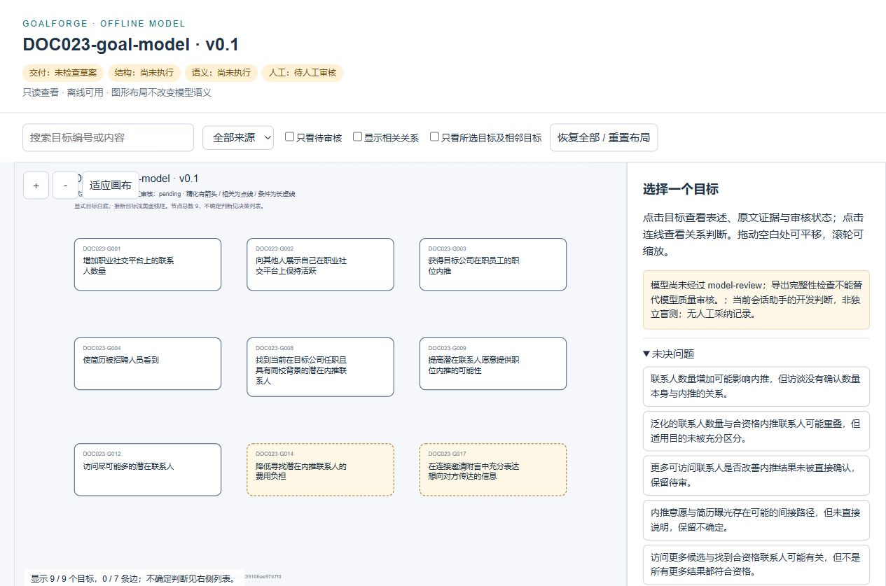
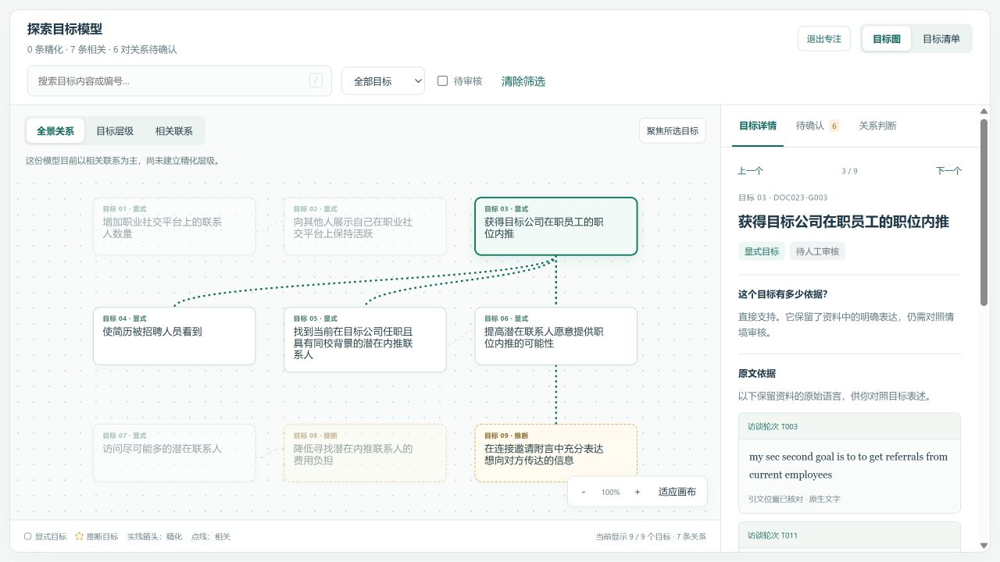
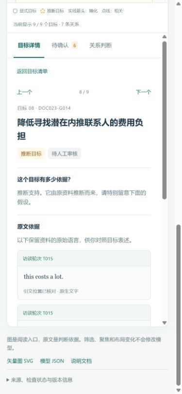

# 目标模型 HTML 阅读体验审查与修改

日期：2026-10-16。对象：现有 GoalForge 模型查看器。用户目标：理解模型结构，找到目标依据，区分确定关系与待确认判断。本轮仅修改展示模板与导出内嵌方式，不改变目标、关系、证据或审核结论。

## 审查依据

本轮实际打开旧版页面、保存并查看截图后进行修改。没有外部设计上下文，沿用原项目的浅色、深蓝文字及青绿色强调色。不是对完整产品或全部无障碍标准的认证。

原页面的主要问题：默认显示零条边但没有解释已有相关关系；目标文字偏小；原件位置直接呈现 JSON；技术状态与未决问题挤占主要阅读区域；只有图形入口，缺少逐项阅读和清楚的恢复路径。

## 阅读流程与结果

| 步骤 | 用户任务 | 修改后的状态 | 核验依据 |
|---|---|---|---|
| 1 概览 | 知道有多少目标、推断和待确认项 | 已改善：可点击概览入口、明确草案状态、阅读帮助 | 概览实际加载9目标、7显式、2推断、6待确认 |
| 2 探索 | 看已有关系、找到关注的目标 | 已改善：默认全景7条相关关系，提供层级/相关切换、搜索、清单与专注阅读 | 主流程浏览器检查；无精化时明确说明；无结果时提供恢复按钮 |
| 3 核对依据 | 查看原文、来源与推断假设 | 已改善：原文卡片优先、可读轮次、独立的支持/审核标记 | 实际查看T003、T015、T017原文与推断说明 |
| 4 检查关系 | 了解为何有关或为何不确定 | 已改善：36项决策可筛选、6项不确定单列、端点用目标表述呈现 | 浏览器筛选6项并打开具体判断理由，不确定项不绘制成精化边 |
| 5 连续/小屏阅读 | 不迷失在缩放和跳转中 | 已改善：上/下一项、相邻聚焦、清除复位；窄屏单列与返回清单 | 浏览器检查；390px视口无横向溢出，聚焦显示5/9目标与5条真实边 |

以上为本轮主流程通过检查的截图。中间02—07截图用于迭代定位问题，不作为最终样式依据；10截图发生侧栏宽度变化，不能作为桌面截图，已促成自动断点适配修订。最终交付采用 delivery-ux2；浏览器重新加载最终HTML后确认入口和计数正常。

## 动态反馈

- 选中节点与实际关联边高亮，其他节点适度淡化且仍可点击。
- 筛选/关系跳转通过短时平滑镜头调整；支持减少动画的系统偏好。
- 专注阅读收起概览，占用整个工作区；可退出或用Escape返回。
- 侧栏详情切换时回到顶部，避免沿用上一个目标的滚动位置。
- 小屏初始使用清单，点选后定位到详情，并能返回；未手动选择展示方式时，跨越断点会自动适配，手动选择后尊重用户选择。
- 搜索为空、没有精化和没有某类关系分别解释，不使用虚假加载或动画暗示生成了新判断。

## 验证与限制

29项原有工程测试通过；扩展了模板标记与脚本闭合字符串的安全呈现案例。JSON、Markdown、SVG与delivery-v2逐字节相同；输出及界面源文件哈希已核对，详见integrity-check.json。

浏览器实际检查过：入门按钮、搜索无结果、清除筛选、清单/图切换、推断筛选、原文与假设、逐项导航、6项不确定关系、端点跳转、相邻聚焦、合成层级样例、阅读帮助和小屏返回。browser-checks.json保存实际观察文本；一次未处在390px视口的观察已标为rejected_wrong_viewport，不计为窄屏通过。

部分SVG Playwright操作与视口恢复后的快速操作受浏览器定位影响，使用新状态快照和同一浏览器的可访问性操作核验，未改用其他浏览器绕过限制。恢复临时预览时旧标签仍指向已停的端口，产生连接错误；最终通过新的、允许的HTTP预览标签验证，不访问或绕过错误页的data协议。

截图只能反映可见布局；完整键盘、读屏和全部对比度尚未系统验证。复杂大图仍使用当前确定性布局，尚未验证上百节点的阅读性能。直接file协议验收仍受内置浏览器限制，未声称完成。正式model-review、人工确认与模型语义评测不属于本轮UI完成范围。

## 交付与预览

- [最终HTML](../skill-tests/goal-model-building-draft-1/doc023-development/delivery-ux2/goal-model.html)
- [模型JSON](../skill-tests/goal-model-building-draft-1/doc023-development/delivery-ux2/goal-model.json)
- 最终本机预览：http://127.0.0.1:8766/goal-model.html，仅用于当前机器，未发布到网络。

查看器已回写到Skill模板，后续导出复用本轮体验，而不是仅修改这一份DOC023文件。
