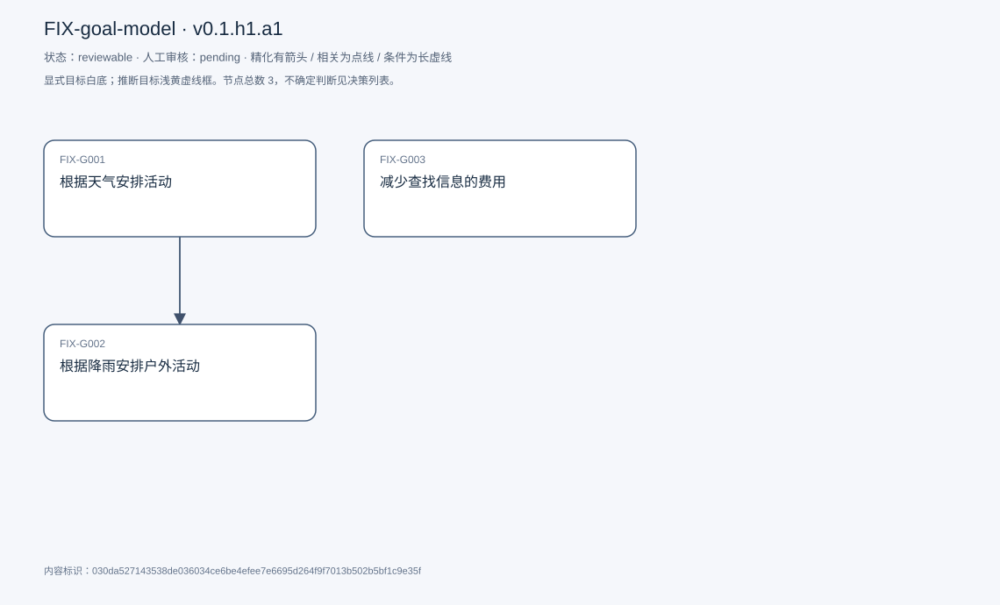
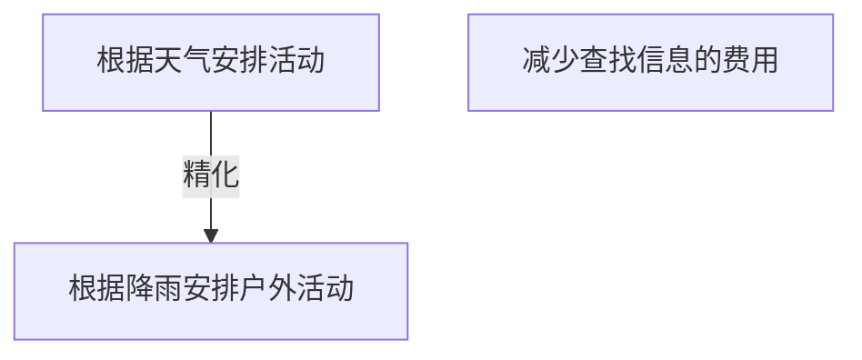

# 目标模型说明

模型：FIX-goal-model；版本：v0.1.h1.a1

交付状态：reviewable；结构：passed；人工审核：pending

[交互模型](goal-model.html) · [矢量图](goal-model.svg) · [权威数据](goal-model.json)

## 目标图

## 目标

| 编号 | 表述 | 来源 | 情境 | 证据 |
|---|---|---|---|---|
| FIX-G001 | 根据天气安排活动 | explicit |  | ET0001 |
| FIX-G002 | 根据降雨安排户外活动 | explicit |  | E0002 |
| FIX-G003 | 减少查找信息的费用 | explicit |  | E0003 |

## 关系判断（含不确定与无关系）

- FIX-G001 / FIX-G002：refinement。重新核对新目标与原句后，保留降雨和户外活动的范围具体化（合成夹具）。
- FIX-G001 / FIX-G003：none。当前版本合成关系判断，未建立联系。
- FIX-G002 / FIX-G003：none。未建立联系。

## 证据

### E0001 · FIX:S001

> 使用者：我希望根据天气合理安排活动。

原件位置：{&quot;line_start&quot;: 1, &quot;line_end&quot;: 1, &quot;start_char&quot;: 0, &quot;end_char&quot;: 18}

### E0002 · FIX:S002

> 使用者：我希望根据降雨安排户外活动。

原件位置：{&quot;line_start&quot;: 2, &quot;line_end&quot;: 2, &quot;start_char&quot;: 19, &quot;end_char&quot;: 37}

### E0003 · FIX:S003

> 使用者：我希望减少查找信息的费用。

原件位置：{&quot;line_start&quot;: 3, &quot;line_end&quot;: 3, &quot;start_char&quot;: 38, &quot;end_char&quot;: 55}

### ET0001 · FIX:S001

> 使用者：我希望根据天气合理安排活动。

原件位置：{&quot;line_start&quot;: 1, &quot;line_end&quot;: 1, &quot;start_char&quot;: 0, &quot;end_char&quot;: 18}

## 问题、限制与版本

- 当前会话助手的开发判断，非独立盲测；无人工采纳记录。
- 结构检查已绑定当前版本；独立语义审查未执行；人工状态以实际审核记录为准。
- 结构检查已绑定当前版本；独立语义审查未执行；人工状态以实际审核记录为准。

内容标识：030da527143538de036034ce6be4efee7e6695d264f9f7013b502b5bf1c9e35f

人工决定：

审核意见：
